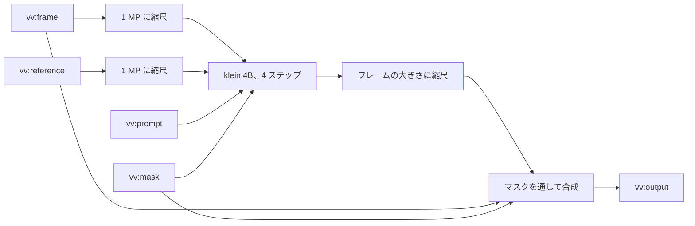
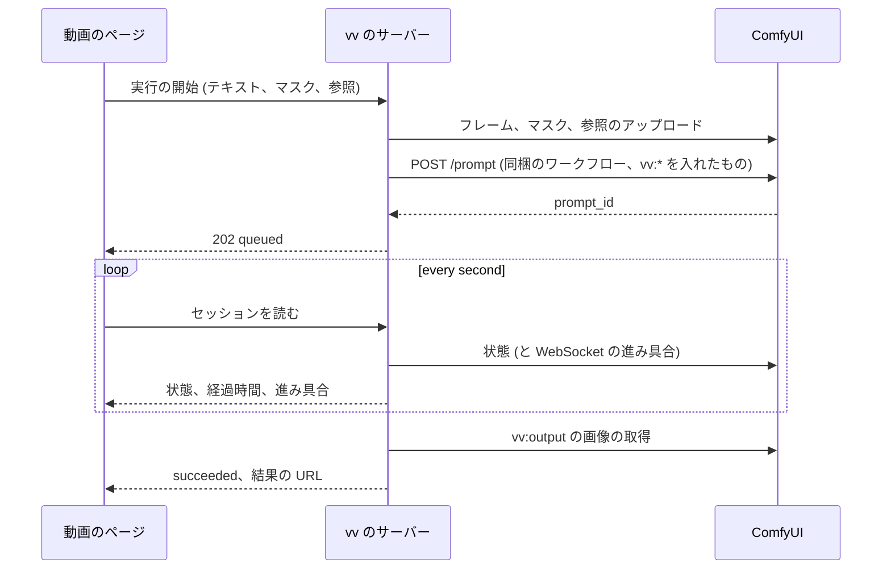

# 契約: 同梱するサムネイルのワークフローとその実行 {#contract-the-bundled-thumbnail-workflow-and-its-runs}

正本: `internal/comfyui` に埋め込むワークフローのファイルができたらそれらであり、それまではこの文書とその隣の 2 つのファイル ([workflows/](workflows/)) である。この文書は、vv が同梱するワークフロー、セルフホストの ComfyUI がそれらを実行するのに必要なもの、vv が 1 回の実行をどう動かすかを扱う。決定は [research.md R-2](../research.md#r-2-vv-bundles-the-workflow-named-nodes-are-its-internal-contract)、[R-3](../research.md#r-3-absent-inputs-get-a-neutral-value-or-the-variant-without-the-node)、[R-5](../research.md#r-5-provider-differences-stay-inside-the-adapter)、[R-12](../research.md#r-12-the-model-is-flux2-klein-4b-fp8)、[R-13](../research.md#r-13-the-connection-test-checks-the-workflows-nodes-and-model-files) にある。

## ワークフロー {#workflows}

どちらのファイルも ComfyUI の API 形式である: キーがノード id で、値が `class_type`、`inputs`、`_meta.title` を持つ JSON オブジェクトである。これらはモデルの POC から来ており、Comfy Cloud で実行した。

| ファイル | 使うとき |
| --- | --- |
| [`workflows/thumbnail-edit.json`](workflows/thumbnail-edit.json) | 所有者が参照画像を添えなかった |
| [`workflows/thumbnail-edit-reference.json`](workflows/thumbnail-edit-reference.json) | 所有者が参照画像を添えた |

vv は入力を入れるノードを `_meta.title` で見つけ、この表の入力だけを書く。

| タイトル | ノード | vv が書くもの |
| --- | --- | --- |
| `vv:frame` | `LoadImage` | `image`: アップロードしたフレーム |
| `vv:prompt` | `CLIPTextEncode` | `text`: 所有者の指示、マスクが塗られていて指示が空のときは既定の指示、または `""` |
| `vv:mask` | `LoadImageMask` (`red` チャンネル) | `image`: アップロードしたマスク、またはフレームの大きさの白いマスク |
| `vv:reference` | `LoadImage` (参照の種類のみ) | `image`: アップロードした参照画像 |
| `vv:output` | `SaveImage` | なし。vv はその最初の出力画像を読む |

マスクはフレームのピクセルの大きさの PNG である: 塗ったピクセルは不透明な白、残りは不透明な黒である。図は、ワークフローが入力で何をするかを示す。

合成は 8 px 広げてぼかしたマスクを使うので、編集は縁でなじみ、その外のピクセルはすべてフレームのものである (モデルの POC は 9 回の実行でマスクの外に変化がないことを測った)。出力は常にフレームの大きさを持つ。シードは 42 に固定なので、同じ入力は同じ結果を出し、所有者は別の結果を得るには指示を変える。

## 必要なファイル {#required-files}

セルフホストの ComfyUI にはカスタムノードは要らず、ワークフローが使うコアのノードを持つだけ新しいバージョンと、次のモデルのファイルだけが要る。Comfy Cloud はそれらを用意している。

| ファイル | ComfyUI のフォルダー | 大きさ | 入手元 |
| --- | --- | --- | --- |
| `flux-2-klein-4b-fp8.safetensors` | `models/diffusion_models` | 4.07 GB | `huggingface.co/black-forest-labs/FLUX.2-klein-4b-fp8` |
| `qwen_3_4b.safetensors` | `models/text_encoders` | 8.04 GB | `huggingface.co/Comfy-Org/z_image_turbo` (`split_files/text_encoders`) |
| `flux2-vae.safetensors` | `models/vae` | 0.34 GB | `huggingface.co/Comfy-Org/flux2-dev` (`split_files/vae`) |

接続のテストは、欠けているノードを「update ComfyUI」と共に、欠けているファイルをそのフォルダーと入手元と共に報告する。必要な VRAM は 8 から 12 GB と見積もり、測っていない。

## 実行 {#run}

シーケンスは、ページでの開始から結果までの 1 回の実行を示す。

アップロードは `vv-` と無作為な部分で始まる名前を使い、`overwrite=true` と `type=input` を付ける。セルフホストの ComfyUI にはそれらを削除するルートがないので、vv はその後、それらや出力を ComfyUI から削除しない。

## 実行の状態 {#run-states}

| vv の状態 | セルフホストの ComfyUI | Comfy Cloud |
| --- | --- | --- |
| `queued` | id が `queue_pending` にある | `submitted`、`preprocessing`、`queued_waiting`、`queued_limited`、`allocated`、`waiting_to_dispatch`、`pending` |
| `preparing` | 報告されない | `preparing`、`pending_execution` |
| `running` | id が `queue_running` にある | `executing`、`in_progress`、`executed` |
| `succeeded` | `history/{id}` が `status.completed` と出力画像を持つ | `success`、`completed`、および出力画像 |
| `failed` | `history/{id}` が `status_str: error` を持つ、または id が履歴のエントリなしにキューから消えた | `error`、`non_retryable_error`、`lost` |
| `cancelled` | vv のキャンセルの後 | `cancel_requested`、`cancelled` |

ステップの進み具合 (`max` 中の `value`) は、実行の `prompt_id` に対する WebSocket の `progress` メッセージから来て、メッセージが届かなかったときはない。

## 失敗の理由 {#failure-reasons}

| 理由 | いつ |
| --- | --- |
| `unreachable` | 接続がない、DNS の失敗、または 5xx の応答 |
| `unauthorized` | Comfy Cloud からの `401` または `403` |
| `insufficient_credits` | Comfy Cloud からの `402`、または型がクレジットを挙げるエラー |
| `workflow_rejected` | `POST /prompt` が `400` (`node_errors`) を返す。最初のノードのエラーのメッセージを引き渡す |
| `run_failed` | プロバイダーが実行の失敗を報告する。実行のエラーのメッセージを引き渡す |
| `no_output` | 実行は成功し、`vv:output` に画像がない |
| `missing_models` | `POST /prompt` が、プロバイダーの持たないノードの種類またはモデルのファイルを挙げる。欠けている名前を引き渡す |
| `timed_out` | 送信から 10 分後に終わりの状態にない |
