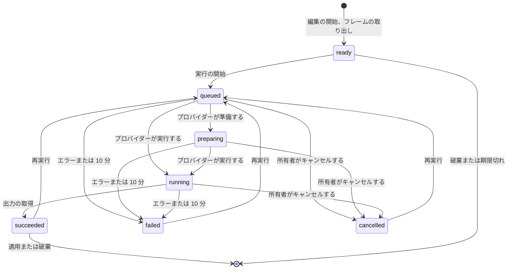

# データモデル: 動画のフレームを ComfyUI で編集し、サムネイルとして使う {#data-model-edit-a-video-frame-with-comfyui-and-use-it-as-the-thumbnail}

親 Issue: #942。

モデルの残りは変わらない: テーブルの正本は [internal/store/migrations/](../../internal/store/migrations/) にあり、テーブルの分類は [running-vv.md、Data and recovery](../../docs/how-to/running-vv.md#data-and-recovery) にある。このファイルは、この機能が加えるテーブル、設定、メモリ上のセッションを扱う。

## マイグレーション {#migration}

`00038_thumbnail_images.sql` (`main` の最後のマイグレーションは `00037_auto_tag_suggestions.sql` である。別の機能が先に入ったときは、実装が次の空いている番号を取る)。up は `thumbnail_images` を作り、down はそれを削除する。

## `thumbnail_images` {#thumbnail_images}

所有者が動画のサムネイルとして適用した画像 ([R-6](research.md#r-6-the-applied-image-is-user-data-in-sqlite-the-thumbnail-file-is-rebuilt-from-it))。作り直せないユーザーデータであり、`video_overrides` と同じく、内容の鍵をキーにし、`videos` への外部キーを持たない。

| フィールド | 型 | Null | 意味 |
| --- | --- | --- | --- |
| `content_key` | text、主キー | いいえ | 画像が属する内容 |
| `image` | blob | いいえ | 合わせ込んだ JPEG ([R-7](research.md#r-7-the-generated-image-is-fitted-to-the-videos-frame-before-it-is-stored))。公開したサムネイルのファイルと同じバイト |
| `revision` | integer | いいえ | 適用のたびに `video_overrides.thumbnail_revision` の規則 (ミリ秒での現在時刻と前の値 + 1 の大きいほう) で書く |
| `applied_at` | integer | いいえ | 適用の Unix ミリ秒 |

**関係**: なし。テーブルは `without rowid` である。まとめることと継承は、`video_overrides` をそのままにするのと同じく、これをそのままにする: サムネイルは 1 つの内容に属する。

## 規則 {#rules}

| 規則 | 強制する場所 |
| --- | --- |
| 適用は、生成のロックの中で、今のサムネイルのファイルを退避し、新しいファイルを公開し、それから 1 つのトランザクションで行を書き、その内容を持つすべての動画の `thumbnail_state` を `done` にし、そのサムネイルのスキャンの問題を消す。公開に失敗すると両方の側を元のままにし、トランザクションに失敗すると退避したファイルを戻す | `app.Ingest.ApplyThumbnailImage` (`SetThumbnailPosition` と同じく `StashThumbnail`)、`OverrideStore` |
| セッションの id を持つ動画がセッションの内容の鍵を持たないとき、適用は `content_changed` で失敗する | `app.Ingest.ApplyThumbnailImage` がロックの中で動画を読み直す |
| サムネイルの位置の設定は行を削除する | 同じトランザクションの中の `OverrideStore.SetThumbnailPosition` |
| 元に戻す操作は行を削除し、`thumbnail_position_ms` から、それが null のときは自動の規則でフレームを公開する。退避、公開、記録、復元の順は同じである | `app.Ingest.RevertThumbnailImage` |
| サムネイルのジョブは、行があるときは行の `image` を公開し、ないときはフレームを取り出す | `app.Ingest.Thumbnail` |
| 画像を適用している間も `video_overrides` は位置を保つ | [R-10](research.md#r-10-apply-revert-and-the-position-override-are-ordered-by-the-generation-lock) |
| すべての適用と元に戻す操作は `domain.VideoOverrideChanged` を発行し、動画の編集時刻 (`touchEditedAt`) を進める | `OverrideStore` |
| 空の `content_key` や空の `image` を持つ行はない | 書き込む側。`internal/store/invariants_test.go` |

テーブルは `running-vv.md` のユーザーデータの行に加わり、その翻訳は後から `doc-translator` が作る。

## `domain` に加える値 {#values-added-to-domain}

| 値 | 内容 |
| --- | --- |
| `Video.ThumbnailImageRevision` | `int64`。画像を適用していないときは 0。設定されているとき、`thumbnailUrl` のバージョンは、位置の `-r<revision>` の代わりに `<content key prefix>-g<revision>` になる |
| `ComfyUISettings` | `Provider` (`self_hosted` または `cloud`)、`URL` (セルフホストのみ)、`APIKey` (cloud のみ、API は決して返さない) |
| `ThumbnailWorkflow` | 登録したとおりのワークフローの JSON と、[contracts/workflow.md](contracts/workflow.md) によって見つけたその `Inputs` (`Prompt`、`Mask`、`Reference` の真偽値) |
| `ParseThumbnailWorkflow([]byte) (ThumbnailWorkflow, error)` | contracts/workflow.md の登録の規則。理由ごとに 1 つのエラー値を持つ純粋な関数 |
| `ThumbnailEditState` | `ready`、`queued`、`preparing`、`running`、`succeeded`、`failed`、`cancelled` ([Edit session](#edit-session)) |

## 設定 {#settings}

`settings` ([00017_settings.sql](../../internal/store/migrations/00017_settings.sql)) に保存する。

| キー | 値 |
| --- | --- |
| `comfyui.provider` | `self_hosted` または `cloud`。保存するまではない |
| `comfyui.url` | セルフホストのベース URL。`ollama.endpoint` と同じく正規化する |
| `comfyui.api_key` | Comfy Cloud のキー ([R-9](research.md#r-9-the-api-key-is-write-only)) |
| `comfyui.workflow` | 登録したワークフローの JSON |

## 編集のセッション {#edit-session}

セッションは `app.ThumbnailEdits` のメモリにあり、動画ごとに 1 つである ([R-4](research.md#r-4-an-edit-is-an-in-memory-session-per-video-read-by-polling))。

| フィールド | 意味 |
| --- | --- |
| `ID` | 無作為な 128 ビット。ルートのキー |
| `VideoID`、`ContentKey` | セッションを始めたときの動画とその内容 |
| `Frame` | 取り出した PNG とその大きさ ([R-8](research.md#r-8-the-frame-is-extracted-by-the-server-at-up-to-2048-px)) |
| `Run` | 今の実行: 設定とワークフローのスナップショット、プロバイダーのジョブ id、状態、`StartedAt`、省略できるステップの進み具合、エラーの理由 |
| `Result` | 最後に成功した実行の出力画像 |
| `LastReadAt` | 読み取りのたびに更新する。読み取りのない 5 分でセッションは終わる |

図は、セッションの状態と、それらの間を動かすものを示す。

どの状態も、破棄、期限切れ、同じ動画の新しい編集の開始、再起動で終わる。進んでいる実行は先にプロバイダーでキャンセルする ([R-11](research.md#r-11-a-new-session-replaces-the-previous-one-a-run-is-limited-to-10-minutes))。`failed` は理由を 1 つ持つ: `unreachable`、`unauthorized`、`insufficient_credits`、`workflow_rejected`、`run_failed`、`no_output`、`timed_out` のいずれかである。

## 変わらないもの {#what-does-not-change}

`video_overrides` は列を保つ: 適用した画像は別の行なので、元に戻す操作は選んだ位置に戻る。シーク用のスプライト、カードのスクラブのフレーム、ホバーのプレビューは引き続きファイルから来る (Issue の `対象外`)。
