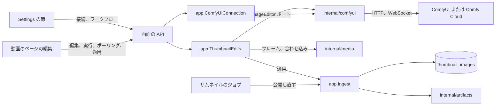
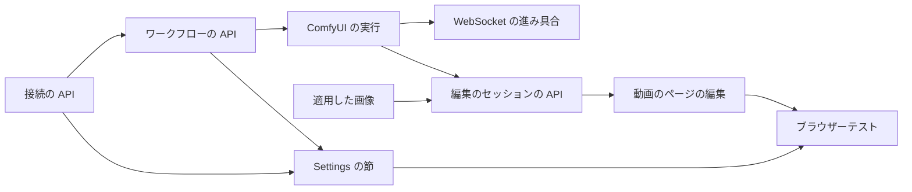

# 実装計画: 動画のフレームを ComfyUI で編集し、サムネイルとして使う {#implementation-plan-edit-a-video-frame-with-comfyui-and-use-it-as-the-thumbnail}

**ブランチ**: `feature/045-comfyui-thumbnails` | **親 Issue**: #942

**入力**: 親 Issue。これがこの機能の仕様である。

## 概要 {#summary}

所有者は Settings で ComfyUI の接続 (セルフホストまたは Comfy Cloud) とワークフローを 1 つ保存し、それから動画のページで今のフレームをテキスト、塗ったマスク、参照画像で編集し、実行を見守り、結果をフレームと比べ、サムネイルとして適用する。vv は `vv:*` というタイトルのノードを通じて所有者のワークフローを動かし、各編集をそれを始めたページのためにメモリに保持し、適用した画像を、どの再スキャンの後にもサムネイルのジョブが公開し直すユーザーデータとして保持する。

図は、この機能が加える部分と、それぞれがやり取りする相手を示す。



| 関心事 | 方針 |
| --- | --- |
| プロバイダー | `ImageEditor` ポートと、両方のプロバイダーに対する 1 つの `internal/comfyui` アダプター ([R-1](research.md#r-1-an-image-edit-port-in-internalapp-one-internalcomfyui-adapter-for-both-providers)、[R-5](research.md#r-5-provider-differences-stay-inside-the-adapter)) |
| ワークフロー | 所有者の API 形式のワークフロー。入力と出力は `vv:*` のタイトルで見つけ、ない入力は中立の値で埋める ([R-2](research.md#r-2-named-nodes-in-the-owners-api-format-workflow-are-the-whole-contract)、[R-3](research.md#r-3-absent-optional-inputs-get-a-neutral-value)、[contracts/workflow.md](contracts/workflow.md)) |
| 編集と実行 | 動画ごとのメモリ上のセッション。ページがポーリングし、破棄、期限切れ、新しい編集で終わる。実行の上限は 10 分 ([R-4](research.md#r-4-an-edit-is-an-in-memory-session-per-video-read-by-polling)、[R-11](research.md#r-11-a-new-session-replaces-the-previous-one-a-run-is-limited-to-10-minutes)) |
| フレーム | サーバーが最大 2048 px で取り出す ([R-8](research.md#r-8-the-frame-is-extracted-by-the-server-at-up-to-2048-px)) |
| 適用した画像 | 動画の縦横比に合わせ、`thumbnail_images` に保存し、サムネイルのジョブが公開し直す ([R-6](research.md#r-6-the-applied-image-is-user-data-in-sqlite-the-thumbnail-file-is-rebuilt-from-it)、[R-7](research.md#r-7-the-generated-image-is-fitted-to-the-videos-frame-before-it-is-stored)) |
| 順序 | 適用、元に戻す操作、位置の上書きは生成のロックを共有する ([R-10](research.md#r-10-apply-revert-and-the-position-override-are-ordered-by-the-generation-lock)) |
| API キー | 書き込み専用 ([R-9](research.md#r-9-the-api-key-is-write-only)) |
| ルート | 設定、編集、元に戻す操作のための所有者専用の新しいルート。位置の上書きは変わる ([contracts/screen-api.md](contracts/screen-api.md)) |

Issue には `ui` ラベルがないので、`design` 段階は実行しない: 2 つの画面の単位はデザインシステムと動画のページの既存のサムネイルの操作部品 ([029 ui-design](../029-video-overrides/ui-design.md)) から組み立て、それぞれに見た目のレビューが必要である。

親 Issue のとおり範囲外のもの: 一括の生成、ComfyUI、モデル、ワークフローの同梱やインストール、シーク用のスプライト、スクラブのフレーム、ホバーのプレビューの置き換え、生成した画像の履歴、ほかのプロバイダー、vv の外で作った画像のアップロード、Comfy Cloud のクレジットの表示。Issue は画面だけを求めているので、外部 API と MCP にはこれらのルートは加わらない。

## 技術的な文脈 {#technical-context}

**正本の定義**:

| 項目 | 出典 |
| --- | --- |
| 境界、依存の方向、ユーザーデータ、生成ファイル、認証の境界 | [ARCHITECTURE.md](../../ARCHITECTURE.md)、[.golangci.yml](../../.golangci.yml) (depguard) |
| AI 層のポートとプロバイダーの形、接続の設定 | [ai-layer.md](../../docs/design-docs/ai-layer.md)、[internal/app/ollama.go](../../internal/app/ollama.go)、[internal/ollama](../../internal/ollama) |
| サムネイルの位置の上書き、生成のロック、`thumbnailUrl` | [029 調査](../029-video-overrides/research.md)、[029 データモデル](../029-video-overrides/data-model.md)、[internal/app/ingest.go](../../internal/app/ingest.go)、[internal/store/overrides.go](../../internal/store/overrides.go) |
| サムネイルのファイル | [internal/artifacts/store.go](../../internal/artifacts/store.go)、[internal/media/thumbnail.go](../../internal/media/thumbnail.go) |
| 設定の保存 | [00017_settings.sql](../../internal/store/migrations/00017_settings.sql)、[internal/store/settings.go](../../internal/store/settings.go) |
| 画面の API、エラー、生成コード | [api/openapi.yaml](../../api/openapi.yaml)、[023 error-api](../023-english-i18n/contracts/error-api.md)、`task generate` |
| 画面と Web のテスト | [design-system.md](../../docs/design-docs/design-system.md)、[web-testing.md](../../docs/design-docs/web-testing.md)、[i18n.md](../../docs/design-docs/i18n.md)、[web/src/player/VideoFacts.tsx](../../web/src/player/VideoFacts.tsx)、[web/src/settings/OllamaSection.tsx](../../web/src/settings/OllamaSection.tsx) |
| 検査 | [Taskfile.yml](../../Taskfile.yml) (`task check`、`task check-docs`、`task test-e2e`) |

**この機能に固有の文脈**:

- マイグレーションを 1 つ、`00038_thumbnail_images.sql` ([data-model.md、Migration](data-model.md#migration))。
- 新しい Go の依存を 1 つ、`github.com/coder/websocket` ([R-5](research.md#r-5-provider-differences-stay-inside-the-adapter))。新しい Web の依存はない。
- vv が保存する最初の外向きの資格情報 ([R-9](research.md#r-9-the-api-key-is-write-only))。
- `multipart/form-data` を受け取り、成果物ではない画像 (フレームと結果) を返す最初の画面の API のルート。
- e2e の実行は偽の ComfyUI サーバーを起動する。`web/e2e` にはまだ外部のサービスを偽装するものはない。

## Constitution Check {#constitution-check}

| 規則 (出典) | 判定 |
| --- | --- |
| アダプターは互いにも `internal/app` にも依存せず、`internal/app` はアダプターに依存しない (ARCHITECTURE.md、depguard) | 適合: `internal/comfyui` は `internal/domain` だけに依存し、`.golangci.yml` のアダプターの一覧に加わる。`internal/app` が `ImageEditor` と設定のストアのインターフェースを宣言する |
| ドメインが決め、ストアが強制する (ARCHITECTURE.md) | 適合: ワークフローの規則と設定の正規化は `internal/domain` の純粋な関数である。適用の順序は既存のロックの下で `internal/app` にある |
| 生成ファイルの所有者は 1 つ (ARCHITECTURE.md) | 適合: サムネイルのファイルは今までどおり `internal/artifacts` だけが置く。適用した画像はファイルではなく行である ([R-6](research.md#r-6-the-applied-image-is-user-data-in-sqlite-the-thumbnail-file-is-rebuilt-from-it)) |
| ユーザーデータは作り直しの後も残る (ARCHITECTURE.md) | 適合: `thumbnail_images` は内容の鍵をキーにして外部キーを持たず、ARCHITECTURE.md と running-vv.md のユーザーデータの一覧に加わる |
| コミット後のイベント (ARCHITECTURE.md) | 適合: 適用と元に戻す操作はコミットの後に既存の `VideoOverrideChanged` を発行する。編集のセッションは何も発行しない ([R-4](research.md#r-4-an-edit-is-an-in-memory-session-per-video-read-by-polling)) |
| すべての読み取りは閲覧者を知る (ARCHITECTURE.md) | 適合: すべてのルートは所有者専用である。`thumbnailGenerated` は所有者への応答にだけあり、`thumbnailUrl` のバージョンが持つのはリビジョンであって所有者のデータではない |
| リクエストの本文の URL にリクエストを送らない (ai-layer.md) | 適合: 確認と実行は保存した URL だけを使う |
| 生成ファイルを手で編集しない (AGENTS.md) | 適合: `api/openapi.yaml` を変え、`task generate` を実行する |
| 依存の更新は dependency-updates.md に従う (AGENTS.md) | 適合: `github.com/coder/websocket` はその規則の下で加える |
| 画面の前に design-system.md を読む。最も低いレベルでテストする (AGENTS.md) | 適合: 規則はドメインのテスト、アダプターは `httptest` の偽物、画面はページテスト、流れは 1 つのブラウザーテストで確かめる |
| 文書は変更とともに (core-beliefs.md) | 適合: 各単位は更新する文書を挙げる |

違反はないので、複雑さの追跡はない。判定は Phase 1 の後も成り立つ。

## プロジェクトの構成 {#project-structure}

### 文書 (この機能) {#documentation-this-feature}

```text
specs/045-comfyui-thumbnails/
├── plan.md
├── research.md
├── data-model.md
├── quickstart.md
└── contracts/
    ├── screen-api.md
    └── workflow.md
```

自動の検査は偽の ComfyUI に対してしか実行しないので、`quickstart.md` がある。`contracts/workflow.md` は、下の手順書が引き継ぐまで、所有者に向けたワークフローの契約である。

### ソースコード {#source-code}

**影響する境界**:

| 境界 | この機能で受け持つもの |
| --- | --- |
| `internal/domain` | `ComfyUISettings`、`ThumbnailWorkflow` とそのパーサー、編集の状態と失敗の理由、`Video.ThumbnailImageRevision` |
| `internal/comfyui` (新規) | プロバイダーのアダプター: 接続のテスト、アップロード、実行、状態、キャンセル、出力、WebSocket の進み具合 |
| `internal/media` | `FrameAt` (最大 2048 px の PNG) と `FitThumbnailImage` (縦横比に合わせる、JPEG) |
| `internal/store` | マイグレーション、`comfyui.*` の設定、`thumbnail_images` の読み書き、`ThumbnailImageRevision` のための結合 |
| `internal/app` | `ComfyUIConnection`、`ThumbnailEdits`、`Ingest.ApplyThumbnailImage`、`Ingest.RevertThumbnailImage`、サムネイルのジョブの公開し直し |
| `internal/httpapi`、`api/openapi.yaml`、`cmd/mdm` | ルート、multipart と画像の応答、配線 |
| `web/src/api`、`web/src/settings`、`web/src/player`、`web/src/i18n` | クライアントの関数、Settings の節、動画のページの編集、カタログの文言 |
| `web/e2e` | 偽の ComfyUI とブラウザーテスト |
| `docs/` | `ai-layer.md`、新しい `docs/design-docs/thumbnail-editing.md`、新しい `docs/how-to/comfyui-thumbnails.md`、`running-vv.md`、ARCHITECTURE.md |

**新しいパス**: `internal/comfyui/`、`internal/domain/comfyui.go`、`internal/app/comfyui.go`、`internal/app/thumbnail_edits.go`、`internal/store/thumbnail_images.go`、`internal/store/migrations/00038_thumbnail_images.sql`、`internal/httpapi/comfyui.go`、`internal/httpapi/thumbnail_edits.go`、`web/src/settings/ComfyUISection.tsx`、`web/src/player/thumbnailEdit/`、`web/e2e/fake-comfyui.mjs`、`web/e2e/thumbnail-edit.e2e.ts`。

**構成の決定**: 動画のページの編集は `web/src/player/` の下の独自のディレクトリにする。マスクのキャンバス、実行のパネル、比較は `VideoFacts` が開くだけの 1 つの流れだからである。偽の ComfyUI は contracts/workflow.md のセルフホストのルートを提供するので、ブラウザーテストは実際のアダプターを動かす。

## 実装作業 {#implementation-work}

図は、どの単位が先に入る必要があるかを示す。



### 画面の API で ComfyUI の接続を保存し、テストする {#save-and-test-a-comfyui-connection-through-the-screen-api}

**範囲**: `ComfyUISettings` とその正規化、`comfyui.provider`、`comfyui.url`、`comfyui.api_key` の設定、`app.ComfyUIConnection`、両方のプロバイダーに対する接続のテストを持つ新しい `internal/comfyui` パッケージ、`GET`/`PUT /api/settings/comfyui` と `POST /api/settings/comfyui/check`、クライアントの関数、depguard の項目、ARCHITECTURE.md のサブシステムの地図、ai-layer.md の「Image-edit provider」の節 ([contracts/screen-api.md](contracts/screen-api.md#get-apisettingscomfyui-put-apisettingscomfyui)、[R-1](research.md#r-1-an-image-edit-port-in-internalapp-one-internalcomfyui-adapter-for-both-providers)、[R-9](research.md#r-9-the-api-key-is-write-only))。

**依存**: なし。

**受け入れ**: `task check` と `task check-docs` が通り、`task generate` で差分が出ない。ハンドラーのテストが次を示す: 保存したキーは `apiKeySet: true` として返り、本文には決して入らない。`apiKey` のない `PUT` はキーを保ち、`""` は消す。契約の `400` の各理由。`httptest` サーバーに対するアダプターのテストが次を示す: 確認はセルフホストの `/system_stats` で使用可能となり、拒否された接続、ComfyUI ではない応答、Cloud の `401`、何も保存されていないときは、それぞれ別のメッセージで使用不可となる。ゲストは各ルートで `401` を受け取り、`TestAccessClassificationMatchesOpenAPISecurity` が通る。

### vv というタイトルのノードを持つサムネイルのワークフローを登録する {#register-a-thumbnail-workflow-with-nodes-titled-vv}

**範囲**: `ThumbnailWorkflow` と `ParseThumbnailWorkflow`、`comfyui.workflow` の設定、`GET`/`PUT`/`DELETE /api/settings/comfyui/workflow` と `GET /api/thumbnail-edits/readiness`、クライアントの関数、そして所有者のために [contracts/workflow.md、Workflow format と Registration](contracts/workflow.md#workflow-format) から書く `docs/how-to/comfyui-thumbnails.md`。

**依存**: 画面の API で ComfyUI の接続を保存し、テストする。

**受け入れ**: `task check` と `task check-docs` が通る。ドメインのテストが Registration の表のすべての行を覆い、5 つのタイトルをすべて持つワークフローには `prompt`、`mask`、`reference` を、`vv:frame` と `vv:output` だけを持つものには何も報告しない。ハンドラーのテストが次を示す: 1 MiB を超えると `413`、登録の前は `404`、削除で `204`、`readiness` は 4 つの組み合わせのそれぞれで `connection` と `workflow` を返す。

### ComfyUI の接続とワークフローを Settings に加える {#add-the-comfyui-connection-and-workflow-to-settings}

**範囲**: Settings の ComfyUI の節: プロバイダーの選択、URL または API キー (キーの欄はキーが保存されていることだけを示す)、保存、テストとその結果、ワークフローのファイルのアップロードとそれが受け取る入力、削除、カタログの文言、手順書への文書のリンク。

**依存**: 画面の API で ComfyUI の接続を保存し、テストする。vv というタイトルのノードを持つサムネイルのワークフローを登録する。

**受け入れ**: `task check` が通る。ページテストが次を示す: 保存の後にキーが欄に入ることはない。テストの結果とそのメッセージ。拒否されたワークフローの理由。登録の後の省略できる入力。画面の変更は、両方のテーマで design-system.md に照らした見た目のレビューを受ける。

### 適用したサムネイルの画像を再スキャンの後も保ち、所有者が元に戻せるようにする {#keep-an-applied-thumbnail-image-across-rescans-and-let-the-owner-revert-it}

**範囲**: `00038_thumbnail_images.sql` とそのストアの操作、`internal/media` の `FitThumbnailImage`、`Ingest.ApplyThumbnailImage` と `Ingest.RevertThumbnailImage`、行からのサムネイルのジョブの公開し直し、行を削除する位置の上書き、`thumbnailGenerated` と `thumbnailUrl` のバージョン、`DELETE /api/videos/{id}/thumbnail-image` とそのクライアントの関数、ARCHITECTURE.md と running-vv.md のユーザーデータの一覧 ([data-model.md](data-model.md)、[R-6](research.md#r-6-the-applied-image-is-user-data-in-sqlite-the-thumbnail-file-is-rebuilt-from-it)、[R-7](research.md#r-7-the-generated-image-is-fitted-to-the-videos-frame-before-it-is-stored)、[R-10](research.md#r-10-apply-revert-and-the-position-override-are-ordered-by-the-generation-lock))。

**依存**: なし。

**受け入れ**: `task check` と `task check-docs` が通る。メディアのテストが次を示す: 16:9 の動画に合わせた 1:1 の PNG は 640×360 になり、大きさのわからない動画に合わせたものは 1:1 を保つ。アプリとストアのテストが次を示す: 適用の後、サムネイルのファイルは行のバイトを持ち、`thumbnailUrl` が変わる。動画の行が除かれ、内容が再びスキャンされた後、サムネイルのジョブは同じバイトを公開する。どの動画も持たない内容の鍵への適用は `content_changed` を返し、何も書かない。適用の後に設定した位置は行を除き、ファイルはそのフレームになる。位置がある状態で元に戻すとその位置のフレームに、ないときは自動のフレームに戻る。位置の変更の後ろでロックを待つ適用は、それでも勝つ。適用または元に戻す操作の間に失敗した公開は、行、`thumbnailUrl`、ファイルを変えず、公開の後に失敗したストアの書き込みは前のファイルを戻す。

### ComfyUI と Comfy Cloud でサムネイルのワークフローを実行する {#run-a-thumbnail-workflow-on-comfyui-and-comfy-cloud}

**範囲**: `internal/app` の `ImageEditor` ポートと、両方のプロバイダーに対するその `internal/comfyui` の実装: アップロード、`vv:*` の入力と中立の値を入れたワークフロー、送信、状態の対応付け、キャンセル、出力の取得 (キーなしでの Cloud のリダイレクト)、失敗の理由 ([contracts/workflow.md、Run、Run states と Failure reasons](contracts/workflow.md#run)、[R-3](research.md#r-3-absent-optional-inputs-get-a-neutral-value)、[R-5](research.md#r-5-provider-differences-stay-inside-the-adapter))。

**依存**: vv というタイトルのノードを持つサムネイルのワークフローを登録する。

**受け入れ**: `task check` が通る。各プロバイダーの `httptest` の偽物に対するアダプターのテストが次を示す: 送信したプロンプトで変わるのは `vv:*` の入力だけである。マスクがないときはフレームの大きさの全面が白い PNG をアップロードし、参照がないときはフレームをアップロードする。Run states の表のすべての行がその vv の状態に対応する。キャンセルは、待機中ならキューから削除し、実行中なら中断する (セルフホスト) か `POST /interrupt` を送る (Cloud)。Cloud の出力はリダイレクトから `X-API-Key` なしで取得する。Failure reasons の表の各行が、そのプロバイダーの応答から生まれる。

### ComfyUI の WebSocket からステップの進み具合を報告する {#report-step-progress-from-the-comfyui-websocket}

**範囲**: 両方のプロバイダーに対する、`github.com/coder/websocket` の上のアダプターの WebSocket クライアント、`prompt_id` による `progress` メッセージの絞り込み、dependency-updates.md の下のその依存の項目 ([R-5](research.md#r-5-provider-differences-stay-inside-the-adapter))。

**依存**: ComfyUI と Comfy Cloud でサムネイルのワークフローを実行する。

**受け入れ**: `task check` が通る。アダプターのテストが次を示す: 実行の id に対する偽物の `progress` メッセージは `max` 中の `value` として現れる。別の id のメッセージは無視される。接続を拒否する WebSocket では進み具合がないままで、実行はそれでも `succeeded` に達する。

### 画面の API でサムネイルの編集のセッションを提供する {#serve-thumbnail-edit-sessions-on-the-screen-api}

**範囲**: `app.ThumbnailEdits` (セッション、スナップショット、ポーリングによる期限切れ、10 分の上限、置き換え)、`internal/media` の `FrameAt`、multipart の入力と画像の応答を持つ `/api/videos/{id}/thumbnail-edits` と `/api/thumbnail-edits/{editId}…` のルート、`Ingest.ApplyThumbnailImage` を通じた適用、クライアントの関数、設計文書の索引からリンクする `docs/design-docs/thumbnail-editing.md` ([contracts/screen-api.md](contracts/screen-api.md)、[data-model.md、Edit session](data-model.md#edit-session)、[R-4](research.md#r-4-an-edit-is-an-in-memory-session-per-video-read-by-polling)、[R-8](research.md#r-8-the-frame-is-extracted-by-the-server-at-up-to-2048-px)、[R-11](research.md#r-11-a-new-session-replaces-the-previous-one-a-run-is-limited-to-10-minutes))。

**依存**: 適用したサムネイルの画像を再スキャンの後も保ち、所有者が元に戻せるようにする。ComfyUI と Comfy Cloud でサムネイルのワークフローを実行する。

**受け入れ**: `task check` と `task check-docs` が通り、`task generate` で差分が出ない。偽の `ImageEditor` と偽の時計を使うアプリのテストが次を示す: Edit session の図のすべての遷移。5 分間読まれなかったセッションはプロバイダーでキャンセルされ、`404` を返す。10 分を過ぎた実行は `timed_out` として失敗する。同じ動画の 2 つ目の編集は最初の編集の実行をキャンセルする。実行中に変えた設定は実行のスナップショットを変えない。ハンドラーのテストが次を示す: 契約の各ステータス。大きさの誤ったマスクと、ワークフローが受け取れないパートは、何もアップロードする前に `400` を返す。ゲストは各ルートで `401` を受け取る。

### 動画のページからサムネイルを編集する {#edit-the-thumbnail-from-the-video-page}

**範囲**: サムネイルの操作部品の隣の入口 (`readiness` がそろっていないときは理由付きで無効、ゲストにはない)、フレーム、マスクの塗り、参照画像、プロンプトを持つ編集の表示、経過時間と進み具合付きの実行の状態、キャンセル、適用、再実行、破棄を持つ並べた比較、アンマウント時の破棄、`thumbnailGenerated` の間の「use the frame instead」。カタログの文言。

**依存**: 画面の API でサムネイルの編集のセッションを提供する。

**受け入れ**: `task check` が通る。ページテストが次を示す: そろっていない `readiness` のそれぞれで入口が Settings の理由付きで無効になる。`inputs` にないときは塗りと参照が無効になる。状態のラベルが経過時間付きで待機中から準備中、実行中に変わる。`progress` があるときだけ進み具合のバーが出る。失敗の理由の文言。フレームの隣の結果。ページを離れると破棄を呼ぶ。画面の変更は、両方のテーマとスマートフォンの幅で design-system.md に照らした見た目のレビューを受ける。

### 偽の ComfyUI でサムネイルの編集をブラウザーテストで覆う {#cover-thumbnail-editing-in-a-browser-test-with-a-fake-comfyui}

**範囲**: `web/e2e/fake-comfyui.mjs` (送信されたプロンプトを記録し、遅延の後に固定の画像を返すセルフホストの ComfyUI の偽物で、`run-e2e.mjs` が起動する) と `web/e2e/thumbnail-edit.e2e.ts`。

**依存**: ComfyUI の接続とワークフローを Settings に加える。動画のページからサムネイルを編集する。

**受け入れ**: `task test-e2e -- e2e/thumbnail-edit.e2e.ts` が通り、次を示す: 所有者が偽物を接続として保存し、テストし、ワークフローを登録し、マスクを塗り、実行し、状態の変化を見て、適用する。ライブラリのカードと動画のページは、再読み込みの後と全体のスキャンの後に偽物の画像を示す。「use the frame instead」はフレームを戻す。キャンセルと破棄はサムネイルを変えない。ゲストには入口が見えない。
