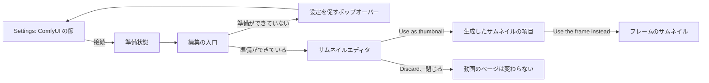
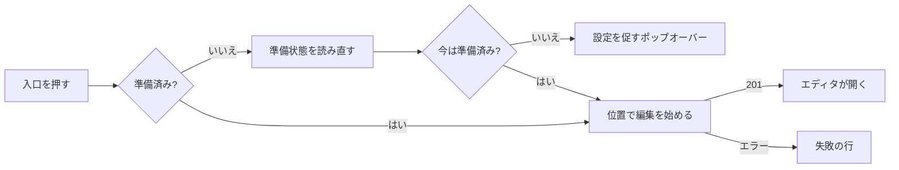
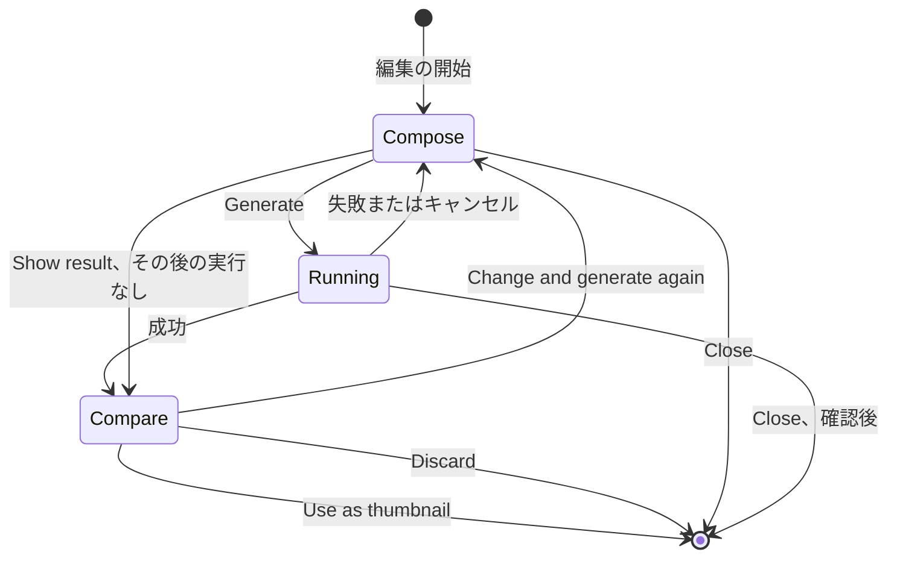

# UI デザイン: 動画のフレームを ComfyUI で編集してサムネイルにする {#ui-design-editing-a-video-frame-with-comfyui-into-the-thumbnail}

**機能**: [親 Issue #942](https://github.com/syudead/vv/issues/942) · [plan.md](plan.md) · [contracts/screen-api.md](contracts/screen-api.md) · [contracts/workflow.md](contracts/workflow.md) · [data-model.md、Edit session](data-model.md#edit-session) · [research.md R-3](research.md#r-3-absent-inputs-get-a-neutral-value-or-the-variant-without-the-node) · [R-4](research.md#r-4-an-edit-is-an-in-memory-session-per-video-read-by-polling) · [R-7](research.md#r-7-the-generated-image-is-fitted-to-the-videos-frame-before-it-is-stored) · [R-9](research.md#r-9-the-api-key-is-write-only) · [R-10](research.md#r-10-apply-revert-and-the-position-override-are-ordered-by-the-generation-lock) · [R-12](research.md#r-12-the-model-is-flux2-klein-4b-fp8) · [R-13](research.md#r-13-the-connection-test-checks-the-workflows-nodes-and-model-files)

すでに決まっていることの出典。ここでは繰り返さずリンクする。

| 話題 | 出典 |
| --- | --- |
| トークン、閉じたスケール、動画のページの密度 | [design-system.md、Foundations](../../docs/design-docs/design-system.md#foundations)。値は [`web/src/ui/tokens.css`](../../web/src/ui/tokens.css) の `@theme` にあり、ここでは名前で示し、決して写さない |
| ダークの配色を一つだけ持ち、ライトの組はない | [library-ui.md、ダークの配色のみ](../../docs/design-docs/library-ui.md#dark-scheme-only-without-a-lightdark-switch) |
| `SettingsPage`、`PageSection`、`FormRow`、`Dialog`、`ConfirmDialog` | [patterns.md](../../web/registry/rules/patterns.md) |
| `Button`、`Textarea`、`RadioGroup`、`ToggleGroup`、`Slider`、`Popover`、`Tooltip`、`Alert`、`Progress`、`Spinner`、`Skeleton` | [components.md](../../web/registry/rules/components.md) |
| Ollama の節: Save、Save and test connection、テスト結果の行 | [`OllamaSection.tsx`](../../web/src/settings/OllamaSection.tsx) |
| 設定の行の `RadioGroup` によるプロバイダの選択、説明の中のガイドのリンク | [`TranscodingSection.tsx`](../../web/src/settings/TranscodingSection.tsx)、[`docsLinks.ts`](../../web/src/settings/docsLinks.ts) |
| 動画のページの情報の行、その右側の操作、サムネイルの項目と一つの失敗の行 | [library-ui.md、情報の行](../../docs/design-docs/library-ui.md#information-rows)。[029 UI デザイン、サムネイルの事実](../029-video-overrides/ui-design.md#thumbnail-fact) |
| 取り込みボタンを押せるときと、それが送る位置 | [029 UI デザイン、取り込みボタン](../029-video-overrides/ui-design.md#capture-button) |
| 幅のブレークポイントは CSS で切り替える。レイアウトは人が確かめる | [library-ui.md、幅のブレークポイント](../../docs/design-docs/library-ui.md#width-breakpoints-in-css-and-the-sidebar-exception)、[人が確かめるレイアウト](../../docs/design-docs/library-ui.md#layout-verified-by-people-not-machines) |
| 画面の文言 | [`web/src/i18n/en.ts`](../../web/src/i18n/en.ts)。この機能は `settings.comfyui`、`player.thumbnailEdit` と下記の文言を加える |

この機能は三つのものを加え、どれも所有者専用である。

1. Settings の **ComfyUI の節**。セルフホストの ComfyUI に欠けているファイルの一覧も示す (要件 1、2、4、受け入れ条件 1 と 2)。
2. 動画のページの情報の行の操作に並ぶ**編集の入口**と、それが開く**サムネイルエディタ** (要件 5 から 10 と 14、受け入れ条件 3 から 5 と 7)。
3. 情報の行の**生成したサムネイルの項目**と、フレームに戻す方法 (要件 11 から 13、受け入れ条件 6 と 8)。

図は各部分と、それぞれの操作の行き先を示す。

変わらないもの: プレーヤーとそのコントロールバー、タイトル、タグと公開範囲の切り替え、ライブラリのカード、関連動画、その他すべての画面。これらは既存の `thumbnailUrl` を通して適用した画像を表示する。ゲストには三つのどれも見えない (要件 15、受け入れ条件 9)。

## この形にした理由 {#why-this-shape}

エディタは**動画のページの上に重なる全画面のダイアログ**であり、新しい `EditorDialog` パターンである ([デザインシステムへの変更](#changes-to-the-design-system))。領域を塗るにはウィンドウが許す限り大きなフレームが要り、二つの画像を比べるには両方が読める大きさで要る。レジストリの `Dialog` は `max-w-lg` (32rem) で止まり、1280 px では 16:9 のフレームの高さが約 290 px にしかならない。プレーヤーの場所で編集する案は採用しなかった。プレーヤー、そのレイヤーとキーが、タイトル、タグ、事実も一緒にスクロールする列の中でキャンバスに場所を譲らなければならず、ページの残りは編集の途中でも動き続ける。別のルートにする案も採用しなかった。要件 5 は編集を動画のページで始め、そのページを離れると編集を破棄しなければならない (Issue の境界ケース) からである。ページの上のモーダルは、編集の寿命をページに結び付け、戻るボタンや再読み込みの規則を別に持たない。今の製品の写真やサムネイルのエディタ (動画公開のスタジオ、写真ライブラリ、生成による塗りつぶしの道具) は同じ形に収束している。画像を中央に置き、道具をその横か下に置き、結果を残す前に見せる全ウィンドウのエディタである。

入口は情報の行の操作のグループに一つ加わるアイコンボタンで、`Use current frame as thumbnail` の隣に置く。同じ対象への同じ種類の操作であり、重みも同じだからである。サムネイルの編集が再生より目立つことは決してない (029、[ここに置き、他に置かない理由](../029-video-overrides/ui-design.md#why-here-and-not-elsewhere))。入口は画面上のフレームから始めるので、取り込みボタンを押せるときにちょうど押せ、同じ位置を送る。

エディタの中では、フレームのステージが主な領域で、脇のパネルが入力と一つの主な操作を、所有者が埋める順に上から下へ持つ。塗りはステージで行い、次に指示、次に任意の参照画像、次に `Generate` である。実行が成功すると、ステージはフレームと結果の比較に変わり、パネルの主な操作は `Use as thumbnail` になる。要件 10 の三つの選択肢はその下にまとまって並ぶので、所有者が両方の画像を見ないまま何かが適用されることはない。

比較の中の生成画像は、サムネイルになるときと同じく切り抜いて表示する (R-7 が動画の形に合わせる)。所有者が承認するものはカードが表示するものと同じである。切り抜きで何かが削られたときだけ、注記がそう伝える。

vv 自身のワークフローは三つの入力をすべて受け取るので、どの入力も常に使える ([R-2](research.md#r-2-vv-bundles-the-workflow-named-nodes-are-its-internal-contract))。二つのヒントがモデルの POC で分かったことを伝え、所有者が結果に驚かないようにする。指示の欄は、領域を塗ったときは空のままでよいと伝え (そのとき vv は塗った領域をきれいにするよう頼む、[R-3](research.md#r-3-absent-inputs-get-a-neutral-value-or-the-variant-without-the-node))、参照画像は、モデルがそこから色と雰囲気を取り、その物体を写すことがあると伝える ([R-12](research.md#r-12-the-model-is-flux2-klein-4b-fp8))。

モデルのファイルが欠けているセルフホストの ComfyUI は、接続をテストする Settings で、各ファイルのフォルダとダウンロードのページとともに伝える。動画のページは ComfyUI にファイルが欠けていることだけを伝えて Settings にリンクするので、一覧は一か所にある。

フレームに戻す方法はサムネイルの項目の `×` で、選んだ位置を消すのと同じ場所と形である。要件 13 が二つを同じ種類の上書きにしているからである。029 でどちらも確認を求めないのと同じく、これも新しい取り込みも確認を求めない。Issue は両方を所有者の戻る方法として挙げている。

## 文言 {#words}

英語はカタログが取り込む下書きである。実装の後は [`web/src/i18n/en.ts`](../../web/src/i18n/en.ts) が正となる。

### Settings {#settings}

| 場所 | 文言 | 注記 |
| --- | --- | --- |
| 節のタイトル | ComfyUI | |
| 節の説明 | Where VVMDM sends a video frame to edit it into a thumbnail. VVMDM brings the workflow; a ComfyUI you run yourself needs the model files listed after a test. | 後にガイドのリンクが続く |
| ガイドのリンク | How to set up ComfyUI | 文書サイトの `docs/how-to/comfyui-thumbnails.md` を新しいタブで開く。スクリーンリーダー向けに `Opens in a new tab`、Transcoding と同じ |
| プロバイダの行のラベル | Runs on | |
| プロバイダの選択肢 | My own ComfyUI · Comfy Cloud | |
| プロバイダの選択肢のヒント | ComfyUI you run on this PC or another one. · Comfy's hosted service. Uses your API key and its credits. | |
| URL の行 | ComfyUI URL | ヒント: `Where ComfyUI listens, for example http://127.0.0.1:8188.` |
| API キーの行 | API key | 保存したキーがないときのヒント: `Create one in your Comfy Cloud account.` 保存したキーがあるとき: `A key is saved. Type a new one to replace it.` |
| 保存 | Save · Saving… | 成功時のトースト: `ComfyUI settings saved` |
| テスト | Save and test connection · Testing… | |
| テストの成功 | Connected to ComfyUI. · Connected to Comfy Cloud. | 保存したプロバイダによる |
| テストの失敗 | The connection test failed: {reason} | `{reason}` はチェック結果の `message` |
| 保存の失敗 | Couldn't save the settings: {reason} | |
| 欠けているファイルの見出し | ComfyUI is missing what the thumbnail edit needs: | 一覧の上 |
| 欠けているモデルのファイル | {name} · put it in {folder} · Download | `Download` はファイルのページを新しいタブで開く |
| 欠けているノード | {name} · Update ComfyUI to get this node | |
| 読み込み中、読み込みの失敗 | Loading the ComfyUI settings · Couldn't load the ComfyUI settings: {reason} | |

### 動画のページ {#video-page}

| 場所 | 文言 | 注記 |
| --- | --- | --- |
| 入口、名前とツールチップ | Edit thumbnail with ComfyUI | |
| 設定を促すポップオーバーのタイトル | Set up ComfyUI first | |
| 設定を促すポップオーバーの本文 | Save a ComfyUI connection in Settings. | |
| 設定を促すポップオーバーのリンク | Open Settings | Settings の ComfyUI の節へ |
| 開始の失敗 | Couldn't start editing the thumbnail: {reason} | 情報の行の一つの失敗の行 |
| エディタのタイトル、詳細 | Edit thumbnail · Frame at {time} | `{time}` は `formatDuration` の形式 |
| エディタを閉じる | Close | `×` |
| 塗りの道具 | Paint · Erase · Brush size · Undo · Clear painting | `Brush size` はスライダーの名前 |
| 塗りのレイヤーの名前 | Painted area | アクセシブルネームのみ |
| 塗りのヒント | Paint over what to change. Leave it unpainted to change the whole frame. | |
| 指示の欄 | Instructions | プレースホルダ: `For example: remove the caption at the bottom`。ヒント: `Optional when you paint: the painted area is then cleaned up.` |
| 参照画像 | Reference image · Add image… · Remove reference image | ヒント: `Its colours and mood are used, and its objects may be copied. PNG, JPEG or WebP, up to 20 MB.` |
| 参照画像を受け付けない | Choose a PNG, JPEG or WebP image up to 20 MB. | 何かを送る前に確かめる |
| 主な操作 | Generate · Generate again | |
| 実行の状態 | Waiting in the queue · Preparing · Generating | |
| ステップの進捗 | Step {value} of {max} | プロバイダが報告するときのみ |
| 経過時間 | {m:ss} | `tabular-nums`。`Elapsed {time}` として読み上げる |
| 長い待ちのヒント | The first run can take a minute while ComfyUI loads its models. | `Waiting in the queue` または `Preparing` で 20 秒経った後 |
| キャンセル | Cancel | |
| キャンセルした後 | Cancelled. The thumbnail is unchanged. | |
| 実行の失敗 | Couldn't generate the image: {reason} | 説明: プロバイダのメッセージ (あるとき) |
| 比較のラベル | Frame · Generated | |
| 切り抜きの注記 | Cropped to the video's shape, as the thumbnail will be. | 結果の形が動画の形と異なるときのみ |
| 比較の操作 | Use as thumbnail · Applying… · Change and generate again · Discard | |
| 結果に戻る | Show result | セッションがまだ `succeeded` の間の Compose で |
| 適用の失敗 | Couldn't use the image: {reason} | |
| 編集の終了 | This edit has ended, because it was opened again elsewhere or left idle. Close it and start again. | `thumbnail_edit_not_found` のとき |
| 閉じるときの確認 | Discard this edit? · The run is cancelled and the generated image is lost. The thumbnail stays as it is. · Keep editing · Discard | |
| 生成した項目 | Generated thumbnail | 視覚的に隠したラベル、`title` と画像の `alt` |
| 生成した項目の `×` | Use the frame instead | |

### エラーの理由 {#error-reasons}

`web/src/i18n/errors.ts` の `reason` の表に加える ([contracts/screen-api.md](contracts/screen-api.md)、[contracts/workflow.md、失敗の理由](contracts/workflow.md#failure-reasons))。`thumbnail_position_out_of_range`、`thumbnail_frame_unavailable`、`file_unavailable` と `video_not_found` は文言を保つ。

| 理由 | 文言 |
| --- | --- |
| `comfyui_url_invalid` | Enter an http or https URL |
| `comfyui_api_key_missing` | Enter the Comfy Cloud API key |
| `thumbnail_edit_not_ready` | ComfyUI isn't set up |
| `thumbnail_edit_mask_invalid` | The painting doesn't match the frame |
| `thumbnail_edit_reference_invalid` | The reference image can't be read |
| `thumbnail_edit_no_result` | There is no generated image yet |
| `thumbnail_image_invalid` | The generated image can't be read |
| `content_changed` | The video changed while you were editing |
| `unreachable` | ComfyUI can't be reached |
| `unauthorized` | Comfy Cloud rejected the API key |
| `insufficient_credits` | Comfy Cloud has no credits left |
| `missing_models` | ComfyUI is missing files the edit needs; test the connection in Settings to see which |
| `workflow_rejected` | ComfyUI rejected the workflow |
| `run_failed` | The edit failed in ComfyUI |
| `no_output` | ComfyUI returned no image |
| `timed_out` | No result after 10 minutes |

## デザインシステムへの変更 {#changes-to-the-design-system}

パターンを一つ、レジストリ、その規則のファイル ([patterns.md](../../web/registry/rules/patterns.md)) と [design-system.md](../../docs/design-docs/design-system.md) に、エディタが使う前に、「Edit the thumbnail from the video page」の作業単位で加える。

| 変更 | 項目 | 内容 |
| --- | --- | --- |
| `EditorDialog` の雛形 | `editor-dialog`、ブロック `editor-dialog-example` | `bg-background` の上でビューポートを端から端まで埋めるモーダルの `Dialog`。高さ `navbar` で下に境界線のあるヘッダーの帯 (タイトル、その後に控えめな詳細、閉じる `×` を `ghost` `icon-sm` の `Button` として)、`stage` スロットと `aside` スロットを持つ。`lg` 以上ではステージが残りを埋め、aside は幅 `detail-aside` (`xl` 以上では `detail-aside-wide`) で左に境界線のある列になる。`lg` 未満ではステージは帯の下に置き、名前付きの段階 `editor-stage` (ビューポートの高さの約 45%) を上限とし、aside がその後に続く。aside は主な操作を持つ `footer` スロットを持つ。`lg` 以上では aside の下端に、`lg` 未満ではビューポートの下端に固定する。ステージは内容を `bg-muted` の上に `p-4` で中央に置く。Esc と `×` は `onClose` を呼び、画面はそれに `ConfirmDialog` で応じてよい。ウィンドウ全体が要る一枚の画像の作業に使う。フォームは `FormDialog` のままにする |

名前付きの段階 `editor-stage` を、`player-height` と同じく `tokens.css` に加える。色のトークンは加えない。塗りのレイヤーは `opacity-50` の `primary` の色で、ブラシの輪郭は `foreground` である。`web/src/theme/tokens.test.ts` の `pairs` には何も加えない。どちらも文字を持たないからである。

## Settings: ComfyUI の節 {#settings-comfyui-section}

`ComfyUI` という題の `PageSection` で、`Auto-tagging` の後、`Transcoding` の前に置く。外部の AI サービスに接続する二つの節が並ぶようにするためである。Ollama の節の形に従う。接続の値は `Save` でまとめて保存し、`Save and test connection` は保存していない値を先に保存する。サーバーは保存した接続だけをテストするからである。

| 行 | コントロール | 規則 |
| --- | --- | --- |
| Runs on | `RadioGroup`、二つの項目で各ラベルの下にヒント | 変えるとすぐに対応する行を下に表示する。`Save` まで何も保存しない |
| ComfyUI URL | `Input type="url"`、`sm:w-sm` | `My own ComfyUI` のときのみ |
| API key | `Input type="password"`、`sm:w-sm`、`autocomplete="off"` | `Comfy Cloud` のときのみ。読み込みの後も保存の後も常に空。ヒントがキーを保存済みかどうかを伝える (要件 2)。空の欄は保存したキーを保つ |
| (操作) | `Save` (`default` `sm`)、`Save and test connection` (`outline` `sm`) | テスト結果の行と保存の失敗は Ollama の節に従う。スピナーかチェックのある控えめな状態の行、または `destructive` の `Alert` である。欠けているファイルは[欠けているファイル](#missing-files)に従う |

ガイドのリンクは説明の後に、Transcoding の節の形で置く。

### 欠けているファイル {#missing-files}

テストが ComfyUI に届いたが、ノードかモデルのファイルが欠けているとき ([contracts/screen-api.md](contracts/screen-api.md#post-apisettingscomfyuicheck))、テスト結果は失敗の行の代わりに `warning` の `Alert` になる。見出し、次に欠けている項目ごとに一行、モデルのファイルが先である。

| 項目 | 行 |
| --- | --- |
| モデルのファイル | ファイル名を `font-mono text-sm` で、次に `put it in {folder}` を `text-muted-foreground` で、次にそのページへの `link` の `Button` として `Download` を、新しいタブで |
| ノード | ノード名を `font-mono text-sm` で、次に `Update ComfyUI to get this node` を `text-muted-foreground` で |

`destructive` ではなく `warning` にする。接続そのものは動いており、所有者は vv の外で直すからである。一覧は次のテストか値の変更まで残る。Comfy Cloud はすべてのファイルを用意するので、Cloud では Cloud が一つを落としたときだけ一覧が現れ、そのときは同じ形でそれを挙げる。

### 状態 {#states}

| 状態 | 節が表示するもの |
| --- | --- |
| 読み込み中 | `h-9` の `Skeleton` の行を二つ、Ollama と同じ |
| 読み込みの失敗 | `Retry` のある `ErrorState` |
| 何も保存していない | `My own ComfyUI` を選択、空の URL |
| 保存済み、未テスト | 保存した値。テストの行はない |
| テスト中 | スピナーとともに `Testing…` |
| テストの成功または失敗 | 値が変わるか次のテストまで、操作の下にテストの行 |
| ファイルが欠けている | 操作の下に[欠けているファイル](#missing-files)の `Alert` |

## 動画のページ: 編集の入口 {#video-page-edit-entry}

`ActionButton` (`ghost` `icon-sm`、lucide `WandSparkles`、`text-muted-foreground`) を、情報の行の操作のグループで `Use current frame as thumbnail` のすぐ後、`Open file` の前に置く。ページは所有者に対して開くときに `GET /api/thumbnail-edits/readiness` を読む。ゲストには入口もリクエストもない。

図は入口を押したときの動きを示す。

| 状態 | 入口 |
| --- | --- |
| 準備済み、画面にフレームがある | 押せる。再生を一時停止し、プレーヤーの位置で編集を始め、フレームを取り出す間は回る |
| 準備ができていない (`connection` が false) | `opacity-50` と `aria-disabled` で、フォーカスは受ける。押すと準備状態を読み直し (所有者が別のタブで設定したばかりかもしれない)、まだ準備ができていなければ、設定のタイトル、本文と `Open Settings` の `link` ボタンを持つ `Popover` を開く |
| 始めるフレームがない | `aria-disabled`、`opacity-50`、ポップオーバーなし。取り込みボタンと同じ条件 (029) |
| 開始中 | `LoaderCircle` が回り、`aria-disabled`。二度目に押しても何も送らない |

設定を促すポップオーバーは、ツールチップが決して表示されないタッチ画面で理由を読める唯一の場所である。これにより、要件 14 の「所有者が設定が必要だと分かる」がホバーなしで成り立つ。開始に失敗すると情報の行の一つの失敗の行 (`Couldn't start editing the thumbnail: {reason}`) を表示し、029 と同じく以前の行を置き換える。

## サムネイルエディタ {#thumbnail-editor}

`Edit thumbnail` という題で、詳細が `Frame at {time}` の `EditorDialog`。開いたときは指示の欄にフォーカスがある。

図はエディタのビューとその間の移動を示す。その背後のセッションの状態は [data-model.md、Edit session](data-model.md#edit-session) にある。

### Compose {#compose}

ステージはフレーム (`frameUrl`) を収まる最大の大きさで、全体が見えるように (`object-contain`) 表示し、その上に同じ大きさで塗りのレイヤーを重ねる。ステージの上端には道具の行が一つある (`Paint` と `Erase` を持つ `ToggleGroup type="single"` `outline` `default`、三段階の `Slider` `Brush size`、次にツールチップ付きの `ghost` `icon` ボタンとして `Undo` と `Clear painting`)。ステージの下には塗りのヒントを `text-sm text-muted-foreground` で置く。

| 塗りの規則 | 振る舞い |
| --- | --- |
| ポインタ | マウス、ペン、指一本で塗る。ストロークの間、ステージはスクロールもズームもしない |
| ブラシ | 丸いブラシ。直径はフレームの短い辺の 2%、5% または 10% で、一段階がどのウィンドウの大きさでもフレームの同じ割合を覆う。ホバーできるポインタではブラシを `foreground` の輪郭で表示する |
| 塗り | フレームの上に `opacity-50` の `primary`。下のフレームが読めるままになる |
| Undo | 最後のストロークを消す。ステージにフォーカスがあるときは Ctrl+Z または ⌘+Z でも |
| Clear painting | すべてのストロークを消す |
| 送る形 | フレームのピクセルの大きさの PNG で、塗ったピクセルが白、残りが黒 ([contracts/workflow.md](contracts/workflow.md#workflows))。何も塗っていなければ何も送らない |

aside は上から下に次を持つ。`Instructions` (`Textarea`、四行で伸び、その `Label` を持つ)。`Reference image` (`outline` `default` の `Button` としての `Add image…`、または選んだ後は `h-16` の画像とそのファイル名と `ghost` `icon-sm` の `×`) とそのヒント。そして実行の領域。そのフッターは `Generate` (`default`、`lg`、aside の全幅) を持ち、セッションがまだ `succeeded` の間はその上に `Show result` (`ghost`) を持つ。所有者が `Change and generate again` で Compare から戻り、まだ実行を始めていない状態である。実行を始めると、以前の結果は画面から永久に消える。適用は `succeeded` のセッションしか受け付けず ([contracts/screen-api.md](contracts/screen-api.md#post-apithumbnail-editseditidapply))、失敗またはキャンセルした実行が、適用できない画像を画面に残してはならないからである。

ほかの種類のファイルや 20 MB を超えるファイルの参照画像は、何かを送る前に aside で `destructive` の `Alert` によって受け付けない。

`Generate` は入力のどの組み合わせでも、何もなくても押せる (要件 6。ない入力は中立の値を得る、[R-3](research.md#r-3-absent-inputs-get-a-neutral-value-or-the-variant-without-the-node))。

### Running {#running}

実行中は入力、道具の行とステージがロックされ (コントロールに `aria-disabled`、`opacity-50`。塗りは見えたまま)、`Generate` はフッターの場所を `Cancel` (`outline`、`lg`、全幅) に譲る。aside のフッターの上にある実行の領域は次を表示する。

| 行 | 内容 |
| --- | --- |
| 状態 | `Spinner`、状態の文言を `text-base font-medium` で、行の末尾に経過時間を `text-muted-foreground tabular-nums` で |
| 進捗 | `value` と `max` を持つ `Progress` と、`text-sm` の控えめな文字で `Step {value} of {max}`。`progress` がある間のみ |
| ヒント | `Waiting in the queue` または `Preparing` で 20 秒経った後、長い待ちのヒントを `text-sm` の控えめな文字で |

実行の領域は `role="status"` の領域なので、状態の変化が読み上げられる。経過時間は読み取りの間はページで毎秒進み、読み取りのたびにサーバーの `elapsedMs` を取る。そのため、読み取りの遅れより大きく後ろに飛ぶことは決してない。プロバイダがステップを報告しないときはバーを描かない。スピナーの隣の不確定のバーは同じことを二度言うことになる。

`Cancel` はすぐにキャンセルする。そのとき領域は控えめな文字で `Cancelled. The thumbnail is unchanged.` を表示し、ビューは入力を保ったまま Compose に戻る。

### 失敗 {#failure}

失敗した実行は入力を保ったまま Compose に戻り、実行の領域は `destructive` の `Alert` を表示する。タイトルが `Couldn't generate the image: {reason}` で、説明がプロバイダのメッセージ (あるとき) である。実行の開始に対する `400` と `502` の応答も同じ `Alert` が伝える。`Generate` は `Generate again` になる。サムネイルには決して触れない (Issue の境界ケース)。

セッションが終わっているとき (`404 thumbnail_edit_not_found`: 別のタブがこの動画の編集を始めたか、ページが 5 分間読み取らなかった)、ステージは最後に表示した画像を保ち、閉じる `×` 以外のすべてのコントロールが無効になり、aside は `Edit ended` の `Alert` を表示する。

### Compare {#compare}

ステージは二つの箱を横に並べて表示し、フレームが先である。各箱の上にラベル (`Frame`、`Generated`) を `text-sm text-muted-foreground` で置き、どちらも動画の形で同じ大きさ、間隔は `gap-4` である。`md` 未満では縦に積み、フレームが上になる。フレームは箱を埋め、生成画像は箱を中央で覆う (`object-cover`)。これがサムネイルが受ける切り抜きであり ([R-7](research.md#r-7-the-generated-image-is-fitted-to-the-videos-frame-before-it-is-stored))、結果の形が異なるときは箱の後に切り抜きの注記が続く。どちらの画像の上にも塗りは描かない。

aside は指示と参照画像を読み取り専用で保ち、実行の領域は終わった実行の経過時間を表示する。そのフッターは上から下に `Use as thumbnail` (`default`、`lg`、全幅)、次に `Change and generate again` (`outline`) と `Discard` (`ghost`) を横に並べて持つ。

| 操作 | 結果 |
| --- | --- |
| Use as thumbnail | 回って `Applying…` になる。`200` でエディタが閉じ、応答の `Video` がページの動画を置き換え、生成した項目が現れる ([生成したサムネイルの項目](#generated-thumbnail-item))。トーストはない。029 と同じく、項目が結果である |
| Use as thumbnail の失敗 | エディタは残る。フッターの上の `Alert` が `Couldn't use the image: {reason}` と伝える。`content_changed` のときはセッションが終わっているので、`×` だけが有効なまま残る |
| Change and generate again | 指示、塗り、参照画像を保ったまま Compose に戻る |
| Discard | セッションを終え (`DELETE`)、尋ねずにエディタを閉じる。要件 10 の名前の付いた選択肢だからである |

### 閉じる {#closing}

`×` と Esc はエディタを閉じる。実行中か、結果を適用していないときは、`ConfirmDialog` が先に尋ねる (`Discard this edit?`)。生成画像は取り戻せず、実行には時間がかかり、Comfy Cloud ではクレジットもかかるからである。それ以外のときはエディタはすぐに閉じる。閉じること、破棄すること、動画のページを離れることはどれもセッションを終える。フォーカスは入口に戻る。エディタが閉じた後も再生は一時停止のままである。

エディタが開いている間、動画のページのキーは働かない。Space は欄に入力され、Esc はエディタのものである。

## 生成したサムネイルの項目 {#generated-thumbnail-item}

`thumbnailGenerated` が `true` の間、情報の行のサムネイルの項目 ([029、項目](../029-video-overrides/ui-design.md#item-only-when-set)) は位置の項目の代わりに生成画像を表示する。lucide `WandSparkles` (`size-4`、`aria-hidden`)、小さな画像 (`thumbnailUrl`、029 と同じ)、`Use the frame instead` という名前の `×` である。画像は一つの位置から来たものではないので、時刻は表示しない。`×` を押すと `DELETE /api/videos/{id}/thumbnail-image` を送り、送る間は回り、`200` で、位置が設定されていれば項目は位置の項目を表示し、なければ消える (要件 13、受け入れ条件 8)。失敗は 029 と同じく行の一つの失敗の行 `Couldn't change the thumbnail: {reason}` を使う。

`Use current frame as thumbnail` は振る舞いを保つ。`200` で位置の項目が生成した項目を置き換える。サーバーが同じリクエストで画像を落としたからである ([contracts/screen-api.md](contracts/screen-api.md#put-apivideosidthumbnail-position-changed))。

## 幅に応じた振る舞い {#responsive-behaviour}

Tailwind の既定のブレークポイントだけを使い、CSS で切り替える。判定する幅は 360px、768px、1280px で、エディタは 1440px でも判定する。

| 幅 | Settings の節 | エディタ |
| --- | --- | --- |
| 1440px | 1280px と同じ | ステージが左、aside `detail-aside-wide` が右。Compare の二つの箱は横に並び、それぞれ幅約 470 px |
| 1280px | ラベルとヒントが左、コントロールが右 (`FormRow`) | ステージが左、aside `detail-aside` が右。フッターは aside の下端。道具の行は一行 |
| 768px | 1280px と同じ | ステージが上で、`editor-stage` を上限とする。aside はその下。フッターは下端に固定。Compare は横に並ぶ |
| 360px | ラベル、ヒント、コントロールを縦に積む。プロバイダの項目も縦に積む | 768px と同じで、Compare の箱は縦に積む。道具の行は二行に折り返す。`Change and generate again` と `Discard` は `Use as thumbnail` の下で一行を分け合う。横スクロールはない |

縦長の動画のフレームと比較の箱は、ステージの中でフレームの形を取る。ステージは決して横にスクロールしない。

## レビューの基準 {#review-criteria}

vv の一つのダークの配色で、動いている画面を見て判定する (library-ui.md、人が確かめるレイアウト)。「存在する」だけでは合格しない (Q-4)。

1. **視覚的な階層**: 動画のページでは、視線は今までどおりプレーヤー → タイトル → タグと進む。入口は隣の取り込みボタンと同じ重みで、塗りつぶしも境界線も `primary` の色も持たない。エディタではフレームが画面で最も大きく、aside より先に読まれる。Compare では二つの画像がどのボタンよりも先に読まれ、`Use as thumbnail` が見えている唯一の `primary` のコントロールである。
2. **情報の密度**: 上書きのない動画の情報の行に加わるのは、ちょうど一つのアイコンである。aside の各入力が持つヒントはせいぜい一つの短いもので、段落ではない。実行の領域は多くて三行である。欠けているファイルの一覧は欠けているものだけを、一つにつき一行で表示する。
3. **余白のリズム**: Settings の節は、その上の Ollama の節と同じ行の余白と間隔を持つ。Compare では二つの箱が同じ大きさで間に一つの間隔があり、ラベルは同じ高さにある。フッターのボタンは aside の欄と両端で揃う。
4. **文字組み**: 実行の状態は `text-base` の太さ `medium` で読め、その下のヒントとステップの行より強い。経過時間は進んでも幅を保つ (`tabular-nums`)。ヒントはすべて控えめな `text-sm` で、`primary` で組む文字はない。
5. **操作の優先度**: 入口から、字幕を塗り、指示を入力し、`Generate` を押すのに他の手順は要らない。状態の行は時間が進みながら `Waiting in the queue` から `Generating` に変わり、`Cancel` はどの待ちの状態でもフッターに残る (受け入れ条件 5)。結果の後、`Use as thumbnail` を一度押すとエディタが閉じ、情報の行は生成した項目を表示する。その `×` を一度押すとフレームが戻る (受け入れ条件 6 と 8)。
6. **見える状態**: どの待ちも固まって見えない。`Preparing` の間も時間は数え続け、20 秒後にヒントが現れる。失敗、キャンセル、破棄は、カード、動画のページのサムネイルの項目と関連動画を元のままにし (受け入れ条件 7)、失敗の理由はその原因を言葉で示す。
7. **スマートフォンの幅**: 360px では、指でフレームを塗ってもページはスクロールしない。aside がスクロールしてもフッターの主な操作は画面に残る。何も横にスクロールしない。
8. **ゲスト**: サインアウトした状態では、同じ動画のページに入口も生成した項目も ComfyUI へのリクエストもない (受け入れ条件 9)。
9. **要件を満たさない例**: 編集が別のページか、塗るには小さすぎるダイアログで開く。両方の画像が見える前に `Use as thumbnail` が押せる。カードは切り抜いて表示するのに、比較は生成画像を切り抜かずに表示する。保存した API キーが欄かページのソースに現れる。欠けているモデルのファイルを、どこに置くかやどこで手に入れるかを示さずに挙げる。ComfyUI が設定されていないとき、入口が理由とともに薄く表示されるのではなく隠れる。

## アクセシビリティ {#accessibility}

親 Issue はスクリーンリーダーやコントラストの設計を求めていないので、029 と同じく、名前と読み上げだけを決める。

- 入口は `Edit thumbnail with ComfyUI`。生成した項目の画像の `alt` と隠したラベルは `Generated thumbnail`。その `×` は `Use the frame instead`。
- ステージの塗りのレイヤーの名前は `Painted area`。塗りにはキーボードでの操作がなく、Issue もそれを求めていない。
- 実行の領域は `role="status"`。失敗の `Alert` は `role="alert"`。スピナーは `aria-hidden` で、送信中またはロックされたコントロールは `aria-disabled` である。
