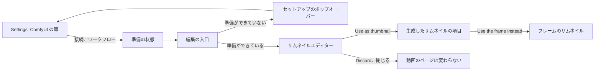
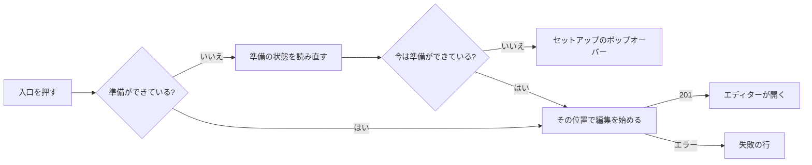
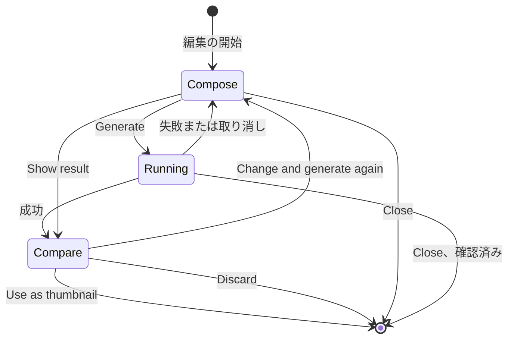

# UI 設計: 動画のフレームを ComfyUI で編集してサムネイルにする {#ui-design-editing-a-video-frame-with-comfyui-into-the-thumbnail}

**機能**: [親 Issue #942](https://github.com/syudead/vv/issues/942) · [plan.md](plan.md) · [contracts/screen-api.md](contracts/screen-api.md) · [contracts/workflow.md](contracts/workflow.md) · [data-model.md の Edit session](data-model.md#edit-session) · [research.md R-3](research.md#r-3-absent-optional-inputs-get-a-neutral-value) · [R-4](research.md#r-4-an-edit-is-an-in-memory-session-per-video-read-by-polling) · [R-7](research.md#r-7-the-generated-image-is-fitted-to-the-videos-frame-before-it-is-stored) · [R-9](research.md#r-9-the-api-key-is-write-only) · [R-10](research.md#r-10-apply-revert-and-the-position-override-are-ordered-by-the-generation-lock)

すでに決めている出典。ここでは繰り返さず、リンクする。

| 話題 | 出典 |
| --- | --- |
| トークン、閉じた段階、動画のページの密度 | [design-system.md の Foundations](../../docs/design-docs/design-system.md#foundations)。値は [`web/src/ui/tokens.css`](../../web/src/ui/tokens.css) の `@theme` にあり、ここでは名前で参照し、写さない |
| 1 つのダークの配色、ライトのセットはない | [library-ui.md の Dark scheme only](../../docs/design-docs/library-ui.md#dark-scheme-only-without-a-lightdark-switch) |
| `SettingsPage`、`PageSection`、`FormRow`、`Dialog`、`ConfirmDialog` | [patterns.md](../../web/registry/rules/patterns.md) |
| `Button`、`Textarea`、`RadioGroup`、`ToggleGroup`、`Slider`、`Popover`、`Tooltip`、`Alert`、`Progress`、`Spinner`、`Skeleton` | [components.md](../../web/registry/rules/components.md) |
| Ollama の節: Save、Save and test connection、テスト結果の行 | [`OllamaSection.tsx`](../../web/src/settings/OllamaSection.tsx) |
| 設定の行の `RadioGroup` としてのプロバイダーの選択、説明の中の手順書へのリンク | [`TranscodingSection.tsx`](../../web/src/settings/TranscodingSection.tsx)、[`docsLinks.ts`](../../web/src/settings/docsLinks.ts) |
| 動画のページの情報の行、その右側の操作、サムネイルの項目、1 つの失敗の行 | [library-ui.md の Information rows](../../docs/design-docs/library-ui.md#information-rows)。[029 UI 設計の Thumbnail fact](../029-video-overrides/ui-design.md#thumbnail-fact) |
| 取り込みボタンを押せるときと、それが送る位置 | [029 UI 設計の Capture button](../029-video-overrides/ui-design.md#capture-button) |
| CSS の幅のブレークポイント。人が確かめるレイアウト | [library-ui.md の Width breakpoints](../../docs/design-docs/library-ui.md#width-breakpoints-in-css-and-the-sidebar-exception)、[Layout verified by people](../../docs/design-docs/library-ui.md#layout-verified-by-people-not-machines) |
| 画面の文言 | [`web/src/i18n/en.ts`](../../web/src/i18n/en.ts)。この機能は `settings.comfyui`、`player.thumbnailEdit` と下の文言を加える |

この機能は 3 つのものを加える。どれも所有者専用である。

1. Settings の **ComfyUI の節** (要件 1 から 3、受け入れ条件 1)。
2. 動画のページの情報の行の操作に加わる **編集の入口**と、それが開く **サムネイルエディター** (要件 4 から 9 と 13、受け入れ条件 2 から 4 と 6)。
3. 情報の行の **生成したサムネイルの項目**と、フレームに戻る手段 (要件 10 から 12、受け入れ条件 5 と 7)。

図は、部分と、それぞれの操作の行き先を示す。

変わらないもの: プレーヤーとその操作バー、タイトル、タグと公開の切り替え、ライブラリのカード、関連動画、そのほかのすべての画面。これらは適用した画像を既存の `thumbnailUrl` で表示する。ゲストには 3 つのどれも見えない (要件 14、受け入れ条件 8)。

## この形にした理由 {#why-this-shape}

エディターは **動画のページの上の全画面のダイアログ**で、新しい `EditorDialog` パターンである ([デザインシステムの変更](#changes-to-the-design-system))。領域を塗るにはフレームをウィンドウが許すだけ大きく表示する必要があり、2 つの画像を比べるには両方を読める大きさで表示する必要がある。レジストリの `Dialog` は `max-w-lg` (32rem) で止まり、1280 px では 16:9 のフレームの高さが約 290 px になる。プレーヤーの代わりに編集する案は採らなかった。プレーヤー、そのレイヤー、そのキーが、タイトル、タグ、事実もスクロールする列の中でキャンバスに場所を譲らなければならず、編集が途中の間もページのほかの部分が動き続ける。別のルートにする案も採らなかった。要件 4 は編集を動画のページで始め、そのページを離れると編集を破棄しなければならない (Issue のエッジケース) からである。ページの上のモーダルなら、戻るボタンや再読み込みの独自の規則なしに、編集の寿命をページに結びつけられる。現在の製品の写真とサムネイルのエディター (動画の公開スタジオ、写真ライブラリ、生成による塗りつぶしのツール) は同じ形に収束している: ウィンドウ全体のエディターで、画像が中央にあり、ツールがその横か下にあり、結果を保持する前に表示する。

入口は、情報の行の操作のグループにもう 1 つ加わるアイコンボタンで、`Use current frame as thumbnail` の隣に置く。同じ対象に対する同じ種類の操作で、同じ重みだからである: サムネイルの編集が再生より目立つことは決してない (029 の [Why here and not elsewhere](../029-video-overrides/ui-design.md#why-here-and-not-elsewhere))。入口は画面上のフレームから始めるので、押せるのは取り込みボタンを押せるときとちょうど同じで、同じ位置を送る。

エディターの中では、フレームのステージが主な領域で、横のパネルが入力と 1 つの主な操作を、所有者が埋める順に上から下へ持つ: ステージの上で塗り、次に指示、次に任意の参照画像、次に `Generate` である。実行が成功すると、ステージはフレームと結果の比較に変わり、パネルの主な操作は `Use as thumbnail` になる。要件 9 の 3 つの選択肢はその下にまとまっているので、所有者が両方の画像を見ていない状態で何かが適用されることはない。

比較の中の生成した画像は、サムネイルになるときと同じに切り抜いて表示する (R-7 が動画の形に合わせる)。そのため、所有者が承認するものがカードが表示するものである。切り抜きで何かが除かれたときだけ、注記がそれを伝える。

登録したワークフローが受け取れない任意の入力は、隠さず、表示したまま無効にし、ない `vv:*` ノードを名指す控えめな色の 1 行を添える。その価値は Issue のエッジケースにある: 所有者は実行する前に、何を添えられるかを決めるのは vv ではなくワークフローであることと、どのノードを加えればよいかを知る。レジストリの無効の見た目を持ち、そのすぐ下の行が理由を述べるので、動く操作部品と間違えられない (Q-5)。

フレームに戻る手段はサムネイルの項目の `×` で、選んだ位置を消すのと同じ場所、同じ形である。要件 12 が 2 つを同じ種類の上書きにするからである。それも新しい取り込みも確認を求めない。029 でもどちらも求めない。Issue は両方を所有者が戻る手段として挙げている。

## 文言 {#words}

英語は、カタログが取り込む下書きである。実装の後は [`web/src/i18n/en.ts`](../../web/src/i18n/en.ts) が正本である。

### Settings {#settings}

| 場所 | 文言 | 備考 |
| --- | --- | --- |
| 節のタイトル | ComfyUI | |
| 節の説明 | Where VVMDM sends a video frame to edit it into a thumbnail, and the workflow it runs there. | 後に手順書へのリンクが続く |
| 手順書へのリンク | How to prepare a workflow | 文書サイトの `docs/how-to/comfyui-thumbnails.md` を新しいタブで開く。Transcoding と同じに、スクリーンリーダー向けに `Opens in a new tab` |
| プロバイダーの行のラベル | Runs on | |
| プロバイダーの選択肢 | My own ComfyUI · Comfy Cloud | |
| プロバイダーの選択肢のヒント | ComfyUI you run on this PC or another one. · Comfy's hosted service. Uses your API key and its credits. | |
| URL の行 | ComfyUI URL | ヒント: `Where ComfyUI listens, for example http://127.0.0.1:8188.` |
| API キーの行 | API key | キーが保存されていないときのヒント: `Create one in your Comfy Cloud account.` キーが保存されているとき: `A key is saved. Type a new one to replace it.` |
| 保存 | Save · Saving… | 成功時のトースト: `ComfyUI settings saved` |
| テスト | Save and test connection · Testing… | |
| テストの成功 | Connected to ComfyUI. · Connected to Comfy Cloud. | 保存したプロバイダーによる |
| テストの失敗 | The connection test failed: {reason} | `{reason}` はチェック結果の `message` |
| 保存の失敗 | Couldn't save the settings: {reason} | |
| ワークフローの行 | Workflow | ヒント: `Export it from ComfyUI with Export (API). It needs nodes titled vv:frame and vv:output.` |
| ワークフローのボタン | Upload workflow… · Replace… · Remove · Uploading… | |
| 登録したワークフロー | Registered. Takes: {inputs}. · Registered. Takes the frame only. | `{inputs}` は `instructions`、`a painted area`、`a reference image` をこの順に連ねる |
| ワークフローの拒否 | Couldn't register the workflow: {reason} | |
| 読み込み中、読み込みの失敗 | Loading the ComfyUI settings · Couldn't load the ComfyUI settings: {reason} | |

### 動画のページ {#video-page}

| 場所 | 文言 | 備考 |
| --- | --- | --- |
| 入口の名前とツールチップ | Edit thumbnail with ComfyUI | |
| セットアップのポップオーバーのタイトル | Set up ComfyUI first | |
| セットアップのポップオーバーの本文 | Save a ComfyUI connection in Settings. · Register a thumbnail workflow in Settings. · Save a ComfyUI connection and register a workflow in Settings. | `readiness` に欠けているものによる |
| セットアップのポップオーバーのリンク | Open Settings | Settings の ComfyUI の節へ |
| 開始の失敗 | Couldn't start editing the thumbnail: {reason} | 情報の行の 1 つの失敗の行 |
| エディターのタイトル、詳細 | Edit thumbnail · Frame at {time} | `{time}` は `formatDuration` の書式 |
| エディターを閉じる | Close | `×` |
| 塗りのツール | Paint · Erase · Brush size · Undo · Clear painting | `Brush size` はスライダーの名前 |
| 塗りのレイヤーの名前 | Painted area | アクセシブルな名前だけ |
| 塗りのヒント | Paint over what to change. Leave it unpainted to let the workflow change the whole frame. | |
| 指示の欄 | Instructions | プレースホルダー: `For example: remove the caption at the bottom` |
| 参照画像 | Reference image · Add image… · Remove reference image | ヒント: `PNG, JPEG or WebP, up to 20 MB.` |
| 参照画像の拒否 | Choose a PNG, JPEG or WebP image up to 20 MB. | 何かを送る前に確かめる |
| 受け取らない入力 | This workflow takes no painted area (no vv:mask node). · This workflow takes no instructions (no vv:prompt node). · This workflow takes no reference image (no vv:reference node). | |
| 主な操作 | Generate · Generate again | |
| 実行の状態 | Waiting in the queue · Preparing · Generating | |
| ステップの進み | Step {value} of {max} | プロバイダーが報告するときだけ |
| 経過時間 | {m:ss} | `tabular-nums`。`Elapsed {time}` と読み上げる |
| 長い待ちのヒント | The first run can take a minute while ComfyUI loads its models. | `Waiting in the queue` か `Preparing` で 20 秒たった後 |
| 取り消し | Cancel | |
| 取り消した後 | Cancelled. The thumbnail is unchanged. | |
| 実行の失敗 | Couldn't generate the image: {reason} | 説明: プロバイダーのメッセージがあるときはそれ |
| 比較のラベル | Frame · Generated | |
| 切り抜きの注記 | Cropped to the video's shape, as the thumbnail will be. | 結果の形が動画の形と違うときだけ |
| 比較の操作 | Use as thumbnail · Applying… · Change and generate again · Discard | |
| 結果に戻る | Show result | 結果がある間の Compose の表示で |
| 適用の失敗 | Couldn't use the image: {reason} | |
| 編集の終了 | This edit has ended, because it was opened again elsewhere or left idle. Close it and start again. | `thumbnail_edit_not_found` のとき |
| 閉じるときの確認 | Discard this edit? · The run is cancelled and the generated image is lost. The thumbnail stays as it is. · Keep editing · Discard | |
| 生成したサムネイルの項目 | Generated thumbnail | 視覚的に隠したラベル、`title`、画像の `alt` |
| 生成したサムネイルの項目の `×` | Use the frame instead | |

### エラーの理由 {#error-reasons}

`web/src/i18n/errors.ts` の `reason` の表に加える ([contracts/screen-api.md](contracts/screen-api.md)、[contracts/workflow.md の Failure reasons](contracts/workflow.md#failure-reasons))。`thumbnail_position_out_of_range`、`thumbnail_frame_unavailable`、`file_unavailable`、`video_not_found` は今の文言を保つ。

| 理由 | 文言 |
| --- | --- |
| `comfyui_url_invalid` | Enter an http or https URL |
| `comfyui_api_key_missing` | Enter the Comfy Cloud API key |
| `workflow_invalid` | The file isn't a ComfyUI workflow |
| `workflow_not_api_format` | This is the editor format; export it with Export (API) |
| `workflow_missing_node` | No node is titled {node} |
| `workflow_duplicate_node` | More than one node is titled {node} |
| `workflow_node_input_missing` | The {node} node has no input VVMDM can fill |
| `request_too_large` | The file is larger than 1 MB |
| `thumbnail_edit_not_ready` | ComfyUI isn't set up |
| `thumbnail_edit_input_unsupported` | The workflow has no node for {input} |
| `thumbnail_edit_mask_invalid` | The painting doesn't match the frame |
| `thumbnail_edit_reference_invalid` | The reference image can't be read |
| `thumbnail_edit_no_result` | There is no generated image yet |
| `thumbnail_image_invalid` | The generated image can't be read |
| `content_changed` | The video changed while you were editing |
| `unreachable` | ComfyUI can't be reached |
| `unauthorized` | Comfy Cloud rejected the API key |
| `insufficient_credits` | Comfy Cloud has no credits left |
| `workflow_rejected` | ComfyUI rejected the workflow |
| `run_failed` | The workflow failed in ComfyUI |
| `no_output` | The vv:output node produced no image |
| `timed_out` | No result after 10 minutes |

## デザインシステムの変更 {#changes-to-the-design-system}

1 つのパターンを、エディターがそれを使う前に、「Edit the thumbnail from the video page」の単位で、レジストリ、そのルールのファイル ([patterns.md](../../web/registry/rules/patterns.md))、[design-system.md](../../docs/design-docs/design-system.md) に加える。

| 変更 | 項目 | 内容 |
| --- | --- | --- |
| `EditorDialog` の雛形 | `editor-dialog`、ブロック `editor-dialog-example` | `bg-background` の上でビューポートを端から端まで埋めるモーダルの `Dialog`: 下に境界線を持つ `navbar` の高さのヘッダーの帯 (タイトル、その後の控えめな色の詳細、`ghost` `icon-sm` の `Button` としての閉じる `×`)、`stage` スロット、`aside` スロット。`lg` 以上では、ステージが残りを埋め、aside は左に境界線を持つ `detail-aside` の幅 (`xl` 以上では `detail-aside-wide`) の列である。`lg` 未満では、ステージは帯の下に置かれ、名前付きの段階 `editor-stage` (ビューポートの高さの約 45%) を上限とし、aside がその後に続く。aside は主な操作を持つ `footer` スロットを持つ: `lg` 以上では aside の下端に、`lg` 未満ではビューポートの下端に留まる。ステージは内容を `bg-muted` の上に `p-4` で中央に置く。Esc と `×` は `onClose` を呼び、画面はそれに `ConfirmDialog` で応えてよい。ウィンドウ全体を必要とする 1 つの画像に対する作業に使う。フォームは `FormDialog` のままにする |

名前付きの段階 `editor-stage` を、`player-height` と同じに `tokens.css` に加える。色のトークンは加えない: 塗りのレイヤーは `opacity-50` の `primary` の色で、ブラシの輪郭は `foreground` である。どちらも文字を持たないので、`web/src/theme/tokens.test.ts` の `pairs` には何も加えない。

## Settings: ComfyUI の節 {#settings-comfyui-section}

`ComfyUI` というタイトルの `PageSection` で、`Auto-tagging` の後、`Transcoding` の前に置く。外部の AI サービスに接続する 2 つの節が並ぶようにするためである。Ollama の節の形に従う: 接続の値は `Save` でまとめて保存し、`Save and test connection` はまず保存していない値を保存する。サーバーは保存した接続だけをテストするからである。

| 行 | 操作部品 | 規則 |
| --- | --- | --- |
| Runs on | 2 つの項目を持ち、各ラベルの下にヒントがある `RadioGroup` | 変えるとすぐに下の対応する行が表示される。`Save` まで何も保存しない |
| ComfyUI URL | `Input type="url"`、`sm:w-sm` | `My own ComfyUI` のときだけ |
| API key | `Input type="password"`、`sm:w-sm`、`autocomplete="off"` | `Comfy Cloud` のときだけ。読み込みの後と保存の後は常に空。キーが保存されているかはヒントが伝える (要件 2)。空の欄は保存したキーを保つ |
| (操作) | `Save` (`default` `sm`)、`Save and test connection` (`outline` `sm`) | テスト結果の行と保存の失敗は Ollama の節に従う: スピナーかチェックを持つ控えめな色の状態の行、または `destructive` の `Alert` |
| Workflow | 登録の状態、その後にボタン | `Save` を待たず、すぐに働く ([ワークフローの行](#workflow-row)) |

手順書へのリンクは、Transcoding の節の形で、説明の後に続く。

### ワークフローの行 {#workflow-row}

ワークフローはファイルとしてアップロードする。所有者が保持する、書き出した `.json` だからである。1 メガバイトの JSON を欄に貼り付ける案は採らなかった。

| 状態 | 行が表示するもの |
| --- | --- |
| 登録なし | `Upload workflow…` (`outline` `sm`)。`.json` のためのシステムのファイル選択を開く |
| アップロード中 | 押したボタンはスピナーとともに `Uploading…` と表示し、`aria-disabled` である |
| 登録済み | `CircleCheck` と `text-sm` の `Registered. Takes: …`、次の行に `Replace…` (`outline` `sm`) と `Remove` (`ghost` `sm`) |
| 拒否 | 前の状態が残る。行の下の `destructive` の `Alert` が `Couldn't register the workflow: {reason}` と伝え、ノードのタイトルがあるときは理由にそれを含める |

`Remove` は確認なしに働く: 所有者はファイルを保持していて、もう一度アップロードできる。拒否されたアップロードが登録したワークフローを置き換えることは決してない。`Alert` は次のアップロードか削除で消える。

### 状態 {#states}

| 状態 | 節が表示するもの |
| --- | --- |
| 読み込み中 | Ollama と同じに、`h-9` の 2 つの `Skeleton` の行 |
| 読み込みの失敗 | `Retry` を持つ `ErrorState` |
| 何も保存していない | `My own ComfyUI` を選択し、URL は空、ワークフローはない |
| 保存済み、テストしていない | 保存した値。テストの行はない |
| テスト中 | スピナーとともに `Testing…` |
| テストの成功または失敗 | 値が変わるか次のテストまで、操作の下にテストの行 |

## 動画のページ: 編集の入口 {#video-page-edit-entry}

情報の行の操作のグループで、`Use current frame as thumbnail` のすぐ後、`Open file` の前に置く `ActionButton` (`ghost` `icon-sm`、lucide `WandSparkles`、`text-muted-foreground`)。ページは所有者のために開いたときに `GET /api/thumbnail-edits/readiness` を読む。ゲストには入口もリクエストもない。

図は、入口を押したときの動作を示す。

| 状態 | 入口 |
| --- | --- |
| 準備ができている、画面にフレームがある | 押せる。再生を一時停止し、プレーヤーの位置で編集を始め、フレームを取り出す間スピンする |
| 準備ができていない (`connection` か `workflow` が false) | `opacity-50` と `aria-disabled` で、フォーカスは受け取れる。押すと準備の状態を読み直し (所有者がちょうど別のタブで設定したかもしれない)、まだ準備ができていなければ、セットアップのタイトル、欠けているものに対応する本文、`Open Settings` の `link` ボタンを持つ `Popover` を開く |
| 始めるフレームがない | `aria-disabled`、`opacity-50`、ポップオーバーはない。取り込みボタンと同じ条件 (029) |
| 開始中 | 回転する `LoaderCircle`、`aria-disabled`。2 度目に押しても何も送らない |

セットアップのポップオーバーは、ツールチップが表示されないタッチスクリーンで理由を読める唯一の場所である。ホバーなしで要件 13 の「所有者は設定が必要だとわかる」を成り立たせるのはこれである。開始の失敗は情報の行の 1 つの失敗の行 (`Couldn't start editing the thumbnail: {reason}`) を表示し、029 と同じに、それより前の行を置き換える。

## サムネイルエディター {#thumbnail-editor}

`Edit thumbnail` というタイトルで、`Frame at {time}` を詳細に持つ `EditorDialog`。ワークフローが指示を受け取るときは指示の欄に、そうでなければ `Generate` にフォーカスを置いて開く。

図は、エディターの表示と、その間を移るものを示す。その背後のセッションの状態は [data-model.md の Edit session](data-model.md#edit-session) にある。

### Compose {#compose}

ステージは、フレーム (`frameUrl`) を収まる最大の大きさで、全体が見えるように (`object-contain`) 表示し、その上に同じ大きさの塗りのレイヤーを重ねる。ステージの上端には 1 つのツールの行 (`Paint` と `Erase` を持つ `ToggleGroup type="single"` `outline` `default`、3 段階の `Slider` `Brush size`、次にツールチップ付きの `ghost` `icon` ボタンとしての `Undo` と `Clear painting`) が重なり、ステージの下には塗りのヒントが `text-sm text-muted-foreground` で置かれる。

| 塗りの規則 | 振る舞い |
| --- | --- |
| ポインター | マウス、ペン、1 本の指で塗る。ストロークの下でステージはスクロールもズームもしない |
| ブラシ | 丸いブラシ。直径はフレームの短い辺の 2%、5%、10% なので、どのウィンドウの大きさでも 1 段階がフレームの同じ部分を覆う。ホバーできるポインターでは、ブラシを `foreground` の輪郭で表示する |
| 塗り | フレームの上に `opacity-50` の `primary`。そのため、塗りの下でもフレームが読める |
| Undo | 最後のストロークを消す。ステージにフォーカスがある間は Ctrl+Z か ⌘+Z でも消す |
| Clear painting | すべてのストロークを消す |
| 送る形 | フレームのピクセルの大きさの PNG で、塗ったピクセルは白、残りは黒 ([contracts/workflow.md](contracts/workflow.md#workflow-format))。何も塗っていないときは何も送らない |

aside は上から下へ次を持つ: `Instructions` (4 行で伸びる `Textarea` とその `Label`)。`Reference image` (`outline` `default` の `Button` としての `Add image…`、または選んだ後は、`h-16` の画像とそのファイル名と `ghost` `icon-sm` の `×`) とそのヒント。そして実行の領域。フッターは `Generate` (`default`、`lg`、aside の全幅) を持ち、前の結果がある間はその上に `Show result` (`ghost`) を持つ。

ワークフローが受け取らない入力は無効 (`opacity-50`) になり、その下に `Input not taken` の行を `text-sm text-muted-foreground` で持つ。`vv:mask` がなければ、ツールの行は無効になり、ステージはストロークを受け付けない。ほかの種類の参照ファイルや 20 MB を超える参照ファイルは、何かを送る前に、aside の中の `destructive` の `Alert` で拒否する。

`Generate` は、何もない場合を含め、どの入力の組み合わせでも押せる (要件 5。ない入力は中立の値を受け取る、[R-3](research.md#r-3-absent-optional-inputs-get-a-neutral-value))。

### Running {#running}

実行中は、入力、ツールの行、ステージをロックし (操作部品に `aria-disabled` と `opacity-50`。塗りは見えたまま)、`Generate` はフッターの場所を `Cancel` (`outline`、`lg`、全幅) に譲る。aside の、フッターの上の実行の領域は次を表示する:

| 行 | 内容 |
| --- | --- |
| 状態 | `Spinner`、`text-base font-medium` の状態の文言、行の端に `text-muted-foreground tabular-nums` の経過時間 |
| 進み | `value` と `max` を持つ `Progress` と、`text-sm` の控えめな色の `Step {value} of {max}`。`progress` がある間だけ |
| ヒント | `Waiting in the queue` か `Preparing` で 20 秒たった後に、`text-sm` の控えめな色の長い待ちのヒント |

実行の領域は `role="status"` の領域なので、状態の変化が読み上げられる。経過時間は読み込みの合間はページの上で毎秒進み、読むたびにサーバーの `elapsedMs` を取るので、読み込みの遅延より大きく巻き戻ることは決してない。プロバイダーがステップを報告しないときは、バーを描かない: スピナーの隣の不確定のバーは同じことを二度言うことになる。

`Cancel` はすぐに取り消す。その後、領域は控えめな色の文字で `Cancelled. The thumbnail is unchanged.` を表示し、表示は入力を保ったまま Compose に戻る。

### 失敗 {#failure}

失敗した実行は入力を保ったまま Compose に戻り、実行の領域は `destructive` の `Alert` を表示する: タイトルは `Couldn't generate the image: {reason}`、説明はプロバイダーのメッセージがあるときはそれである。同じ `Alert` が、実行の開始の `400` と `502` の応答も伝える。`Generate` は `Generate again` と表示する。サムネイルには決して触れない (Issue のエッジケース)。

セッションが終わったとき (`404 thumbnail_edit_not_found`: 別のタブがこの動画の編集を始めたか、ページが 5 分間読み込まなかった)、ステージは最後に表示した画像を保ち、閉じる `×` 以外のすべての操作部品は無効になり、aside は `Edit ended` の `Alert` を表示する。

### Compare {#compare}

ステージは 2 つの箱を横に並べて表示し、フレームが先である。それぞれの上にラベル (`Frame`、`Generated`) を `text-sm text-muted-foreground` で置き、どちらも動画の形で同じ大きさ、間は `gap-4` である。`md` 未満では縦に積み、フレームが上になる。フレームは箱を埋める。生成した画像は箱を中央で覆い (`object-cover`)、これがサムネイルが受ける切り抜きである ([R-7](research.md#r-7-the-generated-image-is-fitted-to-the-videos-frame-before-it-is-stored))。結果の形が違うときは、箱の後に切り抜きの注記が続く。どちらの画像の上にも塗りは描かない。

aside は指示と参照を読み取り専用で保ち、実行の領域は終わった実行の経過時間を表示する。フッターは上から下へ、`Use as thumbnail` (`default`、`lg`、全幅)、次に横に並べた `Change and generate again` (`outline`) と `Discard` (`ghost`) を持つ。

| 操作 | 結果 |
| --- | --- |
| Use as thumbnail | スピンして `Applying…` と表示する。`200` のときエディターが閉じ、応答の `Video` がページの動画を置き換え、生成したサムネイルの項目が現れる ([生成したサムネイルの項目](#generated-thumbnail-item))。トーストはない: 029 と同じに、項目が結果である |
| Use as thumbnail の失敗 | エディターは残る。フッターの上の `Alert` が `Couldn't use the image: {reason}` と伝える。`content_changed` ではセッションが終わっているので、`×` だけが有効のまま残る |
| Change and generate again | 指示、塗り、参照を保ったまま Compose に戻る |
| Discard | セッションを終え (`DELETE`)、尋ねずにエディターを閉じる: 要件 9 の名指しされた選択肢だからである |

### 閉じる {#closing}

`×` と Esc はエディターを閉じる。実行中か、結果をまだ適用していない間は、`ConfirmDialog` がまず尋ねる (`Discard this edit?`)。生成した画像は取り戻せず、実行には時間がかかり、Comfy Cloud ではクレジットもかかるからである。それ以外のときはエディターはすぐに閉じる。閉じる、破棄する、動画のページを離れる、のどれもがセッションを終える。フォーカスは入口に戻る。エディターが閉じた後も再生は一時停止のままである。

エディターが開いている間、動画のページのキーは働かない: Space は欄に入力され、Esc はエディターのものである。

## 生成したサムネイルの項目 {#generated-thumbnail-item}

`thumbnailGenerated` が `true` の間、情報の行のサムネイルの項目 ([029 の Item](../029-video-overrides/ui-design.md#item-only-when-set)) は、位置の項目の代わりに生成した画像を表示する: lucide `WandSparkles` (`size-4`、`aria-hidden`)、小さな画像 (029 と同じに `thumbnailUrl`)、`Use the frame instead` という名前の `×`。画像は 1 つの位置から来たものではないので、時刻は表示しない。`×` を押すと `DELETE /api/videos/{id}/thumbnail-image` を送り、送る間スピンし、`200` のとき、位置が設定されていれば項目は位置の項目を表示し、そうでなければ消える (要件 12、受け入れ条件 7)。失敗は、029 と同じに、行の 1 つの失敗の行 `Couldn't change the thumbnail: {reason}` を使う。

`Use current frame as thumbnail` は振る舞いを保つ。`200` のとき、位置の項目が生成した項目を置き換える。サーバーが同じリクエストで画像を捨てたからである ([contracts/screen-api.md](contracts/screen-api.md#put-apivideosidthumbnail-position-changed))。

## レスポンシブな振る舞い {#responsive-behaviour}

Tailwind の既定のブレークポイントだけを使い、CSS で切り替える。判断する幅は 360px、768px、1280px で、エディターは 1440px でも判断する。

| 幅 | Settings の節 | エディター |
| --- | --- | --- |
| 1440px | 1280px と同じ | ステージが左、aside `detail-aside-wide` が右。Compare の 2 つの箱は横に並び、それぞれ約 470 px の幅 |
| 1280px | ラベルとヒントが左、操作部品が右 (`FormRow`) | ステージが左、aside `detail-aside` が右。フッターは aside の下端。ツールの行は 1 行 |
| 768px | 1280px と同じ | ステージが上で、`editor-stage` を上限とする。aside はその下。フッターは下端に留まる。Compare は横に並ぶ |
| 360px | ラベル、ヒント、操作部品を縦に積む。プロバイダーの項目も縦に積む | 768px と同じで、Compare の箱は縦に積む。ツールの行は 2 行に折り返す。`Change and generate again` と `Discard` は `Use as thumbnail` の下の 1 行を分け合う。横スクロールはない |

縦長の動画のフレームと比較の箱は、ステージの中でフレームの形を取る。ステージが横にスクロールすることは決してない。

## レビューの基準 {#review-criteria}

vv の 1 つのダークの配色で、動いている画面を見て判断する (library-ui.md の Layout verified by people)。「存在する」だけでは合格しない (Q-4)。

1. **視覚的な階層**: 動画のページでは、目は今もプレーヤー → タイトル → タグの順に動く。入口は隣の取り込みボタンと同じ重みで、塗りも境界線も `primary` の色も持たない。エディターではフレームが画面で最も大きいもので、aside より先に読まれる。Compare では 2 つの画像がどのボタンより先に読まれ、`Use as thumbnail` が見えている唯一の `primary` の操作部品である。
2. **情報の密度**: 上書きのない動画の情報の行は、ちょうど 1 つのアイコンだけ増える。aside は、ワークフローが受け取る入力だけを動く操作部品として表示し、無効な入力は段落ではなく短い 1 行を持つ。実行の領域は多くても 3 行である。
3. **間隔のリズム**: Settings の節は、その上の Ollama の節と同じ行の余白と間隔を持つ。Compare では 2 つの箱が同じ大きさで間に 1 つの間隔を持ち、ラベルは同じ高さにある。フッターのボタンは、aside の欄と両端で揃う。
4. **文字の組み方**: 実行の状態は `text-base` の太さ `medium` で読め、その下のヒントとステップの行より強い。経過時間は進んでも幅を保つ (`tabular-nums`)。すべてのヒントと `Input not taken` の行は控えめな色の `text-sm` である。`primary` で組む文字はない。
5. **操作の優先度**: 入口から、キャプションを塗り、指示を入力し、`Generate` を押すのに、ほかの手順は要らない。状態の行は時間が進みながら `Waiting in the queue` から `Generating` に変わり、`Cancel` はどの待ちの状態でもフッターに残る (受け入れ条件 4)。結果の後、`Use as thumbnail` を 1 回押すとエディターが閉じ、情報の行が生成したサムネイルの項目を表示する。その `×` を 1 回押すとフレームが戻る (受け入れ条件 5 と 7)。
6. **見える状態**: 固まって見える待ちはない: `Preparing` の間も時間は数え続け、20 秒後にヒントが現れる。失敗、取り消し、破棄は、カード、動画のページのサムネイルの項目、関連動画を元のままにし (受け入れ条件 6)、失敗の理由はその原因を言葉で名指す。
7. **電話の幅**: 360px では、ページがスクロールせずに指でフレームを塗れる。aside がスクロールする間も、フッターの主な操作は画面に残る。横にスクロールするものはない。
8. **ゲスト**: サインアウトした状態では、同じ動画のページに入口も、生成したサムネイルの項目も、ComfyUI へのリクエストもない (受け入れ条件 8)。
9. **要件を満たさない例**: 編集が別のページか、塗るには小さすぎるダイアログで開く。両方の画像が見える前に `Use as thumbnail` を押せる。カードが切り抜いて表示するのに、比較は生成した画像を切り抜かずに表示する。保存した API キーが欄かページのソースに現れる。ワークフローが受け取れない入力が入力を受け付ける。ComfyUI を設定していないときに、入口が理由を添えて薄く表示されるのではなく、隠される。

## アクセシビリティ {#accessibility}

親 Issue はスクリーンリーダーやコントラストの設計を求めていないので、029 と同じに、名前と読み上げだけを決める。

- 入口は `Edit thumbnail with ComfyUI` である。生成したサムネイルの項目の画像の `alt` と隠したラベルは `Generated thumbnail`、その `×` は `Use the frame instead` である。
- ステージの塗りのレイヤーの名前は `Painted area` である。塗りにはキーボードの形がなく、Issue もそれを求めていない。
- 実行の領域は `role="status"`、失敗の `Alert` は `role="alert"` である。スピナーは `aria-hidden` で、送信中またはロック中の操作部品は `aria-disabled` である。
