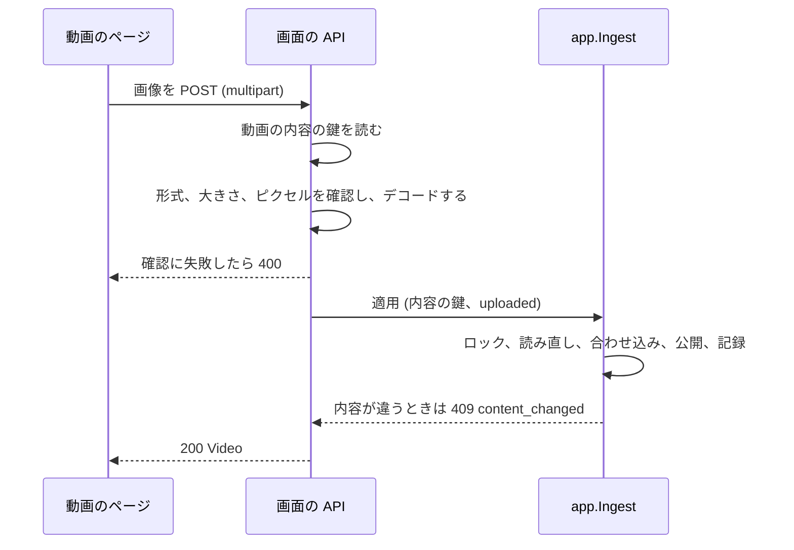

# 契約: サムネイルの画像のアップロードと、今のサムネイルからの編集の開始 {#contract-uploading-a-thumbnail-image-and-starting-an-edit-from-the-current-thumbnail}

正本: `api/openapi.yaml`。この文書は、この機能が加えるルート、変える 2 つのルート、置き換える `Video` のフィールドを扱う。すべてのルートは所有者専用である: どれも `accessRoutes` に挙がっていないので、境界はゲストに `401` を返し (要件 7)、`TestAccessClassificationMatchesOpenAPISecurity` が各ルートの `security` を確かめる。エラーの本文は [023 error-api](../../023-english-i18n/contracts/error-api.md) に従う。この機能は下に挙げる理由を加える。[045 contracts/screen-api.md](../../045-comfyui-thumbnails/contracts/screen-api.md) のほかのルートは変わらない。

## `Video` の変更 {#video-change}

| フィールド | 型 | 規則 |
| --- | --- | --- |
| `thumbnailImage` | `generated`、`uploaded` | 適用した画像がサムネイルである間、所有者への応答にだけある。`thumbnailGenerated` を置き換える ([R-5](../research.md#r-5-thumbnailimage-names-the-applied-images-origin-in-place-of-thumbnailgenerated)) |
| `thumbnailUrl` | string (既存) | 変わらない: 画像を適用している間、バージョンはゲストに対しても `<content key prefix>-g<revision>` である |

## `POST /api/videos/{id}/thumbnail-image` {#post-apivideosidthumbnail-image}

`uploadThumbnailImage`。アップロードした画像を動画のサムネイルにする ([R-1](../research.md#r-1-an-uploaded-image-is-applied-within-its-request-through-the-same-apply-as-a-generated-image))。

図は、リクエストの経路と、各失敗をどこで返すかを示す。

| フィールド | 場所 | 型 | 必須 | 意味 |
| --- | --- | --- | --- | --- |
| `image` | `multipart/form-data` | 64 MiB と 120 メガピクセルまでの PNG、JPEG、静止画の WebP | はい | 画像 ([R-2](../research.md#r-2-an-upload-is-a-png-jpeg-or-still-webp-of-at-most-64-mib-and-120-megapixels-decoded-one-at-a-time)) |

**応答**: サムネイルのファイルを公開した時点で、`thumbnailImage: "uploaded"` と新しい `thumbnailUrl` のバージョンを持つ、`GET /api/videos/{id}` の `Video` とともに `200`。位置の上書きの後と同じく、既存の `video` イベントが続く。生成した画像の適用の後と同じく、先に設定した位置は記録されたまま残る。

| ステータス | `code` / 理由 | いつ |
| --- | --- | --- |
| `400` | `invalid_request` / `thumbnail_upload_too_large` | `image` パートが 64 MiB を超える (multipart の枠組みのため、本文全体は最大 1 MiB 大きくてよい)、またはヘッダーが 120 メガピクセルを超えると示す。`limit` が超えた上限を持つ |
| `400` | `invalid_request` / `thumbnail_upload_invalid` | PNG、JPEG、WebP ではない、アニメーションの WebP、または最後までデコードできないファイル |
| `404` | `not_found` / `video_not_found` | その動画がない |
| `409` | `conflict` / `content_changed` | 動画がなくなった、またはリクエストの開始時と別の内容を持つ |
| `409` | `conflict` / `thumbnail_image_invalid` | ffmpeg が画像を合わせ込めなかった |

どのエラーでも何も書かない。本文がすべて届く前に切れたリクエストは適用しない。本文が届いた後は、確認と適用は、クライアントのキャンセルから切り離され 5 分を上限とするコンテキストの下で実行するので、ページがなくなっても完了する ([R-1](../research.md#r-1-an-uploaded-image-is-applied-within-its-request-through-the-same-apply-as-a-generated-image))。

## `POST /api/videos/{id}/thumbnail-edits` (変更) {#post-apivideosidthumbnail-edits-changed}

`startThumbnailEdit`。本文に `source` が加わる ([R-4](../research.md#r-4-an-edit-from-the-current-thumbnail-starts-from-the-stored-source-or-from-the-thumbnails-frame))。

| フィールド | 場所 | 型 | 必須 | 意味 |
| --- | --- | --- | --- | --- |
| `source` | 本文 | `frame`、`thumbnail` | はい | 編集が何から始まるか |
| `positionMs` | 本文 | integer | `frame` のとき | 今までどおりフレームの位置。`thumbnail` では無視する |

**応答**: 今までどおり `ready` の `ThumbnailEdit` とともに `201`。`thumbnail` では、セッションの画像は、画像を適用しているときは保存した元画像、そうでなければ記録した位置のフレーム、それもなければ自動の位置のフレーム、その位置からフレームが得られないときは、サムネイルのジョブと同じく最初のフレームである。`frameUrl`、`frameWidth`、`frameHeight` は元が何であれその画像を表し、マスクはその大きさに合わなければならない。

| ステータス | `code` / 理由 | いつ |
| --- | --- | --- |
| `400` | `invalid_request` / `thumbnail_position_out_of_range` | 動画の長さの外の位置を持つ、または `positionMs` のない `frame` |
| `404`、`409` | 今までどおり | `thumbnail_edit_not_ready`、`thumbnail_frame_unavailable` (保存した元画像をデコードできないときも)、`file_unavailable` |

## `ThumbnailEdit` (変更) {#thumbnailedit-changed}

| フィールド | 型 | 意味 |
| --- | --- | --- |
| `source` | `frame`、`thumbnail` | セッションが何から始まったか |
| `positionMs` | integer | 画像がフレームのときにフレームを取り出した位置 (選んだもの、記録したもの、自動のもの、または最初のフレームへの代替の後の `0`)。保存した元画像のときはない |

ほかのフィールドは変わらない。

## クライアントでの使い方 {#client-use}

動画のページは、編集の準備状態とは関係なく独自の入口からアップロードし、応答で動画を置き換える。所有者が編集を始めるとき、ページはプレーヤーの位置とともに `source: "frame"` を、または位置なしで `source: "thumbnail"` を送り、エディターは応答の `source` と `positionMs` によって最初の画像にラベルを付ける。
