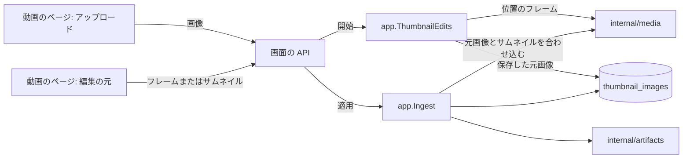
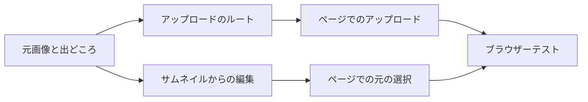

# 実装計画: ローカルの画像をサムネイルにし、今のサムネイルを ComfyUI で編集する {#implementation-plan-set-a-local-image-as-the-thumbnail-and-edit-the-current-thumbnail-with-comfyui}

**ブランチ**: `feature/046-thumbnail-upload-edit` | **親 Issue**: #980

**入力**: 親 Issue。これがこの機能の仕様である。

## 概要 {#summary}

所有者は動画のページで自分の端末から PNG、JPEG、WebP をアップロードし、それが動画のサムネイルになる。生成した画像と同じように保持される ([045 R-6](../045-comfyui-thumbnails/research.md#r-6-the-applied-image-is-user-data-in-sqlite-the-thumbnail-file-is-rebuilt-from-it)): 動画の縦横比に合わせ、再スキャンの後に公開し直し、新しい位置か「use the frame instead」で外れる。ComfyUI の編集は、画面上のフレームの代わりに、今のサムネイルが何であってもそこから始められるようになる: 画像を適用しているときは保存した画像、そうでなければサムネイルを取り出したフレームである。保存した画像を編集できるようにするため、適用は 640 px のサムネイルの隣に、編集の解像度でその複製を保持する。

図は、この機能が加える、または変える部分と、それぞれがやり取りする相手を示す。045 の変わらない部分は [thumbnail-editing.md](../../docs/design-docs/thumbnail-editing.md) にある。



| 関心事 | 方針 |
| --- | --- |
| アップロード | 所有者専用の multipart のルートを 1 つ。生成した画像と同じ適用によって、リクエストの中で適用する ([R-1](research.md#r-1-an-uploaded-image-is-applied-within-its-request-through-the-same-apply-as-a-generated-image)、[contracts/screen-api.md](contracts/screen-api.md#post-apivideosidthumbnail-image)) |
| 受け付けるもの | 64 MiB と 120 メガピクセルまでの PNG、JPEG、静止画の WebP。一度に 1 つのアップロードが、確認と適用の合わせ込みでその元画像をデコードする ([R-2](research.md#r-2-an-upload-is-a-png-jpeg-or-still-webp-of-at-most-64-mib-and-120-megapixels-decoded-one-at-a-time)) |
| 再編集 | 行は、適用した画像の最大 2048 px の元画像とその出どころを保持する ([R-3](research.md#r-3-the-row-keeps-the-applied-images-source-at-up-to-2048-px-and-its-origin)、[data-model.md](data-model.md)) |
| 編集の元 | 編集の開始時の `source`: 画面上のフレーム、または今のサムネイル ([R-4](research.md#r-4-an-edit-from-the-current-thumbnail-starts-from-the-stored-source-or-from-the-thumbnails-frame)) |
| 画像の呼び方 | `thumbnailImage` (`generated` または `uploaded`) が `thumbnailGenerated` を置き換える ([R-5](research.md#r-5-thumbnailimage-names-the-applied-images-origin-in-place-of-thumbnailgenerated)) |
| 順序と元に戻す操作 | 変わらない: 生成のロック、位置の設定や元に戻す操作による行の削除 ([045 R-10](../045-comfyui-thumbnails/research.md#r-10-apply-revert-and-the-position-override-are-ordered-by-the-generation-lock)) |

Issue には `ui` ラベルがあるので、2 つの画面の単位より前に `design` 段階が `ui-design.md` を書く。それが扱うのは次である: 動画のページのアップロードの入口とその状態 (選択中、送信中、拒否、失敗)、アップロードした画像のための情報行の項目、編集を始めるときに所有者がフレームと今のサムネイルのどちらかを選ぶ方法、元が今のサムネイルであるときのエディターのタイトル、詳細、比較のラベル。

親 Issue の `対象外` のとおり範囲外のもの: 複数の動画に一度に画像を設定すること、適用した画像の履歴、外部 API と MCP、vv の中での手動の切り抜きや回転、シーク用のスプライト、カードのスクラブのフレーム、ホバーのプレビュー。

## 技術的な文脈 {#technical-context}

**正本の定義**:

| 項目 | 出典 |
| --- | --- |
| 境界、ユーザーデータ、生成ファイル、認証の境界 | [ARCHITECTURE.md](../../ARCHITECTURE.md)、[.golangci.yml](../../.golangci.yml) |
| 適用した画像、その適用、元に戻す操作、公開し直し、生成のロック | [045 調査](../045-comfyui-thumbnails/research.md)、[045 データモデル](../045-comfyui-thumbnails/data-model.md)、[thumbnail-editing.md](../../docs/design-docs/thumbnail-editing.md)、[internal/app/ingest.go](../../internal/app/ingest.go)、[internal/store/thumbnail_images.go](../../internal/store/thumbnail_images.go) |
| 編集のセッション、フレーム、入力の確認 | [internal/app/thumbnail_edits.go](../../internal/app/thumbnail_edits.go)、[internal/app/thumbnail_edit_images.go](../../internal/app/thumbnail_edit_images.go)、[045 contracts/screen-api.md](../045-comfyui-thumbnails/contracts/screen-api.md) |
| 合わせ込みとフレームの取り出し | [internal/media/thumbnail_image.go](../../internal/media/thumbnail_image.go)、[internal/media/frame.go](../../internal/media/frame.go)、[internal/media/thumbnail.go](../../internal/media/thumbnail.go) |
| ワークフローの入力 (`vv:frame` は任意の PNG を受け取る) | [045 contracts/workflow.md](../045-comfyui-thumbnails/contracts/workflow.md#workflows) |
| 画面の API、エラー、生成コード | [api/openapi.yaml](../../api/openapi.yaml)、[023 error-api](../023-english-i18n/contracts/error-api.md)、`task generate` |
| 動画のページ、エディター、画面の規則と Web のテスト | [045 ui-design](../045-comfyui-thumbnails/ui-design.md)、[web/src/player/VideoFacts.tsx](../../web/src/player/VideoFacts.tsx)、[web/src/player/thumbnailEdit/](../../web/src/player/thumbnailEdit/)、[design-system.md](../../docs/design-docs/design-system.md)、[web-testing.md](../../docs/design-docs/web-testing.md) |
| ブラウザーテストと偽の ComfyUI | [web/e2e/thumbnail-edit.e2e.ts](../../web/e2e/thumbnail-edit.e2e.ts)、[web/e2e/fake-comfyui.mjs](../../web/e2e/fake-comfyui.mjs) |
| 検査 | [Taskfile.yml](../../Taskfile.yml) (`task check`、`task check-docs`、`task test-e2e`) |

**この機能に固有の文脈**:

- マイグレーションを 1 つ、`00041_thumbnail_image_sources.sql` ([data-model.md、Migration](data-model.md#migration))。新しい Go と Web の依存はない。
- Go のプロセスで 64 メガピクセルを超える画像をデコードする最初のルート: 120 メガピクセルの PNG は 480 MB にデコードされるので、確認と、元画像をもう一度デコードする適用の 2 回の合わせ込みは、一度に 1 つのアップロードずつ実行する ([R-2](research.md#r-2-an-upload-is-a-png-jpeg-or-still-webp-of-at-most-64-mib-and-120-megapixels-decoded-one-at-a-time))。
- e2e の実行には、アップロードする PNG、JPEG、WebP が必要である。ffmpeg のビルドには libwebp がないことがあるので、WebP はチェックインしたフィクスチャのファイルにする。

## Constitution Check {#constitution-check}

| 規則 (出典) | 判定 |
| --- | --- |
| アダプターは互いにも `internal/app` にも依存せず、`internal/app` はアダプターに依存しない (ARCHITECTURE.md、depguard) | 適合: 合わせ込みは `Generator` インターフェースの後ろの `internal/media` にとどまり、確認と適用は `internal/app`、multipart の読み取りは `internal/httpapi` にある |
| ユーザーデータは作り直しの後も残る (ARCHITECTURE.md) | 適合: 元画像と出どころは `thumbnail_images` の列であり、内容の鍵をキーにし、外部キーを持たない |
| 生成ファイルの所有者は 1 つ (ARCHITECTURE.md) | 適合: サムネイルのファイルは今までどおり `internal/artifacts` だけが公開する。アップロードは合わせ込むまでメモリに保持する ([R-1](research.md#r-1-an-uploaded-image-is-applied-within-its-request-through-the-same-apply-as-a-generated-image)) |
| すべての読み取りは閲覧者を知る (ARCHITECTURE.md) | 適合: アップロードのルートは所有者専用で、`accessRoutes` にない。`thumbnailImage` は、`thumbnailGenerated` と同じく、所有者への応答にだけある |
| コミット後のイベント (ARCHITECTURE.md) | 適合: アップロードは適用のトランザクションの後に既存の `VideoOverrideChanged` を発行する |
| 生成ファイルを手で編集しない (AGENTS.md) | 適合: `api/openapi.yaml` を変え、それから `task generate` を実行する |
| 複雑さは 25 以下。コードは複製せずに共有する (AGENTS.md) | 適合: アップロードのルートは実行のルートの multipart の読み取りでそのパートを読み、アップロードの確認は、ピクセルの上限を大きくした編集の画像の確認である |
| 画面の前に design-system.md を読む。最も低いレベルでテストする (AGENTS.md) | 適合: 上限にはドメインのテスト、適用にはアプリとストアのテスト、ルートにはハンドラーのテスト、画面にはページテスト、流れには 1 つのブラウザーテストを当てる |
| 文書は変更とともに (core-beliefs.md) | 適合: 各単位は更新する文書を挙げる |

違反はないので、複雑さの追跡はない。判定は Phase 1 の後も成り立つ。

## プロジェクトの構成 {#project-structure}

### 文書 (この機能) {#documentation-this-feature}

```text
specs/046-thumbnail-image-upload/
├── plan.md
├── research.md
├── data-model.md
├── quickstart.md
└── contracts/
    └── screen-api.md
```

`ui-design.md` は `design` 段階が書く (Issue に `ui` ラベルがある)。自動の検査は生成した画像を偽の ComfyUI にしかアップロードしないので、`quickstart.md` がある。実際のスマートフォンの写真と、アップロードした写真からの実際のモデルの結果は人が確かめる。

### ソースコード {#source-code}

**影響する境界**:

| 境界 | この機能で受け持つもの |
| --- | --- |
| `internal/domain` | アップロードの上限とそのエラー、`ThumbnailImageOrigin`、`Video.ThumbnailImageOrigin`、編集の元 |
| `internal/media` | `FitThumbnailSource` (最大 2048 px で縦横比に合わせる) と、フレームに基づく元画像のためのサムネイルのジョブのフレームの規則 (自動の位置、次に最初のフレーム) |
| `internal/store` | マイグレーション、`source` と `origin` の列、元画像の読み取り |
| `internal/app` | アップロードの確認、確認と適用の合わせ込みのあいだ保持するアップロードのゲート、元画像と出どころを書く `Ingest.ApplyThumbnailImage`、元を受け取る `ThumbnailEdits.Start` |
| `internal/httpapi`、`api/openapi.yaml` | アップロードのルート、変わる開始のルート、`Video` のフィールド、実行のルートと共有する multipart の読み取り |
| `web/src/api`、`web/src/player`、`web/src/i18n` | クライアントの関数、アップロードの入口と項目、編集の元の選択、カタログの文言 |
| `web/e2e` | アップロードのフィクスチャとブラウザーテスト |
| `docs/` | `thumbnail-editing.md` (アップロード、編集の元)、`library-ui.md` (情報行の項目)、`running-vv.md` (一覧は変わらず、行が大きくなる) |

**新しいパス**: `internal/store/migrations/00041_thumbnail_image_sources.sql`、`internal/httpapi/thumbnail_upload.go`、`web/src/player/thumbnailUpload/`、`web/e2e/fixtures/thumbnail-upload.webp`。

**構成の決定**: アップロードは編集のセッションの一段階ではなく、動画の独自のルートである。そのため ComfyUI の接続なしで動き、状態を持たない ([R-1](research.md#r-1-an-uploaded-image-is-applied-within-its-request-through-the-same-apply-as-a-generated-image))。アップロードの入口は `web/src/player/` の下、`thumbnailEdit/` の隣の独自のディレクトリにする。情報行の失敗の行を編集の入口と共有するが、エディターのビューは何も共有しないからである。

## 実装作業 {#implementation-work}

図は、どの単位が先に入る必要があるかを示す。2 つの画面の単位は、`design` 段階の `ui-design.md` も待つ。



### 再編集のために、適用した画像の元画像と出どころを保持する {#keep-the-applied-images-source-and-origin-for-re-editing}

**範囲**: `00041_thumbnail_image_sources.sql` と、ストアの `source` と `origin` の書き込みと読み取り、`internal/media` の `FitThumbnailSource`、出どころを受け取り、サムネイルとともに元画像を書く `Ingest.ApplyThumbnailImage`、`Video.ThumbnailImageOrigin`、`api/openapi.yaml` で `thumbnailGenerated` を置き換える `thumbnailImage`、クライアントの型と、それを読む動画のページの既存の項目とブラウザーテスト、サムネイルの編集の設計文書の行についての記述 ([data-model.md](data-model.md)、[R-3](research.md#r-3-the-row-keeps-the-applied-images-source-at-up-to-2048-px-and-its-origin)、[R-5](research.md#r-5-thumbnailimage-names-the-applied-images-origin-in-place-of-thumbnailgenerated)、[contracts/screen-api.md、`Video` change](contracts/screen-api.md#video-change))。

**依存**: なし。

**受け入れ**: `task check` と `task check-docs` が通り、`task generate` で差分が出ない。メディアのテストが次を示す: 16:9 の動画のために合わせ込んだ 4000 × 3000 の PNG は 2048 × 1152 になり、1280 × 720 のものは大きさを保つ。ストアとアプリのテストが次を示す: 適用は `source`、`origin`、640 px の `image` を 1 つのトランザクションで書く。位置の変更と元に戻す操作は 3 つすべてを取り除く。サムネイルのジョブは今までどおり `image` を公開し直す。前のマイグレーションの行は null の元画像と `generated` として読める。不変条件のテストは空の `source` を拒否する。ハンドラーのテストが次を示す: 編集の適用の後、所有者の応答に `thumbnailImage: "generated"` があり、ゲストのとき、または画像を適用していないときにはそのフィールドがない。

### 画面の API で画像を動画のサムネイルとしてアップロードする {#upload-an-image-as-the-videos-thumbnail-through-the-screen-api}

**範囲**: `POST /api/videos/{id}/thumbnail-image` と、実行のルートと共有するその multipart の読み取り (`image` パートに 64 MiB、本文にはそれより 1 MiB 多く)、`internal/domain` の上限とエラー、`internal/app` のアップロードの確認 (形式、静止画の WebP、大きさ、ピクセルの上限、最後までのデコード)、確認のあいだと、生成のロックの中で再び適用の 2 回の合わせ込みのあいだ保持するプロセス全体のアップロードのゲート、リクエストの開始時に読んだ内容の鍵による、生成のロックの中での出どころ `uploaded` の適用、本文が届いた後にクライアントのキャンセルから切り離した 5 分のコンテキストの下での確認と適用、クライアントの関数、thumbnail-editing.md の「Uploaded images」の節 ([R-1](research.md#r-1-an-uploaded-image-is-applied-within-its-request-through-the-same-apply-as-a-generated-image)、[R-2](research.md#r-2-an-upload-is-a-png-jpeg-or-still-webp-of-at-most-64-mib-and-120-megapixels-decoded-one-at-a-time)、[contracts/screen-api.md](contracts/screen-api.md#post-apivideosidthumbnail-image))。

**依存**: 再編集のために、適用した画像の元画像と出どころを保持する。

**受け入れ**: `task check` と `task check-docs` が通り、`task generate` で差分が出ない。ハンドラーのテストが次を示す: PNG、JPEG、WebP はそれぞれ `thumbnailImage: "uploaded"` と新しい `thumbnailUrl` のバージョンを持つ `200` を返す。テキストのファイル、途中で切れた JPEG、アニメーションの WebP は `400 thumbnail_upload_invalid` を返す。64 MiB を超える `image` パートと、ヘッダーが 12000 × 11000 と示す画像は `limit` を持つ `400 thumbnail_upload_too_large` を返す。ちょうど 64 MiB の `image` パートは大きさのために拒否されない。本文をすべて送った後に切断したクライアントでも、サムネイルは適用される。どの `400` でも何も書かない。読み取りとロックの間に内容が変わった動画は `409 content_changed` を返す。ゲストは `401` を受け取る。`TestAccessClassificationMatchesOpenAPISecurity` が通る。ブロックする偽の合わせ込み器を使うアプリのテストが次を示す: 1 つ目が合わせ込みをしている間、2 つ目のアップロードの確認は待ち、1 つ目が確認されている間、2 つ目のアップロードの合わせ込みは待つ。動画のロックを待っているアップロードはゲートを保持しない。位置の変更の後ろでロックを待つアップロードは、それでも勝つ。

### 今のサムネイルからサムネイルの編集を始める {#start-a-thumbnail-edit-from-the-current-thumbnail}

**範囲**: `POST /api/videos/{id}/thumbnail-edits` の `source` と省略できる `positionMs`、行の元画像 (元画像のない行では `image`) を PNG として受け取るか、記録した位置で、または `internal/media` が公開するサムネイルのジョブの規則 (自動の位置、次に最初のフレーム) でフレームを取り出す `ThumbnailEdits.Start`、`ThumbnailEdit` の `source` と `positionMs`、クライアントの関数、thumbnail-editing.md の「Edit source」の節 ([R-4](research.md#r-4-an-edit-from-the-current-thumbnail-starts-from-the-stored-source-or-from-the-thumbnails-frame)、[contracts/screen-api.md](contracts/screen-api.md#post-apivideosidthumbnail-edits-changed))。

**依存**: 再編集のために、適用した画像の元画像と出どころを保持する。

**受け入れ**: `task check` と `task check-docs` が通り、`task generate` で差分が出ない。偽のフレームの供給元を使うアプリのテストが次を示す: 画像を適用しているときの `thumbnail` は、保存した元画像のピクセルの大きさを持ち `positionMs` のない `ready` を返し、フレームのルートは PNG を返す。位置があり画像のない `thumbnail` はその位置で取り出し、その位置を返す。どちらもない `thumbnail` は動画の長さに対する自動の位置で取り出してその位置を返し、その位置からフレームが得られないときは最初のフレームを取り出して `positionMs: 0` を返す。`positionMs` のない `frame` は `400` を返す。セッションの開始後の元に戻す操作はセッションの画像を変えず、実行はその画像を使い続ける。ハンドラーのテストが契約の各ステータスとゲストの `401` を示す。

### 動画のページからサムネイルの画像をアップロードする {#upload-a-thumbnail-image-from-the-video-page}

**範囲**: 所有者のための情報行のアップロードの入口、PNG、JPEG、WebP に限ったファイルの選択、何かを送る前の別の種類や 64 MiB を超えるファイルの拒否、送信中の状態、失敗の行、「use the frame instead」を持つアップロードした画像の項目、カタログの文言とエラーの理由。配置、文言、状態は `ui-design.md` に従い、library-ui.md の情報行に入口と項目が加わる。

**依存**: 画面の API で画像を動画のサムネイルとしてアップロードする。

**受け入れ**: `task check` と `task check-docs` が通る。ページテストが次を示す: ゲストには入口がない。拒否したファイルの文言が出て、リクエストは送られない。応答の `Video` がページの動画を置き換え、項目がアップロードした画像を示す。`400` では理由の文言を持つ失敗の行が出る。項目の `×` が元に戻す操作を呼ぶ。画面の変更は、スマートフォンの幅で design-system.md に照らした見た目のレビューを受ける。

### 動画のページで編集するときに、フレームか今のサムネイルを選ぶ {#choose-the-frame-or-the-current-thumbnail-when-editing-on-the-video-page}

**範囲**: 所有者が編集を始めるときの元の選択、`source` を持つ開始のリクエスト、元がサムネイルのときのエディターのタイトル、詳細、比較のラベル、カタログの文言。操作と文言は `ui-design.md` に従う。エディターの塗り、実行、キャンセル、適用、破棄は変わらない。

**依存**: 今のサムネイルからサムネイルの編集を始める。

**受け入れ**: `task check` が通る。ページテストが次を示す: 今のサムネイルの選択は位置なしで `source: "thumbnail"` を送り、フレームの選択はプレーヤーの位置を送る。エディターの詳細は元を示す。比較の最初の枠は、元がサムネイルであることを示すラベルを持つ。画面の変更は、スマートフォンの幅で design-system.md に照らした見た目のレビューを受ける。

### アップロードと今のサムネイルからの編集をブラウザーテストで確かめる {#cover-the-upload-and-the-edit-from-the-current-thumbnail-in-a-browser-test}

**範囲**: `run-e2e.mjs` が生成する PNG と JPEG のフィクスチャ、チェックインした WebP のフィクスチャ、偽の ComfyUI に対する `web/e2e/thumbnail-edit.e2e.ts` のアップロードとサムネイルを元とする流れ。

**依存**: 動画のページからサムネイルの画像をアップロードする。動画のページで編集するときに、フレームか今のサムネイルを選ぶ。

**受け入れ**: `task test-e2e -- e2e/thumbnail-edit.e2e.ts` が通り、次を示す: ページからアップロードした 3 つの形式はそれぞれ、ライブラリのカード、動画のページ、別の動画の関連動画でサムネイルになり、再読み込みと完全なスキャンの後も残る。縦横比の違う画像は、動画の縦横比でカードを満たす。「use the frame instead」と新しいキャプチャはフレームを戻す。アップロードした画像から始めた編集はそれを元として示し、マスクした実行の後、塗った範囲の中に偽物の色を、その外にアップロードした画像の色を示す。生成したサムネイルから始めた編集は、新しい結果の隣にその画像を示す。ゲストにはアップロードの入口も元の選択も見えない。
