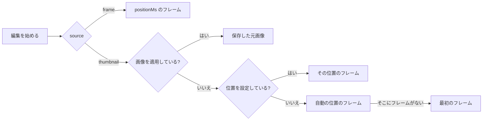

# 調査: ローカルの画像をサムネイルにし、今のサムネイルを ComfyUI で編集する {#research-set-a-local-image-as-the-thumbnail-and-edit-the-current-thumbnail-with-comfyui}

親 Issue: #980。引き継ぐ決定:

| 項目 | 正本 |
| --- | --- |
| 動画の縦横比に合わせ、サムネイルのジョブが公開し直すユーザーデータとしての適用した画像。生成のロックで順序づける適用、元に戻す操作、位置の上書き | [045 R-6](../045-comfyui-thumbnails/research.md#r-6-the-applied-image-is-user-data-in-sqlite-the-thumbnail-file-is-rebuilt-from-it)、[R-7](../045-comfyui-thumbnails/research.md#r-7-the-generated-image-is-fitted-to-the-videos-frame-before-it-is-stored)、[R-10](../045-comfyui-thumbnails/research.md#r-10-apply-revert-and-the-position-override-are-ordered-by-the-generation-lock) |
| メモリ上の編集のセッション、最大 2048 px のフレーム、入力の確認 | [045 R-4](../045-comfyui-thumbnails/research.md#r-4-an-edit-is-an-in-memory-session-per-video-read-by-polling)、[R-8](../045-comfyui-thumbnails/research.md#r-8-the-frame-is-extracted-by-the-server-at-up-to-2048-px)、[thumbnail-editing.md](../../docs/design-docs/thumbnail-editing.md#inputs-are-checked-before-anything-is-uploaded) |
| ワークフローはマスクを通じて結果を入力に合成する | [045 R-3](../045-comfyui-thumbnails/research.md#r-3-absent-inputs-get-a-neutral-value-or-the-variant-without-the-node)、[contracts/workflow.md](../045-comfyui-thumbnails/contracts/workflow.md#workflows) |
| エラーの形と理由のコード | [023 error-api](../023-english-i18n/contracts/error-api.md) |

このファイルは、この機能が加える決定だけを記録する。

## R-1: アップロードした画像は、そのリクエストの中で、生成した画像と同じ適用によって適用する {#r-1-an-uploaded-image-is-applied-within-its-request-through-the-same-apply-as-a-generated-image}

**決定**: `POST /api/videos/{id}/thumbnail-image` は画像を `multipart/form-data` として受け取り、メモリに保持し、確認し、生成のロックの中で、リクエストの開始時に読んだ動画の内容の鍵とともに、出どころ `uploaded` で `Ingest.ApplyThumbnailImage` に渡す。合わせ込んだ画像を公開する前には何もディスクに触れず、リクエストはサムネイルが置かれた時点で `Video` を返す。リクエストのコンテキストは本文を読むためだけに使う: 本文がすべて届いた後は、確認と適用は、クライアントのキャンセルから切り離され 5 分を上限とするコンテキストの下で実行するので、去ったページが送り終えたアップロードを中断することはなく、サーバーの停止は他のハンドラーと同じくそのハンドラーを待つ。

| 案 | 判定 |
| --- | --- |
| **独自のルートで、リクエストの中で適用する** | 採用 |
| 編集のセッションを通じたアップロード (画像で編集を始め、それから適用する) | 不採用: 編集を始めるには保存した ComfyUI の接続が必要であり、要件 1 はそれを求めていない。セッションの 5 分の寿命とポーリングは、1 段階のアップロードに何も加えない |
| アップロードをまず一時ファイルに書く | 不採用: 途中で切れたリクエストは片付けるべきファイルを残す (Issue のエッジケース)。メモリなら、切れたリクエストは何も残さない |

**理由**: 適用は、画像ができた後のすべてをすでに担う: 内容の確認、合わせ込み、退避と公開、行、イベント。本文が届く前に内容の鍵を読んで適用に渡すと、エッジケース「動画がなくなった、またはその場所が別の内容を持つ」に編集のセッションと同じ方法で答えられ、ロックがアップロード、位置の変更、生成した画像の適用を「最後に確定したものが勝つ」にする。適用の合わせ込みとストアへの書き込みは渡されたコンテキストを受け取り、それがキャンセルされると止まるので、リクエストのコンテキストの下で実行すると、送った後にページを閉じたアップロードを落としてしまう。5 分の上限は、アップロードのゲート ([R-2](#r-2-an-upload-is-a-png-jpeg-or-still-webp-of-at-most-64-mib-and-120-megapixels-decoded-one-at-a-time)) と生成のロックを待つ時間、およびそれぞれ最大 60 秒の 2 回の合わせ込みを含む。

## R-2: アップロードは 64 MiB 以下、120 メガピクセル以下の PNG、JPEG、静止画の WebP であり、一度に 1 つずつデコードする {#r-2-an-upload-is-a-png-jpeg-or-still-webp-of-at-most-64-mib-and-120-megapixels-decoded-one-at-a-time}

**決定**: `image` パートは、64 MiB 以下で、ヘッダーが 1 億 2000 万ピクセル以下と示す PNG、JPEG、WebP でなければならず、何かを適用する前に最後までデコードする。どこで失敗しても、`thumbnail_upload_too_large` (バイトまたはピクセル、`limit` 付き) か `thumbnail_upload_invalid` (どの形式でもない、途中で切れている、壊れている、アニメーションである) を持つ `400` を返す。64 MiB はパートに適用する。実行のルートの本文の上限がそのパートの上限に余裕を加えるのと同じく、本文全体は multipart の境界とパートのヘッダーのために 1 MiB 大きくてよい。プロセス全体のアップロードのゲートは、元画像をデコードするすべての段階に一度に 1 つのアップロードを通す: 確認と、生成のロックの中で再び、適用の 2 回の合わせ込み (Go は ffmpeg に PNG を渡すために WebP をデコードし、ffmpeg は合わせ込みごとに画像をデコードする)。アップロードがロックを待つ間にゲートを保持することは決してない。

| 案 | 判定 |
| --- | --- |
| **64 MiB、120 メガピクセル、一度に 1 つのデコード** | 採用 |
| 参照画像の上限 (20 MiB、8192 × 8192 = 67 メガピクセル) | 不採用: 108 メガピクセルのスマートフォンの写真は 12000 × 9000、100 メガピクセルの中判の写真は 11656 × 8742 であり、要件 2 はカメラの写真を大きさのために拒否しないとしている |
| ピクセルの上限なし | 不採用: 偽造したヘッダーが、デコードにメモリを際限なく確保させうる ([thumbnail-editing.md](../../docs/design-docs/thumbnail-editing.md#inputs-are-checked-before-anything-is-uploaded)) |
| ヘッダーだけを確認し、ffmpeg でデコードする | 不採用: ffmpeg は途中で切れた JPEG を警告付きで半分が灰色の画像にデコードするので、壊れたアップロードが理由付きで失敗せずにサムネイルになってしまう |

**理由**: 120 メガピクセルは販売中のすべてのスマートフォンと一般向けカメラを含み、それを超える少数の画像 (スキャン、パノラマ) は、Issue が理由付きで拒否してよいとする「極端な」場合である。120 メガピクセルの PNG は 480 MB に、JPEG は 180 MB にデコードされるので、一度にデコードするアップロードは 1 つだけである。参照画像とプロバイダーの出力はそれぞれの上限を保つ。確認だけを囲むゲートではメモリを抑えられない: 適用の合わせ込みは確認の外で元画像を再びデコードし、生成のロックは内容の鍵ごとなので、別の動画への 2 つのアップロードが同時に合わせ込みをすることも、1 つが合わせ込みをしている間に次が確認されることもありうる。ロックの後にゲートを取り、確認とロックの間でゲートを放すので、自分の動画のサムネイルのジョブの後ろで待つアップロードは、他の動画へのアップロードを止めない。生成した画像の適用はゲートを取らない。その入力はプロバイダーの出力であり、編集の確認ですでに抑えられている。

## R-3: 行は、適用した画像の最大 2048 px の元画像とその出どころを保持する {#r-3-the-row-keeps-the-applied-images-source-at-up-to-2048-px-and-its-origin}

**決定**: 画像 (生成したものまたはアップロードしたもの) の適用は、その画像を 2 通りに合わせ込んで `thumbnail_images` に保存する: サムネイルのファイルの元になる 640 px の JPEG である `image` と、同じ切り抜きの長辺を最大 2048 px にした JPEG で、今のサムネイルからの編集の起点となる `source` である。行は `origin` (`generated` または `uploaded`) も記録する ([data-model.md](data-model.md))。

| 案 | 判定 |
| --- | --- |
| **サムネイルの隣の 2048 px の JPEG** | 採用 |
| 640 px のサムネイルを編集する | 不採用: 045 R-8 は、除去を求めたテキストをモデルが見失うために編集で 640 px を採用せず、結果も 640 px になる |
| アップロードしたバイトをそのまま保存する | 不採用: バックアップに動画ごとに最大 64 MiB が入り、生成した結果には、適用時にセッションが捨てる PNG のほかに元のものがない |
| PNG の元画像 | 不採用: 品質 2 の JPEG の約 1 MB に対して動画ごとに約 4 MB であり、その差はモデルには見えない |

**理由**: 元画像はサムネイルと同じ適用、同じトランザクションで作るので、2 つが食い違うことは決してない。サムネイルからの編集のマスクは、フレームの大きさに対してと同じく、元画像の大きさに対して確認する。この機能より前に書いた行には元画像がない。そのとき編集は、唯一ある画像である `image` から始まる。

## R-4: 今のサムネイルからの編集は、保存した元画像か、サムネイルのフレームから始まる {#r-4-an-edit-from-the-current-thumbnail-starts-from-the-stored-source-or-from-the-thumbnails-frame}

**決定**: 編集の開始は `source` を受け取る: 今までどおりプレーヤーの `positionMs` を持つ `frame`、または `thumbnail`。`thumbnail` では、セッションの画像は、画像を適用しているときは行の元画像、そうでなければ記録した位置のフレーム、それもなければ、記録した位置がないときにサムネイルのジョブが取るフレーム、つまり `internal/media` が使う自動の位置のフレーム、その位置からフレームが得られないときは、`media.Thumbnail` が代わりに使うのと同じく最初のフレームである。セッションの `positionMs` は実際にフレームを取り出した位置であり、代替の後は `0` である。セッションはそれ以降画像をメモリに保持するので、後のアップロード、位置の変更、元に戻す操作は進行中の編集を変えず、その適用が最後に確定した操作になる。

図は、元をどう選ぶかを示す。

| 案 | 判定 |
| --- | --- |
| **保存した元画像、なければ編集の解像度でのサムネイルのフレーム** | 採用 |
| すべての種類のサムネイルで、公開したサムネイルのファイル | 不採用: 640 px ([R-3](#r-3-the-row-keeps-the-applied-images-source-at-up-to-2048-px-and-its-origin)) |
| 実行の開始時に元画像を読み直す | 不採用: Issue のエッジケースは、その間にサムネイルが変わったとき、編集は始めたときの画像で続くとしている |
| サムネイルを編集するための別のルート | 不採用: セッション、そのルート、エディターは同じであり、違うのは最初の画像だけである |

**理由**: セッションはすでに画像をメモリに保持し、ワークフローの `vv:frame` は任意の PNG を受け取るので、保存した元画像は取り出したフレームとまったく同じように実行に入る。自動の位置とその最初のフレームへの代替はサムネイルのジョブが適用する規則なので、所有者が編集するフレームはサムネイルが示すフレームである。自動の位置だけで取り出すと、サムネイルが最初のフレームである動画に限って `thumbnail_frame_unavailable` を返してしまう。`internal/media` は、自動の位置と代替を、サムネイルのジョブと編集の両方が使う 1 か所に保つ。

## R-5: `thumbnailImage` は `thumbnailGenerated` の代わりに適用した画像の出どころを示す {#r-5-thumbnailimage-names-the-applied-images-origin-in-place-of-thumbnailgenerated}

**決定**: 所有者の `Video` は、画像を適用している間 `thumbnailImage` (`generated` または `uploaded`) を持ち、`thumbnailGenerated` は削除する。

| 案 | 判定 |
| --- | --- |
| **出どころを持つ 1 つのフィールド** | 採用 |
| 両方に `thumbnailGenerated: true` を保つ | 不採用: 情報行の項目は示すものを名指しする (「Generated thumbnail」、杖のアイコン) ので、アップロードに誤ったラベルを付けてしまう |
| boolean を保ち、出どころのフィールドを加える | 不採用: 1 つの事実に 2 つのフィールド |

**理由**: このフィールドは画面の API の所有者への応答にだけあり、読み手は動画のページの 1 つだけなので、置き換えの代償は 1 つのページと 1 つのブラウザーテストである。`thumbnailUrl` のバージョンは変わらないので、カードと関連動画には何も要らない。
