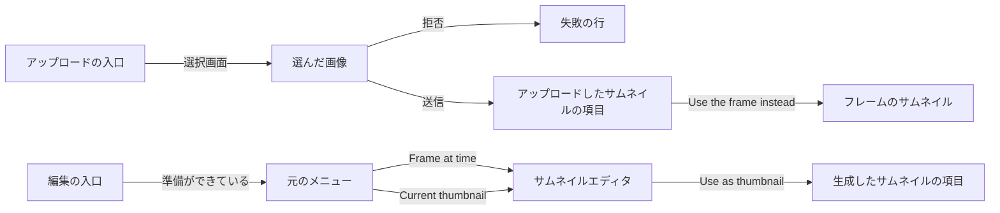
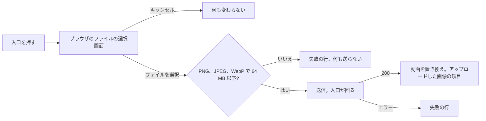
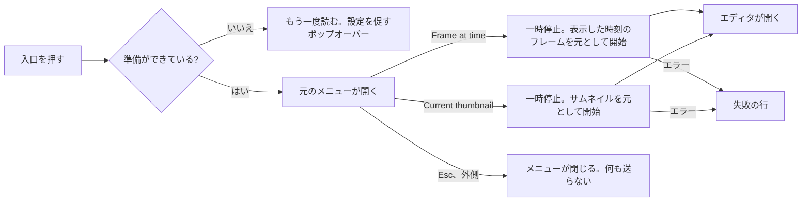

# UI デザイン: ローカルの画像をサムネイルにし、今のサムネイルを ComfyUI で編集する {#ui-design-setting-a-local-image-as-the-thumbnail-and-editing-the-current-thumbnail-with-comfyui}

**機能**: [親 Issue #980](https://github.com/syudead/vv/issues/980) · [plan.md](plan.md) · [contracts/screen-api.md](contracts/screen-api.md) · [research.md R-1](research.md#r-1-an-uploaded-image-is-applied-within-its-request-through-the-same-apply-as-a-generated-image) · [R-2](research.md#r-2-an-upload-is-a-png-jpeg-or-still-webp-of-at-most-64-mib-and-120-megapixels-decoded-one-at-a-time) · [R-4](research.md#r-4-an-edit-from-the-current-thumbnail-starts-from-the-stored-source-or-from-the-thumbnails-frame) · [R-5](research.md#r-5-thumbnailimage-names-the-applied-images-origin-in-place-of-thumbnailgenerated)

すでに決まっていることの出典。ここでは繰り返さずリンクする。

| 話題 | 出典 |
| --- | --- |
| トークン、閉じたスケール、動画のページの密度 | [design-system.md、Foundations](../../docs/design-docs/design-system.md#foundations)。値は [`web/src/ui/tokens.css`](../../web/src/ui/tokens.css) の `@theme` にあり、ここでは名前で示し、決して写さない |
| `Button`、`DropdownMenu`、`Popover`、`Tooltip`、`Input` | [components.md](../../web/registry/rules/components.md) |
| 動画のページの情報の行、その右側の操作、サムネイルの項目と一つの失敗の行 | [library-ui.md、情報の行](../../docs/design-docs/library-ui.md#information-rows)。[029 UI デザイン、サムネイルの事実](../029-video-overrides/ui-design.md#thumbnail-fact) |
| 編集の入口、その準備状態と設定を促すポップオーバー、エディタのビュー、Compare、閉じる操作 | [045 UI デザイン、動画のページ: 編集の入口](../045-comfyui-thumbnails/ui-design.md#video-page-edit-entry)、[サムネイルエディタ](../045-comfyui-thumbnails/ui-design.md#thumbnail-editor)、[生成したサムネイルの項目](../045-comfyui-thumbnails/ui-design.md#generated-thumbnail-item) |
| ボタンから開くファイルの選択画面、何かを送る前の拒否 | [045 UI デザイン、Compose](../045-comfyui-thumbnails/ui-design.md#compose) の参照画像と [`ThumbnailEditor.tsx`](../../web/src/player/thumbnailEdit/ThumbnailEditor.tsx) |
| 動画のページのアイコンボタンから開く、少数の操作のメニュー | [`VersionsFact.tsx`](../../web/src/player/VersionsFact.tsx) |
| 幅のブレークポイントは CSS で切り替える。レイアウトは人が確かめる | [library-ui.md、幅のブレークポイント](../../docs/design-docs/library-ui.md#width-breakpoints-in-css-and-the-sidebar-exception)、[人が確かめるレイアウト](../../docs/design-docs/library-ui.md#layout-verified-by-people-not-machines) |
| 画面の文言 | [`web/src/i18n/en.ts`](../../web/src/i18n/en.ts)。この機能は `player.thumbnailUpload` を加え、`player.thumbnailEdit` とエラーの理由を拡張する |

この機能は動画のページに三つのものを加え、どれも所有者専用である (要件 7、受け入れ条件 7)。

1. 情報の行の操作に並ぶ**アップロードの入口**。ブラウザのファイルの選択画面を開き、選んだ画像をサムネイルにする (要件 1 から 3、受け入れ条件 1 から 3)。
2. 情報の行の**アップロードしたサムネイルの項目**。生成した画像の項目と同じ、フレームに戻す方法を持つ (要件 4、受け入れ条件 4)。
3. 所有者が ComfyUI の編集を始めるときの**元の選択**と、元が今のサムネイルであるときのエディタのラベル (要件 5 と 6、受け入れ条件 5 と 6)。

図は各部分と、それぞれの操作の行き先を示す。

変わらないもの: プレーヤー、タイトル、タグ、公開範囲の切り替え、取り込みボタン、準備状態の確認と設定を促すポップオーバー、エディタの塗り、指示、参照画像、実行、キャンセル、適用、破棄と閉じる操作、その他すべての画面。それらの画面は既存の `thumbnailUrl` を通してアップロードした画像を表示する。

## この形にした理由 {#why-this-shape}

アップロードの入口は**情報の行の操作のグループに加わるもう一つのアイコンボタン**で、`Edit thumbnail with ComfyUI` のすぐ後に置く。同じサムネイルを設定する三つ目の方法だからである。取り込みボタンはフレームから、エディタは生成画像から、アップロードはファイルから設定する。三つは同じ重みで並び、再生より目立たない ([029、ここに置き、他に置かない理由](../029-video-overrides/ui-design.md#why-here-and-not-elsewhere))。既存の二つのボタンは場所を保つ。プレーヤーやサムネイルの項目の上のドロップ領域は採用しなかった。動画のページには「ここに画像をドロップする」と読める領域がなく、プレーヤー上のドロップ先は映像と競合し、Issue はファイルを選ぶことを求めている。ボタンから開く選択画面は、設定やプロフィールの画面が一枚の画像に使う形である。プレビューと確認の段階を持つダイアログは採用しなかった。取り込みボタンとエディタの `Use as thumbnail` は一度押せば適用され、行に現れるアップロードした画像の項目が、その `×` とともに確認になる。それらと同じである。

元の選択は**既存の編集の入口が開く `DropdownMenu`** で、画面上のフレームと今のサムネイルの二つの項目を持つ。レジストリは「ボタンから開く、少数からの一つの選択」にメニューを挙げている。サムネイルを編集する二つ目のアイコンボタンは採用しなかった。並んだ二つの杖のボタンはアイコンで見分けられず、行にはサムネイルの操作が四つになる。エディタの中での選択は採用しなかった。セッションはその元とともに始まる ([R-4](research.md#r-4-an-edit-from-the-current-thumbnail-starts-from-the-stored-source-or-from-the-thumbnails-frame)) ので、エディタの中で切り替えるとセッションと塗りを破棄することになり、所有者はまず一つの画像を見てから、それを差し替えなければならない。メニューはフレームの編集までに一回押す回数を増やす。それは要件 5 の代償であり、何かを取り出す前に、それぞれの編集が何から始まるかを示す。メニューのサムネイルの項目はサムネイルそのものを小さな画像で表示する。サムネイルが自動のフレームのとき、動画のページは他のどこにもそれを表示せず、所有者はこれから編集するものを見るべきだからである。

選択を置いたので、画面上にフレームがないときも入口はもう淡色にならない。今のサムネイルの編集にはフレームが要らない。そのときはフレームの項目だけが無効になる。ComfyUI が設定されていない間は、入口は設定を促すポップオーバーとともに淡色のままである。どちらの元もそれなしでは動かないからである。

エディタの中では何も動かない。元は三つの文言を変える。帯の詳細は画像が何であるかを伝え、塗りのヒントは "frame" の代わりに "image" と言い、Compare の最初のラベルは `Thumbnail` になる。フレームの編集のラベルは以前とまったく同じである。

## 文言 {#words}

英語はカタログが取り込む下書きである。実装の後は [`web/src/i18n/en.ts`](../../web/src/i18n/en.ts) が正となる。

### 動画のページ {#video-page}

| 場所 | 文言 | 注記 |
| --- | --- | --- |
| アップロードの入口、名前とツールチップ | Upload an image as thumbnail | `player.thumbnailUpload.entry` |
| 拒否、種類の誤り | Choose a PNG, JPEG or WebP image. | 行の失敗の行。何かを送る前 |
| 拒否、大きすぎる | Choose an image up to 64 MB. | 上と同じ |
| アップロードの失敗 | Couldn't upload the image: {reason} | 行の失敗の行。`{reason}` は [エラーの理由](#error-reasons) から |
| アップロードした画像の項目 | Uploaded thumbnail | 視覚的に隠したラベル、`title` と画像の `alt` |
| アップロードした画像の項目の `×` | Use the frame instead | 生成した画像の項目と共有 |
| 編集の入口、名前とツールチップ | Edit thumbnail with ComfyUI | 変わらない |
| 元のメニュー、フレームの項目 | Frame at {time} | `{time}` は `formatDuration` の形式で、項目が送る位置。画面上にフレームがないときは `Frame on screen` で無効 |
| 元のメニュー、サムネイルの項目 | Current thumbnail | その前にサムネイルの小さな画像を置く |
| 開始の失敗 | Couldn't start editing the thumbnail: {reason} | 変わらない |

### サムネイルエディタ {#thumbnail-editor}

| 場所 | 文言 | 注記 |
| --- | --- | --- |
| エディタの詳細、フレームの元 | Frame at {time} | 変わらない |
| エディタの詳細、フレームのあるサムネイルの元 | Current thumbnail, frame at {time} | セッションの `positionMs` がある ([contracts/screen-api.md](contracts/screen-api.md#thumbnailedit-changed)) |
| エディタの詳細、サムネイルの元、保存した画像 | Current thumbnail, saved image | セッションの `positionMs` がない。アップロードした画像でも生成画像でも同じ文言である。セッションはどちらを固定したかを伝えないからである |
| 塗りのヒント、サムネイルの元 | Paint over what to change. Leave it unpainted to change the whole image. | フレームの元は `…the whole frame.` を保つ |
| 比較のラベル、サムネイルの元 | Thumbnail · Generated | フレームの元は `Frame · Generated` を保つ |

### エラーの理由 {#error-reasons}

`web/src/i18n/errors.ts` の `reason` の表に加える、または変えるもの ([contracts/screen-api.md](contracts/screen-api.md#post-apivideosidthumbnail-image))。`video_not_found` と `file_unavailable` は文言を保つ。

| 理由 | 文言 | 注記 |
| --- | --- | --- |
| `thumbnail_upload_too_large` | The image is too large: up to 64 MB and 120 megapixels. | どちらかは `limit` が伝える。文言は両方を挙げる。所有者の次のファイルは両方を満たさなければならないからである |
| `thumbnail_upload_invalid` | The file isn't a PNG, JPEG or still WebP, or it can't be read. | 別の形式、アニメーションの WebP、途中で切れたファイルや壊れたファイルを含む |
| `thumbnail_image_invalid` | The image can't be read. | 以前は `The generated image can't be read.`。ffmpeg が画像を合わせ込めないとき、アップロードも同じ理由を返す |
| `content_changed` | The video changed in the meantime. | 以前は `…while you were editing`。アップロードも同じ理由を返す |

## デザインシステムへの変更 {#changes-to-the-design-system}

なし。アップロードの入口と項目は行の他の操作と同じく `ActionButton` を使い、元の選択はレジストリの `DropdownMenu` であり、ファイルの選択画面は参照画像がすでに使っている隠した `Input type="file"` である。トークンは加えず、`web/src/theme/tokens.test.ts` の `pairs` にも何も加えない。アイコンは lucide の `ImageUp` (アップロードの入口とアップロードした画像の項目)、`Film` (フレームの項目)、そして変わらない `WandSparkles` である。

## 動画のページ: アップロードの入口 {#video-page-upload-entry}

`ActionButton` (`ghost` `icon-sm`、lucide `ImageUp`、`text-muted-foreground`) を、情報の行の操作のグループで `Edit thumbnail with ComfyUI` のすぐ後、`Open file` の前に置く。ページが開いていれば常に所有者のために置き、プレーヤーを表示しない動画も含む (読めないファイルでもサムネイルは持てる)。ゲストには入口がない。入口は ComfyUI の準備状態を読まず、それによって淡色になることは決してない。

図は入口を押したときの動きを示す。

| 状態 | 入口と行 |
| --- | --- |
| 待機 | 押せる。ツールチップが名前を示す。押すと `image/png`、`image/jpeg`、`image/webp` に限った選択画面を開く。選択画面は同じファイルを続けて二回選べるので、元に戻した後に画像をもう一度アップロードできる |
| 拒否 | 別の種類のファイル、または 64 MiB を超えるファイルは、何かを送る前に拒否する。行の一つの失敗の行が対応する文言を表示し、入口は押せるままで、サムネイルとその項目は変わらない |
| 送信中 | `LoaderCircle` が回り、`aria-disabled`。二回目に押しても何も送らない。取り込みボタンとサムネイルの項目の `×` も `aria-disabled` になり、そのどちらかが送信している間はアップロードの入口も `aria-disabled` になる。サーバーは最後に確定したものだけを保つので、このページからのサムネイルの操作は一度に一つである。失敗の行は送信の開始で消える。大きな写真の送信は数秒かかる (サーバーがデコードして合わせ込み、別のアップロードやこの動画のサムネイルのジョブを待つこともある)。サムネイルの項目は応答まで前のサムネイルを表示し続ける |
| 送信済み (`200`) | 応答の `Video` がページの動画を置き換える。位置の項目や生成した画像の項目の代わりにアップロードした画像の項目が現れる ([アップロードしたサムネイルの項目](#uploaded-thumbnail-item))。カードと関連動画は `video` イベントを通して新しい `thumbnailUrl` を読む。トーストはない。取り込みボタンと同じく、項目が結果である |
| 失敗 | 行の一つの失敗の行 `Couldn't upload the image: {reason}` が、それより前の行を置き換える。サムネイルとその項目は変わらない (Issue の境界ケース)。`video_not_found`、`file_unavailable`、`content_changed` のときは、029 と同じくページが動画も取得し直す |
| 送信中にページを離れる | 何も尋ねず警告もしない。本文が届けばサーバーはアップロードを終える ([R-1](research.md#r-1-an-uploaded-image-is-applied-within-its-request-through-the-same-apply-as-a-generated-image)) ので、所有者が戻ったときにはサムネイルが置かれている |

送る前の拒否は、誤ったファイルを、ファイル全体を送った後ではなくすぐに失敗させるためにある。有効なのはあくまでサーバーの上限であり、ページの確認を通ってサーバーの確認で失敗したファイルは、サーバーの理由を表示する。

## アップロードしたサムネイルの項目 {#uploaded-thumbnail-item}

`thumbnailImage` が `uploaded` の間、情報の行のサムネイルの項目は、位置の項目の代わりにアップロードした画像を、生成した画像の項目の形 ([045、生成したサムネイルの項目](../045-comfyui-thumbnails/ui-design.md#generated-thumbnail-item)) で表示する。`WandSparkles` の代わりに lucide `ImageUp` (`size-4`、`aria-hidden`)、小さな画像 (`thumbnailUrl`)、`Use the frame instead` という名前の `×` である。時刻は表示しない。`×` は `DELETE /api/videos/{id}/thumbnail-image` を送り、送る間は回り、`200` で、位置が設定されていれば項目は位置の項目を表示し、なければ消える (要件 4、受け入れ条件 4)。失敗は 029 と同じく行の一つの失敗の行 `Couldn't change the thumbnail: {reason}` を使う。

二つの項目は `thumbnailImage` で切り替わる一つのコンポーネント ([R-5](research.md#r-5-thumbnailimage-names-the-applied-images-origin-in-place-of-thumbnailgenerated)) で、違いはアイコンとラベルだけである。所有者の戻り方が同じで、画像も同じ方法で保持するからである。アイコンは画像がどこから来たかを示す。アップロードした画像の編集を適用した後は、項目は生成した画像の項目に変わる。サムネイルがそのとき生成画像になるからである。

`Use current frame as thumbnail` は振る舞いを保つ。`200` で位置の項目がアップロードした画像の項目を置き換える。サーバーが同じリクエストで画像を落としたからである。

## 動画のページ: 元の選択を持つ編集の入口 {#video-page-edit-entry-with-the-source-choice}

編集の入口は場所、アイコン、ツールチップ、準備状態の確認、設定を促すポップオーバーを保つ ([045、動画のページ: 編集の入口](../045-comfyui-thumbnails/ui-design.md#video-page-edit-entry))。変わるのは、ComfyUI の準備ができているときに押すと何が起きるかと、入口が淡色になるときである。

図は入口を押したときの動きを示す。

メニューは入口に固定した `DropdownMenu` (`align="end"`、入口の下) で、二つの `DropdownMenuItem` をこの順に持つ。

| 項目 | 先頭 | 文言 | 規則 |
| --- | --- | --- | --- |
| フレーム | lucide `Film` | `Frame at {time}` | `{time}` はメニューを開いたときのプレーヤーの位置で、その瞬間に取り込みボタンが送る位置である。項目を選ぶとその位置を送り、押したときのプレーヤーの位置は送らない。そのため、メニューが開いている間に再生が進んでも、エディタは項目が示したフレームで開く。画面上にフレームがないとき (取り込みボタンの条件、[029、取り込みボタン](../029-video-overrides/ui-design.md#capture-button))、項目は `Frame on screen` と表示し無効になる |
| サムネイル | 今のサムネイルの小さな画像 (`thumbnailUrl`、`h-6`、動画の縦横比、`rounded-sm`、`object-cover`)。行のサムネイルの項目と同じ形 | `Current thumbnail` | 常に有効。サムネイルがどの種類であっても、その画像が編集の始まりになる ([R-4](research.md#r-4-an-edit-from-the-current-thumbnail-starts-from-the-stored-source-or-from-the-thumbnails-frame)) |

フレームの項目を先に置くのは、それが入口が以前にしていたことであり、フレームで一時停止したばかりの所有者が望むものだからである。どちらの項目を選んでも、再生を一時停止し、メニューを閉じ、`source: "frame"` とフレームの項目が示す位置、または位置なしの `source: "thumbnail"` で編集を始め ([contracts/screen-api.md](contracts/screen-api.md#post-apivideosidthumbnail-edits-changed))、045 で一回押したときと同じく、画像を取り出す間は入口を回す。開始の失敗は情報の行の一つの失敗の行を表示する。

| 状態 | 入口 |
| --- | --- |
| 準備ができている | 画面上にフレームがあってもなくても押せる。押すとメニューを開く |
| 準備ができていない (`connection` が false) | 045 と同じ: `opacity-50`、`aria-disabled`、フォーカスは受ける。押すと準備状態をもう一度読み、まだ準備ができていなければ、メニューの代わりに設定を促すポップオーバーを開く |
| 開始中 | `LoaderCircle` が回り、`aria-disabled`、メニューは閉じている。二回目に押しても何も送らない |
| メニューが開いている | 入口は押された状態を示す (`bg-accent`、開いたメニューのトリガーと同じ)。Esc か外側を押すとメニューが閉じ、何も送らない。フォーカスは入口に戻る |

入口が淡色になるのは接続がないときだけで、フレームがないときはもう淡色にならない。サムネイルの元はフレームを必要としないからである。その条件はフレームの項目が受け持つ。今のサムネイルから始める編集はプレーヤーにまったく依存しないので、入口はアップロードの入口と同じく、プレーヤーを表示しないときも置く。そのときフレームの項目は無効になる。

## 今のサムネイルからのサムネイルエディタ {#thumbnail-editor-from-the-current-thumbnail}

エディタはどのビューでも 045 のものである。所有者に見えるものはセッションの `source` によって異なる。

| 場所 | フレームの元 | サムネイルの元 |
| --- | --- | --- |
| 帯の詳細 | `Frame at {time}` | `positionMs` があるときは `Current thumbnail, frame at {time}`。なければ `Current thumbnail, saved image`。どちらもセッションの応答だけから決め ([contracts/screen-api.md](contracts/screen-api.md#client-use))、ページの `thumbnailImage` からは決して決めない。セッションが画像を固定する前に、別のタブがそれを変えているかもしれないからである |
| Compose のステージ | フレーム (`frameUrl`) とその上の塗り | サムネイルの画像 (`frameUrl`: 保存した元画像、またはサムネイルのフレーム) とその上の塗り。大きさの規則は同じ。そのピクセルの大きさはフレームと同じく `frameWidth` × `frameHeight` なので、ブラシの段階とマスクは変わらない |
| 塗りのヒント | `…change the whole frame.` | `…change the whole image.` |
| Compare、最初の箱 | ラベル `Frame`、`alt` `Frame` | ラベル `Thumbnail`、`alt` `Thumbnail`。箱は動画の形で、元画像もすでにその形である (適用のときに合わせ込んだ、[R-3](research.md#r-3-the-row-keeps-the-applied-images-source-at-up-to-2048-px-and-its-origin)) |
| Compare、二つ目の箱 | `Generated`、サムネイルになるときと同じく切り抜く | 同じ。マスクを使った実行の結果は塗った範囲の外で元画像を保つ (受け入れ条件 6) ので、二つの箱は所有者が塗った所だけが異なる |
| 適用 | 行に生成した画像の項目が現れる | 同じ。元が何であっても項目は生成した画像の項目である。サムネイルはそのとき生成画像だからである |

詳細が画像の種類を示すのは、ステージだけでは所有者が見ているのがフレームか保存した画像かがわからず、フレームを選ぶつもりだった所有者が、サムネイルを選んだことを一目で知るべきだからである。詳細はアップロードした画像と生成画像を区別しない。セッションの応答はその `source` と `positionMs` しか示さず、ページの `thumbnailImage` はサーバーが画像を固定する時点で古くなっていることがあるので、そこから読んだラベルは誤った種類を示しうる。他の場所で "frame" と言うエディタの文言 (`The painting doesn't match the frame`) はそのままにする。どの所有者も画面からは到達しないエラーだからである。

エディタが開いている間のページのサムネイルの変更 (別のタブのアップロード、元に戻す操作) はエディタを変えない。セッションが画像を保持し ([R-4](research.md#r-4-an-edit-from-the-current-thumbnail-starts-from-the-stored-source-or-from-the-thumbnails-frame))、`Use as thumbnail` はその結果を最後に確定したサムネイルにする (Issue の境界ケース)。

## 幅に応じた振る舞い {#responsive-behaviour}

Tailwind の既定のブレークポイントだけを使い、CSS で切り替える。判定する幅は 360px、768px、1280px である。

| 幅 | 情報の行 | 元のメニュー | エディタ |
| --- | --- | --- | --- |
| 1280px | 事実は一行で、操作のグループは右端にあり、アイコンが一つ増える。アップロードした画像の項目は事実の中に小さな画像とともに並ぶ | 入口の下で、右端を入口の右端に揃える。二行で、`Frame at {time}` と、サムネイルの画像と `Current thumbnail` | 帯はタイトルと詳細を一行に表示する |
| 768px | 1280px と同じ。事実は操作のグループの前で二行目に折り返すことがある | 1280px と同じ | 1280px と同じ |
| 360px | 操作のグループ (お気に入り、プレイリスト、取り込み、編集、アップロード、開く、コピー) は一行のままで、事実はその上で折り返す。アップロードした画像の項目は位置の項目と同じく折り返す。失敗の行は行の下で折り返す。横スクロールはない | ビューポートの中で開き、入口が端に近いときは Radix が左にずらす。二つの項目は指で押せるよう少なくとも `h-8` の高さを持つ | 詳細はタイトルより先に省略記号で切り詰める。`Thumbnail` と `Generated` は、`Frame` と `Generated` と同じく、縦に積んだ箱の上に置く |

ブラウザのファイルの選択画面は端末自身のものである。スマートフォンでは写真ライブラリとカメラを提示し、受け入れ条件 2 の写真はそこから来る。

## レビューの基準 {#review-criteria}

vv の一つのダークの配色で、動いている画面を見て判定する (library-ui.md、人が確かめるレイアウト)。「存在する」だけでは合格しない (Q-4)。

1. **視覚的な階層**: 動画のページでは、視線は今までどおりプレーヤー → タイトル → タグと進む。アップロードの入口は隣の取り込みボタンと編集ボタンと同じ重みで、塗りつぶしも境界線も `primary` の色も持たず、三つのサムネイルの操作は一つのグループとして読める。元のメニューではサムネイルの小さな画像が唯一の絵で、二つの項目は対等に読める。どちらも `primary` ではない。エディタでは帯の詳細は控えめで、画像は今までどおり画面で最も大きい。
2. **情報の密度**: 上書きのない動画の情報の行に加わるのは、ちょうど一つのアイコンである。アップロードした画像の項目は生成した画像の項目と同じ大きさで、一つのアイコンと一つの小さな画像を持ち、説明文はない。メニューは二行である。見出しはなく、項目の下の説明もない。
3. **余白のリズム**: アップロードの入口は操作のグループの間隔で並び、`Open file` の前に余分な空きはない。アップロードした画像の項目の内側の間隔と隣との間隔は、位置の項目と同じである。メニューの項目はレジストリの行の高さとパディングを持つ。小さな画像は項目の文字のベースラインの帯に置き、その上には置かない。
4. **文字組み**: 帯の詳細は、どれだけ長くなっても、今の `Frame at {time}` と同じ大きさの `text-muted-foreground` のままである。失敗の行は他の失敗の行と同じく、アイコン付きの `text-sm text-destructive` である。メニューの `{time}` は `tabular-nums` で、開くたびに位置が変わってもずれない。
5. **操作の優先度**: ローカルの画像の設定は、入口と選択画面の二段階で、その間にダイアログ、プレビュー、確認の段階はない (受け入れ条件 1)。アップロードした画像の項目の `×` は一回押せばフレームを戻す (受け入れ条件 4)。今のサムネイルの編集を始めるのは入口と項目の二回の押下で、エディタはサムネイルの画像で開く (受け入れ条件 5)。フレームの編集はサムネイルの編集と同じ二回の押下で、メニューが開いている間に再生が進んでも、その項目が示す位置を送る。
6. **見える状態**: アップロードの送信中は入口が回り、取り込みボタンと `×` が淡色になるので、所有者は行が処理中であることがわかり、二つ目のサムネイルを送れない。項目は応答まで前のサムネイルを保つ。拒否や失敗は原因を言葉で示し、サムネイル、項目、カード、関連動画を元のままにする (Issue の境界ケース)。アップロードした画像からマスクを使って実行した後の Compare では、最初の箱はアップロードした画像で、二つ目はそれと塗った範囲の中だけが異なる (受け入れ条件 6)。
7. **スマートフォンの幅**: 360px では操作のグループは一行で、メニューはビューポートの中で開く。横にスクロールするものはない。選択画面は端末の写真ライブラリを開く。
8. **ゲスト**: サインアウトした状態では、同じ動画のページにアップロードの入口、アップロードした画像の項目、編集の入口、メニューのどれもない (受け入れ条件 7)。
9. **要件を満たさない例**: アップロードが適用の前にプレビュー付きのダイアログを開く。アップロードした画像の項目が杖のアイコンか `Generated thumbnail` のラベルを持つ。一つ目の杖のボタンの隣に二つ目の杖のボタンがある。サムネイルを編集できるのに、フレームがないときに入口が淡色になる。サムネイルから開いたエディタが、保存した画像に `Frame at {time}` と表示する。Compare が保存した画像に `Frame` とラベルを付ける。拒否がサーバーのものと異なる上限を示す。失敗したアップロードがサムネイルを置き換えるか項目を消す。

## アクセシビリティ {#accessibility}

親 Issue はスクリーンリーダーやコントラストの設計を求めていないので、045 と同じく、名前と読み上げだけを決める。

- アップロードの入口は `Upload an image as thumbnail` である。アップロードした画像の項目の画像の `alt` と隠したラベルは `Uploaded thumbnail` で、その `×` は `Use the frame instead` である。
- 元のメニューは Radix のメニューである。矢印キーで項目の間を移り、Enter で選び、Esc で閉じてフォーカスを入口に戻す。サムネイルの項目の小さな画像は `alt=""` である。項目の文字がそれを名付けるからである。
- ファイルの入力は隠され、入口を通してのみ到達する。拒否と失敗は行の `role="alert"` の行を使う。
- スピナーは `aria-hidden` で、送信中またはロック中のコントロールは `aria-disabled` である。
