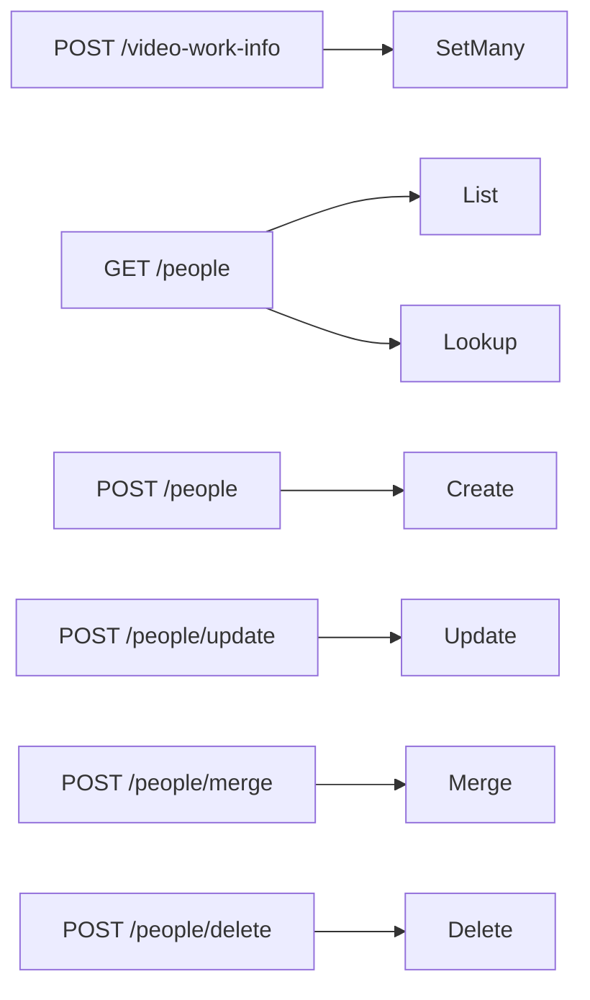

# 契約: 外部 API v1 と MCP の作品情報、人物、組織 {#contract-work-information-people-and-organizations-in-external-api-v1-and-mcp}

正本: `api/external-v1.yaml`、つまり操作 `updateVideoWorkInfo`、`ExternalVideo` の `workInfo` フィールド、操作 `listPeople`、`createPerson`、`updatePerson`、`mergePeople`、`deletePeople` とその `Organization` の対応物。この文書は、この機能が加えるものだけを扱う。共通の規則 (Bearer、エラーの形、`VideoRef`、`index`、32 MiB の本文) は [specs/026-external-api/contracts/external-api.md、共通の規則](../../026-external-api/contracts/external-api.md#common-rules) のとおりである。決定は [research.md R-9](../research.md#r-9-the-external-api-gets-one-bulk-replace-and-literal-post-routes-per-entity-kind-field-names-the-failing-property) にある。互換性の方針に従い、フィールド、操作、理由、1 つのエラーのプロパティだけを加える。エンティティの各操作は画面が実行するのと同じ `CreditStore` の操作を実行するので、[screen-api.md、人物と組織](screen-api.md#people-and-organizations) の規則が各呼び出しの後の状態について成り立つ。

図は、新しい各操作が届くストアの操作を示す。



## `ExternalVideo` の変更 {#externalvideo-changes}

| フィールド | 型 | 規則 |
| --- | --- | --- |
| `workInfo` | `WorkInfo` (`required`) | [screen-api.md、`WorkInfo` スキーマ](screen-api.md#workinfo-schema) の 7 つのフィールド。この API では、`code` と `description` は設定していないときにないのではなく `null` であり、どの一覧も空なら `[]` なので、クライアントは存在を確かめずにすべてのプロパティを読める |
| `updatedAt` | date-time (既存) | その説明の、それを進める編集の一覧に作品情報を加える |

`VideoTagsItem.video` は変わらない。

## `POST /api/v1/video-work-info` {#post-apiv1video-work-info}

`operationId: updateVideoWorkInfo`。

```json
{ "items": [ { "video": { "path": "/media/a.mp4" },
               "workInfo": { "code": "ABC-123",
                             "dates": [ { "kind": "release", "date": "2024-06" } ],
                             "people": [ { "role": "performer", "person": { "id": 7 } } ],
                             "organizations": [ { "role": "maker", "organization": { "id": 2 } } ],
                             "urls": [ "https://example.com/abc-123" ],
                             "externalIds": [ { "source": "example", "value": "abc123" } ] } },
             { "video": { "id": 12 }, "workInfo": {} } ] }
```

各項目の `workInfo` は、画面の API の要求の本文と共有する [`WorkInfoInput`](screen-api.md#workinfoinput-schema) であり、保存したオブジェクトを置き換える: ない、`null`、または前後の空白を除くと空になるフィールドは消え、`{}` はすべてを消す。すべての項目を 1 つのトランザクションで適用する。どれかの項目にエラーがあれば、何も適用しない。同じ動画に対する後の項目が勝つ。

| 状況 | 応答 |
| --- | --- |
| 成功 | `200`: `items` の順の `{ items: [{ video: { id, contentKey }, workInfo }] }`。適用した値は `ExternalVideo` の形 |
| `items` が 0 項目か 20000 を超える項目を持つ | `400 invalid_request` / `too_many_videos`、`limit` |
| `video` が id、内容の鍵、パスのちょうど 1 つでない | `400 invalid_request` |
| フィールドがその規則を破る ([screen-api.md、`PUT /api/videos/{id}/work-info`](screen-api.md#put-apivideosidwork-info)) | 同じ `reason`、`field`、`limit` を持つ `400 invalid_request`。`index` は `items` の中の位置 |
| 人物か組織の id が存在しない | `404 not_found` / `person_not_found` か `organization_not_found`、`field`、`index`。何も適用しない |
| 動画が見つからない | `404 not_found` / `video_not_found`、`index`。何も適用しない |

要求を繰り返しても状態は変わらず、`200` を返す。

## 人物と組織 {#people-and-organizations}

下の 5 つの操作は `/api/v1/people` と `/api/v1/organizations` の下にある。組織の形は `parent` と `parentId` を加え、`organization_not_found`、`merge_same_organization`、`organization_parent_cycle` で答える。スキーマ `Person`、`Organization`、`Alias`、`ExternalId`、`CreditInput`、`CreditPatch`、`CreditList` は [screen-api.md、人物と組織](screen-api.md#people-and-organizations) のものである。この API では、`parent` は根では `null` であり、どの一覧も空なら `[]` である。

| 操作 | メソッドとパス | 本文またはパラメータ | 応答 |
| --- | --- | --- | --- |
| `listPeople` | `GET /api/v1/people` | 画面と同じ `q`、`sort`、`cursor`、`limit`。または照会のために `source` と `externalId` をともに | `200 CreditList`。照会は、その外部 ID を持つ 1 つのエンティティ (外部 ID はある種類のエンティティを最大 1 つ指す) か、空の `items` を返す |
| `createPerson` | `POST /api/v1/people` | `CreditInput` | `200 Person` |
| `updatePerson` | `POST /api/v1/people/update` | `{ id }` と `CreditPatch` | `200 Person` |
| `mergePeople` | `POST /api/v1/people/merge` | `{ targetId, sourceIds }`、1 から 20,000 の統合元 | `200 { person: Person, notFoundIds }` |
| `deletePeople` | `POST /api/v1/people/delete` | `{ ids }`、1 から 20,000 | `200 { deletedIds, notFoundIds }`。`ids` の順で重複なし |

| ステータス | `code` / `reason` | 条件 |
| --- | --- | --- |
| `400` | `invalid_request` | 5 つの値の外の `sort`、1 から 200 の外の `limit`、100 文字を超える `q`、`externalId` のない `source` かその逆 |
| `400` | `invalid_request` / `invalid_cursor` | 読めない、または別の `sort` の下で作った `cursor` |
| `400` | `invalid_request` / `work_info_*`、`field`、`limit` | 名前、別名、言語、外部 ID、一覧がその規則を破る ([data-model.md、フィールド](../data-model.md#fields)) |
| `400` | `invalid_request` / `work_info_too_many`、`field`、`limit` | `sourceIds` か `ids` が空か 20,000 項目を超える、または統合で統合先が 50 を超える `aliases` か 20 を超える `externalIds` を持つことになる。何も変わらない |
| `400` | `invalid_request` / `merge_same_person` | `sourceIds` が `targetId` を含む。何も変わらない |
| `400` | `invalid_request` / `organization_parent_cycle` | `parentId` がその組織かその子孫の 1 つである、または統合元が `targetId` の祖先である。何も変わらない |
| `409` | `conflict` / `external_id_taken`、`field` | `create` か `update` が、その種類の別のエンティティが持つ外部 ID を送る。`field` は `externalIds[i]`。そのエンティティを意図したクライアントは、それを照会してその id を使う |
| `404` | `not_found` / `person_not_found` | `id` か `targetId` が存在しない、または (`field: parentId`) 親が存在しない。存在しない統合元と `delete` の存在しない `ids` は挙げられ、エラーではない |

どの操作も JSON の本文を返すので、どの MCP ツールにも結果がある ([039 R-5](../../039-external-tag-admin/research.md#r-5-every-operation-returns-a-json-body-so-every-tool-has-a-result))。`createPerson` は、ほかの外部の書き込みと同じ理由で、`201` ではなく `200` で答える。

`Error` は省略可能な `field` を得て、`ErrorReason` は [screen-api.md、追加する `reason` の値と `field`](screen-api.md#added-reason-values-and-field) の 13 の値を得る。

## MCP ツール {#mcp-tools}

[specs/026-external-api/contracts/mcp.md、Tools](../../026-external-api/contracts/mcp.md#tools) の表に加える。入力と出力は、操作の要求と応答と同じ形である。`list_videos` と `get_video` の出力は `workInfo` をそのまま含む。この機能の後、ツールは 26 になる。

| ツール | 操作 | ヒント |
| --- | --- | --- |
| `update_video_work_info` | `POST /api/v1/video-work-info` | `destructiveHint: true` (消した項目は失われる)、`idempotentHint: true` |
| `list_people`、`list_organizations` | `GET /api/v1/people`、`GET /api/v1/organizations` | `readOnlyHint: true`。`list_tags` と同じく、ツールの中で `limit` の既定は 100 |
| `create_person`、`create_organization` | `POST …` | `destructiveHint: false`、`idempotentHint: false` (呼び出しごとに 1 つ作成する) |
| `update_person`、`update_organization` | `POST …/update` | `destructiveHint: true` (与えた一覧は保存した一覧を置き換える)、`idempotentHint: true` |
| `merge_people`、`merge_organizations` | `POST …/merge` | `destructiveHint: true`、`idempotentHint: true` (統合した統合元はなくなる) |
| `delete_people`、`delete_organizations` | `POST …/delete` | `destructiveHint: true`、`idempotentHint: true` |

ツールの説明は、操作、その上限、動画の書き込みは人物と組織を id で参照すること、そして作成する前に id を見つける方法は外部 ID による照会であることを挙げる。

## クライアントでの使い方 {#client-use}

`docs/how-to/external-api.md` は "Set work information" の節を得る。その節は、上の要求、表としてのフィールドの規則、スクレイパーのための照会、作成、書き込みの流れ (出演者を `source` と `externalId` で照会し、`items` が空なら作成し、それから動画を書く)、MCP の表の 11 のツールを持つ。
