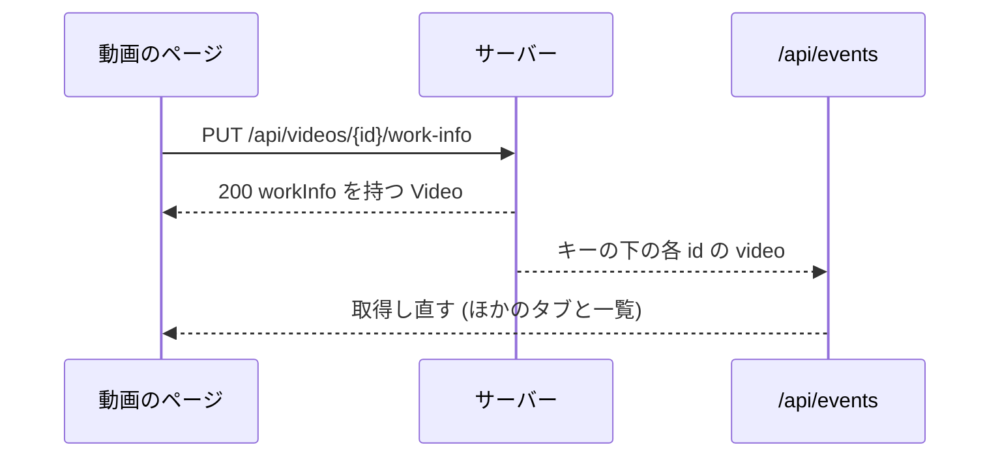

# 契約: 画面の API の作品情報 {#contract-work-information-in-the-screen-api}

正本: `api/openapi.yaml` の操作 `setVideoWorkInfo`、スキーマ `WorkInfo` と `WorkInfoInput`、`listVideos`、`listLibrary`、`listLibraryIds` の `performer` と `maker` のパラメーター。この文書は、この機能が加えるものだけを扱う。決定は [research.md R-4](../research.md#r-4-performer-and-maker-list-parameters-matched-by-folded-value-library-only)、[R-5](../research.md#r-5-one-put-that-replaces-the-whole-object-a-cleared-field-is-absent-null-or-empty)、[R-7](../research.md#r-7-guests-receive-no-work-information-in-responses-search-or-filters) にある。

## `WorkInfo` スキーマ {#workinfo-schema}

| フィールド | 型 | 必須 | ルール |
| --- | --- | --- | --- |
| `code` | string | いいえ | 未設定のときはない。[data-model.md、フィールド](../data-model.md#fields) |
| `releaseDate` | string (`YYYY-MM-DD`) | いいえ | 未設定のときはない |
| `maker` | string | いいえ | 未設定のときはない |
| `performers` | string[] | はい | 入力した順。いないときは空 |
| `description` | string | いいえ | 未設定のときはない |
| `sourceUrl` | string (`uri`) | いいえ | 未設定のときはない |

## `WorkInfoInput` スキーマ {#workinfoinput-schema}

`setVideoWorkInfo` の要求本文と、外部の `updateVideoWorkInfo` の各項目の `workInfo`。[`WorkInfo`](#workinfo-schema) の 6 つのプロパティを持ち、どれも必須ではなく、それぞれ `nullable` である (`performers` も含む) ので、`{}` と `null` はフィールドを消去する。別のスキーマなのは、`WorkInfo` が応答を記述し、そこでは `performers` が必須で決して `null` にならないからである。1 つのスキーマを共有すると、生成される型は有効な消去の要求を拒むか、応答を弱めるかのどちらかになる。

## `Video` の変更 {#video-changes}

| フィールド | 型 | ルール |
| --- | --- | --- |
| `workInfo` | `WorkInfo` | `GET /api/videos/{id}` と、`Video` を返す所有者の `PUT` の応答にだけある。ゲストに対してはなく、どのフィールドも設定されていないときもない。一覧の項目、関連する動画、ライブラリの項目は含まない |

## `PUT /api/videos/{id}/work-info` {#put-apivideosidwork-info}

`operationId: setVideoWorkInfo`。所有者だけ (`accessRoutes` の既定の区分)。本文は [`WorkInfoInput`](#workinfoinput-schema) である。ない、`null`、またはトリム後に空のフィールドは消去される。オブジェクトは保存されているものを置き換える。

| 状況 | 応答 |
| --- | --- |
| 保存した。すべてのフィールドを消去した保存も含む | `200` `workInfo` を持つ `Video` (すべてのフィールドが消去されたときはない) |
| フィールドに制御文字がある (`description` 以外の改行も含む) | `400 invalid_request` / `work_info_control_characters`、`field` |
| フィールドが長さの上限を超える | `400 invalid_request` / `work_info_too_long`、`field`、`limit` |
| 出演者が 100 人を超える | `400 invalid_request` / `too_many_performers`、`field: performers`、`limit: 100` |
| `releaseDate` が `YYYY-MM-DD` の暦の日付でない | `400 invalid_request` / `work_info_invalid_date`、`field: releaseDate` |
| `sourceUrl` が `http` または `https` の絶対 URL でない | `400 invalid_request` / `work_info_invalid_url`、`field: sourceUrl` |
| 動画が存在しない、またはメディアフォルダの下に場所を持たない | `404 not_found` / `video_not_found` |
| ゲスト | `401 unauthenticated` (境界が返す) |

[`WorkInfo` スキーマ](#workinfo-schema) の順で最初に失敗したフィールドを報告し、何も書かない。何も変えない書き込みは `200` を返し、`updatedAt` を進めない。変更がコミットされた後、同じユーザーキーの下のすべての動画について `video` を `/api/events` に送る。

## 一覧のパラメーター `performer` と `maker` {#list-parameters-performer-and-maker}

`listVideos` (`GET /api/videos`)、`listLibrary` (`GET /api/library`)、`listLibraryIds` (`GET /api/library/ids`) に加える。`listFolderVideos` には加えない。

| 名前 | 型 | 既定 | 意味 |
| --- | --- | --- | --- |
| `performer` | string、1 から 200 コードポイント | なし | 畳み込んだ名前が畳み込んだ値と等しい出演者を持つ動画だけ |
| `maker` | string、1 から 200 コードポイント | なし | 畳み込んだメーカーが畳み込んだ値と等しい動画だけ |

- 両方とも `query`、`tag`、`watch`、`playable`、`favorite` と AND になる。`total` はそれらを適用して数える。
- 一致のない値は、エラーではなく空の一覧になる。値そのものが条件なので、`missingTagIds` のようなものは報告しない。
- 200 コードポイントを超える、またはトリム後に空の値は `400 invalid_request` を返す。
- ゲストからは `400 invalid_request` / `guest_filter_not_allowed`。

ライブラリの URL ([014 list-url.md](../../014-video-tags/contracts/list-url.md)) では、`performer` と `maker` は与えられたとおりにトリムして書く。「Clear filters」は `q`、`watch`、`playable`、`tag` とともにそれらを除く。一覧のスナップショットのキーは両方を含む。

## 加える `reason` の値と `field` {#added-reason-values-and-field}

`Error` は省略できるプロパティ `field` を得る。これは `work_info_*` または `too_many_performers` の理由が指す `WorkInfo` のプロパティ名 (`code`、`releaseDate`、`maker`、`performers`、`description`、`sourceUrl`) である。

`ErrorReason` は `work_info_control_characters`、`work_info_too_long`、`work_info_invalid_date`、`work_info_invalid_url`、`too_many_performers` を得て、`web/src/i18n/errors.ts` はそれぞれに、フィールドを挙げる英語のメッセージを持つ。
