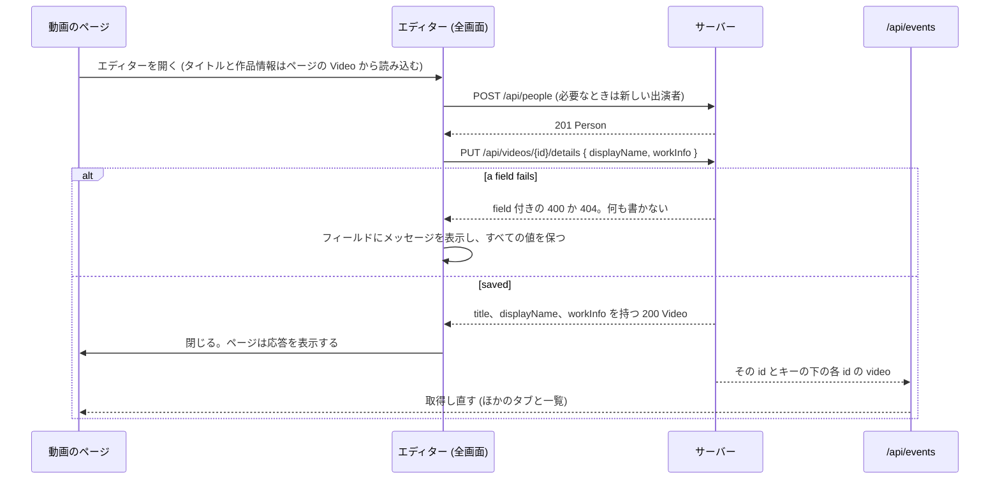
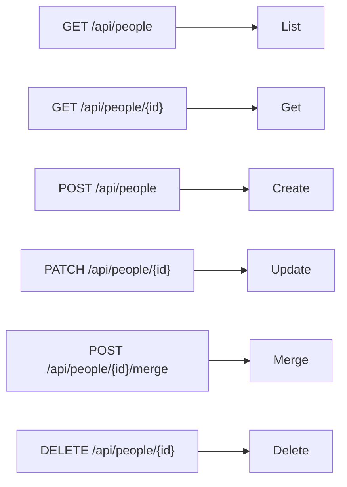

# 契約: 画面の API の作品情報、人物、組織 {#contract-work-information-people-and-organizations-in-the-screen-api}

正本: `api/openapi.yaml`、つまり操作 `setVideoWorkInfo`、`setVideoDetails`、`listPeople`、`getPerson`、`createPerson`、`updatePerson`、`deletePerson`、`mergePeople` とその `Organization` の対応物、スキーマ `WorkInfo`、`WorkInfoInput`、`VideoDetailsInput`、`Person`、`Organization`、`CreditInput`、`CreditPatch`、`CreditList`、および `listVideos`、`listLibrary`、`listLibraryIds` の `person` と `organization` のパラメータ。この文書は、この機能が加えるものだけを扱う。`PUT /api/videos/{id}/display-name` ([029 screen-api.md](../../029-video-overrides/contracts/screen-api.md)) は変わらず、その場でのタイトルの編集に使われ続ける。決定は [research.md R-4](../research.md#r-4-a-video-write-references-people-and-organizations-by-id-creation-has-its-own-route)、[R-5](../research.md#r-5-one-put-that-replaces-the-whole-work-information-object)、[R-7](../research.md#r-7-person-and-organization-list-parameters-by-id-matching-every-role)、[R-8](../research.md#r-8-entity-edits-are-a-patch-of-optional-fields-a-merge-that-moves-links-and-a-delete-that-detaches)、[R-10](../research.md#r-10-guests-receive-no-work-information-in-responses-search-or-filters)、[R-14](../research.md#r-14-the-editor-saves-the-display-name-and-the-work-information-with-one-put-apivideosiddetails-in-one-transaction) にある。ここのどのルートも所有者専用である (`accessRoutes` の既定の分類)。本文を持つルートは `requiresJSONBody` と `openapi_routes_test.go` の対応付けに加わる。

## `WorkInfo` スキーマ {#workinfo-schema}

応答の形。どの一覧も必須で、空なら `[]` である。単一の値は、設定していなければない。

| フィールド | 型 | 必須 | 規則 |
| --- | --- | --- | --- |
| `code` | string | いいえ | [data-model.md、フィールド](../data-model.md#fields) |
| `description` | string | いいえ | — |
| `dates` | `[{ kind, date }]` | はい | `kind` は列挙 `release`、`recorded`、`published`。`date` は R-12 のテキスト。種類の順 |
| `people` | `[{ role, person: { id, name } }]` | はい | `role` は列挙 `performer`、`director`、`photographer`、`streamer`。`(role, position)` の順。`name` はその人物の今の名前 |
| `organizations` | `[{ role, organization: { id, name } }]` | はい | `role` は列挙 `maker`、`label`。`(role, position)` の順 |
| `urls` | string[] | はい | 入力した順 |
| `externalIds` | `[{ source, value }]` | はい | `(source, value)` の順 |

## `WorkInfoInput` スキーマ {#workinfoinput-schema}

`setVideoWorkInfo` の要求の本文であり、外部の `updateVideoWorkInfo` の各項目の `workInfo` である。[`WorkInfo`](#workinfo-schema) の 7 つのプロパティを持ち、どれも必須ではなくそれぞれ `nullable` なので、`{}` と `null` はフィールドや一覧を消す。その `people[].person` と `organizations[].organization` は `id` だけを持つ (R-4)。`WorkInfo` は応答を記述し、そこでは一覧が必須で参照が名前を持つので、別のスキーマにしている。

## `Video` の変更 {#video-changes}

| フィールド | 型 | 規則 |
| --- | --- | --- |
| `workInfo` | `WorkInfo` | `GET /api/videos/{id}` と、`Video` を返す所有者の `PUT` の応答にだけある。ゲストにはなく、動画が行を持たないときもない。一覧の項目、関連する動画、ライブラリの項目は持たない |

## `PUT /api/videos/{id}/work-info` {#put-apivideosidwork-info}

`operationId: setVideoWorkInfo`。本文は [`WorkInfoInput`](#workinfoinput-schema) であり、そのオブジェクトが保存したものを置き換える。エディターはこれを呼ばない ([`PUT /api/videos/{id}/details`](#put-apivideosiddetails) を呼ぶ)。これは、外部の操作と共有する意味で作品情報だけを書くクライアントのためにある。

| 状況 | 応答 |
| --- | --- |
| 保存した。すべてを消した保存も含む | `200` `Video`。`workInfo` を持つ (すべてを消したときはない) |
| 文字列の中の制御文字 (`description` 以外の改行を含む) | `400 invalid_request` / `work_info_control_characters`、`field` |
| 長さの上限を超える文字列 | `400 invalid_request` / `work_info_too_long`、`field`、`limit` |
| 項目数の上限を超える一覧 | `400 invalid_request` / `work_info_too_many`、`field`、`limit` |
| `YYYY`、`YYYY-MM`、暦の上の日付 `YYYY-MM-DD` のどれでもない `date` | `400 invalid_request` / `work_info_invalid_date`、`field` |
| 絶対の `http` か `https` の URL でない `url` | `400 invalid_request` / `work_info_invalid_url`、`field` |
| 繰り返した日付の種類、URL、外部 ID、または役割の中で繰り返した人物や組織 | `400 invalid_request` / `work_info_duplicate`、`field` |
| 列挙の外の `kind` か `role` | `400 invalid_request` (生成したスキーマの確認) |
| 存在しない人物の id | `404 not_found` / `person_not_found`、`field` |
| 存在しない組織の id | `404 not_found` / `organization_not_found`、`field` |
| 動画が存在しないか、メディアのフォルダの下に場所を持たない | `404 not_found` / `video_not_found` |
| ゲスト | `401 unauthenticated` (境界が返す) |

[`WorkInfo` スキーマ](#workinfo-schema) の順で最初に失敗したフィールドを報告し、何も書かない。何も変えない書き込みは `200` を返し、`updatedAt` を進めない。変更がコミットされた後、同じユーザーキーの下のすべての動画について `video` を `/api/events` に送る。

## `PUT /api/videos/{id}/details` {#put-apivideosiddetails}

`operationId: setVideoDetails`。全画面のエディターの保存である ([R-14](../research.md#r-14-the-editor-saves-the-display-name-and-the-work-information-with-one-put-apivideosiddetails-in-one-transaction))。本文は `VideoDetailsInput` である:

| フィールド | 型 | 必須 | 規則 |
| --- | --- | --- | --- |
| `displayName` | string | はい | `PUT /api/videos/{id}/display-name` の規則 ([029 screen-api.md](../../029-video-overrides/contracts/screen-api.md)): 前後の空白を取り除き、空なら表示名を消してタイトルはファイルのタイトルに戻る。プロパティがないときは、そこと同じく `400 invalid_request` である |
| `workInfo` | [`WorkInfoInput`](#workinfoinput-schema) | はい | `PUT /api/videos/{id}/work-info` と同じく保存したオブジェクトを置き換える。`{}` はすべてを消す |

両方を 1 つのトランザクションで書くか、どちらも書かない。

| 状況 | 応答 |
| --- | --- |
| 保存した | `200` `Video`。`title`、`displayName`、`workInfo` を適用している (消したときは `displayName` はなく、すべてを消したときは `workInfo` はない) |
| `displayName` が規則に反する | `400 invalid_request` / `display_name_control_characters` か `display_name_too_long` (`limit` 付き)、`field: displayName`。何も書かない |
| `workInfo` のフィールドが規則に反するか、存在しない人物や組織を挙げる | そのフィールドに対する [`PUT /api/videos/{id}/work-info`](#put-apivideosidwork-info) の応答で、`field` は `workInfo` の中のパス (`code`、`dates[0].date`、`people[0].person.id`) である。表示名も含めて何も書かない |
| 動画が存在しないか、メディアのフォルダの下に場所を持たない | `404 not_found` / `video_not_found` |
| ゲスト | `401 unauthenticated` (境界が返す) |

先に `displayName` を確かめ、次に [`WorkInfo` スキーマ](#workinfo-schema) の順で `workInfo` を確かめ、最初の失敗だけを報告する。どちらの値も変えない保存は `200` を返し、何も進めず、何も送らない。どちらかを変える保存は `updatedAt` を 1 回進める: 表示名が変わったときはその動画について、作品情報が変わったときはユーザーキーの下のすべての動画について進める。変更がコミットされた後、`/api/events` は、表示名が変わったときはその id の `video` を、作品情報が変わったときはユーザーキーの下のすべての動画の `video` を運ぶ。開いている動画のページはどちらでも取得し直す。



## 一覧のパラメータ `person` と `organization` {#list-parameters-person-and-organization}

`listVideos` (`GET /api/videos`)、`listLibrary` (`GET /api/library`)、`listLibraryIds` (`GET /api/library/ids`) に加える。`listFolderVideos` には加えない。

| 名前 | 型 | 既定 | 意味 |
| --- | --- | --- | --- |
| `person` | int64 | なし | どの役割であれ、その人物に結び付いた動画だけ |
| `organization` | int64 | なし | どの役割であれ、その組織に結び付いた動画だけ |

- どちらも `query`、`tag`、`watch`、`playable`、`favorite` と AND をとる。`total` はそれらを適用して数える。
- エンティティのない id は空の一覧を返し、エラーではなく、`missingTagIds` のようなものも報告しない。画面は、適用中の絞り込みのために名前を読むときの `GET /api/people/{id}` の `404` からエンティティがなくなったことを知り、パラメータを外し、それを知らせる。
- 正の整数でない値は `400 invalid_request` を返す。
- ゲストからは `400 invalid_request` / `guest_filter_not_allowed`。

ライブラリの URL ([014 list-url.md](../../014-video-tags/contracts/list-url.md)) では、`person` と `organization` は id として書く。"Clear filters" は `q`、`watch`、`playable`、`tag` とともにそれらを外す。一覧のスナップショットのキーは両方を含む。

## 人物と組織 {#people-and-organizations}

同じルートが `/api/people` と `/api/organizations` の下にある。組織のルートは `parent` を加える。図は、各ルートが届くストアの操作を示す。



```yaml
Alias:
  type: object
  required: [name]
  properties:
    name:     { type: string }
    language: { type: string }          # absent when not given

ExternalId:
  type: object
  required: [source, value]
  properties:
    source: { type: string }
    value:  { type: string }

Person:
  type: object
  required: [id, name, aliases, externalIds, videoCount, createdAt]
  properties:
    id:          { type: integer, format: int64 }
    name:        { type: string }
    aliases:     { type: array, items: { $ref: "#/components/schemas/Alias" } }
    externalIds: { type: array, items: { $ref: "#/components/schemas/ExternalId" } }
    videoCount:  { type: integer }      # shown videos linked in any role
    createdAt:   { type: string, format: date-time }

Organization:                           # Person plus
  properties:
    parent: { $ref: "#/components/schemas/CreditRef" }   # { id, name }; absent at the root

CreditInput:                            # POST body
  required: [name]
  properties: { name, aliases, externalIds, parentId }    # parentId: organizations only

CreditPatch:                            # PATCH body; every property optional, lists nullable
  properties: { name, aliases, externalIds, parentId }    # parentId null clears

CreditList:
  required: [items, total, totalAll]
  properties: { items, total, totalAll, nextCursor }
```

| ルート | 本文またはパラメータ | 成功 | エラー |
| --- | --- | --- | --- |
| `GET /api/people` | `q` (最大 100 文字)、`sort` (`name`、`countDesc`、`countAsc`、`createdDesc`、`createdAsc`。既定は `name`)、`cursor`、`limit` (1 から 200。ないときはすべてのエンティティを返す) | `Person` の `200 CreditList` | `400` (`sort`、`limit`、`q` の長さ)、`400 invalid_cursor` |
| `GET /api/people/{id}` | — | `200 Person` | `404 person_not_found` |
| `POST /api/people` | `CreditInput` | `201 Person` | `400` ([`PUT /api/videos/{id}/work-info`](#put-apivideosidwork-info) のフィールドのエラーで、`field` は `name`、`aliases[i].name`、`aliases[i].language` (`work_info_invalid_language`)、`externalIds[i].source`、`externalIds[i].value`)。別の人物がその `(source, value)` を持つときは、`409 conflict` / `external_id_taken` と `field: externalIds[i]` |
| `PATCH /api/people/{id}` | `CreditPatch` | `200 Person` (何も違わないときは変わらない) | 上と同じ `400`、`404 person_not_found`、`POST` の `409` |
| `DELETE /api/people/{id}` | — | `204`。リンクの行は削除される | `404 person_not_found` |
| `POST /api/people/{id}/merge` | `{ sourceIds: int64[] }`、1 から 20,000 項目 | `200 { person: Person, notFoundIds: int64[] }` | `field: sourceIds` と `limit` 付きの `400 work_info_too_many`。統合したエンティティがより多くを持つことになるときは、`field: aliases` (上限 50) か `externalIds` (上限 20) 付きの `400 work_info_too_many`。`400 merge_same_person`。`404 person_not_found` (統合先)。エラーのときは何も変わらない |
| `GET /api/organizations` とほかの 5 つ | 上と同じで、`Organization`、`organization_not_found`、`merge_same_organization` を使う | — | `POST` と `PATCH` は、親が存在しないときの `field: parentId` 付きの `404 organization_not_found` と、`parentId` がその組織か子孫であるときの `400 organization_parent_cycle` を加える。統合は、統合元が統合先の親かほかの祖先であるとき、その子が統合先の下に移ることになるので、`400 organization_parent_cycle` を加える |

- エディターのコンボボックスは、候補のために `GET /api/people?q=…&limit=…` を読み (名前と別名が一致する)、その id の今の名前を表示する。選ぶと id を送り、`Create "…"` はまず `POST /api/people { name }` を送る (R-4)。こうして作成した人物は、その後エディターの保存が失敗したり放棄されたりしても存在し、人物の画面がそれを一覧する。
- 一覧画面は、タグのページと同じく、`nextCursor` で 100 件ずつのページを読む ([036 screen-api.md、`GET /api/tags` のパラメータ](../../036-tag-admin-scale/contracts/screen-api.md#get-apitags-parameters))。
- 削除と統合の確認は、一覧の `videoCount` を使う。

## 追加する `reason` の値と `field` {#added-reason-values-and-field}

`Error` は省略可能なプロパティ `field` を得る: `work_info_*`、`person_not_found`、`organization_not_found`、`external_id_taken` の理由が指すプロパティのパスであり、JSON のプロパティ名を `.` でつなぎ、一覧の位置を角括弧に入れたものである: `code`、`dates[1].date`、`people[0].person.id`、`aliases[2].language`、`parentId`。外部の一括操作では、`index` は `items` の中の位置のままで、`field` はその項目の `workInfo` の中のパスである。`PUT /api/videos/{id}/details` では、`field` は既存の 2 つの `display_name_*` の理由では `displayName` で、それ以外では `workInfo` の中のパスなので、1 つのメッセージのカタログがエディターと作品情報のルートに使われる。表示名のルート自体は `field` を加えない。

`ErrorReason` は `work_info_control_characters`、`work_info_too_long`、`work_info_too_many`、`work_info_invalid_date`、`work_info_invalid_url`、`work_info_invalid_language`、`work_info_duplicate`、`person_not_found`、`organization_not_found`、`organization_parent_cycle`、`merge_same_person`、`merge_same_organization`、`external_id_taken` を得て、`web/src/i18n/errors.ts` はそれぞれについてフィールドを挙げる英語のメッセージを得る。
