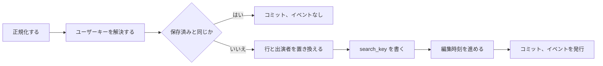

# データモデル: 動画の作品情報 {#data-model-work-information-on-videos}

親 Issue: #967。

モデルの残りは変わらない。既存のテーブルは [internal/store/migrations/](../../internal/store/migrations/) が定義し、再構築できる索引とユーザーデータの分け方は [ARCHITECTURE.md](../../ARCHITECTURE.md) にあり、ユーザーキーとユーザーデータをコピーする経路は [specs/030-video-versions/data-model.md、ユーザーキー](../030-video-versions/data-model.md#user-key) にある。このファイルは、この機能が加えるテーブル、値、ルールだけを持つ。`videos`、`video_locations`、`video_overrides`、`video_tags` に列は加えない。

## マイグレーション {#migration}

`main` の最後のマイグレーションは `00041_thumbnail_image_sources.sql` である。この機能は `00042_video_work_info.sql` を加える。入ったマイグレーションは決して編集しない (`scripts/migrations-immutable.sh`)。

```sql
create table video_work_info (
    content_key    text    primary key,
    code           text,
    release_date   text,
    maker          text,
    maker_key      text,
    description    text,
    source_url     text,
    search_key     text    not null default '',
    search_version integer not null default 0,
    updated_at     integer not null
) without rowid;
create index video_work_info_maker_idx on video_work_info (maker_key);

create table video_work_performers (
    content_key text    not null references video_work_info (content_key)
                            on delete cascade on update cascade,
    position    integer not null,
    name        text    not null,
    name_key    text    not null,
    primary key (content_key, position)
) without rowid;
create index video_work_performers_name_idx on video_work_performers (name_key, content_key);
```

Down は両方のテーブルを削除する。`content_key` は、`video_favorites` と同じくユーザーキーを持つ。列がこの名前のままなのは、`userDataTables` がほかのテーブルと同じ文でそれをコピーし、`moveUserData` がそのキーを付け替えるためである ([まとまりと継承](#bundles-and-succession))。両方のテーブルはユーザーデータであり、[running-vv.md、データと復旧](../../docs/how-to/running-vv.md#data-and-recovery) のユーザーデータの行と、ARCHITECTURE.md「User data survives a rebuild」の一覧に加わる。

## フィールド {#fields}

| フィールド | 列 | 型 | ルール |
| --- | --- | --- | --- |
| `code` | `code` | 文字列 | 100 コードポイント以下 |
| `releaseDate` | `release_date` | 文字列 `YYYY-MM-DD` | 暦の日付で、年は 1 から 9999 |
| `maker` | `maker` | 文字列 | 200 コードポイント以下。`maker_key` は `FoldForMatch(maker)` |
| `performers` | `video_work_performers` の行 | 文字列の順序つきの一覧 | 0 から 100 個の名前で、それぞれ 200 コードポイント以下。`position` は一覧での位置。`name_key` は `FoldForMatch(name)` |
| `description` | `description` | 文字列 | 10,000 コードポイント以下。改行は認め、ほかの制御文字は認めない |
| `sourceUrl` | `source_url` | 文字列 | 2,048 コードポイント以下。ホストを持つ、`http` または `https` の絶対 URL |

消去したフィールドはその列で `null` である。`video_work_info` の行は、少なくとも 1 つのフィールドが設定されているか、少なくとも 1 人の出演者がある間だけ存在する。すべての文字列のフィールドは、まず表示名の手順を通る。どこかに制御文字があればエラー (`description` の改行を除く)、前後の空白はトリムし、空の結果はフィールドを消去する ([029 R-10](../029-video-overrides/research.md#r-10-display-name-rules-follow-tag-name-rules-with-a-200-code-point-limit))。トリム後に同じ綴りの 2 人の出演者は、最初のものを残す。

## `domain` に加える値 {#values-added-to-domain}

| 値 | 意味 |
| --- | --- |
| `WorkInfo{Code, ReleaseDate, Maker, Performers []string, Description, SourceURL string}` | 6 つのフィールド。未設定のフィールドは空文字列、未設定の一覧は空 |
| `NormalizeWorkInfo(input WorkInfo) (WorkInfo, empty bool, error)` | [フィールド](#fields) を適用する。すべてのフィールドが消去されたとき `empty` は true |
| `WorkInfoLimits` (`CodeMaxLength` 100、`MakerMaxLength` 200、`PerformerMaxLength` 200、`PerformersMaxCount` 100、`DescriptionMaxLength` 10000、`SourceURLMaxLength` 2048) | 上の上限。API が `limit` のために読む |
| `WorkInfoField` (`code`、`releaseDate`、`maker`、`performers`、`description`、`sourceUrl`) | エラーが挙げるフィールド。値は JSON のプロパティ名である |
| `InvalidWorkInfoError{Field, Problem, Limit}`。`Problem` は `ControlCharacters`、`TooLong`、`InvalidDate`、`InvalidURL`、`TooMany` のいずれか | `ErrInvalidWorkInfo` に Unwrap する。API は `Problem` を理由に対応づける ([contracts/screen-api.md、加える `reason` の値と `field`](contracts/screen-api.md#added-reason-values-and-field)) |
| `WorkInfoChange{Video VideoRef, WorkInfo WorkInfo}`、`WorkInfoAtError{Index int, Err error}` | 外部のまとめての操作の項目と、その位置つきのエラー。`DisplayNameChange` と `DisplayNameAtError` と同じ形 |
| `Video.WorkInfo *WorkInfo` | 詳細の読み取りと外部の読み取りが埋める。一覧の読み取りと、行がないときは `nil` |
| `VideoQuery.Performer`、`VideoQuery.Maker` (string) | [R-4](research.md#r-4-performer-and-maker-list-parameters-matched-by-folded-value-library-only) の一覧の絞り込み。空は絞り込みなしを意味する |
| `VideoWorkInfoChanged{VideoIDs []int64}` | [R-8](research.md#r-8-a-change-publishes-domainvideoworkinfochanged-mapped-to-the-screens-video-notification) のイベント |

`Audience.CheckVideoQuery` は、ゲストが `Performer` または `Maker` を設定すると `ErrGuestQueryNotAllowed` を返す。

## 読み取り {#reads}

| 読み取り | 出所 | 振る舞い |
| --- | --- | --- |
| `GET /api/videos/{id}` | `getVideo` の後の `WorkInfoStore.ByUserKeys`。キーは `Video.UserKey` | 所有者への応答は `workInfo` を含む。ゲストには `forAudience` がそれを除く |
| `GET /api/v1/videos`、`GET /api/v1/videos/lookup` | ページのユーザーキーに対する `WorkInfoStore.ByUserKeys`。`TagsByContentKeys` と同じように読む | すべての項目が `workInfo` を含む |
| 一覧 (`listColumns`) | 読まない | カードは作品情報を表示しない |

`ByUserKeys` は出演者を `position` の順に返す。

## 書き込み (`WorkInfoStore`) {#writes-workinfostore}

`WorkInfoStore` は新しい役割の型で、`FavoriteStore` と同じく `sql` の接続とイベントの発行者だけを持つ。動画の id は `userKeysForVideoIDs` (まとまりごとに 1 つのキー) で、外部の参照は `resolveTaggableVideos` で解決する。



| 操作 | 振る舞い |
| --- | --- |
| `Set(videoID, WorkInfo)` | 1 つのトランザクションで、正規化し、キーを解決し、保存済みのオブジェクトと比べ、`video_work_info` の行とその出演者を置き換え (`empty` のときは行を削除する)、`search_key` と `search_version` を書き、オブジェクトが変わったときは `touchEditedAtForUserKeys` を呼び、`WorkInfo` を持つ動画を返す |
| `SetMany([]WorkInfoChange)` | すべての項目について、1 つのトランザクションで同じようにする。同じ動画に対する後の項目が勝つ。最初のエラーで `WorkInfoAtError` または `VideoRefNotFoundError` とともに中止する |
| `RefreshSearchKeys` | 起動時、`TagStore.RefreshSearchKeys` の後に、`search_version` が `domain.SearchKeyVersion` より小さい行の `search_key`、`maker_key`、`name_key` を書き直す |

`search_key` は、畳み込んだ品番、畳み込んだメーカー、畳み込んだ出演者名を `\n` でつないだもので、それぞれの中の改行は空白に置き換えるので、どの語も 2 つの値をまたいで一致しない。

## 検索 {#search}

所有者に対して、`searchExprCondition` の語の条件は、場所のキーとタグ名と並ぶ 3 つ目の分岐を得る:

```sql
exists (select 1 from videos v join video_work_info wi on wi.content_key = <userKeyExpr(v)>
        where v.id = <alias>.video_id and v.content_key <> '' and instr(wi.search_key, ?) > 0)
```

同じ畳み込んだ語をもう一度渡す。ゲストの条件は変わらない。

## 一覧 {#lists}

`filteredFrom` と `libraryItemsCTE` は、`Performer` または `Maker` が設定されているとき、次を得る:

| 絞り込み | 動画に対する条件 |
| --- | --- |
| `Performer` | `FoldForMatch(Performer)` での `exists (select 1 from video_work_performers p where p.content_key = <userKeyExpr(videos)> and p.name_key = ?)` |
| `Maker` | `FoldForMatch(Maker)` での `exists (select 1 from video_work_info wi where wi.content_key = <userKeyExpr(videos)> and wi.maker_key = ?)` |

両方とも、タグの AND が適用される [027 library-api.md、`GET /api/library` が項目を組み立てる方法](../027-partial-group-search/contracts/library-api.md#how-get-apilibrary-builds-items) の一致したメンバーの段階に適用されるので、一部だけ一致したグループは、一致したメンバーを動画の項目として表示する。`total` は絞り込みを適用して数える。

## まとまりと継承 {#bundles-and-succession}

| 経路 | 変更 |
| --- | --- |
| `userDataTables` | `video_work_info`、次に `video_work_performers` を末尾に加える。これにより、まとめると代表の行と名前をまとまりのキーにコピーし、まとまりを解くと各メンバー自身の行が残る ([030 R-1](../030-video-versions/research.md#r-1-bundles-live-in-user-data-tables-and-bundle-values-sit-in-the-existing-tables-under-the-bundles-own-key)) |
| `moveUserData` | `video_work_info` のキーを古いキーから新しいキーへ付け替え、古いキーに行があるときは新しいキーの行を置き換える (`playback_progress` のルール)。新しいキーの行を削除するとその出演者が除かれ、`on update cascade` が古いキーの出演者を付け替えた行とともに移す。`video_work_performers.content_key` を直接更新すると外部キーが壊れるので、ループには入れない。ストアのテストが、出演者を持つ継承を、新しいキーの下にすでに作品情報がある場合とない場合について確かめる |

## ルール {#rules}

| ルール | 強制する場所 |
| --- | --- |
| `video_work_info` の行は、少なくとも 1 つの null でないフィールドか、少なくとも 1 人の出演者を持つ | `WorkInfoStore` (`empty` のときは行を削除する)、`invariants_test.go` |
| 1 つのキーの `position` の値は `0..n-1` である | `WorkInfoStore` は一覧を丸ごと書く。`invariants_test.go` |
| `maker_key`、`name_key`、`search_key` は、`search_version = SearchKeyVersion` のとき、その値を畳み込んだものと等しい | `WorkInfoStore` は値と同じ文でそれらを書く。`RefreshSearchKeys` |
| [フィールド](#fields) のフィールドのルール | すべての書き込みが呼ぶ `domain.NormalizeWorkInfo` |

## 変わらないもの {#what-does-not-change}

- `video_overrides` と表示名は内容の鍵ごとのままである。タイトルは代表に従い、作品情報はまとまりに従う (R-2)。
- 場所の `search_key` と `title_key`、および `SearchKeyVersion` は変わらない。タイトルでの並べ替えは作品情報を読まない。
- 一覧とカードは作品情報を含まない。詳細の読み取りは含む。
