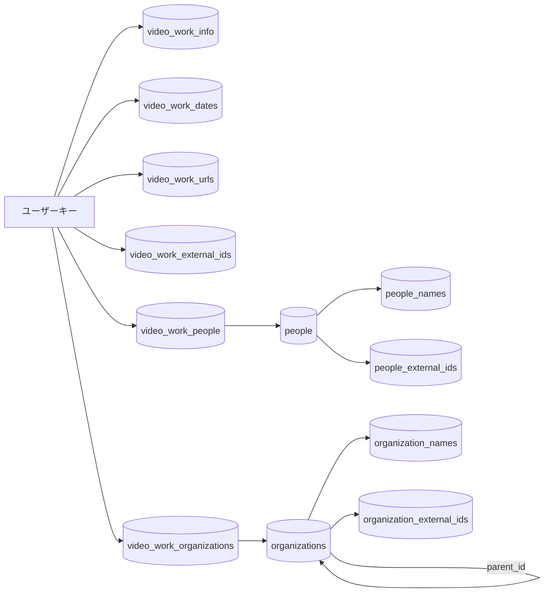
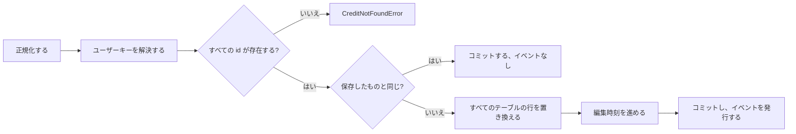

# データモデル: 動画の作品情報 {#data-model-work-information-on-videos}

親 Issue: #967。

モデルの残りは変わらない: 既存のテーブルは [internal/store/migrations/](../../internal/store/migrations/) が定義し、作り直せる索引とユーザーデータの区別は [ARCHITECTURE.md](../../ARCHITECTURE.md) にあり、ユーザーキーとユーザーデータをコピーする経路は [specs/030-video-versions/data-model.md、ユーザーキー](../030-video-versions/data-model.md#user-key) にある。このファイルは、この機能が加えるテーブル、値、規則だけを扱う。`videos`、`video_locations`、`video_overrides`、`video_tags` には列を加えない。

図は、この機能が加えるテーブルと、それらを結ぶものを示す。



## マイグレーション {#migration}

`main` の最後のマイグレーションは `00041_thumbnail_image_sources.sql` である。この機能は `00042_work_info.sql` を加える。入ったマイグレーションは決して編集しない (`scripts/migrations-immutable.sh`)。

```sql
-- Entities (research.md R-3). autoincrement keeps a deleted id from being reused.
create table people (
    id         integer primary key autoincrement,
    created_at integer not null
);
create table organizations (
    id         integer primary key autoincrement,
    parent_id  integer references organizations (id) on delete set null,
    created_at integer not null
);

-- Names and aliases: one row per spelling per entity; canonical = 1 is the name shown.
-- Two entities may share a spelling (same name, different people).
create table people_names (
    person_id      integer not null references people (id) on delete cascade,
    name           text    not null,
    canonical      integer not null check (canonical in (0, 1)),
    language       text,                            -- aliases only; null when not given
    search_key     text    not null default '',     -- domain.FoldForMatch(name)
    sort_key       text    not null default '',     -- domain.NaturalSortKey(name), canonical rows
    search_version integer not null default 0,
    primary key (person_id, name)
) without rowid;
create unique index people_names_canonical_idx on people_names (person_id) where canonical = 1;
create table organization_names (
    organization_id integer not null references organizations (id) on delete cascade,
    name            text    not null,
    canonical       integer not null check (canonical in (0, 1)),
    language        text,
    search_key      text    not null default '',
    sort_key        text    not null default '',
    search_version  integer not null default 0,
    primary key (organization_id, name)
) without rowid;
create unique index organization_names_canonical_idx on organization_names (organization_id) where canonical = 1;

create table people_external_ids (
    person_id integer not null references people (id) on delete cascade,
    source    text    not null,
    value     text    not null,
    primary key (person_id, source, value)
) without rowid;
-- An external ID names one entity of a kind, so Lookup has one answer.
create unique index people_external_ids_lookup_idx on people_external_ids (source, value);
create table organization_external_ids (
    organization_id integer not null references organizations (id) on delete cascade,
    source          text    not null,
    value           text    not null,
    primary key (organization_id, source, value)
) without rowid;
create unique index organization_external_ids_lookup_idx on organization_external_ids (source, value);

-- Per-video tables (research.md R-2). content_key holds the user key; no foreign key to videos
-- and none between these tables, so the bundle paths copy each one alone; succession moves the six together.
create table video_work_info (
    content_key    text    primary key,
    code           text,
    code_key       text    not null default '',     -- domain.FoldForMatch(code)
    description    text,
    search_version integer not null default 0
) without rowid;
create table video_work_dates (
    content_key text not null,
    kind        text not null check (kind in ('release', 'recorded', 'published')),
    date        text not null,                      -- YYYY, YYYY-MM or YYYY-MM-DD
    primary key (content_key, kind)
) without rowid;
create table video_work_urls (
    content_key text    not null,
    position    integer not null,
    url         text    not null,
    primary key (content_key, position),
    unique (content_key, url)
) without rowid;
create table video_work_external_ids (
    content_key text not null,
    source      text not null,
    value       text not null,
    primary key (content_key, source, value)
) without rowid;
create table video_work_people (
    content_key text    not null,
    role        text    not null check (role in ('performer', 'director', 'photographer', 'streamer')),
    position    integer not null,
    person_id   integer not null references people (id) on delete cascade,
    primary key (content_key, role, position),
    unique (content_key, role, person_id)
) without rowid;
create index video_work_people_person_idx on video_work_people (person_id, content_key);
create table video_work_organizations (
    content_key     text    not null,
    role            text    not null check (role in ('maker', 'label')),
    position        integer not null,
    organization_id integer not null references organizations (id) on delete cascade,
    primary key (content_key, role, position),
    unique (content_key, role, organization_id)
) without rowid;
create index video_work_organizations_org_idx on video_work_organizations (organization_id, content_key);
```

down は 12 のテーブルを削除する。どれもユーザーデータである: [running-vv.md、Data and recovery](../../docs/how-to/running-vv.md#data-and-recovery) のユーザーデータの行と、ARCHITECTURE.md "User data survives a rebuild" の一覧に加わる。

## フィールド {#fields}

どの文字列もまず表示名の手順を通る: どこかに制御文字があればエラーであり (`description` の改行を除く)、前後の空白は取り除き、結果が空ならフィールドを消すか一覧の項目を捨てる ([029 R-10](../029-video-overrides/research.md#r-10-display-name-rules-follow-tag-name-rules-with-a-200-code-point-limit))。2 つの値は空にできず、代わりに問題 `Empty` (`work_info_empty`) で拒否する: エンティティの `name` と、もう一方の半分が設定された外部 ID の半分である。保存する表記は畳み込みも正規化もしない。照合のときに畳み込む (R-6)。

一覧の各項目は送られた順に検査し、`field` のパスは、捨てる項目も数えた、送られたとおりの一覧での位置を指す。一覧の項目数の上限は、捨てた後に残る項目を数える。繰り返した値は 2 回目の出現で報告する。

| フィールド | テーブル | 規則 |
| --- | --- | --- |
| `code` | `video_work_info.code` | 最大 100 コードポイント。`code_key` は `FoldForMatch(code)` |
| `description` | `video_work_info.description` | 最大 10,000 コードポイント。改行を許す |
| `dates[].kind` | `video_work_dates.kind` | `release`、`recorded`、`published` のいずれか。種類ごとに 1 項目 ([R-12](research.md#r-12-one-date-per-kind-in-yyyy-yyyy-mm-or-yyyy-mm-dd)) |
| `dates[].date` | `video_work_dates.date` | `YYYY`、`YYYY-MM`、`YYYY-MM-DD`。年は 1 から 9999、月は 1 から 12、日はその月に存在する日 |
| `urls[]` | `video_work_urls.url` | 0 から 20 項目。それぞれ最大 2,048 コードポイントで、ホストを持つ絶対の `http` か `https` の URL。`position` は添字。繰り返した URL はエラー |
| `externalIds[]` | `video_work_external_ids` | 0 から 20 項目。`source` は 1 から 50 コードポイント、`value` は 1 から 200。両方の半分が空の項目は捨て、ちょうど一方の半分が空の項目は `Empty` で、`field` は `externalIds[i].source` か `externalIds[i].value`。繰り返した `(source, value)` は `Duplicate` で、`field` は `externalIds[i]` |
| `people[]` | `video_work_people` | 役割ごとに 0 から 100 項目。`role` は `performer`、`director`、`photographer`、`streamer` のいずれか。`id` は存在する人物。`position` は役割の中の添字。1 つの役割に同じ人物が 2 回あればエラー |
| `organizations[]` | `video_work_organizations` | 役割ごとに 0 から 20 項目。`role` は `maker`、`label` のいずれか。`id` は存在する組織。1 つの役割に同じ組織が 2 回あればエラー |
| エンティティの `name` | `*_names` の `canonical = 1` の行 | 1 から 200 コードポイント。前後の空白を取り除いて空なら `Empty` で、`field: name`。タグに対する `tag_name_empty` と同じである |
| エンティティの `aliases[]` | `*_names` の `canonical = 0` の行 | 0 から 50 項目。それぞれの `name` は 1 から 200 コードポイント。前後の空白を取り除いて名前が空になる別名は、`language` を持っていても捨てる。名前か別の別名と等しい別名 (畳み込まず、そのまま比べる) は `Duplicate` で、`field` は `aliases[i].name` |
| エンティティの `aliases[].language` | `*_names.language` | 省略可能で、前後の空白を取り除いて空ならなしを意味する。最大 35 文字 (`TooLong`)、それを満たしたうえで BCP 47 のタグの構文 `^[A-Za-z]{2,3}(-[A-Za-z0-9-]*)?$`: ASCII の英字、数字、`-` からなり、2 か 3 文字の英字のサブタグで始まる (`InvalidLanguage`)。それ以外の検証はしない |
| エンティティの `externalIds[]` | `*_external_ids` | 0 から 20 項目、上の `externalIds[]` の規則。同じ種類の別のエンティティが持つ `(source, value)` はエラー (`CreditExternalIDTakenError`) |
| 組織の `parentId` | `organizations.parent_id` | 存在する組織で、その組織自身でもその子孫の 1 つでもないもの。`null` で消す。人物は親を持たず、`CreditStore` は人物の `parentId` を読まない |

消した単一の値のフィールドは `null` である。`video_work_info` の行は、`code` か `description` が設定されている間だけ存在する。

動画の規則は次の場合も決める。どれも上の規則と同じである:

| 場合 | 規則 |
| --- | --- |
| `date` が前後の空白を取り除いて空になる `dates[]` の項目 | 捨てるので、種類ごとに 1 項目の規則には数えない |
| 繰り返した日付の種類 | `Duplicate` で、`field` は `dates[i].kind` |
| 1 つの役割の中で繰り返した人物か組織 | `Duplicate` で、`field` は `people[i].person.id` か `organizations[i].organization.id` |
| 項目数の上限を超えた役割 | `TooMany` で、`field` は `people` (上限 100) か `organizations` (上限 20) |
| 形式より長い `date`、または 1 桁の月か日 | `InvalidDate` |
| 集合の外にある `kind` か `role` | `Problem` を持たず `ErrInvalidWorkInfo` を包むエラー。生成したスキーマの検査が先に拒否する |
| 存在しない人物か組織 | すべてのフィールドの規則の後に、送られた順に、人物を組織より先に検査する。`field` は送られたとおりの一覧での位置 |

`(role, position)` の役割の順は、役割の集合の順である: `performer`、`director`、`photographer`、`streamer`、次に `maker`、`label`。`NormalizeWorkInfo` は一覧を [読み取り](#reads) の読み取りの順で返すので、ストアは書き込みを保存したオブジェクトとそのまま比べる。

## エンティティ {#entities}

人物や組織は `domain.Credit` として読む: 正式な名前、名前の自然順に並べた別名、`(source, value)` の順の外部 ID、どの役割であれ結び付いた表示する動画の数、組織ではその親の id と名前。`CreditStore` は `domain.CreditKind` (`person` か `organization`) を受け取ってテーブル名に解決する 1 つの役割の型であり、SQL は一度だけ書く。

| 操作 | 振る舞い |
| --- | --- |
| `List(kind, CreditQuery)` | `q` は畳み込み、`instr` で、すべての名前の行 (名前と別名) の `search_key` に照合する。`sort` は `name`、`countDesc`、`countAsc`、`createdDesc`、`createdAsc` のいずれかで、同順の扱いは [036 R-1](../036-tag-admin-scale/research.md#r-1-the-server-pages-the-list-and-applies-search-filters-and-sort-to-every-tag) に従う。キーセットの `cursor` と 1 から 200 の `limit`。`limit` がなければすべてのエンティティ。`total` は一致したものを、`totalAll` はすべてのエンティティを数える |
| `Get(kind, id)` | エンティティ、または `domain.ErrNotFound` |
| `Lookup(kind, source, value)` | その外部 ID と完全に一致するものを持つエンティティ、または `domain.ErrNotFound` |
| `Create(kind, CreditInput)` | 1 つのトランザクション: 正規化し、その種類の別のエンティティが持つ外部 ID を拒否し、エンティティ、その正式な名前の行、別名の行、外部 ID を挿入する。組織では親を確かめる |
| `Update(kind, id, CreditPatch)` | 1 つのトランザクション: パッチにあるフィールドを保存したエンティティに重ね、その結果を正規化する。一覧は保存した行全体を置き換える。パッチが残す別名と等しい新しい `name` は `Duplicate` で、`field: name`。タグを自身の同義語に改名すると拒否されるのと同じである。その種類の別のエンティティが持つ外部 ID は拒否する。親は、新しい親から根まで `parent_id` をたどって循環を確かめる。何も変えないパッチは、エンティティを変えずに返す |
| `Merge(kind, targetID, sourceIDs)` | 1 つのトランザクション: 統合先と等しい統合元は `ErrMergeSameCredit` である。組織では、統合先から根まで `parent_id` をたどり、統合元がその連鎖の上にあれば `ErrCreditParentCycle` で拒否する。その統合元の子を統合先に向けるとループができるからである。次に、各統合元について、そのリンクの行を統合先に移し (`update or ignore` で統合元の行をその位置のまま統合先に向け直すので、統合先は一覧の中で統合元の位置を占める。統合先がすでにその `(content_key, role)` にあるところでは、一意の索引によりその行は残り、その後削除し、その `(content_key, role)` を詰めて番号付けし直す)、その名前の行を別名として移し (`insert or ignore` なので、統合先がすでに持つ表記は捨てる)、その外部 ID を統合先に向け直し (`update`。一意の `(source, value)` の索引により、統合先がすでにそれを持つことはありえない)、統合元の組織の子を統合先に向け、統合元を削除する。最後に、統合先の別名と外部 ID を数える: 50 か 20 を超えれば `InvalidWorkInfoError{Field: "aliases" or "externalIds", Problem: TooMany, Limit}` でトランザクションをロールバックするので、統合が `NormalizeCredit` の拒否するエンティティを残すことは決してない。存在しない統合元は `NotFoundIDs` に挙げる |
| `Delete(kind, id)` | エンティティを削除する。名前、外部 ID、リンクの行は連鎖して消える。組織の子は `parent_id = null` になる。各 `(content_key, role)` の残りの位置は番号付けし直す |
| `RefreshSearchKeys` | 起動時、`TagStore.RefreshSearchKeys` の後: 名前の行の `search_key` と `sort_key`、および `code_key` (`video_work_info` の行) のうち、`search_version` が `domain.SearchKeyVersion` より小さい行のものを書き直す |

## `domain` に加える値 {#values-added-to-domain}

| 値 | 意味 |
| --- | --- |
| `WorkInfo{Code, Description string; Dates []WorkDate; People []WorkPerson; Organizations []WorkOrganization; URLs []string; ExternalIDs []ExternalID}` | 1 つの動画のオブジェクト。設定していないフィールドは空の文字列か空の一覧 |
| `WorkDate{Kind DateKind, Date string}`、`WorkPerson{Role PersonRole, Person CreditRef}`、`WorkOrganization{Role OrganizationRole, Organization CreditRef}`、`ExternalID{Source, Value string}` | 一覧の項目。`CreditRef{ID int64, Name string}` は読み取りでは名前を持ち、書き込みでは id だけを持つ |
| `DateKind`、`PersonRole`、`OrganizationRole` | [フィールド](#fields) の決まった集合。文字列の定数 |
| `NormalizeWorkInfo(input WorkInfo) (WorkInfo, empty bool, error)` | ストアが確かめる id の存在を除いて [フィールド](#fields) を適用する。すべてのフィールドが消えたとき `empty` は true |
| `WorkInfoLimits` | 上の上限。API が `limit` のために読む |
| `InvalidWorkInfoError{Field, Problem, Limit}`。`Problem` は `ControlCharacters`、`TooLong`、`TooMany`、`InvalidDate`、`InvalidURL`、`InvalidLanguage`、`Duplicate`、`Empty` のいずれか | `ErrInvalidWorkInfo` にアンラップされる。`Field` は [contracts/screen-api.md、追加する `reason` の値と `field`](contracts/screen-api.md#added-reason-values-and-field) のパス |
| `CreditNotFoundError{Kind, ID, Field}` | 存在しない参照した id。API はそれを `404` に対応付け、`person_not_found` か `organization_not_found` と `field` を付ける |
| `WorkInfoChange{Video VideoRef, WorkInfo WorkInfo}`、`WorkInfoAtError{Index int, Err error}` | 外部の一括操作の項目と、その位置付きのエラー。`DisplayNameChange` と `DisplayNameAtError` と同じ形 |
| `Video.WorkInfo *WorkInfo` | 詳細の読み取りと外部の読み取りが埋める。一覧の読み取りと、動画が行を持たないときは `nil` |
| `CreditKind` (`person`、`organization`)、`Credit{Kind, ID, Name, Aliases []Alias, ExternalIDs, Parent *CreditRef, VideoCount, CreatedAt}`、`Alias{Name, Language string}` | エンティティ ([エンティティ](#entities)) |
| `CreditInput{Name, Aliases, ExternalIDs, ParentID *int64}`、`CreditPatch` (同じフィールドで、それぞれ省略可能)、`CreditQuery{Q, Sort, Cursor, Limit}`、`CreditPage{Items, Total, TotalAll, NextCursor}`、`CreditMergeOutcome{Credit, NotFoundIDs}` | `CreditStore` の入力と出力 |
| `NormalizeCredit`、`ErrCreditParentCycle`、`ErrMergeSameCredit` | [フィールド](#fields) のエンティティの規則と、2 つの拒否 |
| `CreditExternalIDTakenError{Kind, Field, HolderID}` | その種類の別のエンティティが持つ、エンティティの外部 ID。API はそれを `409 conflict` / `external_id_taken` に対応付け、`field` を付ける |
| `VideoQuery.Person`、`VideoQuery.Organization` (int64) | [R-7](research.md#r-7-person-and-organization-list-parameters-by-id-matching-every-role) の一覧の絞り込み。ゼロは絞り込みなしを意味する |
| `VideoWorkInfoChanged{VideoIDs []int64}` | [R-11](research.md#r-11-a-work-information-write-publishes-videoworkinfochanged-entity-edits-publish-nothing) のイベント |

`Audience.CheckVideoQuery` が `ErrGuestQueryNotAllowed` を返すのは、ゲストが `Person` か `Organization` を設定したときである。

## 読み取り {#reads}

| 読み取り | 出どころ | 振る舞い |
| --- | --- | --- |
| `GET /api/videos/{id}` | `WorkInfoStore.ByUserKeys` (`getVideo` の後)。`Video.UserKey` をキーとする | 所有者への応答は `workInfo` を持つ。ゲストには `forAudience` がそれを除く |
| `GET /api/v1/videos`、`GET /api/v1/videos/lookup` | ページのユーザーキーに対する `WorkInfoStore.ByUserKeys`。`TagsByContentKeys` を読むのと同じ | どの項目も `workInfo` を持つ |
| 一覧 (`listColumns`) | 読まない | カードは作品情報を表示しない |

`ByUserKeys` は、人物と組織を `(role, position)` の順にそれぞれの正式な名前とともに、URL を `position` の順に、日付を種類の順 `release`、`recorded`、`published` に、外部 ID を `(source, value)` の順に返す。

## 書き込み (`WorkInfoStore`) {#writes-workinfostore}

`WorkInfoStore` は、`sql` の接続とイベントの発行者を持つ新しい役割の型であり、`FavoriteStore` と同じ形である。動画の id を `userKeysForVideoIDs` で (まとまりごとに 1 つのキーに)、外部の参照を `resolveTaggableVideos` で解決する。



| 操作 | 振る舞い |
| --- | --- |
| `Set(videoID, WorkInfo)` | 1 つのトランザクション: 正規化し、キーを解決し、参照したすべての id を確かめ、保存したオブジェクトと比べ、6 つのテーブルの行を置き換え (`video_work_info` の行は、`code` と `description` の両方が消えたときは作らない)、`code_key` と `search_version` を書き、オブジェクトが変わったときは `touchEditedAtForUserKeys` を呼び、`WorkInfo` を持つ動画を返す |
| `SetMany([]WorkInfoChange)` | 1 つのトランザクションで、すべての項目に同じことをする。同じ動画に対する後の項目が勝つ。最初のエラーで、`WorkInfoAtError` か `VideoRefNotFoundError` とともに中止する |
| `SetDetails(videoID, displayName, WorkInfo)` | 1 つのトランザクション ([R-14](research.md#r-14-the-editor-saves-the-display-name-and-the-work-information-with-one-put-apivideosiddetails-in-one-transaction)): 先に `NormalizeDisplayName`、次に `NormalizeWorkInfo` を呼び、どちらのエラーも何かを書く前に返す。内容の鍵 (`registeredContentKeysForVideoIDs`) とユーザーキーを解決する。参照したすべての id を確かめる。表示名が `displayNamesOf` と異なるときは、`writeDisplayName` と `refreshSearchKeysForContentKeys` で書く。オブジェクトが異なるときは、`Set` と同じく 6 つのテーブルの行を置き換える。編集時刻は、名前が異なるときの編集した動画の内容の鍵と、オブジェクトが異なるときのユーザーキーのすべてのメンバーの内容の鍵 (`touchEditedAtForUserKeys` が展開するとおりの `contentKeysForUserKeys`) の重複を除いた和集合に対する 1 回の `touchEditedAt` の呼び出しで 1 回進め、まとまりのすべてのメンバーが共有のオブジェクトの編集時刻を持つようにする。`WorkInfo` を持つ動画を返す。コミットの後、名前が変わったときは `VideoOverrideChanged{VideoID}` を、オブジェクトが変わったときは `VideoWorkInfoChanged{VideoIDs}` を発行する。どちらも変えない書き込みは何も発行しない |
| `ByUserKeys(keys)` | [読み取り](#reads) のオブジェクト |

## 検索 {#search}

所有者の場合、`searchExprCondition` の語の条件は、場所のキーとタグ名の隣に 3 つの分岐を得る。どれも場所の動画のユーザーキーに対するものである:

```sql
exists (select 1 from video_work_info wi
        where wi.content_key = <userKeyExpr(v)> and instr(wi.code_key, ?) > 0)
or exists (select 1 from video_work_people vp join people_names pn on pn.person_id = vp.person_id
           where vp.content_key = <userKeyExpr(v)> and instr(pn.search_key, ?) > 0)
or exists (select 1 from video_work_organizations vo join organization_names onm on onm.organization_id = vo.organization_id
           where vo.content_key = <userKeyExpr(v)> and instr(onm.search_key, ?) > 0)
```

同じ畳み込んだ語をさらに 3 回渡す。ゲストの条件は変わらない。除外する語は、タグ名と同じく OR 全体を否定する。

## 一覧 {#lists}

`filteredFrom` と `libraryItemsCTE` は、`Person` か `Organization` が設定されているとき、次を得る:

| 絞り込み | 動画に対する条件 |
| --- | --- |
| `Person` | `exists (select 1 from video_work_people vp where vp.content_key = <userKeyExpr(videos)> and vp.person_id = ?)` |
| `Organization` | `exists (select 1 from video_work_organizations vo where vo.content_key = <userKeyExpr(videos)> and vo.organization_id = ?)` |

どちらも、タグの AND が適用される [027 library-api.md、`GET /api/library` が項目を組み立てる方法](../027-partial-group-search/contracts/library-api.md#how-get-apilibrary-builds-items) の一致したメンバーの段階に適用されるので、一部だけが一致したグループは、一致したメンバーを動画の項目として示す。`total` は絞り込みを適用して数える。エンティティのない id は何にも一致せず、エラーではない。

エンティティの `VideoCount` は、どの役割であれリンクの行が挙げる、表示する動画 (所有者としての `shownVideoCondition`) の異なるユーザーキーを数え、[014 data-model.md、動画の数](../014-video-tags/data-model.md#video-counts) のタグの件数と同じくページごとに計算する。

## まとまりと引き継ぎ {#bundles-and-succession}

| 経路 | 変更 |
| --- | --- |
| `userDataTables` | 6 つの動画ごとのテーブルをキー以外の列とともに加えるので、まとめる操作は代表の行をまとまりのキーにコピーし、まとまりを解くと各メンバー自身の行が残る ([030 R-1](../030-video-versions/research.md#r-1-bundles-live-in-user-data-tables-and-bundle-values-sit-in-the-existing-tables-under-the-bundles-own-key)) |
| `moveUserData` | 6 つのテーブルは、テーブルごとではなく 1 つのオブジェクトとして移る: 古いキーがそのどれかに行を持つとき、6 つすべてから新しいキーの行を削除し、それから古いキーの行のキーを付け替える。既存のループのテーブルごとの規則 (`playback_progress` の規則) では、古いキーが空のままにするテーブルが保たれるので、新しいキーは、ある動画の人物と別の動画の日付を持つことになってしまう。ストアのテストは、人物が結び付いている場合、新しいキーの下に作品情報がない場合、古いキーが持たない日付と URL を新しいキーが持ち、引き継ぎがそれらを消す場合の引き継ぎを覆う |

## 規則 {#rules}

| 規則 | 強制する場所 |
| --- | --- |
| `video_work_info` の行は `code` か `description` が設定されている | `WorkInfoStore` (両方が消えたときは行を書かない)。`invariants_test.go` |
| `position` の値は、1 つの `(content_key, role)` の中でも、1 つのキーの URL の中でも `0..n-1` である | `WorkInfoStore` は一覧全体を書く。`CreditStore.Merge` と `Delete` は番号付けし直す。`invariants_test.go` |
| どのエンティティも `canonical = 1` の名前の行をちょうど 1 つ持つ | `CreditStore`。`invariants_test.go` |
| 正式な名前の行では `language` は null である | `CreditStore`。`invariants_test.go` |
| `parent_id` の連鎖は根で終わる (循環がない) | `CreditStore.Update` と `Create` は新しい親から、`Merge` は統合先から連鎖をたどる。`invariants_test.go` |
| エンティティは最大 50 の別名と 20 の外部 ID を持つ | 作成と更新での `NormalizeCredit`、`Merge` の最後の数え上げ。`invariants_test.go` |
| `(source, value)` はある種類のエンティティを最大 1 つ指す | 一意の照会の索引。`CreditStore.Create` と `Update` は `CreditExternalIDTakenError` を報告する |
| `code_key`、`search_key`、`sort_key` は、`search_version = SearchKeyVersion` のときにその値を畳み込んだものと等しい | 値と同じ文で書く。`RefreshSearchKeys` |
| [フィールド](#fields) のフィールドの規則 | すべての書き込みが呼ぶ `domain.NormalizeWorkInfo` と `domain.NormalizeCredit` |

## 変わらないもの {#what-does-not-change}

- `video_overrides` と表示名は内容の鍵ごとのままである: タイトルは代表に従い、作品情報はまとまりに従う (R-2)。`SetDetails` はそれぞれを自身のキーの下に 1 つのトランザクションで書き、この組のためのテーブルも列も加えない (R-14)。
- 場所の `search_key` と `title_key`、および `SearchKeyVersion` は変わらない。タイトルでの並べ替えは作品情報を読まない。
- 一覧とカードは作品情報を持たない。詳細の読み取りが持つ。
- タグ、タグ名、タグの絞り込みは触れない。人物はタグではない。
