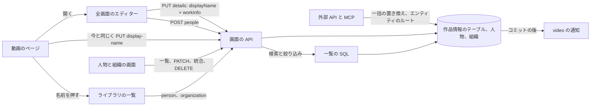
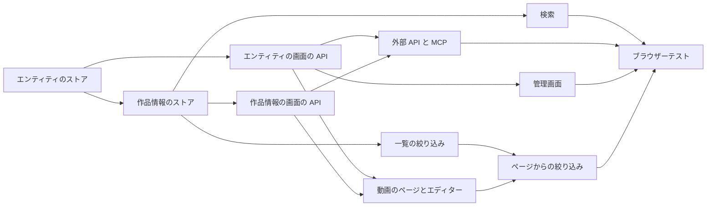

# 実装計画: 動画の作品情報 (コード、日付、人物、組織、URL、外部 ID) {#implementation-plan-work-information-on-videos-code-dates-people-organizations-urls-external-ids}

**ブランチ**: `feature/047-video-work-info` | **親 Issue**: #967

**入力**: 親 Issue。これがこの機能の仕様である。

## 概要 {#summary}

所有者は各動画に、コード、説明、決まった種類の集合に属する日付付きの出来事、URL、外部 ID、および決まった集合の役割で結び付けた人物と組織を与え、それらを、動画のページから開く全画面のエディターで表示名とともに入力し、変え、消し (エディターの保存は 1 つの要求、1 つのトランザクションで両方を適用し、ページ上のその場でのタイトルの編集は残る)、情報欄では設定した項目だけを見て、検索ボックスでコードとどの名前や別名からでも動画を見つけ、ページから人物や組織の動画を一覧してそれらでライブラリを絞り込み、タグのページと同じ作りの 2 つの一覧画面で人物と組織を管理し (名前の変更、別名、統合、削除、親組織)、これらすべてを外部 API と MCP を通じて読み書きする。人物と組織は id を持つエンティティであり、その名前は重複してよい。動画ごとの値はユーザーキーをキーとするユーザーデータなので、再スキャン、移動、名前の変更、まとめる操作で失われない。この Issue の最初の計画 (6 つの文字列フィールド、ブランチ `archive/047-video-work-info-v1`) はこの計画で置き換えられる。

図は、この機能が加える、または変える部分と、それぞれがやり取りする相手を示す。



| 関心事 | 方針 |
| --- | --- |
| 形 | 項目の種類ごとの型付きのテーブル。役割と種類は決まったテキストの集合。後の項目は新しいテーブルか種類の値になる ([R-1](research.md#r-1-typed-tables-per-item-kind-so-a-later-item-is-a-new-table-or-a-new-kind-value)、[data-model.md、マイグレーション](data-model.md#migration)) |
| 保存 | ユーザーキーをキーとする動画ごとのテーブル。それぞれが独立し、まとめる経路と引き継ぎの経路がコピーする ([R-2](research.md#r-2-per-video-tables-keyed-by-the-user-key-each-standing-alone-copied-by-the-bundle-and-succession-paths)) |
| エンティティ | 名前が一意でない `people` と `organizations`。両方の種類に 1 つの `CreditStore` ([R-3](research.md#r-3-people-and-organizations-are-id-entities-whose-names-are-not-unique-served-by-one-creditstore)、[data-model.md、エンティティ](data-model.md#entities)) |
| 動画の書き込み | オブジェクト全体を置き換える 1 つの `PUT` で、エンティティは id で参照する。作成には独自のルートがある ([R-4](research.md#r-4-a-video-write-references-people-and-organizations-by-id-creation-has-its-own-route)、[R-5](research.md#r-5-one-put-that-replaces-the-whole-work-information-object)、[contracts/screen-api.md](contracts/screen-api.md#put-apivideosidwork-info)) |
| エディターの保存 | `PUT /api/videos/{id}/details` は表示名とオブジェクトを受け取り、両方を 1 つのトランザクションで書く。タイトルだけのルートと作品情報だけのルートは残る ([R-14](research.md#r-14-the-editor-saves-the-display-name-and-the-work-information-with-one-put-apivideosiddetails-in-one-transaction)、[contracts/screen-api.md](contracts/screen-api.md#put-apivideosiddetails)) |
| 検索 | 動画の行の `code_key` とすべての名前の行の `search_key` を、タグ名と並べて `instr` で照合する ([R-6](research.md#r-6-the-search-box-matches-the-code-and-every-name-and-alias-of-the-linked-people-and-organizations)) |
| エンティティごとの一覧 | 一覧の API とライブラリの URL の `person` と `organization` の id。役割は問わない ([R-7](research.md#r-7-person-and-organization-list-parameters-by-id-matching-every-role)) |
| エンティティの管理 | 省略可能なフィールドの `PATCH`、リンクと名前を移す統合、リンクを外す削除、親の循環の拒否 ([R-8](research.md#r-8-entity-edits-are-a-patch-of-optional-fields-a-merge-that-moves-links-and-a-delete-that-detaches)) |
| 外部 API と MCP | 1 つの一括の置き換え、エンティティの種類ごとに 5 つの固定のルート、パスとしての `field` ([R-9](research.md#r-9-the-external-api-gets-one-bulk-replace-and-literal-post-routes-per-entity-kind-field-names-the-failing-property)、[contracts/external-api.md](contracts/external-api.md)) |
| ゲスト | フィールドなし、検索の分岐なし、絞り込みは `400` を返す、エンティティのルートは所有者専用 ([R-10](research.md#r-10-guests-receive-no-work-information-in-responses-search-or-filters)) |
| 画面 | `VideoWorkInfoChanged` を `video` の通知に対応付ける。エンティティの編集にはイベントがない ([R-11](research.md#r-11-a-work-information-write-publishes-videoworkinfochanged-entity-edits-publish-nothing)) |
| 日付 | 種類ごとに 1 つ。`YYYY`、`YYYY-MM`、`YYYY-MM-DD` ([R-12](research.md#r-12-one-date-per-kind-in-yyyy-yyyy-mm-or-yyyy-mm-dd)) |
| 編集時刻 | 動画の書き込みは進め、エンティティの編集は進めない ([R-13](research.md#r-13-work-information-writes-advance-the-edit-time-entity-edits-do-not)) |

Issue に `ui` ラベルがあるので、情報欄での項目の配置、エディターを開く入口、エディターのレイアウトとその保存、取り消し、エラーの状態、人物や組織を選ぶか作成するコンボボックス、折りたたんだ説明、エンティティの適用中の絞り込みの行、2 つの一覧画面は、次の `design` 段階の `ui-design.md` が親 Issue の `UI品質` に照らして決める。Plan がエディターについて決めるのは、それが表示名とすべての作品情報の項目を持ち 1 つの要求で保存する 1 つの画面であること (R-14) と、独自のルートであること (構成の決定) である。

## 技術的な文脈 {#technical-context}

**正本の定義**:

| 項目 | 出典 |
| --- | --- |
| 境界、依存の方向、ユーザーデータ、コミットの後のイベント、認証の境界 | [ARCHITECTURE.md](../../ARCHITECTURE.md)、[.golangci.yml](../../.golangci.yml) (depguard) |
| ユーザーキー、まとまりのコピーと復元、引き継ぎ | [specs/030-video-versions/data-model.md](../030-video-versions/data-model.md)、[internal/store/user_keys.go](../../internal/store/user_keys.go)、[internal/store/versions.go](../../internal/store/versions.go) (`userDataTables`)、[internal/store/successions.go](../../internal/store/successions.go) (`moveUserData`) |
| 名前の規則、表示名の規則、編集時刻 | [specs/014-video-tags/data-model.md](../014-video-tags/data-model.md)、[specs/029-video-overrides/research.md](../029-video-overrides/research.md)、[internal/store/video_edits.go](../../internal/store/video_edits.go) |
| 検索キーと検索の条件 | [specs/013-library-search/data-model.md](../013-library-search/data-model.md)、[internal/store/search.go](../../internal/store/search.go) (`searchExprCondition`、`tagNameMatchCondition`)、[internal/store/tag_search_keys.go](../../internal/store/tag_search_keys.go) |
| ページ単位の管理の一覧、件数、統合、自然順 | [specs/036-tag-admin-scale/research.md](../036-tag-admin-scale/research.md)、[internal/store/tag_listing.go](../../internal/store/tag_listing.go)、[internal/store/tags.go](../../internal/store/tags.go) (`MergeTags`) |
| 一覧、項目、絞り込み | [internal/store/listing.go](../../internal/store/listing.go) (`filteredFrom`)、[internal/store/library_items.go](../../internal/store/library_items.go) (`libraryItemsCTE`)、[internal/domain/library.go](../../internal/domain/library.go) (`VideoQuery`)、[specs/027-partial-group-search/contracts/library-api.md](../027-partial-group-search/contracts/library-api.md) |
| ゲスト | [specs/016-single-account-auth/contracts/guest-api.md](../016-single-account-auth/contracts/guest-api.md)、[internal/domain/auth.go](../../internal/domain/auth.go) (`CheckVideoQuery`)、[internal/httpapi/videos.go](../../internal/httpapi/videos.go) (`forAudience`、`parseVideoQuery`) |
| 画面の API、エラー、生成コード | [api/openapi.yaml](../../api/openapi.yaml)、[specs/023-english-i18n/contracts/error-api.md](../023-english-i18n/contracts/error-api.md)、[internal/httpapi/video_overrides.go](../../internal/httpapi/video_overrides.go)、[internal/httpapi/tags.go](../../internal/httpapi/tags.go)、[internal/httpapi/events.go](../../internal/httpapi/events.go) |
| 外部 API と MCP | [api/external-v1.yaml](../../api/external-v1.yaml)、[docs/how-to/external-api.md](../../docs/how-to/external-api.md)、[specs/026-external-api/contracts/mcp.md](../026-external-api/contracts/mcp.md)、[specs/039-external-tag-admin/contracts/external-api.md](../039-external-tag-admin/contracts/external-api.md)、[internal/httpapi/external_video_overrides.go](../../internal/httpapi/external_video_overrides.go)、[internal/httpapi/external_tags.go](../../internal/httpapi/external_tags.go)、[internal/httpapi/mcp.go](../../internal/httpapi/mcp.go) |
| 動画のページ、タグのページ、ライブラリのタグの絞り込み、画面の規則、Web のテスト | [specs/012-video-detail-ia/ui-design.md](../012-video-detail-ia/ui-design.md)、[specs/036-tag-admin-scale/ui-design.md](../036-tag-admin-scale/ui-design.md)、[docs/design-docs/library-ui.md、情報の行](../../docs/design-docs/library-ui.md#information-rows)、[web/src/player/VideoFacts.tsx](../../web/src/player/VideoFacts.tsx)、[web/src/tags/TagsPage.tsx](../../web/src/tags/TagsPage.tsx)、[web/src/library/tagCriteria.ts](../../web/src/library/tagCriteria.ts)、[web/src/library/ActiveTagFilters.tsx](../../web/src/library/ActiveTagFilters.tsx)、[design-system.md](../../docs/design-docs/design-system.md)、[web-testing.md](../../docs/design-docs/web-testing.md)、[i18n.md](../../docs/design-docs/i18n.md) |
| ブラウザーテスト | [web/e2e/search.e2e.ts](../../web/e2e/search.e2e.ts) |
| 検査 | [Taskfile.yml](../../Taskfile.yml) (`task check`、`task check-docs`、`task generate`、`task test-e2e`) |

**この機能に固有の文脈**:

- マイグレーションは `00042_work_info.sql` の 1 つで、ユーザーデータのテーブルは 12 ある ([data-model.md、マイグレーション](data-model.md#migration))。Go と Web の依存は増えない。`SearchKeyVersion` と `FolderIndexVersion` は上げない。
- 新しいドメインイベント `VideoWorkInfoChanged` を加え、`/api/events` の種類は増やさない (R-11)。
- エラーの本文は、両方のスキーマで `field` と 13 の `reason` の値を得る ([contracts/screen-api.md、追加する `reason` の値と `field`](contracts/screen-api.md#added-reason-values-and-field))。既存の 2 つの `display_name_*` の理由は、詳細のルートからのときだけ `field: displayName` を持つ。
- 所有者専用の新しい画面を 3 つ加える: `/videos/{id}/edit` のエディター、`/people`、`/organizations`。後の 2 つのサイドバーでの配置は `ui-design.md` で決める。
- `quickstart.md` はない: ストア、httpapi、Vitest、ブラウザーのテストが受け入れ条件を確かめ、この機能に固有の手動の手順はない。

## Constitution Check {#constitution-check}

| 規則 (出典) | 判定 |
| --- | --- |
| アダプターは互いも `internal/app` もインポートしない。`internal/domain` はアダプターをインポートしない (ARCHITECTURE.md、depguard) | 合格: フィールドと名前の規則は `internal/domain` の純粋な関数である。SQL は `internal/store` に留まる。`internal/httpapi` はエラーとパラメータを対応付ける。`internal/app` は触れない |
| ユーザーデータは作り直しの後も残る (ARCHITECTURE.md) | 合格: どのテーブルもユーザーキーかエンティティの id をキーとし、`videos` への外部キーを持たない。動画ごとのテーブルは、ユーザーデータをコピーする経路に加わる (R-2)。ARCHITECTURE.md と running-vv.md の一覧に加える |
| 役割の型は別の役割の公開メソッドを呼ばない (ARCHITECTURE.md "Store roles") | 合格: `WorkInfoStore` と `CreditStore` は、パッケージの関数 `userKeysForVideoIDs`、`resolveTaggableVideos`、`touchEditedAtForUserKeys`、`shownVideoCondition` と自身の SQL を使う。`SetDetails` は表示名を、`OverrideStore` を通じてではなく、`SetDisplayName` がすでに使うパッケージの関数を通じて書く (R-14) |
| コミットの後のイベント (ARCHITECTURE.md) | 合格: `VideoWorkInfoChanged` と、`SetDetails` からの `VideoOverrideChanged` は、トランザクションのコミットの後に発行する (R-11、R-14) |
| どの読み取りも閲覧者を知っている (ARCHITECTURE.md、guest-api.md) | 合格: `workInfo` は所有者への応答にだけあり、ゲストの検索の条件は変わらず、`CheckVideoQuery` が絞り込みを拒否し、エンティティのルートは所有者専用である (R-10)。`openapi_routes_test.go` が新しい各ルートの分類を確かめる |
| API の正本と生成ファイル (AGENTS.md) | 合格: `api/openapi.yaml` と `api/external-v1.yaml` を変え、それから `task generate` を実行する。互換性の方針はこの追加を許す (R-9) |
| 複雑度は 25 以下。コードはコピーせず共有する (AGENTS.md) | 合格: 1 つの `NormalizeWorkInfo` と 1 つの `NormalizeCredit` が画面と外部の経路の両方に使われる。1 つの `CreditStore`、1 つのハンドラーの組、1 つの管理ページのコンポーネントが両方のエンティティの種類に使われる (R-3)。エラーの対応付けは、すべてのルートが呼ぶ 1 つの関数である |
| 画面の前に design-system.md を読む。最も低い水準でテストする (AGENTS.md、web-testing.md) | 合格: フィールドの規則はドメインのテスト、書き込みと読み取りはストアのテスト、ルートはハンドラーのテスト、ページと絞り込みはページのテスト、流れは 1 つのブラウザーテストで確かめる |
| 文書を変更と一緒に更新する (core-beliefs.md) | 合格: 各単位は自身が更新する文書を挙げる |

違反はないので、複雑さの追跡はない。判定は Phase 1 の後も変わらない。

## プロジェクトの構成 {#project-structure}

### 文書 (この機能) {#documentation-this-feature}

```text
specs/047-video-work-info/
├── plan.md
├── research.md
├── data-model.md
└── contracts/
    ├── screen-api.md
    └── external-api.md
```

`ui-design.md` は `design` 段階が書く (Issue に `ui` ラベルがある)。`quickstart.md` はない (技術的な文脈を参照)。

### ソースコード {#source-code}

**影響する境界**:

| 境界 | この機能で担うもの |
| --- | --- |
| `internal/domain` | `WorkInfo` とその項目の型、種類と役割の集合、`NormalizeWorkInfo`、`Credit`、`CreditKind`、`NormalizeCredit`、エラー、`Video.WorkInfo`、`VideoQuery.Person` と `Organization`、`CheckVideoQuery`、`VideoWorkInfoChanged`、`WorkInfoChange` |
| `internal/store` | マイグレーション、`CreditStore`、`WorkInfoStore`、検索の分岐、一覧の絞り込み、`userDataTables`、`moveUserData`、起動時のキーの更新、不変条件 |
| `internal/httpapi`、`api/openapi.yaml`、`api/external-v1.yaml` | `PUT /api/videos/{id}/work-info`、`PUT /api/videos/{id}/details`、詳細の読み取りの `workInfo`、一覧のパラメータ、人物と組織のルート、外部の操作、MCP ツール、`field` 付きのエラーの対応付け、イベントの対応付け。`cmd/mdm` でのつなぎ込み |
| `web/src/api`、`web/src/player`、`web/src/library`、`web/src/credits`、`web/src/app`、`web/src/i18n` | クライアントの関数、ページ上の作品情報、全画面のエディターとそのルート、`person` と `organization` の条件と適用中の絞り込み、2 つの管理画面とそのルート、カタログとエラーの文言 |
| `web/e2e` | ブラウザーテスト |
| `docs/` | `ARCHITECTURE.md` (ユーザーデータ、役割の型、Web の `credits/` ディレクトリ)、`running-vv.md` (ユーザーデータの行)、`external-api.md` (新しい節)、`library-ui.md` (情報欄、一覧の条件、管理画面)、`mcp.md` (ツール) |

**新しいパス**: `internal/store/migrations/00042_work_info.sql`、`internal/store/credits.go`、`internal/store/credit_listing.go`、`internal/store/work_info.go`、`internal/httpapi/credits.go`、`internal/httpapi/video_work_info.go`、`internal/httpapi/external_credits.go`、`internal/httpapi/external_video_work_info.go`、`web/src/api/workInfo.ts`、`web/src/api/credits.ts`、`web/src/player/WorkInfo.tsx` (情報欄。`ui-design.md` に合わせてコンポーネントを分けたり名前を変えたりしてよい)、`web/src/player/VideoDetailsEditor.tsx` (エディターのルート)、`web/src/library/creditCriteria.ts`、`web/src/credits/` (管理画面)、`web/e2e/work-info.e2e.ts`。

**構成の決定**: 人物と組織は、どの層でも `domain.CreditKind` をキーとする 1 つの実装を共有する: 1 つの役割の型 (`CreditStore`)、2 つのパスの接頭辞の下に登録する 1 つのハンドラーの組、管理ページが種類を prop として受け取る 1 つの `web/src/credits/` ディレクトリ、1 つの `web/src/api` のモジュール。層ごとに 2 つのコピーを持つ案は AGENTS.md のコピーしたコードを禁じる規則により採用せず、種類の列を持つ 1 つのテーブルの案は R-3 で採用しなかった。作品情報は `OverrideStore` を大きくせず、独自の役割の型 `WorkInfoStore` を持つ: 上書きは内容の鍵ごとであり場所の検索キーを書き換えるが、作品情報はユーザーキーごとでありエンティティを参照するので、2 つが共有する SQL はない。画面では、ライブラリの `person` と `organization` の条件は `tagCriteria.ts` の形に従い、フォルダの画面の URL が変わらないように、共有の `ListCriteria` には入れない (R-7)。

全画面のエディターは独自のルート `/videos/:id/edit` であり、ほかの所有者の画面と同じく `deferredRoute` で読み込み、プレーヤーなしで描画し、直接開いたときは `GET /api/videos/{id}` で動画を読む。`VideoPage` の中のオーバーレイは採用しなかった: 最大 100 行のフォームの下でプレーヤーが動き続け、そのキーボードと Esc の規則 ([012 ui-design.md](../012-video-detail-ia/ui-design.md)) を持ち続ける。再読み込みで編集途中のフォームが失われる。エディターのコードが、ほとんどの訪問では編集しないページと一緒に読み込まれる。そのレイアウト、入口、保存、取り消しは `ui-design.md` で決める。

## 実装作業 {#implementation-work}

図は、どの単位が先に入る必要があるかを示す。3 つの画面の単位は `design` 段階の `ui-design.md` も待つ。



### 名前、別名、外部 ID、統合、親を持つ人物と組織を保存する {#store-people-and-organizations-with-names-aliases-external-ids-merges-and-parents}

**範囲**: すべてのテーブルと不変条件を持つ `00042_work_info.sql` ([data-model.md、マイグレーション](data-model.md#migration)、[規則](data-model.md#rules))。`domain` の `Credit`、`CreditKind`、`Alias`、`ExternalID`、`NormalizeCredit`、`CreditInput`、`CreditPatch`、`CreditQuery`、`CreditPage`、`CreditMergeOutcome`、`ErrCreditParentCycle`、`ErrMergeSameCredit`、`CreditExternalIDTakenError`、`InvalidWorkInfoError` ([`domain` に加える値](data-model.md#values-added-to-domain))。`List`、`Get`、`Lookup`、`Create`、`Update`、`Merge`、`Delete`、`RefreshSearchKeys` を持つ `CreditStore` と `db.Credits()` ([エンティティ](data-model.md#entities))。`TagStore.RefreshSearchKeys` の隣の起動時の呼び出し。ARCHITECTURE.md のユーザーデータの一覧と役割の型の一覧、running-vv.md のユーザーデータの行。

**依存**: なし

**受け入れ**: `task check` が通る。ドメインのテストが次を示す: [data-model.md、フィールド](data-model.md#fields) のエンティティの各規則が、フィールドのパスと問題を挙げて入力を拒否する。名前と同じ別名を拒否する。形式の誤った言語を拒否する。ストアのテストが次を示す: 同じ名前で作成した 2 人の人物は異なる id を持ち、両方が一覧に出る。別名に一致する `q` の下で、`nextCursor` と `total` 付きの 100 件のページ。`name` だけの `Update` は別名を残す。`Merge` は、統合元のリンク、名前、外部 ID を統合先に移し、統合先がすでに持つ表記を捨て、両方を持っていた `(content_key, role)` を番号付けし直し、統合元の組織の子を付け替え、存在しない統合元を `NotFoundIDs` に挙げる。統合元が統合先の祖父母であるときは `ErrCreditParentCycle` で、統合した別名が 50 を超えるときは `aliases` に対する `TooMany` で `Merge` を拒否し、どちらもすべての行を元のままにする。別の人物が持つ外部 ID は、`Create` と `Update` で `CreditExternalIDTakenError` により拒否する。`Delete` はリンクの行を削除し、番号付けし直す。組織自身と孫を `parentId` にすると拒否する。外部 ID による `Lookup`。`search_version = 0` の行を起動時に埋め直す。

### 作品情報をユーザーキーの下に保存し、そのフィールドを確かめる {#store-work-information-under-the-user-key-and-validate-its-fields}

**範囲**: `domain` の `WorkInfo` とその項目の型、種類と役割の集合、`NormalizeWorkInfo`、`WorkInfoLimits`、`CreditNotFoundError`、`WorkInfoChange`、`Video.WorkInfo`、`VideoWorkInfoChanged` ([`domain` に加える値](data-model.md#values-added-to-domain))。`Set`、`SetMany`、`SetDetails`、`ByUserKeys` を持つ `WorkInfoStore` と `db.WorkInfo()` ([書き込み (`WorkInfoStore`)](data-model.md#writes-workinfostore)、R-14)。`userDataTables` と `moveUserData` ([まとまりと引き継ぎ](data-model.md#bundles-and-succession))。編集時刻の呼び出し (R-13)。

**依存**: 名前、別名、外部 ID、統合、親を持つ人物と組織を保存する

**受け入れ**: `task check` が通る。ドメインのテストが次を示す: [data-model.md、フィールド](data-model.md#fields) の動画の各規則が、フィールドのパスと問題を挙げて入力を拒否する (`dates[1].date`、`urls[0]`、`people[2].person.id` を含む)。前後の空白を取り除く。空なら消す。改行は説明でだけ許す。3 つの形式それぞれの日付を受け入れる。ストアのテストが次を示す: 設定したオブジェクトを読み戻すと、人物は役割と位置の順に並び、各人物の今の名前を持つ。同じ値での 2 回目の設定は `updatedAt` を変えず、イベントを発行しない。存在しない人物の id での設定は、フィールドを挙げた `CreditNotFoundError` で失敗し、何も書かない。すべてを消すと、どのテーブルにも行が残らない。日付だけを持つ動画は、まとめる操作の後も値が残る。内容を別のパスで索引し直した後と、同じパスの引き継ぎの後に値を読める。引き継ぎは、人物が結び付いている場合、新しいキーの下に作品情報がない場合、古いキーが持たない日付と URL を新しいキーが持つ場合を含み、最後の場合は引き継ぎがそれらを消す。2 つの動画をまとめると、まとまりに代表の値が出て、まとまりを解くとメンバーに自身の値が戻る。新しい表示名と新しいオブジェクトでの `SetDetails` は両方を読み戻せ、`updatedAt` を 1 回進め、`VideoOverrideChanged` と `VideoWorkInfoChanged` を発行する。まとまりのメンバーに対する新しいオブジェクトでの `SetDetails` はまとまりのすべてのメンバーの `updatedAt` を進め、新しい表示名だけならそのメンバーについてだけ進める。有効な表示名と無効な日付での `SetDetails` は、保存した表示名と行を変えず、何も発行しない。上限を超える表示名と有効なオブジェクトでの `SetDetails` も同じである。両方の値が変わらない `SetDetails` は `updatedAt` をそのままにし、何も発行しない。

### 画面の API で人物と組織を管理する {#manage-people-and-organizations-through-the-screen-api}

**範囲**: `/api/people` の下の 6 つのルートと `/api/organizations` の下の 6 つのルート、スキーマ `Person`、`Organization`、`Alias`、`ExternalId`、`CreditInput`、`CreditPatch`、`CreditList` ([contracts/screen-api.md、人物と組織](contracts/screen-api.md#people-and-organizations))。`Error` の `field` と 13 の理由 ([追加する `reason` の値と `field`](contracts/screen-api.md#added-reason-values-and-field))、および `InvalidWorkInfoError`、`CreditNotFoundError`、`CreditExternalIDTakenError` からの 1 つの対応付けの関数。`web/src/i18n/errors.ts` のメッセージ。`api/openapi.yaml` と `task generate`。`requiresJSONBody` と `accessRoutes` の分類。両方の接頭辞の下に登録する 1 つのハンドラーの組。

**依存**: 名前、別名、外部 ID、統合、親を持つ人物と組織を保存する

**受け入れ**: `task check` が通る。ハンドラーのテストが次を示す: `POST /api/people` は人物とともに `201` を返し、`GET /api/people/{id}` はその人物を返す。`aliases` を持つ `PATCH` は一覧を置き換え、名前を残す。別名の `language` が `x` なら `field: aliases[0].language` 付きの `400 work_info_invalid_language` を返す。既存の組織に対する、その子を `parentId` にした `PATCH /api/organizations/{id}` は `400 organization_parent_cycle` を返す。別の人物が持つ外部 ID を持つ `POST /api/people` は `field: externalIds[0]` 付きの `409 external_id_taken` を返す。統合は `notFoundIds` とともに統合先を返す。`DELETE` は `204` を返し、その後の `GET` は `404 person_not_found` を返す。ゲストはすべてのルートで `401` を受け取る。`GET /api/people?limit=2` は `nextCursor` と `total` を返す。

### 画面の API で作品情報を読み書きする {#read-and-write-work-information-through-the-screen-api}

**範囲**: `Video` の `workInfo`、`PUT /api/videos/{id}/work-info`、`PUT /api/videos/{id}/details` ([contracts/screen-api.md、`Video` の変更](contracts/screen-api.md#video-changes)、[`PUT /api/videos/{id}/work-info`](contracts/screen-api.md#put-apivideosidwork-info)、[`PUT /api/videos/{id}/details`](contracts/screen-api.md#put-apivideosiddetails))。`WorkInfo`、`WorkInfoInput`、`VideoDetailsInput` のスキーマ。詳細のルートからの 2 つの `display_name_*` の理由の `field: displayName`。`forAudience`。`Events.Handle` での `VideoWorkInfoChanged` の対応付け。`api/openapi.yaml` と `task generate`。`accessRoutes` の分類。

**依存**: 作品情報をユーザーキーの下に保存し、そのフィールドを確かめる。画面の API で人物と組織を管理する (エラーの対応付けと `field`)

**受け入れ**: `task check` が通る。ハンドラーのテストが次を示す: `PUT` は保存した `workInfo` とともに `200` を返し、人物は名前を持ち、その後の `GET /api/videos/{id}` は同じオブジェクトを返す。`{}` での `PUT` は `workInfo` なしで `200` を返す。10,000 コードポイントを超える説明は `field: description` と `limit: 10000` 付きの `400 work_info_too_long` を返す。`2024-02-30` は `field: dates[0].date` 付きの `work_info_invalid_date` を返す。同じ人物を 2 回 `performer` にすると `work_info_duplicate` を返す。存在しない人物の id は `field: people[0].person.id` 付きの `404 person_not_found` を返す。ゲストは `PUT` で `401` を受け取り、公開した動画の `GET` では `workInfo` を受け取らない。変更の後に、その id の `video` の通知が届く。詳細のルートについて: 表示名とオブジェクトを持つ `PUT` は、`title`、`displayName`、`workInfo` を適用して `200` を返し、`GET /api/videos/{id}` は両方を示す。新しい表示名と `2024-02-30` を持つ `PUT` は `field: dates[0].date` 付きの `400 work_info_invalid_date` を返し、`GET` は古いタイトルを示す。201 文字の表示名と有効なオブジェクトを持つ `PUT` は `field: displayName` と `limit` 付きの `400 display_name_too_long` を返し、`GET` は作品情報を示さない。`displayName` か `workInfo` のない本文は `400 invalid_request` を返す。ゲストは `401` を受け取る。

### ライブラリの検索でコードと人物と組織の名前を照合する {#match-the-code-and-the-names-of-people-and-organizations-in-the-library-search}

**範囲**: 所有者の語の条件の 3 つの分岐と、変わらないゲストの条件 ([data-model.md、検索](data-model.md#search))。`WorkInfoStore` のすべての書き込みで書く `code_key`。library-ui.md "List conditions applied by the server" の検索の段落。

**依存**: 作品情報をユーザーキーの下に保存し、そのフィールドを確かめる

**受け入れ**: `task check` が通る。ストアのテストが次を示す: `GET /api/videos?query=` に、コード (`ab-12`、2 から 5 文字)、人物の名前、別のかなの形での人物の別名、組織の名前を与えると、それぞれ動画を返す。否定した語はその動画を除く。説明にだけある単語は一致しない。同じ問い合わせをゲストとして行うと、作品情報でだけ一致する公開した動画を返さない。名前を変えた人物は新しい名前で一致し、古い名前では一致しない。

### 一覧の API で人物と組織により一覧を絞り込む {#filter-lists-by-person-and-organization-in-the-list-api}

**範囲**: `VideoQuery.Person` と `Organization`、`CheckVideoQuery`、`filteredFrom` と `libraryItemsCTE` の 2 つの条件 ([data-model.md、一覧](data-model.md#lists))。`listVideos`、`listLibrary`、`listLibraryIds` の `person` と `organization` のパラメータとその検証 ([contracts/screen-api.md、一覧のパラメータ `person` と `organization`](contracts/screen-api.md#list-parameters-person-and-organization))。`api/openapi.yaml` と `task generate`。library-ui.md "List conditions applied by the server" の条件の表。

**依存**: 作品情報をユーザーキーの下に保存し、そのフィールドを確かめる

**受け入れ**: `task check` が通る。ハンドラーとストアのテストが次を示す: `GET /api/library?person=<id>` は、どの役割でもその人物に結び付いた動画だけを返し、`total` はそれらを数える。`organization` も同じである。両方を合わせると AND になる。メンバーの 1 つだけが一致するグループは、そのメンバーを動画の項目として挙げる。エンティティのない id は `200` で空の一覧を返す。`0` や `abc` は `400` を返す。ゲストは `400 guest_filter_not_allowed` を受け取る。`GET /api/library/ids` は同じ id を返す。

### 外部 API と MCP で作品情報、人物、組織を読み書きする {#read-and-write-work-information-people-and-organizations-in-the-external-api-and-mcp}

**範囲**: `ExternalVideo` の `workInfo`、`POST /api/v1/video-work-info`、`/api/v1/people` と `/api/v1/organizations` の下の 5 つの操作、`api/external-v1.yaml` の `field` と 13 の理由、11 の MCP ツールと `list_videos` と `get_video` の `workInfo` ([contracts/external-api.md](contracts/external-api.md))。画面のルートと共有するエラーの対応付け。`task generate`。external-api.md の "Set work information" の節と mcp.md のツールの行。

**依存**: 画面の API で人物と組織を管理する。画面の API で作品情報を読み書きする

**受け入れ**: `task check` が通る。ハンドラーと MCP のテストが次を示す: 2 つの項目を持つ `POST` は両方のオブジェクトとともに `200` を返し、`GET /api/v1/videos/lookup` はそれらを、設定していない `code` を `null` として返す。101 人の出演者を持つ項目は `field: people`、`limit: 100`、`index: 1` 付きの `400 work_info_too_many` を返し、最初の項目は適用されない。存在しない人物を挙げる項目は `field` と `index` 付きの `404 person_not_found` を返す。繰り返した `POST` は `200` を返し、`updatedAt` を変えない。`GET /api/v1/people?source=example&externalId=42` はその 1 人の人物を返し、未知の ID では空の `items` を返す。`POST /api/v1/people/delete` は `deletedIds` と `notFoundIds` を返す。`/mcp` を通じた `update_video_work_info` と `list_people` はルートと同じ構造化された内容を返し、`list_people` の `limit` は既定で 100 である。

### 動画のページで作品情報を表示し、全画面のエディターで表示名とともに編集する {#show-work-information-on-the-video-page-and-edit-it-with-the-display-name-in-a-full-screen-editor}

**範囲**: `web/src/api/workInfo.ts` (`setVideoDetails`) と `web/src/api/credits.ts` (`listCredits`、`createCredit`)。`ui-design.md` が決めるとおりの、動画のページの情報欄の作品情報とエディターを開く入口。エディターのルート `/videos/:id/edit` (`web/src/player/VideoDetailsEditor.tsx`。`web/src/app` に `deferredRoute` で登録する。構成の決定) は表示名とすべての作品情報の項目を持ち、既存の人物や組織を選ぶか作成するコンボボックス (R-4) を備え、1 つの `PUT /api/videos/{id}/details` で保存し (R-14)、ページに戻る。`web/src/auth/AuthGate.tsx` の `ownerOnlyPath` の述語は `/videos/:id/edit` を含み、ゲストが開くと `/login` に送られる。折りたたんだ説明。`field` を挙げるエラーの行。カタログの文言。ページを更新する `video` の通知。`VideoTitle.tsx` のその場でのタイトルの編集とその `PUT /api/videos/{id}/display-name` は今のまま残る。library-ui.md の情報欄とエディターの段落。

**依存**: 画面の API で人物と組織を管理する。画面の API で作品情報を読み書きする。`design` 段階の `ui-design.md`

**受け入れ**: `task check` が通る。ページテストが次を示す: 設定した項目は描画され、設定していない項目はない。行のない動画は情報の行を以前のとおりに描画する。ページから開いたエディターは今の表示名と項目を表示する。新しい表示名、コード、発売日、2 人の出演者 (1 人は選び、1 人は `POST /api/people` で作成する) を入力して保存すると、表示名とオブジェクト全体を持つ 1 つの `PUT /api/videos/{id}/details` を送り、ページはその後、新しいタイトルと応答の項目を表示する。エディターで項目を消して保存すると情報欄から消える。`field: dates[0].date` 付きの `400` は、入力したすべての値を持ったままエディターを開いておき、その項目にメッセージを表示し、エディターを離れてもページのタイトルは変わらない。`field: displayName` 付きの `400` は表示名にメッセージを表示する。ページ上のその場でのタイトルの編集は今も `PUT /api/videos/{id}/display-name` を送る。ゲストには項目も編集の入口も見えず、`/videos/:id/edit` を開くと `AuthGate` が `/login` に送る。`video` の通知はページを取得し直し、別の場所で書いた値を表示する。この単位は画面を変えるので、実装は `ui-design.md` が挙げる幅で見た目と操作を確かめる。

### 一覧画面で人物と組織を管理する {#manage-people-and-organizations-on-their-list-screens}

**範囲**: 種類を受け取る 1 つの管理ページを持つ `web/src/credits/`、`web/src/app` のルート `/people` と `/organizations`、`ui-design.md` が決めるとおりのサイドバーの項目、検索と並べ替えを持つ 100 件ずつの一覧のページ、`web/src/api/credits.ts` (`getCredit`、`updateCredit`、`mergeCredits`、`deleteCredit`) を呼ぶ名前の変更、別名、親、統合、削除のダイアログ。カタログの文言。library-ui.md の管理画面の段落と、ARCHITECTURE.md の Web の層の表の `credits/` の行。

**依存**: 画面の API で人物と組織を管理する。`design` 段階の `ui-design.md`

**受け入れ**: `task check` が通る。ページテストが次を示す: `/people` は名前、別名の数、動画の数を持つページを一覧し、スクロールでさらに読み込み、`q` をサーバーに送る。名前の変更は `name` だけの `PATCH` を送る。別名のダイアログは言語付きで一覧全体を送る。統合は合計した `videoCount` で確認し、`sourceIds` を送る。削除は件数で確認し、`DELETE` を送る。`/organizations` は親を表示し、循環のエラーを親のフィールドに表示する。ゲストは両方のルートから別の場所へ送られる。この単位は画面を変えるので、実装は `ui-design.md` が挙げる幅で見た目と操作を確かめる。

### 動画のページから人物や組織でライブラリを絞り込む {#filter-the-library-by-a-person-or-organization-from-the-video-page}

**範囲**: `creditCriteria.ts` (ライブラリの URL の `person` と `organization`、一覧のスナップショットのキー、"Clear filters")、`VideosCriteria` と一覧の要求の `person` と `organization`、`ui-design.md` が決めるとおりに `getCredit` で読んだエンティティの名前を表示し `404` でパラメータを外す適用中の絞り込みの行、`/?person=<id>` と `/?organization=<id>` へのリンクとしての動画のページの人物と組織 ([contracts/screen-api.md、一覧のパラメータ `person` と `organization`](contracts/screen-api.md#list-parameters-person-and-organization))。

**依存**: 一覧の API で人物と組織により一覧を絞り込む。動画のページで作品情報を表示し、全画面のエディターで表示名とともに編集する

**受け入れ**: `task check` が通る。ページテストが次を示す: 動画のページで出演者を押すと、URL に `person=<id>` を持つライブラリが開き、要求はそれを持ち、適用中の絞り込みは名前を表示する。その id に対する `404` はパラメータを外し、それを知らせる。絞り込みを外すか "Clear filters" で URL からそれが消える。Back で動画のページに戻る。`/` のスナップショットを `/?person=…` に再利用しない。この単位は画面を変えるので、実装は見た目と操作を確かめる。

### 作品情報をブラウザーテストで覆う {#cover-work-information-in-a-browser-test}

**範囲**: e2e のサーバーに対する `web/e2e/work-info.e2e.ts`。流れが必要とするところではトークン付きで外部 API を使う。

**依存**: ライブラリの検索でコードと人物と組織の名前を照合する。外部 API と MCP で作品情報、人物、組織を読み書きする。一覧画面で人物と組織を管理する。動画のページから人物や組織でライブラリを絞り込む

**受け入れ**: `task test-e2e -- e2e/work-info.e2e.ts` が通り、次を示す: ページから開いたエディターで入力した表示名、コード、発売日、2 人の出演者が、1 回の保存の後にページのタイトルと情報欄の項目になり、再読み込みの後も残る (受け入れ条件 1 と要件 8)。エディターでそれらを消すと情報の行は以前のとおりになる (2)。コード、出演者の名前、別名のそれぞれでライブラリの検索が動画を見つける (3)。出演者を押すとその人物の動画だけが一覧され、メーカーも同じである (4)。`/people` で人物 A を人物 B に統合すると、出演者として B が表示され、A の名前で動画が見つかる (5)。収録日と撮影者だけなら、ほかの項目は表示されない (6)。全体のスキャンの後も値が残っている (7)。`POST /api/v1/video-work-info` で書いたオブジェクトは開いているページに再読み込みなしで現れ、ページで入力した値は `GET /api/v1/videos/lookup` で読み戻せる (8)。長い説明は折りたたまれたままで、360px でページに横スクロールが出ない (Edge Case)。
