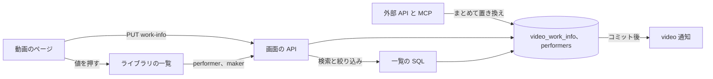
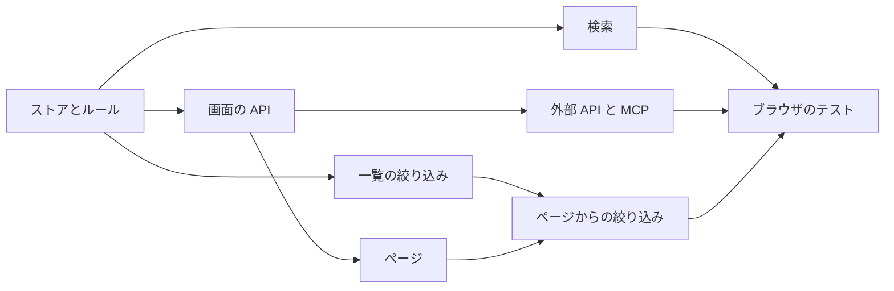

# 実装計画: 動画の作品情報 (品番、発売日、メーカー、出演者、説明、出典) {#implementation-plan-work-information-on-videos-code-release-date-maker-performers-description-source}

**ブランチ**: `feature/047-video-work-info` | **親 Issue**: #967

**入力**: 親 Issue。これがこの機能の仕様である。

## 概要 {#summary}

所有者は各動画に作品情報の固定のフィールドの組 (`code`、`releaseDate`、`maker`、`performers`、`description`、`sourceUrl`) を与え、動画のページでそれらを入力・消去し、設定したフィールドを情報エリアで見て、検索ボックスで品番、メーカー、出演者から動画を見つけ、値を押して同じ出演者またはメーカーの動画の一覧を開き、外部 API と MCP を通じて同じフィールドを読み書きする。値はユーザーキーをキーにするユーザーデータなので、再スキャン、移動、名前の変更、まとめることで失われない。

図は、この機能が加える、または変える部分と、それぞれが何とやり取りするかを示す。



| 関心事 | 方針 |
| --- | --- |
| フィールド | 6 つの固定のフィールド。`performers` と `maker` は値ごとの一覧を持つ ([R-1](research.md#r-1-six-fixed-fields-performers-and-the-maker-get-lists)、[data-model.md、フィールド](data-model.md#fields)) |
| 保存 | ユーザーキーをキーにする 2 つのユーザーデータのテーブル。まとめる経路と継承の経路がコピーする ([R-2](research.md#r-2-two-user-data-tables-keyed-by-the-user-key-copied-by-the-bundle-and-succession-paths)、[マイグレーション](data-model.md#migration)) |
| 検索 | 品番、メーカー、出演者名からなるキーごとの `search_key` を、タグ名と並べて `instr` で照合する ([R-3](research.md#r-3-the-search-box-matches-the-code-the-maker-and-the-performer-names-through-a-per-key-search-key)) |
| 値ごとの一覧 | 一覧の API とライブラリの URL の `performer` と `maker`。畳み込んだ値で照合する ([R-4](research.md#r-4-performer-and-maker-list-parameters-matched-by-folded-value-library-only)、[contracts/screen-api.md](contracts/screen-api.md#list-parameters-performer-and-maker)) |
| 画面の API | オブジェクト全体を置き換える 1 つの `PUT`。詳細の読み取りに `workInfo` ([R-5](research.md#r-5-one-put-that-replaces-the-whole-object-a-cleared-field-is-absent-null-or-empty)、[contracts/screen-api.md](contracts/screen-api.md#put-apivideosidwork-info)) |
| 外部 API と MCP | 1 つのまとめての置き換え、`ExternalVideo` の `workInfo`、1 つのツール。エラー本文に `field` ([R-6](research.md#r-6-the-external-api-gets-one-bulk-operation-and-mcp-one-tool-workinfo-joins-externalvideo)、[contracts/external-api.md](contracts/external-api.md)) |
| ゲスト | フィールドなし、検索の分岐なし、絞り込みは `400` を返す ([R-7](research.md#r-7-guests-receive-no-work-information-in-responses-search-or-filters)) |
| 画面 | `VideoWorkInfoChanged` を `video` 通知に対応づける ([R-8](research.md#r-8-a-change-publishes-domainvideoworkinfochanged-mapped-to-the-screens-video-notification)) |

Issue に `ui` ラベルがあるので、情報エリアでのフィールドの配置、編集の操作、折りたたんだ説明、出演者またはメーカーの有効な絞り込みの行は、次の `design` 段階の `ui-design.md` が、親 Issue の `UI品質` に照らして決める。

## 技術的な文脈 {#technical-context}

**正本の定義**:

| 話題 | 出典 |
| --- | --- |
| 境界、依存の方向、ユーザーデータ、コミット後のイベント、認証の境界 | [ARCHITECTURE.md](../../ARCHITECTURE.md)、[.golangci.yml](../../.golangci.yml) (depguard) |
| ユーザーキー、まとめるときのコピーと復元、継承 | [specs/030-video-versions/data-model.md](../030-video-versions/data-model.md)、[internal/store/user_keys.go](../../internal/store/user_keys.go)、[internal/store/versions.go](../../internal/store/versions.go) (`userDataTables`)、[internal/store/successions.go](../../internal/store/successions.go) (`moveUserData`) |
| 表示名のルール、上書き、編集時刻 | [specs/029-video-overrides/research.md](../029-video-overrides/research.md)、[internal/domain/video_override.go](../../internal/domain/video_override.go)、[internal/store/video_edits.go](../../internal/store/video_edits.go) |
| 検索キーと検索の条件 | [specs/013-library-search/data-model.md](../013-library-search/data-model.md)、[internal/store/search.go](../../internal/store/search.go) (`searchExprCondition`、`tagNameMatchCondition`)、[internal/store/tag_search_keys.go](../../internal/store/tag_search_keys.go) |
| 一覧、項目、絞り込み | [internal/store/listing.go](../../internal/store/listing.go) (`filteredFrom`)、[internal/store/library_items.go](../../internal/store/library_items.go) (`libraryItemsCTE`、`tagConditions`)、[internal/domain/library.go](../../internal/domain/library.go) (`VideoQuery`)、[specs/027-partial-group-search/contracts/library-api.md](../027-partial-group-search/contracts/library-api.md) |
| ゲスト | [specs/016-single-account-auth/contracts/guest-api.md](../016-single-account-auth/contracts/guest-api.md)、[internal/domain/auth.go](../../internal/domain/auth.go) (`CheckVideoQuery`)、[internal/httpapi/videos.go](../../internal/httpapi/videos.go) (`forAudience`、`parseVideoQuery`) |
| 画面の API、エラー、生成コード | [api/openapi.yaml](../../api/openapi.yaml)、[specs/023-english-i18n/contracts/error-api.md](../023-english-i18n/contracts/error-api.md)、[internal/httpapi/video_overrides.go](../../internal/httpapi/video_overrides.go)、[internal/httpapi/events.go](../../internal/httpapi/events.go) |
| 外部 API と MCP | [api/external-v1.yaml](../../api/external-v1.yaml)、[docs/how-to/external-api.md](../../docs/how-to/external-api.md)、[specs/026-external-api/contracts/mcp.md](../026-external-api/contracts/mcp.md)、[internal/httpapi/external_video_overrides.go](../../internal/httpapi/external_video_overrides.go)、[internal/httpapi/mcp.go](../../internal/httpapi/mcp.go)、[internal/store/overrides.go](../../internal/store/overrides.go) (`SetDisplayNames`、`resolveTaggableVideos`) |
| 動画のページ、ライブラリのタグの絞り込み、画面のルール、Web のテスト | [specs/012-video-detail-ia/ui-design.md](../012-video-detail-ia/ui-design.md)、[docs/design-docs/library-ui.md、情報の行](../../docs/design-docs/library-ui.md#information-rows)、[web/src/player/VideoFacts.tsx](../../web/src/player/VideoFacts.tsx)、[web/src/library/tagCriteria.ts](../../web/src/library/tagCriteria.ts)、[web/src/library/ActiveTagFilters.tsx](../../web/src/library/ActiveTagFilters.tsx)、[web/src/api/videosCriteria.ts](../../web/src/api/videosCriteria.ts)、[design-system.md](../../docs/design-docs/design-system.md)、[web-testing.md](../../docs/design-docs/web-testing.md)、[i18n.md](../../docs/design-docs/i18n.md) |
| ブラウザのテスト | [web/e2e/search.e2e.ts](../../web/e2e/search.e2e.ts) |
| 検査 | [Taskfile.yml](../../Taskfile.yml) (`task check`、`task check-docs`、`task generate`、`task test-e2e`) |

**この機能に固有の文脈**:

- マイグレーションは 1 つ、`00042_video_work_info.sql` ([data-model.md、マイグレーション](data-model.md#migration))。Go と Web の新しい依存はない。`SearchKeyVersion` と `FolderIndexVersion` は上げない。
- 新しいドメインイベント `VideoWorkInfoChanged` を加え、`/api/events` の種類は加えない (R-8)。
- エラー本文は両方のスキーマで `field` を得る (R-6)。
- `quickstart.md` はない。ストア、httpapi、Vitest、ブラウザのテストが受け入れ条件を検証し、この機能に固有の手作業の手順はない。

## 憲章の確認 {#constitution-check}

| ルール (出典) | 判定 |
| --- | --- |
| アダプターは互いも `internal/app` も import しない。`internal/domain` はアダプターを import しない (ARCHITECTURE.md、depguard) | 合格: フィールドのルールは `internal/domain` の純粋な関数である。SQL は `internal/store` にとどまる。`internal/httpapi` はエラーとパラメーターを対応づける。`internal/app` は変えない |
| ユーザーデータは再構築を越えて残る (ARCHITECTURE.md) | 合格: 両方のテーブルはユーザーキーをキーにし、`videos` への外部キーを持たず、ユーザーデータをコピーする経路に加わる (R-2)。ARCHITECTURE.md と running-vv.md の一覧に加える |
| 役割の型は別の役割の公開メソッドを呼ばない (ARCHITECTURE.md「Store roles」) | 合格: `WorkInfoStore` はパッケージの関数 `userKeysForVideoIDs`、`resolveTaggableVideos`、`touchEditedAtForUserKeys` と自身の SQL を使う |
| イベントはコミット後 (ARCHITECTURE.md) | 合格: `VideoWorkInfoChanged` はトランザクションのコミット後に発行する (R-8) |
| すべての読み取りは閲覧者を知る (ARCHITECTURE.md、guest-api.md) | 合格: `workInfo` は所有者への応答にだけあり、ゲストの検索の条件は変わらず、`CheckVideoQuery` が絞り込みを拒む (R-7)。`openapi_routes_test.go` が新しいルートの区分を検査する |
| API の正本と生成ファイル (AGENTS.md) | 合格: `api/openapi.yaml` と `api/external-v1.yaml` を変えてから `task generate` を実行する。互換性の方針はこれらの追加を認める (R-6) |
| 複雑度は 25 以下。コードはコピーせず共有する (AGENTS.md) | 合格: 1 つの `NormalizeWorkInfo` が画面と外部の経路の両方に使われる。`SetMany` は `SetDisplayNames` と同じように作る。エラーの対応づけは両方のルートが呼ぶ 1 つの関数である |
| 画面の前に design-system.md を読む。最も低いレベルでテストする (AGENTS.md、web-testing.md) | 合格: フィールドのルールはドメインのテスト、書き込みと読み取りはストアのテスト、ルートはハンドラーのテスト、ページと絞り込みはページのテスト、流れは 1 つのブラウザのテストで確かめる |
| 変更とともに文書を更新する (core-beliefs.md) | 合格: 各単位が更新する文書を挙げる |

違反はないので、複雑さの追跡はない。判定はフェーズ 1 の後も成り立つ。

## プロジェクトの構成 {#project-structure}

### 文書 (この機能) {#documentation-this-feature}

```text
specs/047-video-work-info/
├── plan.md
├── research.md
├── data-model.md
└── contracts/
    ├── screen-api.md
    └── external-api.md
```

`ui-design.md` は `design` 段階が書く (Issue に `ui` ラベルがある)。`quickstart.md` はない (技術的な文脈を参照)。

### ソースコード {#source-code}

**影響する境界**:

| 境界 | この機能でそれが持つもの |
| --- | --- |
| `internal/domain` | `WorkInfo`、`NormalizeWorkInfo` とその上限とエラー、`Video.WorkInfo`、`VideoQuery.Performer` と `Maker`、`CheckVideoQuery`、`VideoWorkInfoChanged`、`WorkInfoChange` |
| `internal/store` | マイグレーション、`WorkInfoStore` (`Set`、`SetMany`、`ByUserKeys`、`RefreshSearchKeys`)、検索の分岐、一覧の絞り込み、`userDataTables`、`moveUserData`、不変条件 |
| `internal/httpapi`、`api/openapi.yaml`、`api/external-v1.yaml` | `PUT /api/videos/{id}/work-info`、詳細の読み取りの `workInfo`、一覧のパラメーター、`POST /api/v1/video-work-info`、`ExternalVideo` の `workInfo`、MCP のツール、`field` を含むエラーの対応づけ、イベントの対応づけ。`cmd/mdm` での配線 |
| `web/src/api`、`web/src/player`、`web/src/library`、`web/src/i18n` | クライアントの関数、ページの作品情報とその編集、`performer` と `maker` の条件と有効な絞り込み、カタログとエラーの文言 |
| `web/e2e` | ブラウザのテスト |
| `docs/` | `ARCHITECTURE.md` (ユーザーデータ、役割の型)、`running-vv.md` (ユーザーデータの行)、`external-api.md` (新しい節)、`library-ui.md` (情報エリア、一覧の条件)、`mcp.md` (ツール) |

**新しいパス**: `internal/store/migrations/00042_video_work_info.sql`、`internal/store/work_info.go`、`internal/httpapi/video_work_info.go`、`internal/httpapi/external_video_work_info.go`、`web/src/api/workInfo.ts`、`web/src/player/WorkInfo.tsx` (コンポーネントは `ui-design.md` に従って分割または改名してよい)、`web/src/library/workInfoCriteria.ts`、`web/e2e/work-info.e2e.ts`。

**構成の判断**: 作品情報は `OverrideStore` を大きくするのではなく、独自の役割の型 `WorkInfoStore` を持つ。上書きは内容の鍵ごとで場所の検索キーを書き換えるが、作品情報はユーザーキーごとで独自の検索キーを持つので、両者は SQL を共有しない ([R-2](research.md#r-2-two-user-data-tables-keyed-by-the-user-key-copied-by-the-bundle-and-succession-paths))。画面では、ライブラリの `performer` と `maker` の条件は `tagCriteria.ts` の形に従い、フォルダの画面の URL が変わらないよう、共有の `ListCriteria` には入れない ([R-4](research.md#r-4-performer-and-maker-list-parameters-matched-by-folded-value-library-only))。

## 実装作業 {#implementation-work}

図は、どの単位が先に入る必要があるかを示す。2 つのページの単位は `design` 段階の `ui-design.md` も待つ。



### 作品情報をユーザーキーの下に保存し、そのフィールドを検証する {#store-work-information-under-the-user-key-and-validate-its-fields}

**範囲**: `00042_video_work_info.sql` と不変条件 ([data-model.md、マイグレーション](data-model.md#migration)、[ルール](data-model.md#rules))。`domain` の `WorkInfo`、`NormalizeWorkInfo`、その上限と `InvalidWorkInfoError`、`WorkInfoChange`、`Video.WorkInfo`、`VideoWorkInfoChanged` ([`domain` に加える値](data-model.md#values-added-to-domain))。`Set`、`SetMany`、`ByUserKeys`、`RefreshSearchKeys` を持つ `WorkInfoStore` と `db.WorkInfo()` ([書き込み (`WorkInfoStore`)](data-model.md#writes-workinfostore))。`userDataTables` と `moveUserData` ([まとまりと継承](data-model.md#bundles-and-succession))。`TagStore.RefreshSearchKeys` の隣での起動時の呼び出し。ARCHITECTURE.md のユーザーデータの一覧と役割の型の一覧、running-vv.md のユーザーデータの行。

**依存**: なし

**受け入れ**: `task check` が通る。ドメインのテストが次を示す: [data-model.md、フィールド](data-model.md#fields) の各ルールがフィールドと問題を挙げて入力を拒むこと、トリムすること、空で消去すること、改行を説明でだけ認めること、繰り返された出演者を 1 つにまとめること。ストアのテストが次を示す: 設定したオブジェクトが出演者の順で読み戻されること。同じ値での 2 回目の設定が `updatedAt` を変えず、イベントを発行しないこと。すべてのフィールドの消去が行とその出演者を削除すること。内容が別のパスで索引し直された後と、同じパスでの継承の後に、出演者を設定した状態で、また新しいキーがすでに作品情報を持つ場合にも、値を読めること。2 つの動画をまとめるとまとまりに代表の値が表示され、まとまりを解くとメンバーに自身の値が戻ること。

### 画面の API を通じて作品情報を読み書きする {#read-and-write-work-information-through-the-screen-api}

**範囲**: `Video` の `workInfo` と `PUT /api/videos/{id}/work-info` ([contracts/screen-api.md、`Video` の変更](contracts/screen-api.md#video-changes)、[`PUT /api/videos/{id}/work-info`](contracts/screen-api.md#put-apivideosidwork-info))。`Error` の `field` と 5 つの理由 ([加える `reason` の値と `field`](contracts/screen-api.md#added-reason-values-and-field))、および `InvalidWorkInfoError` からの 1 つの対応づけの関数。`forAudience`。`Events.Handle` での `VideoWorkInfoChanged` の対応づけ。`web/src/i18n/errors.ts` のメッセージ。`api/openapi.yaml` と `task generate`。`accessRoutes` の区分。

**依存**: 作品情報をユーザーキーの下に保存し、そのフィールドを検証する

**受け入れ**: `task check` が通る。ハンドラーのテストが次を示す: `PUT` が保存した `workInfo` とともに `200` を返し、その後の `GET /api/videos/{id}` が同じオブジェクトを返すこと。`{}` での `PUT` が `workInfo` なしで `200` を返すこと。10,000 コードポイントを超える説明が `field: description` と `limit: 10000` とともに `400` `work_info_too_long` を返すこと。`2024-02-30` が `work_info_invalid_date` を返すこと。`ftp://…` が `work_info_invalid_url` を返すこと。ゲストが `PUT` から `401` を受け、公開された動画の `GET` から `workInfo` を受けないこと。変更の後にその id の `video` 通知が送られること。

### ライブラリの検索で品番、メーカー、出演者名を照合する {#match-the-code-the-maker-and-the-performer-names-in-the-library-search}

**範囲**: 所有者の語の条件の 3 つ目の分岐と、変わらないゲストの条件 ([data-model.md、検索](data-model.md#search))。`WorkInfoStore` のすべての書き込みで書き、起動時に `RefreshSearchKeys` が埋め直す `search_key`。library-ui.md「List conditions applied by the server」の検索の段落。

**依存**: 作品情報をユーザーキーの下に保存し、そのフィールドを検証する

**受け入れ**: `task check` が通る。ストアのテストが次を示す: 品番 (`ab-12`、2 から 5 文字)、メーカー、別のかなの形の出演者名による `GET /api/videos?query=` がそれぞれその動画を返すこと。否定の語がそれを除くこと。説明にだけある語が一致しないこと。同じクエリをゲストとして送ると、作品情報でだけ一致する公開された動画を返さないこと。`search_version = 0` の行が起動時に埋め直され、その後に一致すること。

### 一覧の API で出演者とメーカーにより一覧を絞り込む {#filter-lists-by-performer-and-maker-in-the-list-api}

**範囲**: `VideoQuery.Performer` と `Maker`、`CheckVideoQuery`、`filteredFrom` と `libraryItemsCTE` の 2 つの条件 ([data-model.md、一覧](data-model.md#lists))。`listVideos`、`listLibrary`、`listLibraryIds` の `performer` と `maker` のパラメーターとその検証 ([contracts/screen-api.md、一覧のパラメーター](contracts/screen-api.md#list-parameters-performer-and-maker))。`api/openapi.yaml` と `task generate`。library-ui.md「List conditions applied by the server」の条件の表。

**依存**: 作品情報をユーザーキーの下に保存し、そのフィールドを検証する

**受け入れ**: `task check` が通る。ハンドラーとストアのテストが次を示す: `GET /api/library?performer=…` がその出演者を持つ動画だけを、幅とかなの違いを越えて照合して返し、`total` がそれらを数えること。`maker` も同じであること。両方を合わせると AND になること。1 つのメンバーだけが一致するグループが、そのメンバーを動画の項目として挙げること。一致のない値が `200` で空の一覧を返すこと。200 コードポイントを超える値が `400` を返すこと。ゲストが `400` `guest_filter_not_allowed` を受けること。`GET /api/library/ids` が同じ id を返すこと。

### 外部 API と MCP で作品情報を読み書きする {#read-and-write-work-information-in-the-external-api-and-mcp}

**範囲**: 未設定のフィールドを `null` にした `ExternalVideo` の `workInfo`、`POST /api/v1/video-work-info`、`api/external-v1.yaml` の `field` と 5 つの理由、MCP のツール `update_video_work_info`、`list_videos` と `get_video` の `workInfo` ([contracts/external-api.md](contracts/external-api.md))。画面のルートと共有するエラーの対応づけ。`task generate`。external-api.md の「Set work information」の節と mcp.md のツールの行。

**依存**: 画面の API を通じて作品情報を読み書きする

**受け入れ**: `task check` が通る。ハンドラーと MCP のテストが次を示す: 2 つの項目を持つ `POST` が両方のオブジェクトとともに `200` を返し、`GET /api/v1/videos/lookup` がそれらを返すこと。101 人の出演者を持つ項目が `field: performers`、`limit: 100`、`index: 1` とともに `400` `too_many_performers` を返し、最初の項目が適用されないこと。繰り返した `POST` が `200` を返し、`updatedAt` をそのままにすること。`/mcp` を通じた `update_video_work_info` がルートと同じ構造化された内容を返すこと。`GET /api/v1/videos` の項目が、行のない動画については `null` のフィールドを持つ `workInfo` を含むこと。

### 動画のページで作品情報を表示し、編集する {#show-and-edit-work-information-on-the-video-page}

**範囲**: `web/src/api/workInfo.ts` (`setVideoWorkInfo`)、`ui-design.md` が決めるとおりの、動画のページの情報エリアの作品情報とその編集、折りたたんだ説明、`field` を挙げるエラーの行、カタログの文言、ページを更新する `video` 通知。library-ui.md の情報エリアの段落。

**依存**: 画面の API を通じて作品情報を読み書きする、および `design` 段階の `ui-design.md`

**受け入れ**: `task check` が通る。ページのテストが次を示す: 設定したフィールドが表示され、未設定のものは表示されないこと。品番と出演者を入力して保存すると、オブジェクト全体を持つ `PUT` を送り、応答を表示すること。フィールドを消去するとエリアから除かれること。`field` を持つ `400` がそのフィールドにメッセージを表示すること。ゲストにはフィールドも編集の入口も見えないこと。`video` 通知が取得し直し、別の場所で書かれた値を表示すること。この単位は画面を変えるので、実装は `ui-design.md` が挙げる幅で見た目と操作を確かめる。

### 動画のページから出演者またはメーカーでライブラリを絞り込む {#filter-the-library-by-a-performer-or-maker-from-the-video-page}

**範囲**: `workInfoCriteria.ts` (ライブラリの URL の `performer` と `maker`、一覧のスナップショットのキー、「Clear filters」)、`VideosCriteria` と一覧の要求の `performer` と `maker`、`ui-design.md` が決めるとおりの値の有効な絞り込みの行、`/?performer=…` と `/?maker=…` へのリンクとしての動画のページの出演者とメーカーの値 ([contracts/screen-api.md、一覧のパラメーター](contracts/screen-api.md#list-parameters-performer-and-maker))。

**依存**: 一覧の API で出演者とメーカーにより一覧を絞り込む。動画のページで作品情報を表示し、編集する

**受け入れ**: `task check` が通る。ページのテストが次を示す: 動画のページで出演者を押すと、URL に `performer=<name>` を持つライブラリが開き、要求がそれを含み、有効な絞り込みが表示されること。絞り込みを外すか「Clear filters」で URL からそれが落ちること。「戻る」で動画のページに戻ること。`/` のスナップショットが `/?performer=…` に再利用されないこと。この単位は画面を変えるので、実装は見た目と操作を確かめる。

### ブラウザのテストで作品情報を確かめる {#cover-work-information-in-a-browser-test}

**範囲**: e2e サーバーに対する `web/e2e/work-info.e2e.ts`。流れが必要とするところではトークンを使って外部 API を使う。

**依存**: ライブラリの検索で品番、メーカー、出演者名を照合する。外部 API と MCP で作品情報を読み書きする。動画のページから出演者またはメーカーでライブラリを絞り込む

**受け入れ**: `task test-e2e -- e2e/work-info.e2e.ts` が通り、次を示す: ページで入力した品番と出演者が、再読み込みの後に情報エリアにあること (受け入れ条件 1)。出演者を消去するとそれが除かれること (2)。品番と出演者名がそれぞれライブラリの検索でその動画を見つけること (3)。完全なスキャンの後も値が残ること (4)。`POST /api/v1/video-work-info` を通じて書いたオブジェクトが、開いているページに再読み込みなしで現れ、ページで入力した値が `GET /api/v1/videos/lookup` を通じて読み戻されること (5)。出演者を押すと同じ出演者の動画が挙がること (6)。長い説明は折りたたまれたままで、ページは 360px で横スクロールを示さないこと (Edge Case)。
