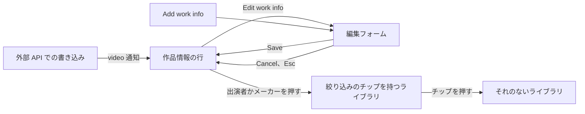
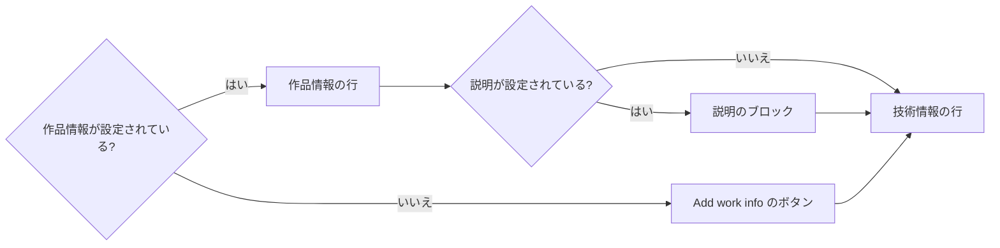
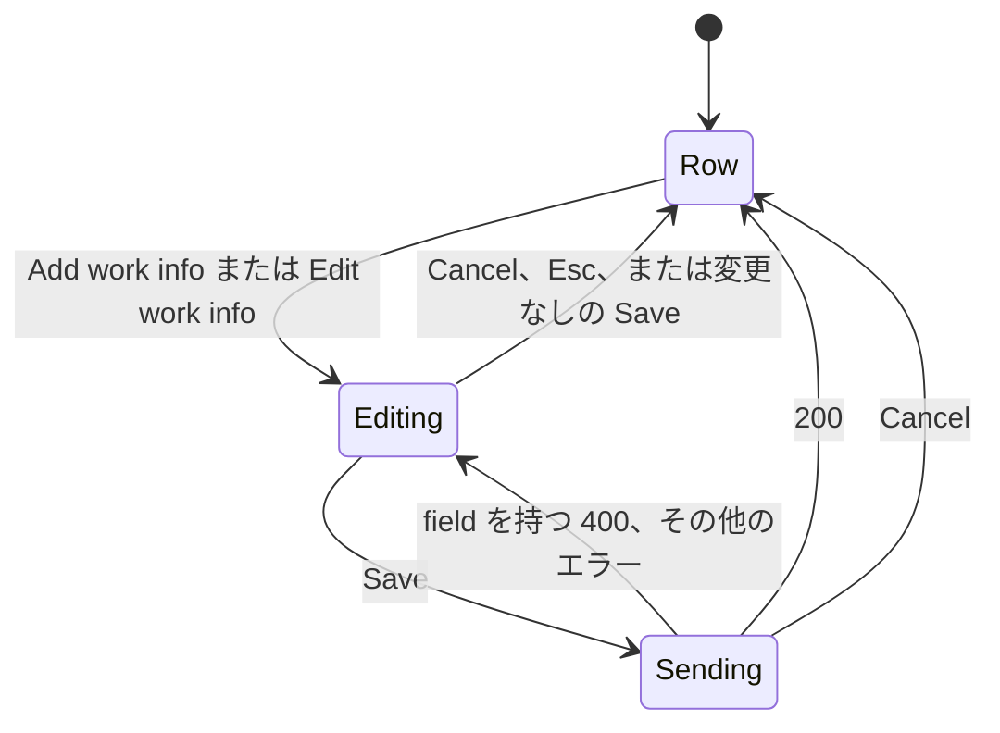
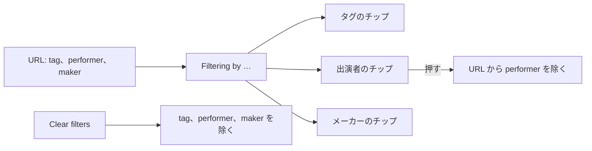

# UI デザイン: 動画のページとライブラリの絞り込みでの作品情報 {#ui-design-work-information-on-the-video-page-and-in-the-library-filter}

**機能**: [親 Issue #967](https://github.com/syudead/vv/issues/967) · [plan.md](plan.md) · [contracts/screen-api.md](contracts/screen-api.md) · [research.md R-1](research.md#r-1-six-fixed-fields-performers-and-the-maker-get-lists) · [R-4](research.md#r-4-performer-and-maker-list-parameters-matched-by-folded-value-library-only) · [R-5](research.md#r-5-one-put-that-replaces-the-whole-object-a-cleared-field-is-absent-null-or-empty) · [R-7](research.md#r-7-guests-receive-no-work-information-in-responses-search-or-filters) · [R-8](research.md#r-8-a-change-publishes-domainvideoworkinfochanged-mapped-to-the-screens-video-notification)

すでに決まっていることの出典。ここでは繰り返さずリンクする。

| 話題 | 出典 |
| --- | --- |
| トークン、閉じたスケール、動画のページの密度 | [design-system.md、Foundations](../../docs/design-docs/design-system.md#foundations)。値は [`web/src/ui/tokens.css`](../../web/src/ui/tokens.css) の `@theme` にあり、ここでは名前で示し、決して写さない |
| `Button`、`Input`、`Textarea`、`Field`、`Toggle`、`Tooltip` | [components.md](../../web/registry/rules/components.md) |
| `DetailPage` の子、`ListPage` の `band` | [patterns.md、Detail page](../../web/registry/rules/patterns.md#detail-page)、[List page](../../web/registry/rules/patterns.md#list-page) |
| 動画のページの情報の行、その右側の操作、一つの失敗の行 | [library-ui.md、情報の行](../../docs/design-docs/library-ui.md#information-rows)。[012 UI デザイン、動画の情報](../012-video-detail-ia/ui-design.md#video-facts) |
| 動画のページでのその場の編集: 入口、入力、Save と Cancel、キー、失敗、編集中の再取得 | [029 UI デザイン、タイトルの編集](../029-video-overrides/ui-design.md#title-editing) |
| 動画のページで、押すとその値で絞り込んだライブラリを開く値 | [014 UI デザイン、動画ページのタグ](../014-video-tags/ui-design.md#video-page-tags) |
| ライブラリの本体の上にある、適用中の絞り込みの行 | [014 UI デザイン、絞り込み中のタグ](../014-video-tags/ui-design.md#active-tag-filters)。[`ActiveTagFilters.tsx`](../../web/src/library/ActiveTagFilters.tsx) |
| 幅のブレークポイントは CSS で切り替える。レイアウトは人が確かめる | [library-ui.md、幅のブレークポイント](../../docs/design-docs/library-ui.md#width-breakpoints-in-css-and-the-sidebar-exception)、[人が確かめるレイアウト](../../docs/design-docs/library-ui.md#layout-verified-by-people-not-machines) |
| 画面の文言 | [`web/src/i18n/en.ts`](../../web/src/i18n/en.ts)。この機能は `player.workInfo` を加え、`library.activeTags.label` を変え、五つのエラーの理由を加える |

この機能は三つのものを加え、どれも所有者専用である ([R-7](research.md#r-7-guests-receive-no-work-information-in-responses-search-or-filters))。

1. 動画のページの情報エリアの**作品情報の行**。値を持つフィールドを表示し、その下に**説明のブロック**を置く (要件 2 と 3、受け入れ条件 1 と 2)。
2. 作品情報の行をその場で置き換え、オブジェクト全体を保存する**編集フォーム** (要件 2)。
3. ライブラリの適用中の絞り込みの行の**出演者とメーカーの絞り込み**。動画のページで出演者かメーカーを押すとたどり着く (要件 5、受け入れ条件 6)。

図は各部分と、それぞれの操作の行き先を示す。

変わらないもの: プレーヤー、タイトル、タグ、公開範囲の切り替え、操作を持つ一つ目の情報の行、技術情報の行、検索ボックス、カード。検索ボックスは、ボックス自体を何も変えずに、品番、メーカー、出演者名で動画を見つける (要件 4)。

## この形にした理由 {#why-this-shape}

フィールドは**情報エリアの三つ目の行で、一つ目の行の形をとる**。カードでも表でも独立したセクションでもない。親 Issue の `UI品質` は、既存の行と同じ配置と間隔、二次色のラベルと本文色の値、フィールドが多いときに伸びないエリアを求めている。`label value` の組が折り返す一つの行は、アイコンの代わりに言葉を置いた既存の行の形であり、作品情報のない動画には行がまったくない。`FactList` (用語と値の二列) は採用しなかった。用語の列が内容の幅の三分の一を占め、幅の広いプレーヤーの下では `Code` とその値の間に数百ピクセルの隙間が残り、積み重なる行は、一行か二行で収まる六つのフィールドに六行を与える。`PageSection` のカードは 012 が採用しなかった。動画のページは詳細の周りに枠を描かない。

六つのフィールドは、一つずつ編集する六つのフィールドではなく、一つの入口から開く**その場の一つの編集フォーム**に入れる。画面の API はオブジェクト全体を一つの `PUT` で置き換え ([R-5](research.md#r-5-one-put-that-replaces-the-whole-object-a-cleared-field-is-absent-null-or-empty))、所有者はたいてい複数のフィールドを一度に埋め (品番、日付、名前は同じ出典から来る)、すべてのフィールドが見えるフォームは「空は消去を意味する」が見える場所である。値を押して編集する形は採用しなかった。メーカーと出演者はライブラリへのリンクなので、押すとすでに何かが起こり、値のない動画には押すものがない。`FormDialog` は、029 がタイトルにダイアログを採用しなかったのと同じ理由で採用しなかった。フォームは値のある場所に属し、`lg` 未満ではダイアログがプレーヤーを隠す。

入口は**作品情報の行の右端のアイコンボタン**で、一つ目の行の操作がとる形である。こうして編集は読むことより控えめになる (`UI品質` の「操作の優先度」)。動画に作品情報がないときは行が空になるので、入口が行になる。アイコンと `Add work info` の言葉を持つ一つの `ghost` `sm` のボタンを淡色で置く。タグの一覧がチップの現れる場所に `Add tag` の入力欄を置くのと同じである。

メーカーと各出演者は、チップではなく**淡色の下線を持つ本文色のリンク**である。Issue は既存の行と同じ書体 (`text-sm`、本文色) の値を求めている。`Badge` は塗りの上の `text-xs` で、タグとして読まれる。下線が押せることを示し、行のラベルが名前が何であるかを伝える。

説明は**三行に折りたたみ**、その下に `Show more` を置く。説明は 10,000 コードポイントまで長くなりえ、Issue は折りたたむことを求めているからである。テキストが収まるときは折りたたまないので、一行の説明は操作を持たない。

ライブラリでは、出演者とメーカーの絞り込みは、二つ目の行や独立したページではなく、**適用中のタグの絞り込みの行に加わり**、同じ `Toggle` の形のチップで、それぞれのアイコンを持つ ([R-4](research.md#r-4-performer-and-maker-list-parameters-matched-by-folded-value-library-only))。一つの行は、条件の種類にかかわらず「一覧が何で絞られているか」として読める。チップのアイコンが種類を示すので、行のラベルは `Filtering by tags` から `Filtering by` に変わる。

## 文言 {#words}

英語はカタログが取り込む下書きである。実装の後は [`web/src/i18n/en.ts`](../../web/src/i18n/en.ts) が正となる。

### 動画のページ {#video-page}

| 場所 | 文言 | 注記 |
| --- | --- | --- |
| 作品情報の行、アクセシブルな名前 | Work details | `player.workInfo.label`。`ul` の名前で、`File details` と `Technical details` と並ぶ |
| ラベル、行とフォームのフィールド | Code · Released · Maker · Performers · Source · Description | それぞれ一語。行は `Released 2024/02/10` と読めるので、`Release date` ではなく `Released` |
| 入口、値なし | Add work info | アイコンと文言を持つ `ghost` `sm` の `Button` |
| 入口、値あり。名前とツールチップ | Edit work info | 行の右端の、アイコンだけの `ActionButton` |
| Performers のフィールド、ヘルプ | One name per line | `FieldDescription` |
| Released のフィールド、プレースホルダー | YYYY-MM-DD | `type="date"` にテキストの入力欄を描くブラウザで表示される |
| Source のフィールド、プレースホルダー | https:// | |
| 保存 | Save | タイトルのものと同じ |
| キャンセル | Cancel | タイトルのものと同じ |
| 保存の失敗、フィールドなし | Couldn't save the work info: {reason} | フォームの一つの失敗の行。`{reason}` は [エラーの理由](#error-reasons) から |
| 説明の折りたたみ | Show more · Show less | 説明の下の `link` の `Button` |
| 出典のリンク、ツールチップ | URL そのもの | `title`。テキストは一行に切り詰めた URL |

### ライブラリ {#library}

| 場所 | 文言 | 注記 |
| --- | --- | --- |
| 適用中の絞り込みの行、ラベル | Filtering by | 以前は `Filtering by tags` (`library.activeTags.label`)。今はチップのアイコンが種類を示す |
| 出演者のチップ、名前と `title` | Remove the filter for {name} | `library.activeTags.removeNamed`。タグと共有する |
| メーカーのチップ、名前と `title` | Remove the filter for {name} | 同じ |

### エラーの理由 {#error-reasons}

`web/src/i18n/errors.ts` の `reason` の表に加える ([contracts/screen-api.md、加える `reason` の値と `field`](contracts/screen-api.md#added-reason-values-and-field))。各文言はエラーの本文の `field` から読んだフィールドを挙げるので、同じ文言がフィールドの下の `FieldError` と失敗の行の両方に使える。

| 理由 | 文言 | 注記 |
| --- | --- | --- |
| `work_info_control_characters` | {Field} can't contain control characters. | `{Field}` は `The code`、`The release date`、`The maker`、`A performer name`、`The description`、`The source URL` のいずれか |
| `work_info_too_long` | {Field} is too long: up to {limit} characters. | `limit` は本文から |
| `too_many_performers` | Too many performers: up to {limit}. | |
| `work_info_invalid_date` | The release date isn't a calendar date in YYYY-MM-DD. | |
| `work_info_invalid_url` | The source must be an http:// or https:// address. | |

## デザインシステムへの変更 {#changes-to-the-design-system}

なし。行は情報エリア自身の一覧の形を使い、入口は行のほかの操作と同じく `ActionButton` を使い、フォームはレジストリの `Field`、`FieldLabel`、`FieldDescription`、`FieldError`、`Input`、`Textarea` を使い、Save と Cancel はタイトルのエディタの `Button` であり、絞り込みのチップは `ActiveTagFilters` がすでに与えている形のレジストリの `Toggle` である。トークンは加えず、`web/src/theme/tokens.test.ts` の `pairs` にも何も加えない。アイコンは lucide の `NotebookPen` (両方の入口)、`User` (出演者のチップ)、`Factory` (メーカーのチップ)、`ExternalLink` (出典のリンク) である。行のラベルはアイコンではなく言葉である。

## 動画のページ: 作品情報の行 {#video-page-work-row}

作品情報の行は `Work details` という名前の `ul` で、一つ目の情報の行とその失敗の行の後、技術情報の行の前に、同じ枠線のあるブロックの中に、ブロックの `gap-3` で置く ([library-ui.md、情報の行](../../docs/design-docs/library-ui.md#information-rows))。所有者にだけ、かつ少なくとも一つのフィールドが設定されているかフォームが開いている間だけ存在する。ゲストと、作品情報のない動画には、行も余白もない。

図は所有者がエリアのどの部分を見るかを示す。

行は一つ目の行のレイアウトをとる。`flex flex-wrap items-center gap-x-4 gap-y-2 text-sm sm:gap-x-5`、`min-w-0 flex-1` で、入口は右端 (`ml-auto`) の `shrink-0` のグループに入る。各項目は一つのフィールドで、`text-muted-foreground` のラベル、`gap-1.5`、`text-foreground` の値の順に並ぶ。値のないフィールドは項目を持たない (要件 3)。順序は固定である。

| 項目 | 値 | ルール |
| --- | --- | --- |
| Code | 入力されたとおりの品番 | `tabular-nums`。項目は `min-w-0 max-w-full`、値は `wrap-anywhere` なので、収まる品番は一行のままで、100 コードポイントまでの品番は行からあふれずに行の中で折り返す。一つ目の行のルールである `whitespace-nowrap` は使わない。品番は自由なテキストであり、幅のわかる数値ではない |
| Released | 保存した日を一つ目の行の日付の書式 (`dateStyle: "medium"`) で表す。`web/src/i18n/format.ts` に新しく加える `formatCalendarDate` を通し、`YYYY-MM-DD` を UTC のタイムゾーンで書式化する | `title` は保存した `YYYY-MM-DD` を持つ。表示する時刻がないので、ポップオーバーはない。`formatDate` は使わない。それは文字列を UTC の午前 0 時の時刻として読み、ブラウザのタイムゾーンで書式化するので、UTC より西では保存した日の前日を表示し、フォームの日付の入力欄はそうしない。UTC より西のタイムゾーンでの単体テストが、100 より小さい年を含めて、保存した日を固定する |
| Maker | `/?maker=<name>` への `Link` | 本文色、`underline decoration-muted-foreground underline-offset-4`、ホバーで `decoration-foreground`。`wrap-anywhere` なので長い名前はあふれずに折り返す。アクセシブルな名前は `Videos by {name}` |
| Performers | 名前ごとに一つの `Link` を入力した順に並べ、`/?performer=<name>` へリンクする | 同じリンクの形。名前は内側の `flex flex-wrap gap-x-3 gap-y-1` に入るので、二十の名前の一覧は項目の中で折り返し、項目は行の中で折り返す。アクセシブルな名前は `Videos with {name}` |
| Source | URL への `Link`、`target="_blank"` `rel="noopener noreferrer"` | URL のテキスト、`max-w-full min-w-0 truncate`、その後に lucide の `ExternalLink` (`size-3.5`、`aria-hidden`)。`title` は完全な URL |

ラベルが見える言葉なのは、長さ、サイズ、日付と違い、六つの自由なテキストのフィールドはアイコンで見分けられないからである。ラベルは行の唯一の淡色のテキストなので、目は値を読む (`UI品質` の「タイポグラフィ」)。説明は行の項目ではない。

### 説明のブロック {#description-block}

`description` が設定されているとき、ブロックの `gap-3` で行の後にブロックが続く。`text-sm text-muted-foreground` のラベル `Description`、続いて `text-sm text-foreground whitespace-pre-line wrap-anywhere` のテキストで、所有者の改行が表示され、長いトークンは折り返す。テキストは三行に切り詰める (`line-clamp-3`)。切り詰めが何かを隠すとき (要素のスクロールの高さがクライアントの高さより大きいとき)、`link` の `Button` である `Show more` をテキストのすぐ下の左端に置く。押すと切り詰めが外れ、ボタンは `Show less` になる。折りたたみはどの動画でも閉じた状態で始まり、保存されない。三行に収まる説明はボタンを持たない (Q-5: 後ろに何もない操作は置かない)。

### 入口 {#entry}

| 場合 | 入口 |
| --- | --- |
| 作品情報なし、所有者 | lucide の `NotebookPen` と `Add work info` を持つ `ghost` `sm` の `Button`、`text-muted-foreground` で、行の位置の左端に置く (`-mx-2` でアイコンを一つ目の行のアイコンに揃える)。行の位置にあるのはそれだけで、`h-8` の一行を占める |
| 作品情報あり、所有者 | 作品情報の行の右端のグループの `ActionButton` (`ghost` `icon-sm`、`NotebookPen`、`text-muted-foreground`、ツールチップ `Edit work info`)。一つ目の行の操作の形 |
| ゲスト | 入口も行もない |
| フォームが開いている | どちらの入口もない。フォームがその場所に立つ |

どちらの入口を押しても、今の値でフォームが開く。029 が挙げる理由で、入口はホバーのときだけでなく常に見える。

## 動画のページ: 編集フォーム {#video-page-edit-form}

フォームは、どちらかの入口から開き、作品情報の行、説明のブロック、入口をその場で (一つ目の行の失敗の行と技術情報の行の間で) 置き換える。一つ目の行、その操作、タイトル、タグ、プレーヤーはそのままで、フォームが開いている間も働き続ける。

図はフォームの状態を示す。

フォームは `noValidate` を持つ `FieldGroup` の中の `Field` からなる `form` で、幅の広いプレーヤーが十文字の品番を列いっぱいに伸ばさないように `max-w-2xl`、フィールドの間は `gap-4` (動画のページの間隔) である。`noValidate` はブラウザの制約の確認を止めるので、`url` や `date` の入力欄が拒む値 (スキームのない出典、テキストの入力欄を描くブラウザで打ち込んだ日付) はサーバーに届き、その理由は、フォームが言葉も位置も決められないブラウザ自身の吹き出しではなく、フィールドの下の `FieldError` として表示される。フィールドは `WorkInfo` スキーマの順に並ぶ。

| フィールド | コントロール | ルール |
| --- | --- | --- |
| Code | `Input type="text"` | `autoComplete="off"`、`spellCheck={false}` |
| Released | `Input type="date"` | ブラウザのピッカーが日を与え、値は API が受け取るとおりの `YYYY-MM-DD` である。それでもサーバーの暦の確認が決め、その理由はフィールドの下に表示される |
| Maker | `Input type="text"` | `autoComplete="off"` |
| Performers | `Textarea`、三行で、内容に合わせて伸びる | 一行に一つの名前 (`FieldDescription`)。保存のときに行をトリムし、空の行を落とし、残りを順に送るので、改行が制御文字として API に届くことはない。今の値は一行に一つずつ入った状態で開く |
| Source | `Input type="url"`、`inputMode="url"` | `placeholder` は `https://`。ブラウザは確認しない (フォームの `noValidate`) ので、`example.com` は送られ、フィールドの下の `work_info_invalid_url` として返ってくる |
| Description | `Textarea`、四行で、内容に合わせて伸びる | 改行を保つ |

`sm` 以上では、Code、Released、Maker が一行を等しい幅の三列で分け合い、Performers、Source、Description はそれぞれ全幅をとる。`sm` 未満ではすべてのフィールドが積み重なる。どのフィールドもコントロールの上に見える `FieldLabel` (行の言葉) を持つ。029 が挙げる理由で、どのフィールドも `maxLength` を持たない。サーバーはコードポイントを数え、切られた貼り付けは気づかれないからである。

フィールドの下に、`Save` (`default` `sm`) と `Cancel` (`ghost` `sm`) を、タイトルのエディタのボタンと同じく `gap-2` で左に置く。`Save` はエリアで唯一の `default` のボタンで、フォームが開いている間だけ存在するので、再生と競合しない (`UI品質` の「操作の優先度」)。

| 操作 | 振る舞い |
| --- | --- |
| 開く | フォームは今の値を表示する。フォーカスは選択せずに `Code` の入力欄に移る。フィールドがフォーカスを持つ間、ページのキー (Space、矢印、F、M、C、0、Esc) は働かない (`keyboard.ts` の `isEditable`) |
| `Input` での Enter | 保存する。`Textarea` での Enter は改行を入れる |
| どのフィールドでも Esc | キャンセルする |
| Cancel | 何も送らず、元の値で行を再び表示し、フォーカスを入口に戻す |
| Save、何も変更なし | Cancel として働く。何も送らない (タイトルのエディタのルール) |
| Save | オブジェクト全体を持つ一つの `PUT /api/videos/{id}/work-info` ([contracts/screen-api.md](contracts/screen-api.md#put-apivideosidwork-info))。トリムの後に空のフィールドは、ない状態で送る。送信中は、すべてのコントロールが `readOnly` で、`Save` は `aria-disabled` になり、テキストのアイコンの代わりに lucide の `LoaderCircle` が回る。`Cancel` は押せるままで、待たずに行に戻る |
| `200` | 応答の `Video` がページの動画を置き換える。行は保存したフィールドを表示し、すべてのフィールドを消去したときは `Add work info` の入口を表示する (受け入れ条件 2)。フォーカスは入口に戻る。トーストはない。行が結果である |
| `field` を持つ `400` | フォームは値を持ったまま開いている。挙げられたフィールドは `aria-invalid` と、その下の理由の文言を持つ `FieldError` を得て、フォーカスはそのフィールドに移る。ほかのフィールドは何も表示しない |
| その他の失敗 | フォームは開いたままである。ボタンの下に一つの行を置く。`role="alert"`、`text-sm text-destructive`、先頭に lucide の `AlertCircle` (`size-4`)、`Couldn't save the work info: {reason}`。`404 video_not_found` のときは、029 と同じく、ページは動画も再取得する |
| 編集中の再取得 | `video` 通知 (別のタブ、外部 API) は動画を再取得するが、下書きを上書きしない。Save は下書きを最後の書き込みにし、Cancel は再取得した値を表示する (029 のルール) |
| 別の動画を開く | フォーム、その下書き、そのエラーは引き継がない (ページはタイトルと同じく、動画の ID をコンポーネントのキーにする) |

### 状態 {#states}

| 状態 | 画面に表示するもの |
| --- | --- |
| 詳細の読み込み中 | 行も入口もなく、タイトルとタグと同じくスケルトンの中にある |
| 作品情報なし、所有者 | 行の位置の `Add work info` のボタン |
| 作品情報あり | 設定したフィールドを持つ作品情報の行、右端の入口、説明が設定されているときは説明のブロック |
| 説明を折りたたんでいる | 説明の三行と `Show more` |
| 説明を広げている | 説明全体と `Show less` |
| 編集中 | 行の位置にある、`Save` と `Cancel` を持つフォーム |
| 送信中 | フォームのコントロールは読み取り専用で、`Save` は回り、`aria-disabled` である |
| フィールドの拒否 | フォーム、印の付いた挙げられたフィールドと、その下の理由 |
| 保存の失敗 | フォームと、ボタンの下の一つの失敗の行 |
| ほかで書かれた | 外部 API を通じて書いた値が、`video` 通知を通じて、再読み込みなしで行に現れる ([R-8](research.md#r-8-a-change-publishes-domainvideoworkinfochanged-mapped-to-the-screens-video-notification)。受け入れ条件 5) |
| ゲスト | 行も、ブロックも、入口も、フォームもない (R-7) |

## ライブラリ: 出演者とメーカーの絞り込み {#library-performer-and-maker-filters}

動画のページで出演者かメーカーを押すと、`/?performer=<name>` か `/?maker=<name>` を開く。タグのチップが `/?tag=<id>` を開くのと同じく、その一つの条件を持つライブラリである ([014、動画ページのタグ](../014-video-tags/ui-design.md#video-page-tags))。一覧には、畳み込んだ出演者かメーカーが畳み込んだ値と等しい動画が入り ([contracts/screen-api.md、一覧のパラメーター](contracts/screen-api.md#list-parameters-performer-and-maker))、要約の行の件数は条件を含み、Back で動画のページに戻る。

図は適用中の絞り込みの行を示す。

行は `ListPage` の `band` で、`tag`、`performer`、`maker` のいずれかが適用されている間、`ActiveTagFilters` の形で表示する。`text-xs text-muted-foreground` のラベル `Filtering by`、続いてチップの一つの `ul` である。チップは `Toggle` `outline` `sm` `pressed` で、次の順に並ぶ。名前の自然な順のタグのチップ (変わらない)、出演者のチップ、メーカーのチップ。

| チップ | 先頭のアイコン | テキスト | 押したとき |
| --- | --- | --- | --- |
| タグ | lucide の `Tag` | タグの名前 | そのタグを除く (変わらない) |
| 出演者 | lucide の `User` | URL に書かれたとおりの値、`max-w-chip-label min-w-0 truncate`、`title` は完全な値 | URL から `performer` を除く |
| メーカー | lucide の `Factory` | 同じ形 | URL から `maker` を除く |

各チップは、タグのチップと同じく lucide の `X` で終わる。除いた後、フォーカスは次のチップに、なければ前のチップに移り、最後のチップだったときは検索ボックスに移る (014 のルール)。絞り込みのメニューの `Clear filters` は、タグ、検索語、視聴の状態、再生できるかどうかとともに `performer` と `maker` を除き、絞り込みのボタンの件数は、タグを含まないのと同じくそれらを含まない。一致なしの状態は 014 の形を保つ。その中にチップはなく、その上の行が条件を除く場所である。

チップはレジストリの名前ではなく、書かれたとおりの値を表示する。出演者やメーカーは値であり、実体ではないからである ([R-4](research.md#r-4-performer-and-maker-list-parameters-matched-by-folded-value-library-only))。読み込むものがないので、チップが `Skeleton` を表示することはない。一度に適用されるのは一人の出演者と一つのメーカーで (API はそれぞれ一つの値を受け取る)、別の動画のページからの値は URL の値を置き換える。出演者かメーカーを変えると、タグを変えるときと同じく選択が消え、`/` の一覧のスナップショットは `/?performer=…` に再利用しない。

ゲストは画面からチップにたどり着けず (作品情報の行がない)、`performer` か `maker` を打ち込んだ URL は `400 guest_filter_not_allowed` を受け、ライブラリはゲストからのタグの絞り込みと同じく、それをエラーの状態で表示する。

## 幅に応じた振る舞い {#responsive-behaviour}

Tailwind の既定のブレークポイントだけを使い、CSS で切り替える。判断する幅は 360px、768px、1280px である。

| 幅 | 作品情報の行と説明 | 編集フォーム | 絞り込みの行 |
| --- | --- | --- | --- |
| 1280px | 名前が少ないとき、Code、Released、Maker、Performers、Source が一つ目の行の下の一行に並び、入口は右端にある。長い出演者の一覧は入口の前で行を二行目に折り返す。その下に説明のブロックがプレーヤーの幅で、三行に折りたたんで置かれる | 列の左端の `max-w-2xl`。Code、Released、Maker が三列の一行に並び、その下に幅の広い三つのフィールド、Save と Cancel は左 | 一行。ラベル、タグのチップ、出演者のチップ、メーカーのチップ |
| 768px | 1280px と同じ。出演者が三人以上だと行は二行に折り返す。説明は内容の幅に広がる | 1280px と同じ。`max-w-2xl` より狭いときフォームは内容の幅 | 1280px と同じ。チップが収まらないときは折り返す |
| 360px | 各フィールドは折り返す行の一行か二行を占める。長いメーカー名や出演者名はリンクの中で折り返し、100 コードポイントの品番は項目の中で折り返す。出典の URL は行の幅に切り詰める。入口は最後の行の末尾か、次の行に単独で置かれる。説明の切り詰めた三行と `Show more` はビューポートの中に収まる。横スクロールはない (Issue の Edge Case) | すべてのフィールドが全幅で積み重なる。日付の入力欄はブラウザのもの。Save と Cancel は一行のまま | ラベルが単独の行に、続いてチップが折り返し、それぞれ最大 `max-w-chip-label` の幅。横スクロールはない |

## レビューの基準 {#review-criteria}

vv の一つのダークの配色で動いている画面を見て判断する (library-ui.md、人が確かめるレイアウト)。「存在する」だけでは合格しない (Q-4)。

1. **視覚的な階層**: 動画のページでは、視線は今までどおりプレーヤー → タイトル → タグと進む。作品情報の行は情報エリアの一部として、一つ目の行の大きさで、それより強くなく読め、技術情報の行は最も弱い行のままである。行の淡色のテキストはラベルだけなので、一目で `Code`、`Released`、`Maker` という言葉より先に `ABC-123`、`2024/02/10` と名前を読む。入口は塗りも境界線も `primary` の色も持たない。フォームが開いている間、`Save` がエリアで一つの塗りつぶしたボタンである。
2. **情報の密度**: 作品情報のない動画は、所有者には `h-8` の一行が増え、ゲストには何も増えない。品番、日付、メーカー、二人の出演者を持つ動画は、1280px でそれらを一行に表示する。五十行の説明は三行と一つの `Show more` を占める。エリアの中に枠、カード、見出し、区切り線を加えず、一つ目の行、作品情報の行、説明のブロック、技術情報の行の間隔はどこでもブロックの `gap-3` である。
3. **間隔のリズム**: 行の項目は一つ目の行の `gap-x-4` (`sm` 以上では `gap-x-5`) で並び、その `gap-y-2` で折り返す。ラベルとその値は、一つ目の行のアイコンと値の間隔である `gap-1.5` で並ぶ。出演者名は `gap-x-3` で並ぶので、一つの名前ではなく一覧として読める。フォームのフィールドは `gap-4` 離れ、ボタンはタイトルのエディタの `gap-2` で並ぶ。
4. **タイポグラフィ**: ラベルと値は一つ目の行の大きさの `text-sm` である。ラベルは `text-muted-foreground`、値は `text-foreground` である。品番は `tabular-nums` である。日付は一つ目の行の日付の書式である。メーカーと出演者は淡色の下線を持ち、ホバーで本文色に変わる。出典の URL は省略記号付きで切り詰めた一行である。説明は所有者の改行を保つ。失敗の行とフィールドのエラーは、ほかの失敗の行と同じく `text-sm text-destructive` である。
5. **操作の優先度**: 読むには何も要らない。編集は淡色のアイコンを一回押すことで (まだ何もないときは一つの淡色のボタン)、保存は `Save` を一回押すか一行のフィールドで Enter を押すことである (受け入れ条件 1)。フィールドの消去は、それを空にして保存することである (受け入れ条件 2)。ある出演者の動画の一覧は、名前を一回押すことで出る (受け入れ条件 6)。行のリンクは同じタブでライブラリを開き、新しいタブでも開ける。
6. **見える状態**: 保存を送る間、コントロールは読み取り専用で `Save` は回る。拒否されたフィールドは印が付き、フィールドの下に理由を挙げ、ほかのフィールドは値を保つ。`404` やネットワークのエラーは、ボタンの下に一つの行を置いてフォームを開いたままにする。外部 API を通じて書いた値は、再読み込みなしで行に現れる (受け入れ条件 5)。
7. **ライブラリの絞り込み**: 出演者のチップはタグのチップと同じ行にあり、`User` のアイコン、動画のページに書かれたとおりの名前、`X` を持つ。押すとその条件だけが除かれ、件数が変わる。`Clear filters` はほかとともにそれを除く。長い名前では、チップのテキストは `max-w-chip-label` で切り詰められる。
8. **スマートフォンの幅**: 360px では、100 コードポイントの品番と長いメーカー名がある場合も含めて、行、説明、フォーム、絞り込みの行のどれも横にスクロールしない。フォームのフィールドは積み重なり、日付の入力欄は端末のピッカーを開く。
9. **ゲスト**: サインアウトした状態では、同じ動画のページに作品情報の行、説明のブロック、入口、フォームがなく、ライブラリは `performer` か `maker` の URL にチップを表示せず、エラーの状態だけを表示する。
10. **要件を満たさない例**: フィールドがカードの中か独立した見出しの下に描かれる。ラベルが言葉なしのアイコンとして描かれるか、値が淡色である。値のないフィールドが `Code —` と表示される。ラベルと値の間に広い空の隙間がある、用語と値の二列の一覧。説明が既定で全体を表示するか、広げる方法なしに折りたたまれる。編集のためにダイアログが開く。フォームが閉じている間に `Save` のボタンが見える。出演者のチップがタグのチップと違う色か大きさである。出演者のチップが行にあるときに、ラベルが `Filtering by tags` のまま残る。

## アクセシビリティ {#accessibility}

親 Issue はスクリーンリーダーやコントラストの設計を求めていないので、046 と同じく、名前と読み上げだけを決める。

- 作品情報の行は `Work details` という名前の `ul` である。各項目のラベルは見えるテキストなので、隠れたテキストは加えない。リンクの名前は `Videos by {name}` (メーカー) と `Videos with {name}` (出演者) である。出典のリンクの名前は URL である。
- 入口の名前は `Add work info` と `Edit work info` である。アイコンだけのほうは同じ文言のツールチップを持つ。
- フォームのすべてのコントロールは `htmlFor` で結び付けた見える `FieldLabel` を持つ。拒否されたフィールドは `aria-invalid` とその `FieldError` を持つ。失敗の行は `role="alert"` である。
- `Show more` と `Show less` は文言の変わる一つのボタンである。説明の切り詰めの状態は、そのボタンの `aria-expanded` である。
- 絞り込みのチップは、タグのチップと同じく `Remove the filter for {name}` という名前の `Toggle` である。スピナーは `aria-hidden` で、送信中の `Save` は `disabled` ではなく `aria-disabled` なので、フォーカスが残る。
