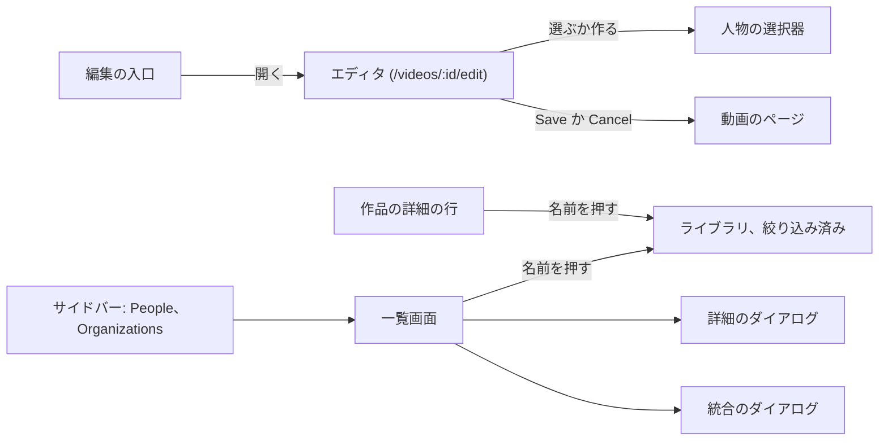
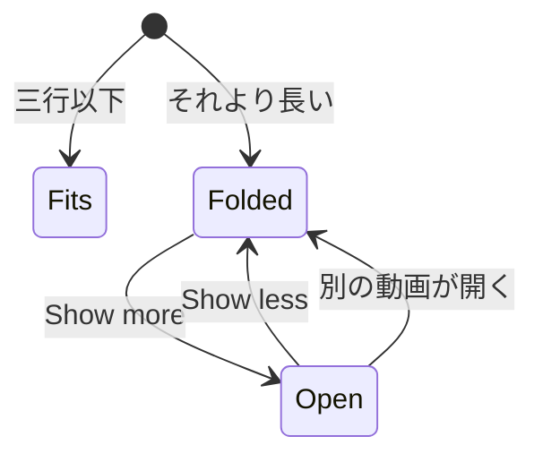
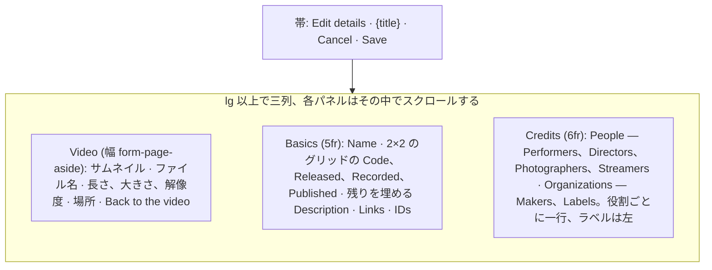
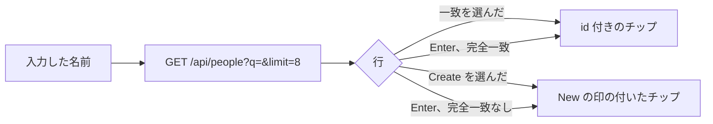
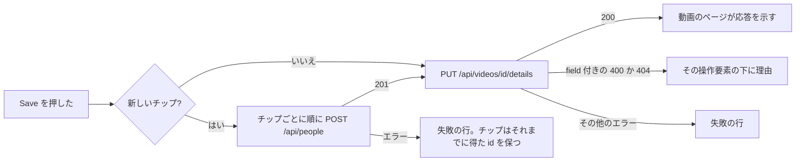
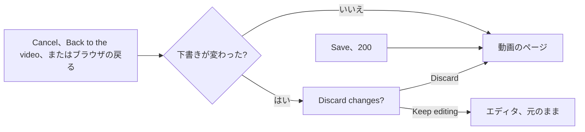
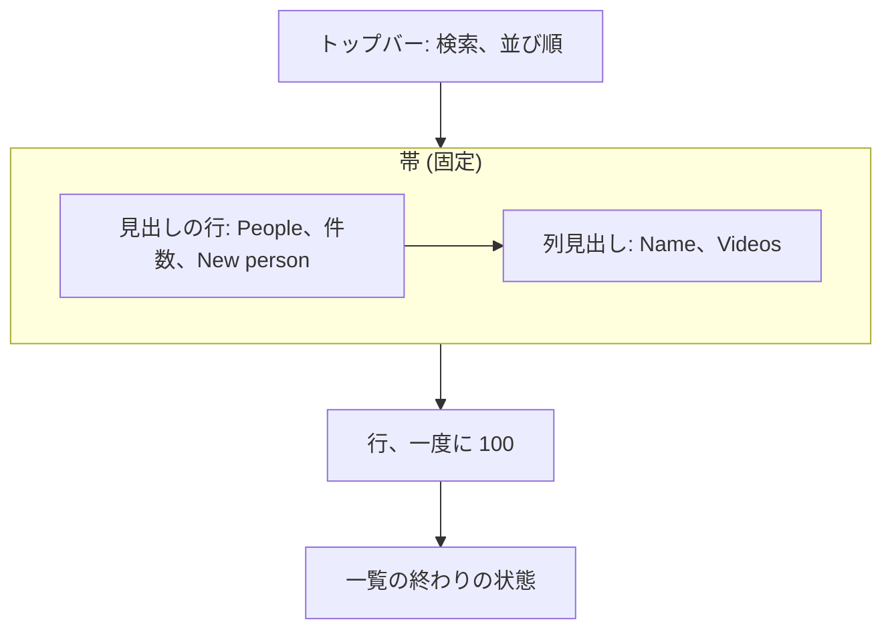

# UI 設計: 動画の作品情報 (コード、日付、人物、組織、URL、外部 ID) {#ui-design-work-information-on-videos-code-dates-people-organizations-urls-external-ids}

**機能**: [親 Issue #967](https://github.com/syudead/vv/issues/967) · [plan.md](plan.md) · [data-model.md、フィールド](data-model.md#fields) · [contracts/screen-api.md](contracts/screen-api.md) · [research.md R-4](research.md#r-4-a-video-write-references-people-and-organizations-by-id-creation-has-its-own-route) · [R-5](research.md#r-5-one-put-that-replaces-the-whole-work-information-object) · [R-7](research.md#r-7-person-and-organization-list-parameters-by-id-matching-every-role) · [R-8](research.md#r-8-entity-edits-are-a-patch-of-optional-fields-a-merge-that-moves-links-and-a-delete-that-detaches) · [R-14](research.md#r-14-the-editor-saves-the-display-name-and-the-work-information-with-one-put-apivideosiddetails-in-one-transaction)

すでに決まっていることの出典。ここでは繰り返さずリンクする。

| 話題 | 出典 |
| --- | --- |
| トークン、閉じたスケール、二つの密度 | [design-system.md、Foundations](../../docs/design-docs/design-system.md#foundations)。値は [`web/src/ui/tokens.css`](../../web/src/ui/tokens.css) の `@theme` にあり、ここでは名前で示し、決して写さない |
| `Button`、`Input`、`Textarea`、`Field`、`Badge`、`Toggle`、`Combobox`、`DropdownMenu`、`Tooltip`、`Sidebar`、`TagCommand` | [components.md](../../web/registry/rules/components.md) |
| `DetailPage`、`AdminTablePage`、`FormDialog`、`ConfirmDialog`、`EditorDialog`、`DataTable`、状態のブロック | [patterns.md](../../web/registry/rules/patterns.md) |
| 動画のページの帯、情報の行、その右側の操作のグループ、一つの失敗の行 | [012 UI 設計、動画のヘッダー](../012-video-detail-ia/ui-design.md#video-header)。[library-ui.md、情報の行](../../docs/design-docs/library-ui.md#information-rows)。[`VideoFacts.tsx`](../../web/src/player/VideoFacts.tsx) |
| 動画のページでのタイトルのその場での編集 (鉛筆、Save、Cancel、失敗の行、キー)。これは残る | [029 UI 設計、タイトルの編集](../029-video-overrides/ui-design.md#title-editing)。[`VideoTitle.tsx`](../../web/src/player/VideoTitle.tsx) |
| 全画面のエディタの帯、作業を破棄する前に尋ねる `Cancel`、その下ではページのキーが働かないこと | [045 UI 設計、サムネイルエディタ](../045-comfyui-thumbnails/ui-design.md#thumbnail-editor)、[閉じる](../045-comfyui-thumbnails/ui-design.md#closing) |
| 名前のリンクと `×` を持つチップと、動画のページのドロップダウンの一覧付きの追加の入力欄 | [014 UI 設計、動画ページのタグ](../014-video-tags/ui-design.md#video-page-tags)。[`VideoTags.tsx`](../../web/src/player/VideoTags.tsx) |
| ライブラリの絞り込み中の行とそのチップ | [014 UI 設計、絞り込み中のタグ](../014-video-tags/ui-design.md#active-tag-filters)。[`ActiveTagFilters.tsx`](../../web/src/library/ActiveTagFilters.tsx) |
| タグ管理画面: トップバー、帯、行、作成と改名、統合のダイアログ、削除、一覧の終わりの状態、タッチと狭い幅での操作、確認する幅 | [036 UI 設計](../036-tag-admin-scale/ui-design.md)。[014 UI 設計、タグ管理ページ](../014-video-tags/ui-design.md#tag-management-page)。[`web/src/tags/`](../../web/src/tags/) |
| 幅のブレークポイントは CSS で切り替える。レイアウトは人が確かめる。サイドバーのレールとドロワー | [library-ui.md、幅のブレークポイント](../../docs/design-docs/library-ui.md#width-breakpoints-in-css-and-the-sidebar-exception)、[人が確かめるレイアウト](../../docs/design-docs/library-ui.md#layout-verified-by-people-not-machines)、[シェルとツールバー](../../docs/design-docs/library-ui.md#shell-and-toolbar) |
| 所有者専用の画面でのゲスト | [016 UI 設計、ゲストでの縮退](../016-single-account-auth/ui-design.md)。[`AuthGate.tsx`](../../web/src/auth/AuthGate.tsx) (`ownerOnlyPath`) |
| 画面の文言 | [`web/src/i18n/en.ts`](../../web/src/i18n/en.ts)。この機能は `player.workInfo`、`player.detailsEditor`、`credits`、`shell.nav` の二つの項目を加え、`library.activeTags` とエラーの理由を拡張する |

この機能は四つのものを加え、どれも所有者専用である。

1. 動画のページの情報欄の**作品の詳細の行**。設定した項目だけを示し、説明は折りたたむ (要件 9 と 11、受け入れ条件 1、2、6)。
2. 動画のページの**編集の入口**。`/videos/:id/edit` の**全画面のエディタ**を開く。エディタは表示名とすべての作品情報の項目、人物や組織を見つけるか作る選択器、両方を一度に書く一つの `Save` を持つ (要件 8、受け入れ条件 1)。ページ上のタイトルのその場での編集は残る。
3. ライブラリの**人物または組織による絞り込み**。動画のページで名前を押すと至る (要件 11、受け入れ条件 4)。
4. タグの画面と同じ作りの二つの**一覧画面**、`/people` と `/organizations`。一覧、検索、並び替え、作成、改名、詳細 (別名、外部 ID、親)、統合、削除を持つ (要件 12、受け入れ条件 5)。

図は各部分と、それぞれの操作の行き先を示す。

変わらないもの: プレーヤー、タイトルとそのその場でのエディタ、タグ、公開範囲の切り替え、ファイルの事実と技術の行、カードと一覧の行 (作品情報を持たない)、タグの画面、ゲストが見るすべてのもの。

## この形にした理由 {#why-this-shape}

**作品の詳細は、情報欄で折り返すもう一つの行であり、ファイルの事実の下、技術の行の上に置く。** 親 Issue は既存の情報の行と同じ並びと間隔を求め、多くの項目を設定しても縦に伸びない欄を求めている。行の隙間で折り返す `label value` の項目の行は、ファイルの行の `text-sm` と隙間を使い、1280px ではコード、日付、二人の出演者を一行で読ませ、360px ではファイルの行の形のままである。`FactList` (一行に一つの項目名と値) は採用しなかった。コード、三つの日付、四つの役割の人物、二つの役割の組織、リンク、ID を持つ動画は十三行の高さになり、Issue はそれを除外している。カードや枠付きのブロックは、詳細の周りに枠を描かない [012](../012-video-detail-ia/ui-design.md#screen-boundary) によって退けられた。行をファイルの行の上ではなく下に置くのは、作品情報のない動画がピクセル単位で以前と同じになり (受け入れ条件 2)、操作のグループがどの幅でも欄の上端の位置を保つためである。技術の行は最も控えめなので最後のままにする。

**ラベルはアイコンではなく言葉である。** ファイルの事実がアイコンを使うのは、時計とハードディスクに曖昧さがないからである。"released" と "recorded"、"director" と "photographer" はそうではない。ラベルは `text-muted-foreground`、値は `text-foreground` で、Issue の `UI品質` が名指すとおりである。そのため目はまず値を読み、ラベルはそれらを見分けるためだけに読む。

**説明は三行に折りたたむ。** 説明は 10,000 コードポイントまでありうる。全体を表示すると技術の行と、`lg` 未満では関連動画を画面の外へ押し出す。三行で動画が何であるかがわかり、`Show more` がその場で残りを開く。全文のためのダイアログは採用しなかった。読むことは、ページを覆う必要のある作業ではない。

**編集はそれ専用の画面でし、情報の行の操作のグループにある一つのアイコンからそこへ至る。** 要件 8 は、動画のページから開き、表示名も持ち、両方を一つの要求で保存する全画面のエディタを求め、Plan はそれをルート `/videos/:id/edit` とする (構造の決定)。そのため、百のチップを持ちうるフォームの下でプレーヤーが動くことはなく、ほとんどの訪問で編集しないページはエディタのコードを読み込まない。入口は操作のグループの一つのアイコンのままにする。このページの動画ごとの編集の操作はどれもすでにそこにある ([046、この形にした理由](../046-thumbnail-image-upload/ui-design.md#why-this-shape))。そのため、何も設定していない動画は空の欄も促しも示さず、入口だけを示す (`UI品質`: `入力を前提にしない`)。タイトルの鉛筆は名前を変える手早い方法として残る。題名の変更は視聴中についでにする唯一の編集であり、エディタは腰を据えて作品に向き合うためのものである。`FormDialog` は採用しなかった。`max-w-lg` の中の十三の欄と六つの選択器はダイアログの本文の中でスクロールし、要件は全画面を名指している。`EditorDialog` は採用しなかった。そのステージは画像のためのもので、フォームはその aside に押し込まれる。`SettingsPage` は、各行が自身を保存し保存ボタンを持たないので採用しなかった。`CenteredForm` は幅 `max-w-sm` のカードなので採用しなかった。まとめて保存する多くの値のページに合う雛形はないので、045 が `EditorDialog` を加えたように、先にデザインシステムに一つ加える ([デザインシステムへの変更](#changes-to-the-design-system))。

**エディタは画面の幅を使う。どの動画を編集しているかを示す狭い列、`Basics` のパネル、`Credits` のパネルで、`lg` 以上では横に並ぶ。** 幅 `max-w-2xl` の中央の一列は、画面を無駄にするとしてメンテナが退けた。42rem に積んだ十三の欄は 1280×820 では `Dates` で画面からはみ出すので、所有者は役割を探してスクロールし、ウィンドウの三分の二が空になる。三列にすると、典型的な内容ではすべての欄が一度に画面に収まり、一覧が長いときは各パネルがその中でスクロールするので、帯と他のパネルはその場にとどまる。分け方は欄の性質に従う。`Basics` は所有者が入力する文字と日付を持つ。`Credits` は六つの役割を持ち、それはチップと選択器で、文字の欄より幅を必要とするので、右のパネルを少し広くする。左の列があるのは、エディタにプレーヤーがないからである。サムネイル、ファイル名、ファイルの事実が、動画のページの事実と同じく、どの動画を開いているかを示し、戻るリンクは `Cancel` と同じ出口である。列は `lg` 未満で積み重なる。そこで横に並べると選択器が押しつぶされるからである。そのときページは、`lg` 未満の動画のページと同じく、帯の下で一体としてスクロールする ([library-ui.md、幅のブレークポイント](../../docs/design-docs/library-ui.md#width-breakpoints-in-css-and-the-sidebar-exception))。

**`Cancel` と `Save` は最後の欄の下ではなく、エディタの帯に置く。** パネルは百のチップを持ちうる。帯はどの幅でも固定されるので、保存のために下端までスクロールする必要はない。また上端の帯は、動画のページによって目が出口を探すよう慣らされた場所である ([012、動画のヘッダー](../012-video-detail-ia/ui-design.md#video-header))。帯はロゴ、パンくず、`×` を持たない。エディタは動画のページの中の一段階で、唯一の出口は `Cancel` であり、変更を破棄する前に尋ねる ([045 のエディタ](../045-comfyui-thumbnails/ui-design.md#closing) と同じ)。十数の値を入力した所有者が、一回押しただけでそれを失うべきではないからである。同じ理由で、Esc でエディタを離れることは決してない。

**名前は最初の欄で、表示名を持ち、ファイル名のタイトルをプレースホルダーとする。** 要件 8 は表示名を同じエディタに置く。ページが最初に示すものなので最初に来る。その場でのエディタと同じく ([029、編集モード](../029-video-overrides/ui-design.md#edit-mode)) ファイル名のタイトルを前もって入れておく案は、ここでは採用しなかった。手を付けない欄がファイル名と同じ表示名を保存してしまい、空の名前が何に戻るかはプレースホルダーがすでに示しているからである。

**人物と組織はタグのページの選択器を一般化したもので選び、新しい項目は `Save` のときに作る。** 動画のページの `Add tag` は `dropdown` レイアウトの `TagCommand` である。入力し、一致する項目を見て、一つを選ぶか一つを作る。同じ形が名前にも使え、タグの名前の規則の代わりにエンティティの名前の規則を使う ([デザインシステムへの変更](#changes-to-the-design-system))。新しい名前は `New` の印の付いたチップになり、`Save` が動くときだけ、`PUT` の直前に `POST /api/people` として送る (R-4)。そのため `Cancel` は何も残さず、二つの役割に入力した人物は一度だけ作られる。選んだ時点で作る案は採用しなかった。取り消した編集が、動画のない人物を `/people` に残すからである。`Create "…"` の行は、まったく同じ名前の人物が存在するときも、一致する行の後に示す。Issue の境界ケースが、同名の人物を別の人物として作れることを求めているからである。一致する行は動画の数を示すので、所有者はどれがどれかを見分けられる。

**名前はそのエンティティで絞り込んだライブラリへのリンクで、絞り込みはライブラリの絞り込み中の行のチップである。** R-7 は `person=<id>` と `organization=<id>` をライブラリの URL に置くので、動画のページや一覧画面で名前を押すと、タグのチップが `/?tag=<id>` を開くのと同じく `/?person=<id>` を開く。絞り込み中の行はエンティティごとに、そのエンティティのアイコン付きのチップを得るので、行のラベルは `Filtering by` になる。人物ごとの専用のページは R-7 で採用しなかった。

**一覧画面は、仮のタグと一括選択を除いたタグの画面である。** Issue はタグのページのやり方 (一覧、改名、統合) を求めており、所有者はすでにそれを知っている。行にチェックボックスはなく、見出しが選択バーに置き換わることは決してない。Issue は人物への一括操作を求めていないからである。別名、外部 ID、親組織は一つの `Edit details` のダイアログで編集し、一つの `PATCH` で保存する (R-8)。タグのページの一つのシノニムのダイアログがこのダイアログになったのは、タグが一つの任意の一覧を持つところを、人物は三つ持つからである。サイドバーは `Tags` の後に `People` と `Organizations` の二つの項目を得る。Issue は二つの画面を名指しており、一つの画面の中のタブはルートを変えるタブになり、レジストリの `Tabs` の規則がそれを禁じている。

## 文言 {#words}

英語はカタログが取り込む下書きである。実装の後は [`web/src/i18n/en.ts`](../../web/src/i18n/en.ts) が正となる。名前、コード、日付、URL、ID はユーザーデータであり、翻訳せずに埋め込む。

### 動画のページ、作品の詳細の行 {#video-page-work-details-row}

| 場所 | 文言 | 注記 |
| --- | --- | --- |
| 行 (`ul`) のアクセシブルな名前 | Work details | `File details` と `Technical details` に並ぶ |
| 項目のラベル | Code / Released / Recorded / Published / Performer, Performers / Director, Directors / Photographer, Photographers / Streamer, Streamers / Maker, Makers / Label, Labels / Links / IDs | 役割のラベルは要素が一つなら単数、それより多ければ複数 (`selectPlural`) |
| 名前のリンクのアクセシブルな名前 | Show videos with {name} | `aria-label`。見える文字は名前 |
| リンクの項目 | {スキームを除いた url} | 完全な URL は `title` に入れる。新しいタブで開く |
| ID の項目 | {source}: {value} | |
| 説明、折りたたみの操作 | Show more / Show less | 折りたたんだ文の後の `link` `sm` `Button` |
| 一覧の項目の隠れた要素 | +{n} more / Show fewer | 最初の三つの要素の後の `link` `sm` `Button`。`aria-label` は `Show all {count} {label}` (`Show all 12 performers`) |
| 入口、名前とツールチップ | Edit details | `player.workInfo.edit`。名前と作品情報をまとめて |

### エディタ {#editor}

| 場所 | 文言 | 注記 |
| --- | --- | --- |
| 帯のタイトル (`h1`) と `document.title` | Edit details | `document.title` は `Edit details · {title}` |
| 帯の詳細 | {title} | 動画の今のタイトル。控えめな色で、帯のタイトルの後に置く |
| 左の列 (`aside`) のアクセシブルな名前 | Video | サムネイルの `alt` は空。ファイル名、`{length} · {size} · {resolution}`、場所はユーザーデータ |
| 左の列のリンク | Back to the video | ルーターの `Link`。`Cancel` として働く ([離れる](#leaving)) |
| パネルの凡例 | Basics / Credits | 二つのパネルの `FieldLegend` |
| `Credits` のグループのラベル | People / Organizations | 役割の各グループの上の `FieldLegend variant="label"` |
| 欄のラベル | Name / Code / Description / Released / Recorded / Published / Performers / Directors / Photographers / Streamers / Makers / Labels / Links / IDs | 見える `FieldLabel`。エディタでは役割のラベルは常に複数形 |
| 名前のプレースホルダー | ファイル名のタイトルそのもの | ユーザーデータで、翻訳しない。その場でのエディタのプレースホルダーと同じ (029) |
| 日付のプレースホルダー | YYYY-MM-DD | 三つの日付の欄。`YYYY` と `YYYY-MM` も受け付け、欄の下の説明でそう述べる: `A year or a year and month is enough.` |
| 選択器の入力欄、名前とプレースホルダー | Add a performer / Add a director / Add a photographer / Add a streamer / Add a maker / Add a label | 役割ごとに一つ |
| 選択器、作成の行 | Create "{name}" | 最後の行。空でない名前には常に示す |
| 選択器、一致のヒント | Alias: {alias} | 別名で見つかった一致の下。タグの選択器の `Synonym: …` と同じ |
| 選択器、一致の数 | {n} videos | 行の右。カタログの `videos(n)` |
| 選択器、名前がない | Enter a name | 入力欄の下の理由の行。タグの選択器の、名前が空のときの理由と同じ |
| 選択器、名前が長すぎる | Up to 200 characters | 理由の行 |
| チップの `×` | Remove {name} | |
| 保存していない新しい項目のチップの印 | New | 名前の後の `text-xs text-muted-foreground`。`{name}, new` と読み上げる |
| リンクの行 | Link / Remove link / Add link | 行の入力欄の `aria-label`、その `×`、行の下のボタン |
| ID の行 | Source / Value / Remove ID / Add ID | |
| 帯のボタン | Cancel / Save | 送信中、Save はスピナー付きで `Saving…` と表示する |
| 失敗の行 | Couldn't save the details: {reason} | 帯の下、列の上。`{reason}` は [エラーの理由](#error-reasons) から |
| 作成したが保存していない | {n} people were created, but the details weren't saved: {reason} | `POST` が成功し `PUT` が失敗したときの失敗の行。チップは id を保つので、もう一度 `Save` すると `PUT` だけを送る |
| 破棄の確認 | Discard changes? / The changes to "{title}" haven't been saved. / Keep editing / Discard | `ConfirmDialog` のタイトル、文、キャンセル、操作 |
| 読み込みの失敗 | Couldn't load the video: {reason} | `Retry` 付きの `ErrorState` |
| 動画が消えた | This video no longer exists. | `Retry` のない `ErrorState` |

### ライブラリ {#library}

| 場所 | 文言 | 注記 |
| --- | --- | --- |
| 絞り込み中の行のラベル | Filtering by | `Filtering by tags` を置き換える。種類はチップのアイコンが示す |
| 人物または組織のチップのアクセシブルな名前 | Remove the filter for {name} | タグのチップと共有 |
| 名前がわかる前のチップ | Remove the person filter / Remove the organization filter | |
| エンティティが消えた (名前の読み込みからの `404`) | Removed a person who no longer exists from the filter / Removed an organization that no longer exists from the filter | トースト。パラメーターは URL から外れる |

### サイドバー {#sidebar}

| 場所 | 文言 | 注記 |
| --- | --- | --- |
| 項目 | People / Organizations | `shell.nav.people`、`shell.nav.organizations`。`Tags` の後、`Duplicates` の前 |

### 人物と組織の画面 {#people-and-organizations-screens}

`{kind}` は `person` か `organization` を表す。どの文言もカタログに両方の種類の分がある。

| 場所 | 文言 | 注記 |
| --- | --- | --- |
| 見出し | People / Organizations | `h1`。タグのページの形式 |
| 件数 | 1,000 people / 90 of 1,000 people; 1,000 organizations / 90 of 1,000 organizations | 検索が効いている間は `totalAll` のうちの `total` |
| 作成のボタン | New person / New organization | |
| 検索欄 | Search people / Search organizations | アクセシブルな名前とプレースホルダー。`/` でフォーカスする |
| 並び順の種類 | Name / Video count / Date created | タグのページのメニューと向きの切り替え |
| 列見出し | Name / Videos | |
| 名前のリンクのアクセシブルな名前 | Open the library filtered by {name} | |
| 行の二行目 | Aliases: {a} · {b} ({language}) | 言語が設定されているときは、別名の後の括弧に入る。別名がなければこの行はない |
| 二行目、親を持つ組織 | Part of {parent} · Aliases: … | 親が先 |
| 行の操作 | Rename / Edit details / More actions | `IconButton` の名前とメニューの項目。タッチと `sm` 未満では 036 と同じく `Actions` |
| メニューの項目 | Merge into another person… / Merge into another organization… · Delete… | |
| 作成の行 | Name / Create / Cancel | 入力欄の `aria-label` と二つのボタン |
| 改名 | Rename / Save / Cancel | タグの行と同じ |
| 詳細のダイアログのタイトル | Edit "{name}" | |
| 詳細のダイアログの区分 | Aliases / External IDs / Parent organization | `FieldLegend`。最後は組織だけ |
| 別名の行 | Alias / Language / Remove alias / Add alias | `Language` のプレースホルダーは `ja`。その説明は `Optional. A language tag such as ja or en-US.` |
| ID の行 | Source / Value / Remove ID / Add ID | |
| 親の欄 | None / Search organizations / No matching organizations | `Combobox` のプレースホルダー、検索のプレースホルダー、空のときの文 |
| 詳細のダイアログのボタン | Cancel / Save | |
| 統合のダイアログのタイトル | Merge "{name}" | |
| 統合先のラベル | Person to merge into / Organization to merge into | |
| 統合先の候補が空 | No matching people / No matching organizations | |
| 統合の確認 | The {videos(n)} with "{source}" get "{target}" instead. "{source}"'s name, aliases and IDs become aliases and IDs of "{target}", and "{source}" leaves the list. This can't be undone. | `n` は統合元の `videoCount`。動画が 0 本のときは `"{source}" isn't on any videos. Its name, aliases and IDs become aliases and IDs of "{target}", and it leaves the list. This can't be undone.` |
| 統合のダイアログのボタン | Cancel / Merge | |
| 統合のトースト | Merged "{source}" into "{target}" | |
| 削除のダイアログのタイトル | Delete "{name}"? | |
| 削除の文 | "{name}" will be removed from {videos(n)}. This can't be undone. | 動画が 0 本のときは `"{name}" isn't on any videos. This can't be undone.`。組織では二文目 `Organizations inside it stay and lose their parent.` が付く |
| 削除のダイアログのボタン | Cancel / Delete | 送信中は `Deleting…` |
| 削除のトースト | Deleted "{name}" | |
| 操作中にエンティティが消えた | This person no longer exists, so the list was reloaded / This organization no longer exists, so the list was reloaded | トースト。タグのページの `tag_not_found` と同じ |
| 空の一覧 | No people yet / No organizations yet | `EmptyState` のタイトル。説明は `Add them from a video's details, or create one here.`。作成のボタン |
| 検索に一致しない | No people match "{q}" / No organizations match "{q}" | `EmptyState`。`Clear search` |
| 読み込みの失敗 | Couldn't load people: {reason} / Couldn't load organizations: {reason} | `Retry` 付きの `ErrorState` |
| 続きの読み込み、その失敗、一覧の変化 | 036 と同じ: Loading more people… / Couldn't load more: {reason} / People were added or removed elsewhere, so the rest of this list may be out of date. | 組織の文言も同様 |

### エラーの理由 {#error-reasons}

`web/src/i18n/errors.ts` が読む `web/src/i18n/en.ts` の `reason` の表に加える ([contracts/screen-api.md、追加した `reason` の値と `field`](contracts/screen-api.md#added-reason-values-and-field))。文言は欄を名指さない。画面は `field` が名指す操作要素の下にそれを置き、一致する操作要素がないときは、失敗の行が文言の後にパスをインラインコードで表示する。二つの `display_name_*` の理由は 029 の文言を保ち、`field: displayName` とともにエディタに届く。

| 理由 | 文言 |
| --- | --- |
| `work_info_control_characters` | Contains characters that can't be used. |
| `work_info_too_long` | Too long: up to {limit} characters. |
| `work_info_too_many` | Too many: up to {limit}. |
| `work_info_invalid_date` | Enter a date as YYYY, YYYY-MM or YYYY-MM-DD. |
| `work_info_invalid_url` | Enter a full web address starting with http:// or https://. |
| `work_info_invalid_language` | Enter a language tag such as ja or en-US. |
| `work_info_duplicate` | Already listed. |
| `work_info_empty` | This can't be empty. |
| `person_not_found` | This person no longer exists. |
| `organization_not_found` | This organization no longer exists. |
| `organization_parent_cycle` | The parent can't be the organization itself or one inside it. |
| `merge_same_person` | A person can't be merged into themselves. |
| `merge_same_organization` | An organization can't be merged into itself. |
| `external_id_taken` | Another entry already has this ID. |

## デザインシステムへの変更 {#changes-to-the-design-system}

二つの追加はどちらも、045 が `EditorDialog` を加えたように、動画のページの単位がそれらを使う前に、[patterns.md](../../web/registry/rules/patterns.md) と [components.md](../../web/registry/rules/components.md) の規則、[design-system.md](../../docs/design-docs/design-system.md) の行とともに入る。

| 変更 | 内容 |
| --- | --- |
| `FormPage` の雛形、レジストリの項目 `form-page`、ブロック `form-page-example` | ダイアログではなくページで、`bg-background` の上でウィンドウを埋め、まとめて保存する多くの値のフォームに使う。これは `FormDialog` (少数の欄) と `SettingsPage` (各行が自身を保存する) が扱わないものである。高さ `navbar` のヘッダーの帯は、どの幅でも `sticky top-0` で、下の境界線と動画のページの帯の `bg-background/90 backdrop-blur-md` を持ち、`title` (ページの `h1`、`text-lg font-semibold`)、その後の控えめな `detail` (`text-sm text-muted-foreground`、`truncate`、`sm` 未満では隠す)、右端の `Cancel` と一つの `default` ボタンのための `actions` スロットを持つ。帯の下には失敗の行のための `notice` スロットがある。本文は `px-4` (`sm` 以上では `px-6`) と `py-6` で、任意の `aside` と `panels` (それぞれ `FieldLegend` を持つ `FieldSet` で、その欄は `gap-4` 離れる) を持ち、`lg` 以上では名前付きのユーティリティ `grid-cols-form-page` で配置する。aside は左の幅 `form-page-aside` (16.25rem) の列で、その後にパネルが 5:6 の比で続き、列は `gap-6` 離れる。`lg` 以上ではページはビューポートの高さを保ち、各パネルはその中でスクロールする (`min-h-0 overflow-y-auto`)。`lg` 未満では aside とパネルが順に積み重なり、ページは帯の下で一体としてスクロールする。ライブラリの密度である。どの雛形もそうであるように、帯、グリッド、パネルのスクロール、隙間を受け持ち、画面は中身をスロットに渡す。patterns.md の雛形の表のその行は "Fills in many values saved together, on a screen of its own" と書き、Settings ページの規則の最後の文は `A group of values saved together belongs in a FormDialog, or in a FormPage when it is more than a few.` になる |
| `CreditCommand`、vv のコンポーネントでレジストリの項目 `credit-command` | タグの名前の規則の代わりにエンティティの名前の規則 (1 から 200 コードポイント、制御文字を含まない、改行を含む貼り付けはその理由とともに拒否する) を使う `TagCommand` の `Command`。同じ `dropdown` と `inline` のレイアウトと、同じ行の中身 (名前、ヒントの行、右の件数、最後の作成の行) を持つ。実装はそれと `TagCommand` を、名前の規則を受け取る一つの基底のコンポーネントにするので、コードは写さない (AGENTS.md)。components.md の `TagCommand` の節はこの兄弟を加え、その最後の文は `Do not use either for values other than tag names and the names of people and organizations.` になる |
| `Combobox`、画面での初めての使用 | 詳細のダイアログの親組織の欄。コンポーネントは変えない |

`tokens.css` は、スケールにない幅について foundations.md が求めるとおり、名前付きの段階 `form-page-aside` (16.25rem、エディタの左の列) と名前付きのユーティリティ `grid-cols-form-page` (`var(--spacing-form-page-aside) minmax(0, 5fr) minmax(0, 6fr)`) を一つずつ得る。どちらも foundations.md の名前付きの段階とユーティリティに載せる。色のトークンは加えず、`web/src/theme/tokens.test.ts` の `pairs` にも何も加えず (`background`、`popover`、`card` の上の `foreground` と `muted-foreground` はすでに載っている)、セクションも加えない。アイコンは lucide の `Clapperboard` (編集の入口)、`ArrowLeft` (`Back to the video`)、`User` (人物のチップ)、`Building2` (組織のチップと `Organizations` のサイドバーの項目)、`Users` (`People` のサイドバーの項目)、`IdCard` (一覧画面の `Edit details`)、そしてタグの画面の `Pencil`、`Ellipsis`、`Merge`、`Trash2` である。

## 動画のページ: 作品の詳細の行 {#video-page-work-details-row-1}

行は情報欄 ([library-ui.md、情報の行](../../docs/design-docs/library-ui.md#information-rows)) の三つ目のブロックで、ファイルの行とその失敗の行の後、技術の行の前に置くので、欄の `gap-3` がその両方から隔てる。`workInfo` が設定した項目を少なくとも一つ持つときだけ描く。何もない動画は欄を以前とまったく同じに表示する。

| 部分 | 形 |
| --- | --- |
| 行 | ファイルの行のクラスを持つ `ul`: `flex flex-wrap items-center gap-x-4 gap-y-2 text-sm sm:gap-x-5`。区切り、枠、見出し、アイコンはない |
| 項目 | ラベルと値の `li` で、`gap-1.5` 離れる。ラベルは `text-muted-foreground`、値は `text-foreground`。設定した項目だけを、ラベルの表の順に置く。一覧が空の項目はない |
| コード | 保存したままのコード。`tabular-nums` |
| 日付 | 保存した文字 (`2024-03-01`、`2024-03`、`2024`)、`tabular-nums`。`formatDate` には決して通さない。年や年と月にはロケールの形がなく、一つの行の三つの形はそろっている方が読みやすいからである |
| 人物、組織 | 一つの役割の名前を位置の順に `, ` でつなぐ。各名前は `/?person=<id>` か `/?organization=<id>` へのルーターの `Link` で、本文の色、`hover:text-primary`、通常時は下線なしで、タグのチップの名前のリンクと同じである。項目はカンマの後で折り返し、名前は `wrap-anywhere` で折り返す |
| リンク | URL ごとに一つのリンク。文字はスキームを除いた URL で、`max-w-xs` で `truncate`、完全な URL を `title` に入れ、`rel="noreferrer"` 付きの `target="_blank"`、文字の後に lucide `ExternalLink` (`size-3`) を置く。複数あれば `, ` でつなぐ |
| ID | `{source}: {value}` の組を `, ` でつなぐ。`tabular-nums` |
| 長い一覧 | 三つより多い要素を持つ役割、`Links`、`IDs` は、最初の三つを示し、その後に同じ項目の中で `+{n} more` を置く。これは `text-muted-foreground`、`hover:text-primary` の `link` `sm` `Button` である。押すとその項目のすべての要素をその場で示し、その後に `Show fewer` を置き、フォーカスを四つ目の要素に移す。説明と同じく記憶しない。上限は役割ごとに 100 の名前、20 のリンクと ID を許すので、この上限がなければ行の高さは件数とともに伸び、Issue の `UI品質` (`項目が多くても情報欄が縦に間延びしない`) がそれを除外する。行全体ではなく各一覧を折りたたむことで、どの種類の項目も見えたままになる |
| 説明 | `ul` の下の `p`、`text-sm text-foreground whitespace-pre-line max-w-prose`。そのため改行が表示され、広い左の列でも一行が読みやすいまま保たれる。下のとおり折りたたむ |

### 折りたたんだ説明 {#folded-description}

図は説明がどう開くかを示す。

| 状態 | 行が示すもの |
| --- | --- |
| 収まる | 全文。操作はない |
| 折りたたみ | `line-clamp-3`、その後、文の下の専用の行に `Show more` を置く。`link` `sm` `Button`、`text-muted-foreground`、`hover:text-primary` である。文があふれるかは要素で測る。ウィンドウの大きさが変わると測り直す |
| 開いている | 全文と、その下の `Show less`。記憶しない。次の動画も、この動画に戻ったときも、折りたたんだ状態で始まる |

### 状態 {#states}

行に独自の読み込みの状態はない。`workInfo` は動画とともに届く。`video` の通知は動画を取得し直し、行は新しい値を示す。外部 API を通して書いたオブジェクトも含む (受け入れ条件 8)。

| 状態 | 行が示すもの |
| --- | --- |
| 項目を設定していない | 何もない。情報欄は以前と同じくファイルの行と技術の行である |
| いくつかの項目を設定している | 設定した項目だけを、順に、折り返して |
| ゲスト | 何もなく、入口もない。応答に `workInfo` がない |

## 動画のページ: 入口 {#video-page-entry}

`ActionButton` (`ghost` `icon-sm`、lucide `Clapperboard`、`text-muted-foreground`、名前は `Edit details`) を、情報の行の操作のグループで `Add to playlist` の後、`Use current frame as thumbnail` の前に置くので、サムネイルの三つの操作はまとまったままである。これは `/videos/:id/edit` へのルーターの `Link` (`Button asChild`) で、エディタが返せるよう、ページの戻り先 (`from`、`trail`) をナビゲーションの状態に入れて運ぶ。ページが開いていれば、プレーヤーの有無にかかわらず所有者のために置き、ゲストには決して置かない。作品情報の唯一の入口である。行は鉛筆を持たないので、作品情報のある動画とない動画の入り方は同じである。タイトルの鉛筆 ([029、タイトルの編集](../029-video-overrides/ui-design.md#title-editing)) は名前を変える手早い方法としてその横に残る。それは名前だけを、その場で、`PUT /api/videos/{id}/display-name` で編集する。

エディタを開くと動画のページを離れるので、再生は止まる。戻ると、ページは一覧から開いたときと同じく、再生していない状態で開く。

## エディタ {#editor-1}

`/videos/:id/edit` は、動画のページと同じく `AppShell` の外の `FormPage` ([デザインシステムへの変更](#changes-to-the-design-system)) である。サイドバー、トップバー、プレーヤーはない。`deferredRoute` で読み込み、`ownerOnlyPath` に加わるので、ゲストは `next` をエディタにしてサインインへ送られる (plan、構造の決定)。入口から開くとページの `Video` から始まり、URL で開くとまず `GET /api/videos/{id}` を読む ([状態](#states-1))。

図は `lg` 以上での画面の部分を示す。帯、その後に横に並ぶ三つの列である。

`lg` 未満では同じ三つの部分がこの順に積み重なり、ページは帯の下で一体としてスクロールする ([幅に応じた振る舞い](#responsive-behaviour))。

### 画面 {#screen}

| 部分 | 形 |
| --- | --- |
| 帯 | 雛形の帯。`h1` として `Edit details`、詳細として動画の今のタイトル、右端に `Cancel` (`ghost` `sm`)、その後に `Save` (`default` `sm`、画面で唯一の `default` ボタン) を置く。ロゴ、パンくず、`×` はない |
| グリッド | `lg` 以上での雛形の `grid-cols-form-page`。左の列は幅 `form-page-aside`、`Basics` と `Credits` は 5:6 の比で、`gap-6` 離れる。`lg` 以上ではページはビューポートの高さなので、帯は上端を決して離れず、各パネルは中身が高いときその中でスクロールする。`lg` 未満では三つが積み重なり、ページは一体としてスクロールする。操作要素は雛形のライブラリの密度 (`sm`) である |
| 左の列 | `Video` という名前の `aside`、`text-sm`。部分は `gap-3` 離れ、上から順に、サムネイル (`rounded-md`、列の幅、`aspect-video`、`object-cover`、ないときは動画のページのプレースホルダー)、ファイル名 (`font-medium`、`wrap-anywhere`)、控えめな一行 `{length} · {size} · {resolution}` (`text-muted-foreground tabular-nums`。プローブが保留中または失敗したときは解像度がない)、場所 (`text-muted-foreground`、`wrap-anywhere`、動画のページのファイルの行が示すとおりのフォルダとファイル)、そして `Back to the video` である。これは先頭に lucide `ArrowLeft` を置いた `link` `sm` `Button asChild` で、`text-muted-foreground`、`hover:text-primary` である。列の中に編集できるものはなく、列は決してスクロールしない。中身に限りがあるからである |
| `Basics` パネル | `FieldLegend` `Basics` を持つ `FieldSet`。flex の列で、欄は `gap-4` 離れ、この順に並ぶ。`Name`。`sm` 以上では `grid grid-cols-2 gap-4` の中の `Code`、`Released`、`Recorded`、`Published` (一行目に `Code` と `Released`、二行目に `Recorded` と `Published`。`sm` 未満では積み重なる) と、グリッドの下の一つの `FieldDescription`。他の欄が残す高さを取る `Description` (`flex-1`)。その後に `Links` と `IDs` |
| `Credits` パネル | `FieldLegend` `Credits` を持つ `FieldSet` で、`gap-6` 離れた二つのグループを持つ。四つの人物の役割を持つ `People` と、二つの組織の役割を持つ `Organizations` で、それぞれ入れ子の `FieldSet` であり、その `FieldLegend variant="label"` がグループの名前である。グループの役割は `grid grid-cols-term gap-x-4 gap-y-3 items-start` の行で、一列目に役割の `FieldLabel` (一行、最初のチップに揃うよう `pt-1.5`)、二列目にチップと選択器を置く |
| 失敗の行 | 動画のページの失敗の行 (`role="alert"`、`text-sm text-destructive`、先頭に lucide `AlertCircle`) を、帯の下、列の上の雛形の `notice` スロットに置く。そのため、パネルがどこまでスクロールしても、`Save` を持つ帯の下に見える。次の `Save` と、離れるときに消える |

### 欄 {#fields}

| 欄 | 操作要素 | 初期値 |
| --- | --- | --- |
| Name | `Input`。プレースホルダーはファイル名のタイトルなので、空の欄はページが何を示すかをその場で伝える。説明はない。029 と同じく、プレースホルダーが説明である | 表示名が設定されていればそれ、なければ空 |
| Code | `Input`。2×2 のグリッドの最初のセル | 保存したコード |
| Released, Recorded, Published | 三つの `Input`。2×2 のグリッドの他のセル。プレースホルダーは `YYYY-MM-DD`。グリッドの下に一つの `FieldDescription`: `A year or a year and month is enough.` | それぞれの種類の保存した文字 |
| Description | パネルの残りの高さを埋める `Textarea`。少なくとも三行 (`min-h-20`) で、その文はその中でスクロールする。中身とともに伸びないので、`Links` と `IDs` はその下の位置を保つ。`Links` と `IDs` がパネルの高さを超えて伸びると、パネルがスクロールし、`Textarea` は最小のままである | 保存した文 |
| Performers, Directors, Photographers, Streamers | 行の二列目で折り返す一行の上の、チップの行と選択器の入力欄。動画のページのタグの形で、`secondary` `Badge` のチップ (名前、リンクなし、`Remove {name}` という名前の `×`)、その後、行の末尾に `CreditCommand` の `dropdown` の入力欄 (`w-combobox`) を置く | その役割で結び付いた人物を位置の順に |
| Makers, Labels | 同じものを組織について | |
| Links | URL ごとに一つの `Input` と、その右の `ghost` `icon-sm` の `×` (`Remove link`)、行の下に `Add link` (`outline` `sm`、lucide `Plus`)。一覧が空の間は行がない | 保存した URL を順に |
| IDs | 外部 ID ごとに一行。横に並ぶ `Source` と `Value` の `Input` (`Source` は行の三分の一)、`×` (`Remove ID`)、その後に `Add ID` | 保存した ID |

- エディタは `Name` にフォーカスを置いて開き、その文は選択しない。所有者はたいてい作品情報のために来ており、選択した名前は上書きの入力を誘うからである。
- `Add link` と `Add ID` は空の行を末尾に加え、そこにフォーカスする。空の行は `Save` のときに捨てる。
- 役割のチップは位置の順に並び、新しいチップは末尾に加わる。順序は加えた順であり、人物を動かすには外してもう一度加える。ドラッグでの並べ替えは求められておらず、デザインシステムにないコンポーネントが必要になる。
- チップの `×` はすぐにそれを外す。外したことは `Save` で送る。
- エディタが開いている間に届いた `video` の通知は下書きに触れない。`Save` が下書きを最後の書き込みにする。
- キー: Esc は開いた選択器の一覧か破棄の確認を閉じ、それ以外では何もしない。エディタを離れるのは `Cancel`、`Save`、ブラウザの戻るを通してだけである ([離れる](#leaving))。`Name`、`Code`、日付、リンク、ID の入力欄での Enter は、その場でのタイトルのエディタで Enter が保存するのと同じく保存する。`Description` での Enter は改行を入れる。選択器の入力欄での Enter は選択器に働く。動画のページの再生のショートカットはここには存在しない。プレーヤーがないからである。

### 選択器 {#picker}

`dropdown` レイアウトの `CreditCommand` は、動画のページの `Add tag` ([014、追加の入力欄](../014-video-tags/ui-design.md#add-input)) と同じく振る舞う。一覧はフォーカスか入力で入力欄の下に開き、Esc、Tab、離れることで閉じ、矢印キーかポインターが選ぶまで行は選ばれない。一覧はページ上のポップオーバーなので、ダイアログの本文に切り取られることはない。

図は各入力がどこへ至るかを示す。

| 観点 | 規則 |
| --- | --- |
| 候補 | キーを打つたびに `GET /api/people?q={input}&limit=8` (または `/api/organizations`) を要求し、前の要求は中止する。`q` は入力の最初の 100 文字に切る。一覧の契約は最大 100 を受け付け、名前は 200 までありうるからである。完全な名前の一致はどれもその接頭辞を含むので、切っても何も絞り落とさず、名前は作成に有効なままである。新しい行が届くまで前の行は残り、統合のダイアログの統合先の一覧と同じく、入力欄の右端に小さなスピナーを示す |
| 行の中身 | 名前。入力が名前ではなく別名に一致したときは、その下に `Alias: {alias}`。右に `{n} videos`。この役割のチップにすでにいる人物と、エディタの保存していない新しいチップは、一致として挙げない |
| 完全一致 | 検索の畳み込みのもとで名前か別名が入力全体と等しい候補が先頭に来る。八つの行は名前順の部分一致の一ページなので、完全一致がそこにないことがある ([contracts/screen-api.md](contracts/screen-api.md#people-and-organizations) は別の完全一致の結果を持たない)。下の Enter を参照 |
| 作成の行 | `Create "{name}"`。最後に置き、保存していない新しいチップとしてまだないすべての空でない名前に、完全一致があるときも示す ([この形にした理由](#why-this-shape))。選ぶと `New` の印の付いたチップを加える。まだ何も送らない。別の役割に同じ名前を入力すると、二つ目の作成の行の代わりに、その保存していないチップを一致の行 (`New` の印付き、件数なし) として示す |
| 矢印なしの Enter | 行が完全一致を持つときはそれ。持たず、応答に `nextCursor` があった (行より多くの一致がある) ときは、選択器はまず同じ `q` を `limit` なしで要求する。これはすべての一致を返す。その間入力欄のスピナーを示し、その応答に完全一致があればそれを選ぶ。どこにも完全一致がないときだけ Enter は作成の行を取るので、Enter が既存の項目と同名のものを作ることは決してない。その要求の失敗は`Request failed` の行を示し、チップを加えない。空の名前は入力欄の下に `Enter a name` を示す |
| 名前の規則 | 入力のたびに確かめる。200 コードポイントを超えるか制御文字を含むと、入力欄の下に理由を示し、選択器は働かない。改行を含む貼り付けは、タグの選択器と同じく、その理由とともに拒否する |
| 要求の失敗 | 選択器の理由の形式で、入力欄の下に `Couldn't search people: {reason}`。最後の行は残り、次のキーでもう一度検索する |

### 保存 {#save}

図は `Save` が何を送るかを示す。

`PUT` は `displayName` (`Name` の欄から前後の空白を除いたもの。空なら表示名を消す) と `workInfo` (他のすべての欄を一つのオブジェクトとして) を運び、サーバーは両方を書くか、どちらも書かない ([contracts/screen-api.md、`PUT /api/videos/{id}/details`](contracts/screen-api.md#put-apivideosiddetails))。

| 状況 | エディタが示すもの |
| --- | --- |
| 送信中 | `Save` は回る `LoaderCircle` とともに `Saving…` と表示し、`aria-disabled`。すべての欄は `readOnly` で、選択器と `×` は働かない。`Cancel` は `POST` と `PUT` がすべて応答するまで `aria-disabled`。送った `POST` は取り消せないので、その間に離れると何にも結び付かない人物や組織が残り、`PUT` の間に離れると、通知が届くまでページが古いタイトルと項目を示す。待つことで、保存はページで、または下の失敗の行で終わる |
| 保存済み (`200`) | エディタは応答の `Video` とともに `/videos/:id` に戻るので、ページは新しいタイトル、保存した項目を持つ行 (すべて消したときはなし)、`document.title` を即座に示し、古い値が一瞬見えることはない。フォーカスは入口に置かれる。トーストはない。ページが結果である |
| `field` 付きの `400` | パスが名指す操作要素の下に理由を示す (`displayName` は `Name`、`code`、`description`、`dates[i].date` はその種類の日付の欄、`urls[i]`、`externalIds[i].source` または `.value` はその行の入力欄、`people[i].person.id` はそのチップの `×`)。その要素に `aria-invalid` を付け、そのパネル (`lg` 未満ではページ) を要素が見えるようスクロールし、フォーカスをそこへ移す。エディタはすべての値を保って開いたままで、名前も含め何も書かれていない。操作要素のないパスは、パスをインラインコードにして失敗の行に示す |
| `field` 付きの `404 person_not_found` または `organization_not_found` | 同じく、チップに示し、所有者はそれを外す。別のタブがその項目を削除した |
| `POST` が失敗した | 失敗の行 `Couldn't save the details: {reason}`。`POST` が成功したチップは `New` の印を失って id を保つので、二回目の `Save` は何も二重に作らない |
| `POST` の成功後に `PUT` が失敗した | 失敗の行 `{n} people were created, but the details weren't saved: {reason}`。二回目の `Save` は `PUT` だけを送る。ここからの `Cancel` は離れ、作成した項目を残す。それらは行がたった今名指したもので、破棄の確認は触れない。それらは `0 videos` として一覧画面に残り、所有者はそこで削除できる |
| `404 video_not_found` | エディタは [消えた状態](#states-1) を示す |
| 何も変えていない | それでも `PUT` を送る。サーバーは `200` を返し、`updatedAt` を変えない ([contracts/screen-api.md](contracts/screen-api.md#put-apivideosiddetails))。エディタはページに戻る |

### 離れる {#leaving}

図は出口を示す。

| 観点 | 規則 |
| --- | --- |
| 変わった | 前後の空白を除いた後で、下書きが読み込んだ値と異なる。異なる文字、加えたか外したチップ (保存していない `New` のチップも数える)、異なるリンクか ID の行が該当し、加えた空の行は数えない |
| `Cancel`、変わっていない | 何も送らず、すぐにページに戻る |
| `Cancel`、変わった | `Keep editing` と `destructive` の `Discard` を持つ `ConfirmDialog` `Discard changes?` ([文言](#editor))。`Discard` は何も送らず、新しいチップを何も残さずにページに戻る。`Keep editing` と Esc はダイアログを閉じ、フォーカスを `Cancel` に戻す |
| `Back to the video` | 左の列からの、`Cancel` と同じもの。リンクのナビゲーションは、下書きが変わっていないか `Discard` を選ぶまで保留する。`Keep editing` はフォーカスをリンクに戻す |
| ブラウザの戻る | `Cancel` と同じ。変わっていなければ離れ、変わっていればまず尋ね、ダイアログが開いている間はエディタにとどまる |
| 再読み込みか閉じたタブ | 下書きが変わっている間は、ブラウザ自身の離脱の確認 (`beforeunload`)。それ以外は何もない |
| 戻り先 | 入口が運んだ `from` と `trail` を持つ `/videos/:id`。そのため、ページの `×` は所有者が来た一覧に引き続き戻る。URL で開いたときは、エディタは状態なしで `/videos/:id` に戻り、ページは URL で開いたときと同じく `/` に戻る。フォーカスは入口に置かれる |

### 状態 {#states-1}

| 状態 | エディタが示すもの |
| --- | --- |
| 読み込み中 (URL で開いた) | 詳細が空の帯、押せる `Cancel`、`aria-disabled` の `Save`。左の列はサムネイルの位置に `Skeleton` と、文字の行の `Skeleton` を二つ示し、パネルはすべての欄のラベルと、その位置に操作要素の高さ (`h-8`、`w-full`) の `Skeleton` を示すので、値が届いても何も跳ねない。入口から開いたときは読み込みがない。ページの `Video` が下書きの元である |
| 読み込み済み | 初期値を持つ欄。フォーカスは `Name` |
| 読み込みの失敗 | 列の代わりに本文に `ErrorState` `Couldn't load the video: {reason}` と `Retry`。`Save` は `aria-disabled` |
| 消えた (`404 video_not_found`、読み込みのときか `Save` のとき) | `Retry` のない `ErrorState` `This video no longer exists.`。`Save` は `aria-disabled`。`Cancel` はページに戻り、ページは自身の消えたときの層を示す |
| ゲスト | 何かを描く前に `/login?next=/videos/:id/edit` へ送る。サインインの後、エディタが開く |

## ライブラリ: 人物または組織による絞り込み {#library-filter-by-a-person-or-organization}

動画のページか一覧画面で名前を押すと `/?person=<id>` か `/?organization=<id>` を開く ([contracts/screen-api.md、一覧のパラメーター](contracts/screen-api.md#list-parameters-person-and-organization))。ライブラリは `tag` と同じくそれを適用する。要求がそれを運び、`total` はそれを含めて数え、スナップショットのキーはそれを含み、ページは上端までスクロールし、戻るは動画のページに戻る。

絞り込み中の行 ([014、絞り込み中のタグ](../014-video-tags/ui-design.md#active-tag-filters)) は、タグのチップの後にエンティティごとに一つのチップを、同じ `Toggle` の形 (`outline` `sm`、押された状態) で示す。lucide `User` か `Building2`、名前、`×` である。チップがもうタグだけではないので、ラベルは `Filtering by` と読む。行はタグ、人物、組織のいずれかが効いている間描く。

| 観点 | 規則 |
| --- | --- |
| 名前 | `person` のチップには `GET /api/people/{id}`、`organization` のチップには `GET /api/organizations/{id}` で読む。二つの種類は別々の id の空間を持つからである。届くまでは、タグの一覧が読み込まれる前のタグのチップと同じく、`Skeleton` (`w-12`) がチップの代わりになる |
| `404` (その読み込みからの `person_not_found` か `organization_not_found`) | パラメーターは URL から外れ、チップは消え、一覧は読み込み直され、トーストがエンティティがもう存在しないと伝える ([文言](#library))。タグともう一方のエンティティの絞り込みは残る |
| 外す | チップを押すとそのパラメーターだけを外す。フォーカスは次のチップ、なければ前のチップ、なければ検索欄に移る |
| `Clear filters` | `q`、`watch`、`playable`、`tag` とともに `person` と `organization` を外す。並び順は残る。絞り込みのボタンの件数は、タグを含まないのと同じく、それらを含まない |
| 両方を設定 | 人物一人と組織一つまで。チップはタグの後にこの順に並ぶ |
| ゲスト | `person` か `organization` を持つゲストの URL は、`fav=1` と同じく、要求の前に戻して訂正する |

## サイドバー {#sidebar-1}

上のグループの `Tags` の後、`Duplicates` の前に二つの項目が加わる。`People` (lucide `Users`、`/people`) と `Organizations` (lucide `Building2`、`/organizations`) で、所有者専用であり、レールのアイコンがラベルの上にある正方形とドロワーに置く。レールはそのとき八つの項目を持ち、ショーケースを判定する高さではフッターの上に収まる。`/people`、`/organizations`、`/videos/:id/edit` は `ownerOnlyPath` に加わるので、`/tags` からと同じく、ゲストはサインインへ送られる。

## 人物と組織の画面 {#people-and-organizations-screens-1}

一つの `AdminTablePage` のコンポーネントが両方の種類を受け持ち (plan、構造の決定)、036 の後のタグの画面と同じく配置し、違いは次のとおりである。`Filter` ボタン、タブ、チェックボックスの列、選択バーがなく、シノニムのダイアログの代わりに詳細のダイアログがある。下の表が名指さないものはすべて [036 UI 設計](../036-tag-admin-scale/ui-design.md) に従う。トップバーの検索と並び順、固定の帯、見出しの行の形式と高さ、列見出し、`py-2` の行、作成の行、その場での改名、スクロールでの続きの読み込み、一覧の終わりの状態、古い一覧の箱、空とエラーの状態、タッチと `sm` 未満での `Actions` メニュー、URL の状態 (`q`、`sort`) である。

| 部分 | 形 |
| --- | --- |
| 行 | 名前の列 (`flex-1 min-w-0`)。`/?person=<id>` へのリンクとしての名前 (`text-sm font-medium`、`hover:text-primary`、一行、`truncate`、完全な名前を `title` に) と、その下に親 (組織) と別名 ([文言](#people-and-organizations-screens)) を持つ `text-xs text-muted-foreground` の一行を置く。この行は切り詰め、完全な文を `title` に入れる。どちらもないときはこの行はない。その後に件数 (`text-sm text-muted-foreground tabular-nums`、右揃えの `w-16`)、その後に操作 |
| 行の操作、`sm` 以上でマウス | ツールチップ付きの `ghost` `icon-sm` ボタンとして `Rename` (`Pencil`) と `Edit details` (`IdCard`)、その後に `More actions` (`Ellipsis`)。これは `Merge into another person…` (`Merge`)、区切り、`Delete…` (`Trash2`、`destructive`) を持つ `DropdownMenu` を開く |
| 行の操作、タッチか `sm` 未満 | 036 と同じく、四つの項目をこの順に持つ一つの `Actions` メニュー |
| 作成 | `New person` は上端に作成の行を差し込み、`Name` の入力欄にフォーカスする。Enter か `Create` が `POST { name }` を送る。行は並び順の位置を取り、フォーカスはその名前に移る。名前は一意ではないので、既存の名前を持つ二人目の人物は警告なしに作られる (Issue の境界ケース)。行の件数 `0 videos` と空の二行目が、一人目との見分けを示す |
| 改名 | タグの行と同じ。名前の列が、名前を選択した入力欄になる。Enter は `PATCH { name }` を送り、Esc は元に戻し、フォーカスは `Rename` に戻る。サーバーからの理由は入力欄の下に示す |
| 並び順 | `Name` (既定)、`Video count`、`Date created`。タグのページのメニュー、向きの切り替え、詰めた形を使う。URL と、種類ごとに `localStorage` に保存する |
| 検索 | 名前と別名が、一覧の検索の一致の形 (全角、半角、かなの異体) で、読み込み済みかどうかにかかわらずすべての項目に一致する |

### 詳細のダイアログ {#details-dialog}

`Edit details` は `FormDialog` `Edit "{name}"` を開く。その一つの `Save` は、それが持つ一覧とともに `PATCH` を送る (どの一覧も丸ごと、R-8)。名前はそこにない。改名は行に残る。

| 区分 | 形 |
| --- | --- |
| Aliases | 別名ごとに一行。`Alias` の `Input` (三分の二)、`Language` の `Input` (三分の一、プレースホルダーは `ja`)、`×` (`Remove alias`)。行の下に `Add alias`。`FieldDescription` は言語が任意であると述べる。最大 50 行で、51 行目を加える `Add alias` は無効になる |
| External IDs | ID ごとに一行。`Source` と `Value` の `Input`、`×`、`Add ID`。最大 20 |
| Parent organization | 組織だけ。レジストリの `Combobox`、`w-full`。選択肢はこの組織を除くすべての組織で、ダイアログが開くときに `GET /api/organizations` (`limit` なし) で読み込み、最初の選択肢は `None` である。そのポップオーバーは Radix が配置するので、ダイアログのスクロールする本文に切り取られない |

- `field` 付きの `400` は、理由を行の入力欄 (`aliases[i].name`、`aliases[i].language`、`externalIds[i].source`、`externalIds[i].value`) の下か、`Combobox` (`parentId`。`organization_parent_cycle` と `organization_not_found` を含む) の下に `FieldError` として示す。`409 external_id_taken` はその ID の行の下に示す。ダイアログは開いたままである。
- `Save` は `200` でダイアログを閉じ、応答から行を書き直し (読み込み直さない)、フォーカスを `Edit details` に戻す。
- ダイアログは最大 `max-w-lg` である。`sm` 未満では 16px の余白で画面に広がり、`Alias` と `Language` の入力欄は積み重なる。

### 統合と削除 {#merge-and-delete}

`Merge into another person…` は、統合元が一つの、タグの統合のダイアログの形を開く ([036、統合のダイアログ](../036-tag-admin-scale/ui-design.md#merge-dialog))。`FormDialog` `Merge "{name}"`、統合先のラベル、`inline` レイアウトの `CreditCommand` (候補は `GET /api/people?q=&limit=8` から来て (`q` は [選択器](#picker) と同じく 100 文字に切る)、統合元と作成の行を含まない)、一覧での選んだ統合先の印、フッターの `source → target`、統合先を選んだ後の、統合元の `videoCount` を含む確認の文である。`Merge` は `default` で、それまでは無効である。`200` でダイアログが閉じ、統合元の行が消え、トーストは `Merged "{source}" into "{target}"` と表示し、統合先は [036 の統合の結果](../036-tag-admin-scale/ui-design.md#merge-dialog) に従う。その位置が読み込んだ行の中に入るとき (`nextCursor` が残っていなければ常に) は、応答から書き直して並び順の位置に置き、それ以外は読み込んだ行の中に置かない (読み込んだ統合先の行はそこから外れる) ので、次のページがそれを一度だけ、その順で返す。フォーカスは、統合先の行が読み込まれていればその名前に、そうでなければ消えた統合元の後の行、なければ前の行、なければ作成のボタンに移る。`organization_parent_cycle` と `work_info_too_many` (50 を超える別名か 20 を超える ID) はダイアログの失敗の行として示し、何も変わらない。

`Delete…` は、行の `videoCount` を文に含め (Issue の境界ケース)、`destructive` の `Delete` を持つ `ConfirmDialog` `Delete "{name}"?` を開く。`204` で行が消え、トーストは `Deleted "{name}"` と表示し、フォーカスは次の行の `Rename`、なければ前の行のもの、なければ `New person` に移る。

改名、詳細、統合、削除のどれかからの `person_not_found` は、タグのページが `tag_not_found` でするのと同じく、ダイアログを閉じ、[文言](#people-and-organizations-screens) のトーストを示し、一覧を上端から読み込み直す。

### 状態 {#states-2}

| 状態 | 画面が示すもの |
| --- | --- |
| 読み込み中 | 件数を隠した見出し。本文に `LoadingState` `table` の行 |
| 読み込み済み | 行。次のページを読み込む間、末尾に `Loading more people…` と行の `Skeleton` |
| 空 | `Users` か `Building2`、[文言](#people-and-organizations-screens) のタイトルと説明、作成のボタンを持つ `EmptyState`。検索欄は無効 |
| 検索に一致しない | `SearchX` と `Clear search` を持つ `EmptyState` |
| 読み込みの失敗 | `Retry` 付きの `ErrorState` |
| ゲスト | 何かを描く前にサインインへ送る |

## 幅に応じた振る舞い {#responsive-behaviour}

Tailwind の既定のブレークポイントだけを使い、CSS で切り替える。判定する幅は 360px、768px、1280px である (エディタは 1280×820、一覧画面は 1280×800)。エディタの列は、動画のページの列と同じく `lg` で切り替わる。

| 幅 | 動画のページ | エディタ | ライブラリ | 一覧画面 |
| --- | --- | --- | --- | --- |
| 1280px | ファイルの行は一行で、入口は操作のグループのもう一つのアイコンである。その下に作品の詳細の行があり、コード、日付、二人の出演者が一行に並ぶ。説明は `max-w-prose` | 帯はタイトル、詳細、右端の `Cancel` と `Save` を持つ。その下に左の列 (`form-page-aside`)、`Basics`、`Credits` が `gap-6` 離れて横に並び、幅を埋める。1280×820 では、典型的な内容 (名前、コード、三つの日付、短い説明、二つのリンク、二つの ID、役割ごとに数人の名前) ですべての欄が画面に収まり、ページはスクロールしない。`Code` と三つの日付は 2×2 のグリッド。六つの役割の行は、ラベルが左の一列に並び、選択器はそのチップの行の末尾で `w-combobox`。`Source` と `Value` は横に並ぶ。長い一覧はそのパネルだけをスクロールし、帯と他の列はとどまる | 絞り込み中の行は件数の上の中央に置き、タグのチップ、その後にエンティティのチップが並ぶ | 1280px の 036 と同じ。ただし `Filter` ボタンとチェックボックスの列はない |
| 768px | 1280px と同じ。作品の詳細の行は説明の前で二行に折り返すことがある | `lg` 未満。左の列、`Basics`、`Credits` がこの順に積み重なり、それぞれ余白を除いた幅を埋め、ページは固定の帯の下で一体としてスクロールする。中でスクロールするパネルはない。サムネイルは行を埋めず、左の列の `form-page-aside` の幅を保つ。2×2 のグリッドと役割の行は形を保つ | 1280px と同じ | 768px の 036 と同じ |
| 360px | 操作のグループ (お気に入り、プレイリスト、詳細、取り込み、編集、アップロード、開く、コピー) は一行のままで、事実はその上で折り返す。作品の詳細の行は項目ごとに折り返し、長い出演者の一覧はカンマの後で、長い名前はその中で折り返す。リンクは切り詰める。横スクロールはない (Issue の境界ケース、ブラウザのテストでの受け入れ条件) | 帯はタイトルと二つのボタンを一行に保ち、詳細は隠す。三つの部分は 768px と同じく積み重なる。`Code` と日付は一行に一つずつ積み重なる。役割のラベルは左の専用の列にとどまり、チップはその横で折り返し、各選択器の入力欄はそのチップの下の専用の行を取る。`Source` と `Value` は横に並んだままである。200 文字の名前のチップでも横スクロールはない | チップは折り返す | 360px の 036 と同じ。名前の列は約 160px、一つの `Actions` メニュー、横スクロールなし。詳細のダイアログの別名の行は `Alias` の下に `Language` を積む |

## レビューの基準 {#review-criteria}

vv の一つのダークの配色で、動いている画面を見て判定する (library-ui.md、人が確かめるレイアウト)。「存在する」だけでは合格しない (Q-4)。

1. **視覚的な階層**: 動画のページでは、視線は今までどおりプレーヤー → タイトル → タグと進む。作品の詳細の行は、ファイルの事実の後、技術の行の前に、同じ `text-sm` で読まれる。ラベルは控えめで値は本文の色なので、一目で `Code` や `Released` という言葉より先に `AB-123`、`2024-03-01`、名前が目に入る。入口は操作のグループのアイコンの中の控えめな一つのアイコンで、塗りつぶしも境界線も `primary` の色も持たない。エディタでは視線は帯のタイトル → `Name` → `Basics` を下へ → 横に `Credits` と進み、`Save` が唯一の塗りつぶしのボタンである。凡例の `Basics` と `Credits` はその欄より先に、`People` と `Organizations` はその行より先に読まれる。左の列は最後に、サムネイルの下の控えめな事実として読まれ、その中に編集できるように見えるものはない。一覧画面では、タグの画面と同じく、まず名前が読まれ、次に見出しと `New person`、次に件数と別名が読まれる。
2. **情報の密度**: コード、発売日、二人の出演者を持つ動画は、1280px で情報欄に一行を加える。すべての項目を設定した動画は、折り返した数行と折りたたんだ説明を加える。行は出演者が 100 人でも 4 人でも同じ高さである。各一覧は三つの要素と `+{n} more` を示すからである。10,000 文字の説明は三行と `Show more` である。何も設定していない動画は行のどのピクセルも変わらず、操作のグループにちょうど一つのアイコンが加わる。1280×820 では、エディタは典型的な内容で、`Name` から `Labels`、`Links`、`IDs` までのすべての欄をページのスクロールなしに示し、三つの列が幅を埋め、その横に背景だけの空いた帯はない。二十のチップを持つ役割は `Credits` のパネルだけをスクロールし、`Save` はどのスクロール位置でも見えたままである。一覧画面の帯の下には、1280×800 で約 12 行が見える。
3. **余白のリズム**: 作品の詳細の行の項目間の隙間はファイルの行と等しく (`gap-x-4`、`sm` 以上では `gap-x-5`)、ラベルとその値の隙間は、事実のアイコンとその値の隙間と等しい。欄の `gap-3` が、行を上のファイルの行と下の技術の行から隔てる。説明の周りに余分な空きは現れない。エディタでは、三つの列は `gap-6`、パネルの中の欄は `gap-4`、`Credits` の二つのグループは `gap-6` 離れ、その役割の行は `gap-y-3` である。すべての役割のラベルは同じ x から始まり、そのベースラインは最初のチップと揃う。帯は動画のページの帯の高さで、チップと選択器はタグの行の `gap-1.5` で一行に並ぶ。
4. **文字組み**: ラベルと値はファイルの行の `text-sm` である。日付、コード、ID は `tabular-nums` である。説明は同じ大きさで、事実より大きくも太くもならず、折りたたみの操作はボタンではなくリンクとして読める。エディタの帯のタイトルは `text-lg font-semibold`、その詳細は控えめな `text-sm`、欄のラベルは `FieldLabel` の大きさである。`Name` の欄は `Code` と同じ `Input` で、タイトルの `text-2xl` ではない。一覧画面では、タグの行のシノニムと同じく、行の名前は `text-sm font-medium`、二行目は控えめな `text-xs` である。
5. **操作の優先度**: 名前、コード、発売日、二人の出演者の入力は、入口 → 入力 → 選ぶか作る → `Save` で、一つの画面と、保存のための一回の押下である。その後ページは新しいタイトルと行を示す (受け入れ条件 1 と要件 8)。項目を消すには、その欄を空にするかチップの `×` を押し、`Save` を押す。項目は行から消える (受け入れ条件 2)。`Save` はエディタで唯一の `default` ボタンで、その横の `Cancel` は `ghost` であり、閲覧の行は名前、リンク、`Show more` 以外の操作要素を持たない。タイトルの鉛筆は今までどおり、エディタを開かずにその場で名前を変える。一覧画面では、改名は一回の押下で、統合と削除は `More actions` と確認の後ろにある。
6. **空の動画で促さない**: 作品情報のない動画は、入力を促す空の欄、プレースホルダー、破線の箱、文を示さない。示すのは入口のアイコンだけで、押すまで何もしない (`UI品質`: `入力を前提にしない`)。空の欄はエディタの中にだけ存在する。
7. **選ぶことと作ること**: `Add a performer` に `ali` と入力すると、名前か別名が `ali…` の人物を動画の数とともに挙げ、最後に `Create "ali"` を置く。一致を選ぶとチップを加え、作成を選ぶと `New` の印の付いたチップを加える。同じ新しい名前を `Directors` に入力すると、その保存していないチップを示し、`Save` はその人物を一度だけ作り、その後行は両方の役割でその人物を示す。既存の人物の横に同名の人物を作ることができ、`/people` の二つの行は件数で異なる。
8. **一つとしての保存**: 新しい名前と無効な日付を一緒に保存すると、エディタは開いたままで、`Recorded` の下に理由を示し、`Basics` をそこまでスクロールし、すべての値を保ち、エディタを離れたときページのタイトルは変わっていない。上限を超える名前を有効なオブジェクトとともに保存すると、`Name` の下に理由を示し、作品情報を何も書かない。下書きが変わった状態の `Cancel` は `Discard changes?` と尋ね、`Discard` は `/people` に新しい人物を残さない。何も変えていない `Cancel` はすぐに離れる。
9. **ナビゲーション**: 動画のページで出演者を押すと、URL に `person=<id>`、絞り込み中の行にチップ `User {name}` を持ち、その人物の動画だけを示すライブラリが開く (受け入れ条件 4)。メーカーを押すと `Building2` で同じことが起きる。戻るは動画のページに戻る。`/people` で名前を押しても同じことが起きる。エディタを離れると動画のページに戻り、その `×` は今までどおり所有者が来た一覧に戻る。
10. **統合**: `/people` で `A` を `B` に統合すると、`A` の行が消え、`B` の件数が合算され、動画では `B` が出演者として示され、ライブラリの検索に `A` の名前を入力するとその動画が見つかる (受け入れ条件 5)。組織自身のレーベルである親を選ぶと、親の欄の下に循環の理由を示し、何も保存しない。
11. **スマートフォンの幅**: 360px では、動画のページは長い説明、二十人の出演者、200 文字の名前があっても横スクロールを示さない。操作のグループは一行である。エディタの帯は、三つの部分を積み重ね、`Code` と日付を一行に一つずつにし、200 文字のチップをその役割のラベルの横で折り返した状態で、`Cancel` と `Save` を見えたままに保つ。`/people` では行の操作は一つの `Actions` メニューである。
12. **ゲスト**: サインアウトした状態では、同じ動画のページに作品の詳細の行も入口もない。`/videos/:id/edit` はサインインへリダイレクトする。サイドバーに `People` も `Organizations` もない。`/people` はサインインへリダイレクトする。`/?person=<id>` は `/` に訂正される。
13. **要件を満たさない例**: 作品の詳細が枠付きのカードや、一行に一項目の項目名と値の一覧である。ラベルがアイコンである。説明が全体を表示するか、ダイアログで開く。空の動画が空の欄、プレースホルダーの行、`No work details yet` の行を示す。編集がダイアログやプレーヤーの下のフォームで開く。エディタがサイドバー、ロゴ、パンくずを示す。エディタが 1280px で両側の背景が空いた中央の一列である、または典型的な内容で 1280×820 でページがスクロールする、または長い役割の一覧がそのパネルではなくページ全体をスクロールする。役割のラベルがチップの横ではなく上にある。`Save` がパネルの下端にしかない。`Name` の欄にファイル名が前もって入っている。作品情報が失敗したのにタイトルが保存される、またはその逆。下書きが変わった状態の `Cancel` が尋ねずに離れる、または Esc でエディタを離れる。`Save` を送らずに取り消した編集が `/people` に新しい人物を残す。`POST` か `PUT` の送信中に `Cancel` でエディタを離れる。既存の名前が作成の行を消す。ライブラリのエンティティのチップがタグのアイコンを持つ。一覧画面がチェックボックスの列か選択バーを持つ。詳細のダイアログの `Save` が赤い。統合先を選ぶ前に `Merge` が押せる。1280×800 で見える行が 12 未満である。

## アクセシビリティ {#accessibility}

親 Issue はスクリーンリーダーやコントラストの設計を求めていないので、036 と 046 と同じく、名前と読み上げだけを決める。

- 行の `ul` は `Work details` である。各項目のラベルは見える文字なので、隠した名前は要らない。名前のリンクは `Show videos with {name}` である。リンクの項目の `title` は完全な URL である。
- 入口は `Edit details` という名前のリンクである。エディタの `h1` は帯のタイトル `Edit details` である。すべての欄は見える `FieldLabel` を持ち、すべての `×` は `aria-label` を持つ。選択器の入力欄はそのプレースホルダーで名付けられ、`New` の印は名前の後に読み上げられる。`FieldSet` の `FieldLegend` がそのパネルかグループを名付け、左の列は `Video` という名前の `aside` で、そのサムネイルの `alt` は空である。横のファイル名が同じことを言うからである。開いたときフォーカスは `Name` にあり、ページに戻ったときは入口にある。
- 欄の理由は `FieldError` を使い、操作要素に `aria-invalid` を付ける。失敗の行は `role="alert"` である。折りたたみの操作の文字はその動作を言う。破棄の確認は `AlertDialog` である。
- 絞り込み中のチップはタグのチップの名前を保つ。消えたエンティティのトーストは、消えたタグと同じ `Sonner` の知らせである。
- 一覧画面では、名前、メニュー、ダイアログは、タグの画面の役割と名前を `person` と `organization` の言い回しで持つ。削除の確認は `AlertDialog` である。
