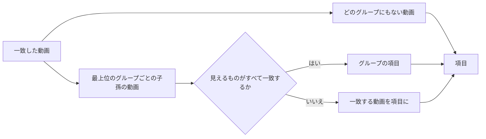

# データモデル: 任意の動画とグループからなるグループ {#data-model-groups-of-any-videos-and-groups}

親 Issue: #1040。モデルの残りは変わらない。正本:

| 項目 | 出典 |
| --- | --- |
| 既存のテーブルの定義 | [internal/store/migrations/](../../internal/store/migrations/) |
| データの分類 | [running-vv.md、Data and recovery](../../docs/how-to/running-vv.md#data-and-recovery) |
| フォルダでまとめる規則、フォルダのキー、フォルダから導くタグ、作り直しの時点 | [017 データモデル](../017-folder-groups/data-model.md) |
| 一部が一致するグループ | [027 library-api.md](../027-partial-group-search/contracts/library-api.md) |
| ユーザーキー、まとまり、継承 | [030 データモデル、User key](../030-video-versions/data-model.md#user-key)、[internal/store/successions.go](../../internal/store/successions.go) の `moveUserData` |
| 項目のクエリの中のお気に入り | [035 データモデル、Library items](../035-favorites/data-model.md#library-items-libraryitemscte-listlibrary-libraryids) |
| プレイリストの項目と再生 | [044 データモデル](../044-playlists/data-model.md) |

## マイグレーション {#migration}

マイグレーションは 3 つ。`00042_groups.sql` はグループのテーブルを加え、今のフォルダの索引から種をまく。`00043_group_keys.sql` はお気に入りとプレイリストの項目をグループの id に変換する。`00044_drop_folder_groups.sql` は、読むものがなくなったら、フォルダの索引のグループのテーブルを削除する。`main` の最後のマイグレーションは `00041_thumbnail_image_sources.sql` である。実装するときに番号を確かめる。

```sql
-- 00042_groups.sql. User data (research.md R-1). No foreign key to videos.
create table groups (
    id            integer primary key autoincrement,
    name          text    not null check (length(name) between 1 and 100),
    title_key     text    not null,          -- domain.NaturalSortKey(name)
    origin_folder text    unique,            -- domain.FolderKey of the folder; null for a hand-made group
    created_at    integer not null,          -- Unix ms
    updated_at    integer not null           -- Unix ms; any change of the name or the items
);

create table group_items (
    id          integer primary key autoincrement,
    group_id    integer not null references groups (id) on delete cascade,
    -- Exactly one of the two is set (R-2).
    content_key text,                        -- a video's user key
    child_id    integer references groups (id) on delete cascade,
    position    integer not null,            -- 0-based, dense within the group
    from_folder integer not null default 0 check (from_folder in (0, 1)),  -- added by the sync (R-3)
    check ((content_key is null) <> (child_id is null)),
    check (content_key is null or content_key <> ''),
    check (from_folder = 0 or content_key is not null),
    check (child_id is null or child_id <> group_id),
    unique (group_id, content_key),
    unique (group_id, child_id)
);
create index group_items_order_idx on group_items (group_id, position);
create index group_items_content_idx on group_items (content_key);
create index group_items_child_idx on group_items (child_id);

-- Folder members the owner removed from an automatic group (R-3).
create table group_exclusions (
    group_id    integer not null references groups (id) on delete cascade,
    content_key text    not null check (content_key <> ''),
    primary key (group_id, content_key)
) without rowid;
```

`00042` はその後、すべての `folder_groups` の行を `groups` に (`name`、`title_key`、`origin_folder = path_key`)、すべての `folder_group_members` の行を `group_items` に写す。後者は `from_folder = 1`、メンバーのユーザーキー ([030](../030-video-versions/data-model.md#user-key) の `userKeyExpr` を埋め込んだもの)、その `position` を持つ。各グループの `created_at` と `updated_at` はマイグレーションの時刻である。

```sql
-- 00043_group_keys.sql (research.md R-10).
create table group_favorites (
    group_id     integer primary key references groups (id) on delete cascade,
    favorited_at integer not null
);
-- Copied from folder_favorites where path = groups.origin_folder; then:
drop table folder_favorites;

-- playlist_items is rebuilt with group_id integer references groups (id) on delete cascade
-- in place of folder_key, and unique (playlist_id, group_id).
-- Rows whose folder_key matches no groups.origin_folder are dropped; positions are renumbered.
```

```sql
-- 00044_drop_folder_groups.sql.
drop table folder_group_members;
drop table folder_groups;
```

それぞれの down は削除したテーブルを空で戻す。次の起動がフォルダの索引を作り直す。

`groups`、`group_items`、`group_exclusions`、`group_favorites` はユーザーデータである: ARCHITECTURE.md (「User data survives a rebuild」) と running-vv.md の表にそれらが加わり、`folder_groups`、`folder_group_members`、`folder_favorites` が抜ける。`RemoveContent`、`releaseContentIndex`、メディアフォルダの取り除きは、そのどれにも触れない。

不変条件 (`internal/store/invariants_test.go` に加える):

| 規則 | 強制する場所 |
| --- | --- |
| 1 つのグループの位置は `0 … n-1` である | `internal/store/invariants_test.go` |
| `origin_folder` は `domain.FolderKey(origin_folder)` に等しい | `internal/store/invariants_test.go` |
| どのグループも自分自身の子孫ではない | `internal/store/invariants_test.go` |

## 自動のグループの同期 {#automatic-group-sync}

`syncFolderGroups(tx, index)` は、`writeFolderIndex` の `folder_groups` と `folder_group_members` への書き込みを置き換える (`00044` までは両方を書く)。[017、When the index is rebuilt](../017-folder-groups/data-model.md#when-the-index-is-rebuilt) のどの作り直しの時点でも、同じトランザクションで、`domain.BuildFolderIndex` の後に動く。最初の起動で同期するように、`domain.FolderIndexVersion` は 3 になる。`video_folder_names` は引き続き丸ごと書き直す。

`domain.PlanFolderGroupSync` は、フォルダの索引 (規則がまとめる各フォルダと、その直下の動画のユーザーキーを自然順に並べたもの)、すべての自動のグループ (その `origin_folder`、項目、除外)、`ungroup` の上書きから決める。ストアがその結果を適用する。

| 場合 | 変更 |
| --- | --- |
| 規則がフォルダをまとめ、それを `origin_folder` とするグループがなく、`ungroup` の上書きもない | フォルダの名前 (100 文字に切る) を名前とし、直下の動画を `from_folder = 1` で自然順に持つグループを作る |
| グループがそのフォルダを `origin_folder` とし、直下の動画がその項目にも除外にもない | それを `from_folder = 1` で末尾に付ける。複数あれば自然順で末尾に付ける |
| `from_folder = 1` の項目が、もうそのフォルダの直下の動画ではない (移した、削除した、フォルダがなくなった、メディアフォルダを取り除いた) | 項目を削除し、番号を振り直す |
| `from_folder = 0` の動画の項目 | 決して触れない |
| グループを持つフォルダを、規則がもうまとめない | 変更なし。上の 2 行だけが当てはまる (エッジケース: メンバーが 1 つのグループ) |
| 項目が 1 つも残らないグループ | 残し、[Visibility](#visibility) で隠す |

「直下の動画」はフォルダの索引のすべての場所を数えるので、規則がまとめないフォルダ (直下の動画が 1 本、子フォルダがある) も、既存のグループの追加と取り除きには引き続き使われる。変わったすべてのグループの id と、変わったグループのすべての祖先の id は、コミットの後の 1 つの `GroupsChanged` イベントに入る。

## 継承とまとめること {#succession-and-bundling}

下のどの経路も、ほかのユーザーデータのキーをすでに付け替えているトランザクションで、`group_items` と `group_exclusions` の行を移す 1 つのパッケージ非公開のヘルパー `rekeyGroupItems(tx, from, to)` を通じて動く。キー `to` の項目が 2 つになったグループでは、`position` の大きいほうを削除し、グループの番号を振り直す。まとめた項目は、どちらかが 0 なら `from_folder = 0` を保つ。経路とその変更は [044、Succession and bundling](../044-playlists/data-model.md#succession-and-bundling) のものと同じである。

## 編集 {#edits}

`domain` が決め、`GroupStore` は書き込みのトランザクションで入力を読む。

| 操作 | 規則 |
| --- | --- |
| 作成 | `ValidateGroupName`。項目は要求から順に (動画、次にグループ)。`origin_folder` は null |
| 名前の変更 | `ValidateGroupName`。`title_key` も追従する |
| 追加 | 要求の順に末尾に付ける。すでにグループにある項目は飛ばす。取り除いたフォルダのメンバーの除外は削除し、そのメンバーは `from_folder = 0` で戻る |
| 取り除く | 項目を削除する。自動のグループの `from_folder = 1` の項目では、その除外を書く。番号を振り直す |
| 移動 | 1 つの項目を別の項目の後ろか先頭に移す。番号を振り直す ([044 R-3](../044-playlists/research.md#r-3-dense-integer-positions-reordered-by-move-after)) |
| 解散 | [R-4](research.md#r-4-dissolving-deletes-the-group-for-an-automatic-group-it-writes-ungroup)。子グループと動画は残る。親は項目を失い、番号を振り直す |
| タグへの変換 | [R-11](research.md#r-11-turning-a-group-into-a-tag-attaches-the-tag-by-hand-then-dissolves) |
| 入れ子 | `ValidateNesting(parent, child, edges)`: 子が親かその祖先の 1 つであるとき `ErrGroupCycle` |
| 存在しない対象 | 解決しない動画の id、グループの id、項目の id は `ErrGroupTargetNotFound` で、何も書かない ([R-12](research.md#r-12-edits-are-positional-and-fail-whole-when-a-target-is-gone)) |

動画の id は `userKeysForVideoIDs` を通じてそのユーザーキーに解決するので、1 つのまとまりの 2 つのバージョンを加えると項目が 1 つ加わる。どの編集も、変えるグループに `updated_at` を設定し、それらのグループとそのすべての祖先を載せて `GroupsChanged` を発行する。親は子の名前と、子孫の数と長さを見せるからである。解散では、イベントは元の親とその祖先も挙げる。

## 再生の順序 {#play-order}

`domain.GroupPlayOrder(items, children)` はグループの動画の id を返す: 示される項目を位置の順に並べ、子グループをその再生の順序で置き換え、深さ優先で、各動画は最初に現れた位置に保つ ([R-7](research.md#r-7-a-groups-values-come-from-its-distinct-descendant-videos-in-play-order))。動画の項目は、そのユーザーキーについて閲覧者に示される動画 (`shownVideosCTE`) に解決する。解決しない項目は除くが、削除はしない。

| 読み取り | 使う再生の順序 |
| --- | --- |
| `LibraryGroup` の値 (本数、合計、日付、視聴状態、`previews`、`openVideoId`、`videoIds`) | そのグループ |
| `Video.group`、`Up next`、前後、メンバーの窓、`GET /api/videos/{id}/group-members` | 文脈のグループ ([R-9](research.md#r-9-the-video-page-follows-the-group-it-was-opened-from)) |
| プレイリストのグループの項目 | そのグループ。`PlaylistPlaybackOf` でフォルダのグループのメンバーを置き換える |
| 選んだグループの `LibrarySelection` | そのグループ |

## ライブラリの項目 {#library-items}

`libraryItemsCTE` は 027 の手順を保ち、グループの出どころを置き換える:



| 手順 | 規則 |
| --- | --- |
| 最上位のグループ | それを指す `group_items.child_id` の行がないグループ |
| 子孫の動画 | 各最上位のグループから `child_id` をたどる再帰 CTE を、各 `content_key` の示される動画と結合する |
| 見えるグループ | 閲覧者が見てよい子孫の動画が少なくとも 1 本ある。最小は所有者でもゲストでも 1 ([R-6](research.md#r-6-the-library-top-level-and-partial-search-matches-over-descendants)) |
| グループの項目 | 見えるすべての子孫の動画が一致した |
| 単独の項目 | 一部が一致する最上位のグループの一致する子孫の動画と、どのグループにもない一致する動画。各動画は 1 回 |
| お気に入りだけ | お気に入りにした見えるグループ (どの深さでも) はすべてグループの項目である。それらのどれにも入っていないお気に入りの動画は動画の項目である |
| キーと同順位の決め方 | グループの項目は `groups.id`、動画の項目は動画の id を使う。cursor は種類を運ぶ |

集計、視聴状態、並べ替えの値、`LibraryIDs` は、子孫の動画に対して 017 と 027 に従う。`LibrarySelection.Groups` はグループの id と、その再生の順序の動画の id を運ぶ。

## 見え方 {#visibility}

グループは、その閲覧者にとっての再生の順序が空でないとき、その閲覧者に示す。ゲストはグループの項目、値、再生の順序を公開の動画だけから読む。公開の動画のない子グループは、その親から除く。ゲストは示されないグループに `404` を受け、存在しないグループと同じである。

## 加える `domain` の値 {#domain-values-added}

| 値 | 内容 |
| --- | --- |
| `Group` | `ID`、`Name`、`OriginFolder` (手作りのグループでは空)、`UpdatedAt` |
| `GroupItem` | `ID`、そして `Video *Video` か `Group *LibraryGroup` のどちらか |
| `GroupPage` | `Group`、`LibraryGroup` の値、`Items []GroupItem` (1 ページ)、`Trail []GroupRef`、`NextCursor` |
| `GroupRef` | `ID`、`Name` |
| `ValidateGroupName(string) (string, error)` | トリムする。空か 100 文字を超えると `*InvalidGroupNameError` |
| `ValidateNesting`、`GroupPlayOrder`、`PlanFolderGroupSync` | 上の規則 |
| `GroupsChanged` | `GroupIDs []int64`。コミットの後に発行する |
| `ErrGroupNotFound`、`ErrGroupTargetNotFound`、`ErrGroupCycle` | `404 not_found`、`404 group_target_not_found`、`409 group_cycle` |

`LibraryGroup` は `ID` を得て、`Path` はフォルダが登録したフォルダの下にある自動のグループでだけ保つ。`VideoGroup` (関連動画) は id で指す。
