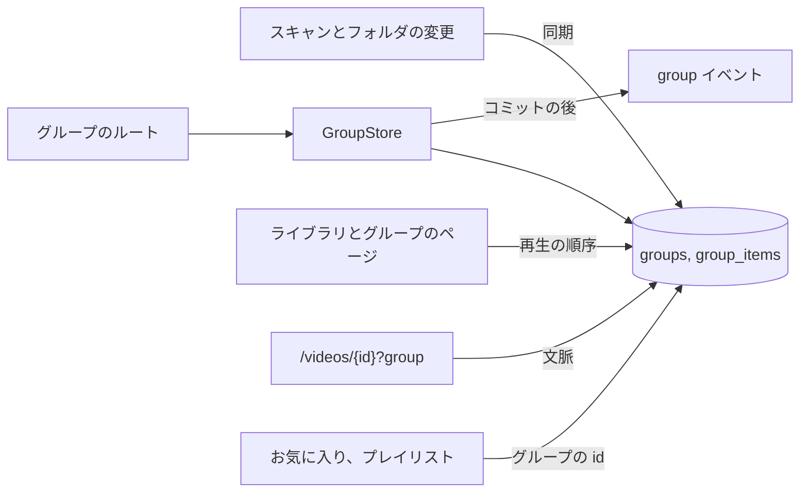
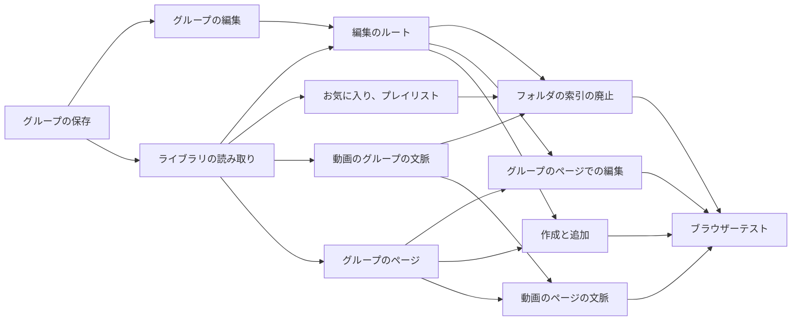

# 実装計画: 任意の動画とグループからなり、複数への所属と入れ子を持つグループ {#implementation-plan-groups-of-any-videos-and-groups-with-several-memberships-and-nesting}

**ブランチ**: `feature/048-groups` | **親 Issue**: #1040

**入力**: 親 Issue。これがこの機能の仕様である。

## 概要 {#summary}

所有者は任意の動画とグループからグループを作り、名前を付けて並べ、1 つの動画や 1 つのグループを複数のグループに入れ、グループを入れ子にする。017 のフォルダのグループは同じ種類のグループになり、スキャンが作り、その後は手で編集される。グループは作り直されるフォルダの索引から、変わらない id を持つユーザーデータに移る。スキャンは自動のグループを作り、そのフォルダのメンバーを加えたり取り除いたりするだけで、グループのすべての機能 (お気に入り、プレイリスト、タグ、ゲスト、部分的な検索の一致、`Up next`) はその id でグループを指す。

図は、この機能が加えるか変える部分と、それぞれが読むか書くものを示す。



| 関心事 | 方針 |
| --- | --- |
| 保存 | 変わらない id を持つユーザーデータとしての `groups`、`group_items`、`group_exclusions` ([R-1](research.md#r-1-groups-become-user-data-with-a-stable-id)、[data-model.md、Migration](data-model.md#migration)) |
| メンバー | 動画はユーザーキー、子グループは id で指す ([R-2](research.md#r-2-a-video-item-is-keyed-by-the-user-key-a-child-group-by-its-id)) |
| 自動のグループ | スキャンが一度だけ作り、その後はフォルダのメンバーを加えたり取り除いたりするだけ ([R-3](research.md#r-3-the-scan-creates-automatic-groups-once-then-only-adds-and-removes-folder-members)) |
| 解散 | グループを削除する。自動のグループでは `ungroup` ([R-4](research.md#r-4-dissolving-deletes-the-group-for-an-automatic-group-it-writes-ungroup)) |
| 入れ子 | 循環のないグラフ。書き込みで確かめる ([R-5](research.md#r-5-nesting-is-a-graph-without-cycles-checked-in-the-write)) |
| ライブラリ | 最上位のグループとどのグループにも入っていない動画。部分的な一致は子孫に対して決める ([R-6](research.md#r-6-the-library-top-level-and-partial-search-matches-over-descendants)) |
| グループの値と再生 | 重複のない子孫の動画、深さ優先 ([R-7](research.md#r-7-a-groups-values-come-from-its-distinct-descendant-videos-in-play-order)) |
| グループを開く | `?trail` 付きの `/groups/{id}` ([R-8](research.md#r-8-a-group-page-at-groupsid-with-a-trail-in-the-url)) |
| `Up next` | 動画のページの `?group` ([R-9](research.md#r-9-the-video-page-follows-the-group-it-was-opened-from)) |
| お気に入り、プレイリスト、タグ | グループの id。タグは手で付ける ([R-10](research.md#r-10-favorites-and-playlist-items-name-a-group-by-its-id)、[R-11](research.md#r-11-turning-a-group-into-a-tag-attaches-the-tag-by-hand-then-dissolves)) |
| 編集と並行性 | 位置による移動、対象がないときは全体を失敗にする、`group` イベント ([R-12](research.md#r-12-edits-are-positional-and-fail-whole-when-a-target-is-gone)、[R-13](research.md#r-13-a-group-event-tells-open-screens-to-read-again)) |

Issue には `ui` ラベルがあるので、画面の単位より前に `design` 段階が `ui-design.md` を書く。対象は、グループのページとその経路、グループカードの押下と再生、選択バーからの作成と追加の流れ、メニューとダイアログ、名前の変更、解散、取り除くことと並べ替え、循環のエラー、自動のグループを手作りのグループと区別する印、動画のページのグループの行で、親 Issue の `UI品質` に照らして判断する。

## 技術的な文脈 {#technical-context}

**正本の定義**:

| 項目 | 出典 |
| --- | --- |
| 境界、依存の方向、ユーザーデータ、認証の境界 | [ARCHITECTURE.md](../../ARCHITECTURE.md)、[.golangci.yml](../../.golangci.yml) (depguard) |
| フォルダでまとめる規則、フォルダから導くタグ、作り直しの時点、グループカードと動画のページ | [017 データモデル](../017-folder-groups/data-model.md)、[017 の UI 設計](../017-folder-groups/ui-design.md) |
| 一部が一致するグループ | [027 library-api.md](../027-partial-group-search/contracts/library-api.md) |
| ユーザーキー、まとまり、継承 | [030 データモデル、User key](../030-video-versions/data-model.md#user-key) |
| お気に入り、プレイリスト | [035 データモデル](../035-favorites/data-model.md)、[044 データモデル](../044-playlists/data-model.md) |
| 画面の API と生成コード | [api/openapi.yaml](../../api/openapi.yaml)、`task generate` |
| 画面と Web のテスト | [design-system.md](../../docs/design-docs/design-system.md)、[library-ui.md](../../docs/design-docs/library-ui.md)、[web-testing.md](../../docs/design-docs/web-testing.md)、[i18n.md](../../docs/design-docs/i18n.md) |
| 検査 | [Taskfile.yml](../../Taskfile.yml) (`task check`、`task check-docs`、`task test-e2e`) |

**この機能に固有の文脈**:

- マイグレーションが 3 つ、`00042` から `00044` ([data-model.md、Migration](data-model.md#migration))。最初の起動で同期するように、`FolderIndexVersion` は 3 になる。
- 9 つのルートを加え、いくつかのスキーマを変え、3 つのルートを取り除く。すべて画面の API である ([contracts/screen-api.md](contracts/screen-api.md))。
- SPA の新しいルート `/groups/{id}` と、動画のページの `?group`。
- 新しいドメインイベントが 1 つ、`GroupsChanged`、`/api/events` の新しい種類が 1 つ、`group`。

## 憲章の確認 {#constitution-check}

| 規則 (出典) | 判定 |
| --- | --- |
| アダプターは互いも `internal/app` も import しない (ARCHITECTURE.md、depguard) | 合格: `internal/httpapi` が `GroupStore` の満たす `Groups` インターフェースを宣言する。同期はストアの作り直しの中で呼ばれ、その作り直しは `app.Scans` がすでに呼んでいる |
| ドメインが決め、ストアが強制する (ARCHITECTURE.md) | 合格: `ValidateGroupName`、`ValidateNesting`、`GroupPlayOrder`、`PlanFolderGroupSync` は `internal/domain` にある。一意制約と検査制約がテーブルを守る |
| ストアの役割 (ARCHITECTURE.md) | 合格: `GroupStore` は新しい。継承、まとめること、作り直しは、それぞれのトランザクションでパッケージ非公開のヘルパーを通じてグループに触れる |
| イベントはコミットの後 (ARCHITECTURE.md) | 合格: `GroupsChanged` はコミットの後に発行する ([R-13](research.md#r-13-a-group-event-tells-open-screens-to-read-again)) |
| ユーザーデータは作り直しを越えて残る (ARCHITECTURE.md) | 合格: グループはユーザーキーとグループの id をキーにするユーザーデータで、`videos` への外部キーを持たない。不変条件の一覧と復旧の表もそれに合わせて変わる |
| どの読み取りも閲覧者を知っている (ARCHITECTURE.md) | 合格: グループのどの読み取りも `domain.Audience` を受け取る。グループの読み取りはゲストが読めるものとして `accessRoutes` に加わり、書き込みは所有者だけのまま |
| メディアフォルダのファイルを読むのはスキャンだけ (ARCHITECTURE.md) | 合格: 同期は SQLite の中のフォルダの索引だけを読む |
| 生成ファイルを手で編集しない (AGENTS.md) | 合格: `api/openapi.yaml` を変え、`task generate` を実行する |
| 複雑度は 25 以下、コードを写さない (AGENTS.md) | 合格: 移動、番号の振り直し、キーの付け替えの規則は写さずにプレイリストと共有する。項目のクエリのグループの出どころは 1 つの CTE である |
| 画面の前に design-system.md を読む。最も低いレベルでテストする (AGENTS.md) | 合格: 画面は `ui-design.md` に従う。規則はドメインのテスト、ストアはそのテスト、画面はページテスト、受け入れ条件は 1 つのブラウザーテストを得る |

違反はないので、複雑さの記録はない。

## プロジェクトの構成 {#project-structure}

### 文書 (この機能) {#documentation-this-feature}

```text
specs/048-groups/
├── plan.md
├── research.md
├── data-model.md
└── contracts/
    └── screen-api.md
```

`ui-design.md` は `design` 段階が書く。`quickstart.md` はない: どの受け入れ条件とエッジケースも、ドメイン、ストア、ページのテストか、下のブラウザーテストで届く。

### ソースコード {#source-code}

**影響する境界**:

| 境界 | この機能で持つもの |
| --- | --- |
| `internal/domain` | グループの値、名前、入れ子、再生の順序、同期の規則、`GroupsChanged` |
| `internal/store` | マイグレーション、`GroupStore`、フォルダの索引の作り直しでの同期、継承とまとめることでのキーの付け替え、項目のクエリ、グループの id によるお気に入りとプレイリスト |
| `internal/httpapi`、`api/openapi.yaml`、`cmd/mdm` | ルート、変わったスキーマ、`group` イベント、配線 |
| `web/src/api` | `groups.ts`、お気に入り、プレイリスト、まとめ方の変わったクライアント |
| `web/src/groups` (新規)、`web/src/app`、`web/src/library`、`web/src/player`、`web/src/folders`、`web/src/i18n` | グループのページとそのルート、作成と追加の流れ、カード、動画のページのグループの文脈、フォルダのメニュー |
| `web/e2e` | ブラウザーテスト |

**新しいパス**: `internal/store/migrations/00042_groups.sql`、`00043_group_keys.sql`、`00044_drop_folder_groups.sql`、`internal/domain/group.go`、`internal/store/groups.go`、`internal/httpapi/groups.go`、`web/src/api/groups.ts`、`web/src/groups/`、`web/e2e/groups.e2e.ts`。

**構成の判断**: フォルダの索引の古いグループのテーブルは最後のバックエンドの単位まで書き続ける。そのため各単位は 1 つの読み手をグループに切り替え、feature ブランチはどのマージの後も検査に通る。

## 実装作業 {#implementation-work}

図は、どの単位が先に入る必要があるかを示す。画面の単位は `design` 段階の `ui-design.md` も待つ。



### グループを所有者のデータとして保存し、自動のグループをそのフォルダに合わせ続ける {#store-groups-as-owner-data-and-keep-automatic-groups-in-step-with-their-folders}

**範囲**: フォルダの索引から種をまく `00042_groups.sql`、グループの値、`internal/domain` の `ValidateGroupName` と `PlanFolderGroupSync`、既存の索引の書き込みと並んでどの作り直しの時点でも動く `syncFolderGroups`、`FolderIndexVersion` 3、継承とまとめることでの `rekeyGroupItems`、同期からの `GroupsChanged`、不変条件、ARCHITECTURE.md と running-vv.md のユーザーデータの一覧とその `translations/ja/` の対応 ([data-model.md、Migration](data-model.md#migration)、[Automatic group sync](data-model.md#automatic-group-sync)、[Succession and bundling](data-model.md#succession-and-bundling))。

**依存**: なし。

**受け入れ**: `task check` と `task check-docs` が通る。マイグレーションのテストが、種まきによってフォルダのグループごとに、その名前、ユーザーキーによるメンバー、その順序を持つグループが 1 つできることを示す。ドメインとストアのテストが同期の表のすべての行を示す: 規則がまとめる新しいフォルダは、ファイル名の順のグループを得る。フォルダに加えたファイルは末尾に付く。手で加えたメンバー、取り除いたメンバー (除外)、新しい名前、新しい順序は作り直しを越えて残る。フォルダの外に移したファイルはグループを離れる。直下の動画が 1 本に減ったフォルダはグループを保つ。取り除いたメディアフォルダはグループを空にし、もう一度加えると同じグループが満ちる。`ungroup` のフォルダはグループを得ない。同じパスの継承とまとめることは項目と除外のキーを付け替え、1 つのグループにある 2 つのバージョンは 1 つの項目にまとまる。それぞれの後で位置は `0 … n-1` である。

### ストアで、入れ子、解散、タグへの変換を含めてグループを編集する {#edit-groups-in-the-store-with-nesting-dissolving-and-tag-conversion}

**範囲**: `GroupStore` の作成、名前の変更、追加、取り除くこと、移動、解散、タグへの変換。`internal/domain` の `ValidateNesting` と `GroupPlayOrder`。同じ経路でフォルダのグループを解散する `ungroup` 付きの `PUT /api/folders/{rootId}/grouping`。すべての編集からの `GroupsChanged` ([data-model.md、Edits](data-model.md#edits)、[Play order](data-model.md#play-order)、[R-11](research.md#r-11-turning-a-group-into-a-tag-attaches-the-tag-by-hand-then-dissolves))。

**依存**: グループを所有者のデータとして保存し、自動のグループをそのフォルダに合わせ続ける。

**受け入れ**: `task check` が通る。ドメインのテストが入れ子 (自分自身、子、孫は拒否。兄弟は許す) と再生の順序 (深さ優先、2 つの子グループにある動画は 1 回、隠れた項目は除く) を扱う。ストアのテストが次を示す: 2 つのグループに加えた 1 本の動画は両方の項目である。グループ A を B に加えてから B を A に加えると `ErrGroupCycle` で、何も書かれない。存在しない動画、グループ、項目の id は `ErrGroupTargetNotFound` で、何も書かれない。自動のグループのフォルダのメンバーを取り除くとその除外が書かれ、作り直しでも戻らず、もう一度加えると除外が取り除かれる。解散は子グループと動画を残し、親から項目を取り除き、自動のグループでは `ungroup` を書くので、作り直しでもまた作られない。そのフォルダに `auto` を選ぶと新しいグループが作られる。子グループを持つグループをタグに変えると、すべての子孫の動画にタグを手で付けてからグループを解散する。トリム後に 0 文字と 101 文字の名前は拒否される。各編集は、変わった id とともにコミットの後に `GroupsChanged` を発行する。

### ライブラリとグループのページをグループから読む {#read-the-library-and-group-pages-from-groups}

**範囲**: グループに対する項目のクエリ (最上位のグループ、子孫、部分的な一致、お気に入りだけ、ゲストの最小 1)、`LibraryGroup.id` と省略できる `folder`、`LibraryGroupIds.id`、`trail` 付きの `GET /api/groups/{id}`、`GET /api/groups/{id}/items`、`/api/events` の `group` の種類、そして新しい画面なしで変わったスキーマに従う SPA: 選択とカードの再読み込みはグループの id をキーにし、カードの再読み込みは `GET /api/groups/{id}` を読む。`GET /api/folders/{rootId}/group` は取り除く ([data-model.md、Library items](data-model.md#library-items)、[Visibility](data-model.md#visibility)、[contracts/screen-api.md](contracts/screen-api.md))。

**依存**: グループを所有者のデータとして保存し、自動のグループをそのフォルダに合わせ続ける。

**受け入れ**: `task generate` の差分なしで `task check` が通る。ストアとハンドラーのテストが次を示す: 3 つのフォルダの 3 本の動画を 1 つのグループに入れると、動画としてではなく 1 つのグループの項目として挙がる (受け入れ条件 1)。A が B の中にあるとき、最上位には B だけが挙がり、`GET /api/groups/{B}` が A を挙げる。子孫がすべて検索に一致するグループは 1 つの項目で、一致する子孫が 1 つのグループはその動画を 1 回挙げる。一部が一致する 2 つのグループにある動画は 1 回挙がる。見える動画のないグループは挙がらず、その `GET /api/groups/{id}` は `404` である。ゲストは公開の動画を 1 本持つグループを見る。壊れた組を含む `?trail=` はそこで切られる。`group` イベントが `/api/events` の購読者に届く。`TestAccessClassificationMatchesOpenAPISecurity` が通る。既存のライブラリのページテストが id をキーにした選択で通る。

### グループの編集のルートを画面の API に加える {#add-the-group-edit-routes-to-the-screen-api}

**範囲**: `POST /api/groups`、`PATCH` と `DELETE /api/groups/{id}`、追加、取り除くこと、移動、タグ、それらのスキーマとハンドラー、`requiresJSONBody`、`cmd/mdm` での配線、`web/src/api/groups.ts` のそれらのクライアント関数 ([contracts/screen-api.md、Statuses](contracts/screen-api.md#statuses))。

**依存**: ストアで、入れ子、解散、タグへの変換を含めてグループを編集する。ライブラリとグループのページをグループから読む。

**受け入れ**: `task generate` の差分なしで `task check` が通る。ハンドラーのテストが契約の表の各ステータスを示し、ゲストはすべての書き込みで `401` を受け、`TestAccessClassificationMatchesOpenAPISecurity` が通る。

### お気に入りとプレイリストの項目をグループの id をキーにする {#key-favorites-and-playlist-items-by-group-id}

**範囲**: `00043_group_keys.sql`、`group_favorites`、`playlist_items.group_id`、`PUT /api/favorites` と `POST /api/playlists/{id}/items` の `groupIds`、`appliedGroups`、グループの再生の順序に対する `PlaylistPlaybackOf`、そしてカード、選択バー、動画のページからグループの id を送る SPA ([R-10](research.md#r-10-favorites-and-playlist-items-name-a-group-by-its-id)、[data-model.md、Play order](data-model.md#play-order))。

**依存**: ライブラリとグループのページをグループから読む。

**受け入れ**: `task generate` の差分なしで `task check` が通る。マイグレーションのテストが、今のフォルダのグループのフォルダのお気に入りとプレイリストのグループの項目はそのグループのものになり、グループではないフォルダのものは落とされてプレイリストの番号が振り直されることを示す。ストアのテストが、手作りのグループはお気に入りにでき、お気に入りの絞り込みとプレイリストの項目として挙がり、その再生の順序で再生されること (受け入れ条件 8) を示す。それを解散すると、お気に入りとプレイリストの項目が取り除かれる。既存のお気に入りとプレイリストのページテストが通る。

### 動画のページのグループを、開いた元のグループから答える {#answer-the-video-pages-group-from-the-group-it-was-opened-from}

**範囲**: `GET /api/videos/{id}`、`/related`、`/group-members` の `group` クエリ、グループの id と再生の順序による `Video.group`、`RelatedGroup`、メンバーのページ、代わりのグループ、そしてそれらを id で読む SPA の既存の動画のページ ([R-9](research.md#r-9-the-video-page-follows-the-group-it-was-opened-from))。

**依存**: ライブラリとグループのページをグループから読む。

**受け入れ**: `task generate` の差分なしで `task check` が通る。ハンドラーのテストが次を示す: グループ G1 と G2 にある動画について、`nextId` は `group=G1` では G1 に、`group=G2` では G2 に従う (受け入れ条件 2)。`group` がないときは、id の小さいほうのグループが答える。その動画を持たない `group` では代わりのグループを使う。入れ子のグループの中では、`nextId` は深さ優先の再生の順序に従う。ゲストでは、位置は公開の動画だけを数える。

### フォルダの索引のグループのテーブルと、フォルダをキーにするグループのルートを廃止する {#retire-the-folder-index-group-tables-and-folder-keyed-group-routes}

**範囲**: `00044_drop_folder_groups.sql`、古い索引の書き込みの終わり、`grouped` と `taggable` に代わる `FolderGrouping.groupId`、`POST /api/folders/{rootId}/grouping/tag` と 3 つのエラーコードを取り除くこと、`groupId` を読んで `POST /api/groups/{id}/tag` でグループをタグに変えるフォルダのメニュー、そして ARCHITECTURE.md、running-vv.md、library-ui.md のフォルダの索引のグループへの言及とその `translations/ja/` の対応。

**依存**: グループの編集のルートを画面の API に加える。お気に入りとプレイリストの項目をグループの id をキーにする。動画のページのグループを、開いた元のグループから答える。

**受け入れ**: この単位はフォルダのメニューを変えるので、`ui-design.md` に照らした見た目のレビューが要る。`task generate` の差分なしで `task check` と `task check-docs` が通る。`folder_groups`、`folder_group_members`、`folder_favorites` を読むコードはない (`rg` はそれらをマイグレーションの中にだけ見つける)。フォルダのページテストが、グループのあるフォルダではメニューがタグの操作を出し、グループのないフォルダでは出さないことを示す。

### グループのページでグループを開いてその項目を見せる {#open-a-group-onto-its-items-on-a-group-page}

**範囲**: `/groups/{id}` の画面: グループの名前、上へのリンクを持つその経路、カードと行としての順番どおりの項目、ページ送り、グループからの再生、`?trail` 付きでそれを開くグループのカードと行、そこから開いた動画が運ぶ `?group`、`group` イベントでのグループの読み直し、なくなったグループ、ゲストのアクセス、そのルートとカタログの文言。レイアウトは `ui-design.md` に従う ([R-8](research.md#r-8-a-group-page-at-groupsid-with-a-trail-in-the-url))。

**依存**: ライブラリとグループのページをグループから読む。`design` 段階の `ui-design.md`。

**受け入れ**: この単位は画面を変えるので、`ui-design.md` と親 Issue の `UI品質` に照らした見た目と操作のレビューが要る。`task check` が通る。ページテストが次を示す: グループカードを押すとそのページが開く。ページは子グループと動画を応答の順に挙げる。子グループを開くと経路が延び、経路のリンクは上へ行く。ページから開いた動画は `?group` を運ぶ。表示中の id の `group` イベントで読み直す。`404` ではグループがなくなったと示す。ゲストは編集の操作のないページを見る。自動のグループはフォルダの印を示し、手作りのグループは何も示さない。

### グループのページでグループの名前、順序、項目を編集する {#edit-a-groups-name-order-and-items-on-the-group-page}

**範囲**: 名前の変更、確認付きの解散、タグへの変換、既存の `@dnd-kit` パッケージによるドラッグでの並べ替え、選んだ項目を取り除くこと、対象がなくなった編集の失敗、カタログの文言 ([R-12](research.md#r-12-edits-are-positional-and-fail-whole-when-a-target-is-gone))。

**依存**: グループのページでグループを開いてその項目を見せる。グループの編集のルートを画面の API に加える。

**受け入れ**: この単位は画面を変えるので、`ui-design.md` と親 Issue の `UI品質` に照らした見た目と操作のレビューが要る。`task check` が通る。ページテストが次を示す: キーボードで項目を移動すると、新しい場所の上の項目とともに `move` を送り、再読み込みしても順序が保たれる (受け入れ条件 4)。選んだ 2 つの項目を取り除くと両方の id を送る。名前の変更はトリムした名前を送り、空の名前は送れない。解散は先に確かめ、その後で経路の親かライブラリに移る。`404 group_target_not_found` では編集が失敗したと伝え、グループを読み直す。

### 選択バーとメニューから、グループを作り、動画とグループをグループに加える {#create-groups-and-add-videos-and-groups-to-groups-from-the-selection-bar-and-menus}

**範囲**: 選択からの `New group` (名前のダイアログ) と `Add to group` (グループの選択肢。選択肢から新しいグループも作れる) を、選択バー、カードと行のメニュー、動画のページに置く。`group_cycle` のエラー。`videoIds` と `groupIds` として送る動画とグループの選択。所有者だけ。

**依存**: グループの編集のルートを画面の API に加える。グループのページでグループを開いてその項目を見せる。`design` 段階の `ui-design.md`。

**受け入れ**: この単位は画面を変えるので、`ui-design.md` と親 Issue の `UI品質` に照らした見た目と操作のレビューが要る。`task check` が通る。ページテストが次を示す: 選んだ 3 本の動画と名前からグループが作られ、ライブラリは 3 本の代わりにそのカードを示す (受け入れ条件 1)。選んだグループを別のグループに加えるとその id を送る。B をそれ自身の子に加えると、加えられないと伝える (受け入れ条件 3)。ゲストには作成と追加の操作が見えない。

### 開いた元のグループの中で動画を再生する {#play-a-video-in-the-group-it-was-opened-from}

**範囲**: `?group` を読み、それをグループの読み取りに渡し、`Up next`、矢印、メンバーの一覧でそれを保つ動画のページ、そして所有者のグループの操作を持ち、グループのページにリンクするグループの行。クエリのないページは代わりのグループを保つ ([R-9](research.md#r-9-the-video-page-follows-the-group-it-was-opened-from))。

**依存**: 動画のページのグループを、開いた元のグループから答える。グループのページでグループを開いてその項目を見せる。`design` 段階の `ui-design.md`。

**受け入れ**: この単位は画面を変えるので、`ui-design.md` と親 Issue の `UI品質` に照らした見た目と操作のレビューが要る。`task check` が通る。ページテストが次を示す: `?group=1` では読み取りが `group=1` を運び、自動再生の通知はそのグループの次の動画を挙げ、進んでも `?group=1` が保たれる。グループの行は `/groups/1` にリンクする。クエリがないとき、読み取りは `group` を運ばない。プレイリストの文脈は引き続きグループに優先する。

### グループをブラウザーテストで扱う {#cover-groups-in-a-browser-test}

**範囲**: 実際のサーバーとメディアに対する `web/e2e/groups.e2e.ts` ([web-testing.md、Test levels](../../docs/design-docs/web-testing.md#test-levels))。

**依存**: グループのページでグループの名前、順序、項目を編集する。選択バーとメニューから、グループを作り、動画とグループをグループに加える。開いた元のグループの中で動画を再生する。フォルダの索引のグループのテーブルと、フォルダをキーにするグループのルートを廃止する。

**受け入れ**: `task test-e2e -- e2e/groups.e2e.ts` が通り、親 Issue の受け入れ条件 1 から 8 を示す: 3 つのフォルダの 3 本の動画のグループは 1 枚のカードである (1)。2 つのグループにある 1 本の動画は両方に現れ、`Up next` は開いたグループに従う (2)。A を持つ B だけが最上位のカードで、A は B を持てない (3)。新しい順序は再読み込みを越えて残る (4)。自動のグループに加えたメンバー、取り除いたメンバー、新しい名前は再スキャンを越えて残り、そのフォルダの新しいファイルはそのグループに入る (5)。解散した自動のグループは再スキャンの後もないままである (6)。別のフォルダに移したメンバーのファイルは、再スキャンの後も手作りのグループに残る (7)。手作りのグループはお気に入りにでき、プレイリストに加えられ、そこに挙がり続ける (8)。
