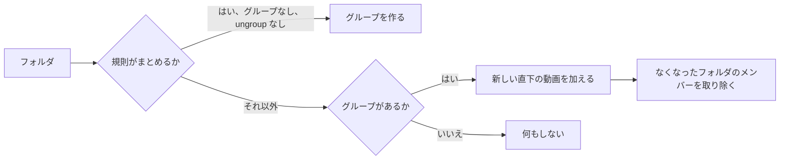

# 調査: 任意の動画とグループからなり、複数への所属と入れ子を持つグループ {#research-groups-of-any-videos-and-groups-with-several-memberships-and-nesting}

親 Issue: #1040。技術スタック、層、ストアの役割は [ARCHITECTURE.md](../../ARCHITECTURE.md) と [tech-stack-selection.md](../../docs/design-docs/tech-stack-selection.md) から引き継ぐ。この機能が保つフォルダでまとめる規則は [017 データモデル、Assignment rules](../017-folder-groups/data-model.md#assignment-rules) にある。このファイルは、この機能が加える決定だけを記録する。

## R-1: グループは変わらない id を持つユーザーデータになる {#r-1-groups-become-user-data-with-a-stable-id}

**決定**: グループは新しいユーザーデータのテーブル `groups` の行で、決して変わらない `integer` の id を持つ。その項目は `group_items` に、所有者が取り除いたフォルダのメンバーは `group_exclusions` に置く ([data-model.md、Migration](data-model.md#migration))。索引のテーブル `folder_groups` と `folder_group_members` は、読むものがなくなったら削除する。`video_folder_names` と `folder_index_state` は残る。

| 案 | 判定 |
| --- | --- |
| **ユーザーデータのテーブル、変わらない id** | 採用 |
| 作り直される索引を残し、所有者の編集をその上の上書きとして保存する | 不採用: 索引は作り直しのたびに削除して書き直されるので、名前、順序、手で加えたメンバーには書き直しを越えて残る目印が要り、所属に 2 つの出どころができる |
| フォルダのパスを識別子として残し、手作りのグループに別のテーブルを加える | 不採用: 要件 10 は 1 種類のグループを求めており、フォルダの名前を変えるとすべての編集が宙に浮く |

**理由**: 要件 14 は手作りのグループが再スキャンとメディアフォルダの変更を越えて残ることを求め、要件 11 は自動のグループへの編集にも同じことを求める。作り直しを越えて残るのはユーザーデータだけである ([ARCHITECTURE.md、Cross-cutting invariants](../../ARCHITECTURE.md#cross-cutting-invariants))。id は API に出す。017 がそれを退けたのは、索引の id が作り直しのたびに振り直されたからにすぎない ([017 library-api.md、`GET /api/library`](../017-folder-groups/contracts/library-api.md#get-apilibrary))。

## R-2: 動画の項目はユーザーキーで、子グループはその id で指す {#r-2-a-video-item-is-keyed-by-the-user-key-a-child-group-by-its-id}

**決定**: `group_items` の行は、動画のユーザーキー (まとまりのメンバーでは `'bundle:<id>'`、それ以外では内容の鍵) か、子グループの id のどちらかを持つ。まとめることと同じパスの継承は、`rekeyPlaylistItems` と同じように、ほかのユーザーデータのキーをすでに付け替えているトランザクションで動画の項目のキーを付け替える ([044 R-2](../044-playlists/research.md#r-2-bundling-and-succession-re-key-every-members-items-and-merge-duplicates))。`group_exclusions` にも同じことが当てはまる。

| 案 | 判定 |
| --- | --- |
| **ユーザーキー** | 採用 |
| `videos.id` | 不採用: 再スキャンで作り直されるので、要件 14 を満たさない |
| 生の内容の鍵 | 不採用: まとまりがバージョンごとに 1 回ずつ現れ、まとまりについてのエッジケースに反する |

**理由**: タグはすでにユーザーキーを通じて、移動したファイルや置き換えたファイルに付いていく (要件 14 はタグを手本として挙げる)。まとまりごとに 1 つのキーなので、エッジケース「1 回だけ数える」は一意制約になる。

## R-3: スキャンは自動のグループを一度だけ作り、その後はフォルダのメンバーを加えたり取り除いたりするだけ {#r-3-the-scan-creates-automatic-groups-once-then-only-adds-and-removes-folder-members}

**決定**: 自動のグループは `origin_folder` (フォルダの `domain.FolderKey`) を持つグループである。今フォルダの索引を作り直しているどの時点でも、同じトランザクションの中の 1 つの同期が、フォルダごとに次を行う ([data-model.md、Automatic group sync](data-model.md#automatic-group-sync)):

規則は 017 のもの (「Becomes a group」) である。グループはフォルダの名前と、ファイル名の自然順に並べた直下の動画で作る。既存のグループは、持っておらず除外もしていない直下の動画を得て、それらは自然順で末尾に付く。そして、フォルダから来てもう直下にないメンバーを失う。同期はグループの名前を変えず、並べ替えず、削除せず、所有者が手で加えたメンバーに触れない。

| 案 | 判定 |
| --- | --- |
| **一度だけ作り、その後はフォルダのメンバーを加えて取り除く** | 採用 |
| スキャンのたびにグループを導き、所有者の編集を差分として再生する | 不採用: 導いた一覧に対して記録した順序や取り除きは、ファイルが増えたり減ったりすると変わらない目印を持たない |
| 作った後も規則を適用し続ける (動画が 2 本未満になったグループを落とす) | 不採用: エッジケースは、所有者が解散するまでメンバーが 1 つのグループを保つ |
| 新しいファイルをファイル名の位置に挿し込む | 不採用: 所有者が並べ替えた後は、ファイル名は順序の中に場所を持たない。選択を上書きしない位置は末尾だけである |

**理由**: 要件 11 と 12 は仕事を分ける: スキャンはフォルダがどのファイルを持つかを受け持ち、所有者はそれ以外のすべてを受け持つ。フォルダがなくなったグループは手で加えたメンバーを保ち、残る (エッジケース)。メンバーが残らなければ空になって隠れるが、削除はされないので、取り除いてもう一度加えたメディアフォルダは、フォルダのメンバーを同じグループに取り戻す。

## R-4: 解散はグループを削除する。自動のグループでは `ungroup` を書く {#r-4-dissolving-deletes-the-group-for-an-automatic-group-it-writes-ungroup}

**決定**: 解散は `groups` の行と、その項目、お気に入り、プレイリストの項目を削除する。自動のグループの解散は、同じトランザクションで、そのフォルダの `ungroup` の上書きも書く。フォルダのメニューで `Don't group` を選ぶと、同じようにフォルダのグループを解散する。`Automatic` か `Group this folder's videos` を選ぶと、上書きを取り除くか書いてから同期を実行し、規則が成り立てば同期が新しいグループを作る。

| 案 | 判定 |
| --- | --- |
| **削除し、自動のグループでは `ungroup` も書く** | 採用 |
| グループに解散済みのフラグを残す | 不採用: 2 つの記録が「このフォルダはグループではない」と言うことになり、食い違いうる |

**理由**: 要件 13 は解散した自動のグループを `Don't group` と同じにし、フォルダの設定は残る (要件 13) ので、既存の上書きがその記録である。

## R-5: 入れ子は循環のないグラフで、書き込みで確かめる {#r-5-nesting-is-a-graph-without-cycles-checked-in-the-write}

**決定**: グループはほかのグループを持てて、グループは複数のグループに入れる。グループ X をグループ G に加えることは、G が X か X の子孫であるときに `409 group_cycle` で拒否する。`domain.ValidateNesting` は、ストアが書き込みのトランザクションで読む辺から決める。読み取りは再帰 CTE で子孫をたどる (`union` なので、2 回届くグループは 1 回だけ訪ねる)。

| 案 | 判定 |
| --- | --- |
| **書き込みで確かめ、読み取りでたどる** | 採用 |
| すべての祖先と子孫の閉包テーブル | 不採用: 追加、取り除き、解散、同期のたびにそれを書き直すことになる。手で組んだ階層は数百のグループを持ち、再帰 CTE は 1 つのクエリの中でそれをたどれる |
| 木 (グループごとに親は 1 つ) | 不採用: 要件 4 はグループが複数のグループに入ることを許す |

## R-6: ライブラリの最上位と、子孫に対する部分的な検索の一致 {#r-6-the-library-top-level-and-partial-search-matches-over-descendants}

**決定**: ライブラリは、ほかのどのグループの項目でもないグループと、どのグループにもない動画を項目として挙げる。グループは、閲覧者が見てよい動画を、直接か子グループを通じて少なくとも 1 本持つとき、その閲覧者に示す。これはゲストにも当てはまる。検索やタグの絞り込みがあるとき、見える子孫の動画がすべて一致する最上位のグループは 1 つのグループの項目である。そうでなければ、一致する子孫の動画のそれぞれが 1 回ずつ動画の項目になる ([data-model.md、Library items](data-model.md#library-items))。

| 案 | 判定 |
| --- | --- |
| **グループ全体か、その一致する動画** | 採用 |
| 再帰する: 一部が一致する親の中で、すべてが一致する子グループをカードとして示す | 不採用: 同じ親のカードと単独の動画に、項目のクエリの中で階層ごとに 1 つの判断が要ることになる。要件 15 が求めていない場合のためである |
| ゲストの公開メンバー 2 つという最小を保つ | 不採用: 所有者は今やメンバーが 1 つのグループを保ち (エッジケース)、子グループだけを持つグループには数えるべき直接のメンバーがない |

**理由**: 要件 15 は、027 の振る舞いが入れ子のグループでも動き続けることを求める。2 つのグループにある動画は、一方のグループのカードの中に現れ、同時に一部が一致するもう一方のグループからの単独の動画としても現れうる。一覧は項目を数えるので、間違ったことは言わない。

## R-7: グループの値は、重複のない子孫の動画から再生の順序で求める {#r-7-a-groups-values-come-from-its-distinct-descendant-videos-in-play-order}

**決定**: グループの再生の順序は、その項目を位置の順に並べ、子グループをその再生の順序で置き換えたもので、深さ優先で、各動画は最初に現れたものを保つ。`videoCount`、`videoIds`、合計、日付、視聴状態、`previews`、`openVideoId` (017 の `GroupOpenIndex`) は、その順序に対して計算する。

| 案 | 判定 |
| --- | --- |
| **子孫、深さ優先** | 採用 |
| 直下の動画だけ | 不採用: 子グループだけを持つグループが 0 本と表示され、再生できない |

## R-8: `/groups/{id}` のグループのページと、URL の中の経路 {#r-8-a-group-page-at-groupsid-with-a-trail-in-the-url}

**決定**: グループのカードか行を押すと `/groups/{id}` が開き、グループの項目 (子グループと動画) を保存した順に挙げる。所有者がたどってきたグループは `?trail=<id>,<id>` として運ぶ。サーバーは経路の名前を答え、もう親と子ではない最初の組で経路を切る ([contracts/screen-api.md](contracts/screen-api.md#statuses))。

| 案 | 判定 |
| --- | --- |
| **URL の経路を持つグループのページ** | 採用 |
| カードが最初の未視聴のメンバーを開くままにする | 不採用: 要件 8 はグループを開くとその項目が見えることを求める。これはそのカードについての 017 の選択を覆す |
| 経路を `location.state` で運ぶ | 不採用: 再読み込みや共有した URL では失われ、`UI品質` は上への道が常に見えることを求める |
| サーバーが選んだ 1 つの親を示す | 不採用: 親が 2 つあるグループでは、所有者が下りてこなかった道を上らせることになる |

## R-9: 動画のページは、開いた元のグループに従う {#r-9-the-video-page-follows-the-group-it-was-opened-from}

**決定**: グループから開いた動画は `?group=<id>` を運ぶ。`Up next`、前後の矢印、メンバーの一覧、`Video.group` は、そのグループの再生の順序に従う。パラメーターがないとき、または動画がもうそのグループにないときは、その動画を直接持ち、閲覧者に示される、id が最も小さいグループに従う。

| 案 | 判定 |
| --- | --- |
| **URL の 1 つのグループ、代わりは最も小さい id** | 採用 |
| 経路全体を運び、終わりで親に続ける | 不採用: 要件 9 は動画にたどり着いたグループを挙げており、上に続けると所有者が開いていないグループを再生することになる |
| 動画が複数のグループにあり文脈がないときは `Up next` を出さない | 不採用: フォルダの画面や検索から開いた動画には文脈がなく、今はそこですべての自動のグループのメンバーが `Up next` を得ている |

## R-10: お気に入りとプレイリストの項目は、グループをその id で指す {#r-10-favorites-and-playlist-items-name-a-group-by-its-id}

**決定**: `folder_favorites` はグループの id をキーにする `group_favorites` になり、`playlist_items.folder_key` は `group_id` になる。どちらもグループとともに削除される。1 つのマイグレーションが、フォルダのキーが自動のグループの `origin_folder` である行を変換し、残りを落とす。グループを `VideoFolder` で指していた要求 (`PUT /api/favorites`、`POST /api/playlists/{id}/items`) は、代わりに `groupIds` を受け取る。

| 案 | 判定 |
| --- | --- |
| **グループの id をキーにし、一度だけ変換する** | 採用 |
| フォルダのキーを残し、読むときにグループに解決する | 不採用: 手作りのグループにはフォルダがない |
| 今グループではないフォルダのフォルダのキーの行を、後で取り込むために残す | 不採用: そうした行は今もう隠れており、残すと 2 つ目のキーをずっと持つことになる |

**理由**: 失われるデータは、更新の時点でグループではないフォルダのお気に入りとプレイリストの項目だけである。044 R-4 は戻ってくるかもしれないグループのためにそれを残していたが、解散したグループはもう戻らない (R-4)。

## R-11: グループをタグに変えると、タグを手で付けてから解散する {#r-11-turning-a-group-into-a-tag-attaches-the-tag-by-hand-then-dissolves}

**決定**: タグはグループの名前で探すか作り (`NormalizeTagName`)、すべての子孫の動画に手で (`video_tags`) 付け、グループを解散する (R-4)。これを 1 つのトランザクションで行う。登録したフォルダ自身のグループに対する `409` はなくなる。

| 案 | 判定 |
| --- | --- |
| **グループのすべての動画に手で付ける** | 採用 |
| 自動のグループにはフォルダ名のタグを残す | 不採用: 名前を変えた自動のグループや手で加えたメンバーを持つグループは、その名前のタグを得られない。要件 10 は 1 つの振る舞いを求める |

**理由**: 名前を変えていない自動のグループのフォルダは、名前で新しいタグにまだ一致するので、後でそのフォルダに加えたファイルはこれまでどおりそのタグを得る。

## R-12: 編集は位置によるもので、対象がなくなっていれば全体を失敗にする {#r-12-edits-are-positional-and-fail-whole-when-a-target-is-gone}

**決定**: 項目はプレイリストと同じように「1 つの項目の後ろへ移動」で並べ替え、位置は詰め、追加は要求の順に末尾に付ける ([044 R-3](../044-playlists/research.md#r-3-dense-integer-positions-reordered-by-move-after))。すでにグループにある動画やグループを加えても何もしない。もう存在しない動画、グループ、項目を指す要求は `404` で失敗し、何も書かない。

| 案 | 判定 |
| --- | --- |
| **対象がなければ全体を失敗にする** | 採用 |
| プレイリストの追加のように、解決しないものを飛ばす | 不採用: エッジケースは、操作が失敗したことを所有者が知ることを求める |
| 画面から順序全体を置き換える | 不採用: 古い画面が別の画面の移動を取り消してしまう |

## R-13: `group` イベントが開いている画面に読み直させる {#r-13-a-group-event-tells-open-screens-to-read-again}

**決定**: グループのすべての書き込みと、グループを変えるすべての同期は、コミットの後に `domain.GroupsChanged{GroupIDs}` を発行し、`/api/events` はそれらの id とともに `group` を送る。グループのページ、グループのカード、動画のページのグループの行は、それを受けてグループを読み直す。

| 案 | 判定 |
| --- | --- |
| **`group` イベント** | 採用 |
| プレイリストのようにイベントなし | 不採用: エッジケースは、別の画面が最新の内容を示すことを求める |

## R-14: グループの名前はトリム後に 1 から 100 文字で、名前は重複してよい {#r-14-a-group-name-is-1-to-100-characters-after-trimming-names-may-repeat}

**決定**: プレイリストの名前の規則を当てはめる ([044 R-11](../044-playlists/research.md#r-11-a-playlist-name-is-1-to-100-characters-after-trimming-names-may-repeat))。自動のグループはフォルダの名前で始まり、それはもっと長いことがある。その場合は 100 文字に切る。

| 案 | 判定 |
| --- | --- |
| **プレイリストと同じ規則** | 採用 |
| 一意の名前 | 不採用: `Season 1` という名前の 2 つのフォルダが、すでにその名前の自動のグループを 2 つ作る |
