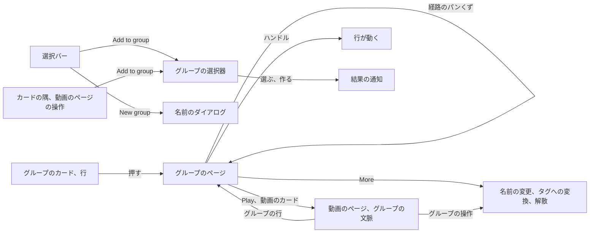
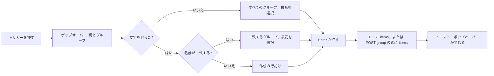
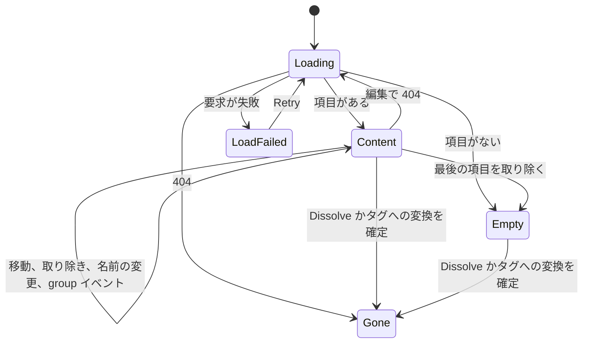

# UI 設計: 任意の動画とグループからなり、複数への所属と入れ子を持つグループ {#ui-design-groups-of-any-videos-and-groups-with-several-memberships-and-nesting}

**機能**: [親 Issue #1040](https://github.com/syudead/vv/issues/1040) · [plan.md](plan.md) · [research.md R-8](research.md#r-8-a-group-page-at-groupsid-with-a-trail-in-the-url) · [R-9](research.md#r-9-the-video-page-follows-the-group-it-was-opened-from) · [R-11](research.md#r-11-turning-a-group-into-a-tag-attaches-the-tag-by-hand-then-dissolves) · [R-12](research.md#r-12-edits-are-positional-and-fail-whole-when-a-target-is-gone) · [R-13](research.md#r-13-a-group-event-tells-open-screens-to-read-again) · [R-14](research.md#r-14-a-group-name-is-1-to-100-characters-after-trimming-names-may-repeat) · [data-model.md、Edits](data-model.md#edits) · [contracts/screen-api.md](contracts/screen-api.md)

すでに決めている出典。ここでは繰り返さず、リンクする。

| 話題 | 出典 |
| --- | --- |
| トークン、閉じた段階、ライブラリと視聴の密度 | [design-system.md、Foundations](../../docs/design-docs/design-system.md#foundations)。値は [`web/src/ui/tokens.css`](../../web/src/ui/tokens.css) の `@theme` にあり、ここでは名前で参照し、写さない |
| `ListPage`、`PageHeader`、`CardGrid`、`DataTable`、`SelectionBar`、状態のブロック | [patterns.md、List page](../../web/registry/rules/patterns.md#list-page)、[Sections](../../web/registry/rules/patterns.md#sections)、[States](../../web/registry/rules/patterns.md#states) |
| `FormDialog`、`ConfirmDialog`: `pending`、その中の失敗の `Alert` | [patterns.md、Form dialog](../../web/registry/rules/patterns.md#form-dialog) と [Confirm dialog](../../web/registry/rules/patterns.md#confirm-dialog) |
| `Button`、`Popover`、`Command`、`DropdownMenu`、`Breadcrumb`、`Tooltip`、`Sonner`、`VideoThumbnail`、`FavoriteToggle`: それぞれの用途 | [components.md](../../web/registry/rules/components.md) |
| ライブラリのカードと行、グループのカードと行、選択バーの順序と折り返し | [library-ui.md、Cards](../../docs/design-docs/library-ui.md#cards)、[List view and selection](../../docs/design-docs/library-ui.md#list-view-and-selection)、[Selection bar](../../docs/design-docs/library-ui.md#selection-bar)。[017 の UI 設計、Group card](../017-folder-groups/ui-design.md#group-card) |
| グループのカードの選択: メンバーは動画として選ばれ、グループは一括操作のために覚えられる | [017 の UI 設計、Pressing and selection](../017-folder-groups/ui-design.md#pressing-and-selection)、[035 の UI 設計、Selection bar](../035-favorites/ui-design.md#selection-bar) |
| カードの隅の印 (ハート、`Add to playlist`) と、それらを出すとき | [044 の UI 設計、Add to playlist](../044-playlists/ui-design.md#add-to-playlist)、[035 の UI 設計、When the mark is shown](../035-favorites/ui-design.md#when-the-mark-is-shown) |
| プレイリストの画面の行 (ハンドル、番号、`×`)、その並べ替えとそのダイアログ | [044 の UI 設計、Playlist screen](../044-playlists/ui-design.md#playlist-screen)、[Reordering](../044-playlists/ui-design.md#reordering)、[Renaming](../044-playlists/ui-design.md#renaming)、[Deleting](../044-playlists/ui-design.md#deleting) |
| プレイリストの選択器: 最初の行が作成する、ポップオーバーの中の `Command` | [044 の UI 設計、Add to playlist](../044-playlists/ui-design.md#add-to-playlist) |
| フォルダの画面のパンくずの帯と、`md` 未満でのその折りたたみ方 | [011 の UI 設計、Breadcrumb bar](../011-folder-browser/ui-design.md#breadcrumb-bar)、[`web/src/folders/Breadcrumbs.tsx`](../../web/src/folders/Breadcrumbs.tsx) |
| 動画のページ: グループの行、`Up next` のメンバーの一覧、矢印、自動再生の通知。事実の行の操作のグループ | [library-ui.md、Group members](../../docs/design-docs/library-ui.md#group-members)、[017 の UI 設計、Video page](../017-folder-groups/ui-design.md#video-page)、[044 の UI 設計、Add to playlist](../044-playlists/ui-design.md#add-to-playlist) (`page` のトリガー) |
| フォルダのまとめ方メニュー | [017 の UI 設計、Folder grouping menu](../017-folder-groups/ui-design.md#folder-grouping-menu) |
| ゲストでの縮退 | [016 の UI 設計、Guest degradation](../016-single-account-auth/ui-design.md#guest-degradation) |
| CSS の幅のブレークポイント。人が確かめるレイアウト | [library-ui.md、Width breakpoints](../../docs/design-docs/library-ui.md#width-breakpoints-in-css-and-the-sidebar-exception)、[Layout verified by people](../../docs/design-docs/library-ui.md#layout-verified-by-people-not-machines) |
| 画面の文言 | [`web/src/i18n/en.ts`](../../web/src/i18n/en.ts) (`common`、`list.card`、`library.group`、`library.selection`、`player.group`、`folders.grouping`)。この機能は `groups` と下の文言を加える |

図は、この機能が加えるか変える部分と、それぞれの操作の行き先を示す。

変わらないもの: ライブラリのツールバー、検索、絞り込み。加わる 1 つの印とグループのカードのリンク先を除く、動画のカードとグループのカード。お気に入りのハート。`Add to playlist`。プレイリストの画面。まとめ方メニューを除くフォルダの画面。自動再生の通知と再生終了のレイヤー。サイドバー。下のすべての部分はレジストリのコンポーネントかパターンであり、`web/src/theme/tokens.test.ts` のコントラストの組は何も増えない。トークンは加えない: グループのページはライブラリのカードの幅とプレイリストの画面の行を使い回し、経路はフォルダのパンくずの帯を使い回す。

## この形にした理由 {#why-this-shape}

グループはライブラリ自身の種類の項目なので、そのページはその項目のライブラリである: 本体がライブラリのグリッドかライブラリのリスト表示である `ListPage` で、ツールバーの表示の切り替えで切り替わり、そのズームで大きさが決まり、同じカード、同じ行、同じ選択、同じ選択バーを持つ。そのため所有者は、すでに知っている動きでグループを編集する (`UI品質`、1 つ目の点): 選んでから、バーから操作する。独自の形のページ (名前の表、木) は採用しなかった。グループの中の動画が、ライブラリの同じ動画と違って見えることになり、所有者は動画を名前より先にサムネイルとタグで見分けるからである (`情報密度`)。ライブラリのリスト表示が順序の表示である: ハンドル、番号、`×` は、プレイリストの画面の行に加わるのと同じようにその行に加わり、グリッドはハンドルなしでライブラリのカードを保つ。行は順序として読めるが、カードはそう読めないからである ([044 の UI 設計、Why this shape](../044-playlists/ui-design.md#why-this-shape))。

上への道はフォルダの画面のパンくずの帯で、トップバーの下に貼り付く: 「Library › Season 1 › Extras」。項目がスクロールする間も帯は留まるので、どのグループが開いているかと上へ行く方法が画面から消えることはない (`UI品質`、2 つ目の点)。また帯はフォルダの画面のものなので、入れ子のグループは、所有者がすでに知っている「場所の中の場所」として読める。ページのタイトルは帯の下で名前を繰り返す。タイトルは数、フォルダの行、操作の置き場所だからである。帯は 2 つ目のタイトルではなく経路であり、タイトルがスクロールで消えたときに見えたまま残るものである。経路は所有者自身がたどった道 (`?trail`、R-8) であって、サーバーが選ぶ親ではないので、上へ行くと所有者が下りてきた道を戻る。

自動のグループと手作りのグループは 1 か所で見分ける: グループのページのタイトルの下の行「From the folder {path}」で、フォルダにリンクする。カード、行、選択バー、ダイアログは両方を同じに扱う (`UI品質`、3 つ目の点。要件 10)。違いは、所有者がグループそのものを見るために立ち止まった場所でだけ読まれ、解散のダイアログの追加の文は、自動のグループを解散することがそのフォルダにとって何を意味するかを言う (要件 13)。カードの印は採用しなかった: どの操作も変えない違いのために、ライブラリに 2 つ目の種類のカードを加えることになる。

作成と追加は、選択バーとカードの既存の動きである。「New group」は名前を尋ねる `FormDialog` で、「Bundle as versions」が代表を尋ねるのと同じであり、「Add to group」はプレイリストの選択器の形である: グループを絞り込み、打った名前から 1 つ作る `Command` を持つポップオーバー。2 つを分けるのは、Issue が両方の操作を挙げており (要件 1 と 3)、ダイアログは新しいグループの名前に所有者の注意をすべて向けさせ、選択器は既存のものに 2 回のキー入力で届くためのものだからである。選択器も作成するので、存在しない名前の打ち間違いは行き止まりにならない。カードの「Add to group」はサムネイルの隅にハートと「Add to playlist」と並んで置かれ、それらと一緒に現れるので、休んでいるカードは変わらない。「Remove from group」はグループのページの選択バーの操作とその行の `×` で、確認はない。誤って取り除いた項目はどのカードからでも加え直せるからである (要件 7 の「何も失われない」は取り除くことにも当てはまる)。解散とタグへの変換はグループを終わらせるので、それぞれ `ConfirmDialog` をとる。

動画のページでは、グループの行はグループのページへのリンクになり、所有者のグループの操作は行そのものからその後の小さなメニューに移る。そのため行はプレイリストの行と同じように読めて開き、操作は 1 回押せば届くままである (`UI品質`、2 つ目の点: メンバーからは、グループが上への道である)。行は `?group` に従う (R-9) ので、2 つのグループにある動画は開いたもとのグループを示し、`Up next` はそのグループの順序で再生する。

## 文言 {#words}

`web/src/i18n/en.ts` の `groups` の下の文言。キーを挙げたところは除く。ユーザーデータ (グループの名前、タイトル、パス) は引数として埋め込む。`videos` はカタログの「1 video」/「N videos」のヘルパーで、`items` はその「N items」である。

| 場所 | 文言 | 備考 |
| --- | --- | --- |
| 選択バーの操作 | New group; Add to group | `library.selection.newGroup`、`library.selection.addToGroup` |
| 選択バーの操作、グループのページだけ | Remove from group | `library.selection.removeFromGroup` |
| 新しいグループのダイアログのタイトル | New group | `groups.newDialog.title` |
| 新しいグループのダイアログの説明 | 3 videos become one group; 2 videos and 1 group become one group | `groups.newDialog.description(videos, groupCount)`。「1 group becomes one group」は決して出ない。1 つのグループだけでは提示しないからである ([New group](#new-group)) |
| 名前の欄のラベル | Name | `groups.nameLabel` |
| 名前の欄のエラー | Use a name of 1 to 100 characters. | `groups.nameRule`。プレイリストのダイアログの規則で、コードポイントで数える (R-14) |
| 作成の操作。送信中 | Create; Creating… | `groups.newDialog.submit`、`.submitting` |
| 作成の失敗 | Couldn't create the group: {reason} | `groups.newDialog.failed`。ダイアログの中の `destructive` の `Alert` |
| 作成した | Created "{name}" | `groups.created(name)`。トースト |
| 選択器のトリガー、ツールチップ | Add to group | `groups.add.label` |
| 動画のカード、行、動画のページでの選択器のトリガーのアクセシブルな名前 | Add "{title}" to a group | `list.card.addToGroup(title)` |
| グループのカードか行での選択器のトリガーのアクセシブルな名前 | Add group "{name}" to a group | `library.group.addToGroup(name)` |
| 選択器の欄のプレースホルダーとアクセシブルな名前 | Search or create a group | `groups.add.search` |
| 選択器の一覧のアクセシブルな名前 | Groups | `groups.add.list` |
| 作成の行 | Create "{name}" | `groups.add.create(name)` |
| グループも文字もない選択器 | No groups yet. Type a name to create one. | `groups.add.none` |
| 打った名前が長すぎる | Use a name of up to 100 characters | `groups.add.nameTooLong`。欄の下の理由の行 |
| 選択器の読み込み中、読み込みの失敗 | Loading…, Couldn't load the groups | `groups.add.loading`、`groups.add.loadFailed`。`Retry` は `common.retry` |
| 加えた | Added to "{name}" | `groups.add.added(name)`。トースト。数はない: すでにグループにある項目は、サーバーが数を返さずに飛ばす ([data-model.md、Edits](data-model.md#edits)) |
| 追加の失敗 | Couldn't add to the group: {reason} | `groups.add.failed`。欄の下の理由の行 |
| `group_cycle` | A group can't be put inside itself or inside a group it contains. | `errorCodes.group_cycle`。追加の失敗の行の `{reason}` |
| `group_target_not_found` | A video or group in the request no longer exists. | `errorCodes.group_target_not_found`。失敗した作成、追加、取り除き、移動の `{reason}` |
| 経路の帯のアクセシブルな名前 | Group path | `groups.trail` |
| 最初のパンくず | Library | `library.title` |
| ヘッダーの数 | 12 videos · 1:32:10 | `groups.detail.count(count, duration)`: `library.group.count`、次に ` · ` と `formatDuration` を通した合計。`durationMs` がないとき、時間の部分は省く |
| フォルダの行 | From the folder {path} | `groups.detail.fromFolder(path)`。`path` は、フォルダの画面のパンくずが示すとおりのフォルダの表示のパス |
| 再生の操作、アクセシブルな名前 | Play; Play "{name}" | `groups.detail.play`、`groups.detail.playFor(name)` |
| More のボタン、ツールチップとアクセシブルな名前 | More | `common.more` |
| メニューの項目 | Rename…, Turn the group into a tag…, Dissolve… | `groups.detail.rename`、`groups.detail.toTag`、`groups.detail.dissolve` |
| 項目の表のアクセシブルな名前 | Items | `groups.detail.table` |
| ドラッグのハンドルのアクセシブルな名前 | Reorder "{title}" | `groups.item.reorder(title)` |
| キーボードの説明、dnd-kit の読み上げ | プレイリストの画面と同じ | `groups.item.reorderInstructions`、`.pickedUp`、`.movedTo`、`.dropped`、`.cancelled`。`playlists.item` と同じ文言 |
| 取り除くボタン、ツールチップ | Remove from group | `groups.item.remove` |
| 取り除くボタン、アクセシブルな名前 | Remove "{title}" from the group | `groups.item.removeFor(title)` |
| まとめて取り除いた | Removed {N items} from "{name}" | `groups.removed(count, name)`。選択バーの操作の後のトースト |
| 移動の失敗、取り除きの失敗 | Couldn't move the item: {reason}; Couldn't remove from the group: {reason} | `groups.item.moveFailed`、`groups.item.removeFailed`。トースト |
| 対象がない | The group changed in the meantime, so it was reloaded | `groups.reloaded`。`404 group_target_not_found` の後のトースト ([Edits that fail](#edits-that-fail)) |
| 空のグループのタイトル | No items yet | `groups.detail.empty.title` |
| 空のグループの説明 | Add videos and groups with Add to group on a card, on the video page, or in the selection bar. | `groups.detail.empty.description` |
| 空のグループの操作 | Open library | `groups.detail.empty.action`。`/` へのリンク |
| 消えたときのタイトル | This group no longer exists | `groups.detail.gone.title` |
| 消えたときの説明 | It was dissolved, maybe in another tab. | `groups.detail.gone.description` |
| 消えたときの操作 | Back to library | `groups.detail.gone.action`。`/` へのリンク |
| グループの読み込みの失敗 | Couldn't load the group | `groups.detail.loadFailed` |
| 続きの読み込みの失敗 | Couldn't load more of the group | `player.related.moreFailed`。メンバーの一覧の文言 |
| 名前の変更のダイアログのタイトル。操作。送信中 | Rename group; Save; Saving… | `groups.renameDialog.title`、`.submit`、`.submitting` |
| 名前の変更の失敗 | Couldn't rename the group: {reason} | `groups.renameDialog.failed` |
| 解散のダイアログのタイトル | Dissolve "{name}"? | `groups.dissolveDialog.title(name)` |
| 解散のダイアログの説明 | The group is dissolved. Its videos and groups stay in the library. | `groups.dissolveDialog.description` |
| 解散のダイアログ、自動のグループ | Its folder is no longer grouped automatically. Choose Automatic on the folder page to group it again. | `groups.dissolveDialog.folder`。説明の後の 2 つ目の文 |
| 解散の操作。送信中 | Dissolve; Dissolving… | `groups.dissolveDialog.submit`、`.submitting`。`destructive` |
| 解散の失敗 | Couldn't dissolve the group: {reason} | `groups.dissolveDialog.failed` |
| 解散した | Dissolved "{name}" | `groups.dissolved(name)`。トースト |
| タグのダイアログのタイトル | Turn "{name}" into a tag? | `groups.tagDialog.title(name)` |
| タグのダイアログの説明 | The tag "{name}" is added to every video in the group, and the group is dissolved. | `groups.tagDialog.description(name)` |
| タグの操作。送信中 | Turn into a tag; Turning into a tag… | `groups.tagDialog.submit`、`.submitting`。`destructive` |
| タグの失敗 | Couldn't turn the group into a tag: {reason} | `groups.tagDialog.failed`。`400` は今と同じく、タグの名前の規則を理由として挙げる |
| タグに変えた | Created the tag "{name}" and dissolved the group; Added the tag "{name}" and dissolved the group | `groups.tagged(name, created)`。`folderGrouping.tagged` を置き換える。その「ungrouped」は、起きることをもう言い表さない |
| グループの行のアクセシブルな名前 | Group "{name}", video 3 of 12. Open the group | `player.group.line(name, position, count)` |
| グループの操作のボタン、ツールチップとアクセシブルな名前 | Group actions | `player.group.actions` |
| グループの操作のメニューの項目 | Remove from this group, Turn the group into a tag…, Dissolve… | `player.group.remove`、`player.group.toTag`、`player.group.dissolve`。`player.group.ungroup` と `player.group.menu` はなくなる |
| 動画のページでグループから取り除いた | Removed from "{name}" | `player.group.removed(name)`。トースト |
| フォルダのメニューの項目 | Turn the group into a tag… | `folders.grouping.toTag`。今はタグのダイアログを開くので、省略記号を付ける |

「Group」は、動画を持つライブラリの項目という意味を保つ。手作りのグループも「a group」であり、決して「a collection」や「a set」ではないので、フォルダのメニュー、カード、新しい画面は 1 つの語を言う。グループを終わらせることには、「Dissolve」が「Ungroup」を置き換える: 「Ungroup」はフォルダの設定を名指しており、親 Issue の `解散` はフォルダのない手作りのグループに当てはまる。「Item」は、プレイリストと同じく、グループの中の動画かグループである。

## ライブラリ {#library}

### グループのカードと行 {#group-card-and-row}

グループのカードと行は、その箱、フォルダの絵、数の面、名前、印を保つ。2 つが変わる:

| 部分 | 変更 |
| --- | --- |
| リンク | カードと行の名前は、`state.from` をリストの URL として `/groups/{id}` を開く。ライブラリからは経路は空である。アクセシブルな名前は「{name}, group of 12 videos」のままである |
| 隅の印 | 3 つ目の印「Add to group」(lucide `FolderPlus`) を「Add to playlist」の左に、同じ `size-8` の当たり領域に `drop-shadow-mark` 付きで置き、同じ規則で現れ、開いたままになる。`aria-label` は「Add group "{name}" to a group」。リスト表示では「Add to playlist」の列のすぐ後の `w-8` の列で、その列と同じく `sm` から描く |

動画のカードと行も同じ印を「Add to playlist」の左に得て、`aria-label` は「Add "{title}" to a group」である。隅は今や 3 つの印を持つ: 隅に最も近いハート、次に「Add to playlist」、次に「Add to group」。ハートは状態を持ち、目で探されるものであり、2 つの追加の操作部品は状態を持たない。`card-0` では、3 つの印と選択のチェックが、2 つのまとまりの間に余裕を持ってサムネイルの 1 行に収まる。

グループのカードは、その id を運ぶ `group` イベント (R-13) と、今従っている `video` イベントで、スケルトンなしで読み直される。`404` はそれを取り除く。[017 の UI 設計、Refresh and removal](../017-folder-groups/ui-design.md#refresh-and-removal) が言うとおりである。

### 選択バー {#selection-bar}

2 つの操作が、バーの「Add to playlist」の後、「Visibility」の前に加わる: 「New group」(lucide `Group` + 文字) と「Add to group」(lucide `FolderPlus` + 文字) で、どちらも `ghost` `sm` で、どの幅でも文字を欠かさない。順序は 数 → Add tag → Remove tag → Favorite → Add to playlist → New group → Add to group → Visibility → Bundle as versions → 区切り → Select all である。グループのページでは、「Remove from group」(lucide `FolderMinus` + 文字) が「Add to group」に続く。3 つは、「Favorite」以降のまとまりの中で、バーの規則に従って折り返す。

どちらも「Favorite」が送るものを送る ([035 の UI 設計、Selection bar](../035-favorites/ui-design.md#selection-bar)): `groupIds` は選んだグループ、`videoIds` は選んだ id のうち選んだグループのメンバーではないもの。2 つの数の合計が 20000 を超えると、「Favorite」と同じ理由で `disabled` になる。選択がちょうど 1 つのグループのとき、「New group」も `disabled` になり、ツールチップは「Select at least one video, or a group and something else」(`library.selection.newGroupNeedsMore`) である: 1 つのグループからなるグループは階層を 1 つ増やすだけで、ほかに何も加えない。選択は「Add to group」の後は残り、「New group」の後は消える ([New group](#new-group))。

### 新しいグループ {#new-group}

「New group」は「New group」というタイトルの `FormDialog` を開く。その説明は何がグループになるかを言い (「3 videos become one group」、「2 videos and 1 group become one group」)、その 1 つの `Field` はプレイリストのダイアログの名前の欄である ([044 の UI 設計、New playlist](../044-playlists/ui-design.md#new-playlist)): `Label`「Name」、`maxLength` のない `Input`、コードポイントの数え方、開いたときのフォーカス。フッターは `Cancel` と `default` の「Create」である。

| 出来事 | 振る舞い |
| --- | --- |
| トリム後に名前が空、または 100 コードポイントを超える | プレイリストのダイアログと同じ: 何も送らず、「Use a name of 1 to 100 characters.」が欄の `FieldError` になる |
| 送信 | `pending`。トリムした名前、`videoIds`、`groupIds` を `POST /api/groups` に送る |
| `201` | ダイアログが閉じ、トースト「Created "{name}"」が出て、選択が消え、一覧が読み直される。そのため新しいグループのカードは並び順が置く場所に立ち、そのメンバーはもう単独のカードではない (受け入れ条件 1)。グループのページでも同じで、新しいグループがその一覧の項目になるのはこのグループに加えられたときだけだが、そうはなっていない。それは最上位のグループである |
| `404 group_target_not_found` | 欄の下に `destructive` の `Alert`「Couldn't create the group: A video or group in the request no longer exists.」。ダイアログは開いたままで、閉じると一覧を読み直す |
| その他の失敗 | `Alert`「Couldn't create the group: {reason}」。ダイアログは開いたまま |
| Cancel、Esc | ダイアログが閉じる。打った名前は捨てる |

### グループに追加 {#add-to-group}

1 つの選択器を、選択バー、カードと行の印、動画のページから使う。形はプレイリストの選択器のもの ([044 の UI 設計、Add to playlist](../044-playlists/ui-design.md#add-to-playlist)): `w-popover` の `Popover` で、カード、行、動画のページではトリガーの下に、選択バーではその上に出て、`CommandInput`「Search or create a group」と `CommandList`「Groups」を持つ。図は 1 回の追加を示す。

| 部分 | 形 |
| --- | --- |
| 一覧 | 所有者が持つすべてのグループを名前の自然な順で、それぞれ lucide `Folder` 付きで。文字を打っている間は、大文字と小文字を区別せずに、名前がトリムした文字を含むグループ。選んだグループそのものは除く。グループは自分自身を持てないからである。選んだグループの子孫は挙がり、サーバーが拒む ([Cycle](#cycle))。グループは画面の API の一覧の読み取り (名前の絞り込みとカーソル付きの `GET /api/groups` を、最後のページまでたどる) から来る。これは [contracts/screen-api.md](contracts/screen-api.md) がまだ持たず、計画の改訂が加える |
| 作成の行 | トリムした文字が空でなく、どのグループの名前もそれと等しくない間、最初に lucide `Plus` 付きの「Create "{name}"」。一致がないときは唯一の行である |
| 100 コードポイントを超える打った名前 | 理由の行「Use a name of up to 100 characters」。Enter も押すことも何もしない |
| グループも文字もない | 一覧の場所に「No groups yet. Type a name to create one.」 |
| 読み込み中、読み込みの失敗 | 「Loading…」、または `ghost` `sm` の「Retry」付きの「Couldn't load the groups」。欄はそれでも名前を受け付け、名前があれば Enter で作成する |
| グループを選ぶ | その場所の `videoIds` と `groupIds` で `POST /api/groups/{id}/items`。応答まで行は `Spinner` を出す |
| 作成 | トリムした名前と同じメンバーで `POST /api/groups` |
| 結果 | ポップオーバーが閉じ、1 つのトーストが「Added to "{name}"」、作成の行では「Created "{name}"」と読める。追加がトリガーのある一覧の示すものを変えたとき、その一覧を読み直す: ライブラリでは、グループに加えた動画か最上位のグループは最上位を離れる (受け入れ条件 3)。グループのページでは、対象がこのグループでない限り何も変わらず、このグループならその終わりに項目が加わる |
| 失敗 | ポップオーバーは開いたままで、欄の下に理由の行「Couldn't add to the group: {reason}」が出るので、所有者は別のものを選べる。その間に解散したグループへの `404` は、グループを静かに読み直す |

トリガーの場所と、送るもの:

| 場所 | トリガー | 送るもの |
| --- | --- | --- |
| 動画のカードと行 | [Group card and row](#group-card-and-row) の隅の印と行の列 | `videoIds: [id]` |
| グループのカードと行 | 同じ印。`aria-label` は「Add group "{name}" to a group」 | `groupIds: [id]` |
| 動画のページ | 事実の行の操作のグループの、「Add to playlist」のすぐ後: lucide `FolderPlus` とツールチップ「Add to group」を持つ `ghost` `icon-sm` のボタン。「Add to playlist」を描くときはいつも、所有者に描く | `videoIds: [id]` |
| 選択バー | 「Add to group」([Selection bar](#selection-bar)) | 「Favorite」と同じ `groupIds` と `videoIds` |

#### 循環 {#cycle}

グループ B を、B であるか B の中にあるグループに加えると `409 group_cycle` になる。選択器はそれを失敗の行「Couldn't add to the group: A group can't be put inside itself or inside a group it contains.」として示し、開いたままなので、所有者は別のグループを選ぶ (受け入れ条件 3)。押す前に、どのグループが拒まれるかを画面の何も示さない: 答えには階層全体が要り、1 行が規則をすべて挙げる。

## グループのページ {#group-page}

`/groups/{id}` は `AppShell` の中の `ListPage` で、使うときに読み込まれ、所有者とゲストのためにある。`document.title` はグループの名前である。クエリ `trail=1,5` は、閲覧者が通ってきたグループを外側から順に運ぶ (R-8)。応答の `trail` が帯の描くものである。

### 経路の帯 {#trail-band}

ヘッダーの場所の最初のもので、フォルダの画面のパンくずの帯 (`Breadcrumbs`。共有し、写さない) にある: トップバーの下に貼り付き、`h-10` で、「Group path」という名前の `Breadcrumb` である。そのパンくずは「Library」(`/` へのリンク)、応答の `trail` の各グループ (そのグループより前で経路を切った `/groups/{thatId}` へのリンク)、そして今のパンくずとしての、リンクではない開いているグループの名前である。`md` 未満では、フォルダの帯と同じく、パンくずが 4 つ以上で帯は「… › {parent} › {name}」に折りたたまれるので、上への道は常に名前の前のパンくずである。サーバーが短く切った経路 (もう親と子ではない組) は答えのとおりに描き、切ったことについては何も言わない: 示すパンくずはすべて正しい。

### ヘッダー {#header}

帯の下の `PageHeader`:

| 部分 | 形 |
| --- | --- |
| タイトル | グループの名前。`text-xl font-semibold` で、プレイリストの画面と同じく最大 2 行で、`title` に名前全体 |
| 数 | 「12 videos · 1:32:10」、`text-xs text-muted-foreground`。応答の `videoCount` と `durationMs` から (子孫の値、R-7) |
| 説明 | フォルダが登録済みのフォルダの下にある自動のグループ (`folder` がある) では、`text-xs text-muted-foreground` の 1 行で、lucide `Folder` (`size-3`) と「From the folder {path}」。パスはそのフォルダのページへの `link` の変種のリンク。手作りのグループと、フォルダがなくなった自動のグループには行がない |
| 操作 | `default` `sm` の「Play」(lucide `Play`) と、`ghost` `icon-sm` の「More」(lucide `Ellipsis`)。「More」は、「Rename…」(lucide `Pencil`)、「Turn the group into a tag…」(lucide `Tag`)、`DropdownMenuSeparator`、「Dissolve…」(lucide `Trash2`、`variant="destructive"`) を持つ `DropdownMenu` を開く。ゲストには「Play」だけが見える |

「Play」は `state: { from: <this page's URL>, autoplay: true }` 付きで `/videos/{openVideoId}?group={id}` を開く: グループの再生順で続けるメンバーである。名前は画面で唯一の `text-xl` である。「Play」は画面で唯一の塗りつぶした操作部品である (`UI品質`、`視覚的な階層`)。

### 本体 {#body}

ツールバーはトップバーにあるライブラリのもので、表示の切り替えとズームのスライダーだけに減らす: 検索も絞り込みも並び順もない。本体はグループ自身の順序だからである。本体は応答の `items` を位置の順に並べたライブラリのグリッドかリスト表示で、その後に `LoadMoreRow` か 1 つの状態のブロックが続く。

| 表示 | 項目 |
| --- | --- |
| グリッド | 動画の項目にはライブラリの `VideoCard`、子グループには `GroupCard` を、その印、タグの行、選択のチェックとともに置く。順序は読む順で、番号は描かない |
| リスト | プレイリストの画面の行 ([044 の UI 設計、Rows](../044-playlists/ui-design.md#rows)) の最初に、ライブラリの選択のチェックを付けたもの: チェック、ハンドルと番号、サムネイル、タイトル (子グループは「12 videos」の行を出す)、`sm` からの視聴、長さ、`×`「Remove from group」。ハート、追加、日付の列はない: 行は順序の中の項目であり、それらの操作は選択バーにある。ハンドルと `×` は所有者にだけ描く |

動画のカードか行は、`state.from` をこのページの URL として `/videos/{videoId}?group={id}` を開くので、動画のページの `×` と Esc はここに戻り、`Up next` はこのグループに従う ([Video page](#video-page))。子グループのカードか行は `/groups/{childId}?trail={trail},{id}` を開く。子グループの中にあり、このグループにも直接ある動画は 2 回出る: 自身のカードとして 1 回、子の絵の中に 1 回 (Edge Case)。子を選ぶとその動画が選ばれ、ライブラリと同じく、直接のカードも選んだ印になる。

ページ送りは、グリッドの後の番兵がビューポートから 600px 以内に来たとき、ライブラリのグリッドと同じく、応答の `nextCursor` から `GET /api/groups/{id}/items` を読む。失敗したページは、`Retry` 付きの `LoadMoreRow` の `Alert`「Couldn't load more of the group」を出す。

選択はライブラリのものである: カードか行のチェック、子のメンバーを選ぶグループのチェック、グループの `videoIds` (すべての子孫の動画、つまりすべての項目) を選ぶ「Select all」、3 つのグループの操作を持つライブラリの選択バー ([Selection bar](#selection-bar))。「Remove from group」は、動画が選ばれている項目と、子グループのメンバーがすべて選ばれている項目の id で `POST /api/groups/{id}/items/remove` を送り、「Removed 3 items from "{name}"」を出して選択を消す。その行は離れ、残りは番号を振り直す。

### 並べ替え {#reordering}

リスト表示では、行はそのハンドルで、ポインタ、タッチ、キーボードで持ち上げる。プレイリストの画面とまったく同じである ([044 の UI 設計、Reordering](../044-playlists/ui-design.md#reordering)): 行はすぐに番号を振り直し、今その上にある項目を `after` として (先頭では省く) 1 つの `POST /api/groups/{id}/items/{itemId}/move` を送り、失敗するとトースト「Couldn't move the item: {reason}」とともにサーバーが最後に確かめた順序に戻し、`404` はグループを読み直す ([Edits that fail](#edits-that-fail))。新しい順序が結果であり、トーストはない (受け入れ条件 4)。グリッドにはハンドルがない: リスト表示に切り替えることが並べ替えの方法であり、切り替えはどの幅でもトップバーにある。

### 項目を 1 つ取り除く {#removing-one-item}

行の `×` は、その項目で `POST /api/groups/{id}/items/remove` をすぐに送る。確認も成功のトーストもない: 行が離れることが結果であり、動画かグループはライブラリに残る (要件 7)。送信中、`×` は `Spinner` 付きで `disabled` になる。`200` で行が離れ、残りは番号を振り直し、数が変わり、フォーカスは次の行の `×`、なければ前の行のもの、なければタイトルに移る。自動のグループのフォルダのメンバーでは、サーバーが取り除いたことを記録するので、再スキャンがそれを戻さない (要件 11)。画面はそれ以上何も言わない。行が離れることはどちらでも同じ結果だからである。

### 名前の変更 {#renaming}

「Rename…」は「Rename group」の `FormDialog` を開く。[New group](#new-group) の名前の欄を持ち、今の名前で埋まり、文字が選ばれた状態で、`default` の「Save」は、トリムした文字が今の名前と等しい間 `submitDisabled` である。`200` でダイアログが閉じ、タイトル、帯の最後のパンくず、`document.title` がトリムした名前を示し、フォーカスは「More」に戻る。`404` は消えた状態を示す。失敗は「Couldn't rename the group: {reason}」としてダイアログに留まる。

### 解散 {#dissolving}

「Dissolve…」は `ConfirmDialog` を開く: タイトル「Dissolve "{name}"?」、説明「The group is dissolved. Its videos and groups stay in the library.」、自動のグループ (`folder` がある) ではその後に「Its folder is no longer grouped automatically. Choose Automatic on the folder page to group it again.」、次に `Cancel` と `destructive` の「Dissolve」。説明が残るものを挙げるのは、動画を失うことがここでの唯一の恐れだからであり (要件 7)、2 つ目の文は自動のグループの違いを口にする唯一の場所である (要件 13)。

| 出来事 | 振る舞い |
| --- | --- |
| 確定 | `pending`: 両方のボタンを無効にし、`Spinner` 付きの「Dissolving…」。`DELETE /api/groups/{id}` |
| `204` | ダイアログが閉じ、画面は経路の最後のグループ (そのグループより前で切った `/groups/{parentId}?trail=`)、経路がなければ `/` に移り、そこでトーストが「Dissolved "{name}"」と言う |
| `404` | すでに解散している: トーストなしで `204` と同じ |
| その他の失敗 | 説明の下に `destructive` の `Alert`「Couldn't dissolve the group: {reason}」。ダイアログは開いたまま |
| Cancel、Esc | 何も変わらない |

### タグへの変換 {#turning-into-a-tag}

「Turn the group into a tag…」は `ConfirmDialog` を開く: タイトル「Turn "{name}" into a tag?」、説明「The tag "{name}" is added to every video in the group, and the group is dissolved.」、`Cancel` と `destructive` の「Turn into a tag」。グループがそれで終わるので確かめる (R-11)。同じダイアログが動画のページのグループの操作とフォルダのまとめ方メニューから開くので、3 つの入り口が 1 つの文を共有する。

| 出来事 | 振る舞い |
| --- | --- |
| 確定 | `pending`。`POST /api/groups/{id}/tag` |
| `200` | ダイアログが閉じ、画面は [Dissolving](#dissolving) と同じく移り、トーストは `created` に応じて「Created the tag "{name}" and dissolved the group」か「Added the tag "{name}" and dissolved the group」と読める |
| `400 invalid_request` | `Alert`「Couldn't turn the group into a tag: {reason}」。理由はタグの名前の規則のもの。ダイアログは開いたままで、何も変わっていない |
| `404` | 消えた状態。トーストはない |
| その他の失敗 | 理由付きの `Alert`。ダイアログは開いたまま |

### 失敗する編集 {#edits-that-fail}

対象がなくなった移動、取り除き、追加は `404 group_target_not_found` を返し、何も書かない (R-12)。画面は示しているものを保ち、グループを読み直し、応答が届くと項目を置き換え、トースト「The group changed in the meantime, so it was reloaded」を出す。その読み直しへの `404 not_found` は消えた状態である。選択は、もう挙がっていない id を落とす。このグループの id を運ぶ `group` イベント (R-13) も同じようにグループを読み直すが、トーストはなく、スクロールの位置と選択を保つ。帯、タイトル、数は応答に従うので、別のタブでの名前の変更や並べ替えは再読み込みなしで画面に出る (Edge Case)。

### 状態 {#states}

図は本体の状態と、その間を動かすものを示す。

| 状態 | 画面が出すもの |
| --- | --- |
| 読み込み中 | 帯は、`?trail` からわかるパンくずをスケルトンとして、「Library」とともに出す。本体に今の表示の `LoadingState`。ヘッダーはタイトルの場所に `Skeleton` の行を持ち、数も操作も持たない |
| 読み込みの失敗 | 「Couldn't load the group」と `Retry` を持つ `ErrorState`。帯は「Library」だけ。ヘッダーは操作を持たない |
| 消えた | lucide `FolderX`、「This group no longer exists」、「It was dissolved, maybe in another tab.」、`default` `sm` の「Back to library」を持つ `EmptyState`。帯は「Library」だけ。ヘッダーのタイトルは「Library」で、数も操作もないので、画面は出せないものを何も名指さない |
| 空 | lucide `Folder`、「No items yet」、「Add videos and groups with Add to group on a card, on the video page, or in the selection bar.」、`default` `sm` の「Open library」を持つ `EmptyState`。ヘッダーは名前、「0 videos」、「More」を出すが、「Play」は出さない。ゲストはこれを決して見ない: 見える動画のないグループは、ゲストには `404` である |
| 内容 | グリッドかリスト。ヘッダーは数、「Play」、「More」を持つ。何かを選んでいる間は選択バー |
| 続きの読み込み中、続きの読み込みの失敗 | 項目の後の `LoadMoreRow` |
| 名前の変更中、解散中、タグへの変換中 | 変わらない本体の上の、`pending` の形のダイアログ |

## 動画のページ {#video-page}

`?group=<id>` があると、ページの読み取りは `group` を運び、グループの行、矢印、`Up next` のメンバーの一覧、自動再生の通知はそのグループの再生順に従う。ないときは代わりのグループに従う (R-9) ので、フォルダの画面や検索から開いた動画は今と同じに見える。もう動画を持たない `group` はサーバーで代わりのグループに切り替わり、そのとき行は代わりのグループを名指す。メンバーの一覧の行、矢印、通知による進行は、開く URL に `?group` を保ち、プレイリストの文脈は今もグループより優先する ([044 の UI 設計、Video page in a playlist](../044-playlists/ui-design.md#video-page-in-a-playlist))。

| 部分 | 形 |
| --- | --- |
| グループの行 | タイトルの上の 1 行で、その形のまま (lucide `Folder` `size-4`、切り詰めた名前、`·`、「3 / 12」。`text-xs`、`sm` からは `text-sm`、`text-muted-foreground`)。行は `/groups/{id}` への `Link` で、`state.from` を引き継ぎ、アクセシブルな名前は「Group "{name}", video 3 of 12. Open the group」である。動画のページからは経路は空なので、そこでの帯は「Library › {name}」と読める。ゲストにとっても行は同じリンクである |
| グループの操作 | 所有者には、同じ行の、行の後に: `ghost` `icon-sm` のボタン (lucide `Ellipsis`、`text-muted-foreground`、ツールチップ「Group actions」) で、「Remove from this group」(lucide `FolderMinus`)、「Turn the group into a tag…」(lucide `Tag`)、区切り、「Dissolve…」(lucide `Trash2`、`variant="destructive"`) を持つ `DropdownMenu` を開く。今と同じく、Esc はメニューだけを閉じる |
| Remove from this group | 動画の項目 (動画の id によってグループの項目とともに読む) で `POST /api/groups/{id}/items/remove`。`200` でトースト「Removed from "{name}"」が出て、動画と関連する動画を `group` なしで読み直すので、行、一覧、矢印は代わりのグループに従うか、なくなる。`404` はトーストなしで同じように読み直す |
| Dissolve…、Turn the group into a tag… | グループのページのダイアログ ([Dissolving](#dissolving)、[Turning into a tag](#turning-into-a-tag))。成功するとトーストが出て、動画と関連する動画を `group` なしで読み直し、ページは留まる |
| 操作のグループ | 「Add to playlist」の後の「Add to group」([Add to group](#add-to-group)) |

行のメニューは行そのものではなく別のボタンである。行は今グループを開くものであり、1 つの操作部品が開くこととメニューを開くことの両方をしてはならないからである。ボタンは行と同じくらい控えめである (`UI品質`、`操作の優先度`)。

## フォルダのまとめ方メニュー {#folder-grouping-menu}

メニューはそのラベル、ラジオのグループ、ヒントを保つ。「Turn the group into a tag…」は `grouping.groupId` があるときに描き、そのグループの [タグのダイアログ](#turning-into-a-tag) を開く。`200` では、今と同じく、トリガーは応答から「One by one in the library」と読め、フォルダの動画の一覧が読み直される。ダイアログからの `404` (その間にグループが解散した) はダイアログを閉じ、フォルダの `grouping` を読み直す。登録したフォルダ自身のグループに対する `409` はなくなった (R-11) ので、項目は登録したフォルダにも描く。

## ゲストでの縮退 {#guest-degradation}

ゲストとして描くとき、次のものは出さない。`disabled` にも `aria-disabled` にもしない (016 と同じ)。

| 場所 | 出さないもの | 代わり |
| --- | --- | --- |
| カードと行、動画のページの操作のグループ、選択バー | 「Add to group」、「New group」、「Remove from group」 | 応答は `favorite` を持たず、操作部品は「Add to playlist」のある場所にだけ描く。ゲストは選択を持たない |
| グループのページ | 「More」、選択のチェック、ハンドル、番号の列のハンドル、`×` | 帯、タイトル、数、フォルダの行、「Play」、カードか番号付きのただの行としての項目。公開の動画のないグループは消えた状態である |
| 動画のページ | グループの操作のボタン | グループの行はリンクのまま |

## レスポンシブな振る舞い {#responsive-behaviour}

下の幅は、実装を判断する幅である。グループのページのグリッドは、ライブラリのものと同じく幅とズームで変わる。そのリスト表示は、プレイリストの画面のものと同じく `sm` (視聴の列) で変わる。帯は `md` 未満で折りたたまれる。動画のページの行は、グループの行がすでにそうであるように `sm` で変わる。

| 幅 | レイアウト |
| --- | --- |
| 360px | サイドバーはドロワーである。グループのページ: 帯は 1 行で、経路が 2 つ以上のグループを持つときは「… › {parent} › {name}」、そうでなければ経路全体である。ヘッダーは最大 2 行の名前、その下の数とフォルダの行、行の終わりの「Play」と「More」である。グリッドは本体の幅のカードの 1 列である。リストの行はチェック、ハンドルと番号、`w-list-thumb` のサムネイル、最大 2 行のタイトル、長さ、`×` で、視聴の列はない。長いタイトルが `×` を行の外に押し出すことはない。選択バーの「New group」、「Add to group」、「Remove from group」は、「Favorite」のある段か、その下の段の右端に、文字を欠かさずに置く。選択器のポップオーバーは `w-popover` で、ビューポートの中に収める。動画のページ: グループの行とその操作のボタンは、タイトルの上の 1 行を共有する。ボタンが動く前に行が切り詰められる |
| 768px | レールのサイドバー。グループのページ: 帯は経路全体を示し、長い名前は折り返さずに切り詰める。ヘッダーの名前、数、2 つの操作は、名前が約 40 文字までなら 1 行に収まる。グリッドはズームに応じて 2 列か 3 列である。リストの行は視聴の列を持つ。選択バーは、1 つを選んでいるとき、数と操作の 1 行目を持ち、バーの規則が言うとおり、「Favorite」以降は 2 行目にある。ダイアログは `max-w-lg` で中央に置く |
| 1280px | グループのページ: グリッドは選んだズームでのライブラリの列で、両端はヘッダーの端にそろう。リストは完全な行で、ドラッグした行の影は、通り過ぎる行に対して見える。選択バーは 1 行である。動画のページ: 2 列。行と操作のボタンは左の列のタイトルの上にある |

## レビューの基準 {#review-criteria}

360px、768px、1280px で画面を見て判断する。所有者としてサインインし、ライブラリには 2 つの自動のグループと 3 つの手作りのグループがあり、そのうち 1 つは子グループ 1 つと 8 本の動画を持ち、その動画には別のグループにもある動画 1 本、視聴済みの動画 1 本、視聴途中の動画 1 本が含まれる。

1. **視覚的な階層 (グループのページ)**: グループの名前は画面で最も強い文字で、唯一の `text-xl` である。その上の帯は薄い色の `text-sm` で、2 つ目のタイトルではなく経路として読める。数とフォルダの行は薄い色の `text-xs` で、カードのタイトルより先に目を引かない。「Play」は唯一の塗りつぶした操作部品である。「More」、ハンドル、`×` は薄い色で描き、行やカードの中では、選択の輪と進み具合のバーの塗り以外の何も `primary` で描かない (`UI品質`、`視覚的な階層`、`タイポグラフィ`)。
2. **情報密度**: グループのページの動画のカードは、同じズームでのライブラリのカードであり、同じサムネイル、タイトルのサイズ、タグの行、隅の印を持つので、動画はライブラリでもそのグループの中でも同じに見える。リストの行は、チェックを前に付けたプレイリストの画面の行で、同じサムネイルの幅と高さを持つ。1280×800 ではヘッダーの下に少なくとも 7 つのリストの行が画面にあり、360×780 では少なくとも 4 つある (`UI品質`、`情報密度`)。
3. **余白のリズム**: `Breadcrumbs` と `ListPage` が描くので、帯、ヘッダー、本体までの間隔、本体の端は、フォルダの画面とプレイリストの画面のものである。グリッドはライブラリの列と `gap-3` を持ち、両端はヘッダーの端にそろう。ページの何も自分の余白を書かない (`UI品質`、`余白のリズム`)。
4. **操作の優先度**: グループのページでは、Tab は「More」より先に「Play」に届き、「More」は「Rename…」、「Turn the group into a tag…」、「Dissolve…」を持ち、「Dissolve…」は線の後の最後にある。動画のカードを押すと、それをグループの中で再生するために開く。子グループを押すと、帯のパンくずを 1 つ延ばして子を開く。項目を取り除くのは `×` を 1 回押すことである。解散は「More」、「Dissolve…」、「Dissolve」を要し、Cancel か Esc は何も変えない (`UI品質`、`操作の優先度`)。
5. **上への道**: 子グループの中では、帯は 1280px で「Library › {parent} › {child}」、360px で「… › {parent} › {child}」と読め、カードがスクロールする間もトップバーの下に留まり、「{parent}」を押すと帯「Library › {parent}」とともに親に戻る。子の URL を再読み込みしても同じ帯を描く。子から開いて `×` で閉じた動画は、その帯とともに子に戻る。`?trail` が、もうそのグループを持たないグループを挙げているグループを開くと、帯はそのパンくずを除き、メッセージもなしに描かれる (`UI品質`、2 つ目の点。R-8)。
6. **バーからの作成**: 3 つのフォルダから 3 本の動画を選んで「New group」を押すと、「3 videos become one group」とともにダイアログが開く。名前を打って Enter を押すとダイアログが閉じ、トースト「Created "{name}"」が出て、ライブラリは 3 枚の単独のカードがあった場所に 1 枚のグループのカードを示す (受け入れ条件 1)。グループのカード 1 枚だけを選ぶと、「New group」はその理由とともに無効に見える。それを動画 1 本と一緒に選ぶと有効になり、ダイアログは「1 video and 1 group become one group」と読める。ダイアログはまとまりのダイアログのサイズとフッターを持つので、手は止まらない (`UI品質`、1 つ目の点)。
7. **バー、カード、ページからの追加**: ポインタの当たっていないカードで「Add to group」を押すと、隅に 3 つの印がハートを隅に最も近くして現れ、動画を開かず選択も変えずに選択器が開く。グループを選ぶと選択器が閉じ、トースト「Added to "{name}"」が出て、カードはライブラリの最上位から消える。同じ選択器が、行の列から、動画のページの操作のグループでハートに続く 3 番目から、選択バーの「Add to playlist」の後から開き、選択バーでは上向きに開く。名前の一部を打つと一覧が絞られ、どのグループも持たない名前では「Create "{name}"」が最初に出る (`UI品質`、1 つ目の点)。
8. **入れ子と循環**: A のカードからグループ A をグループ B に加えると、2 つのうち B だけが最上位に残り、B のページは A をその絵を持つカードとして挙げる。A のページで、A の動画の 1 本のために選択器で B を選ぶと成功し、B のページで B のカードのために A を選ぶと、選択器は行「Couldn't add to the group: A group can't be put inside itself or inside a group it contains.」とともに開いたままになる (受け入れ条件 3)。
9. **並べ替え**: リスト表示で、行をハンドルでドラッグするとそれが動き、番号はすぐに振り直され、再読み込みしても同じ順が出る (受け入れ条件 4)。フォーカスのあるハンドルで Space、`↓`、Space を押すと同じことが起き、Esc は順を戻す。グリッドはハンドルを示さず、トップバーの表示の切り替えは 360px でも 1280px でもリストに切り替える。
10. **両方の種類で同じ見た目**: 自動のグループのカードと、その隣の手作りのグループのカードは、同じ箱、絵、数の面、印を持つ。どちらのページも同じ帯、タイトル、「Play」、「More」、メニューを持つ。唯一の違いは、自動のグループのページの数の下の「From the folder {path}」の行で、フォルダのページを開く。それと、その解散のダイアログの追加の文である (`UI品質`、3 つ目の点。要件 10)。
11. **グループの中の動画のページ**: 共有された動画をグループ G1 から開くと、タイトルの上に行「G1 · 2 / 8」が出て、`Up next` の一覧は G1 の順になる。G2 から開くと G2 のものが出る。`?group` がないと、行は id の小さいほうのグループを名指す (受け入れ条件 2)。行は今と同じくらい小さく薄い色で、G1 のページを開く。その後の操作のボタンも同じくらい薄い色で、「Remove from this group」はトーストとともに動画を取り除き、その後、行はもう 1 つのグループを名指す。
12. **解散**: 子グループのページで「Dissolve」を押すと、トースト「Dissolved "{name}"」とともに親のページに移り、親の数は子の動画の分だけ減り、子の動画はライブラリに残っている。自動のグループのページでは、ダイアログはフォルダの文を持ち、「Dissolve」の後、フォルダのページのメニューは「One by one in the library」と読める (受け入れ条件 6)。解散したグループの URL を開くと、「Back to library」付きの「This group no longer exists」が出る。
13. **別のタブ**: 2 つ目のタブでグループの名前を変えて行を動かすと、再読み込みなしで、1 つ目のタブの帯とタイトルに新しい名前が、行に新しい順が出る。2 つ目のタブがすでに取り除いた項目を 1 つ目のタブで取り除くと、トースト「The group changed in the meantime, so it was reloaded」が出て、2 つ目のタブが残した行が出る (Edge Case)。
14. **ゲスト**: ゲストとしてサインインすると、公開の動画を 1 本持つグループは、帯、名前、「1 video」、「Play」、チェックもハンドルも `×` もないただの行とともにそのページを開く。どのカード、行、動画のページ、選択バーも「Add to group」や「New group」を出さない。動画のページのグループの行は、操作のボタンのないリンクである。
15. **失敗の例** (`UI品質`): 本体がライブラリのカードと行ではなく、名前の表や木であるグループのページ。タイトルのサイズの 2 つ目の見出しとして描いた帯、または「Back」ボタンだけで示した上への道。同じサイズの帯の名前とタイトル。すべての行の `default` のボタン。ホバーでだけ現れるハンドル。4 つ目の隅の印、または休んでいるカードに描いた追加の印。自動のグループのカードのフォルダのアイコンやバッジ。欄のない名前のメニューである選択器、または最上位のグループだけを挙げる選択器。バーでアイコンに縮めた「New group」と「Add to group」。ダイアログのない「Dissolve」、またはダイアログのある「Remove from group」。メニューを中に持つボタンに戻したグループの行。選択器が閉じた後にトーストで拒む循環。
