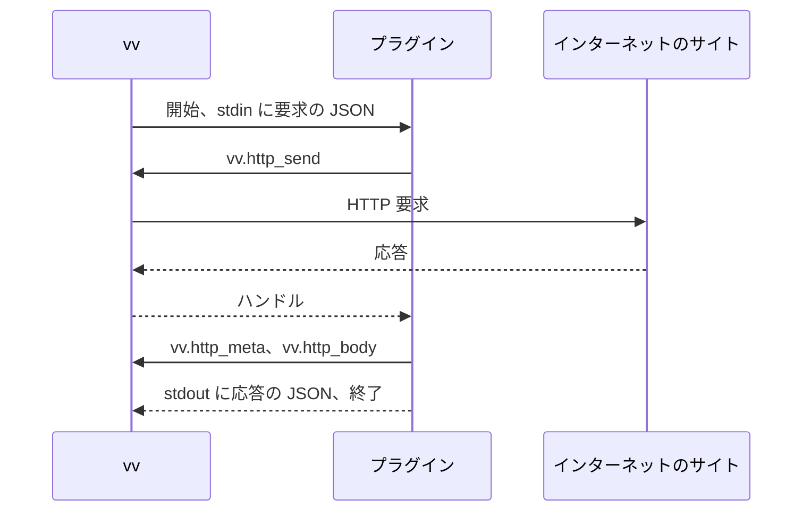

# 契約: 作品情報プラグインの契約、バージョン 1 {#contract-work-info-plugin-contract-version-1}

実装がそれを公開するまでの正本: このファイル。単位「プラグインの作者に作品情報プラグインの契約を公開する」がこれを `docs/how-to/work-info-plugins.md` に移し、その後はそれが正本になり、このファイルはそこへリンクする (P-3)。契約がこの形である理由: [R-2](../research.md#r-2-a-plugin-is-a-wasi-command-that-reads-a-json-request-and-writes-a-json-response)、[R-3](../research.md#r-3-the-manifest-is-a-custom-section-read-without-running-the-module)、[R-4](../research.md#r-4-each-run-has-no-files-no-environment-and-fixed-limits)、[R-5](../research.md#r-5-plugins-reach-the-network-only-through-vv-and-only-public-addresses)。

図は、所有者の要求から結果までの 1 つの実行を示す。

## モジュール {#module}

| 項目 | 規則 |
| --- | --- |
| 形式 | `_start` を引数も戻り値もない関数として、`memory` をメモリとして export する、`wasip1` 向けにビルドした WebAssembly のコアモジュール |
| テーブル | それぞれが最大 100,000 要素以下の最大値を宣言する |
| import | `wasi_snapshot_preview1` と `vv` だけ。それ以外があるとアップロードは `import_unsupported` になる |
| WASI | 事前に開かれたディレクトリ、環境変数、引数はない。時計と乱数は動く。stdin が要求を持ち、stdout が応答を受け、stderr はサーバーのログに行く |
| 上限 | [R-4](../research.md#r-4-each-run-has-no-files-no-environment-and-fixed-limits) と [R-5](../research.md#r-5-plugins-reach-the-network-only-through-vv-and-only-public-addresses) の値 |

## マニフェスト {#manifest}

`vv.plugin` という名前のカスタムセクションがこの JSON を持つ。未知のフィールドは無視する。

| フィールド | 型 | 必須 | 規則 |
| --- | --- | --- | --- |
| `contract` | integer | はい | `1` |
| `name` | string | はい | `a-z`、`0-9`、`-`、`.` からなる 1 から 64 文字。プラグインの識別子なので、同じ名前のモジュールはそれを置き換える |
| `version` | string | はい | 1 から 32 文字。所有者に表示する |
| `description` | string | いいえ | 最大 500 文字 |
| `operations` | string の配列 | はい | `search` と `fetch` の空でない部分集合 |

## 要求 {#request}

vv は 1 つの JSON オブジェクトを標準入力に書き、それを閉じる。

| 操作 | フィールド |
| --- | --- |
| `search` | `{"contract": 1, "operation": "search", "query": "<1 to 200 characters>"}` |
| `fetch` | `{"contract": 1, "operation": "fetch", "url": "<an http or https URL of at most 2048 characters>"}` |

## 応答 {#response}

プラグインは 1 つの JSON オブジェクトを標準出力に書き、終了する。未知のフィールドは無視するので、後の契約はバージョン 1 を壊さずにフィールドを加えられる。

| 場合 | 本文 |
| --- | --- |
| `search` の結果 | `{"candidates": [{"url": "...", "title": "...", "detail": "..."}]}`: `url` (http か https) と `title` は必須、`detail` は省略できる。vv は最初の 50 個を保つ |
| `fetch` の結果 | `{"workInfo": {"title": "...", "tags": ["..."]}}`: どちらのフィールドも省略できる。vv は最初の 100 個のタグを保ち、重複を落とす |
| 失敗 | `{"error": {"message": "..."}}`: vv は `message` の最初の 300 文字を所有者に表示する |

0 以外の終了コード、またはこれらのどれでもない出力は、失敗 `plugin_failed` である。

## ホスト関数 {#host-functions}

モジュール `vv`。ポインターと長さは、プラグインが export する `memory` の中の `i32` のオフセットである。JSON は UTF-8 である。

| 関数 | シグネチャ | 動作 |
| --- | --- | --- |
| `http_send` | `(req_ptr, req_len) -> handle` | 要求を行い、その応答へのハンドル (0 以上) か負のエラーを返す |
| `http_meta` | `(handle, buf_ptr, buf_cap) -> len` | 応答のメタデータの JSON を `buf_cap` に収まるときに書き、常にその全体の長さを返す |
| `http_body` | `(handle, buf_ptr, buf_cap) -> len` | 応答の本文のバイト列を `buf_cap` に収まるときに書き、常にその全体の長さを返す |

バッファより大きな長さを受け取ったプラグインは、その大きさのバッファでもう一度呼ぶ。ハンドルは実行が終わるまで有効である。

| JSON | 形 |
| --- | --- |
| `http_send` の要求 | `{"method": "GET" or "POST", "url": "...", "headers": {"Name": "value"}, "body": "<base64>"}`。`headers` と `body` は省略できる。vv はプラグインが設定しないときに `User-Agent` を設定し、`Host` とホップバイホップのヘッダーを落とす |
| `http_meta` の結果 | `{"status": 200, "url": "<final URL after redirects>", "headers": {"Name": ["value"]}}` |

| `http_send` のエラー | 意味 |
| --- | --- |
| `-1` | 要求の JSON が無効である (メソッド、スキーム、URL) |
| `-2` | アドレスが拒否された。プラグインが何を返しても、実行は `blocked_address` で失敗する |
| `-3` | 接続か TLS が失敗した |
| `-4` | 要求に 10 秒より長くかかった |
| `-5` | 実行がすでに 16 の要求を行った |
| `-6` | 本文が 4 MiB を超えた |

`http_meta` と `http_body` は、未知のハンドルに対して `-1` を返す。
