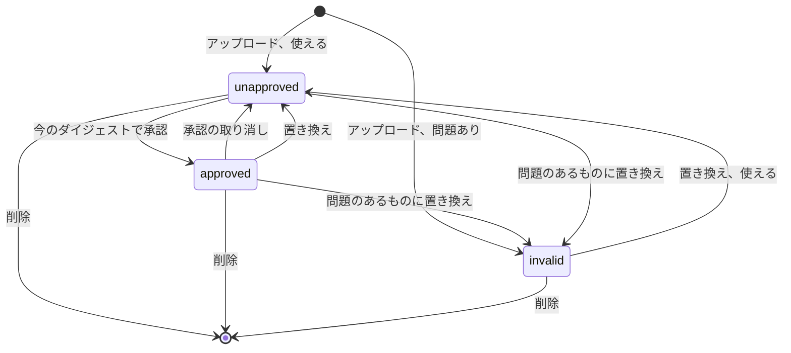

# データモデル: 作品情報プラグイン {#data-model-work-info-plugins}

モデルの残りは変わらない: [internal/store/migrations/](../../internal/store/migrations/)。取得した結果は保存せず、メモリに保つ ([R-8](research.md#r-8-a-fetched-result-lives-in-memory-for-10-minutes-bound-to-the-video-and-the-plugins-digest))。

## マイグレーション {#migration}

`00043_work_info_plugins.sql` が `work_info_plugins` と `work_info_plugin_settings` を作る。別のマイグレーションが先に `main` に入ったら、番号は次の空いている番号に移る。

## `work_info_plugins` {#work_info_plugins}

| フィールド | 型 | Null | 意味 |
| --- | --- | --- | --- |
| `id` | integer | いいえ | 主キー。画面の API はこれでプラグインを指す |
| `name` | text | はい | マニフェストの `name`。一意。マニフェストを読めなかったときは null |
| `file_name` | text | いいえ | アップロードしたファイルの名前。`name` が null のとき表示する |
| `version` | text | はい | マニフェストの `version` |
| `description` | text | はい | マニフェストの `description` |
| `contract` | integer | はい | マニフェストの契約のバージョン |
| `operations` | text | はい | マニフェストの操作。カンマ区切り (`search`、`fetch`) |
| `settings` | text | はい | マニフェストの設定の宣言の JSON ([契約](contracts/plugin-contract.md#manifest)) |
| `module` | blob | はい | モジュール。`problem` が設定されているときは null |
| `digest` | text | いいえ | アップロードしたバイト列の SHA-256 の小文字の 16 進 |
| `problem` | text | はい | プラグインを承認できない理由 (下の表)。使えるプラグインでは null |
| `approved_digest` | text | はい | 所有者が承認したダイジェスト |
| `added_at` | integer | いいえ | 最初のアップロードの Unix 秒 |
| `updated_at` | integer | いいえ | 最後のアップロードか承認の変更の Unix 秒 |

**関係**: なし。テーブルは所有者のデータである。再スキャンで再構築されず、[Data and recovery](../../docs/how-to/running-vv.md#data-and-recovery) に保つものとして載る。

| `problem` | それを設定するアップロード |
| --- | --- |
| `not_wasm` | バイト列が WebAssembly のモジュールとしてコンパイルできない |
| `manifest_missing` | `vv.plugin` カスタムセクションがない |
| `manifest_invalid` | セクションが [マニフェスト](contracts/plugin-contract.md#manifest) の JSON でないか、フィールドがその規則を破る |
| `contract_unsupported` | `contract` がこの vv の実行するバージョンでない (`1` だけ) |
| `import_unsupported` | モジュールが `wasi_snapshot_preview1` と `vv` の外のものを import する |
| `export_invalid` | モジュールが `_start` を何も受け取らず何も返さない関数として export しないか、`memory` をメモリとして export しない |
| `table_too_large` | モジュールのテーブルが合わせて 100,000 要素を超える。各テーブルは宣言された最大値で、それがなければ最小値と、vv が設ける上限である 100,000 の大きい方で数える |

## `work_info_plugin_settings` {#work_info_plugin_settings}

所有者が入力した値 ([R-13](research.md#r-13-plugin-settings-are-declared-in-the-manifest-and-passed-only-in-that-plugins-request))。

| フィールド | 型 | Null | 意味 |
| --- | --- | --- | --- |
| `plugin_id` | integer | いいえ | プラグイン。主キーの一部 |
| `key` | text | いいえ | プラグインのマニフェストが宣言するキー。主キーの一部 |
| `value` | text | いいえ | 値。最大 2000 文字 |
| `updated_at` | integer | いいえ | Unix 秒 |

**関係**: `plugin_id` は `on delete cascade` で `work_info_plugins.id` を参照するので、プラグインを削除するとその値も削除される。テーブルは `work_info_plugins` と同じく所有者のデータである。

## 規則 {#rules}

| 規則 | 強制する場所 |
| --- | --- |
| プラグインが承認済みであるのは、ちょうど `problem` が null で `approved_digest = digest` のときである | `internal/domain` (状態)、`internal/store` (読み取り) |
| マニフェストが既存の `name` を挙げるアップロードは、その行のモジュール、メタデータ、ダイジェスト、問題を置き換え、`approved_digest` を消す。そのため置き換えたものは未承認に戻る | `internal/store`、1 つのトランザクションで |
| 読める名前のないアップロードは新しい行になる | `internal/store` |
| 承認が `approved_digest` を書くのは、要求のダイジェストが `digest` と等しく、`problem` が null のときだけである。そうでなければ `plugin_changed` か `plugin_unusable` | `internal/app` が判断し、`internal/store` がそのトランザクションの中で読み直す |
| 承認の取り消しは `approved_digest` を消す | `internal/store` |
| 置き換えは、新しいマニフェストが宣言するキーの値を保ち、残りを削除する。`problem` のある置き換えは、宣言を読めていないのですべてを保つ | `internal/store`、アップロードのトランザクションの中で |
| 値を書けるのは、プラグインが宣言するキーに対してだけである。値を書いても `approved_digest` には触れない | `internal/app` が判断し、`internal/store` が書く |
| 秘密の値は、そのプラグインの実行の要求の中を除いて、決して `internal/app` の外に出ない | `internal/app`、`internal/httpapi` (応答の型は秘密のための値のフィールドを持たない) |
| 取得した結果の適用は、同じトランザクションの中で、プラグインの行がまだ存在し、承認済みで、結果を取得したときのダイジェストを持つときを除いて何も書かない | `internal/store` (`OverrideStore` の適用) |
| `name` は `a-z`、`0-9`、`-`、`.` からなる 1 から 64 文字。`version` は 1 から 32 文字。`description` は最大 500 文字 | `internal/domain` |
| `module` は最大 16 MiB | `internal/domain`、`internal/httpapi` (本文の上限) |

## 状態の遷移 {#state-transitions}

図は、プラグインの状態と、それを変えるものを示す。`invalid` は `problem` を持つ任意の行である。

## 変わらないもの {#what-does-not-change}

表示名 (`video_overrides`)、タグ、拒否したタグ名はそれぞれのテーブルを保つ。取得した結果の適用は、既存の規則を通じてそれらを書く ([R-9](research.md#r-9-the-title-and-the-tags-are-applied-in-one-transaction-and-skipped-names-are-reported))。047 の作品情報は書かない。タイトルとタグ以外のフィールドは Issue で範囲外である。
