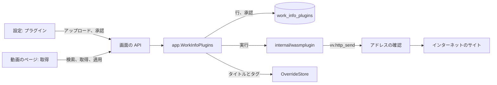
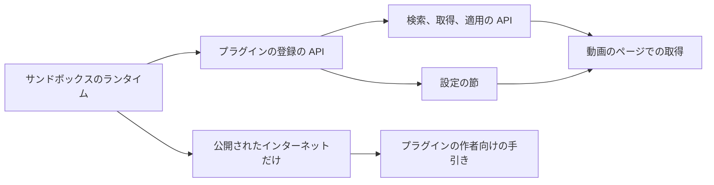

# 実装計画: 外部のサービスから作品情報を取得する作品情報プラグイン {#implementation-plan-work-info-plugins-that-fetch-work-information-from-external-services}

**ブランチ**: `feature/049-work-info-plugins` | **親 Issue**: #968

**入力**: 親 Issue。これがこの機能の仕様である。

## 概要 {#summary}

所有者は設定画面で作品情報プラグイン (WebAssembly のモジュール) をアップロードして承認する。動画のページでは、それで検索するか作品の URL を与え、取得したタイトルとタグを今のものと比べ、選んだフィールドを適用する。vv は各プラグインをプロセスの中で wazero により、ファイルも環境もなく固定の上限を持つ WASI コマンドとして実行し、プラグインの HTTP 要求を自分で行うので、到達するのは公開されたインターネットのアドレスだけである。vv は特定のサービスのためのコードを持たない。

図は、この機能が加える部分と、それぞれがやり取りする相手を示す。



| 関心事 | 方針 |
| --- | --- |
| ランタイム | プロセスの中の wazero、純粋な Go ([R-1](research.md#r-1-wazero-runs-the-plugins-inside-the-vv-process)) |
| プラグインのインターフェース | WASI コマンド、stdin と stdout の JSON、HTTP のための 3 つの `vv` ホスト関数 ([R-2](research.md#r-2-a-plugin-is-a-wasi-command-that-reads-a-json-request-and-writes-a-json-response)、[contracts/plugin-contract.md](contracts/plugin-contract.md)) |
| 承認の前の名前とバージョン | モジュールを実行せずに読む `vv.plugin` カスタムセクション ([R-3](research.md#r-3-the-manifest-is-a-custom-section-read-without-running-the-module)) |
| 隔離と上限 | ファイル、環境、引数はない。128 MiB、30 秒、出力 1 MiB、同時に 1 つの実行 ([R-4](research.md#r-4-each-run-has-no-files-no-environment-and-fixed-limits)) |
| ネットワーク | vv 自身の HTTP クライアント。接続のたびにアドレスを確かめ、拒否された要求は実行を失敗させる ([R-5](research.md#r-5-plugins-reach-the-network-only-through-vv-and-only-public-addresses)) |
| 保存と承認 | blob の行。承認したダイジェストがモジュールのダイジェストと等しいとき承認済み。承認はダイジェストを指定する ([R-6](research.md#r-6-plugins-are-rows-in-sqlite-and-approval-is-bound-to-the-modules-digest)、[R-7](research.md#r-7-approving-names-the-digest-the-owner-saw)、[data-model.md](data-model.md)) |
| 取得と適用 | 動画とダイジェストに結び付いた、メモリ上の 10 分間の結果。タイトルとタグを 1 つのトランザクションで適用し、飛ばした名前を報告する ([R-8](research.md#r-8-a-fetched-result-lives-in-memory-for-10-minutes-bound-to-the-video-and-the-plugins-digest)、[R-9](research.md#r-9-the-title-and-the-tags-are-applied-in-one-transaction-and-skipped-names-are-reported)、[contracts/screen-api.md](contracts/screen-api.md)) |
| 動画のページの入口 | プラグインの一覧に承認済みのプラグインがあるとき表示する。候補はテキストだけ ([R-10](research.md#r-10-search-candidates-are-text-only)、[R-11](research.md#r-11-the-video-page-reads-the-plugin-list-to-decide-whether-to-show-the-fetch-action)) |

Issue は `ui` ラベルを持つので、`design` ステージが 2 つの画面の単位の前に `ui-design.md` を書く。それが扱うのは、設定画面のプラグインの節 (追加、承認の状態、名前、バージョン、ネットワークの通知を伴う承認の確認、理由を伴う無効なプラグイン、承認の取り消し、削除) と、動画のページの副次的な取得の操作、プラグインの選択、URL か検索か、候補の一覧、選択を伴う比較の行、適用、飛ばしたタグの通知、失敗と古い状態である。

親 Issue の `対象外` のとおり、範囲外: プラグインの入手元と、そのインストール、更新、更新の通知。取り込み時の取得、一括の取得、確認の待ち行列。取得した画像をサムネイルに使うこと。タイトルとタグ以外のフィールドの適用。JavaScript で描画されるページ。そして、どのサービスのプラグイン、プラグインの SDK、サンプル。

## 技術的な文脈 {#technical-context}

**正本の定義**:

| 項目 | 正本 |
| --- | --- |
| 境界、ストアの役割、イベント、認証の境界、ユーザーデータ | [ARCHITECTURE.md](../../ARCHITECTURE.md)、[.golangci.yml](../../.golangci.yml) |
| `internal/app` のポートと、その背後のプロバイダーのアダプター | [ai-layer.md](../../docs/design-docs/ai-layer.md) |
| 表示名とその規則 | [029 research](../029-video-overrides/research.md)、[internal/domain/video_override.go](../../internal/domain/video_override.go)、[internal/store/overrides.go](../../internal/store/overrides.go) |
| 仮のタグ、拒否した名前、タグ名の規則 | [031 research](../031-tentative-tags/research.md)、[internal/domain/tag.go](../../internal/domain/tag.go)、[internal/store/external_video_tags.go](../../internal/store/external_video_tags.go) |
| マルチパートのアップロードの読み取りと blob の保存 | [046 research](../046-thumbnail-image-upload/research.md)、[internal/httpapi/thumbnail_edits.go](../../internal/httpapi/thumbnail_edits.go) |
| メモリ上の短命な結果 | [thumbnail-editing.md](../../docs/design-docs/thumbnail-editing.md) |
| 画面の API、エラー、生成コード | [api/openapi.yaml](../../api/openapi.yaml)、[023 error-api](../023-english-i18n/contracts/error-api.md)、`task generate` |
| 設定画面、動画のページ、画面の規則、Web のテスト | [web/src/settings/](../../web/src/settings/)、[web/src/player/VideoFacts.tsx](../../web/src/player/VideoFacts.tsx)、[design-system.md](../../docs/design-docs/design-system.md)、[web-testing.md](../../docs/design-docs/web-testing.md) |
| 検査 | [Taskfile.yml](../../Taskfile.yml) (`task check`、`task check-docs`、`task test-e2e`) |

**この機能に固有の文脈**:

- 新しい Go の依存は 1 つ、`github.com/tetratelabs/wazero` である。それ自身の依存を持たず、コンテナと Windows アプリのために `CGO_ENABLED=0` でビルドできる ([R-1](research.md#r-1-wazero-runs-the-plugins-inside-the-vv-process))。新しい Web の依存はない。
- マイグレーションは 1 つ、`00043_work_info_plugins.sql` ([data-model.md、マイグレーション](data-model.md#migration))。
- 所有者の設定以外の誰かが宛先を選ぶ、vv で最初の外向きの HTTP である。ComfyUI と Ollama のクライアントは意図して LAN のアドレスに到達し、今後もそうする。アドレスの確認はプラグインのアダプターの中にだけある。
- テストとブラウザーテストは、`internal/wasmplugin/testdata/` の下のソースから `GOOS=wasip1 GOARCH=wasm` でプラグインをビルドする ([R-12](research.md#r-12-test-plugins-are-built-from-go-sources-when-the-tests-run))。

## Constitution Check {#constitution-check}

| 規則 (出典) | 判定 |
| --- | --- |
| アダプターは互いも `internal/app` も import しない。`internal/app` はアダプターを import しない (ARCHITECTURE.md、depguard) | 合格: `internal/wasmplugin` は `internal/domain` だけを import する新しいアダプターである。`internal/app` がランタイムのポートを宣言する。depguard はアダプターの規則にこのパッケージを加える |
| ストアの役割。役割をまたぐ作業は、パッケージ内部のヘルパーを通じて 1 つのトランザクションで実行する (ARCHITECTURE.md) | 合格: 新しい `WorkInfoPluginStore` の役割がプラグインの行を持つ。適用は、パッケージ内部の表示名とタグのヘルパーを再利用する 1 つの `OverrideStore` の操作である ([R-9](research.md#r-9-the-title-and-the-tags-are-applied-in-one-transaction-and-skipped-names-are-reported)) |
| コミットの後のイベント (ARCHITECTURE.md) | 合格: 適用はコミットの後に既存の `VideoOverrideChanged` を発行する。プラグインの行は何も発行しない。それを読むのは設定画面と開いている動画のページだけで、どちらも一覧を読み直すからである |
| ユーザーデータは再構築を越えて残る (ARCHITECTURE.md) | 合格: プラグインの行は動画とのつながりを持たない。適用は表示名とタグを既存のキーの下に書く |
| すべての読み取りは閲覧者を知る (ARCHITECTURE.md) | 合格: 新しいルートはすべて所有者だけのもので、`accessRoutes` にない。画面はその入口を所有者にだけ描画する (受け入れ条件 7) |
| ファイルを開く所有者は 1 つ (ARCHITECTURE.md) | 合格: プラグインはファイルを開かない。モジュールは SQLite にある |
| 生成されたファイルを手で編集しない (AGENTS.md) | 合格: `api/openapi.yaml` を変え、その後 `task generate` を実行する |
| 複雑度は 25 以下。コードはコピーせず共有する (AGENTS.md) | 合格: アップロードは 046 のマルチパートの読み取りを再利用する。適用は表示名とタグのヘルパーを再利用する |
| 画面の前に design-system.md を読む。最も低い水準でテストする (AGENTS.md、web-testing.md) | 合格: 上限、アドレスの規則、マニフェストの規則は Go の単体テスト、実行はビルドしたプラグインによるアダプターのテスト、ルートはハンドラーのテスト、画面はページテスト、流れ全体は 1 つのブラウザーテストで確かめる |
| 変更とともに文書を更新する。設計文書は索引からリンクする (AGENTS.md、core-beliefs.md) | 合格: 各単位が、加える文書か更新する文書を挙げる |

違反はないので、複雑さの追跡はない。判定は Phase 1 の後も成り立つ。

## プロジェクトの構成 {#project-structure}

### 文書 (この機能) {#documentation-this-feature}

```text
specs/049-work-info-plugins/
├── plan.md
├── research.md
├── data-model.md
├── quickstart.md
└── contracts/
    ├── plugin-contract.md
    └── screen-api.md
```

`ui-design.md` は `design` ステージが書く。`quickstart.md` があるのは、CI のプラグインはインターネットに到達せず、CI は Windows アプリを実行しないからである。

### ソースコード {#source-code}

**影響する境界**:

| 境界 | この機能で担うもの |
| --- | --- |
| `internal/domain` | マニフェストとその規則、プラグインの状態と問題、実行の要求と結果の型、上限、実行の失敗、取得した結果 |
| `internal/wasmplugin` (新しいアダプター) | モジュールの検査、上限を伴う wazero での実行、`vv` ホスト関数、HTTP クライアントとそのアドレスの確認 |
| `internal/store` | マイグレーション、`WorkInfoPluginStore`、`OverrideStore` の適用の操作 |
| `internal/app` | `WorkInfoPlugins`: アップロード、承認、承認の取り消し、削除、検索、結果のキャッシュを伴う取得、適用。ランタイムのポート |
| `internal/httpapi`、`api/openapi.yaml` | [contracts/screen-api.md](contracts/screen-api.md) のルート、`Error.pluginMessage` と `Error.host` |
| `cmd/mdm` | ランタイム、ストアの役割、ユースケースの組み立て |
| `web/src/api`、`web/src/settings`、`web/src/player`、`web/src/i18n` | クライアントの関数、プラグインの節、取得のダイアログ、カタログのテキスト |
| `web/e2e` | ブラウザーテスト |
| `docs/`、`ARCHITECTURE.md`、`.golangci.yml` | 設計文書、プラグインの作者向けの手引き、サブシステムの地図とアダプターの一覧、depguard |

**新しいパス**: `internal/wasmplugin/`、`internal/wasmplugin/testdata/`、`internal/store/migrations/00043_work_info_plugins.sql`、`internal/store/work_info_plugins.go`、`internal/app/work_info_plugins.go`、`internal/httpapi/work_info_plugins.go`、`web/src/settings/WorkInfoPluginsSection.tsx`、`web/src/player/workInfoFetch/`、`web/e2e/work-info-plugins.e2e.ts`、`docs/design-docs/work-info-plugins.md`、`docs/how-to/work-info-plugins.md`。

**構成の決定**: ランタイムと、アドレスの確認を伴う HTTP クライアントは 1 つのアダプター `internal/wasmplugin` である。クライアントはホスト関数に仕えるためだけにあり、アダプターは互いを import できないからである。既存のプロバイダーのアダプターは、制限のない自分のクライアントを持ち続ける。取得のダイアログは、046 がアップロードの入口でそうしたように、`web/src/player/` の下の `thumbnailEdit/` の隣にある独自のディレクトリである。

## 実装作業 {#implementation-work}

図は、どの単位が先に入る必要があるかを示す。2 つの画面の単位は、`design` ステージの `ui-design.md` も待つ。



### 作品情報プラグインを WebAssembly のサンドボックスで実行する {#run-work-info-plugins-in-a-webassembly-sandbox}

**範囲**: wazero と、depguard と ARCHITECTURE.md の項目を伴うアダプター `internal/wasmplugin` を加える。モジュールを検査し (コンパイル、`vv.plugin` マニフェスト、import、`_start`)、マニフェストか問題にする。実行ごとに新しいインスタンスを、要求を stdin に、応答を stdout から受けて、ファイル、環境、引数なしに、[R-4](research.md#r-4-each-run-has-no-files-no-environment-and-fixed-limits) の上限と 1 つの実行の枠で実行する。ドメインの型と実行の失敗。登録はするが次の単位まで `-1` を返す `vv` ホスト関数。[R-12](research.md#r-12-test-plugins-are-built-from-go-sources-when-the-tests-run) のフィクスチャをビルドするヘルパー。索引からリンクした `docs/design-docs/work-info-plugins.md` (サンドボックスと上限)。

**依存**: なし。

**受け入れ**: `task check` と `task check-docs` が通り、`task build-windows-check` がビルドできる。ビルドしたプラグインによるアダプターのテストで、echo プラグインの応答が読み戻されること、無限に繰り返すプラグインが 30 秒で止められ、メモリを増やすプラグインが 128 MiB で止められ、それぞれが失敗を伴い、次の実行が成功すること、2 MiB を書くプラグインが `output_too_large` で止められること、`/etc/hostname` を開くか環境変数を読むプラグインが何も得ないこと、同時の 2 つ目の実行が 10 秒後に拒否されることを示す。検査のテストで、[data-model.md](data-model.md#work_info_plugins) の各 `problem` がその不正なモジュールに対して、マニフェストが正しいモジュールに対して、それを実行せずに得られることを示す。

### 作品情報プラグインが公開されたインターネットのサイトにだけ到達できるようにする {#let-work-info-plugins-reach-public-internet-sites-only}

**範囲**: [contracts/plugin-contract.md、ホスト関数](contracts/plugin-contract.md#host-functions) の `vv.http_send`、`vv.http_meta`、`vv.http_body` ホスト関数。接続時のアドレスの確認、リダイレクトの扱い、環境のプロキシを使わないこと、実行ごとの要求数、時間、サイズの上限を伴う vv の HTTP クライアント。拒否された要求が `blocked_address` とホストで実行を失敗させること ([R-5](research.md#r-5-plugins-reach-the-network-only-through-vv-and-only-public-addresses))。設計文書のネットワークの節。

**依存**: 作品情報プラグインを WebAssembly のサンドボックスで実行する。

**受け入れ**: `task check` と `task check-docs` が通る。単体テストで、アドレスの規則が R-5 の各範囲を IPv4 射影の形も含めて拒否し、公開されたアドレスを受け入れることを示す。注入したリゾルバーによるアダプターのテストで、プラグインが vv を通じてページを取得すること、`127.0.0.1` への要求、LAN のアドレスへの要求、LAN のアドレスにリダイレクトするか解決される公開された名前への要求が、プラグインがエラーを無視しても、それぞれ `blocked_address` とホストで実行を失敗させること、17 番目の要求、5 MiB の本文、11 秒の応答がそれぞれのエラーコードで返されることを示す。

### 画面の API で作品情報プラグインを追加、承認、削除する {#add-approve-and-remove-work-info-plugins-through-the-screen-api}

**範囲**: マイグレーションと `WorkInfoPluginStore` ([data-model.md](data-model.md))。アップロード (検査、保存、名前による置き換え)、ダイジェストによる承認、承認の取り消し、削除のための `app.WorkInfoPlugins`。046 と共有するマルチパートの読み取りを伴うルート `GET`/`POST /api/work-info-plugins`、`PUT`/`DELETE …/{id}/approval`、`DELETE …/{id}` ([contracts/screen-api.md](contracts/screen-api.md))。クライアントの関数。`cmd/mdm` での組み立て。running-vv.md の Data and recovery のプラグインのテーブル。

**依存**: 作品情報プラグインを WebAssembly のサンドボックスで実行する。

**受け入れ**: `task check` と `task check-docs` が通り、`task generate` による差分がない。ストアと app のテストで、アップロードが `unapproved` として一覧されること、一覧のダイジェストによる承認がそれを `approved` にすること、同じ名前のアップロードが新しいダイジェストでそれを再び `unapproved` にすること、古いダイジェストによる承認が `plugin_changed` で返されること、壊れたファイルが問題とともに `invalid` として一覧され、`plugin_unusable` で拒否されること、承認の取り消しと削除を示す。ハンドラーのテストで、17 MiB のパートが `413` `plugin_too_large` で返されること、すべてのルートがゲストに `403` を返すことを示す。

### 設定画面で作品情報プラグインを管理する {#manage-work-info-plugins-on-the-settings-screen}

**範囲**: `ui-design.md` が定める設定ページの `WorkInfoPluginsSection`: 状態、名前、バージョンかファイル名、問題、ネットワークの通知を伴う一覧、追加、承認、承認の取り消し、削除。カタログのテキスト。

**依存**: 画面の API で作品情報プラグインを追加、承認、削除する。`design` ステージ。

**受け入れ**: `task check` が通る。ページテストで、追加したプラグインが名前、バージョン、ネットワークの通知とともに未承認として一覧されること、承認がそれを承認済みに切り替えること、無効なプラグインが承認の操作なしに理由を表示すること、失敗した要求が節の中に表示されることを示す。画面は `ui-design.md` が挙げる幅で目で確かめる。

### 画面の API で作品情報を検索、取得、適用する {#search-fetch-and-apply-work-information-through-the-screen-api}

**範囲**: `app.WorkInfoPlugins` で、宣言された操作を持つ承認済みのプラグインに限ってランタイムのポートを通じて検索と取得をすること、動画とダイジェストに結び付いた 10 分間の結果のキャッシュ ([R-8](research.md#r-8-a-fetched-result-lives-in-memory-for-10-minutes-bound-to-the-video-and-the-plugins-digest))、タグ名の規則でタグ名を絞った適用。表示名と仮のタグを 1 つのトランザクションで書き、拒否した名前を報告する `OverrideStore` の操作 ([R-9](research.md#r-9-the-title-and-the-tags-are-applied-in-one-transaction-and-skipped-names-are-reported))。検索、取得、適用のルート、`Error.pluginMessage` と `Error.host` ([contracts/screen-api.md](contracts/screen-api.md))。クライアントの関数。

**依存**: 画面の API で作品情報プラグインを追加、承認、削除する。

**受け入れ**: `task check` が通り、`task generate` による差分がない。偽のランタイムによる app とストアのテストで、検索の候補が返されること、取得が動画を変えないこと、`title` と `tags` だけを適用すると表示名が変わり、タグが仮のものとして加わり、それ以外は何も変わらないこと、拒否した名前と無効な名前が `skippedTags` で報告され、付けられないこと、失敗した適用が両方のフィールドを変えないこと、未承認のプラグインが `plugin_not_approved` で返されること、10 分の後、置き換えの後、承認の取り消しの後の適用が `work_info_fetch_stale` で返されることを示す。ハンドラーのテストで、契約の各実行の失敗がそのステータスとフィールドで返されること、すべてのルートがゲストに `403` を返すことを示す。

### 動画のページでプラグインから作品情報を取得する {#fetch-work-information-from-a-plugin-on-the-video-page}

**範囲**: `ui-design.md` が定める `web/src/player/workInfoFetch/` の取得の操作とダイアログ: 承認済みのプラグインが一覧にあるときだけ所有者に表示し ([R-11](research.md#r-11-the-video-page-reads-the-plugin-list-to-decide-whether-to-show-the-fetch-action))、プラグインの選択、URL か検索か、候補、比較の行、適用、飛ばしたタグの通知、失敗と古い状態。カタログのテキスト。ネットワークなしに用意したデータで答えるフィクスチャのプラグインによるブラウザーテスト `web/e2e/work-info-plugins.e2e.ts`。

**依存**: 画面の API で作品情報を検索、取得、適用する。設定画面で作品情報プラグインを管理する。`design` ステージ。

**受け入れ**: `task check` が通り、CI の `Browser E2E` が新しいテストとともに通る。そのテストは、設定画面でフィクスチャのプラグインを追加し、承認の前には取得の操作がなく、後にはあることを見て、検索し、候補を選び、タイトルとタグだけを適用し、新しい表示名と仮のタグを見る。ページテストで、ゲストや承認済みのプラグインがないときに取得の操作がないこと、値のないフィールドが選べないこと、プラグインの失敗と古い結果がそれぞれ動画を変えずに表示されることを示す。画面は `ui-design.md` が挙げる幅で目で確かめる。

### プラグインの作者に作品情報プラグインの契約を公開する {#publish-the-work-info-plugin-contract-for-plugin-authors}

**範囲**: `docs/how-to/work-info-plugins.md`: `wasip1` モジュールのビルド、`vv.plugin` セクションの追加、要求、応答、ホスト関数、上限とアドレスの規則。これらは [contracts/plugin-contract.md](contracts/plugin-contract.md) から移し、その後 contracts/plugin-contract.md はそこへリンクする。external-api.md の連携の例からそれへのリンク。

**依存**: 作品情報プラグインが公開されたインターネットのサイトにだけ到達できるようにする。

**受け入れ**: `task check-docs` が通る。手引きが文書サイトの手順書の索引に載り、このディレクトリの契約のファイルは内容を述べ直さずにそれへリンクする。
