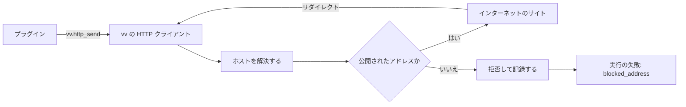

# 調査: 作品情報プラグイン {#research-work-info-plugins}

引き継ぐ決定: [ARCHITECTURE.md](../../ARCHITECTURE.md) (境界、ストアの役割、認証の境界)、[tech-stack-selection.md](../../docs/design-docs/tech-stack-selection.md) (純粋な Go、`CGO_ENABLED=0`、1 つのプロセス)、[ai-layer.md](../../docs/design-docs/ai-layer.md) (`internal/app` のポートと、その背後のプロバイダーのアダプター)、[031](../031-tentative-tags/research.md) の仮のタグと拒否した名前の規則、[029](../029-video-overrides/research.md) の表示名の規則。このファイルは、この機能が加える決定だけを記録する。

## R-1: wazero が vv のプロセスの中でプラグインを実行する {#r-1-wazero-runs-the-plugins-inside-the-vv-process}

**決定**: プラグインは vv のプロセスの中で、それ自身の依存を持たない純粋な Go で書かれた WebAssembly のランタイム `github.com/tetratelabs/wazero` (執筆時点で v1.12.0) で実行する。

| 案 | 純粋な Go (`CGO_ENABLED=0`、Windows へのクロスビルド) | 実行ごとに時間とメモリを制限する | 判定 |
| --- | --- | --- | --- |
| **wazero** | はい | はい: ランタイムごとのメモリのページの上限と、コンテキストが終わったときのモジュールの close | 採用 |
| wasmtime-go、wasmer-go | いいえ: どちらも C のライブラリをリンクする | はい | 不採用: Windows アプリを含む vv のすべてのビルドは CGO を無効にして動く |
| Extism Go SDK (wazero の上) | はい | はい | 不採用: 独自の ABI とフレームワークの依存を加え、組み込みの HTTP はホスト名で絞るので、どのみち [R-5](#r-5-plugins-reach-the-network-only-through-vv-and-only-public-addresses) がそれを置き換えることになる |
| 実行ごとの別のプロセス (コンテナか OS のサンドボックス) | OS による | OS を通じて | 不採用: コンテナと Windows アプリで別々のサンドボックスが必要になり、WebAssembly の試作で、プロセス内のサンドボックスが Issue を満たすことがすでに分かっている |

**理由**: WebAssembly のモジュールはホストが渡さないものを何も呼べないので、サンドボックスは vv が与える import の一覧であり、Linux と Windows で同じである。wazero は amd64 と arm64 ではマシンコードにコンパイルし、それ以外ではインタープリターで実行する。コンパイルしたモジュールは、ダイジェストをキーとしてメモリにキャッシュする。

## R-2: プラグインは、JSON の要求を読み JSON の応答を書く WASI コマンドである {#r-2-a-plugin-is-a-wasi-command-that-reads-a-json-request-and-writes-a-json-response}

**決定**: プラグインは `wasip1` のコマンドモジュールである。各実行は新しいインスタンスを開始し、その標準入力に 1 つの JSON の要求を書き、その標準出力から 1 つの JSON の応答を読む。ネットワークへのアクセスは `vv` import モジュールのホスト関数である ([contracts/plugin-contract.md](contracts/plugin-contract.md))。

| 案 | プラグインの作者が書くもの | 判定 |
| --- | --- | --- |
| **WASI コマンド、stdin と stdout の JSON、HTTP のための `vv` ホスト関数** | 普通の逐次的なコード。Go (`GOOS=wasip1`)、TinyGo、Rust (`wasm32-wasip1`) が変更なしにビルドする | 採用 |
| 純粋なステップのプロトコル: プラグインが欲しい要求を出力し、vv が応答を伴ってそれを再び実行する | 状態が JSON を往復する状態機械 | 不採用: 複数ページのスクレイピングがすべて手書きの継続になり、各ステップがモジュールをインスタンス化し直す |
| Extism の ABI | Extism の PDK に対するコード | [R-1](#r-1-wazero-runs-the-plugins-inside-the-vv-process) で Extism とともに不採用 |
| WebAssembly のコンポーネントモデル (WASI 0.2) | 生成されたバインディング | 不採用: wazero はコンポーネントを実行しない |

**理由**: 標準入出力には vv に固有のコードが要らないので、作者が覚える契約の部分は要求と応答の形と 3 つのホスト関数だけである。実行ごとに新しいインスタンスを使うので、実行の間や動画の間で状態が漏れない。

## R-3: マニフェストは、モジュールを実行せずに読むカスタムセクションである {#r-3-the-manifest-is-a-custom-section-read-without-running-the-module}

**決定**: プラグインは、名前、バージョン、説明、契約のバージョン、操作を `vv.plugin` という名前のカスタムセクションに JSON として持つ。vv はアップロード時にそれを読み、モジュールをコンパイルしてその import を確かめ、所有者が承認していないモジュールを決して実行しない。

| 案 | 承認されていないコードを実行する | 判定 |
| --- | --- | --- |
| **カスタムセクション** | いいえ | 採用 |
| アップロード時に実行する `describe` 操作 | はい | 不採用: 要件 2 は承認の前に名前とバージョンを表示するので、それらが所有者の承認していないコードから来ることになる |
| モジュールの隣にアップロードするマニフェストのファイル | いいえ | 不採用: 食い違いうる 2 つのファイルになり、要件 1 は 1 つのファイルを追加する |

## R-4: 各実行はファイルも環境も持たず、固定の上限を持つ {#r-4-each-run-has-no-files-no-environment-and-fixed-limits}

**決定**: 実行は事前に開かれたディレクトリも、環境変数も、引数も得ず、最初に達した上限で止められる。画面が見るコードは [contracts/screen-api.md、実行の失敗](contracts/screen-api.md#run-failures) にある。

| 上限 | 値 | 達したとき |
| --- | --- | --- |
| モジュールのサイズ | 16 MiB | アップロードを拒否する (`plugin_too_large`) |
| メモリ | 128 MiB (2048 ページ) | 実行がトラップする |
| 実行時間 | 30 秒、HTTP を含む | モジュールを close する |
| 標準出力 | 1 MiB | 実行を止める |
| 標準エラー出力 | 64 KiB を保ち、残りは捨てる | サーバーのログにだけ書く |
| 同時の実行 | 1。2 つ目の実行は最大 10 秒待つ | 2 つ目の実行を拒否する |

**理由**: 同時に 1 つの実行に限ると、プラグインのメモリは 1 つのモジュールの上限に収まり、それは所有者が 1 人のサーバーが割ける量である。Go の `wasip1` ランタイムはヒープのために余裕が要るので、64 MiB では 1 MiB のページをメモリ上で解析するには狭すぎた。時計と乱数源は Go のランタイムが必要とするので与える。どちらもプロセスの外には届かない。

## R-5: プラグインは vv を通じてだけ、公開されたアドレスにだけネットワークで到達する {#r-5-plugins-reach-the-network-only-through-vv-and-only-public-addresses}

**決定**: vv がプラグインのためにすべての HTTP 要求を行い、接続時に解決した各アドレスを確かめるので、vv や LAN を指すリダイレクトや DNS の答えは失敗する。拒否された要求は、プラグインが何を返しても、実行全体を `blocked_address` で失敗させる。

図は、プラグインの 1 つの要求の経路を示す。

接続を拒否するのは、IPv4 射影 IPv6 アドレスを射影から戻した後のアドレスが、グローバルユニキャストでないとき、プライベート (RFC 1918、`fc00::/7`) のとき、ループバック、リンクローカル、マルチキャスト、未指定のとき、`100.64.0.0/10`、`192.0.0.0/24`、`198.18.0.0/15`、`64:ff9b::/96`、`2001:db8::/32` にあるとき、またはサーバー自身のインターフェースの 1 つのアドレスであるときである。

| 案 | DNS リバインディングとリダイレクトに耐える | 判定 |
| --- | --- | --- |
| **ダイヤラーの control フックで、解決の後に、すべての接続で確かめる** | はい | 採用 |
| 要求の前にホスト名を解決して確かめる | いいえ: 2 回目の解決は異なりうるし、リダイレクトは確認を飛ばす | 不採用 |
| プラグインごとのホスト名の許可リスト | いいえ: 公開された名前が LAN のアドレスに解決されうる | 不採用 |
| 拒否をプラグインに返すだけにする | — | 不採用: プラグインがそれを握りつぶせるが、受け入れ条件 5 は所有者が失敗を見ることを求める |
| 環境の `HTTP_PROXY` に従う | いいえ: 接続時の確認にはプロキシしか見えない | 不採用 |

vv は実行ごとに、16 の要求、`GET` と `POST`、`http` と `https`、要求ごとに 5 回のリダイレクト、要求ごとに 10 秒、応答の本文ごとに 4 MiB を許す。本文は応答のヘッダーとともにバイト列としてプラグインに届くので、ページの文字コードはプラグインが自分でデコードする (vv はページを解析する前にそれを知ることができない)。

## R-6: プラグインは SQLite の行であり、承認はモジュールのダイジェストに結び付く {#r-6-plugins-are-rows-in-sqlite-and-approval-is-bound-to-the-modules-digest}

**決定**: 各プラグインは、モジュールを blob として、その SHA-256 のダイジェストとともに持つ `work_info_plugins` の行である。プラグインが承認済みであるのは、ちょうど `approved_digest` が `digest` と等しいときである ([data-model.md](data-model.md))。

| 案 | 判定 |
| --- | --- |
| **承認したダイジェストを持つ blob の行** | 採用 |
| `MDM_DATA_DIR/plugins` の下のモジュールのファイルと、その隣の行 | 不採用: クラッシュの後にファイルと行が食い違いうるし、`internal/artifacts` が持つのは再構築できるファイルだけである。046 も同じ理由でアップロードした画像を blob として保つ |
| 置き換えで消す `approved` フラグ | 不採用: それを消し忘れる書き込みの経路があれば、見ていないコードを承認してしまう。ダイジェストなら、置き換えは作りからして承認を外す (要件 3) |

## R-7: 承認は、所有者が見たダイジェストを指定する {#r-7-approving-names-the-digest-the-owner-saw}

**決定**: 承認の要求は所有者が見た一覧のダイジェストを運び、保存されたモジュールが別のダイジェストを持つときは `plugin_changed` で失敗する。

| 案 | 判定 |
| --- | --- |
| **ダイジェストで承認する** | 採用 |
| 今のモジュールを承認する | 不採用: 一覧を開いてから承認を押すまでの間の置き換えで、所有者が一度も見ていないモジュールを承認してしまう |

## R-8: 取得した結果は、動画とプラグインのダイジェストに結び付いて、10 分間メモリにある {#r-8-a-fetched-result-lives-in-memory-for-10-minutes-bound-to-the-video-and-the-plugins-digest}

**決定**: 取得は結果の id で答える。結果は 10 分間メモリにとどまり、期限が切れたとき、再起動で捨てられたとき、またはその後にプラグインのダイジェストか承認が変わったときは、その適用は `work_info_fetch_stale` で失敗する。

| 案 | 判定 |
| --- | --- |
| **id を持つメモリ上の結果** | 採用 |
| クライアントが取得した値を適用とともに送り返す | 不採用: そうするとサーバーは古い結果と新しい結果を区別できないが、Issue の Edge Case はそれを求める |
| 結果の SQLite のテーブル | 不採用: 結果のどの部分も再起動を越えて残る必要はない。所有者は取得し直す |

**理由**: サムネイルの編集のセッション ([thumbnail-editing.md](../../docs/design-docs/thumbnail-editing.md)) と同じ形である。寿命が固定なのは、古くなるのが所有者の操作ではなく外部のページだからである。

## R-9: タイトルとタグは 1 つのトランザクションで適用し、飛ばした名前を報告する {#r-9-the-title-and-the-tags-are-applied-in-one-transaction-and-skipped-names-are-reported}

**決定**: 1 つのストアの操作が、選んだタイトルを表示名として書き、選んだタグを仮のタグとして付けることを、1 つのトランザクションで行う。vv はタグ名の規則を破る名前をストアの前に落として `invalid` として報告し、ストアは外部 API のときと同じく拒否した名前を飛ばして `rejected` として報告する。

| 案 | 判定 |
| --- | --- |
| **1 つのトランザクション、無効な名前は先に絞る** | 採用 |
| 既存の `SetDisplayName` と `ApplyVideoTags` を順に呼ぶ | 不採用: 2 つ目が失敗すると、所有者が選んだものの半分だけが適用されたままになる |
| 外部 API と同じく、最初の無効なタグ名で適用を失敗させる | 不採用: Issue の Edge Case は名前を飛ばして所有者に伝える |

## R-10: 検索の候補はテキストだけである {#r-10-search-candidates-are-text-only}

**決定**: 候補は URL、タイトル、省略できる詳細の行を持つ。画像は持たない。

| 案 | 判定 |
| --- | --- |
| **テキストだけ** | 採用 |
| 候補ごとのリモートの画像 | 不採用: ブラウザーが第三者のサイトからそれを読み込み、閲覧者をそのサイトに明かすことになる。また、取得した画像は Issue で範囲外である |

## R-11: 動画のページは、取得の操作を表示するかを決めるためにプラグインの一覧を読む {#r-11-the-video-page-reads-the-plugin-list-to-decide-whether-to-show-the-fetch-action}

**決定**: 動画のページは `GET /api/work-info-plugins` を読み、承認済みのプラグインがそこにあるときだけ取得の操作を表示する (要件 10)。

| 案 | 判定 |
| --- | --- |
| **プラグインの一覧** | 採用 |
| `GET /api/thumbnail-edits/readiness` のような準備状態のエンドポイント | 不採用: ダイアログはどのみち承認済みのプラグインの名前と操作を必要とし、一覧は数行である |

## R-12: テストのプラグインは、テストの実行時に Go のソースからビルドする {#r-12-test-plugins-are-built-from-go-sources-when-the-tests-run}

**決定**: Go のテストとブラウザーテストは、フィクスチャのプラグインを Go のソースから `GOOS=wasip1 GOARCH=wasm` でビルドし、小さなヘルパーで `vv.plugin` セクションを加える。`.wasm` ファイルはチェックインしない。

| 案 | 判定 |
| --- | --- |
| **テスト時にソースからビルドする** | 採用 |
| `.wasm` のフィクスチャをコミットする | 不採用: バイナリのファイルはレビューできず、フィクスチャはそのソースからずれていく |
