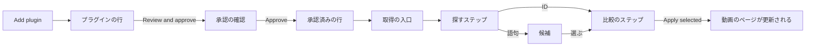
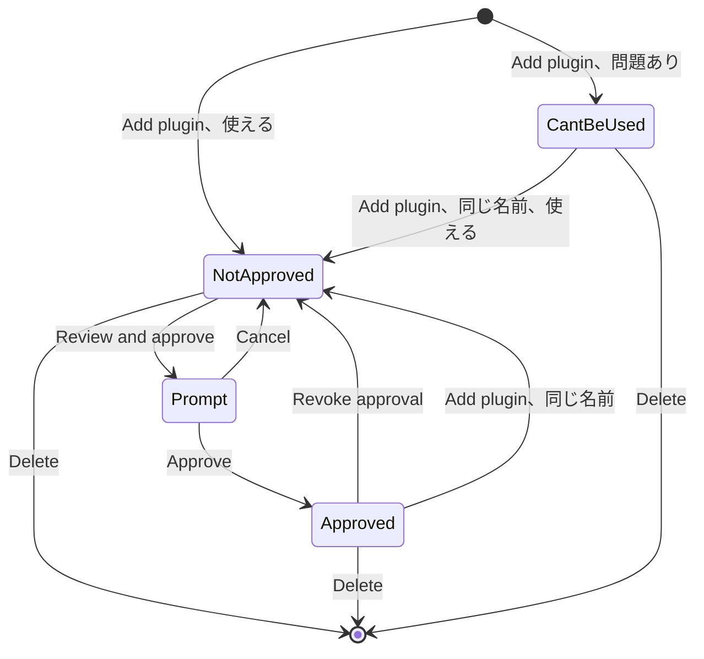
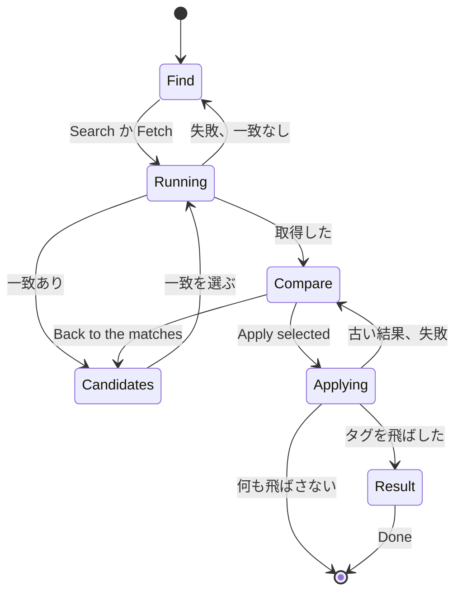

# UI デザイン: 外部のサービスから作品情報を取得する作品情報プラグイン {#ui-design-work-info-plugins-that-fetch-work-information-from-external-services}

**機能**: [親 Issue #968](https://github.com/syudead/vv/issues/968) · [plan.md](plan.md) · [contracts/screen-api.md](contracts/screen-api.md) · [data-model.md](data-model.md) · [research.md R-7](research.md#r-7-approving-names-the-digest-the-owner-saw) · [R-8](research.md#r-8-a-fetched-result-lives-in-memory-for-10-minutes-bound-to-the-video-and-the-plugins-digest) · [R-9](research.md#r-9-the-title-and-the-tags-are-applied-in-one-transaction-and-skipped-names-are-reported) · [R-10](research.md#r-10-search-candidates-are-text-only) · [R-11](research.md#r-11-the-video-page-reads-the-plugin-list-to-decide-whether-to-show-the-fetch-action) · [R-13](research.md#r-13-plugin-settings-are-declared-in-the-manifest-and-passed-only-in-that-plugins-request)

すでに決まっていることの出典。ここでは繰り返さずリンクする。

| 話題 | 出典 |
| --- | --- |
| トークン、閉じたスケール、ライブラリと動画のページの密度 | [design-system.md、Foundations](../../docs/design-docs/design-system.md#foundations)。値は [`web/src/ui/tokens.css`](../../web/src/ui/tokens.css) の `@theme` にあり、ここでは名前で示し、決して写さない |
| `SettingsPage`、`PageSection`、`FactList`、`FormDialog`、`ConfirmDialog`、`EmptyState`、`ErrorState` | [patterns.md](../../web/registry/rules/patterns.md) |
| `Button`、`Input`、`Field`、`Select`、`Checkbox`、`Badge`、`Alert`、`DropdownMenu`、`Skeleton`、`Spinner`、`Tooltip`、`TentativeMark` | [components.md](../../web/registry/rules/components.md) |
| 行ごとの操作を持つ設定の一覧、その失敗の行と削除の確認 | [`SettingsPage.tsx`](../../web/src/settings/SettingsPage.tsx) のメディアフォルダの節。[`APITokensSection.tsx`](../../web/src/settings/APITokensSection.tsx) |
| 書き込み専用の秘密の欄と、その「保存済み」のヒント | ComfyUI の API キー、[045 UI デザイン、Settings: ComfyUI の節](../045-comfyui-thumbnails/ui-design.md#settings-comfyui-section) |
| `/settings#<id>` で到達する節、説明の後のガイドのリンク | [`useSectionAnchor.ts`](../../web/src/settings/useSectionAnchor.ts)、[`docsLinks.ts`](../../web/src/settings/docsLinks.ts) |
| 動画のページの情報の行、その操作のグループ、一つの失敗の行 | [library-ui.md、情報の行](../../docs/design-docs/library-ui.md#information-rows) |
| 仮のタグとその印 | [031 UI デザイン](../031-tentative-tags/ui-design.md) |
| 幅のブレークポイントは CSS で切り替える。レイアウトは人が確かめる | [library-ui.md、幅のブレークポイント](../../docs/design-docs/library-ui.md#width-breakpoints-in-css-and-the-sidebar-exception)、[人が確かめるレイアウト](../../docs/design-docs/library-ui.md#layout-verified-by-people-not-machines) |
| 画面の文言 | [`web/src/i18n/en.ts`](../../web/src/i18n/en.ts)。この機能は `settings.workInfoPlugins`、`player.workInfoFetch` と下記のエラーの理由を加える |

この機能は二つのものを加え、どちらも所有者専用である (受け入れ条件 7)。

1. Settings の **Work-info plugins の節**: プラグインのファイルの追加、その状態、承認の確認、設定の値、承認の取り消しと削除 (要件 1 から 3 と 11、受け入れ条件 1、2、8)。
2. 動画のページの情報の行の操作に並ぶ**取得の入口**と、それが開く**取得のダイアログ**: 検索か作品の ID、候補、比較、選んだ項目の適用 (要件 4 から 6 と 10、受け入れ条件 3 から 6)。

図は各部分と、それぞれの操作の行き先を示す。

変わらないもの: プレーヤー、タイトルとその鉛筆、タグとその提案、`Edit details` とそのエディタ、情報の行の他の操作、他のすべての設定の節、他のすべての画面。これらは既存の `Video` を通して適用したタイトルとタグを表示する。

## この形にした理由 {#why-this-shape}

プラグインは**設定の節を一つ増やす**。プラグインの追加、承認、設定は、ComfyUI の接続と同じく所有者が一度だけする準備だからである。動画のページは Settings が承認したものを使うだけである。各プラグインはメディアフォルダの節の形をした一つの行で、先頭に**状態のバッジ**を置く。そのため、どの行でも状態が最初に読まれる (Issue の `UI品質`)。承認は**承認の確認**を開く。これは `FormDialog` で、所有者が信頼するものすべてを `Approve` ボタンの前に一つの画面に集める。名前とバージョン、プラグインにできること、インターネットについての注意、受け取る設定、ファイルの SHA-256 である。行の中で承認する案は採用しなかった。行にはそれぞれに一行分の場所しかなく、ネットワークについての注意が行の他の文言と競合するからである。ダイアログは、所有者が承認するダイジェストを表示したものに固定もする ([R-7](research.md#r-7-approving-names-the-digest-the-owner-saw))。

設定の値はプラグインごとの**設定のダイアログ**で入力する。これは `FormDialog` である。一つのプラグインの値はまとめて保存され、[patterns.md、Settings page](../../web/registry/rules/patterns.md#settings-page) はまとめて保存する値のグループを `FormDialog` に置くからである。秘密の欄は常に空で、値が保存されているかを伝える。ComfyUI の API キーと同じである。

動画のページでは、入口は**操作のグループに一つ加わるアイコンボタン**で、`Edit details` の後に置く。作品情報の取得は同じ詳細を埋めるもう一つの方法であり、隣と同じ重みを持ち、タイトルとタグより控えめだからである (Issue の `UI品質`)。入口は一つのウィンドウに二つのステップを持つ**取得のダイアログ**を開く。作品を探すステップと、比較するステップである。全画面のエディタにする案は採用しなかった。比較は今は二行であり、所有者には後ろのページが引き続き見えているべきだからである。ストアやメディア管理の製品 (音楽のタグ付けツール、メディアサーバーの「fix match」) は同じ形に収束している。検索するかリンクを貼り付け、一致を選び、項目を確かめ、適用する形である。

探すステップは**語句か作品の ID のための一つの欄**を持ち、プラグインが両方できるときだけ `Find by` の切り替えを置く。文字列は URL として読まない。所有者が入力したものは、検索語または ID としてそのままプラグインに届く (親 Issue #1232、要件 14)。貼り付けたページの URL を受け付けたいプラグインは、その URL から ID を自分で読み取る。

比較は**項目ごとに一行で、チェックボックス、現在の値、取得した値を横に並べる**。取得した値は本文の色、現在の値は控えめな色にするので、書き込まれるものが先に読まれる (Issue の `UI品質`)。値があり異なる項目は選ばれた状態で始まる。所有者は `Apply selected` を押す前に選ばれた行をすべて見て、選択を外すのは一回押すだけである。値のない項目は選べない (Issue の境界ケース)。横に並べるには `FormDialog` の `max-w-lg` より広い幅が要るので、ダイアログは新しい広いサイズを使う ([デザインシステムへの変更](#changes-to-the-design-system))。

適用がタグの名前を飛ばしたとき、ダイアログは開いたまま**結果のステップ**を表示し、その名前を並べる。所有者がどの名前が除かれたかを読む前に、トーストは消えることがあるからである。何も飛ばさなかった適用はダイアログを閉じ、ページの新しいタイトルとタグが確認になる。

## 文言 {#words}

英語はカタログが取り込む下書きである。実装の後は [`web/src/i18n/en.ts`](../../web/src/i18n/en.ts) が正となる。画面上の製品名は `VVMDM` である。

### Settings の節の文言 {#settings-section-text}

| 場所 | 文言 | 注記 |
| --- | --- | --- |
| 節のタイトル | Work-info plugins | アンカーは `#work-info-plugins` |
| 節の説明 | Plugins fetch work information from other sites for the video page. Approve a plugin before it can run. | 後にガイドのリンクが続く |
| ガイドのリンク | How plugins work | 文書サイトの `docs/how-to/work-info-plugins` を新しいタブで開く |
| 追加のボタン | Add plugin | `outline` `sm`、lucide `Upload` |
| 追加中 | Adding… | 送信中の追加のボタンの文言 |
| 拒否、大きすぎる | Choose a file up to 16 MB. | 何かを送る前 |
| 追加の失敗 | Couldn't add the plugin: {reason} | 節の失敗の行 |
| 追加した (トースト) | Added {name}. Approve it to use it. | `{name}` は名前。名前がないときはファイル名 |
| 置き換えた (トースト) | Replaced {name}. Approve it again to use it. | アップロードが `200` で返された。`201` は一覧の内容にかかわらず Added を表示する |
| 追加したが使えない (トースト) | Added {name}, but it can't be used. | `state: invalid` |
| 空 | No plugins yet | `EmptyState` のタイトル |
| 空のときのヒント | Add a .wasm plugin file to fetch titles and tags on the video page. | `EmptyState` の説明 |
| バッジ、承認済み | Approved | `success`、lucide `ShieldCheck` |
| バッジ、未承認 | Not approved | `warning`、lucide `ShieldAlert` |
| バッジ、使えない | Can't be used | `destructive`、lucide `CircleX` |
| バージョン | v{version} | 名前の後 |
| 操作、検索 | Search | ` · ` でつなぐ |
| 操作、取得 | Fetch by ID | |
| インターネットについての注意 (行) | Reaches internet sites | lucide `Globe` |
| 設定の要約 | Settings: {list} | `{list}` は各ラベルの後に `set` か `not set` を続け、`, ` でつないだもの |
| 必須の値の欠落 | Needs a value: {labels} | lucide `CircleAlert` を伴う `warning` の文字 |
| 承認のボタン | Review and approve | `default` `sm`、`unapproved` のときだけ |
| 設定のボタン | Settings | `outline` `sm`、lucide `SlidersHorizontal`。プラグインが設定を宣言していて、`invalid` でないときだけ |
| 行のメニュー | More actions for {name} | `ghost` `icon-sm`、lucide `Ellipsis` |
| 行のメニュー、取り消し | Revoke approval | `approved` のときだけ。確認はない |
| 行のメニュー、削除 | Delete | 破壊的な項目。削除の確認を開く |
| 行の処理中 | Revoking… · Deleting… | 行の操作の前に置く控えめな状態 |
| 行の失敗 | Couldn't change {name}: {reason} | 行の下 |

### 使えないプラグインの理由 {#invalid-plugin-reasons}

`invalid` の行の下の一行で、`text-destructive` で表示し、その `problem` から決まる ([data-model.md、work_info_plugins](data-model.md#work_info_plugins))。

| `problem` | 文言 |
| --- | --- |
| `not_wasm` | The file isn't a WebAssembly module. |
| `manifest_missing` | The file has no plugin information for VVMDM. |
| `manifest_invalid` | The plugin information in the file is invalid. |
| `contract_unsupported` | The plugin is made for another version of VVMDM. |
| `import_unsupported` | The plugin asks for functions VVMDM doesn't offer. |
| `export_invalid` | The file isn't a plugin VVMDM can run. |
| `table_too_large` | The plugin asks for more memory tables than VVMDM allows. |

### 承認の確認の文言 {#approval-prompt-text}

| 場所 | 文言 | 注記 |
| --- | --- | --- |
| タイトル | Approve {name}? | |
| 説明 | Approved plugins can run when you fetch work information on a video page. | |
| 事実 | Version · File · Can · Description · SHA-256 | `FactList` の用語。`Can` は操作を並べ、`Description` はあるときだけ |
| インターネットについての注意のタイトル | This plugin can reach any site on the internet | `warning` の `Alert`、lucide `Globe` |
| インターネットについての注意の本文 | It can send what it fetches and the values of its settings to those sites. VVMDM blocks its requests to VVMDM itself and to devices on your network. | |
| 設定の見出し | Settings it receives | |
| 設定の行 | {label} | 宣言されているときは `Secret` と `Required` の `secondary` のバッジを伴う |
| 設定がない | It receives no settings. | |
| 送信 | Approve | |
| 途中での変更 | The plugin was replaced while this was open. Close this and review it again. | `destructive` の `Alert`。`Approve` は無効 |

### 設定のダイアログの文言 {#settings-dialog-text}

| 場所 | 文言 | 注記 |
| --- | --- | --- |
| タイトル | Settings for {name} | |
| 説明 | Values are sent only to this plugin when it runs. Changing them keeps the approval. | |
| 必須の印 | Required | 控えめ、ラベルの後 |
| 秘密のヒント、保存済み | Saved. Type a new value to replace it. | |
| 秘密のヒント、未保存 | Not set. | |
| 秘密を消す | Forget | `ghost` `sm`。保存した秘密のときだけ |
| 消したときのヒント | Removed when you save. | `Undo` の `link` ボタンを伴う |
| 送信 | Save | |
| 保存した (トースト) | Saved the settings for {name}. | |
| 保存の失敗 | Couldn't save the settings: {reason} | ダイアログの中の `destructive` の `Alert` |

### 削除の確認の文言 {#delete-confirmation-text}

| 場所 | 文言 | 注記 |
| --- | --- | --- |
| タイトル | Delete {name}? | |
| 説明 | The plugin and the values of its settings are removed. Videos keep what was already applied. | |
| 操作 | Delete · Deleting… | `destructive` |
| 削除した (トースト) | Deleted {name}. | |

### 動画のページの文言 {#video-page-text}

| 場所 | 文言 | 注記 |
| --- | --- | --- |
| 入口、名前とツールチップ | Fetch work info from a plugin | lucide `CloudDownload` |
| ダイアログのタイトル | Fetch work info | |
| ダイアログの説明 | Nothing changes until you apply. | |
| プラグインのラベル | Plugin | 承認済みのプラグインが複数あるときは `Select`。一つのときは名前を文字で示す |
| クエリのラベル、語句 | Search words | |
| クエリのラベル、ID | The work's ID | `ID` が押されているとき、または取得だけのプラグイン |
| 探し方 | Find by · Words · ID | `ToggleGroup` のラベルと項目。`search` と `fetch` を持つプラグインだけ |
| 検索のボタン | Search | 文字列を検索するとき |
| 取得のボタン | Fetch | 文字列を作品の ID として取得するとき |
| 実行中 | Searching… · Fetching… | 実行の間のボタンの文言。実行は最大 30 秒かかることがある |
| 候補の見出し | {n} matches | |
| 候補の ID | ID {id} | `text-xs text-muted-foreground`、タイトルと詳細の下 |
| 候補なし | No matches. Try other words, or choose ID and enter the work's ID. | 二文目はプラグインが取得できるときだけ |
| 出典の行 | From {plugin} · ID {id} | 控えめ、比較の上。`{id}` は取得した ID を文字で示したもの |
| 戻る | Back to the matches | `ghost` `sm`、lucide `ArrowLeft`。検索の後だけ |
| 列の見出し | Now · Fetched | |
| 項目のラベル | Title · Tags | |
| 値なし | Not in the result | 控えめ。その行は選べない |
| 同じ値 | Same as now | 控えめ。その行は選べない |
| すでに動画にあるタグ | On the video | lucide `Check` を伴う控えめなチップのツールチップ |
| 新しいタグの数 | {n} new | 控えめ、取得したチップの後 |
| 残りのタグ | +{n} more · Show fewer | `link` `sm`、作品の詳細の行と同じ |
| 送信、比較 | Apply selected | 何も選ばれていない間は無効 |
| 適用中 | Applying… | |
| 適用した (トースト) | Applied to the video. | 何も飛ばさなかったときだけ |
| 結果のタイトル | Applied, but some tags were left out | 適用した部分についての `success` の `Alert` |
| 飛ばした、拒否 | {name} — you rejected this tag before | 名前ごとに一行 |
| 飛ばした、無効 | {name} — not a valid tag name | 名前ごとに一行 |
| 送信、結果 | Done | ダイアログを閉じる |
| 古い結果 | This result is out of date. Fetch it again to apply it. | `destructive` の `Alert`。その横に `Fetch again` |
| 再取得 | Fetch again | `Alert` の操作の中の `outline` `sm` |
| 設定の欠落 | {plugin} needs {labels} first. | `/settings#work-info-plugins` への `Open Settings` の `link` ボタンを伴う `warning` の `Alert` |
| 実行の失敗 | Couldn't {search or fetch}: {reason} | `destructive` の `Alert`。`{reason}` は [エラーの理由](#error-reasons) から |
| 適用の失敗 | Couldn't apply: {reason} | 比較の上の `destructive` の `Alert`。`{reason}` は [エラーの理由](#error-reasons) から |
| プラグイン自身のメッセージ | The plugin said: "{message}" | 失敗の二行目、控えめ、`pluginMessage` があるときだけ |

### エラーの理由 {#error-reasons}

`web/src/i18n/errors.ts` に加える。`{host}`、`{limit}` とプラグインのメッセージは `Error` から来る ([contracts/screen-api.md、実行の失敗](contracts/screen-api.md#run-failures))。

| コードまたは理由 | 文言 |
| --- | --- |
| `plugin_too_large` | The file is over 16 MB. |
| `plugin_changed` | The plugin was replaced. Review it again. |
| `plugin_unusable` | The plugin can't be used. |
| `plugin_not_approved` | The plugin is no longer approved. |
| `plugin_settings_missing` | The plugin needs settings first. |
| `plugin_failed` | The plugin failed. |
| `blocked_address` | The plugin tried to reach {host}, which is VVMDM itself or a device on your network. |
| `network_error` | The plugin couldn't reach {host}. |
| `memory_exceeded` | The plugin used more than 128 MB of memory and was stopped. |
| `output_too_large` | The plugin's answer was over 1 MB. |
| `plugin_timed_out` | The plugin didn't finish in 30 seconds and was stopped. |
| `plugin_busy` | Another plugin is running. Try again in a moment. |
| `operation_unsupported` | The plugin can't do that. |
| `work_info_fetch_stale` | The result is out of date. Fetch it again. |

## デザインシステムへの変更 {#changes-to-the-design-system}

レジストリの `FormDialog`、そのルールのファイル ([patterns.md、Form dialog](../../web/registry/rules/patterns.md#form-dialog)) と [design-system.md](../../docs/design-docs/design-system.md#page-patterns) に二つの選択肢を加える。取得のダイアログがそれを使う前に、「Fetch work information from a plugin on the video page」の単位が加える。

| 変更 | 内容 |
| --- | --- |
| `size="wide"` | ダイアログは `max-w-lg` ではなく `max-w-2xl` で止まる。比較のために値を横に並べるフォームのためである。`sm` 未満では、既定のサイズと同じく 16px の余白を残して画面に広がる |
| `cancelLabel` を省略可能にする | これがないとき、フッターは送信ボタンだけを持つ。閉じることだけが操作である最後のステップ (`Done`) のためである |

トークンは加えず、`web/src/theme/tokens.test.ts` の `pairs` にも何も加えない。バッジ、アラート、チップは既存の役割を使う。アイコンは lucide の `Upload`、`ShieldCheck`、`ShieldAlert`、`CircleX`、`Globe`、`SlidersHorizontal`、`Ellipsis`、`CircleAlert`、`CloudDownload`、`ExternalLink`、`ArrowLeft` と `Check` である。

## Settings: Work-info plugins の節 {#settings-work-info-plugins-section}

`Work-info plugins` という題の `PageSection` で、`ComfyUI` の後、`Transcoding` の前に置く。外部のサービスに到達する節が並ぶようにするためである。`useSectionAnchor` を通じて `/settings#work-info-plugins` の行き先になる。ヘッダーの操作は `Add plugin` である。本文は一覧で、プラグインごとに一行を API の順 (名前、次にファイル名) に並べ、メディアフォルダと同じく `border` の線で区切る。

### 追加 {#adding}

`Add plugin` はブラウザのファイル選択を `.wasm` ファイルに限って開く。16 MiB を超えるファイルは、何かを送る前に節の失敗の行で拒否する。ファイルを送る間、ボタンは回転して `Adding…` と表示し、行の操作は使えるままである。`201` か `200` のとき一覧を読み直し、トーストが何が起きたかをそのステータスで伝え (画面 API の定めのとおり `201` は追加、`200` は置き換えであり、古い可能性のある画面上の一覧によらない) ([文言、Settings の節の文言](#settings-section-text))、フォーカスは追加した行の最初の操作に移る。失敗すると、ヘッダーの下の `destructive` の `Alert` である節の失敗の行を、次の追加まで表示する。問題のあるファイルも `invalid` の行として追加する (Issue の境界ケース)。

### プラグインの行 {#plugin-row}

| 部分 | 形 |
| --- | --- |
| 一行目 | 状態の `Badge`、次に `font-medium` の名前と、`text-muted-foreground` `tabular-nums` の `v{version}`。名前のない `invalid` の行は `font-mono` でファイル名を示す。操作は行の右端に置く |
| 説明 | マニフェストの説明。`text-muted-foreground`、一行の `truncate` で、全文は `title` に入れる。マニフェストに説明がないときはない |
| 事実の行 | `text-xs text-muted-foreground`: 操作、アイコン付きの `Reaches internet sites`、設定の要約を ` · ` で区切り、全体として折り返す。`invalid` ではない |
| 必須の値の欠落 | `required` の設定が設定されていないとき、アイコン付きの `text-warning` で `Needs a value: {labels}`。それがないと取得のダイアログは実行を拒む |
| 問題 | `invalid` のとき、事実の行の代わりに `text-destructive` で問題の文言 |
| 行の失敗 | 行の下に `text-destructive` で `Couldn't change {name}: {reason}`。行の次の操作まで |

| 状態 | 操作 |
| --- | --- |
| `unapproved` | `Review and approve` (`default` `sm`)、宣言されているときは `Settings`、`Delete` を持つ行のメニュー |
| `approved` | 宣言されているときは `Settings`、`Revoke approval` と `Delete` を持つ行のメニュー |
| `invalid` | `Delete` を持つ行のメニュー |

`Review and approve` は節の中で唯一の塗りつぶしのボタンなので、未承認のプラグインとそれを承認する方法が最初に目に入る (Issue の `UI品質`)。承認の後は行は控えめになり、バッジだけが色を持つ。取り消しは確認なしにすぐ実行する。もう一度承認すれば元に戻るからである。行は `Revoking…` を示し、次に `Not approved` のバッジを示す。`Delete` は [削除の確認](#delete-confirmation) を開く。これは `pending` を持つ `ConfirmDialog` である。設定の値もプラグインと一緒に消えるからである。

### 承認の確認 {#approval-prompt}

`Review and approve` が開く `FormDialog` で、一覧が返したとおりの行の `WorkInfoPlugin` から組み立てる。上から下へ、`FactList` (`Version`、`File`、`Can`、`Description`、`font-mono text-xs break-all` の `SHA-256`)、`warning` の `Alert` としてのインターネットについての注意、次に宣言した設定ごとに一行 (ラベルと `Secret` と `Required` のバッジ) を持つ `Settings it receives`、または `It receives no settings.` を置く。フッターは `Cancel` と `Approve` である。

`Approve` は確認が表示しているダイジェストを `pending` とともに送る ([R-7](research.md#r-7-approving-names-the-digest-the-owner-saw))。`200` のときダイアログが閉じ、行は `Approved` になり、フォーカスは行に戻る。`plugin_changed` か `plugin_unusable` のとき、ダイアログは `Changed meanwhile` の `Alert` と無効な `Approve` を持って開いたままで、後ろで一覧を読み直す。そのため確認を開き直すと新しいモジュールが表示される。SHA-256 は、所有者がファイルを作者が公開したものと比べられるようにそこにある。確認はそれ以上説明しない。

### 設定のダイアログ {#settings-dialog}

`Settings` が開く `FormDialog` で、宣言した設定ごとに一つの `Field` をマニフェストの順に持つ。ラベル、宣言されているときはその後の `Required`、Unicode のコードポイントで数えて 2000 文字で止まる `Input` である。数え方はサーバーと同じである。`maxLength` は使わない。これは UTF-16 の単位で数えるので、絵文字の値を早く止めてしまう。

| 設定 | 欄 |
| --- | --- |
| 秘密でない | 保存した値を持つ `Input type="text"`。空にすると保存時に値を削除する |
| 秘密、未保存 | `Input type="password"`、`autocomplete="off"`、空。ヒントは `Not set.` |
| 秘密、保存済み | 同じ入力で、空。ヒントは `Saved. Type a new value to replace it.` と `Forget`。空の欄は保存した値を保つ。`Forget` は入力を空にして無効にし、`Undo` とともに `Removed when you save.` を表示する |

`Save` は変わったキーがない間は無効で、変わったキーだけを (削除した値には `null` を) `pending` とともに送る。`200` のときダイアログはトーストとともに閉じ、行の設定の要約と必須の行は応答から更新される。承認のバッジは変わらない (要件 11)。失敗すると、ダイアログに `Save failed` の `Alert` を表示し、入力した値をすべて保つ。秘密の値は、ダイアログでも他のどこでも、決して欄に戻さない (受け入れ条件 8)。

### 削除の確認 {#delete-confirmation}

`Delete {name}?` という題の `ConfirmDialog` で、[文言](#delete-confirmation-text) の説明、`Cancel` と `Delete` を持つ。`204` のとき行は一覧から消え、トーストがその名前を伝え、フォーカスは次の行の最初の操作に、一覧が空のときは `Add plugin` に移る。メディアフォルダと同じである。失敗すると、ダイアログに `destructive` の `Alert` を表示する。

### 節の状態 {#section-states}

| 状態 | 節が表示するもの |
| --- | --- |
| 読み込み中 | `h-10` の `Skeleton` の行を二つ。メディアフォルダと同じ |
| 読み込みの失敗 | `Retry` を持つ `ErrorState`。`Add plugin` は無効 |
| 空 | lucide `Puzzle`、`No plugins yet` とそのヒントを持つ `EmptyState` |
| 行 | 上のとおり、プラグインごとに一行 |
| 追加中 | 回転する `Add plugin`、`Adding…`、`aria-disabled` |
| 追加の失敗 | ヘッダーの下の節の失敗の行 |

図は行の状態と、その間の所有者の操作を示す。状態はサーバーのものである ([data-model.md、状態の遷移](data-model.md#state-transitions))。

## 動画のページ: 取得の入口 {#video-page-fetch-entry}

`ActionButton` (`ghost` `icon-sm`、lucide `CloudDownload`、`text-muted-foreground`) で、`Edit details` のすぐ後、`Use current frame as thumbnail` の前に置く。詳細を埋める二つの方法が並ぶようにするためである。ページが所有者に対して開くと、`GET /api/work-info-plugins` を読む。入口は、一覧に `approved` のプラグインがあるときだけ置く ([R-11](research.md#r-11-the-video-page-reads-the-plugin-list-to-decide-whether-to-show-the-fetch-action)、要件 10)。プレーヤーが表示されているかどうかは問わない。ゲストには入口もリクエストもない。一覧の読み込み中と、読み込みに失敗したときは、入口もメッセージもない。取得は任意であり、ページには読めなかったプラグインについて伝えることがないからである。入口を押すと再生を一時停止し、取得のダイアログを開く。

## 取得のダイアログ {#fetch-dialog}

`size="wide"` の `FormDialog` で、題は `Fetch work info` である。一つのウィンドウに三つのステップを持つ。適用が成功する前に閉じると実行は破棄され、何も変わらない (要件 5)。結果のステップは適用の後に来るので、そこで閉じても適用したものは保たれる。

図はステップと、ステップの間の移り方を示す。

### 探す {#find}

| 部分 | 形 |
| --- | --- |
| プラグイン | 承認済みのプラグインが一つのときは、`Plugin` とその名前を文字で示す。複数のときは、承認済みのプラグインを一覧の順に並べた `Select` `sm` で、最初のものを選んだ状態にする。変えると入力した文字列を保ち、候補を消す |
| 探し方 | `search` と `fetch` の両方を持つプラグインでは、クエリの上に `Words` と `ID` の `ToggleGroup` `outline` `sm` を置き、最初は `Words` が押されている。クエリがまだ最初の値のままのときに切り替えると、その値をもう一方のモードの値に置き換え、候補を消す |
| クエリ | プラグインの操作と探し方によるラベルを持つ一つの `Input` ([文言、動画のページの文言](#video-page-text))。文字列を検索するときは、ページが表示するタイトルを選択した状態で始まるので、入力するとそれを置き換える。文字列を ID として取得するときは動画の品番で始まり、品番がなければ空で始まる |
| ボタン | 送信ボタンの `Search` か `Fetch` で、文字列が何をするかによって名前が決まる。`ID` が押されているかプラグインが検索できないときは作品の ID として取得し、そうでなければ検索する。文字列の形は何も変えない。貼り付けた URL は、語句として検索するか、ID として送る |

実行の間、ボタンは回転して `Searching…` か `Fetching…` と表示し、プラグインとクエリは無効になり、`Cancel` は使えるままである。閉じると、届いた答えを捨てる。実行は 30 秒以内に終わるか、`plugin_timed_out` になる。

### 候補 {#candidates}

クエリの下、同じステップの中に、`{n} matches` と、候補ごとに一行をプラグインの順に最大 50 件、ダイアログのスクロールする本文の中に並べる ([R-10](research.md#r-10-search-candidates-are-text-only))。

| 部分 | 形 |
| --- | --- |
| 行 | 左揃えの文字を持つ全幅の `ghost` ボタンで、`border` の線で区切る。押すとその候補の `id` を取得する |
| タイトル | `text-sm text-foreground`、最大二行 (`line-clamp-2`)、全文は `title` に入れる |
| 詳細 | `text-xs text-muted-foreground`、一行の `truncate`。プラグインが何も渡さなかったときはない |
| ID | `text-xs text-muted-foreground`、`ID {id}`。同じ題の作品を見分けられるようにする。候補は URL を持たないので、行にページへのリンクはない |
| 取得中 | 選んだ行は右端に `Spinner` を示す。他の行とクエリは無効になる |

プラグインが取得できない (探すだけの) とき、行はボタンではない。タイトル、詳細、ID を普通の文字で示す。

候補がないときは、一覧の代わりに控えめな一行 `No matches…` を表示する。

### 比較 {#compare}

このステップは探すステップの本文を置き換える。控えめな出典の行 `From {plugin} · ID {id}` (取得した ID)、ステップが検索から来たときは次に `Back to the matches`、次に比較を置く。比較は見出しの行 (`Now`、`Fetched`) と、項目ごとの一行 (`Title`、次に `Tags`) である。

| 列 | 形 |
| --- | --- |
| 項目 | `Checkbox` と項目のラベル。ラベルは `text-muted-foreground` で、互いにラベルとなる |
| Now | `text-muted-foreground`。Title: ページが表示するタイトル、最大二行。Tags: 動画のタグを `secondary` のチップで示し、仮のものは `TentativeMark` を付け、取得したタグと同じく畳む |
| Fetched | `text-foreground`。Title: 取得したタイトル、最大二行、全文は `title` に入れる。Tags: 取得した名前を `TentativeMark` 付きの `secondary` のチップで示す。仮のタグとして付くからである (要件 6)。すでに動画にある名前は、lucide `Check` とツールチップ `On the video` を持つ控えめなチップである。最後に `{n} new` |

| 場合 | 行 |
| --- | --- |
| 値が異なる | 選択でき、ステップが開くとき選ばれている |
| 結果に値がない | 取得した値の列に `Not in the result`。チェックボックスは無効で、選ばれていない (Issue の境界ケース) |
| 現在と同じ | 取得した値の列に控えめな `Same as now`。無効で、選ばれていない。タグでは、取得したすべての名前がすでに動画にある場合である |

十個より多いチップを持つタグの一覧は、最初の十個と `+{n} more` を表示し、これが残りをその場で `Show fewer` とともに表示する。作品の詳細の行と同じである。所有者が開くまで、行が十個のチップを超えて伸びることは決してない。行は五列のグリッド (項目に一列、各値に二列) に置き、情報の行の `gap-x-4` と `text-sm` を使い、行の間は `gap-y-2` で、その間に `border` の線を置く。そのため比較はダイアログの後ろの情報の行と揃う (Issue の `UI品質`)。

送信ボタンは `Apply selected` で、選ばれた行がない間は無効である。選んだ項目を `pending` とともに送る ([R-9](research.md#r-9-the-title-and-the-tags-are-applied-in-one-transaction-and-skipped-names-are-reported))。

| 応答 | ダイアログとページの動き |
| --- | --- |
| `200`、何も飛ばさない | ダイアログが閉じ、応答の `Video` がページの動画を置き換え、トースト `Applied to the video.` を表示し、フォーカスは入口に戻る |
| `200`、名前を飛ばした | 上と同じくページの動画を置き換える。ダイアログは [結果](#result) に移る |
| `work_info_fetch_stale` | ダイアログは比較に留まり、その上に `Stale` の `Alert` と `Fetch again` を表示する。これは同じプラグインと ID で実行し、新しい比較を開く。`Apply selected` は無効になる (Issue の境界ケース) |
| その他の失敗 | 比較の上に `destructive` の `Alert` `Couldn't apply: {reason}` を表示する。選択は保たれる。動画は変わらない |

### 結果 {#result}

`success` の `Alert` `Applied, but some tags were left out` を置き、次に飛ばした名前ごとに一行を置く。`font-medium` の名前とその理由で、`rejected` を `invalid` より先に、応答の順に並べる。フッターは `Done` だけを持ち、それがダイアログを閉じてフォーカスを入口に戻す。

### 失敗 {#failures}

失敗した実行は、探すステップのクエリの下に `destructive` の `Alert` を表示し、クエリと候補を保つ。`Alert` のタイトルは `Couldn't search: {reason}` か `Couldn't fetch: {reason}` である。エラーに `pluginMessage` があるときは、控えめな二行目がそれを引用する。サーバーが切り詰めたとおり、最大 300 文字である。動画は決して変わらない (Issue の境界ケース)。

| コード | 追加の振る舞い |
| --- | --- |
| `plugin_settings_missing` | `destructive` ではなく `warning` の `Alert`: `{plugin} needs {labels} first.`。ラベルは `settingKeys` で一覧から引き、`/settings#work-info-plugins` への `Open Settings` を伴う |
| `blocked_address` か `network_error` を伴う `plugin_failed` | 理由の文言が `{host}` を挙げる (受け入れ条件 5) |
| `plugin_timed_out`、`memory_exceeded` | 理由の文言がプラグインを止めたと伝える (受け入れ条件 6)。ダイアログは次の実行に使えるままである |
| `plugin_not_approved`、`not_found` | ページはプラグインの一覧を読み直す。`Select` はそのプラグインを外し、承認済みのプラグインが残らないときは探すステップのボタンが無効になり、ダイアログを閉じると入口は消える |
| `plugin_busy` | その文言。所有者がもう一度実行する |

## 幅に応じた振る舞い {#responsive-behaviour}

Tailwind の既定のブレークポイントだけを使い、CSS で切り替える。判定する幅は 360px、768px、1280px である。

| 幅 | Settings の節 | 取得の入口 | 取得のダイアログ |
| --- | --- | --- | --- |
| 1280px | 各行の一行目にバッジ、名前、バージョンと右端の操作を置き、その下に説明と事実の行を置く | 操作のグループの一行に一つ加わるアイコン | `max-w-2xl`、中央寄せ。比較の三つの列を横に並べる。候補は一行に一つ |
| 768px | 1280px と同じ | 1280px と同じ | 1280px と同じ。ダイアログはビューポートの左右の余白の内側に収まる |
| 360px | 操作はメディアフォルダと同じく行の文字の下に移り、右揃えになる。事実の行は折り返す。名前は `break-words` で折り返す | 他の入口と同じく、操作のグループは一行のままで、事実はその上で折り返す | ダイアログは 16px の余白を残して画面に広がる。比較の各行は縦に積む。チェックボックスとラベル、次に `Now` と `Fetched` をそれぞれ一行に、見出しを前に置いて並べる。見出しの行は隠す。候補の行はタイトル、詳細、ID を左に保つ。横スクロールはない |

## レビューの基準 {#review-criteria}

vv の一つのダークの配色で、動いている画面を見て判定する ([人が確かめるレイアウト](../../docs/design-docs/library-ui.md#layout-verified-by-people-not-machines))。「存在する」だけでは合格しない (Q-4)。

1. **視覚的な階層**: 動画のページでは、視線は今までどおりプレーヤー → タイトル → タグと進む。取得の入口は隣と同じ重みで、塗りつぶしも境界線も `primary` の色も持たない。設定の節では、各行のバッジが名前より先に読まれ、`Review and approve` が唯一の塗りつぶしのボタンなので、未承認のプラグインがひと目で承認済みのものから目立つ。承認の確認では、インターネットについての注意が `Approve` の上にある唯一の色付きのかたまりである。
2. **情報の密度**: 1280px では、100 文字のタイトルと 10 個の取得したタグがあっても、比較は両方の項目を、現在の値と取得した値を横に並べて、ダイアログをスクロールせずに表示する。プラグインの行は 1280px で最大三行 (名前、説明、事実) である。候補の行は最大四行である。
3. **余白のリズム**: 比較の行は一つの間隔と一つの区切り線を共有し、横の間隔は情報の行と同じである。長いタイトルは二行で、長いタグの一覧は十個のチップで切るので、それだけの理由で他より高くなる行はない。プラグインの行はメディアフォルダの行のパディングを持つ。
4. **文字組み**: 比較では取得した値の列が `text-foreground`、現在の値の列が `text-muted-foreground` なので、取得した値が先に読まれる。仮のチップは取得した値の列で破線の印を持つ。バージョンと SHA-256 は行の間でずれない (`tabular-nums`、`font-mono`)。
5. **操作の優先度**: 比較では `Apply selected` がダイアログの唯一の塗りつぶしのボタンで、`Back to the matches` はその上の ghost のリンクである。Settings では、承認は二回押す操作 (`Review and approve`、`Approve`) で、その間にインターネットについての注意がある。取り消しは二回押す操作 (メニュー、`Revoke approval`) である。語句からの取得は、検索、選択、適用である。
6. **見える状態**: 承認済みのプラグインを同じ名前のファイルで置き換えた後、その行は `Not approved` を示し、次に開いた動画のページでは取得の入口が消えている (受け入れ条件 2)。秘密の設定は再読み込みの後 `Saved.` だけを示し、設定を保存した後も承認のバッジは `Approved` のままである (受け入れ条件 8)。ブロックされたアドレスは、失敗の中でそのホストを挙げる。止められた実行は、止められたと伝える。どの失敗の後も、古い結果の後も、動画のタイトルとタグは変わらない。
7. **スマートフォンの幅**: 360px では、比較は横スクロールなしに項目ごとに縦に積み、設定の行の操作はその文字の下に置かれ、ダイアログは本文がスクロールする間もタイトルとフッターを画面に保つ。
8. **ゲスト**: サインアウトした状態では、動画のページに取得の入口がなく、プラグインへのリクエストもせず、Settings には到達できない (受け入れ条件 7)。
9. **要件を満たさない例**: 取得の入口が塗りつぶしかラベル付きのボタンである。取得した値のない項目を選べる。取得した値が控えめで、現在の値が明るい。1280px で比較が値を上下に積む。`Approve` が確認なしに行の中にある。秘密の欄が保存の後に点か値を示す。`invalid` の行が `Review and approve` を提供する。タグの名前を飛ばした後に、適用が何も伝えずに閉じる。

## アクセシビリティ {#accessibility}

親 Issue はスクリーンリーダーやコントラストの設計を求めていないので、名前だけを決める。

- 入口は `Fetch work info from a plugin`。各行のメニューは `More actions for {name}`。
- 比較の各チェックボックスは、その項目のラベルでラベル付けする。無効なものは、その行の `Not in the result` か `Same as now` で理由を伝える。
- スピナーは `aria-hidden`、実行中のコントロールは `aria-disabled` で、節とダイアログの失敗は `role="alert"` を使う。
