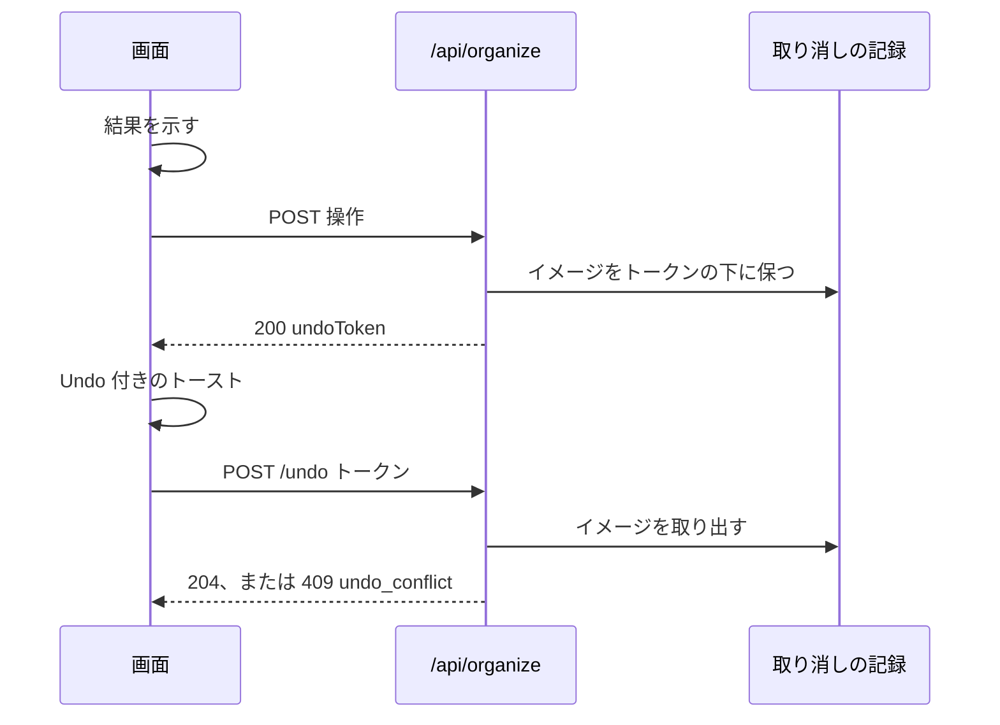

# 契約: ドラッグ操作と取り消しの画面の API {#contract-screen-api-for-drag-operations-and-undo}

正本: [api/openapi.yaml](../../../api/openapi.yaml)。このファイルは、この機能が加えるものだけを挙げる。`task generate` が `internal/httpapi/gen/` と `web/src/api/gen/` を生成し直す。どのルートも `/api/*` の既定により所有者だけで、`requiresJSONBody` に加わる。外部 API と MCP は変わらない。

図は、ドロップとその取り消しを示す。



## 共有のスキーマ {#shared-schemas}

```yaml
OrganizeRef:                       # a dragged card (R-4)
  required: [kind, id]
  properties:
    kind: { type: string, enum: [video, group] }
    id: { type: integer, format: int64 }

OrganizeRefs:
  type: array
  minItems: 1
  maxItems: 20000
  items: { $ref: OrganizeRef }     # screen order

OrganizeResult:
  required: [undoToken]
  properties:
    undoToken: { type: string }
    groupId: { type: integer, format: int64 }   # the new group, from /group only
```

どの操作も `200 OrganizeResult` で応答する。

## `POST /api/organize/reorder` {#post-apiorganizereorder}

1 つのグループのドラッグした項目をまとめて動かす (要件 1)。

| フィールド | 型 | 必須 | 意味 |
| --- | --- | --- | --- |
| `groupId` | int64 | はい | 開いているグループ |
| `itemIds` | int64[] | はい | 画面の順のグループの項目の id、1 から 20000 個 |
| `after` | int64 | いいえ | それらが後に続く項目。ないときは先頭 |

## `POST /api/organize/move` {#post-apiorganizemove}

ドラッグしたカードをグループに入れるか、グループの間で動かすか、取り出す (要件 3、7 の入れ子、9、10)。

| フィールド | 型 | 必須 | 意味 |
| --- | --- | --- | --- |
| `items` | `OrganizeRefs` | はい | ドラッグしたカード |
| `from` | int64 | いいえ | それらが離れる、開いているグループ |
| `to` | int64 | いいえ | それらが入るグループ。ないときはライブラリ |

`from` と `to` が両方ないときは `400 invalid_request` である。

## `POST /api/organize/group` {#post-apiorganizegroup}

ドラッグした動画と対象の動画からグループを作る (要件 5)。

| フィールド | 型 | 必須 | 意味 |
| --- | --- | --- | --- |
| `items` | `OrganizeRefs` | はい | 動画だけ |
| `target` | int64 | はい | ドロップ先の動画 |
| `from` | int64 | いいえ | 新しいグループを置く、開いているグループ |

## `POST /api/organize/merge` {#post-apiorganizemerge}

ドラッグしたグループを対象に統合し、ドラッグした動画を対象に付け加える。これを 1 つのトランザクションで行う (要件 8)。

| フィールド | 型 | 必須 | 意味 |
| --- | --- | --- | --- |
| `items` | `OrganizeRefs` | はい | ドラッグしたカード。少なくとも 1 つのグループを含む |
| `into` | int64 | はい | ドロップ先のグループ |

## `POST /api/organize/bundle` {#post-apiorganizebundle}

対象を代表として、ドラッグした動画をまとめる (要件 6)。

| フィールド | 型 | 必須 | 意味 |
| --- | --- | --- | --- |
| `videoIds` | int64[] | はい | ドラッグした動画 |
| `target` | int64 | はい | ドロップ先の動画で、代表 |

## `POST /api/organize/undo` {#post-apiorganizeundo}

トークンが指す操作の前の状態を戻す (要件 12)。

| フィールド | 型 | 必須 | 意味 |
| --- | --- | --- | --- |
| `token` | string | はい | 操作の `undoToken` |

**応答**: `204`。

## 取り消しトークン付きの `PATCH /api/groups/{id}` {#patch-apigroupsid-with-an-undo-token}

048 の名前変更に省略可能な本文のフィールドが 1 つ加わり、"Make a group" とその名前欄からの名前変更が 1 つの単位として取り消される (要件 12)。このフィールドがなければ、ルートは 048 のもので変わらない。本文は独自のスキーマ `GroupRename` になる。`GroupName` はトークンを受け取らない `POST /api/groups` の本文でもあるからである。

| フィールド | 型 | 必須 | 意味 |
| --- | --- | --- | --- |
| `name` | string | はい | 048 の `GroupName` と同じ |
| `undoToken` | string | いいえ | グループ `id` を作った `/group` の `undoToken` |

名前変更が成功し、`undoToken` が、新しいグループが `id` である有効な `/group` の操作を指すとき、サーバーはそのトークンの変更後イメージを名前変更の後の行で置き換えるので、トークンの取り消しは引き続きグループを削除する ([data-model.md、取り消しトークンの下での名前変更](../data-model.md#rename-under-an-undo-token))。未知の、使われた、10 分より古い、別の操作の、または別のグループのトークンは何も変えない: 名前変更はそれでも行われ、トークンは古いイメージを保つ。応答とエラーは 048 のものである。このフィールドが名前変更を失敗させることはない。

## エラー {#errors}

| ルート | ステータス | `code` | 条件 |
| --- | --- | --- | --- |
| どの操作も | `400` | `invalid_request` | 空の一覧、`/group` か `/bundle` の中のグループ、`/merge` の中にグループがないこと、または `itemIds` の中にある `after` |
| どの操作も | `404` | `group_target_not_found` | 動画、グループ、項目が存在しないか、`from` か `groupId` にない。何も書かれない |
| `/move`、`/merge` | `409` | `group_cycle` | ドラッグしたグループが対象か、その祖先の 1 つである |
| `/bundle` | `400` | `too_many_videos` | まとまりを展開した後に動画が 20 本を超える。`POST /api/video-bundles` と同じ |
| `/undo` | `409` | `undo_conflict` (新規) | 操作の後に行が変わった。何も書かれない |
| `/undo` | `410` | `undo_expired` (新規) | トークンが不明か、使用済みか、10 分より古い |

`undo_conflict` と `undo_expired` はエラーの理由の enum に加わる。
