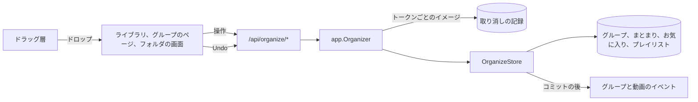
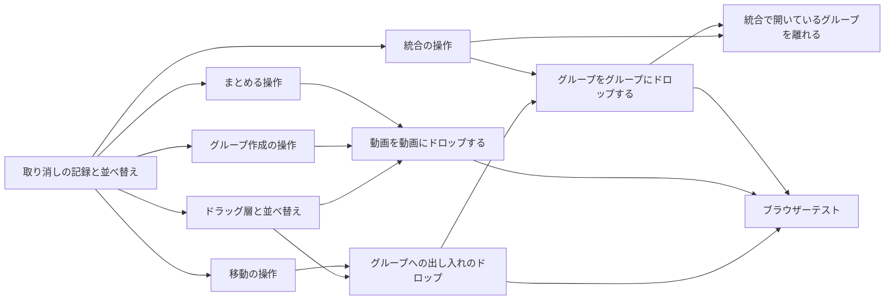

# 実装計画: ドラッグ&ドロップで並べ替え、グループにし、統合し、まとめる {#implementation-plan-drag-and-drop-to-reorder-group-merge-and-bundle}

**ブランチ**: `feature/050-drag-organize` | **親 Issue**: #1075

**入力**: 親 Issue。これがこの機能の仕様である。

## 概要 {#summary}

所有者は、ライブラリ、グループのページ、フォルダの画面でカードをドラッグして、グループを並べ替え、カードをグループに入れ、取り出し、グループを作り、グループを統合し、バージョンをまとめ、そのどれもトーストから元に戻す。各ドロップは 1 つのトランザクションで行う 1 つのサーバーの操作で、取り消しトークンを返す。サーバーは操作が変えた行を保持し、その後に何もその行を変えていなければ、取り消しでその行を書き戻す。画面は 1 つの `@dnd-kit` のドラッグ層を共有し、その層がカードの上へのドロップとカードの間へのドロップを区別する。

図は、この機能が加える部分と、それぞれが呼ぶものを示す。



| 関心事 | 方針 |
| --- | --- |
| 取り消し | 変更前と変更後の行イメージ。行がまだ変更後イメージと等しいときだけ戻す ([R-1](research.md#r-1-undo-restores-the-rows-the-operation-changed-held-by-the-server)) |
| 取り消しの寿命 | `internal/app` のメモリ上、10 分、1 回だけ使う。クライアントはそのトーストとともにそれを忘れる ([R-2](research.md#r-2-the-undo-journal-lives-in-internalapp-in-memory-for-10-minutes)) |
| 操作 | 5 つのルート、それぞれ 1 つのトランザクション ([R-3](research.md#r-3-one-route-per-drag-operation-each-in-one-transaction)、[contracts/screen-api.md](contracts/screen-api.md)) |
| ドラッグしたカード | 画面の順の動画とグループの id と、`from` ([R-4](research.md#r-4-dragged-cards-are-named-by-video-and-group-id-in-screen-order)) |
| 統合 | お気に入り、プレイリスト、親は対象に引き継がれる ([R-5](research.md#r-5-a-merge-hands-the-dropped-groups-favorites-playlist-items-and-parents-to-the-target)) |
| グループを作る | 対象が先頭、対象の場所に置く ([R-6](research.md#r-6-make-a-group-puts-the-new-group-where-the-target-was)) |
| ドラッグ層 | 1 つの `@dnd-kit` の層、上か間か、8 px か 200 ms の押下 ([R-7](research.md#r-7-one-drag-layer-on-dnd-kit-for-cards-and-rows-over-and-between)) |
| フィードバック | 結果をすぐに示し、失敗したら戻す。取り消しはトーストのアクション ([R-8](research.md#r-8-the-screen-applies-an-operation-at-once-and-puts-it-back-on-failure)、[R-9](research.md#r-9-the-undo-toast-is-the-existing-toast-with-an-action)) |

Issue には `ui` ラベルがあるので、画面の単位より前に `design` 段階が `ui-design.md` を書く。対象は、上、間、拒否の表示、選択数付きのドラッグのプレビュー、2 つのドロップのメニュー、ドロップ先としての経路の帯とライブラリ、取り消しのトーストとその失敗のメッセージ、フォルダの画面のドラッグで、親 Issue の `UI品質` に照らして判断する。

## 技術的な文脈 {#technical-context}

**正本の定義**:

| 項目 | 出典 |
| --- | --- |
| 境界、ストアの役割、コミットの後のイベント | [ARCHITECTURE.md](../../ARCHITECTURE.md)、[.golangci.yml](../../.golangci.yml) (depguard) |
| グループ、項目、入れ子、解散、`group` イベント | [048 データモデル](../048-groups/data-model.md)、[048 の契約](../048-groups/contracts/screen-api.md) |
| グループのページ、選択バー、並べ替え、失敗した編集 | [048 の UI 設計](../048-groups/ui-design.md) |
| バージョンのまとまりとユーザーキー | [030 データモデル](../030-video-versions/data-model.md) |
| ドラッグのセンサーと読み上げ | `web/src/videoList/reorder.tsx`、[044 R-9](../044-playlists/research.md#r-9-drag-reordering-with-dnd-kitcore-and-dnd-kitsortable) |
| 画面の API と生成コード | [api/openapi.yaml](../../api/openapi.yaml)、`task generate` |
| 画面と Web のテスト | [design-system.md](../../docs/design-docs/design-system.md)、[library-ui.md](../../docs/design-docs/library-ui.md)、[web-testing.md](../../docs/design-docs/web-testing.md)、[i18n.md](../../docs/design-docs/i18n.md) |
| 検査 | [Taskfile.yml](../../Taskfile.yml) (`task check`、`task check-docs`、`task test-e2e`) |

**この機能に固有の文脈**:

- マイグレーションはない ([data-model.md](data-model.md))。新しいストアの役割が 1 つ、`OrganizeStore`、新しいユースケースが 1 つ、`app.Organizer`。
- 6 つのルートと 2 つのエラーコードを加え、1 つのルートを変える: 048 の `PATCH /api/groups/{id}` は、自身の本文のスキーマ `GroupRename` で省略できる `undoToken` を受け取る ([contracts/screen-api.md](contracts/screen-api.md#patch-apigroupsid-with-an-undo-token))。
- フォルダの画面には今は選択がないので、1 度に 1 枚のカードをドラッグする。要件 11 は選択がある場所 (ライブラリとグループのページ) に当てはまる。
- `POST /api/organize/merge` は、開いているグループである省略できる `from` を受け取る。そのため、グループのページからの統合は、移動と同じように、同じトランザクションの中で同じ取り消しトークンのもと、ドラッグした動画とグループをそこから取り出す ([contracts/screen-api.md](contracts/screen-api.md#post-apiorganizemerge)、[data-model.md、Operations](data-model.md#operations))。それを加える単位は [統合の操作で、`from` を使って統合したカードを開いているグループから取り出す](#take-merged-cards-out-of-the-open-group-with-from-in-the-merge-operation) である。
- 受け入れた制限: あらゆる深さのグループを並べて一覧にするライブラリのお気に入りの絞り込みでは、自分の子孫にドロップしたグループを拒むのはサーバーの `409 group_cycle` だけであり、画面はそれをカードを元に戻した失敗のトーストとして示す (R-8)。画面は前もって拒否を示さない。何も書かれず (要件 15 は守られる)、契約は変わらない。`ui-design.md` はこれを拒否の規則の例外として記す ([What a drop does](ui-design.md#what-a-drop-does))。

## 憲章の確認 {#constitution-check}

| 規則 (出典) | 判定 |
| --- | --- |
| アダプターは互いも `internal/app` も import しない (ARCHITECTURE.md、depguard) | 合格: `internal/httpapi` が `Organizer` インターフェースを宣言し、`app.Organizer` がそれを満たす。`app.Organizer` はストアのインターフェースを宣言し、そのインターフェースを `OrganizeStore` が満たす。また、イメージをバイト列として持つ |
| ドメインが決め、ストアが強制する (ARCHITECTURE.md) | 合格: 入れ子、新しいグループの名前、統合の計画は `internal/domain` の規則である。ストアはそれらの入力を自分のトランザクションの中で読む |
| ストアの役割 (ARCHITECTURE.md) | 合格: 操作はグループとまとまりにまたがるので、新しい役割 `OrganizeStore` に属する。この役割は `GroupStore` と `VersionStore` を呼ぶ代わりに、それらとパッケージ非公開のヘルパーを共有する |
| イベントはコミットの後 (ARCHITECTURE.md) | 合格: 操作と取り消しは、コミットの後に `GroupsChanged` と `VideoBundleChanged` を発行する |
| ユーザーデータは作り直しを越えて残る (ARCHITECTURE.md) | 合格: テーブルは加えない。記録はメモリだけにあり、取り消しは行をそれ自身の id とキーで戻す |
| どの読み取りも閲覧者を知っている (ARCHITECTURE.md) | 合格: どのルートも書き込みで、`/api/*` の既定により所有者だけである。ゲストはドラッグを得ない |
| 生成ファイルを手で編集しない (AGENTS.md) | 合格: `api/openapi.yaml` を変え、`task generate` を実行する |
| 複雑度は 25 以下、コードを写さない (AGENTS.md) | 合格: `appendGroupMembers` を、動画とグループの 1 つの順序付きの一覧を受け取るように一般化する (今はすべての動画をすべてのグループより先に付け加え、画面の順を崩すことになる)。操作はそれを、`dissolveGroup`、`moveItemAfter`、まとめる処理の本体とともに、共有のヘルパーとして `GroupStore` の追加と共有する。ドラッグ層は `videoList/reorder.tsx` を写さずに拡張する |
| 画面の前に design-system.md を読む。最も低いレベルでテストする (AGENTS.md) | 合格: 画面は `ui-design.md` に従う。規則はドメインのテスト、操作と取り消しはストアのテスト、画面はページテスト、受け入れ条件は 1 つのブラウザーテストを得る |

違反はないので、複雑さの記録はない。

## プロジェクトの構成 {#project-structure}

### 文書 (この機能) {#documentation-this-feature}

```text
specs/050-drag-organize/
├── plan.md
├── research.md
├── data-model.md
└── contracts/
    └── screen-api.md
```

`ui-design.md` は `design` 段階が書く。`quickstart.md` はない: どの受け入れ条件とエッジケースも、ストア、ハンドラー、ページのテストか、下のブラウザーテストで届く。

### ソースコード {#source-code}

**影響する境界**:

| 境界 | この機能で持つもの |
| --- | --- |
| `internal/domain` | `PlanGroupMerge`、新しいグループの名前、`ErrUndoConflict`、`ErrUndoExpired` |
| `internal/store` | `OrganizeStore`: 5 つの操作、そのイメージ、戻す処理、取り消しトークンの下での名前の変更 |
| `internal/app` | `Organizer`: 取り消しの記録、取り消しトークンの下での名前の変更 |
| `internal/httpapi`、`api/openapi.yaml`、`cmd/mdm` | 6 つのルート、エラーコード、名前の変更の `undoToken`、配線 |
| `web/src/api` | `organize.ts`、6 つのルートのクライアント |
| `web/src/videoList`、`web/src/ui` | ドラッグ層。トーストのアクション |
| `web/src/library`、`web/src/groups`、`web/src/folders`、`web/src/i18n` | 各画面でのドロップ、ドロップのメニュー、カタログの文言 |
| `web/e2e` | ブラウザーテスト |

**新しいパス**: `internal/store/organize.go`、`internal/app/organizer.go`、`internal/httpapi/organize.go`、`web/src/api/organize.ts`、`web/src/videoList/cardDrag.tsx`、`web/e2e/drag-organize.e2e.ts`。

**構成の判断**: バックエンドの操作は、取り消しの記録の単位の後に 1 単位に 1 つずつ入る。そのため各画面の単位は、自分が呼ぶ操作だけに依存する。

## 実装作業 {#implementation-work}

図は、どの単位が先に入る必要があるかを示す。画面の単位は `design` 段階の `ui-design.md` も待つ。



### サーバー側の記録でドラッグ操作を取り消せるようにし、グループの並べ替えから始める {#undo-drag-operations-with-a-server-side-journal-starting-with-reordering-a-group}

**範囲**: イメージの取得、直列化、条件付きの復元を持つ `OrganizeStore`。記録を持つ `app.Organizer`。`POST /api/organize/reorder` と `POST /api/organize/undo`、`undo_conflict` と `undo_expired` のコード、`cmd/mdm` の配線、その 2 つのための `web/src/api/organize.ts` ([data-model.md、Undo image](data-model.md#undo-image)、[contracts/screen-api.md](contracts/screen-api.md))。

**依存**: なし。

**受け入れ**: `task check` が通り、`task generate` で差分が出ない。ストアのテストが、5 つのうちドラッグした 3 つの項目が最初の項目の後へまとまって動いて順序を保ち、取り消しが同じ項目の id で 5 つを元に戻すことを示す。そのグループの別の並べ替えの後の取り消しは `ErrUndoConflict` で、何も変えない。アプリのテストが、トークンが 2 回使われたとき、10 分の後、より新しいトークンが 100 個保たれた後に拒否されることを示す。ハンドラーのテストが、2 つのルートについて契約の表のすべてのステータスと、ゲストへの `401` を示す。

### 1 つの操作でカードをグループの間で移し、入れ子にし、取り出す {#move-nest-and-take-out-cards-between-groups-in-one-operation}

**範囲**: 移動の規則とそのイメージを持つ `POST /api/organize/move` ([data-model.md、Operations](data-model.md#operations))。

**依存**: サーバー側の記録でドラッグ操作を取り消せるようにし、グループの並べ替えから始める。

**受け入れ**: `task check` が通り、`task generate` で差分が出ない。ストアのテストが次を示す: A から B へ移した動画は B にあり、A にない (受け入れ条件 6)。3 つの参照が画面の順でグループに入る (受け入れ条件 7)。すでに `to` にある動画は `from` を離れるだけである。グループを自分の子孫に移すと `ErrGroupCycle` で、何も書かれない。A の最後の項目を外に移すと A が解散し、取り消しは A をその id、お気に入り、プレイリストの項目とともに戻す。取り出したフォルダのメンバーはその除外を書き、取り消しはそれを取り除く。

### 1 つの操作で、ドラッグした動画とその対象からグループを作る {#make-a-group-from-a-dragged-video-and-its-target-in-one-operation}

**範囲**: グループ作成の規則を持つ `POST /api/organize/group` ([R-6](research.md#r-6-make-a-group-puts-the-new-group-where-the-target-was))、およびその操作のトークンの下での名前の変更: `GroupRename` スキーマにある `PATCH /api/groups/{id}` の省略できる `undoToken`、それを `app.Organizer` に渡すハンドラー、トークンの変更後イメージを置き換える Organizer と `OrganizeStore` の手順 ([contracts/screen-api.md](contracts/screen-api.md#patch-apigroupsid-with-an-undo-token)、[data-model.md、Rename under an undo token](data-model.md#rename-under-an-undo-token))。

**依存**: サーバー側の記録でドラッグ操作を取り消せるようにし、グループの並べ替えから始める。

**受け入れ**: `task check` が通り、`task generate` で差分が出ない。ストアのテストが次を示す: B にドロップした A は、B のタイトルを名前とし、B、A の順に持つグループを作る (受け入れ条件 2)。`from` があると、グループは B の位置を取り、A と B は `from` を離れる。120 文字のタイトルは 100 文字に切られる。取り消しはグループを削除し、A と B をそれぞれの位置に戻す。新しいグループをお気に入りにした、プレイリストに加えた、別のグループに入れた、トークンなしで名前を変えた後では、取り消しは `ErrUndoConflict` で、何も変えない。トークン付きで名前を変えた後では、取り消しは名前を変えたグループを削除し、A と B を戻す。アプリのテストが次を示す: 未知の、使用済みの、期限切れの、並べ替えのものである、または別のグループのためのトークンを付けた名前の変更は、グループの名前を変え、トークンのイメージを保つ。名前の変更の最中にそのトークンを取り消すと、取り消しは名前の変更を待つ。ハンドラーのテストが次を示す: `undoToken` のない `PATCH /api/groups/{id}` は 048 のとおりに応答し、ある場合も同じ応答を返し、トークンが原因で失敗することはない。

### 1 つの操作で、ドラッグしたグループを対象のグループに統合する {#merge-dragged-groups-into-a-target-group-in-one-operation}

**範囲**: `POST /api/organize/merge`、`domain.PlanGroupMerge` ([R-5](research.md#r-5-a-merge-hands-the-dropped-groups-favorites-playlist-items-and-parents-to-the-target))。

**依存**: サーバー側の記録でドラッグ操作を取り消せるようにし、グループの並べ替えから始める。

**受け入れ**: `task check` が通り、`task generate` で差分が出ない。ドメインのテストが計画の行 (すでに Y を持つ親、Y の子孫である親、両方を持つプレイリスト) を扱う。ストアのテストが次を示す: Y は自分の項目の後に X の項目を順に持ち、X はなくなる (受け入れ条件 4)。お気に入りの X を統合すると、Y はお気に入りになる。X のプレイリストの項目と親の項目は、X の位置で Y のものになる。動画と X をこの順に選ぶと、1 つのトランザクションで、動画、続いて X の項目を付け加える。統合した自動の X は `ungroup` を書く。取り消しは X をその id、項目、お気に入り、プレイリストの項目、親とともに戻し、Y を元のとおりに戻す。

### 1 つの操作で、対象を代表としてドラッグした動画をまとめる {#bundle-a-dragged-video-with-its-target-as-the-representative-in-one-operation}

**範囲**: `VersionStore.Bundle` と共有するまとめる処理の本体の上の `POST /api/organize/bundle` と、まとまりのイメージ ([data-model.md、Undo image](data-model.md#undo-image))。

**依存**: サーバー側の記録でドラッグ操作を取り消せるようにし、グループの並べ替えから始める。

**受け入れ**: `task check` が通り、`task generate` で差分が出ない。ストアのテストが次を示す: B にドロップした A は、B を代表とするまとまりを作る (受け入れ条件 3)。すでにまとまっている A はそのまとまり全体を連れてくる。取り消しは新しいまとまりとそのコピーしたユーザーデータを取り除き、吸収したまとまりをその id とともに戻し、グループとプレイリストの項目を古いキーの下に戻す。`POST /api/video-bundles` のテストは引き続き通る。

### カードをドラッグし、取り消しのトースト付きでグループの項目を並べ替える {#drag-cards-and-reorder-a-groups-items-with-an-undo-toast}

**範囲**: グリッドと一覧のための `web/src/videoList/cardDrag.tsx` のドラッグ層 (センサー、上と間、拒否の状態、ドラッグのプレビュー、Esc)。所有者だけ。`ui/Toast.tsx` のトーストのアクション。取り消しのトーストとその失敗。`/api/organize/reorder` を通したグリッドと一覧でのグループのページの並べ替えで、ドラッグでの項目ごとの移動を置き換え、選択した複数の項目をまとめて動かす。カタログの文言 ([R-7](research.md#r-7-one-drag-layer-on-dnd-kit-for-cards-and-rows-over-and-between)、[R-8](research.md#r-8-the-screen-applies-an-operation-at-once-and-puts-it-back-on-failure)、[R-9](research.md#r-9-the-undo-toast-is-the-existing-toast-with-an-action))。

**依存**: サーバー側の記録でドラッグ操作を取り消せるようにし、グループの並べ替えから始める。`design` 段階の `ui-design.md`。

**受け入れ**: この単位は画面を変えるので、`ui-design.md` と親 Issue の `UI品質` に照らした、マウスとタッチでの見た目と操作のレビューが要る。`task check` が通る。ページテストが次を示す: 3 枚目のカードを先頭にドロップすると、`after` なしで `reorder` を送る。選択した 2 枚のカードはその順でまとまって動く。Undo を押すと `undo` を送り、古い順序を示す。`409 undo_conflict` は取り消しが失敗したと伝え、グループを読み直す。失敗した並べ替えは、その前に示していた順序を戻す。ドラッグ中の Esc は何も送らない。動かさないクリックはカードを開く。ゲストにはドラッグがない。

### カードをグループの中、経路の上、外のライブラリへドロップする {#drop-cards-into-a-group-onto-the-trail-and-out-to-the-library}

**範囲**: ライブラリとグループのページでのドロップ先としてのグループカード、グループのページでのドロップ先としての経路の帯のグループとライブラリ、1 つとしてドラッグする選択、ドラッグしたグループ自身かその子孫への拒否されるドロップを、`/api/organize/move` を通して扱う。

**依存**: カードをドラッグし、取り消しのトースト付きでグループの項目を並べ替える。1 つの操作でカードをグループの間で移し、入れ子にし、取り出す。

**受け入れ**: この単位は画面を変えるので、`ui-design.md` に照らした見た目と操作のレビューが要る。`task check` が通る。ページテストが次を示す: ライブラリでグループカードにドロップした動画は、`to` 付きの `move` を送る。グループのページで別のグループにドロップしたカードは `from` と `to` を送る (受け入れ条件 6)。経路のライブラリにドロップしたカードは `from` だけを送る。選択した 3 枚のカードは画面の順で 3 つの参照を送る (受け入れ条件 7)。自分自身の上にあるグループカードは拒否の状態を示し、そのドロップは何も送らない。Undo はカードを元に戻す。

### 動画を動画にドロップして、グループを作るかバージョンをまとめる {#drop-a-video-on-a-video-to-make-a-group-or-bundle-versions}

**範囲**: ライブラリ、グループのページ、フォルダの画面での動画から動画へのドロップ、「Make a group」と「Bundle as versions」を持つそのメニュー、名前をすぐに変えられる新しいグループのカード、代表のダイアログなしのまとめを、`/api/organize/group` と `/api/organize/bundle` を通して扱う。

**依存**: カードをドラッグし、取り消しのトースト付きでグループの項目を並べ替える。1 つの操作で、ドラッグした動画とその対象からグループを作る。1 つの操作で、対象を代表としてドラッグした動画をまとめる。

**受け入れ**: この単位は画面を変えるので、`ui-design.md` に照らした見た目と操作のレビューが要る。`task check` が通る。ページテストが次を示す: 「Make a group」で B の上に置いた A は、`target` が B の `group` を送り、B のタイトルを名前とするグループカードを 1 枚示す (受け入れ条件 2)。「Bundle as versions」では `target` が B の `bundle` を送り、ダイアログを開かない (受け入れ条件 3)。グループのページでは、新しいカードは B の場所にある。フォルダの画面では 1 枚のカードがドラッグされる。メニューを閉じると何も送らない。

### グループをグループにドロップして、入れ子にするか統合する {#drop-a-group-on-a-group-to-nest-or-merge-it}

**範囲**: ライブラリとグループのページでのグループからグループへのドロップと、「Put in as a child group」と「Merge」を持つそのメニューを、`/api/organize/move` と `/api/organize/merge` を通して扱う。

**依存**: カードをグループの中、経路の上、外のライブラリへドロップする。1 つの操作で、ドラッグしたグループを対象のグループに統合する。

**受け入れ**: この単位は画面を変えるので、`ui-design.md` に照らした見た目と操作のレビューが要る。`task check` が通る。ページテストが次を示す: 「Merge」で Y の上に置いた X は、`into` が Y の `merge` を送り、X のカードは消える (受け入れ条件 4)。「Put in as a child group」では `to` が Y の `move` を送る (受け入れ条件 5)。グループにドロップした動画とグループの選択は、`merge` か `move` の 1 つの要求を、すべてのカードを画面の順に持たせて送る。

### 統合の操作で、`from` を使って統合したカードを開いているグループから取り出す {#take-merged-cards-out-of-the-open-group-with-from-in-the-merge-operation}

**範囲**: `POST /api/organize/merge` の省略できる `from` ([contracts/screen-api.md](contracts/screen-api.md#post-apiorganizemerge)): `api/openapi.yaml` と `task generate`。統合の規則の `from` からの取り除きと `OrganizeStore` でのそのイメージ、取り除きが変える場合の `domain.PlanGroupMerge` の入力、`from` を渡す `app.Organizer` とハンドラー ([data-model.md、Operations](data-model.md#operations)、[Undo image](data-model.md#undo-image))。`from` を受け取る `web/src/api/organize.ts` の `mergeGroups`。「Put in as a child group」と同じように開いているグループを `from` として送る、グループのページの「Merge」。ライブラリは `from` を送らない。`ui-design.md` の [Group page](ui-design.md#group-page) はすでに目標どおりであり (「持ち上げたカードは消える」)、変わらない。

**依存**: 1 つの操作で、ドラッグしたグループを対象のグループに統合する。グループをグループにドロップして、入れ子にするか統合する。

**受け入れ**: この単位は画面を変えるので、`ui-design.md` の [Group page](ui-design.md#group-page) に照らした、グループのページの「Merge」の見た目と操作のレビューが要る。`task check` が通り、`task generate` で差分が出ない。ストアのテストが次を示す: 動画 V、グループ X、グループ Y を持つグループ G で、V と X を `from` G で Y に統合すると、1 つのトランザクションで、G は Y だけを持ち、Y は自分の項目、続いて V、続いて X の項目を順に持つ。`from` にないドラッグした動画は `ErrGroupTargetNotFound` で、何も書かれない。`from` がないと、操作は前と同じように応答する。1 つのトークンの取り消しは、V と X を G の元の位置に戻し、X をその id、項目、お気に入り、プレイリストの項目、親とともに戻し、Y を元のとおりに戻す。ハンドラーのテストが、`from` が Organizer に届き、契約の状態コードがそれとともに成り立つことを示す。ページテストが次を示す: グループのページで、動画とグループの選択を「Merge」で子グループにドロップすると、開いているグループを `from` とし、すべてのカードを画面の順に持つ 1 つの `merge` を送り、持ち上げたカードは消えて件数が減る。Undo はそれらを戻す。ライブラリの「Merge」は `from` を送らない。`task test-e2e -- e2e/drag-organize.e2e.ts` が、この単位がそのファイルに加えるケースとともに通る: グループのページで、選択した動画と選択したグループを「Merge」で兄弟のグループにドロップするとページを離れ、兄弟はその動画とグループのメンバーを持ち、Undo は両方のカードをグループのページの元の位置に戻す。

### ドラッグでの整理をブラウザーテストで確かめる {#cover-drag-organizing-in-a-browser-test}

**範囲**: 本物のサーバーとメディアに対する、マウスとタッチデバイスのプロファイルでの `web/e2e/drag-organize.e2e.ts` ([web-testing.md、Test levels](../../docs/design-docs/web-testing.md#test-levels))。

**依存**: カードをグループの中、経路の上、外のライブラリへドロップする。動画を動画にドロップして、グループを作るかバージョンをまとめる。グループをグループにドロップして、入れ子にするか統合する。

**受け入れ**: `task test-e2e -- e2e/drag-organize.e2e.ts` が通り、親 Issue の受け入れ条件 1 から 9 を示す: 並べ替えは再読み込みを越えて残り、グループカードは新しい最初の動画のサムネイルを取る (1)。B の上の A は、B のタイトルを名前とするグループ (2) と、B を代表とするまとまり (3) を作る。統合は X のメンバーとお気に入りを Y に移す (4)。入れ子は Y の中に X を示す (5)。A から B への移動 (6)。選択した 3 枚のカードは順序を保つ (7)。それぞれの後の Undo は前の状態を戻す (8)。動画のページにはドラッグできるカードもメンバーもない (9)。
