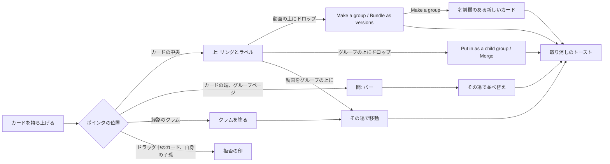
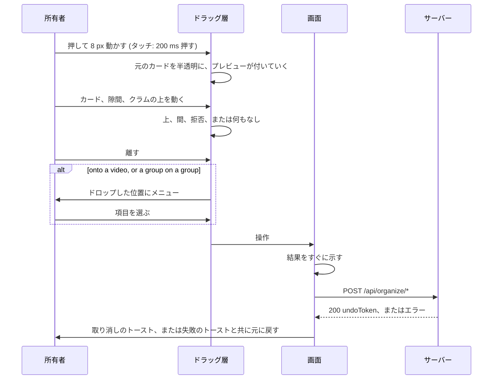
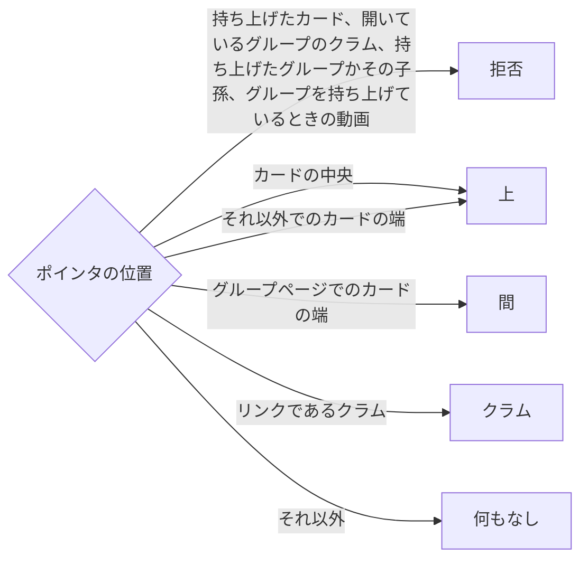
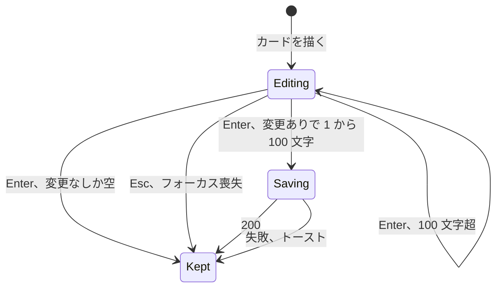
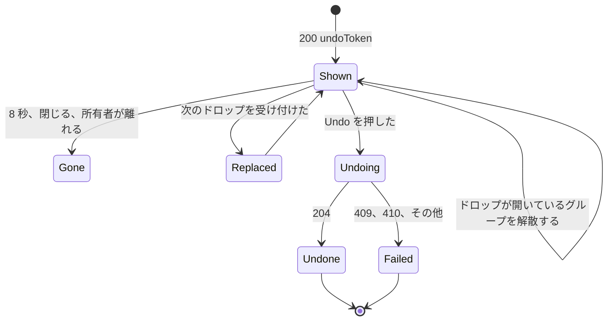

# UI 設計: ドラッグ&ドロップでの並べ替え、グループ化、統合、まとめ {#ui-design-drag-and-drop-to-reorder-group-merge-and-bundle}

**機能**: [親 Issue #1075](https://github.com/syudead/vv/issues/1075) · [plan.md](plan.md) · [research.md R-4](research.md#r-4-dragged-cards-are-named-by-video-and-group-id-in-screen-order) · [R-6](research.md#r-6-make-a-group-puts-the-new-group-where-the-target-was) · [R-7](research.md#r-7-one-drag-layer-on-dnd-kit-for-cards-and-rows-over-and-between) · [R-8](research.md#r-8-the-screen-applies-an-operation-at-once-and-puts-it-back-on-failure) · [R-9](research.md#r-9-the-undo-toast-is-the-existing-toast-with-an-action) · [data-model.md、Operations](data-model.md#operations) · [contracts/screen-api.md](contracts/screen-api.md)

すでに決まっていることを定める出典。ここでは繰り返さずリンクする。

| 話題 | 出典 |
| --- | --- |
| トークン、閉じた尺度、ライブラリの密度 | [design-system.md、Foundations](../../docs/design-docs/design-system.md#foundations)。値は [`web/src/ui/tokens.css`](../../web/src/ui/tokens.css) の `@theme` にあり、ここでは名前で示し、写さない |
| `DropdownMenu`、`Badge`、`Input`、`Sonner`、`VideoThumbnail`: それぞれの用途 | [components.md](../../web/registry/rules/components.md) |
| ライブラリのカードと行、グループカード、選択と選択バー | [library-ui.md、Cards](../../docs/design-docs/library-ui.md#cards)、[List view and selection](../../docs/design-docs/library-ui.md#list-view-and-selection)、[017 UI 設計、Group card](../017-folder-groups/ui-design.md#group-card) |
| グループカードのチェックが何を選ぶか、"Favorite" が選択をグループと動画にどう分けるか | [017 UI 設計、Pressing and selection](../017-folder-groups/ui-design.md#pressing-and-selection)、[035 UI 設計、Selection bar](../035-favorites/ui-design.md#selection-bar) |
| グループページ: 経路の帯、ヘッダー、グリッドとリストの本体、ハンドルでの並べ替え、失敗した編集、消えた状態 | [048 UI 設計、Group page](../048-groups/ui-design.md#group-page)、[Reordering](../048-groups/ui-design.md#reordering)、[Edits that fail](../048-groups/ui-design.md#edits-that-fail)、[Dissolving](../048-groups/ui-design.md#dissolving) |
| プレイリスト画面の持ち上げた行と、そのキーボード操作 | [044 UI 設計、Reordering](../044-playlists/ui-design.md#reordering)、[`web/src/videoList/reorder.tsx`](../../web/src/videoList/reorder.tsx) |
| カード上のホバープレビューとスクラブ帯 | [032 UI 設計](../032-card-scrub-preview/ui-design.md) |
| まとめるダイアログ、代表、20 本の上限 | [030 UI 設計](../030-video-versions/ui-design.md) |
| フォルダ画面のカードとパンくずの帯 | [011 UI 設計](../011-folder-browser/ui-design.md)、[`web/src/folders/Breadcrumbs.tsx`](../../web/src/folders/Breadcrumbs.tsx) |
| 通知の位置と、同時にいくつ出るか | [library-ui.md、Width breakpoints](../../docs/design-docs/library-ui.md#width-breakpoints-in-css-and-the-sidebar-exception)、[`web/src/ui/Toast.tsx`](../../web/src/ui/Toast.tsx) |
| ゲストでの縮退 | [016 UI 設計、Guest degradation](../016-single-account-auth/ui-design.md#guest-degradation) |
| 画面の文言 | [`web/src/i18n/en.ts`](../../web/src/i18n/en.ts)(`common`、`list.card`、`library.selection`、`groups`、`versions.bundle`、`errorCodes`)。この機能は `organize` と下の文言を加える |

図は、この機能が加える部分と、それぞれの行き先を示す。

変わらないもの: カード、行、隅の印、選択のチェックと選択バー。グループページのハンドル、そのキーボードでの並べ替え、その `×`。048 のメニュー、ピッカー、ダイアログ。選択バーから開く 030 のまとめるダイアログ。動画カードがドラッグできるようになる点を除いたフォルダ画面。動画ページと他のすべての詳細画面。これらは何もドラッグしない(要件 13)。トークンは加えず、`web/src/theme/tokens.test.ts` のコントラストの組も増えない。表示はカードがすでに使う場所で `primary`、`primary-soft`、`overlay` を使う。デザインシステムが変わるのは 2 か所だ。[components.md](../../web/registry/rules/components.md#sonner) の `Sonner` の規則に取り消しの形、つまり操作を 1 つ持ち 8 秒残る通知が加わり([取り消しのトースト](#undo-toast))、`useToast` がその操作を受け取る(R-9)。`Breadcrumbs` に、`md` 未満で最初のクラムを残すオプションが加わり、グループページがそれを設定する([グループページ](#group-page))。

## この形にした理由 {#why-this-shape}

ドロップと並べ替えは、手を離す前に、似ていない 2 つの印で見分けられる。ドラッグ中のカードを受け取るカードは箱全体を囲む `primary` のリングと、何が起こるかを言うサムネイル上のラベル("Put in"、"Group or bundle…")を示す。カードの間の場所は隙間に細い `primary` のバーを示し、リングは出さない(`UI品質` の 1 点目)。リングは選択のリングのようにサムネイルではなくカードの箱に付くので、選択したカードとドロップ先を取り違えない。リングだけにせずラベルを選んだのは、同じリングが 3 つの異なる意味(入れる、2 項目のメニュー、移動)を持つことになり、所有者はドロップの後ではなく前にどれかを知るべきだからだ。プレイリストの行のように他のカードを脇へ動かして挿入位置を示す案は、グリッドでは採用しなかった。カードは行をまたいで流れ直すので、ポインタが動く間に隙間が列の間を跳び、「間」の印が「グリッドを読み込み直している」の印に見えてしまう。

ドラッグ中のカードは半透明でその場に残り、持ち上げたカードの写しが、動くものの数を添えてポインタに付いていく。カードはドロップまで元の場所を離れない。拒否されたドロップや閉じたメニューは画面を元のままにしなければならず(Edge Cases)、すでに消えたカードは戻ってこなければならなくなるからだ。写しは縮めたアイコンではなく、持ち上げたカードのサムネイルとタイトルをカードの幅で示す。所有者は動画をサムネイルで見分けるからだ(048 の `UI品質`、`情報密度`)。写しの上の数のバッジが、いくつ一緒に動くかを示す(要件 11)。

動画の上へのドロップと、グループのグループの上へのドロップは、ドロップした位置に 2 項目のメニューを開く(要件 4 と 7)。メニューはデザインシステムの `DropdownMenu` で、ドロップ先の名前をラベルにする。問いが「この 2 つをどうするか」であり、それを問う最小の部品がメニューだからだ。2 つのどちらかを修飾キーで選ぶ案は採用しなかった。タッチでは形がなく(要件 14)、それがあることを画面の何も示さない。グループの上にドロップした動画には問いが要らないので、その場で移動する(要件 3)。

"Make a group" はドロップ先があった場所にグループカードを 1 枚残し、カードの名前はタイトルを選択した編集欄になる(要件 5)。デスクトップで新しいフォルダに名前を付けるように、入力すると仮の名前を置き換え、Enter で確定する。この時点で 048 の名前変更ダイアログを使う案は採用しなかった。ダイアログを避けるためにドロップを選んだからだ。後から名前を変える方法としてはダイアログが残る。フォルダ画面はフォルダの動画を 1 本ずつ並べ、グループカードを出さないので、そこでは同じ欄をドロップ先のカードに付いたポップオーバーで開き、2 枚のカードはフォルダの動画のまま残る。

どの操作も、"Undo" の付いたトースト 1 つで終わる(要件 12)。トーストは既存の `Sonner` の通知に操作と長めの表示時間を加えたものだ。通知がすでに出る場所(`lg` 以上では選択バーの上の下部中央、それ未満ではトップバーの下の右)に出るので、所有者が作業中のカードを覆わず、表示中に次のドラッグを始められる(`UI品質` の 4 点目)。"Undo" を持つのは最後の操作のトーストだけだ。新しいドロップは前の取り消しのトーストを置き換える。画面に取り消しが 2 つあると順序の問題が生じ、サーバーは行がその後変わった取り消しを拒否する(`409 undo_conflict`)からだ。トーストは 8 秒残る。結果を読んでボタンに届くには十分長く、次のいくつかの操作が積み重なる前に消えるには十分短い。

## 文言 {#words}

`web/src/i18n/en.ts` の `organize` の下の文言。キーを名指しした所は除く。利用者のデータ(タイトル、グループ名)は引数として埋め込む。`items`、`videos`、`groups` はカタログの "1 item" / "N items" の補助関数だ。

| 場所 | 文言 | 注記 |
| --- | --- | --- |
| グループカード上のドロップのラベル、動画をドラッグ中 | Put in | `organize.drop.putIn` |
| 動画カード上のドロップのラベル | Group or bundle… | `organize.drop.groupOrBundle` |
| グループカード上のドロップのラベル、ドラッグ中のものにグループを含む | Put in or merge… | `organize.drop.putInOrMerge` |
| 拒否の印、アクセシブルな名前 | Can't drop here | `organize.drop.refused`。プレビュー上の `Ban` バッジ |
| プレビュー上の数のバッジ、アクセシブルな名前 | 3 items | `items(count)`。バッジは数だけを示す |
| メニューのラベル | Dropped on "{name}" | `organize.menu.label(name)`。`DropdownMenuLabel` |
| メニュー項目、動画を動画に | Make a group; Bundle as versions | `organize.menu.makeGroup`。`library.selection.bundle` |
| まとめる項目が無効 | Bundle up to 20 videos at a time | `library.selection.bundleOverLimit(20)`。`disabled` の項目のツールチップ |
| メニュー項目、グループをグループに | Put in as a child group; Merge | `organize.menu.nest`、`organize.menu.merge` |
| 名前欄、アクセシブルな名前 | Group name | `organize.name.label` |
| 名前欄、キーボードのヒント | Enter keeps the name, Esc keeps "{name}" | `organize.name.hint(name)` で、仮の名前を渡す([新しいグループの名前](#the-new-groups-name))。`aria-describedby` で、描画しない |
| 名前欄の規則 | Use a name of 1 to 100 characters. | `groups.nameRule` |
| 名前の変更に失敗 | Couldn't rename the group: {reason} | `groups.renameDialog.failed`。トースト |
| 取り消しのトースト、並べ替え | Reordered "{name}" | `organize.done.reordered(name)` |
| 取り消しのトースト、グループへの移動 | Moved {N items} to "{name}" | `organize.done.moved(count, name)` |
| 取り消しのトースト、ライブラリへの移動 | Moved {N items} out of "{name}" | `organize.done.movedOut(count, name)` |
| 取り消しのトースト、グループ化 | Made the group "{name}" | `organize.done.grouped(name)` |
| 取り消しのトースト、統合 | Merged {N groups} into "{name}"; Merged {N items} into "{name}" | `organize.done.merged(count, name, mixed)`。グループと一緒に動画をドロップしたときは "items" |
| 取り消しのトースト、まとめ | Bundled {N videos} as versions of "{title}" | `versions.bundle.bundled(count, title)` |
| 取り消しの操作 | Undo | `organize.undo` |
| 取り消した | Undone | `organize.undone`。普通のトースト |
| 取り消しに失敗、`409 undo_conflict` | Couldn't undo: it changed in the meantime | `organize.undoFailed.conflict` |
| 取り消しに失敗、`410 undo_expired` | This can no longer be undone | `organize.undoFailed.expired` |
| 取り消しに失敗、その他 | Couldn't undo: {reason} | `organize.undoFailed.other(reason)` |
| 操作に失敗 | Couldn't reorder: {reason}; Couldn't move: {reason}; Couldn't make the group: {reason}; Couldn't merge: {reason}; Couldn't bundle: {reason} | `organize.failed.reorder`、`.move`、`.group`、`.merge`。`versions.bundle.failed`。トースト |
| `group_cycle`、`group_target_not_found` | 048 と同じ | `errorCodes.group_cycle`、`errorCodes.group_target_not_found`。`{reason}` |
| 読み上げ、持ち上げ | Picked up "{title}"; Picked up {N items} | `organize.announce.pickedUp(title, count)`。dnd-kit の `onDragStart` |
| 読み上げ、上 | Over "{name}": {label}; Between cards, position {n} of {count} | `organize.announce.over(name, label)`、`organize.announce.between(position, count)`。`onDragOver` |
| 読み上げ、ドロップ、取りやめ | Dropped on "{name}"; Dropped at position {n} of {count}; Cancelled, nothing changed | `organize.announce.dropped(name)`、`.droppedAt(position, count)`、`.cancelled` |

"Put in" は要件 3 の「グループに入れる」を表すドロップの語で、048 のピッカーが "Add to group" と呼ぶのと同じ行為だ。ドロップのラベルはサムネイルの上に載るので短い。"Merge" と "Bundle as versions" は 048 と 030 の語をそのまま使う。"Undo" は 1 語だ。何をしたかはトーストがすでに言っているからだ。

## ドラッグ層 {#drag-layer}

所有者向けに、1 つの層 `videoList/cardDrag.tsx` がライブラリ、グループページ、フォルダ画面のグリッドとリストを包む(R-7)。何を持ち上げたか、ポインタが何の上にあるか、ドロップが何を意味するかは層が決める。各ドロップで何を送るかは画面が決める。図は 1 回のドラッグを示す。

### 持ち上げ {#lifting}

| 出来事 | 振る舞い |
| --- | --- |
| カードのサムネイルかタイトル(リンク)、またはリストの行の操作部品以外の所でポインタを押し、8 px 動かす | カードを持ち上げる。8 px 未満で離せばクリックで、今と同じくカードを開く。ホバー、サムネイル上のスクラブ、クリックは今と同じ感触になる(`UI品質` の 3 点目) |
| タッチ: 8 px 動かさずに 200 ms 押す | 持ち上げる。200 ms より前のスワイプは今と同じくページをスクロールする。長押しに対するブラウザのコンテキストメニューはカード上では抑える |
| 持ち上げたカードが選択されている | 選択したすべてのカードが画面の順に一緒に持ち上がる。"Favorite" が選択を分けるのと同じく、その中のグループカードはグループとして、選択したグループのメンバーでない動画は動画として扱う(要件 11) |
| 選択がある状態で、持ち上げたカードが選択されていない | そのカードだけを持ち上げる。選択はそのまま残る |
| 隅の印、選択のチェック、タグのチップ、ハンドル、`×` の上でポインタを押す | それらの部品は今と同じ動作をする。ハンドルは 044 のキーボードでの並べ替えを保ち、今と同じくポインタで行を持ち上げる |
| 持ち上げている間 | 持ち上げたカードはすべて `opacity-50` でその場に残る。プレビューがポインタに付いていく。ホバープレビューは始まらず、再生中のものは止まる。ポインタがウィンドウの上端か下端から 48 px 以内に来るとウィンドウがスクロールし、長いリストにも届く。ポインタは `cursor-grabbing` だ |
| Esc、または何もない所で離す | プレビューが 150 ms(`animate-fade-in` の長さ。動きを減らす設定では無し)でカードに戻り、カードは不透明に戻り、何も送らない(Edge Case) |
| ゲスト | 何も持ち上がらない |

プレビューは、持ち上げたカードの `VideoThumbnail` の枠をカードの幅(リスト表示では行の `w-list-thumb`)で示し、`rounded-md bg-card shadow-elevated` で、その下にタイトルを `text-sm font-medium` で 1 行に置く。複数のカードが動くときは、数を示す `Badge` `default` がプレビューの上端側の隅に付く。プレビュー上でブランドの色を塗るのはこのバッジだけなので、数が最初に読まれる。グループカードのプレビューは、カードと同じくフォルダの絵だ。

### 表示 {#indicators}

ポインタの位置が印を決め、印がドロップを決める。図はその規則を示す。

| 印 | 形 |
| --- | --- |
| 上 | ドロップ先のカードの箱(`article`、`rounded-md`)が `ring-2 ring-primary` を示す。サムネイル上には、数の表示と同じ形(`bg-overlay text-foreground text-xs font-medium rounded-md px-2 py-1`、中央寄せ)のラベルが "Put in"、"Group or bundle…"、"Put in or merge…" のいずれかを示す。リングはサムネイルではなく箱に付くので、選択のリングではない。カードの隅の印と進捗バーは残る |
| 間 | カードの高さの `w-0.5 rounded-full bg-primary` のバーを、ドロップ先のカードの前か後の隙間の中央に置く。1 列のグリッドとリスト表示では、カードか行の幅の `h-0.5` のバーを上端か下端に置く。どのカードにもリングは出さない |
| クラム | クラムの文字が `bg-primary-soft text-primary rounded-sm px-1` になる。帯の他の部分は変わらない |
| 拒否 | ドロップ先はリングもバーも示さない。プレビューの数のバッジが、"Can't drop here" という名前の lucide `Ban`(`size-3`)付きの `Badge` `destructive` に替わり、ポインタは `cursor-not-allowed` になる。離しても何も変わらない(要件 15、Edge Cases)。お気に入りの絞り込みの子孫が唯一の例外である([ドロップが何をするか](#what-a-drop-does)) |
| 何もなし | 印はない。離しても何も変わらない |

中央は、グリッドの流れの軸に沿ったカードの内側 50 % だ(2 列以上のグリッドでは幅、1 列のグリッドとリスト表示では高さ)。端は両側の 25 % だ。何も並べ替えないライブラリとフォルダ画面(Issue の `対象外`)では端も中央として扱うので、カード全体が「上」になり、隙間だけが「何もなし」になる。

### ドロップが何をするか {#what-a-drop-does}

| 持ち上げたもの | ドロップ先 | 結果 |
| --- | --- | --- |
| 動画だけ | 動画カードの中央 | メニュー "Make a group" / "Bundle as versions"([ドロップのメニュー](#drop-menus)) |
| 動画だけ | グループカードの中央 | `to` をそのグループ、グループページでは `from` を開いているグループにした `move` を、その場で(要件 3、9) |
| グループを含む | グループカードの中央 | メニュー "Put in as a child group" / "Merge" |
| グループを含む | 動画カード | 拒否: グループからグループは作らない(契約 `/group`、動画のみ) |
| 何でも | グループページのカードの間 | 持ち上げた項目をその場所へ画面の順に並べる `reorder`(要件 1、11) |
| 何でも | "Library" のクラム | `from` があり `to` のない `move`(要件 10) |
| 何でも | 祖先のクラム | `from` を開いているグループ、`to` をその祖先にした `move`(要件 10) |
| 何でも | 持ち上げたカード、開いているグループのクラム、持ち上げたグループかその子孫、折りたたんだ "…" | 拒否 |

ドロップ先のグループにすでにある動画はサーバーが飛ばし、1 回だけ現れる(Edge Case)。画面はサーバーが答える前に結果を示し(R-8)、失敗したときは示していたものを失敗のトーストと共に元に戻す。

拒否の規則の例外を 1 つ受け入れる: あらゆる深さのグループを並べて一覧にするライブラリのお気に入りの絞り込みでは、自分の子孫の上にある持ち上げたグループは、そのカードがほかのどのグループにも示す印(「上」、そして離すとメニュー)を示す。画面はそこで子孫を知らないからである。サーバーは `409 group_cycle` で操作を拒む。画面は持ち上げたカードを戻し、理由を `errorCodes.group_cycle` として失敗のトーストを出し、取り消しのトーストは出さない。何も書き込まれない(要件 15)。

## ドロップのメニュー {#drop-menus}

メニューはポインタを離した所に、ドロップ先のカードに付いた `DropdownMenu`(`side="bottom"`、ビューポート内)として開く。ドロップ先はリングとラベルを保つので、メニューは対象のカードを背に読まれる。その `DropdownMenuLabel` は "Dropped on "{name}"" と示す。持ち上げたカードは、項目を選ぶかメニューが閉じるまで半透明のままだ。

| メニュー | 項目 | 送るもの |
| --- | --- | --- |
| 動画を動画に | "Make a group"(lucide `Group`)、"Bundle as versions"(lucide `Layers`)。持ち上げたカードとドロップ先が 20 枚を超えるときは、ツールチップ "Bundle up to 20 videos at a time" 付きで `disabled`([まとめる上限](#bundle-limit)) | `target` をその動画とし、グループページでは `from` を付けた `group`。または `target` のその動画を代表とした `bundle` で、ダイアログは出さない(要件 6) |
| グループをグループに | "Put in as a child group"(lucide `FolderInput`)、"Merge"(lucide `Merge`) | `to` をそのグループにした `move`(グループページでは `from` も)。または `into` をそのグループにした `merge`。持ち上げたすべてのカードを画面の順に 1 回のリクエストで送る |

Esc、外側を押す、Tab で離れるのいずれもメニューを閉じ、カードは不透明に戻り、何も送らない。メニューに 3 つ目の項目や "Cancel" はない。どのメニューとも同じく、閉じることが取りやめだ。

### まとめる上限 {#bundle-limit}

画面はバージョンではなくカードを数える。リストの項目はバージョンの数を持たず(`VideoVersionsRef` は `GET /api/videos/{id}` にしかない)、すでにまとまりの代表であるカードはそのまとまりのメンバーをすべて連れてくる([data-model.md、操作](data-model.md#operations)、まとめ)。そのためメニューが "Bundle as versions" を無効にするのは、カードだけで 20 を超えるとき、つまり決して成功しないときだけで、残りはまとまりを展開してから数えるサーバーに任せる。メニューを開く前にすべてのカードのバージョンを読む案は採らなかった。メニューを出せるまで、ドロップが最大 20 件のリクエストを待つことになるからだ。

| 場合 | 振る舞い |
| --- | --- |
| ドロップ先を含めて 20 枚を超えるカード | 項目はツールチップ "Bundle up to 20 videos at a time" 付きで `disabled` になる。何も送らない |
| 20 枚以下のカードで、展開すると 20 本を超える動画(12 本のまとまりを 10 本のまとまりにドロップ) | 項目は有効だ。`bundle` は `400 too_many_videos` を返す。画面は持ち上げたカードを戻し、理由を `errorCodes.too_many_videos`(上限 20)として "Couldn't bundle: {reason}" を出し、取り消しのトーストは出さない。何も書き込まれない(契約 `/bundle`) |

## 新しいグループの名前 {#the-new-groups-name}

"Make a group" の後、画面は新しいグループのカードをドロップ先があった場所に示す(R-6。グループページではドロップ先の項目の位置に、ライブラリでは次の読み込みで並び順の位置に移るまでドロップ先の場所に)。カードの名前は `Input`(`h-8 text-sm`、カードのタイトルの幅)で、値は仮の名前、選択済みでフォーカスがあり、名前は "Group name" だ。仮の名前はサーバーがグループに付けた名前で、`domain.ValidateGroupName` が残すとおり、ドロップ先のタイトルを最初の 100 コードポイントで切り、前後の空白を除いたものだ([data-model.md、操作](data-model.md#operations)、グループ作成)。そのため 100 コードポイントを超えるタイトルでは、欄はタイトル全体ではなく最初の 100 コードポイントから始まるので、欄が 100 超のエラーの状態で始まることはなく、Esc はサーバーが保存したものを残す。図はこの欄の動作を示す。

| 出来事 | 振る舞い |
| --- | --- |
| 変更があり、前後の空白を除いて 1 から 100 コードポイントの名前で Enter | 本文に "Make a group" の `undoToken` を付けた `PATCH /api/groups/{id}`(048 の名前変更)。カードのタイトルはすぐに新しい名前を示す。失敗するとトースト "Couldn't rename the group: {reason}" を出し、タイトルは仮の名前に戻る。取り消しのトーストはそのまま残り、その Undo は引き続きグループを取り除く。サーバーはトークンを持つ名前変更をその操作に含めるからだ([contracts/screen-api.md](contracts/screen-api.md#patch-apigroupsid-with-an-undo-token)) |
| 名前が変わっていないか、前後の空白を除いて空で Enter、Esc、フォーカスが離れる | 欄は仮の名前のカードのタイトルになる。何も送らない |
| 100 コードポイント超 | 欄の下に `FieldError` として "Use a name of 1 to 100 characters." を出す。文字が変わるまで Enter は何もしない |
| フォルダ画面 | 同じ欄を、ドロップ先のカードの下に付いた `w-popover` の `Popover` に出す。フォルダは動画を 1 本ずつ並べ、グループカードを描かないからだ。Enter と Esc で同じように閉じ、2 枚のカードはフォルダの動画のまま残る |

この欄はカード上で唯一の文字入力部品で、ドロップ後の数秒間だけ現れる。それ以外でカードをその場で編集できることはない。取り消しのトーストはその横に出る。Undo は名前ごとグループを取り除き、この欄から名前を変えた後でもそうする。新しいグループの名前をほかの場所(048 の名前変更ダイアログ、別のタブ)で変えるとトークンを持たないので、ほかで行われた変更となり、取り消しは "Couldn't undo: it changed in the meantime" で失敗する(Edge Case)。

## 取り消しのトースト {#undo-toast}

サーバーが受け付けたどの操作も、"Undo" の操作(`Sonner` の `action`)を持つトースト 1 つで終わる。通知の 2.8 秒ではなく 8 秒残り、リスト画面で通知が出る場所に出る。図はその一生を示す。

| 状態 | 画面が示すもの |
| --- | --- |
| Shown | 文言と、末尾の操作ボタン "Undo" を持つトースト。画面はすでに結果を示している |
| Replaced | 新しく受け付けたドロップは前の取り消しのトーストを閉じて自身のトーストを出すので、画面上の "Undo" は 1 つで、最後の操作のものだ |
| Undoing | "Undo" は `disabled` になり、トーストに `Spinner` が出る。`POST /api/organize/undo` |
| Undone | トーストが閉じ、普通のトースト "Undone" が 2.8 秒出て、画面はリストを読み直すので、カードは元の場所に戻り、新しいグループのカードは消え、統合したグループのカードは戻る。グループページでは帯、タイトル、件数が応答に従う |
| Failed | トーストが閉じて失敗のトーストが出る。`409` では "Couldn't undo: it changed in the meantime"、`410` では "This can no longer be undone"、それ以外では理由。画面はリストを読み直すので、サーバーにあるものを示す(Edge Case) |
| Gone | トーストが時間切れになったか、閉じられたか、所有者が画面を離れた(所有者によるルートの変更: リンク、サイドバー、Back)。トークンは忘れられ、操作はそのまま残る(Edge Case) |
| Carried | 開いているグループからすべての項目を取り出すドロップはそのグループを解散し、画面は [048 Dissolving](../048-groups/ui-design.md#dissolving) と同じく親かライブラリへ離れる。このルートの変更は所有者が離れたのではなく操作自身の結果なので、取り消しのトーストとそのトークンはそれを越えて残り、ドロップからの 8 秒を保ち、Undo は移った先の画面で働く |

失敗した操作は取り消しのトーストを出さない。画面はドロップ前に示していたものに戻し、失敗のトーストが理由を示す(Edge Case)。グループページでの `404 group_target_not_found` では、さらに 048 のトースト "The group changed in the meantime, so it was reloaded" と共にグループを読み直す。

## グループページ {#group-page}

どちらの表示でも並べ替えられる。グリッドではカードを [持ち上げ](#lifting) のとおりに持ち上げてカードの間にドロップする。リストでは行を操作部品以外のどこからでも、または今と同じくハンドルで持ち上げ、行の間にドロップする。ドロップは、ハンドルが送っていた項目ごとの移動に代えて、持ち上げた項目を画面の順に並べ、`after` をバーの前の項目(先頭では無し)にした `reorder` を 1 回送り、順序はその場で変わる。ハンドルのキーボード操作(Space、矢印、Space)は 044 の形を保ち、項目 1 つで同じ `reorder` を送る。ツールバーには検索も絞り込みもないので、並べ替えは絞り込みなしで行うという Issue の規則は、状態を持たずに成り立つ。

経路の帯のクラムはドロップ先になる([表示](#indicators)): "Library" のクラムと各祖先。`md` 未満では、クラムが 4 つ以上になると、グループページの帯は "Library" を残し、それと親の間の祖先だけを折りたたむ: "Library › … › {parent} › {name}"。フォルダの帯の形 "… › {parent} › {name}"([048 経路の帯](../048-groups/ui-design.md#trail-band))では携帯電話で "Library" のクラムが隠れるので、深いグループからカードを取り出すドロップ先がそこになくなる(要件 10)。`Breadcrumbs` に最初のクラムを残すオプションが加わり、グループページはそれを設定し、フォルダ画面は設定しない。帯は 1 行のままで、現在のもの以外のクラムはどれも今と同じく切り詰める。折りたたんだ "…" はドロップ先ではない。"Library" と名前の前のクラムはドロップ先なので、ライブラリと 1 つ上の階層は常にドロップ 1 回で届く。子グループのカードは、ライブラリのグループカードと同じくドロップ先になる。

| ドロップ | 画面 |
| --- | --- |
| 並べ替え | カードか行が新しい順になる。番号は振り直す。選択は残る |
| 子グループへ入れる、子へ統合する、グループを作る | 持ち上げたカードは消えるか新しいカードになる。選択は解除する。子のカードはその `group` イベントで読み直すので、絵が追従する |
| クラムへ出す | 持ち上げたカードは消え、件数が減り、選択は解除する。持ち上げたカードがすべての項目だったときは、サーバーがグループを解散し、画面は [048 Dissolving](../048-groups/ui-design.md#dissolving) と同じく離れる。取り消しのトーストとそのトークンも一緒に来て([取り消しのトースト](#undo-toast)、Carried)、Undo でグループが戻り、画面はそれを `group` イベントで示す |

## ライブラリ {#library}

グループカードは動画とグループのドロップ先で、動画カードは動画のドロップ先だ。ドロップの後、持ち上げたカードは最上位から消え、ドロップ先のグループのカードはその `group` イベントで読み直し(絵と件数が追従する)、"Make a group" の後は新しいカードが名前欄と共にドロップ先の場所に立つ。リスト表示も同じように行をドラッグし、行のサムネイルとタイトルをプレビューにする。カードは並べ替えない(`対象外`)。カード全体が「上」だ。

## フォルダ画面 {#folder-screen}

フォルダの動画カードは 1 枚ずつドラッグする。画面に選択がないので、プレビューは数を持たない。ドロップ先は動画カードだけだ("Group or bundle…")。フォルダカード、パンくずの帯、ルートのフォルダは「何もなし」だ。"Bundle as versions" の後は持ち上げたカードが消え(代表でないバージョンはどのリストにも出ない)、ドロップ先は残る。"Make a group" の後は両方のカードが残り、名前欄がポップオーバーで開く([新しいグループの名前](#the-new-groups-name))。フォルダの検索結果も同じようにドラッグする。

## ゲストでの縮退 {#guest-degradation}

ゲストとして描くときは、下のものを何も出さない。何も `disabled` や `aria-disabled` にはしない(016 と同じ)。

| 場所 | 出さないもの | 代わり |
| --- | --- | --- |
| ライブラリ、グループページ、フォルダ画面 | ドラッグ層: 何も持ち上がらず、表示も、メニューも、取り消しのトーストもない | カードと行は今と同じ。応答に `favorite` がなく、これは隅の印がすでに使う所有者の判定だ |

## レスポンシブな振る舞い {#responsive-behaviour}

実装を判定する幅は下のとおりで、マウスでは 1280px と 768px、タッチでは 360px と 768px で見る。

| 幅 | レイアウト |
| --- | --- |
| 360px | グリッドは 1 列だ。「間」の領域はカードの上下の 4 分の 1 で、バーは横向きでカードの幅だ。「上」のラベルはサムネイルの中央に置き、1 行に収まる。プレビューはカードの幅から余白を除いた幅なので、下のカードを覆っても、ドロップ先のリングはその端に見える。メニューは `min-w-menu` でドロップ先のカードの下、ビューポート内に出る。名前のポップオーバーは `w-popover` でビューポート内に出る。取り消しのトーストはトップバーの下の右に、そこでの通知の幅で出て、"Undo" は文言と同じ行にある。表示中だけ最上段の右端を覆い、その下からドラッグを始められる。経路の帯のクラムは 1 行で、クラムが 4 つ以上では "Library › … › {parent} › {name}" になる。"Library" へのドロップはカードをライブラリへ出し、名前の前のクラムへのドロップは 1 階層上へ行く |
| 768px | ズームに応じて 2 列か 3 列だ。バーは隙間に縦向きで立つ。行の最後のカードの後の場所は次の行の最初のカードの前の場所なので、バーが行末の最後のカードの先に立つことはない。リスト表示の行は、行のどこからでもハンドルからでも持ち上がる。トーストは引き続き右上だ |
| 1280px | 選んだズームでのライブラリの列。プレビューの影は通り過ぎるカードを背に見える。リングとラベルは `card-0` のカード上でタイトルを隠さずに見える。取り消しのトーストは選択バーの上の下部中央にあるので、最上段や経路の帯へのドラッグがそれを横切ることはない。選択バーが出ているときは、トーストはバーの上にあり、両方が読める |

## レビューの基準 {#review-criteria}

360px、768px、1280px で画面を見て判定する。所有者としてサインインし、ライブラリには手作りのグループ 3 つ(1 つは子グループ 1 つと動画 8 本を持つ)、自動のグループ 1 つ、単独の動画 12 本を置き、マウスでは 1280px と 768px、タッチでは 360px と 768px で見る。

1. **上と間をドロップ前に見分けられる**(`UI品質` の 1 点目): グループページで動画を持ち上げ、ポインタをカードの上で横切らせると、手前の端でバー、中央でリングとラベル "Put in" か "Group or bundle…"、奥の端でバーを示し、両方を同時に示すことはない。バーは `primary` で、髪の毛ほどではない細さ(`w-0.5`)だ。リングはカードの箱を囲む `primary` で、その横の選択したカードはリングをサムネイルにだけ保つので、3 つの状態は 3 つの見た目になる(`視覚的な階層`)。
2. **拒否が見え、何もしない**: グループ A を A 自身のカード、その子のカード、開いているグループのクラムの上に持ち上げると、プレビューに `Ban` バッジが出てリングは出ない。そこで離すと、どのカードも元の場所に残り、トーストは出ない(要件 15、Edge Cases)。選択した 3 枚のカードをそのうちの 1 枚の上に持ち上げても同じだ。
3. **意図せず何も変わらない**(`UI品質` の 3 点目): カードをクリックすると開く。サムネイルの上でマウスを動かすとスクラブする。押して 4 px 動かして離すとカードが開き、何も持ち上がらない。スマートフォンではカードの上のスワイプがページをスクロールし、200 ms の押下でカードが持ち上がり、その後ページは端の近くでだけスクロールする。ドラッグ中の Esc はリクエストを送らずにプレビューを戻す。
4. **プレビューがカードとして読める**(`情報密度`): プレビューは持ち上げたカードのサムネイルとタイトルをカードの幅で `shadow-elevated` 付きで示す。3 枚を選択して 1 枚を持ち上げると、バッジ "3" がプレビュー上で唯一の `primary` の塗りで、元の 3 枚はその場で半透明だ。
5. **並べ替え**(受け入れ条件 1): グループページで 3 枚目のカードを 1 枚目の前のバーへドラッグすると、その場で先頭になり、トースト "Reordered "{name}"" が出て、再読み込みでも同じ順を示し、ライブラリのそのグループのカードはその動画のサムネイルを持つ。リスト表示では行をドラッグして同じになり、ハンドルのキーボード操作も引き続き動く。
6. **ドロップからのグループ化とまとめ**(受け入れ条件 2、3): ライブラリで A を B にドロップすると、"Make a group" と "Bundle as versions" だけを持つメニュー "Dropped on "B"" が出る。"Make a group" は B があった場所にグループカードを 1 枚残し、その名前欄は B のタイトルを選択した状態で示し、入力して Enter を押すとダイアログなしで名前が変わる。"Bundle as versions" は B のカードだけを残し、ダイアログを開かず、B のバージョン数は 2 になる。Esc でメニューを閉じると A と B は元のままだ。
7. **ドロップからの入れ子と統合**(受け入れ条件 4、5): X を Y にドロップすると "Put in as a child group" と "Merge" が出る。"Merge" は X のカードを消し、Y のページは X のメンバーを X の順で最後に並べ、お気に入りの X を統合すると Y はお気に入りになる。"Put in as a child group" は X のカードを消し、Y のページは X をカードとして示す。メニューの項目はカタログのアイコン付きの `text-sm` の行で、`destructive` の項目はない。
8. **移動と外への道**(受け入れ条件 6、7。要件 10): A のページで動画を B のカードにドロップすると、それが消え、B のページはそれを最後に示す。選択した 3 枚を B にドロップすると、その順で B に入る。カードを "Library" のクラムにドロップすると A から消え、ライブラリはそれを最上位に示す。最後のカードをクラムにドロップすると、048 のトーストと、その横の取り消しのトーストと共にページを離れ、その Undo で A が戻る。360px で Library › A › B › C の C のページでは、帯は "Library › … › B › C" と読め、カードを "Library" にドロップするとライブラリへ出る。
9. **取り消し**(受け入れ条件 8。`UI品質` の 4 点目): 上のどの操作の後も、トーストは 1280px では選択バーの上の下部中央に、360px ではトップバーの下の右に出て、末尾に "Undo" を 1 つ持ち、約 8 秒残り、次のドラッグに要るカードを覆わない。その間に "Undo" を押すと、すべてのカード、グループ、お気に入り、名前が元に戻り、"Undone" が出る。トーストの表示中に 2 回目のドロップをすると置き換わるので、画面上の "Undo" は 1 つだ。トーストが消えた後や、別の画面に移った後は、取り消しは出ない。"Make a group" と名前欄での名前変更の後、Undo は名前を変えたグループを取り除く。"Undo" を押す前に別のタブでグループを変えると "Couldn't undo: it changed in the meantime" が出て、別のタブでの変更はそのまま残る。
10. **失敗**: サーバーを止めた状態でドロップすると、往復の間にカードが元の場所に戻り、"Undo" なしで "Couldn't move: {reason}" が出る。中途半端に残るものはない。
11. **フォルダ画面**: 動画カードは数のバッジなしで 1 枚だけドラッグし、フォルダカードはその下で印を出さず、"Make a group" はドロップ先のカードの下に名前のポップオーバーを開き、両方のカードが残る。"Bundle as versions" は持ち上げたカードを消す。
12. **動画ページとゲスト**(受け入れ条件 9): 動画ページではカード、メンバーの行、関連の行はどれも持ち上がらない。ゲストとしてサインインすると、ライブラリ、グループページ、フォルダ画面で何も持ち上がらず、カードは前と同じ見た目だ。
13. **余白と文字組み**(`余白のリズム`、`タイポグラフィ`): バーはどのカードも動かさずにグリッドの `gap-3` に収まる。ラベルはサムネイル上で数の表示と同じ大きさだ。メニューとトーストはデザインシステムのものを通常の大きさで使う。名前欄はカードのタイトルの高さで、カードの高さを変えない。カード上で `primary` で描くのはリング、バー、バッジと、もともとそうだったものだけだ(`視覚的な階層`)。
14. **失敗例**: グリッドで挿入位置を示すために脇へずれるカード。選択したカードとドロップ先に同じリング。離すまで印のないドロップ先。ドロップの後に "Make a group or bundle?" と尋ねるトースト。代表や新しいグループの名前のためのダイアログ。クリックやスクラブから始まるドラッグ。アイコンや数だけのプレビュー。操作が取り消せなくなった後も残る "Undo" ボタン。画面上の 2 つの取り消しのトースト。`destructive` の "Merge" 項目。ドラッグ中の動画の下で光るフォルダカード。
