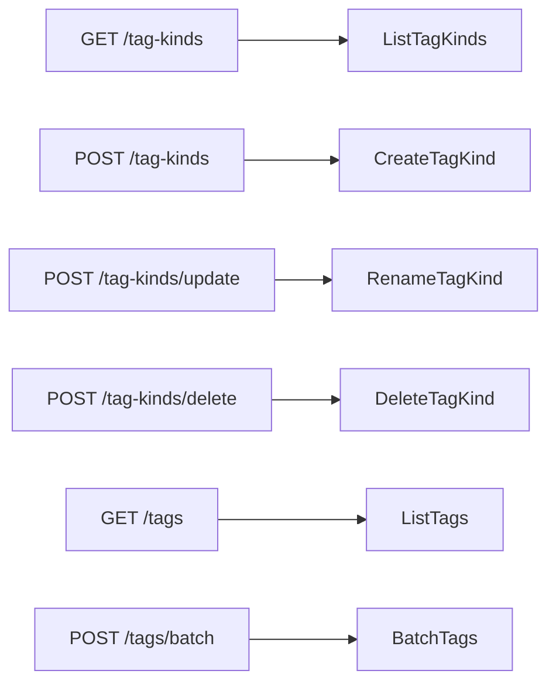

# 契約: 外部 API v1 と MCP のタグの種類 {#contract-tag-kinds-in-the-external-api-v1-and-mcp}

正本: [`api/external-v1.yaml`](../../../api/external-v1.yaml)。この文書は、この機能が加えるものだけを記述する。共通の規則は [026 共通の規則](../../026-external-api/contracts/external-api.md#common-rules) のとおり、タグの操作は [039 external-api](../../039-external-tag-admin/contracts/external-api.md) のとおりである。互換性の方針に従い、フィールド、パラメータ、操作、`reason` の値だけを加える。各操作は [screen-api.md](screen-api.md) の画面のルートが呼ぶストアの操作を呼ぶので、そこの規則が成り立つ (要件 6、受け入れ条件 4)。

種類の操作は人物の操作の形に従う ([047 external-api](../../047-video-work-info/contracts/external-api.md)): 一覧と作成はコレクションのパス、`update` と `delete` は `POST` のサブパスとする。

## スキーマの変更 {#schema-changes}

| スキーマ | 追加 | 規則 |
| --- | --- | --- |
| `TagKindRef`、`TagKind`、`TagKindList` (新規) | [screen-api.md、スキーマの変更](screen-api.md#schema-changes) のとおり | |
| `Tag` | `kind: TagKindRef`、null を許す、`required` | |
| `TagBatchRequest` | `action` に `setKind` と `clearKind` が加わる。省略可能な `kindId` | [`POST /api/tags/batch` の変更](screen-api.md#post-apitagsbatch-changes) と同じ |
| `ErrorReason` | `tag_kind_not_found`、`tag_kind_name_taken` | |

`ExternalVideoTag` には `kind` が加わらない。クライアントは `GET /api/v1/tags` から種類を読む。

## `GET /api/v1/tag-kinds` (`listTagKinds`) {#get-apiv1tag-kinds-listtagkinds}

すべての種類を返す: `200 TagKindList`。

## `POST /api/v1/tag-kinds` (`createTagKind`) {#post-apiv1tag-kinds-createtagkind}

`{ "name": string }` から種類を作り、ほかの外部の書き込みと同じく、`201` ではなく `200 TagKind` で応答する。エラーは [`POST /api/tag-kinds`](screen-api.md#post-apitag-kinds) と同じである。

## `POST /api/v1/tag-kinds/update` (`renameTagKind`) {#post-apiv1tag-kindsupdate-renametagkind}

`{ "id": int64, "name": string }` から種類の名前を変える: `200 TagKind`。エラーは [`PATCH /api/tag-kinds/{id}`](screen-api.md#patch-apitag-kindsid) と同じである。

## `POST /api/v1/tag-kinds/delete` (`deleteTagKinds`) {#post-apiv1tag-kindsdelete-deletetagkinds}

`{ "ids": int64[] }` (`deletePeople` と同じく 1 から 20,000 項目) の種類を削除する。そのタグは種類なしで残る。`200 { deletedIds, notFoundIds }` で応答する。2 つの配列は重ならず、合わせると重複を除いた `ids` に等しい。`ids` が空か 20,000 項目を超えるときは `400 invalid_request` である。

## `GET /api/v1/tags` のパラメータ `kind` {#get-apiv1tags-parameter-kind}

[`GET /api/tags` のパラメータ `kind`](screen-api.md#get-apitags-parameter-kind) と同じ。

## `POST /api/v1/tags/batch` の変更 {#post-apiv1tagsbatch-changes}

[`POST /api/tags/batch` の変更](screen-api.md#post-apitagsbatch-changes) と同じ。

## MCP ツール {#mcp-tools}

[026 mcp.md、Tools](../../026-external-api/contracts/mcp.md#tools) の表に加える。入力と出力は、その操作の要求と応答の形を持つ。

| ツール | 操作 | ヒント |
| --- | --- | --- |
| `list_tag_kinds` | `listTagKinds` | `readOnlyHint: true` |
| `create_tag_kind` | `createTagKind` | `destructiveHint: false`、`idempotentHint: false` |
| `rename_tag_kind` | `renameTagKind` | `destructiveHint: false`、`idempotentHint: true` |
| `delete_tag_kinds` | `deleteTagKinds` | `destructiveHint: true`、`idempotentHint: true` |
| `list_tags` (変更) | `listTags` | 入力に `kind` が加わる |
| `batch_tags` (変更) | `batchTags` | `action` の列挙に `setKind` と `clearKind` が加わる。入力に `kindId` が加わる |

## `docs/how-to/external-api.md` {#docshow-toexternal-apimd}

`Tidy up tags` に小節 `Tag kinds` が加わる: 種類の一覧、作成、名前の変更、削除と、`batchTags` によるタグへの種類の設定。
