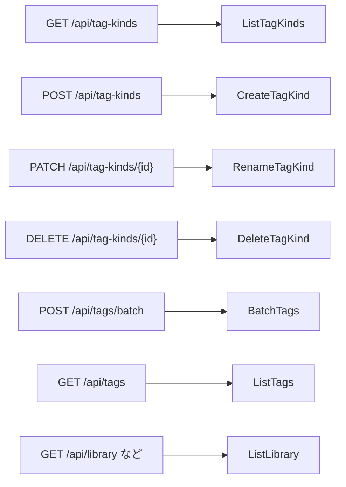

# 契約: 画面の API のタグの種類 {#contract-tag-kinds-in-the-screen-api}

正本: [`api/openapi.yaml`](../../../api/openapi.yaml)。この文書は、この機能が加える、または変えるルート、パラメータ、フィールド、エラーコードだけを記述する。タグのルートのそれ以外の規則は [014 tags-api](../../014-video-tags/contracts/tags-api.md) と [036 screen-api](../../036-tag-admin-scale/contracts/screen-api.md) のとおりである。`/api/tag-kinds` と `/api/tags` のルートは `/api/*` の既定により所有者専用であり、`tagKind` が加わる一覧のルートはゲストにも開いたままで、ゲストが拒否されるのはそのパラメータだけである（[一覧のパラメータ `tagKind`](#list-parameter-tagkind)）。

図は、新しいルートと変わるルートのそれぞれが、どのストアの操作に届くかを示す。

## スキーマの変更 {#schema-changes}

| スキーマ | 追加 | 規則 |
| --- | --- | --- |
| `TagKindRef` (新規) | `id: int64`、`name: string` (どちらも `required`) | [R-4](../research.md#r-4-every-tag-shape-carries-the-kinds-id-and-name) |
| `TagKind` (新規) | `id`、`name`、`tagCount: integer`、`createdAt: date-time` (すべて `required`) | `tagCount` は、仮のものも含めてその種類のタグを数える |
| `TagKindList` (新規) | `items: TagKind[]` (`required`) | すべての種類を id の順に並べる。画面は `compareNatural` で名前順に並べ替える |
| `Tag`、`TagRef`、`VideoTag` | `kind: TagKindRef`、null を許す、`required` | null は種類のないタグである |
| `TagBatchRequest` | `action` の列挙に `setKind` と `clearKind` が加わる。`kindId: int64` (省略可能) | [`POST /api/tags/batch` の変更](#post-apitagsbatch-changes) |
| `ErrorReason` | `tag_kind_not_found`、`tag_kind_name_taken` | 種類のルートと `setKind` |

## `GET /api/tag-kinds` {#get-apitag-kinds}

すべての種類を返す: `200 TagKindList`。

## `POST /api/tag-kinds` {#post-apitag-kinds}

`{ "name": string }` から種類を作る: `201 TagKind`。

| ステータス | `code` / `reason` | 条件 |
| --- | --- | --- |
| `400` | `invalid_request` / `tag_name_empty`、`tag_name_control_characters`、`tag_name_too_long` | 名前が [R-6](../research.md#r-6-kind-names-follow-the-tag-name-rules-in-their-own-namespace) を破る |
| `409` | `conflict` / `tag_kind_name_taken` | 別の種類がその名前を持つ (Edge Case)。何も変わらない |

## `PATCH /api/tag-kinds/{id}` {#patch-apitag-kindsid}

`{ "name": string }` から種類の名前を変える: `200 TagKind`。今と同じ名前は何も変えず、`200` を返す。

| ステータス | `code` / `reason` | 条件 |
| --- | --- | --- |
| `400` | `POST /api/tag-kinds` と同じ | 名前が規則を破る |
| `404` | `not_found` / `tag_kind_not_found` | その id の種類がない |
| `409` | `conflict` / `tag_kind_name_taken` | 別の種類がその名前を持つ |

## `DELETE /api/tag-kinds/{id}` {#delete-apitag-kindsid}

種類を削除する。そのタグは種類なしで残る: `204`。その id の種類がないときは `404 not_found` / `tag_kind_not_found`。

## `POST /api/tags/batch` の変更 {#post-apitagsbatch-changes}

| フィールド | 型 | 必須 | 意味 |
| --- | --- | --- | --- |
| `action` | `setKind`、`clearKind` を加える | はい | `setKind` は各タグに種類 `kindId` を与え、`clearKind` は各タグの種類を外す。どちらも仮のタグを確定しない |
| `kindId` | int64 | `setKind` のときだけ | 設定する種類 |

**応答**: 今と同じく `200 TagBatchResponse`。`notApplicableIds` は、すでに要求した種類を持っていた (`clearKind` では、種類を持っていなかった) タグを持つ。

| ステータス | `code` / `reason` | 条件 |
| --- | --- | --- |
| `400` | `invalid_request` | `kindId` のない `setKind`、または別の操作に付いた `kindId` |
| `404` | `not_found` / `tag_kind_not_found` | `setKind` が存在しない種類を指す。何も変わらない |

`POST /api/tags/impact` は 2 つの操作を受け取らない: 種類の変更は何も削除しないので、画面は確認を求めない。

## `GET /api/tags` のパラメータ `kind` {#get-apitags-parameter-kind}

| 名前 | 型 | 既定 | 意味 |
| --- | --- | --- | --- |
| `kind` | string: 正の整数か `none` | なし | その種類のタグだけ、または種類のないタグだけ ([R-8](../research.md#r-8-the-tag-list-filters-by-one-kind-or-by-no-kind)) |

- `q`、`tentative`、`unused` と AND をとる。`total` はそれを含めて数え、`totalAll` は含めない。
- 種類のない id は空の一覧になる。それ以外の値は `400 invalid_request` である。
- タグ管理の URL は、`tentative` と `unused` と並べて、それを `kind` として持つ (`web/src/tags/tagListUrl.ts`)。

## 一覧のパラメータ `tagKind` {#list-parameter-tagkind}

`person` を受け取るどの一覧のルートにも加える: `listVideos`、`listLibrary`、`listLibraryIds` ([047 の契約](../../047-video-work-info/contracts/screen-api.md#list-parameters-person-and-organization))。

| 名前 | 型 | 既定 | 意味 |
| --- | --- | --- | --- |
| `tagKind` | int64 | なし | その種類のタグを、手動のものかフォルダからのものかを問わず少なくとも 1 つ持つ動画だけ ([R-5](../research.md#r-5-the-library-filters-videos-by-one-tag-kind)) |

- ほかのどの絞り込みとも AND をとる。`total` はそれを含めて数える。
- 種類のない id は空の一覧になり、報告はない。画面は、`GET /api/tag-kinds` がその種類を一覧しなくなったときに種類がなくなったことを知り、パラメータを外し、`person` と同じくそのことを伝える。
- 正の整数でない値は `400 invalid_request` である。ゲストからは `400 invalid_request` / `guest_filter_not_allowed` である。
- ライブラリの URL はそれを `tagKind` として持つ。"Clear filters" は `tag` とともにそれを外し、一覧のスナップショットのキーはそれを含む。

## `web/src/api` の関数 {#websrcapi-functions}

`web/src/api/tagKinds.ts` は `listTagKinds`、`createTagKind`、`renameTagKind`、`deleteTagKind` を持ち、`api/tags.ts` がタグに対してするように、キャッシュした種類の一覧を 1 つ保つ。キャッシュしたどのタグも種類の名前を持つので、名前の変更や削除の後には `refreshTags` を呼ぶ。
