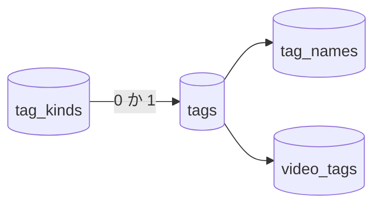

# データモデル: タグの種類 {#data-model-tag-kinds}

モデルの残りは変わらない: タグ、名前、割り当て、却下した名前は [014 data-model](../014-video-tags/data-model.md)、[031](../031-tentative-tags/contracts/screen-api.md)、[036 data-model](../036-tag-admin-scale/data-model.md) のとおりである。マイグレーションは [`internal/store/migrations/`](../../internal/store/migrations) にある。

図は、新しいテーブルと、それを指す列を示す。

## マイグレーション {#migration}

`00048_tag_kinds.sql` は `tag_kinds` を作り、4 つのプリセットの種類を挿入し ([R-2](research.md#r-2-preset-kinds-are-seeded-rows-with-no-special-status))、索引とともに `tags.kind_id` を加え、`Down` の節で両方を削除する。列の既定値が null なので、SQLite は `add column ... references` を受け入れる。

## `tag_kinds` {#tag_kinds}

| フィールド | 型 | Null | 意味 |
| --- | --- | --- | --- |
| `id` | `integer primary key autoincrement` | いいえ | `tags.id` と同じく、再利用しない |
| `name` | `text`, `unique` | いいえ | 種類の名前 ([規則](#rules)) |
| `created_at` | `text` | いいえ | `tags.created_at` と同じく、RFC 3339 の UTC |

初期投入の行は `Genre`、`Work`、`Place`、`Character` で、id はこの順である。

## `tags.kind_id` {#tagskind_id}

| フィールド | 型 | Null | 意味 |
| --- | --- | --- | --- |
| `kind_id` | `integer references tag_kinds(id) on delete set null` | はい | タグの種類。null は種類のないタグである |

**索引**: `kind_id` に対する `tags_kind_id`。タグの一覧の `kind` の絞り込みと、ライブラリの `tagKind` の絞り込みが使う。

タグと同じく、種類は作り直しの後も残るユーザーデータである: 自身の id をキーとする ([ARCHITECTURE.md、横断的な不変条件](../../ARCHITECTURE.md#cross-cutting-invariants))。

## `domain` に加える値 {#values-added-to-domain}

| 値 | フィールド | 用途 |
| --- | --- | --- |
| `TagKind` | `ID`、`Name`、`TagCount`、`CreatedAt` | 種類の一覧の 1 行。`TagCount` は、仮のものも含めてその種類のタグを数える |
| `TagKindRef` | `ID`、`Name` | `Tag`、`TagRef`、`VideoTag` の `kind` ([R-4](research.md#r-4-every-tag-shape-carries-the-kinds-id-and-name)) |
| `TagKindFilter` | 種類の id か "none" | `TagListQuery.Kind` |
| `TagBatchSetKind`、`TagBatchClearKind` | | 新しい `TagBatchAction` の値。`TagBatchRequest` は `setKind` の `KindID` を持つ |
| `ErrTagKindNotFound`、`TagKindNameConflict` | | 種類の操作のエラー |

`VideoQuery` に、種類の id かゼロである `TagKindID` が加わる。

## 規則 {#rules}

| 規則 | 強制する場所 |
| --- | --- |
| 種類の名前は `NormalizeTagName` で正規化する ([R-6](research.md#r-6-kind-names-follow-the-tag-name-rules-in-their-own-namespace)) | `internal/domain` |
| 2 つの種類が同じ名前を持つことはない。種類自身の名前への変更は何も変えない | 一意の `tag_kinds.name`。ストアのトランザクションの中で読む |
| 種類を削除すると、そのタグは種類なしになる (要件 4) | `on delete set null` |
| `setKind` は種類が異なるタグに `kind_id` を書き、`tentative` は変えない ([R-3](research.md#r-3-a-tags-kind-is-set-and-cleared-through-the-tag-batch)) | `TagStore.BatchTags` |
| 存在しない種類の id での `setKind` は何も変えない | 同じトランザクションの中で最初に種類を読む `TagStore.BatchTags` |
| すでに要求した種類の id (`clearKind` では、すでに種類のない id) は `notApplicableIds` に入る | `domain.TagBatchApplies` |
| 統合は統合先の `kind_id` を null も含めて保つ。統合元の種類は統合元とともになくなる (Edge Case) | `tags.kind_id` を書かない `mergeTagsInto` |
| 仮のタグを確定してもその `kind_id` は保たれる (Edge Case) | `tentative` だけを書く `confirmTagInTx` |
| 動画は、そのタグ (手動のもの、またはフォルダからのもの) の 1 つがその種類を持つときに `tagKind` に一致する | `tagConditions` の隣にある一覧の条件 |

## 変わらないもの {#what-does-not-change}

- `tag_names`、`video_tags`、`rejected_tag_names`、`auto_tag_rejections`: 種類はタグに属し、名前や割り当てには属さない。
- イベント: タグの変更はイベントを発行せず ([`internal/store/tags.go`](../../internal/store/tags.go))、種類の変更も発行しない。画面は表示している一覧を読み直す。
- 自動のタグ付けは種類を割り当てない。
