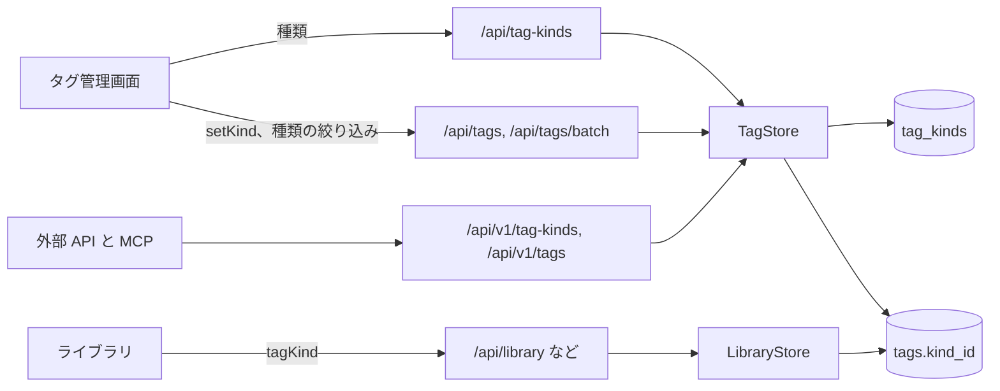
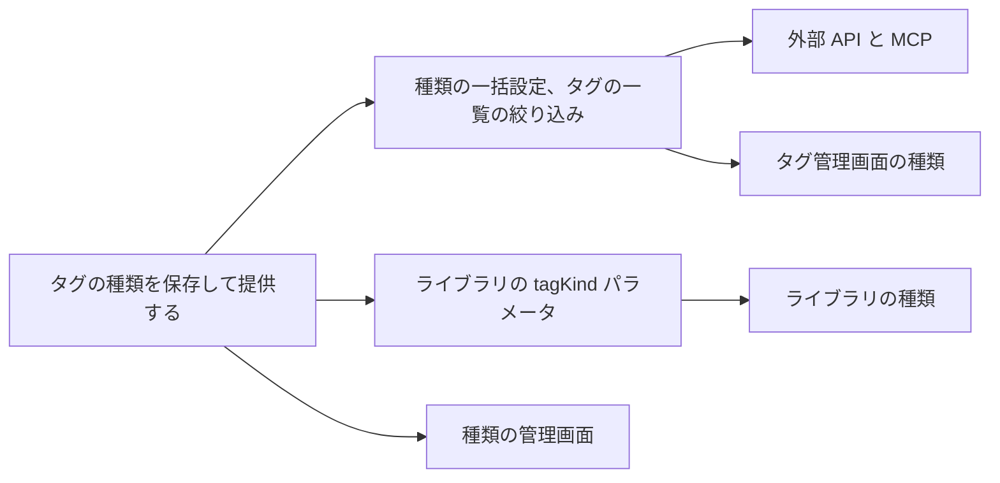

# 実装計画: タグの種類 {#implementation-plan-tag-kinds}

**ブランチ**: `feature/051-tag-kinds` | **親 Issue**: #1136

**入力**: 親 Issue。親 Issue がこの機能の仕様である。

## 概要 {#summary}

所有者は各タグに最大 1 つの種類 (`Genre`、`Work`、`Place`、`Character`、または所有者が加えた種類) を与え、タグ管理画面から多数のタグに一度に設定し、種類の名前を変えて削除し、種類でタグの一覧とライブラリを絞り込む。外部 API と MCP は同じ種類を読み書きする。種類は、`tags.kind_id` が指す新しいテーブル `tag_kinds` の行であり、既存のタグの一括操作で設定する。

図は、この機能が加える部分と、それぞれが呼ぶものを示す。



| 関心事 | 方針 |
| --- | --- |
| 保存 | `tag_kinds` と null を許す `tags.kind_id`、`on delete set null` ([R-1](research.md#r-1-a-kind-is-a-row-that-tags-point-to)) |
| プリセット | 所有者が名前を変えることも削除することもできる、初期投入する 4 行 ([R-2](research.md#r-2-preset-kinds-are-seeded-rows-with-no-special-status)) |
| 種類の設定 | タグの一括操作の `setKind` と `clearKind`。確定はしない ([R-3](research.md#r-3-a-tags-kind-is-set-and-cleared-through-the-tag-batch)) |
| 種類の読み取り | どのタグの形にも `kind: { id, name } \| null` ([R-4](research.md#r-4-every-tag-shape-carries-the-kinds-id-and-name)) |
| ライブラリ | `tagKind`: 1 つの種類のタグをどれか持つ動画 ([R-5](research.md#r-5-the-library-filters-videos-by-one-tag-kind)) |
| 種類の名前 | タグ名の規則、独自の名前空間 ([R-6](research.md#r-6-kind-names-follow-the-tag-name-rules-in-their-own-namespace)) |
| 見た目 | 名前だけ。色は保存しない ([R-7](research.md#r-7-a-kind-has-a-name-and-nothing-else)) |
| タグの一覧 | `kind`: 1 つの id か `none` ([R-8](research.md#r-8-the-tag-list-filters-by-one-kind-or-by-no-kind)) |

Issue に `ui` ラベルがあるので、`design` 段階が画面の単位より前に、親 Issue の `UI品質` に照らして次を `ui-design.md` に書く: タグの行、適用中の絞り込みのチップ、(示すとすれば) カードのタグでの種類の見え方、タグ管理とライブラリの絞り込みメニューの種類の絞り込み、選択の操作 `Set kind`、種類の管理のダイアログ。

## 技術的な文脈 {#technical-context}

**正本の定義**:

| 項目 | 出典 |
| --- | --- |
| 境界、ストアの役割、コミットの後のイベント | [ARCHITECTURE.md](../../ARCHITECTURE.md)、[.golangci.yml](../../.golangci.yml) (depguard) |
| タグ、名前、タグの絞り込み | [014 data-model](../014-video-tags/data-model.md)、[014 tags-api](../014-video-tags/contracts/tags-api.md) |
| 仮のタグ | [031 screen-api](../031-tentative-tags/contracts/screen-api.md) |
| タグの一覧のページ単位の読み込み、一括操作、選択バー | [036 screen-api](../036-tag-admin-scale/contracts/screen-api.md)、[036 ui-design](../036-tag-admin-scale/ui-design.md) |
| 外部からのタグの管理と MCP | [039 external-api](../039-external-tag-admin/contracts/external-api.md)、[external-api の手順書](../../docs/how-to/external-api.md) |
| 一覧の絞り込み `person` と `organization` | [047 screen-api](../047-video-work-info/contracts/screen-api.md#list-parameters-person-and-organization) |
| 画面の API、外部 API、生成コード | [api/openapi.yaml](../../api/openapi.yaml)、[api/external-v1.yaml](../../api/external-v1.yaml)、`task generate` |
| 画面と Web のテスト | [design-system.md](../../docs/design-docs/design-system.md)、[library-ui.md](../../docs/design-docs/library-ui.md)、[web-testing.md](../../docs/design-docs/web-testing.md)、[i18n.md](../../docs/design-docs/i18n.md) |
| 検査 | [Taskfile.yml](../../Taskfile.yml) (`task check`、`task check-docs`、`task test-e2e`) |

**この機能に固有の文脈**:

- マイグレーション `00048_tag_kinds.sql` が 1 つと、リポジトリで最初の初期投入の行 ([data-model.md、マイグレーション](data-model.md#migration))。
- 新しいストアの役割はない: 種類の操作は、`tags` へのすべての書き込みをすでに持つ `TagStore` に属し、ライブラリの条件は `LibraryStore` に属する。
- 画面のルートを 4 つと外部の操作を 4 つ加える。`GET /api/tags`、`POST /api/tags/batch`、`person` を受け取る一覧のルート、それらに対応する外部の操作が変わる ([contracts/screen-api.md](contracts/screen-api.md)、[contracts/external-api.md](contracts/external-api.md))。
- イベントはない: 種類の変更は、タグの変更と同じく、発行せずにコミットする ([data-model.md、変わらないもの](data-model.md#what-does-not-change))。

## Constitution Check {#constitution-check}

| 規則 (出典) | 判定 |
| --- | --- |
| アダプターは互いも `internal/app` もインポートしない (ARCHITECTURE.md、depguard) | 合格: `internal/httpapi` は自身の `Tags` インターフェースを広げる。値は `domain.TagKind` と `domain.TagKindRef` として境界を越える |
| ドメインが決め、ストアが強制する (ARCHITECTURE.md) | 合格: 名前の規則と `TagBatchApplies` は `internal/domain` に留まる。一意性と種類の存在はストアのトランザクションの中で読む |
| ストアの役割 (ARCHITECTURE.md) | 合格: 種類の書き込みと `setKind` は `TagStore` のメソッドである。`tagKind` の条件は `LibraryStore` のもので、`tagConditions` の隣に置く |
| コミットの後のイベント (ARCHITECTURE.md) | 該当しない: タグと同じく、何も発行しない |
| ユーザーデータは作り直しの後も残る (ARCHITECTURE.md) | 合格: `tag_kinds` は自身の id を、`tags.kind_id` はタグの id をキーとする。どちらも `videos` を参照しない |
| どの読み取りも閲覧者を知っている (ARCHITECTURE.md) | 合格: 種類のルートは所有者専用である。ゲストからの `tagKind` は `guest_filter_not_allowed` になる |
| 生成ファイルを手で編集しない (AGENTS.md) | 合格: 両方の YAML ファイルを変え、それから `task generate` を実行する |
| 複雑度は 25 以下、コードをコピーしない (AGENTS.md) | 合格: 種類の名前の検査は `NormalizeTagName` を再利用する。`tagKind` の条件は `videoHasTagCondition` の「手動またはフォルダ」の形をコピーせずに共有する。一括操作は `TagBatchApplies` に 2 つの場合を加える |
| 画面の前に design-system.md を読む。最も低い水準でテストする (AGENTS.md) | 合格: 画面は `ui-design.md` に従う。規則はドメインのテスト、書き込みはストアのテスト、ルートはハンドラーのテスト、画面はページのテスト、受け入れ条件 1 と 2 は 1 つのブラウザーテストを持つ |

違反はないので、複雑さの追跡はない。

## プロジェクトの構成 {#project-structure}

### 文書 (この機能) {#documentation-this-feature}

```text
specs/051-tag-kinds/
├── plan.md
├── research.md
├── data-model.md
└── contracts/
    ├── screen-api.md
    └── external-api.md
```

`ui-design.md` は `design` 段階が書く。`quickstart.md` はない: どの受け入れ条件と Edge Case も、ストア、ハンドラー、ページのテスト、または下のブラウザーテストで扱える。

### ソースコード {#source-code}

**影響する境界**:

| 境界 | この機能で持つもの |
| --- | --- |
| `internal/store/migrations` | `00048_tag_kinds.sql` |
| `internal/domain` | `TagKind`、`TagKindRef`、`TagKindFilter`、2 つの一括操作、エラー、`VideoQuery.TagKindID` |
| `internal/store` | 種類の作成、名前の変更、削除、一覧。`setKind` と `clearKind`。タグの読み取りの `kind`。`kind` と `tagKind` の条件 |
| `internal/httpapi`, `api/*.yaml` | ルート、パラメータ、エラーコード、MCP ツール |
| `web/src/api` | `tagKinds.ts`。タグの型の `kind` |
| `web/src/tags`, `web/src/library`, `web/src/i18n` | 画面とその文言 |
| `docs/how-to/external-api.md` | `Tag kinds` の節 |
| `web/e2e` | ブラウザーテスト |

**新しいパス**: `internal/store/migrations/00048_tag_kinds.sql`、`internal/domain/tag_kind.go`、`internal/store/tag_kinds.go`、`internal/httpapi/tag_kinds.go`、`internal/httpapi/external_tag_kinds.go`、`web/src/api/tagKinds.ts`、`web/e2e/tag-kinds.e2e.ts`。

**構成の決定**: 既存のタグの配置に従い、関心事ごとに 1 つのファイルをタグのファイルの隣に置く。外部のハンドラーは画面と同じ `TagStore` のメソッドを呼ぶ ([039 R-6](../039-external-tag-admin/research.md#r-6-the-external-handlers-call-the-same-tags-methods-as-the-screen-with-no-new-write-path))。

## 実装作業 {#implementation-work}

図は、どの単位が先に入る必要があるかを示す。画面の単位は、`design` 段階の `ui-design.md` も待つ。



### タグの種類を保存し、画面の API で提供する {#store-tag-kinds-and-serve-them-in-the-screen-api}

**範囲**: プリセットを含むマイグレーション ([data-model.md](data-model.md))。ドメインの値と名前の規則。`TagStore` での種類の一覧、作成、名前の変更、削除。`Tag`、`TagRef`、`VideoTag` の読み取りの `kind`。4 つの `/api/tag-kinds` のルートと 2 つの `reason` の値 ([contracts/screen-api.md](contracts/screen-api.md))。`web/src/api/tagKinds.ts` と Web のタグの型の `kind`。

**依存**: なし。

**受け入れ**: `task generate` の差分なしで `task check` が通る。新しいデータベースでのストアのテストが `Genre`、`Work`、`Place`、`Character` を一覧する。ストアのテストで、同じ名前の 2 つ目の種類が `TagKindNameConflict` になり何も書かれないことと、追加し、名前を変え、削除した種類のタグが `kind` が null のまま残ること (受け入れ条件 3) を示す。統合は統合先の種類を null も含めて保ち、仮のタグの確定はその種類を保つ (Edge Cases)。ハンドラーのテストで、4 つのルートの表のすべてのステータスと、ゲストへの `401` を示す。

### タグの種類を一括で設定し、種類でタグの一覧を絞り込む {#set-tag-kinds-in-bulk-and-filter-the-tag-list-by-kind}

**範囲**: `POST /api/tags/batch` の `setKind` と `clearKind`、`GET /api/tags` の `kind` パラメータ ([contracts/screen-api.md](contracts/screen-api.md#post-apitagsbatch-changes))。

**依存**: タグの種類を保存し、画面の API で提供する。

**受け入れ**: `task check` が通る。ストアのテストで、10 個のタグへの `setKind` が 10 個すべてにその種類を与え (受け入れ条件 2)、仮のタグを仮のまま残し、すでにその種類の id を `notApplicableIds` に入れ、存在しない種類では `ErrTagKindNotFound` になり何も書かれないことを示す。種類 `Genre` のタグは `kind=<Genre id>` で一覧され、`kind=none` では一覧されない (受け入れ条件 1)。ハンドラーのテストで、`kindId` のない `setKind` と `kind=abc` に対する `400` を示す。

### タグの種類でライブラリの動画を絞り込む {#filter-library-videos-by-tag-kind}

**範囲**: `listVideos`、`listLibrary`、`listLibraryIds` の `tagKind` パラメータ ([contracts/screen-api.md、一覧のパラメータ `tagKind`](contracts/screen-api.md#list-parameter-tagkind))。

**依存**: タグの種類を保存し、画面の API で提供する。

**受け入れ**: `task check` が通る。ストアのテストで、動画がその種類の手動のタグを通じても、フォルダのタグを通じても一致すること、タグが別の種類か種類なしの動画は一致しないこと、`tagKind` が `tag` と AND をとること、存在しない種類では空の一覧になることを示す。ハンドラーのテストで、ゲストへの `400 guest_filter_not_allowed` と `tagKind=0` への `400 invalid_request` を示す。

### 外部 API と MCP でタグの種類を読み書きする {#read-and-write-tag-kinds-through-the-external-api-and-mcp}

**範囲**: 4 つの `/api/v1/tag-kinds` の操作、`listTags` と `Tag` の `kind`、`batchTags` の一括操作、4 つの新しい MCP ツールと変わる 2 つのツール ([contracts/external-api.md](contracts/external-api.md))。`docs/how-to/external-api.md` の `Tag kinds` の節。

**依存**: タグの種類を一括で設定し、種類でタグの一覧を絞り込む。

**受け入れ**: `task generate` の差分なしで `task check` と `task check-docs` が通る。ハンドラーのテストが `POST /api/v1/tags/batch` で種類を設定し、それを画面の `GET /api/tags` から読む (受け入れ条件 4)。MCP のテストが 4 つの新しいツールをそのヒントとともに一覧し、`setKind` で `batch_tags` を呼ぶ。

### タグ管理画面でタグの種類を管理する {#manage-tag-kinds-on-the-tag-management-screen}

**範囲**: `ui-design.md` が配置するとおりに、重複した名前と削除のメッセージを含めて、タグ管理画面から種類を作成し、名前を変え、削除する。

**依存**: タグの種類を保存し、画面の API で提供する。`design` 段階の `ui-design.md`。

**受け入れ**: `task check` が通る。ページのテストで、種類の追加、名前の変更、削除と、名前の変更と削除の後にタグの一覧を読み直して削除した種類がそのタグから消えていること (受け入れ条件 3)、重複した名前がエラーとして示され種類が変わらないこと (Edge Case) を示す。画面は `ui-design.md` に照らして見た目をレビューする。

### タグ管理画面でタグの種類を表示し、設定し、絞り込む {#show-set-and-filter-tag-kinds-on-the-tag-management-screen}

**範囲**: 各タグの行の種類、絞り込みメニューの種類の絞り込み (各種類と `No kind`) とそのチップ、URL パラメータ `kind`、消去を含む選択の操作 `Set kind`。`ui-design.md` が配置するとおりにする。

**依存**: タグの種類を一括で設定し、種類でタグの一覧を絞り込む。`design` 段階の `ui-design.md`。

**受け入れ**: `task check` が通る。ページのテストで、選択の操作が選択したタグに適用されることと、絞り込みが URL を往復することを示す。`web/e2e/tag-kinds.e2e.ts` はタグ `Robot` に種類 `Genre` を与え、`Genre` の絞り込みではそれを見つけ、`No kind` では見つけない (受け入れ条件 1)。さらに選択した 10 個のタグに種類を設定し、その種類の下で 10 個すべてを見つける (受け入れ条件 2)。画面は `ui-design.md` に照らして見た目をレビューする。

### タグの種類でライブラリを絞り込み、ライブラリのタグに種類を示す {#filter-the-library-by-tag-kind-and-show-kinds-on-library-tags}

**範囲**: ライブラリの絞り込みメニューの種類の絞り込みとその適用中の絞り込みのチップ、URL パラメータ `tagKind` と種類がなくなったときのその除去、`ui-design.md` が示す範囲での適用中のタグのチップとカードのタグの種類。

**依存**: タグの種類でライブラリの動画を絞り込む。`design` 段階の `ui-design.md`。

**受け入れ**: `task check` が通る。ページのテストで、種類を選ぶと一致する動画だけが一覧されること、チップが絞り込みを外すこと、"Clear filters" がそれを外すこと、`GET /api/tag-kinds` にない種類がメッセージとともに URL から落とされることを示す。ライブラリとカードは `ui-design.md` に照らして見た目をレビューし、どのカードの行も以前より広くも高くもならない (`UI品質`)。
