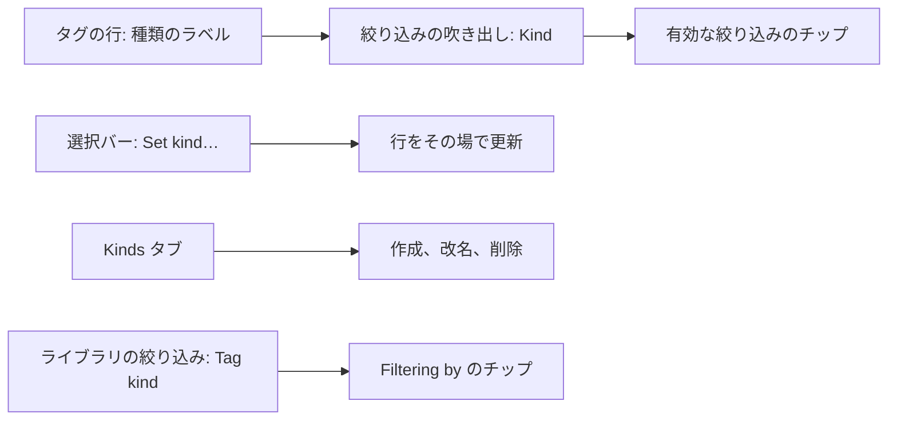
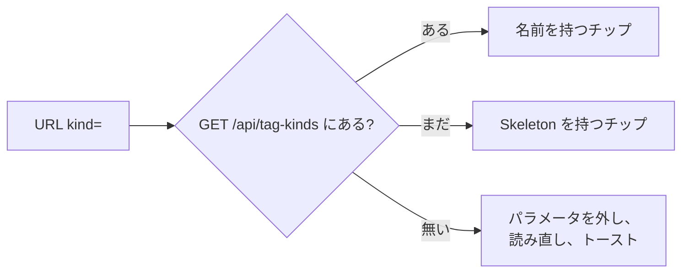
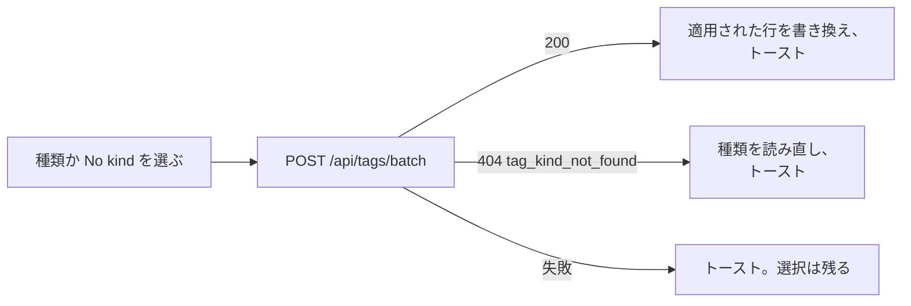
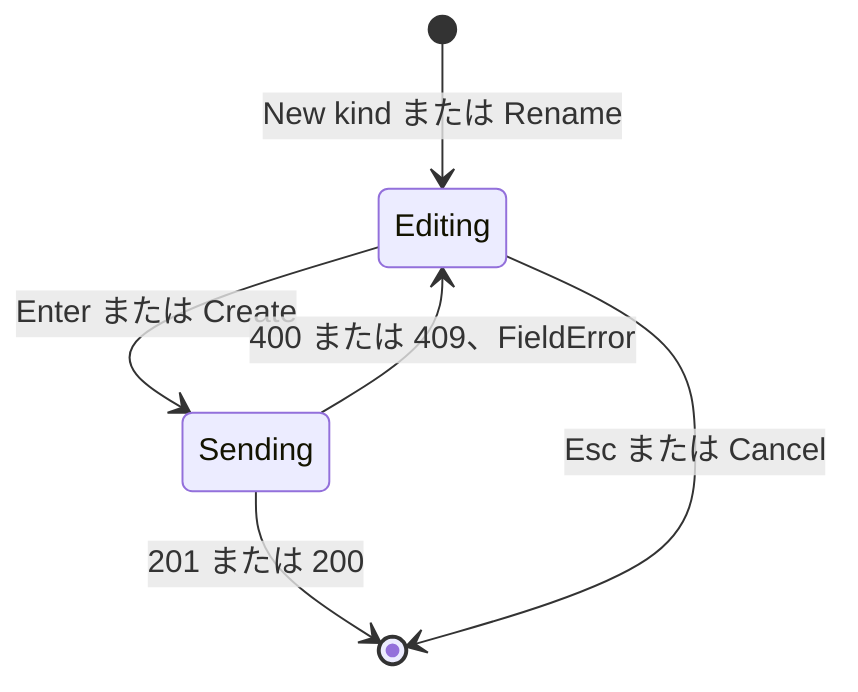

# UI 設計: タグの種類 {#ui-design-tag-kinds}

**機能**: [親 Issue #1136](https://github.com/syudead/vv/issues/1136) · [plan.md](plan.md) · [research.md](research.md) (R-2 から R-5、R-7、R-8) · [contracts/screen-api.md](contracts/screen-api.md)

見た目をすでに決めていて、ここでは決め直さない出典: [design-system.md](../../docs/design-docs/design-system.md) とその規則 ([components.md](../../web/registry/rules/components.md)、[patterns.md](../../web/registry/rules/patterns.md))、[library-ui.md](../../docs/design-docs/library-ui.md)、`web/src/ui/tokens.css` のトークン、[036 UI 設計](../036-tag-admin-scale/ui-design.md) のタグ管理画面 (トップバー、URL の状態、帯、行、選択バー、一括の操作)、[014 UI 設計](../014-video-tags/ui-design.md#active-tag-filters) と [047 UI 設計](../047-video-work-info/ui-design.md#library-filter-by-a-person-or-organization) のライブラリの絞り込み中の行。この文書は、種類がそれらの画面に加える変更だけを書く。デザインシステムには何も加えない。どの部分も既存のコンポーネントである。

図は種類が現れる場所と、各部分が何をするかを示す。

## この形にした理由 {#why-this-shape}

- **種類は、タグの名前の後ろに同じ行で置く、枠線だけの小さなラベルである。** 名前は太さと色 (`font-medium`、`text-foreground`) を保ち、ラベルは `text-xs text-muted-foreground` に `border` を付け、面は塗らない。目は名前を先に、種類を後に読む (`UI品質`: 名前が主)。仮の目印はすでに名前の後ろにあり、ラベルはその後に続くので、種類のあるタグの行は無いタグの行と同じ高さである。`Kind` の列は採らなかった。360px では名前の列が約 160px で、列を足すと半分になる。シノニムの行のように名前の下に薄い行を置く案も採らなかった。シノニムのあるタグが 3 行になり、行の高さがそろわなくなる。ラベルに面を塗らないのは、塗ったチップはカードの上でのタグの見た目 (`Badge` の `secondary`) であり、種類が 2 つ目のタグに見えてはならないからである。
- **種類の絞り込みは、既存の `Filter` の吹き出しの中の `Select` で、`Tentative only` と同じくタブの下にチップとして出る。** 吹き出しはタグの一覧のほかの条件がある場所なので、所有者はすでに見る場所で見つける。`Select` はいくつの種類でも吹き出しの 1 行に収める。ライブラリの視聴状態のような `ToggleGroup` は採らなかった。所有者が種類を足すたびに吹き出しが伸びる。`Combobox` も採らなかった。10 個の種類に打ち込みは要らない ([components.md、Select](../../web/registry/rules/components.md#select-and-radiogroup))。チップは名前だけではなく `Kind: Genre` と `No kind` と読めるので、タグと取り違えない。
- **種類を付けるのは選択バーの 1 つの操作 `Set kind…` で、種類のメニューを開く。** 要件 3 はほかの一括の操作と同じ流れを求める。行を選び、1 つの操作を押す。種類を選ぶとダイアログなしですぐ効く。バッチは何も削除しないからである ([contracts/screen-api.md、`POST /api/tags/batch` changes](contracts/screen-api.md#post-apitagsbatch-changes))。`No kind` は同じメニューの最後、区切り線の後の項目なので、外す操作は付ける操作と同じ場所で見つかる。各行のメニューの `Set kind` サブメニューは採らなかった。同じ変更の 2 つ目の流れになり、タッチでは行の `Actions` メニューの中にサブメニューが入れ子になる。
- **種類は `Tags` と `Rejected names` の横の 3 つ目のタブ `Kinds` で管理する。** タグのページにはすでに、独自の行と行の操作を持つ 2 つ目の一覧のタブがあり、作成・改名・削除を持つ種類の一覧はタグの一覧と同じ形で、同じ作成の行、改名の入力、`ConfirmDialog` を使う。種類の管理ダイアログは採らなかった。1 つの `Dialog` の中にその場の作成の行、改名、削除の確認を持つ一覧は、ダイアログの上にダイアログを重ねる。計画がダイアログと呼んでいるのは、この文書が決めるものの仮の名にすぎない。タブは帯の中に留まるので、どのスクロールの深さからも届き、その件数は開く前に種類がいくつあるかを所有者に伝える。
- **ライブラリは `Filter` の吹き出しから種類で絞り込み、チップは `Filtering by` の行に加わる。** 動画自身は種類を持たない。「この種類のタグを持つ動画」は一覧への条件なので、視聴状態や再生可否と並び、チップは、動画が持つもので一覧を狭めるタグや人物のチップと並ぶ。吹き出しから設定するので、絞り込みのボタンは視聴状態と同じくこれを数える。
- **カードと動画のページは種類を出さない。** カードのタグの行は測った 1 行で、各チップに種類を付けると `+N` の後ろに隠れるタグが増える (`UI品質`: カードは今より混み合わない)。動画のページのタグのチップは同じチップである。種類はタグ管理画面で読み、絞り込みで選ぶ。チップの `title` はタグの名前だけを保つ。

## 文言 {#words}

カタログがすでに持つラベルは `web/src/i18n/en.ts` のとおりに書く。タグと種類の名前は利用者のデータで、翻訳せずに埋め込む。

| 場所 | 文言 | 備考 |
| --- | --- | --- |
| 行の種類のラベル | `Genre` | 種類の名前。スクリーンリーダー向けにだけ前に `Kind:` を付ける。`title` は `Kind: Genre` |
| 絞り込みの吹き出し、種類の行 | `Kind` | `Select` の見えるラベル |
| 絞り込みの吹き出し、種類の選択肢 | `Any kind` / `Genre`、`Work`、… / `No kind` | 既定は `Any kind`。種類は名前の自然順。`No kind` は区切り線の後の最後 |
| 有効な絞り込みのチップ | `Kind: Genre` / `No kind` | 先頭に lucide の `Shapes`、末尾に `X` |
| チップの読み上げ名 | `Remove the filter "Kind: Genre"` / `Remove the filter "No kind"` | 既存の `Remove the filter "{name}"` の形 |
| 種類の一覧が読み込まれる前のチップ | `Remove the kind filter` | 名前の代わりに `Skeleton` を置く |
| URL の絞り込みの種類が無くなった (タグのページとライブラリ) | `Removed a kind that no longer exists from the filter` | トースト。パラメータは URL から外れる |
| 空の結果、種類の絞り込みだけ | `No tags of the kind "Genre"` / `No tags without a kind` | ボタン `Show all tags` |
| 空の結果、種類と検索またはほかの絞り込み | `No tags match the current search and filters` | ボタン `Show all tags`。検索とすべての絞り込みを外す |
| 選択バーの操作 | `Set kind…` | lucide の `Shapes`。メニューを開く |
| Set kind のメニュー | `Genre`、`Work`、… / `No kind` | ラジオの項目。`No kind` は区切り線の後 |
| 種類が無いときの Set kind のメニュー | `No kinds yet. Add them on the Kinds tab.` | `No kind` の上の `DropdownMenuLabel` |
| Set kind のトースト | `Set the kind "Genre" on 10 tags` / `Set the kind "Genre" on 6 tags. 4 already had it.` | `appliedIds` と `notApplicableIds` の数 |
| 種類を外すトースト | `Removed the kind from 8 tags` / `Removed the kind from 6 tags. 2 had none.` | |
| もう無い種類での Set kind | `That kind no longer exists, so the kinds were reloaded` | `404 tag_kind_not_found` でのトースト。種類の一覧を読み直す |
| タブ | `Kinds {count}` | `Rejected names` の後。count は種類の数 |
| Kinds タブの説明 | `A tag has one kind or none. Set it from the Tags tab's selection bar. Deleting a kind leaves its tags without one.` | タブの下、`Rejected names` の説明と同じ |
| Kinds タブの見出しのボタン | `New kind` | lucide の `Plus`。`New tag` の場所 |
| 列見出し | `Name` / `Tags` | |
| 行のタグの数 | `12 tags` / `1 tag` / `0 tags` | `tagCount` |
| 行の名前の読み上げ名 | `Show the tags of the kind "Genre"` | 押すと、その種類で絞り込んだ `Tags` タブを開く |
| 作成の行 | `New kind name` / `Kind name` / `Create` / `Creating…` | 読み上げ名、プレースホルダー、ボタン、送信中のボタン |
| 改名の入力 | `New name for "Genre"` | 読み上げ名 |
| 行の操作 | `Rename` / `More actions` → `Delete…` | タグの行と同じ。タッチと `sm` 未満では `Actions` |
| 名前が使われている | `A kind named "Genre" already exists.` | `409 tag_kind_name_taken` による、入力の下の `FieldError` |
| 名前の規則 | `Enter a name` / `Line breaks and tabs aren't allowed` / `Use 100 characters or fewer (currently 120)` | 名前の欄の手元の理由。タグと共有 |
| 削除ダイアログの題 | `Delete the kind "Genre"?` | |
| 削除ダイアログの文 | `The 12 tags of this kind stay, without a kind. This can't be undone.` / `No tags have this kind. This can't be undone.` | 後者は `tagCount` が 0 のとき |
| 削除ダイアログのボタン | `Cancel` / `Delete` / `Deleting…` | |
| 削除のトースト | `Deleted the kind "Genre"` | |
| 改名または削除の途中で種類が無くなった | `This kind no longer exists, so the list was reloaded` | `404 tag_kind_not_found` でのトースト |
| Kinds タブが空 | `No kinds yet` / `A kind groups tags, such as Genre, Work or Place. Add one to give tags a kind.` / `New kind` | lucide の `Shapes` を持つ `EmptyState` |
| Kinds タブの読み込み失敗 | `Couldn't load the kinds` / `Retry` | `ErrorState` |
| ライブラリの絞り込みの吹き出し | `Tag kind` / `Any kind`、`Genre`、`Work`、… | `Select`。`No kind` の項目は無い ([R-5](research.md#r-5-the-library-filters-videos-by-one-tag-kind)) |
| ライブラリのチップ | `Kind: Genre` | lucide の `Shapes`。人物と団体のチップの後 |
| ライブラリのチップの読み上げ名 | `Remove the filter for the kind "Genre"` / `Remove the kind filter` | 後者は名前が分かる前 |

- 製品の用語は「kind」である。「type」「category」「attribute」は使わない。
- 文中の種類の名前は、タグの名前と同じく引用符で囲む (`"Genre"`)。

## タグ管理画面 {#tag-management-screen}

### 行の種類 {#kind-on-a-row}

[036、行](../036-tag-admin-scale/ui-design.md#rows) の行に 1 つの部品が加わる。名前と仮の目印の後に、種類の名前を持つ `Badge` の `outline`。`text-xs`、`font-normal`、`text-muted-foreground`、`shrink-0` で、`sm` 未満では名前の行の `max-w-1/2`、`sm` からは `sm:max-w-chip-label` で省略し、全文は `title` に持つ。`sm` 未満の上限は、名前の行の半分を名前に残す。360px では名前の列が約 160px で ([036、タッチと狭い幅での操作](../036-tag-admin-scale/ui-design.md#actions-on-touch-and-narrow-widths))、`max-w-chip-label` (12rem) より狭いからである。種類の無いタグはそこに何も出さない。ラベルは押せない。行の名前のリンクと種類の絞り込みがすでに所有者の要る一覧へ導き、名前の横の 2 つ目の押す先はそれと競う。

| 行 | 名前の行 |
| --- | --- |
| 確定済み、種類あり | 名前 → 種類のラベル |
| 仮、種類あり | 名前 → 仮の目印 → 種類のラベル |
| 改名中 | 改名の入力だけ。種類のラベルは名前とともに隠れ、名前とともに戻る |
| 長い名前 | 名前が先に省略される。ラベルは上限までの幅を保つ |
| 長い名前と長い種類 | どちらも省略される。ラベルは上限で、名前は行の残りで省略され、行は横にスクロールしない |

### 種類の絞り込み {#kind-filter}

[036、トップバー](../036-tag-admin-scale/ui-design.md#top-bar) の `Filter` の吹き出しに、`Unused only` の後の 3 行目が加わる。ラベル `Kind` を持つ `Field` と、値が `Any kind`、1 つの種類、`No kind` のいずれかである `Select`。値を選ぶと `kind=<id>` または `kind=none` で先頭のページを読み直し、吹き出しは開いたままで、ボタンでは有効な絞り込み 1 つと数え、`Tentative only` と `Unused only` のチップの後にチップを足す。`Clear filters` はほかの 2 つとともにこれも戻す。チップは lucide の `Shapes` を持つ既存のチップである。押すと種類だけを外し、フォーカスはほかのチップと同じく移る。`Select` は、`Filter` ボタンと同じ条件で、吹き出しのほかの行とともに無効になる。

図は、解決できない `kind` の id に画面が何をするかを示す。

種類の一覧は、画面を開いたとき、`Kinds` タブがそれを変えた後、種類の持つタグの数を変えるタグの操作の後に読む。その操作は、`appliedIds` が 1 つでもある `Set kind` または `No kind` と、単独でも一括でもタグの削除・却下・統合である。外れるタグはその種類も持ち去るからである。それぞれが保持した一覧を古いと印し、`Kinds` タブは開いたときに読み直すので、その件数と削除ダイアログの文は今の `tagCount` を使う。一覧が届くまでチップは `Skeleton` (`w-12`) を持つ。タグの一覧が読み込まれる前のライブラリのタグのチップと同じである。読み込みに成功した一覧に種類の無い `kind=<id>` は `replace` で URL から外れ、一覧はそれ無しで読み直し、[文言](#words) のトーストがそれを伝える。ほかの条件は残る。読み込みに失敗しても何も外さない。絞り込みは効いたままで、チップは `Skeleton` とアクセシブルな名前 `Remove the kind filter` を保ち、次の読み込みで再び試す。

種類の絞り込みの下の空の結果は、[文言](#words) の 2 つの見出しを使う。種類だけなら種類を名指しし、種類に検索やほかの絞り込みが重なるときは、どの組み合わせにも 1 つの見出しを使う。4 つの条件の組み合わせには、さもなければ 16 の見出しが要るからである。どちらも `Show all tags` で終わり、検索とすべての絞り込みを外す。

### 種類の設定 {#set-kind}

`Set kind…` は、[036、選択バー](../036-tag-admin-scale/ui-design.md#selection-bar) の選択バーの、lucide の `Shapes` を持つ `ghost` の `sm` の `Button` で、`Confirm` の後、`Merge into one tag…` の前に置く。どの選択でも出す。どのタグも種類を得るか失えるからである。一括の操作の送信中と選択が上限を超える間は、ほかの操作とともに `disabled` になる。

これは `DropdownMenu` (`align="end"`) を開く。1 つの `DropdownMenuRadioGroup` が、名前の自然順の種類ごとの `DropdownMenuRadioItem`、`DropdownMenuSeparator`、グループの最後の `DropdownMenuRadioItem` である `No kind` を持つ。区切り線は見た目の境界にすぎない。すべての項目が 1 つのグループにあるので、1 つのチェックの状態がすべてを覆う。チェックされる項目は、選んだすべてのタグが共有する種類 (どれも持たないときは `No kind`) である。種類が混ざっていれば何もチェックされない。種類が無いときは、`DropdownMenuLabel` `No kinds yet. Add them on the Kinds tab.` がグループの上に置かれ、グループは `No kind` だけを持ち、区切り線は無い。この行に振る舞いは無く、その価値は種類がどこから来るかを所有者に伝えることで、薄いラベルの見た目とラジオの印が無いことが、選択肢に見えるのを防ぐ (Q-5)。

図は 1 つの選択が何をするかを示す。

| 応答の部分 | 画面の結果 |
| --- | --- |
| `appliedIds` | それらの行は読み込んだ行の中で、読み直さずに、選んだ種類のラベルを得るか失い、選択から外れる。`kind=none` の下では種類を得た行が一覧から外れ、`kind=<id>` の下ではその種類を失った行が外れるので、`Tentative only` の下での一括の確定の後と同じく `total` が減る |
| `notApplicableIds` | 選んだまま残る。トーストが数を添える |
| `notFoundIds` が空でない | [036、一括の確定](../036-tag-admin-scale/ui-design.md#bulk-confirm) のトーストとともに、一覧を先頭から読み直す |
| `404 tag_kind_not_found` | 何も変わらない。種類の一覧を読み直し、メニューは次に開くとき今の種類を示す |
| 失敗 | `errorText` のトースト。何も変わらず、選択は残る |

操作の後のフォーカスは [036、一括の確定](../036-tag-admin-scale/ui-design.md#bulk-confirm) の規則に従う。フォーカスが戻るボタンは `Confirm` の代わりに `Set kind…` である。

### 状態 {#states}

| 状態 | 画面が示すもの |
| --- | --- |
| 種類の絞り込みが効き、行が一致する | 件数 `90 of 1,000 tags`、タブの下のチップ、ラベルがすべて同じ種類を読む行、`No kind` の下ではラベルの無い行 |
| 種類の絞り込みが効き、何も一致しない | [文言](#words) の空の状態。絞り込みを外せるよう、`Filter` ボタンは有効のまま |
| URL の種類がもう無い | パラメータが外れ、一覧が読み直され、トーストが出る |
| 種類がまだ読み込まれていない | チップの中の `Skeleton`。種類が届くまで `Select` は `Any kind` と `No kind` だけを列挙する |
| Set kind の送信中 | 選択バーのボタンは `disabled`、`Set kind…` のアイコンは `Spinner` |

## Kinds タブ {#kinds-tab}

タブ `Kinds {count}` は帯の `TabsList` で `Rejected names` に続く ([036、タブ](../036-tag-admin-scale/ui-design.md#tabs))。切り替えはそこのタブの規則に従う。`Tags` タブの選択、作成の行、改名は閉じ、作成または改名の送信中はタブは切り替わらない。URL は `tab=kinds` を持つ。開いている間、トップバーは `Rejected names` と同じく何も持たない。検索、絞り込み、並び順は種類には当てはまらない。見出しの行は `h1` と、`New tag` の場所の `New kind` を示し、タグの件数は出さない。タブの下の `text-sm text-muted-foreground` の 1 行が、[文言](#words) のタブの説明を持つ。

### 行 {#rows}

本文は列 `Name` (`w-full`) と `Tags` (右寄せ、`tabular-nums`) と行の操作の列を持つ `DataTable` である。チェックボックスの列と選択バーは無い。種類に一括の操作は無いからである。種類は名前の自然順で、すべて一度に列挙する (ページ分けは無い。一覧は多くても数十行である)。

| 部分 | 形 |
| --- | --- |
| 名前 | タグの行の名前と同じ様式のリンク。押すと `kind=<id>` で `Tags` タブに切り替わる (ほかの条件は残る) ので、種類のタグは 1 回の押下で届く |
| 件数 | `12 tags`、`text-muted-foreground`、仮のタグを含む |
| 操作 | `Rename` (`Pencil`) と `More actions` (`Ellipsis`) → `Delete…` (`destructive`)。タグの行の `RowIconButton` と `RowMoreMenu`。タッチと `sm` 未満では 2 つの項目を持つ 1 つの `Actions` メニュー |
| 作成 | `New kind` は [036、帯](../036-tag-admin-scale/ui-design.md#band) の作成の行を一覧の先頭に差し込み、その入力にフォーカスする。`Create` は `POST /api/tag-kinds` を送り、`201` で行は名前の位置で一覧に加わり、フォーカスはその名前へ移る |
| 改名 | 名前の列の中のタグの行の改名の入力。Enter で `PATCH` を送り、Esc で取り消す。`200` で行はその場で書き換わり、名前の位置へ移る |
| 削除 | `Delete…` は [文言](#words) の題と文、先頭の `Cancel`、`destructive` の `Delete` を持つ `ConfirmDialog` を開く。`204` で行は外れ、トーストが出て、フォーカスは次の行の `Rename`、無ければ前の行の、無ければ `New kind` へ移る。行の操作が折りたたまれている間 (タッチ、`sm` 未満) は、[036、タッチと狭い幅での操作](../036-tag-admin-scale/ui-design.md#actions-on-touch-and-narrow-widths) がタグの行で行うのと同じく、`Rename` の代わりにその行の `Actions` ボタンが行き先である |

図は作成の行と改名の入力の状態を示す。

`409 tag_kind_name_taken` と `400` の名前の理由は入力の下の `FieldError` として出し、入力はその文字を保ったまま開いている (Edge Case: 所有者は名前が使えないと分かり、変える)。種類自身の名前への改名は送られ、何も変えずに `200` を返す。

改名または削除は、その種類のすべてのタグの文字を変えるので、そのどちらかの後に `Kinds` タブを離れると `Tags` タブの先頭のページと共有のタグの一覧を読み直す ([contracts/screen-api.md、`web/src/api` functions](contracts/screen-api.md#websrcapi-functions))。改名も削除も無ければ、戻ったときは [036、タブ](../036-tag-admin-scale/ui-design.md#tabs) のとおり、前と同じ行を示す。

### 状態 {#states-1}

| 状態 | 画面が示すもの |
| --- | --- |
| 読み込み中 | 本文の `LoadingState` の `table` の行。`New kind` は無効 |
| 読み込み済み | 行。新しいデータベースでは 4 つのプリセット |
| 空 | lucide の `Shapes` と、[文言](#words) の題、説明、`New kind` を持つ `EmptyState` |
| 読み込み失敗 | `Retry` を持つ `ErrorState` |
| 種類が無くなった (改名または削除での `404`) | ダイアログまたは入力が閉じ、トーストが出て、一覧が読み直される |
| 名前で作成または改名が失敗 | 入力の下の `FieldError`。入力は文字を保つ |

## ライブラリ {#library}

### 種類の絞り込み {#kind-filter-1}

[library-ui.md、シェルとツールバー](../../docs/design-docs/library-ui.md#shell-and-toolbar) の所有者の `Filter` の吹き出しに、`Playable only` の後の最後の行が加わる。ラベル `Tag kind` を持つ `Field` と、値が `Any kind` または名前の自然順の 1 つの種類である `Select`。種類は保持した 1 つの種類の一覧 ([contracts/screen-api.md、`web/src/api` の関数](contracts/screen-api.md#websrcapi-functions)) から来る。吹き出しを最初に開いたとき、または `tagKind` が効いていて一覧がまだ保持されていないとき (URL を直接開いたときなど) に `GET /api/tag-kinds` から読み、2 つは 1 つの要求を共有する。種類を選ぶとほかの行と同じくすぐ効く。URL は `tagKind=<id>` を得て、一覧は `total` がそれを数えて先頭から読み直され、吹き出しは開いたままである。ボタンはそれを有効な絞り込み 1 つと数える。`Clear filters` は `tag`、`person`、`organization` とともにそれを外す。ゲストには行が無く、`tagKind` を持つゲストの URL は `fav=1` と同じく要求の前に戻される。

### チップ {#chip}

`tagKind` が効いている間、`Filtering by` の行は人物と団体のチップの後に、同じ `Toggle` の形のチップをもう 1 つ示す。lucide の `Shapes`、`Kind: Genre`、`×`。名前は保持した種類の一覧から来る。保持されていなければチップがその読み込みを始める ([種類の絞り込み](#kind-filter-1))。届くまでは `Skeleton` (`w-12`) を置く。チップを押すと `tagKind` だけを外し、フォーカスはほかのチップと同じく移る。読み込みに成功した種類の一覧に id が無い `tagKind` は `replace` で URL から外れ、チップは消え、一覧は読み直され、[文言](#words) のトーストが出る。タグ、人物、団体の絞り込みは、[047、ライブラリ](../047-video-work-info/ui-design.md#library-filter-by-a-person-or-organization) で `404` の人物を扱うのと同じく残る。読み込みに失敗しても何も外さない。絞り込みは効いたままで、チップは `Skeleton` とアクセシブルな名前 `Remove the kind filter` を保ち、吹き出しを開いたときに再び読む。

### 状態 {#states-2}

| 状態 | 画面が示すもの |
| --- | --- |
| 種類が効き、動画が一致する | チップ、狭めた `total` の件数の行、変わらないカード |
| 種類が効き、何も一致しない | [014、絞り込み中のタグ](../014-video-tags/ui-design.md#active-tag-filters) の一致なしの状態の上のチップ |
| 種類が無くなった | チップとパラメータが消え、トーストが出て、一覧が読み直される |
| 種類が読み込まれていない | 種類が届くまで `Select` は `Any kind` だけを示す。チップは `Skeleton` を持つ |
| 種類の一覧の読み込みに失敗 | 絞り込みは効いたまま。チップは `Skeleton` を保ち、外せる |

## レスポンシブな振る舞い {#responsive-behaviour}

幅の変化は CSS で Tailwind の既定のブレークポイントを使う ([library-ui.md、幅のブレークポイントは CSS で、サイドバーは例外](../../docs/design-docs/library-ui.md#width-breakpoints-in-css-and-the-sidebar-exception))。確かめる幅は 360px、768px、1280px である。

| 幅 | タグの行 | 絞り込みと選択バー | Kinds タブ | ライブラリ |
| --- | --- | --- | --- | --- |
| 1280px | 名前、目印、種類のラベルが 1 行。ラベルは `max-w-chip-label` までの全幅 | `Select` は吹き出しの幅 (`w-popover`) いっぱい。`Set kind…` はバーの行にほかの操作と並ぶ | タグの行と同じく、名前、件数、2 つの `RowIconButton` | `Select` は吹き出しいっぱい。チップは `Filtering by` の行にほかと並ぶ |
| 768px | 同上 | 同上。`Filter` ボタンはアイコンと数を示す | 同上 | 同上 |
| 360px | 名前がラベルより先に省略される。どんな長さの名前の後でもラベルは見え、名前の行の半分を上限とするので、名前は残りの半分を持ち、何も横にスクロールしない | 選択バーの操作は件数の下に折り返し、`Set kind…` もその中にある。メニューはビューポートの中に開く (`align="end"`) | 名前、件数、1 つの `Actions` メニュー。作成の行と改名の入力は行をまたぐ | チップは名前を `max-w-chip-label` で省略する。行は折り返す |

- 種類のラベルはどの幅でも行の高さを増やさない。
- `Set kind` のメニューは、種類がビューポートの高さを超えるとスクロールする (Radix がメニューをビューポートの中に保つ)。
- Kinds タブの行は 360px でも 1 行ずつに収まる。最長のプリセット `Character`、件数、`Actions` ボタンで約 220px である。

## レビューの基準 {#review-criteria}

実際の画面で判定する ([library-ui.md、機械ではなく人が確かめるレイアウト](../../docs/design-docs/library-ui.md#layout-verified-by-people-not-machines))。あるだけでは合格しない (Q-4)。まず 1280×800 で、次に 768px と 360px (折りたたんだ行の操作はタッチのエミュレーション) で確かめる。

1. **視覚的な階層、タグの行**: すべての行が種類を持っていても、目はまず名前へ行く。ラベルは名前の後の、薄い色に細い枠線で面を塗らない、より静かな 2 列目の文字として読める。ラベルを手で覆っても、名前の読め方は何も変わらない。仮のタグの目印は名前とラベルの間に留まる。種類のある行は無い行より高くない (`UI品質`: 名前が主、行は混み合わない)。360px で 100 文字のタグ名に 100 文字の種類を付けると、どちらも省略されて 1 行に収まり、名前は少なくともその半分を取り、表は横にスクロールしない。
2. **種類とタグ**: タグの行の種類のラベルとライブラリのカードのタグのチップは一目で見分けられる。ラベルは枠線があって面が無く、チップは面があって枠線が無い。有効な絞り込みのチップ `Kind: Genre` は、`Shapes` のアイコン、`soft` の面、`Kind:` の前置きで、どちらからも見分けられる。
3. **密度と間隔**: ラベルは目印または名前の後に `gap-1` で置かれ、名前と目印の間と同じ間隔である。`Filter` の吹き出しでは、`Kind` の行は上の 2 つのチェックボックスの行の `gap-3` を保ち、`Select` は吹き出しの操作の高さ `h-8` である。`Kinds` タブでは列見出しの `Name` と `Tags` が行の名前と件数のちょうど上にあり、行はタグの行の `py-2` を持つ。
4. **タイポグラフィ**: ラベルは `text-xs font-normal` で、名前の `text-sm font-medium` より 1 段下。チップ、`Select`、メニューの項目はコンポーネント自身の大きさのまま。Kinds タブの説明は `text-sm text-muted-foreground` で、却下した名前の説明と同じ。
5. **操作の優先順位**: 選択バーでは `Confirm` が唯一の主要な操作のまま。`Set kind…` は `Merge into one tag…` と同じ `ghost` のボタンで、両者の間に置く。10 個のタグへの種類の設定は、行を選んだ後 2 回の押下 (`Set kind…` → 種類) で済み、トーストは `Set the kind "Genre" on 10 tags` と読める (受け入れ条件 2)。外すのも `No kind` で同じ 2 回の押下。`Kinds` タブの `New kind` はそのタブの唯一の主要なボタンで、`Delete…` は `More actions` の後ろにある。
6. **種類の絞り込み**: `Robot` に種類 `Genre` を付けてから `Filter` の吹き出しで `Genre` を選ぶと、チップ `Kind: Genre`、件数 `N of M tags`、一覧の中の `Robot` が見える。`No kind` を選ぶと `No kind` と、`Robot` の無い一覧が見える (受け入れ条件 1)。再読み込みは URL から絞り込みを保つ。`Filter` ボタンは数 `1` を示し、`Clear filters` はチップを消す。
7. **Kinds タブ**: 新しいデータベースではタブは `Kinds 4` と読め、`Character`、`Genre`、`Place`、`Work` をこの順に列挙する。`Studio` を足し、`Studios` に改名し、削除すると、それを持っていたタグは `Tags` タブでラベル無しで残る (受け入れ条件 3)。2 つ目の `Genre` を作ると、入力の下に `A kind named "Genre" already exists.` が出て文字は残る (Edge Case)。種類の名前を押すと、その種類で絞り込んだ `Tags` タブが開く。
8. **ライブラリ**: `Tag kind` で `Genre` を選ぶと `Filtering by` の行にチップ `Kind: Genre` が出て、その種類のタグを持つ動画だけが並び、絞り込みのボタンがそれを数える。チップの `×` と `Clear filters` のどちらもそれを外す。タグのページでその種類を削除して戻ると、トーストと、絞り込みの無い一覧が見える。機能の前より幅や高さの大きいカードのタグの行は無い (`UI品質`)。
9. **外部からの変更**: 外部連携 API で種類を付けてタグのページを再読み込みすると、そのタグにラベルが見える (受け入れ条件 4)。
10. **キーボード**: Tab は `Filter` の吹き出しで `Unused only` の後に `Select` へ届く。選択バーでは `Set kind…` が `Confirm` に続き、メニューの矢印キーで種類の間を移る。`Kinds` タブでは Tab は `New kind` → タブ → 行の名前 → `Rename` → `More actions` と進む。メニューでの Esc はフォーカスを `Set kind…` へ返す。
11. **要件を満たさない例** (`UI品質`): 種類のラベルが名前より先に目を引く、またはタグのチップのように面が塗られている。種類のある行が無い行より高い。種類の絞り込みが、種類ごとに伸びるトグルの並びである。`Set kind` が確認を求める。カードのタグの行の種類が、前は見えていたタグを `+N` の後ろに隠す。種類の一覧がダイアログで、その削除の確認がその上に開く。チップが `Genre` だけと読め、タグの絞り込みに見える。
