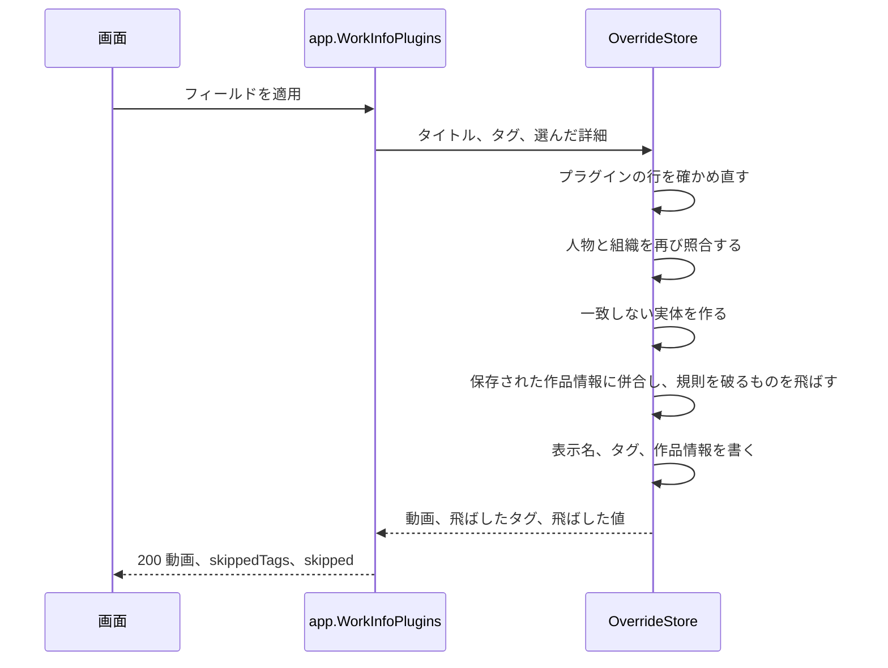

# 契約: 取得と適用の画面の API の作品の詳細 {#contract-work-details-in-the-fetch-and-apply-screen-api}

正本: [api/openapi.yaml](../../../api/openapi.yaml)、操作 `fetchWorkInfo` と `applyWorkInfoFetch`。Go と TypeScript は `task generate` で生成する。このファイルは、この機能が [049 screen-api.md](../../049-work-info-plugins/contracts/screen-api.md) に加えるものだけを挙げる。どちらのルートも所有者だけのままである。外部 API、MCP、プラグインの一覧、検索は変わらない。

## `WorkInfoField` {#workinfofield}

enum は `title` と `tags` から、選べる行ごとに 1 つの値に増える ([R-2](../research.md#r-2-one-selectable-row-per-field-per-date-kind-and-per-role))。

| 値 | 行 | 適用の規則 ([R-4](../research.md#r-4-the-apply-merges-the-selected-fields-into-the-stored-work-information-in-one-transaction-and-skips-each-value-that-breaks-a-rule)) |
| --- | --- | --- |
| `title`、`tags` | 049 のとおり | 変わらない |
| `code`、`description` | Code、Description | 保存された値を置き換える |
| `dates.release`、`dates.recorded`、`dates.published` | Released、Recorded、Published | その種類の保存された日付を置き換える |
| `people.performer`、`people.director`、`people.photographer`、`people.streamer` | Performers、Directors、Photographers、Streamers | その役割にまだ結び付いていない項目を足す |
| `organizations.maker`、`organizations.label` | Makers、Labels | その役割にまだ結び付いていない項目を足す |
| `urls` | Links | まだ保存されていない URL を足す |
| `externalIds` | IDs | まだ保存されていない `(source, value)` の組を足す |

## `POST /api/videos/{id}/work-info-fetches` {#post-apivideosidwork-info-fetches}

要求は変わらない。`WorkInfoFetch` は取得した作品の詳細を得る。各一覧は必須で、プラグインが何も返さなければ `[]` なので、049 のプラグインは同じ本文に空の一覧を加えたもので答える。

| フィールド | 型 | 意味 |
| --- | --- | --- |
| `code`、`description` | 文字列、任意 | プラグインが返したまま、前後の空白を除く。返さなければ無い |
| `dates` | `[{ kind, date }]` | 種類の順。`date` は返されたまま |
| `people` | `[{ role, name, externalIds: [{ source, value }], match }]` | `(role, fetched)` の順。`match` は以下 |
| `organizations` | `[{ role, name, externalIds, match }]` | 同じ |
| `urls` | string[] | 返されたまま |
| `externalIds` | `[{ source, value }]` | 返されたまま |

`match` は取得のときにその項目が解決した実体である ([R-3](../research.md#r-3-people-and-organizations-are-matched-by-external-id-then-by-folded-name-or-alias-and-an-ambiguous-match-links-nothing))。

| `match.state` | 他の `match` のフィールド | 比較が示すもの |
| --- | --- | --- |
| `existing` | `id`、`name`: 一致した実体とその今の名前 | 実体の名前。動画がその役割にすでにそれを結び付けていれば `Check` 付きで控えめに示す。画面はこれを自身の `workInfo` から読む |
| `new` | — | `New` の印を付けた取得した名前。適用が実体を作る |
| `ambiguous` | — | `Not linked` の印を付けた取得した名前。適用がそれを飛ばす |

フィールドの規則を破る値はここでは除かない。適用が決めて報告する (R-4)。

## `POST /api/videos/{id}/work-info-fetches/{fetchId}/apply` {#post-apivideosidwork-info-fetchesfetchidapply}

`fields` はすべての `WorkInfoField` を受け取る。名指しした各フィールドは、これまでどおり結果に値を持たなければならない。応答は変わらない `skippedTags` の横に `skipped` を得る。

| フィールド | 型 | 意味 |
| --- | --- | --- |
| `skipped` | `[{ field, value, reason }]` | 適用が除いた、選んだフィールドの値。フィールドの順、次に取得の順。`field` は `WorkInfoField`、`value` は比較が示した文 (日付、URL、名前、`source: value`。説明は先頭 100 文字) |
| `skipped[].reason` | `invalid` / `too_many` / `ambiguous` | フィールドの規則、保存された項目の後に数えた項目数の上限、曖昧な一致 |

応答の `Video` は、`PUT /api/videos/{id}/details` と同じく、適用の後の `workInfo` を持つ。049 のエラーは変わらない。`invalid_request` は行に値の無いフィールドにも答える。

図は適用のトランザクションを示す。

## `ErrorReason` と `Error` {#errorreason-and-error}

新しい理由やフィールドは無い。`work_info_*` の規則は適用を失敗させない。代わりに値を飛ばす (R-4)。
