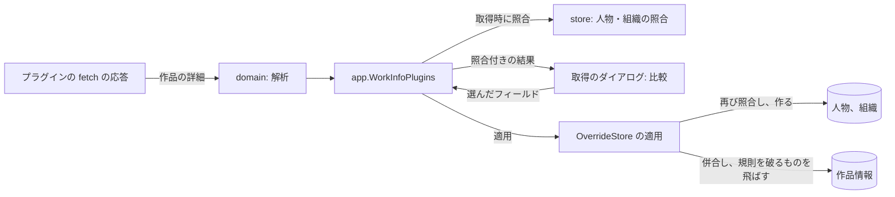
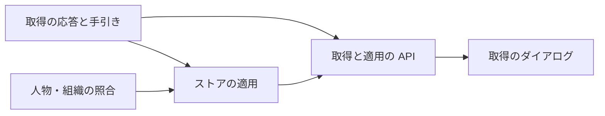

# 実装計画: 作品情報プラグインからの作品の詳細 {#implementation-plan-work-details-from-work-info-plugins}

**ブランチ**: `feature/052-plugin-work-info-fields` | **親 Issue**: #1143

**入力**: 親 Issue。これがこの機能の仕様である。

## 概要 {#summary}

作品情報プラグインの `fetch` の応答は、タイトルとタグの横に 047 の作品の詳細 (コード、説明、日付、人物、組織、リンク、ID) を持てるようになる。動画のページの比較は、取得した各フィールドを今の値と並べ、フィールド、日付の種類、役割ごとに 1 行で示す。適用は、選んだ行をタイトルとタグと同じトランザクションで書く。人物と組織は、外部 ID、次に照合形の名前か別名で既存の実体と照合し、何も一致しなければ作り、複数が一致すれば手を付けない。フィールドの規則を破る値は飛ばし、適用の後に報告する。プラグインの契約はバージョン 1 のままで、タイトルとタグだけを返すプラグインは変わらない。

図は、この機能が変える部分と、その間を流れるものを示す。



| 関心事 | 方針 |
| --- | --- |
| プラグインの契約 | `fetch` の応答の任意のフィールド。契約 1 は変わらない ([R-1](research.md#r-1-the-fetch-response-gains-optional-work-detail-fields-in-contract-1)、[contracts/plugin-contract.md](contracts/plugin-contract.md)) |
| 選択 | フィールドごと、日付の種類ごと、役割ごとに 1 行。`WorkInfoField` は 15 の値に増える ([R-2](research.md#r-2-one-selectable-row-per-field-per-date-kind-and-per-role)、[contracts/screen-api.md](contracts/screen-api.md)) |
| 人物と組織 | ストアの中で、外部 ID、次に照合形の名前か別名で、取得のときに照合し、適用の中で再び照合する。曖昧な項目は何も結び付けない ([R-3](research.md#r-3-people-and-organizations-are-matched-by-external-id-then-by-folded-name-or-alias-and-an-ambiguous-match-links-nothing)) |
| 適用 | 選んだフィールドを保存されたオブジェクトに併合し、047 の置き換えの経路で 049 の 1 つのトランザクションの中で書く。規則を破る各値は飛ばして報告する ([R-4](research.md#r-4-the-apply-merges-the-selected-fields-into-the-stored-work-information-in-one-transaction-and-skips-each-value-that-breaks-a-rule)) |

Issue は `ui` ラベルを持つので、`design` ステージが画面の単位の前に `ui-design.md` を書く。この文書は [049 ui-design.md、Compare](../049-work-info-plugins/ui-design.md#compare) の比較のステップを改訂する。扱うのは、Issue の `UI品質` の範囲で、[contracts/screen-api.md、`WorkInfoField`](contracts/screen-api.md#workinfofield) の順に並ぶ新しいフィールドの行、結果にフィールドが無いときにどの行を出すか、各行の `Now` と `Fetched` のセルが 1 つの値と、足される一覧 (どの項目が動画にとって新しいか) に対して何を示すか、適用が作る実体の控えめな `New` の印と曖昧な実体の `Not linked` の印、一覧の行の状態、結果のステップで飛ばしたタグの横に出す `skipped` の行である。

親 Issue の `対象外` のとおり、次は対象外である。タグの種類 (#1136)。結果から既存の人物や組織の名前、別名、外部 ID、親を更新すること。作らずに既存の実体にだけ結び付ける動き方。検索の候補の画像や日付。取り込み時や一括での取得。

## 技術的な文脈 {#technical-context}

**正本の定義**:

| 話題 | 出典 |
| --- | --- |
| 境界、ストアの役割とパッケージ内のヘルパー、コミット後のイベント | [ARCHITECTURE.md](../../ARCHITECTURE.md) |
| プラグインのサンドボックス、実行、結果のキャッシュ、適用 | [work-info-plugins.md](../../docs/design-docs/work-info-plugins.md)、[049 research](../049-work-info-plugins/research.md)、[internal/app/work_info_fetch.go](../../internal/app/work_info_fetch.go)、[internal/store/work_info_fetch.go](../../internal/store/work_info_fetch.go) |
| 作者向けのプラグインの契約 | [work-info-plugins.md (手順書)](../../docs/how-to/work-info-plugins.md) |
| 作品情報のテーブル、フィールドの規則、実体、`CreditStore` | [047 data-model.md](../047-video-work-info/data-model.md)、[internal/store/work_info.go](../../internal/store/work_info.go)、[internal/store/credits.go](../../internal/store/credits.go) |
| 照合形 | [013 data-model.md](../013-library-search/data-model.md)、`domain.FoldForMatch` |
| 画面の API、エラー、生成コード | [api/openapi.yaml](../../api/openapi.yaml)、[023 error-api](../023-english-i18n/contracts/error-api.md)、`task generate` |
| 取得のダイアログ、作品の詳細の行、画面の規則、Web のテスト | [web/src/player/workInfoFetch/](../../web/src/player/workInfoFetch/)、[web/src/player/WorkInfo.tsx](../../web/src/player/WorkInfo.tsx)、[design-system.md](../../docs/design-docs/design-system.md)、[web-testing.md](../../docs/design-docs/web-testing.md) |
| ブラウザテストとそのフィクスチャのプラグイン | `web/e2e/work-info-plugins.e2e.ts` (削除済み)、`internal/wasmplugin/testdata/e2eworks/` (削除済み) |
| チェック | [Taskfile.yml](../../Taskfile.yml) (`task check`、`task check-docs`) |

**この機能に固有の文脈**: 新しい依存、マイグレーション、新しいルートは無い。この機能は 2 つの取得のルートの本文、プラグインの応答、ストアの適用を変える。049 R-8 の結果のキャッシュは、タイトルとタグの横に作品の詳細とその照合を、同じ寿命で持つ。

## Constitution Check {#constitution-check}

| 規則 (出典) | 判定 |
| --- | --- |
| ストアの役割。役割をまたぐ作業はパッケージ内のヘルパーを通じて 1 つのトランザクションで実行する (ARCHITECTURE.md) | 合格: `OverrideStore.ApplyFetchedWorkInfo` が引き続き適用を持ち、`work_info.go` と `credits.go` のパッケージ内のヘルパーを通じて作品情報と実体の行に到達する。照合は `CreditStore` の 1 つの新しい読み出しである |
| コミット後のイベント (ARCHITECTURE.md) | 合格: 適用のコミットの後に `VideoWorkInfoChanged` が `VideoOverrideChanged` に加わる ([R-4](research.md#r-4-the-apply-merges-the-selected-fields-into-the-stored-work-information-in-one-transaction-and-skips-each-value-that-breaks-a-rule)) |
| 利用者のデータは再構築を越えて残る (ARCHITECTURE.md) | 合格: 適用は利用者の鍵の下の 047 のテーブルと、`videos` へのリンクを持たない実体のテーブルを書く |
| すべての読み出しは閲覧者を知る (ARCHITECTURE.md) | 合格: どちらのルートも所有者だけのままで、取得した結果は他の誰にも届かない |
| 生成ファイルを手で編集しない (AGENTS.md) | 合格: `api/openapi.yaml` を変え、その後 `task generate` を実行する |
| 複雑度 25 以下。コピーせずコードを共有する (AGENTS.md) | 合格: 併合は 047 の `replaceWorkInfo` が書く `domain.WorkInfo` を作る。実体の作成は `writeCreditNames` と `writeCreditExternalIDs` を再利用する。規則の確認は各値に対して `NormalizeWorkInfo` を再利用する |
| 画面の前に design-system.md を読む。最も低いレベルでテストする (AGENTS.md、web-testing.md) | 合格: 解析、照合、併合は Go の単体テスト、ルートはハンドラーのテスト、ダイアログはページのテスト、流れ全体は拡張した既存のブラウザテストで確かめる |
| 変更と共に文書を更新する (AGENTS.md、core-beliefs.md) | 合格: 作者向けの手引き、設計文書、ARCHITECTURE のサブシステムの行は、振る舞いを変える単位が更新する |

違反は無いので、複雑度の追跡は無い。判定はフェーズ 1 の後も成り立つ。

## プロジェクトの構成 {#project-structure}

### 文書 (この機能) {#documentation-this-feature}

```text
specs/052-plugin-work-info-fields/
├── plan.md
├── research.md
└── contracts/
    ├── plugin-contract.md
    └── screen-api.md
```

`ui-design.md` は `design` ステージが書く。`data-model.md` は無い。テーブルや列の変更は無く、照合と併合の規則は R-3 と R-4 である。`quickstart.md` は無い。Go のテストとブラウザテストがインターネットなしでこの機能を確かめるので、手で実行するものは無い。

### ソースコード {#source-code}

**影響する境界**:

| 境界 | この機能で持つもの |
| --- | --- |
| `internal/domain` | 拡張した `fetch` の応答の、上限を含む解析。項目ごとの照合を持つ拡張した取得の結果。15 の `WorkInfoField` の値。選んだフィールドの `WorkInfo` への併合と、飛ばした値 |
| `internal/store` | `CreditStore` の人物・組織の照合の読み出し。再び照合し、実体を作り、作品情報を書く拡張した `OverrideStore.ApplyFetchedWorkInfo` |
| `internal/app` | 取得のときの照合、結果のキャッシュに詳細を持つこと、選んだフィールドの検証 |
| `internal/httpapi`、`api/openapi.yaml` | 拡張した `WorkInfoFetch`、`WorkInfoField`、`WorkInfoFetchApplied` |
| `web/src/api`、`web/src/player/workInfoFetch`、`web/src/i18n` | クライアントの型、比較の行と結果のステップ、カタログの文 |
| `web/e2e`、`internal/wasmplugin/testdata/e2eworks` | ブラウザテストと、作品の詳細を返すそのフィクスチャのプラグイン |
| `docs/`、`ARCHITECTURE.md` | 作者向けの手引き、設計文書の適用の節、サブシステムの行 |

**新しいパス**: なし。

**構成の決定**: 照合は `internal/domain` や画面ではなく `internal/store` に置く。比べる照合形の綴りは保存された `search_key` の行であり、適用はトランザクションの中で照合を繰り返さなければならないからである ([R-3](research.md#r-3-people-and-organizations-are-matched-by-external-id-then-by-folded-name-or-alias-and-an-ambiguous-match-links-nothing))。選んだフィールドの保存されたオブジェクトへの併合は、2 つの `WorkInfo` の値と取得した詳細に対する純粋な `internal/domain` の関数である。そのため飛ばす規則は SQLite なしで単体テストでき、ストアは関数が返すものを書くだけである。

## 実装作業 {#implementation-work}

図は、どの単位が先に入る必要があるかを示す。画面の単位は `design` ステージの `ui-design.md` も待つ。



### プラグインの取得の応答で作品の詳細を受け取り、プラグインの手引きに公開する {#accept-work-details-in-a-plugins-fetch-response-and-publish-them-in-the-plugin-guide}

**範囲**: `domain.FetchedWorkInfo` に [contracts/plugin-contract.md](contracts/plugin-contract.md) のフィールドを加え、`ParseWorkInfoResponse` はそこに挙げた前後の空白の除去、項目の除外、上限に従ってそれらを読む。`docs/how-to/work-info-plugins.md` の `Response` の節はフィールド、その規則、外部 ID の助言を挙げ (要件 9)、この機能の `contracts/plugin-contract.md` はそこにリンクする。

**依存**: なし。

**受け入れ**: `task check` と `task check-docs` が通る。ドメインのテストで、すべてのフィールドを持つ応答が順に解析されること、前後の空白が除かれること、未知の `role` か `kind` を持つ項目が落とされること、2 つ目の `release` の日付が落とされること、101 人目の出演者と 21 個目の URL が落とされること、繰り返した `(source, value)` が 1 回だけ残されること、`title` と `tags` だけの応答がこれまでとまったく同じに解析されることを示す。手引きの `Response` の表がすべてのフィールドとその上限を挙げる。

### 取得した人物と組織を既存のものに照合する {#match-fetched-people-and-organizations-to-existing-ones}

**範囲**: 1 つの種類の取得した項目を受け取り、項目ごとに一致した実体か `new` か `ambiguous` を [R-3](research.md#r-3-people-and-organizations-are-matched-by-external-id-then-by-folded-name-or-alias-and-an-ambiguous-match-links-nothing) に従って返す `CreditStore` の読み出し。外部 ID が先で、次に `FoldForMatch(name)` をすべての名前と別名の行の `search_key` と照合する。`internal/domain` の照合の結果の型。

**依存**: プラグインの取得の応答で作品の詳細を受け取り、プラグインの手引きに公開する。

**受け入れ**: `task check` が通る。ストアのテストで、1 人の人物が持つ外部 ID を持つ項目が、その名前が別の人物の名前と等しくてもその人物に一致すること、名前が別の幅で書いた別名と等しい項目が一致すること、名前を 2 人の人物が共有する項目が `ambiguous` と答えられること、2 つの外部 ID を 2 人の人物がそれぞれ持つ項目が `ambiguous` と答えられること、何にも一致しない項目が `new` と答えられること、組織が組織とだけ照合されること、同じ項目が 2 回とも同じに答えられることを示す。

### 取得した作品の詳細を 1 つのトランザクションで動画に適用する {#apply-fetched-work-details-to-the-video-in-one-transaction}

**範囲**: [R-4](research.md#r-4-the-apply-merges-the-selected-fields-into-the-stored-work-information-in-one-transaction-and-skips-each-value-that-breaks-a-rule) に従って、選んだフィールドを保存された `WorkInfo` に併合する純粋な `internal/domain` の関数 (置き換え、重複なしの追加、規則を破るか上限を超える各値を飛ばしたものとして返すこと、`new` の項目を `NormalizeCredit` と役割の上限で確かめ、ID なしで残すこと)。トランザクションの中で再び照合し、併合し、併合が残した `new` の実体だけを取得した名前と外部 ID で作り、その ID を埋め、`replaceWorkInfo` を通じて書き、編集時刻を進め、コミットの後に `VideoWorkInfoChanged` を発行するように拡張した `OverrideStore.ApplyFetchedWorkInfo`。`docs/design-docs/work-info-plugins.md` の適用の節と、ARCHITECTURE.md のサブシステムの表の `internal/app` の行。

**依存**: 取得した人物と組織を既存のものに照合する。

**受け入れ**: `task check` と `task check-docs` が通る。ドメインのテストで、`code` が置き換えられること、選んだ日付の種類が置き換えられて他の種類は残ること、出演者が保存されたものの後に足されること、保存された URL が繰り返されないこと、別の形の日付とスキームの無い URL が `invalid` として返されて行の残りは適用されること、101 人目の出演者が `too_many` として返されること、名前が空か実体の上限を超える `new` の出演者が `invalid` として返されることを示す。ストアのテストで、Issue の受け入れ条件 2 から 5 とその Edge Case を示す。保存された出演者の横に 2 人目の出演者が足されること、既存の人物の外部 ID を持つ項目が新しい行なしに結び付くこと、`new` の項目が取得した外部 ID を持つ人物を作ること、結果の中に 2 回ある同じ人物と、役割にすでに結び付いた人物が 1 回だけ結び付くこと、取得と適用の間に作られた人物が重複せずに結び付くこと、曖昧な項目が結び付けも作成もされずに報告されること、すでに 100 人の出演者を結び付けた動画への `new` の出演者が新しい人物の行なしに `too_many` として報告されること、名前が実体の上限を超える `new` の出演者が `invalid` として報告され、選んだ `code` は書かれること、無い動画が新しい人物も作品情報の行も残さないことである。作品の詳細が変わったときにはコミットの後に `VideoWorkInfoChanged` が 1 回発行され、タイトルだけが変わったときには発行されないことも示す。

### 取得から作品の詳細を返し、画面の API で選んだフィールドを適用する {#return-work-details-from-a-fetch-and-apply-the-selected-fields-through-the-screen-api}

**範囲**: `app.WorkInfoPlugins` は取得のときにストアを通じて取得した人物と組織を照合し、詳細と照合を結果のキャッシュに持ち、15 のフィールドを結果に対して検証する。[contracts/screen-api.md](contracts/screen-api.md) のスキーマの変更を伴う `fetchWorkInfo` と `applyWorkInfoFetch`。`web/src/api/workInfoPlugins.ts` のクライアントの関数と型。

**依存**: プラグインの取得の応答で作品の詳細を受け取り、プラグインの手引きに公開する。取得した作品の詳細を 1 つのトランザクションで動画に適用する。

**受け入れ**: `task check` が通り、`task generate` による差分が無い。偽のランタイムによる app のテストで、取得の結果が各フィールドをその `match.state` と共に持つこと、タイトルとタグのプラグインからの取得が空の一覧を持ち `code` を持たないこと、発売日の無い結果で選んだ `dates.release` が `ErrWorkInfoApplyInvalid` と答えられることを示す。ハンドラーのテストで、契約どおりの取得の本文、`code`、`dates.release`、`people.performer` の適用が、それらを持つ動画の `workInfo` と共に `200` と答えること、日付が形を破る適用が、その日付を `invalid` として `skipped` に持って `200` と答え、コードは書かれること、どちらのルートもゲストに `401` `unauthenticated` と答えることを示す。

### 取得のダイアログで作品の詳細を比較し、適用する {#compare-and-apply-work-details-in-the-fetch-dialog}

**範囲**: `ui-design.md` の指定どおりの `web/src/player/workInfoFetch/` の比較と結果のステップ。契約の順のフィールドごとに 1 行、ページの `workInfo` からの `Now` のセル、新規と未結合の印と動画にとって新しい項目の数を持つ `Fetched` のセル、一覧の行の状態、値が違う行の選択、ページのものを置き換える応答の `Video`、結果のステップの `skipped` の行。カタログの文。コード、発売日、外部 ID を持つ出演者、メーカーを返すフィクスチャのプラグイン `e2eworks` と、拡張した `web/e2e/work-info-plugins.e2e.ts`。

**依存**: 取得から作品の詳細を返し、画面の API で選んだフィールドを適用する。`design` ステージ。

**受け入れ**: `task check` が通り、CI の `Browser E2E` が拡張したテストと共に通る。そのテストはコード、発売日、出演者、メーカーを適用して作品の詳細の行にそれらを見て、次にすでに別の出演者を持つ動画で再び取得し、出演者を適用して 2 人とも見て、人物の画面でフィクスチャの外部 ID を持つ出演者を見る。ページのテストで、`new` の項目がその印と共に示されること、`ambiguous` の項目がその印と共に示され新規として数えられないこと、役割にすでに結び付いた実体が行を `Same as now` にすること、値の無いフィールドが選べないこと、タイトルとタグの結果がこれまでどおり比較されること、`skipped` の日付が結果のステップに示され他のフィールドは適用されることを示す。画面は `ui-design.md` が挙げる幅で目で確かめる。
