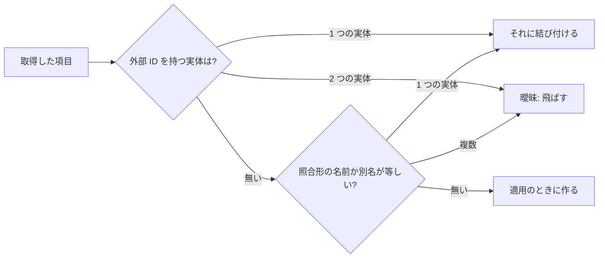

# 調査: 作品情報プラグインからの作品の詳細 {#research-work-details-from-work-info-plugins}

引き継ぐ決定: [049](../049-work-info-plugins/research.md) のプラグインの契約、メモリに持つ取得した結果、1 つのトランザクションでの適用 (R-2、R-8、R-9)。[047](../047-video-work-info/data-model.md) と [047 research](../047-video-work-info/research.md) の作品情報のモデル、そのフィールドの規則、その id を持つ実体 (R-3、R-4、R-11、R-13)。[013](../013-library-search/data-model.md) の照合形 `FoldForMatch`。このファイルは、この機能が加える決定だけを記録する。

## R-1: 取得の応答は、契約 1 のまま任意の作品の詳細のフィールドを得る {#r-1-the-fetch-response-gains-optional-work-detail-fields-in-contract-1}

**決定**: プラグインの `fetch` の応答の `workInfo` は、`title` と `tags` の横に `code`、`description`、`dates`、`people`、`organizations`、`urls`、`externalIds` を、それぞれ任意で、[contracts/plugin-contract.md](contracts/plugin-contract.md) の形で持てる。マニフェストの `contract` は `1` のままである。

| 案 | タイトルとタグのプラグインが変更なしに動き続ける (要件 8) | もっと返すために作者が変えること | 判定 |
| --- | --- | --- | --- |
| **契約 1 の任意のフィールド** | はい: 書かないフィールドは無いものになる | フィールドを書く | 採用 |
| フィールドを持つ契約 2、契約 1 は残す | はい | マニフェストを書き直して再ビルドし、vv は 2 つの応答の形を読む | 不採用: 契約 1 はすでに、フィールドを加えられるように vv が未知のフィールドを無視すると述べており、要求は何も変わらない |
| 2 つ目の操作 (`details`) | はい | 取得ごとに 2 回目の実行を実装する | 不採用: 1 回のページの取得で作品のすべてのフィールドが得られる。2 回目の実行はプラグインの要求と時間を 2 倍にする |

**理由**: 要求は変わらず、新しいフィールドはすべて任意なので、契約は置き換えずに広げる。人物と組織は名前と外部 ID の一覧を持つ。これは外部 API の実体の作成が受け取る形なので、それに対してスクレイパーを書いたことのある作者はフィールドを知っている。

## R-2: フィールドごと、日付の種類ごと、役割ごとに 1 つの選べる行 {#r-2-one-selectable-row-per-field-per-date-kind-and-per-role}

**決定**: 比較と適用はフィールドで選ぶ。日付の種類 (`dates.release`) と役割 (`people.performer`、`organizations.maker`) はそれぞれ独立したフィールドなので、`WorkInfoField` は `title` と `tags` から [contracts/screen-api.md、`WorkInfoField`](contracts/screen-api.md#workinfofield) の 15 の値に増える。

| 案 | 発売日、2 人の出演者、1 つのメーカーを持つ結果の行 | Issue の規則に合う | 判定 |
| --- | --- | --- | --- |
| **フィールドごと、日付の種類ごと、役割ごとに 1 行** | Released、Performers、Makers | はい: 要件 4 は人物と組織を役割ごとに足し、`UI品質` は 1 行に 1 項目を保つ | 採用 |
| すべての日付で 1 行、すべての人物で 1 行、すべての組織で 1 行 | Dates、People、Organizations | いいえ: 行が役割を混ぜ、所有者は監督を除いて出演者だけを取れない | 不採用 |
| 項目ごとに 1 つのチェックボックス (人物ごと、URL ごと) | Released、出演者 1、出演者 2、メーカー 1 | いいえ: 要件 2 は今と同じく項目ごとに選び、20 の URL を持つ結果は 20 行になる | 不採用 |

**理由**: 役割は画面がすでに作品の詳細に付けているラベル ([047](../047-video-work-info/ui-design.md) の `Performers`、`Makers`) なので、役割ごとの行は情報の行と同じように読める。また要件 4 の適用の追加の規則は役割ごとである。

## R-3: 人物と組織は、外部 ID、次に照合形の名前か別名で照合し、曖昧な一致は何も結び付けない {#r-3-people-and-organizations-are-matched-by-external-id-then-by-folded-name-or-alias-and-an-ambiguous-match-links-nothing}

**決定**: 取得した各人物や組織は、その種類の実体と照合する。まず外部 ID のいずれかで照合し、次に名前を、保存されたすべての名前と別名と照合形 `FoldForMatch` (名前の行の `search_key`) で照合する。一致がちょうど 1 つならその実体を結び付ける。一致が無ければ、適用のときに取得した名前と外部 ID で実体を作る。一致が 2 つ以上あるか、外部 ID を別々の実体が持つときは、何も結び付けず何も作らず、その項目を曖昧として報告する。照合は取得のときに比較のために走り、適用のトランザクションの中で再び走る。決めるのは後者である。

図は、取得した 1 つの項目に対する規則を示す。

| 案 | 全角と半角の綴りが一致する | 規則の置き場所 | 判定 |
| --- | --- | --- | --- |
| **保存された `search_key` での照合形の等価、外部 ID が先、ストアの中** | はい | `internal/store` に 1 つ。取得と適用が使う | 採用 |
| 文字列の厳密な等価 | いいえ: 日本のサイトは同じ出演者を異なる幅と空白で綴り、別名はそのためにある | ストア | 不採用 |
| 画面が各名前を `GET /api/people?q=` で引く | 部分一致であり、等価ではない | 画面。適用はそれを繰り返すことになる | 不採用: 項目ごとに 1 つの要求が要り、どのみち適用はトランザクションの中で決めなければならない (Issue の競合の Edge Case) |
| 適用のときだけ照合する | — | ストア | 不採用: 要件 6 は、どの項目が作られるかを比較で示す |

**理由**: Issue の Edge Case (外部 ID を名前より優先する、名前が複数一致すれば何も結び付けない) は優先順位の規則であり、保存された照合形の鍵は綴りの規則がすでにある唯一の場所なので、照合は種類ごとに 1 つのクエリになる。トランザクションの中で再び照合するから、取得と適用の間に作られた実体は重複せずに結び付き、比較が 1 分前のものでも適用の答えは正しい。

## R-4: 適用は選んだフィールドを保存された作品情報に 1 つのトランザクションで併合し、規則を破る値をそれぞれ飛ばす {#r-4-the-apply-merges-the-selected-fields-into-the-stored-work-information-in-one-transaction-and-skips-each-value-that-breaks-a-rule}

**決定**: 適用は保存された作品情報を読み、選んだフィールドをその上に重ね (`code`、`description`、日付の種類は置き換える。役割、`urls`、`externalIds` はまだ無いものを取得した順に足す)、結果を 047 の既存の置き換えの経路で、タイトルとタグと同じトランザクションの中で書く。[047 data-model.md、Fields](../047-video-work-info/data-model.md#fields) のフィールドの規則を破る値は除いて `skipped` で報告し、行の残りは適用する。10,000 コードポイントを超える `description`、別の形の日付、絶対でない URL、101 人目の出演者がそれにあたる。R-3 の曖昧な項目も同じように飛ばす。R-3 が実体を見つけなかった項目は、何かを作る前に確かめる。名前と外部 ID は `domain.NormalizeCredit` の実体の規則で (空の名前や長さを超える名前は `invalid`)、位置は保存された項目の後に数えた役割の上限で (`too_many`) 確かめる。その後、適用は併合が残した項目の実体だけを作る。そのため飛ばした項目は実体を残さず、取得した名前が不正でも適用は失敗しない。

| 案 | 不正な日付と正しいコードを持つ結果 (受け入れ条件 5) | 判定 |
| --- | --- | --- |
| **値を飛ばし、残りを適用し、適用の後に報告する** | コードは書かれ、日付は報告される | 採用 |
| `PUT /api/videos/{id}/work-info` と同じく、`400` と `field` で適用を拒否する | 何も書かれず、所有者は行の中の 1 つの日付だけを外せない | 不採用: 要件 7 |
| タイトルと同じく、取得のときに値を落として `Not in the result` を出す | 日付は出ず、所有者はそれがあったことを知らない。項目数の上限は今の値で決まるが、取得は今の値を読まない | 不採用: 要件 7 は適用の後に報告し、受け入れ条件 5 は日付を名指しする |

`skipped` はフィールド、比較が示したとおりの値、理由を持つ。理由は `invalid` (フィールドの規則)、`too_many` (保存された項目の後に数えた項目数の上限)、`ambiguous` (R-3) である。既存の `skippedTags` は形を保つ (要件 8)。適用は作品の詳細が変わったとき、コミットの後に `VideoOverrideChanged` の横に `VideoWorkInfoChanged` を書き、[047 R-13](../047-video-work-info/research.md#r-13-work-information-writes-advance-the-edit-time-entity-edits-do-not) と同じく利用者の鍵のメンバーの編集時刻を進める。そのためページと一覧は、エディタで保存した後と同じように読み直す。

**理由**: 047 の置き換えの経路はすでに上限と一意性の制約を守らせるので、併合はその経路が受け入れるオブジェクトを作るだけでよい。049 R-9 の 1 つのトランザクションは新しい行と作った実体に広がり、Issue の「失敗した適用は何も残さない」Edge Case がそのまま得られる。作る前に飛ばすものを決めるから、成功した適用が、どの動画にも結び付かない実体を人物の一覧に残さない。
