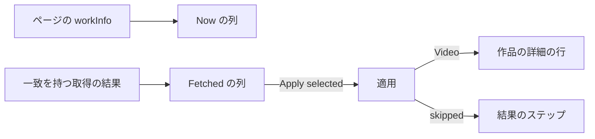
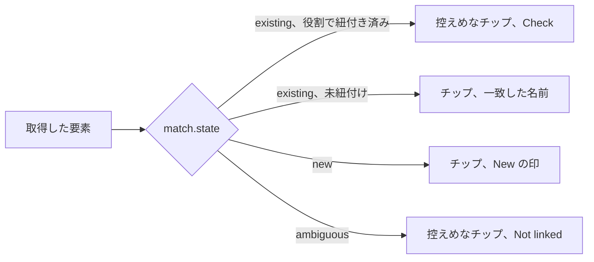
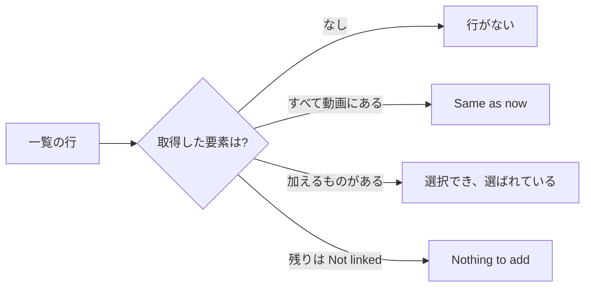

# UI デザイン: 作品情報プラグインからの作品の詳細 {#ui-design-work-details-from-work-info-plugins}

**機能**: [親 Issue #1143](https://github.com/syudead/vv/issues/1143) · [plan.md](plan.md) · [contracts/screen-api.md](contracts/screen-api.md) · [research.md R-2](research.md#r-2-one-selectable-row-per-field-per-date-kind-and-per-role) · [R-3](research.md#r-3-people-and-organizations-are-matched-by-external-id-then-by-folded-name-or-alias-and-an-ambiguous-match-links-nothing) · [R-4](research.md#r-4-the-apply-merges-the-selected-fields-into-the-stored-work-information-in-one-transaction-and-skips-each-value-that-breaks-a-rule)

すでに決まっていることの出典。ここでは繰り返さずリンクする。

| 話題 | 出典 |
| --- | --- |
| トークン、閉じたスケール、動画のページの密度 | [design-system.md、Foundations](../../docs/design-docs/design-system.md#foundations)。値は [`web/src/ui/tokens.css`](../../web/src/ui/tokens.css) の `@theme` にあり、ここでは名前で示し、決して写さない |
| `FormDialog`、`Checkbox`、`Badge`、`Alert`、`Tooltip`、`Button`、`TentativeMark` | [patterns.md](../../web/registry/rules/patterns.md)、[components.md](../../web/registry/rules/components.md) |
| 取得のダイアログ: そのステップ、比較のグリッド、タグのチップ、十個のチップでの折りたたみ、古い結果と失敗の状態、結果のステップ | [049 UI デザイン、取得のダイアログ](../049-work-info-plugins/ui-design.md#fetch-dialog)、[比較](../049-work-info-plugins/ui-design.md#compare)、[結果](../049-work-info-plugins/ui-design.md#result)。[`CompareStep.tsx`](../../web/src/player/workInfoFetch/CompareStep.tsx)、[`TagChips.tsx`](../../web/src/player/workInfoFetch/TagChips.tsx) |
| 作品の詳細の行: その項目のラベル、日付の文字、スキームを除いたリンクの文字、`{source}: {value}`、折りたたんだ説明 | [047 UI デザイン、動画のページ: 作品の詳細の行](../047-video-work-info/ui-design.md#video-page-work-details-row)。[`WorkInfo.tsx`](../../web/src/player/WorkInfo.tsx) |
| まだ存在しないエンティティのチップに付く `New` の印 | [047 UI デザイン、文言、エディタ](../047-video-work-info/ui-design.md#editor) (`Chip mark for an unsaved new entry`) |
| 幅のブレークポイントは CSS で切り替える。レイアウトは人が確かめる | [library-ui.md、幅のブレークポイント](../../docs/design-docs/library-ui.md#width-breakpoints-in-css-and-the-sidebar-exception)、[人が確かめるレイアウト](../../docs/design-docs/library-ui.md#layout-verified-by-people-not-machines) |
| 画面の文言 | [`web/src/i18n/en.ts`](../../web/src/i18n/en.ts)。この機能は `player.workInfoFetch` を拡張する |

この機能は取得のダイアログの二つのステップを、所有者に限って変える。**比較**は結果が持つ作品の詳細ごとに一行を得て、人物と組織には `New` と `Not linked` の印が付く (要件 2、5、6)。**結果のステップ**は、適用が除いた値を飛ばしたタグと並べて示す (要件 7)。画面の他のものは変わらない: 探すステップ、候補、古い結果と失敗の状態、トースト、作品の詳細の行である。作品の詳細の行は、エディタの値を表示するのと同じく、応答の `Video` を通して適用した値を表示する。

図は、比較が何を読み、適用の応答がどこへ行くかを示す。

## この形にした理由 {#why-this-shape}

作品の詳細は、結果がそれを持つときだけ行を得る。一方 `Title` と `Tags` は `Not in the result` の行を保つ。049 のプラグインは作品の詳細を返さないので、その比較は今の二行のままであり (要件 8)、四つの詳細を持つ結果は十五行ではなく六行である。`Not in the result` の十三行は、取得した値を 768px でスクロールしないと見えない位置へ無駄に押し出し、Issue の密度の規則に反する。代わりの案、つまりプラグインが返せない詳細を所有者が見られるようにすべての行を常に置く案は採用しなかった。比較はこの結果についてのものであり、プラグインにできることは Settings で読むからである。

一覧の行 (人物、組織、リンク、ID) の要素は、タグの行の要素と同じくチップであり、動画がすでに持つ要素には同じ `Check` 付きの控えめなチップ、同じ `{n} new` の数、同じ十個での折りたたみを使う。作品の詳細の行は名前をカンマでつなぐが、比較は各要素に印 (動画にある、新しい、紐付かない) を付けなければならず、カンマでつないだ名前には付けられない印をチップは持てる。`New` の印はエディタのものである。名前の後の `text-xs` の控えめな文字で、名前が先に読まれるよう抑えてある (`UI品質`)。`Not linked` は同じ大きさと色で、控えめなチップに付く。そのため適用されない要素は、取り込む値ではなく、すでにある要素のように読める。そのツールチップが理由を伝える。どちらの印にも色付きのバッジやアイコンを使う案は採用しなかった。行が、名前と競合する三種類の印を持つことになるからである。

`{n} new` は 049 での意味、つまり動画がまだ持たない取得した要素の数を保つ。そのため `New` の人物と一致した人物を同じく数え、`Not linked` の人物は除く。単一の値と同じく、要素は項目の規則を確かめる前に数える。比較は役割の上限も、適用がどの URL を拒むかも知らず、数から除いた要素は決して選べないので、飛ばしたものとして伝えられることも決してない ([R-4](research.md#r-4-the-apply-merges-the-selected-fields-into-the-stored-work-information-in-one-transaction-and-skips-each-value-that-breaks-a-rule))。作られるエンティティのための二つ目の数は採用しなかった。チップの `New` の印がすでにどの要素がそれかを示し、Issue は加わるものの数を求めているからである。

## 文言 {#words}

英語はカタログが取り込む下書きである。実装の後は [`web/src/i18n/en.ts`](../../web/src/i18n/en.ts) が正となる。コード、説明、日付、名前、URL、ID はユーザーデータであり、翻訳せずに埋め込む。

| 場所 | 文言 | 注記 |
| --- | --- | --- |
| 項目のラベル、新しい行 | Code · Description · Released · Recorded · Published · Performers · Directors · Photographers · Streamers · Makers · Labels · Links · IDs | `Title` と `Tags` の後に、[contracts/screen-api.md、`WorkInfoField`](contracts/screen-api.md#workinfofield) の順に並べる。役割のラベルはエディタのものと同じく常に複数形である |
| 説明の折りたたみ | Show more · Show less | `link` `sm`。作品の詳細の行の折りたたんだ説明と同じ |
| 動画にすでにある要素 | On the video | lucide `Check` 付きの控えめなチップのツールチップ。タグと同じ (049) |
| 作られる要素 | New | チップの中の名前の後に `text-xs text-muted-foreground` で置く。エディタの未保存のチップと同じ。`{name}, new` と読み上げる。ツールチップは `Created when you apply` |
| 複数に一致する要素 | Not linked | 同じ形で、控えめなチップに付く。`{name}, not linked` と読み上げる。ツールチップは `Matches more than one person, so it isn't linked or created` (組織の行では `organization`) |
| 別の綴りで一致した要素 | Fetched as "{name}" | 一致したエンティティの名前が取得した名前と異なるチップのツールチップ |
| 加えるもののない一覧の行 | Nothing to add | 控えめ。チップの後に `{n} new` の代わりに置く。行は選べない |
| 結果のタイトル | Applied, but some values were left out | `Applied, but some tags were left out` を置き換える。`success` の `Alert` |
| 飛ばしたものの行 | {label}: {value} — {reason} | 飛ばしたタグか値ごとに一行。`{label}` は行の項目のラベル、`{value}` は `font-medium` |
| 飛ばしたタグの理由 | you rejected this tag before · not a valid tag name | 変わらない (049) |
| 飛ばした、`invalid`、日付 | not a date in the form YYYY-MM-DD, YYYY-MM or YYYY | |
| 飛ばした、`invalid`、リンク | not a full URL starting with http:// or https:// | |
| 飛ばした、`invalid`、その他 | too long or contains characters that can't be used | コード、説明、名前、ID |
| 飛ばした、`invalid`、カバー | couldn't be used as the thumbnail | `{value}` はカバーの URL |
| カバー画像 | Current thumbnail · Fetched cover, {width} × {height}. Becomes the thumbnail when you apply | 2 つの画像の `alt` と `title` |
| 飛ばした、`too_many` | over the limit for {label} | `{label}` は小文字にする: `over the limit for performers` |
| 飛ばした、`ambiguous` | matches more than one person · matches more than one organization | 行の種類による |

## 比較 {#compare}

比較はそのグリッド、見出しの行、出典の行、`Back to the matches` を保つ ([049、比較](../049-work-info-plugins/ui-design.md#compare))。行は `Title`、`Tags`、結果がカバー画像を持つときは `Cover`、次に結果が持つ作品の詳細ごとに一行を `WorkInfoField` の順に置く。そのため、作品の詳細の行と同じく、コードと発売日が名前より前に来る。

| 行 | Now (`text-muted-foreground`) | Fetched (`text-foreground`) | 現在と同じになる条件 |
| --- | --- | --- | --- |
| Title、Tags | 049 と同じ | 049 と同じ | 049 と同じ |
| Cover | 今のサムネイルを、幅が最大 `max-w-xs` の `VideoThumbnail` の枠に、不透明度 70% で示す | VVMDM が返す取得したカバーを同じ枠に示す。サムネイルと比べられないので、最初から選んだ状態にする | なし |
| Code | 保存したコード、`tabular-nums` | 取得したコード、`tabular-nums`。規則に反するときも返されたとおり | 文字列が等しい |
| Description | 保存した文字、`whitespace-pre-line`。三行で折りたたみ、`Show more` を付ける | 取得した文字。同じく折りたたむ | 等しい |
| Released、Recorded、Published | その種類の保存した日付、`tabular-nums` | 返されたとおりの取得した日付、`tabular-nums`。別の形の日付も直さずに表示する | 等しい |
| Performers、Directors、Photographers、Streamers、Makers、Labels | その役割で紐付いた名前を、位置の順に `secondary` のチップで示す | 取得した要素ごとに一つのチップを、取得した順に、その `match` に従って (下記) 示し、次に `{n} new` | すべての要素が `existing` で、その役割で紐付いている |
| Links | 保存した URL をスキームを除いてチップで示し、完全な URL を `title` に入れる | URL ごとに一つのチップを、返されたとおりスキームを除いて示す。保存済みのものは `Check` 付きで控えめにする。次に `{n} new` | すべての URL が保存されている |
| IDs | `{source}: {value}` のチップ、`tabular-nums` | 同じ。保存済みの組は `Check` 付きで控えめにする。次に `{n} new` | すべての組が保存されている |

`Now` のセルのチップは印を持たない。動画の要素は候補ではなく事実だからである。このステップのどのチップも `TentativeMark` を持たない。仮になるのはタグだけである。

図は、取得した人物か組織のチップがその `match` からどう描かれるかを示す。

`existing` のエンティティが行の役割で紐付いているかは、結果からではなく、ページの `workInfo` から読む。チップは一致したエンティティの今の名前を示す。取得した綴りが異なるときは、ツールチップ `Fetched as "{name}"` がプラグインの返したものを示すので、別名を通した一致をダイアログを離れずに確かめられる。`New` のチップは取得した名前を示す。十個より多いチップの一覧は、タグの行と同じく折りたたむ。

### 状態 {#states}

図は一覧の行の状態がどう決まるかを示す。他の行は 049 の三つの状態を保つ。

| 状態 | 行が示すもの |
| --- | --- |
| 行がない | 結果がその項目の値を持たない: 行はない。`Title` と `Tags` は代わりに `Not in the result` を示す (049) |
| 選択できる | 取得した要素の少なくとも一つが、動画にもなく `Not linked` でもない (`{n} new` の `n` が零より大きい)。項目の規則に反する要素も含む。チェックボックスは有効で、ステップが開くとき選ばれている |
| Same as now | 取得した値のセルでチップの代わりに `Same as now` を控えめに示す。049 のタグの行と同じである。チェックボックスは無効で、選ばれていない |
| Nothing to add | すべての要素が動画にあるか `Not linked` で、少なくとも一つが `Not linked` である: チップは印とともに残り、その後に `Nothing to add` が続く。チェックボックスは無効で、選ばれていない (Issue の境界ケース: 所有者はどの要素が適用されないかを見る) |

単一の値の行 (`Code`、`Description`、日付) は、その値が保存したものと異なるときは常に選択できる。規則に反する値も含む。適用がそれを判定して伝え ([R-4](research.md#r-4-the-apply-merges-the-selected-fields-into-the-stored-work-information-in-one-transaction-and-skips-each-value-that-breaks-a-rule))、所有者に見えない値は飛ばしたものとして伝えられないからである。

`Apply selected`、それが無効になる規則、古い結果の `Alert`、失敗の `Alert` は変わらない。適用の `200` はページの動画を応答の `Video` で置き換えるので、ダイアログが閉じると作品の詳細の行は適用した値を示す。

## 結果 {#result}

このステップは `success` の `Alert` を保ち、そのタイトルは `Applied, but some values were left out` になる。飛ばしたものをすべて、一つにつき一行で並べる: まず飛ばしたタグを 049 の順に、次に `skipped` の値を応答の順 (項目の順、次に取得した順) に並べる。各行は `{label}: {value} — {reason}` で、値は `font-medium` である。そのため一覧をざっと見下ろすと値が読め、ラベルがそれぞれどの行から来たかを伝える。説明の値は応答が持つ最初の 100 文字で、折り返す行に置く。どちらかの一覧が空でないときダイアログを表示する。両方が空のときは、以前と同じくトーストがダイアログを閉じる。

## 幅に応じた振る舞い {#responsive-behaviour}

判定する幅は 049 と同じく 360px、768px、1280px である。それぞれの幅でのグリッドの振る舞いは変わらない。

| 幅 | 比較 | 結果のステップ |
| --- | --- | --- |
| 1280px | 三つの列を横に並べる。タイトル、タグ、コード、発売日、二人の出演者、一つのメーカーを持つ結果 (受け入れ条件 1) は、1280×800 でダイアログの本文をスクロールせずに六行すべてを示す | 飛ばしたもの一つに一行で、長い値のときだけ折り返す |
| 768px | 1280px と同じ。一覧の行のチップは二列分のセルの中で折り返す | 1280px と同じ |
| 360px | 各行は縦に積み (チェックボックスとラベル、`Now`、`Fetched`)、チップは折り返し、`New` と `Not linked` の印はチップの中にとどまり、`{n} new` は最後のチップの後に置く。横スクロールはない | 長い値はラベルの下で折り返す |

## レビューの基準 {#review-criteria}

vv の一つのダークの配色で、動いている画面を見て判定する ([人が確かめるレイアウト](../../docs/design-docs/library-ui.md#layout-verified-by-people-not-machines))。「存在する」だけでは合格しない (Q-4)。

1. **視覚的な階層**: 出演者の行では、視線はまず名前を読む。`New` と `Not linked` は二度目に見たときにだけ見つかる、チップの中の小さく控えめな文字であり、色付きのバッジ、アイコン、太い字には決してしない。どの行でも、取得した値の列が明るいほう、現在の値の列が控えめなほうのままである。`Not linked` のチップは `On the video` のチップと同じく控えめなので、適用されないものは取り込む値ではなく、すでにあるもののように見える。
2. **情報の密度**: タイトルとタグのプラグインの比較は以前と同じ二行で、余分な行、線、知らせはない。コード、発売日、二人の出演者、一つのメーカーを持つ結果は六行で、1280px でそれぞれ一行であり、プラグインが返さなかった詳細のための `Not in the result` の行は現れない。十二の名前を持つ役割は十個のチップと `+2 more` を示すので、その理由で行がタグの行より高くなることはない。
3. **余白のリズム**: 新しい行は比較の間隔と区切り線を共有する。チップの `New` の印は、チップの横ではなく、チップ自身の間隔でチップの中に置く。`{n} new` か `Nothing to add` は、タグの行の数と同じベースラインで最後のチップの後に続く。
4. **文字組み**: コード、日付、ID は両方の列で `tabular-nums` である。日付はプラグインが返したとおりに、作品の詳細の行と同じ `text-sm` で示し、決して整形し直さない。説明は、ページ上と同じく三行と `Show more` である。項目のラベルはエディタの言葉で、役割は複数形である。
5. **操作の優先度**: `Apply selected` は今もダイアログの唯一の塗りつぶしのボタンで、結果のステップの唯一のボタンは `Done` である。`New` のチップ、`Not linked` のチップ、`Show more` の折りたたみは選択に何もしない。コード、発売日、出演者、メーカーを取り込むのは、一回の取得と一回押す操作である (受け入れ条件 1)。
6. **見える状態**: すでに別の出演者を持つ動画に出演者を適用した後、ダイアログの後ろの作品の詳細の行は両方を示す (受け入れ条件 2)。`New` の出演者を適用した後、人物の画面はその人物を取得した外部 ID とともに並べる (受け入れ条件 4)。発売日が `2024/03/01` の結果はコードを適用し、`Released: 2024/03/01 — not a date in the form YYYY-MM-DD, YYYY-MM or YYYY` を持つ結果のステップを示す (受け入れ条件 5)。取得したすべての出演者を適用した後にもう一度取得すると、出演者の行は `Same as now` を示す。その一部を適用した後では、適用したものを残りの横に控えめな `On the video` のチップとして示す。
7. **スマートフォンの幅**: 360px では、新しい行はすべてタイトルの行と同じく縦に積み、チップは横スクロールなしに折り返し、印はチップの中で読めるままである。
8. **要件を満たさない例**: プラグインが返さなかったすべての詳細に `Not in the result` の行がある。`New` や `Not linked` が色付きのバッジ、アイコン、太字である。`Not linked` の要素が `{n} new` に数えられるか、それ単独で選べる。日付が整形し直されているか、規則に反する値が適用の前に隠されている。結果のステップが値をその行のラベルなしに挙げる。値を飛ばした後に、ダイアログが何も伝えずに閉じる。役割の行が 100 の名前すべてを折りたたまずに示す。

## アクセシビリティ {#accessibility}

親 Issue はスクリーンリーダーやコントラストの設計を求めていないので、名前だけを決める。

- チップの印はその名前の一部である: `{name}, new`、`{name}, not linked`、`{name}, on the video`。049 のチップと同じである。
- 一覧の行の無効なチェックボックスは、その行の `Same as now` か `Nothing to add` で説明する。049 の `Not in the result` と同じである。
