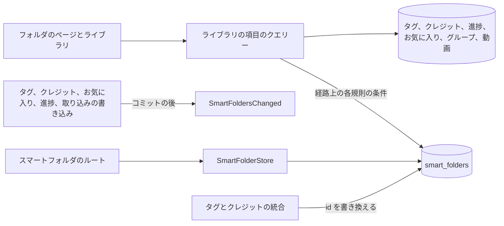
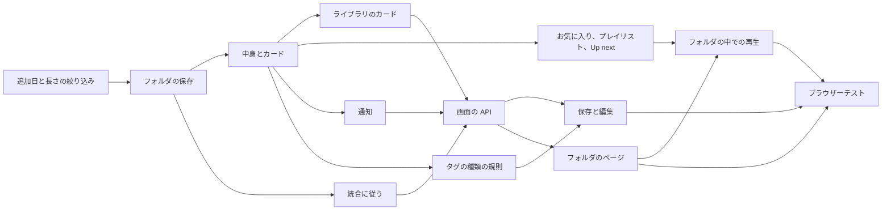

# 実装計画: 中身が保存した条件に従うスマートフォルダ {#implementation-plan-smart-folders-whose-contents-follow-a-saved-condition}

**ブランチ**: `feature/052-smart-folders` | **親 Issue**: #1139

**入力**: 親 Issue。これがこの機能の仕様である。

## 概要 {#summary}

所有者は、ライブラリの絞り込みをスマートフォルダとして保存する。スマートフォルダは仮想のフォルダで、その中身は常にその絞り込みでライブラリが示すもの (グループはカードとして、動画は動画として) であり、どの動画も移動しない。子フォルダは親の絞り込みをさらに絞る。スマートフォルダはグループと並ぶ新しいエンティティである。その中身はフォルダの条件で実行する既存のライブラリの項目のクエリーであり、最上位のフォルダは絞り込みのないライブラリのカードである。

図は、この機能が加えるか変える部分と、それぞれが読み書きするものを示す。



| 関心事 | 方針 |
| --- | --- |
| 保存 | 独自のテーブルと項目の種類 ([R-1](research.md#r-1-a-smart-folder-is-its-own-entity-not-a-group)、[data-model.md、Migration](data-model.md#migration)) |
| 中身 | 絞り込んだライブラリ。読み取りのときに評価し ([R-2](research.md#r-2-contents-are-computed-when-read-not-stored)、[R-3](research.md#r-3-a-rule-is-the-library-filters-fields-contents-are-the-filtered-library))、予算の範囲内に収める ([R-13](research.md#r-13-a-read-budget-at-20000-videos-and-50-smart-folders)) |
| 絞り込みの項目 | ライブラリの絞り込みに追加日の範囲と長さが加わる ([R-4](research.md#r-4-the-library-filter-gains-added-within-and-length)) |
| 入れ子 | 経路上のすべての規則の AND ([R-5](research.md#r-5-a-childs-effective-rule-is-every-rule-on-its-path-anded)) |
| 順序 | 保存したライブラリの並び順 ([R-6](research.md#r-6-videos-follow-the-folders-sort-random-is-refused)) |
| ライブラリ | 最上位のフォルダは絞り込みのないライブラリのカード ([R-7](research.md#r-7-root-smart-folders-are-cards-in-the-unfiltered-library))。空のフォルダは所有者にだけ示す ([R-8](research.md#r-8-an-empty-folder-stays-and-is-shown-to-the-owner-only)) |
| 統合と削除された参照 | 統合で書き換える。存在しない参照は何にも合わない ([R-9](research.md#r-9-merges-rewrite-rules-a-deleted-reference-makes-the-rule-match-nothing)) |
| 所有者の記録 | `owner_kept` ([R-10](research.md#r-10-owner_kept-records-the-owners-folders)) |
| ゲスト | 所有者の情報、閲覧者の見え方 ([R-11](research.md#r-11-the-rule-reads-the-owners-facts-visibility-is-the-viewers)) |
| イベント | `SmartFoldersChanged` と `smartFolder` の画面のイベント ([R-12](research.md#r-12-writes-that-can-change-a-match-publish-smartfolderschanged)) |

Issue には `ui` ラベルがあるので、画面の単位より前に `design` 段階が `ui-design.md` を書く。対象は、ライブラリの絞り込みをフォルダとして保存すること、条件の編集画面とその追加日の範囲と長さの部品、フォルダのカードと (求められるときは) それをグループのカードと見分ける印、パンくず、子、条件を持つフォルダのページ、フォルダを別のフォルダの下に移すこと、フォルダを削除すること、空の状態と存在しない条件の状態、動画のページのフォルダの行で、親 Issue の `UI品質` に照らして判断する。

## 技術的な文脈 {#technical-context}

**正本の定義**:

| 項目 | 出典 |
| --- | --- |
| 境界、依存の向き、ユーザーデータ、認証の境界 | [ARCHITECTURE.md](../../ARCHITECTURE.md)、[.golangci.yml](../../.golangci.yml) (depguard) |
| ライブラリの項目、部分的に合うグループ、グループの再生の順序と見え方、`?group` | [048 データモデル](../048-groups/data-model.md)、[048 調査](../048-groups/research.md)、[027 library-api.md](../027-partial-group-search/contracts/library-api.md) |
| ライブラリの絞り込みとその URL | [internal/domain/library.go](../../internal/domain/library.go) の `domain.VideoQuery`、[web/src/videoList/listCriteria.ts](../../web/src/videoList/listCriteria.ts)、[web/src/library/tagCriteria.ts](../../web/src/library/tagCriteria.ts)、[web/src/library/creditCriteria.ts](../../web/src/library/creditCriteria.ts) |
| お気に入り、プレイリスト | [035 データモデル](../035-favorites/data-model.md)、[044 データモデル](../044-playlists/data-model.md) |
| タグの種類と `tagKind` の絞り込み | #1136、`feature/051-tag-kinds` 上の `specs/051-tag-kinds/` |
| 画面の API と生成コード | [api/openapi.yaml](../../api/openapi.yaml)、`task generate` |
| 画面と Web のテスト | [design-system.md](../../docs/design-docs/design-system.md)、[library-ui.md](../../docs/design-docs/library-ui.md)、[web-testing.md](../../docs/design-docs/web-testing.md)、[i18n.md](../../docs/design-docs/i18n.md) |
| 検査 | [Taskfile.yml](../../Taskfile.yml) (`task check`、`task check-docs`、`task test-e2e`) |

**この機能に固有の文脈**:

- マイグレーションは 1 つで、入るときに番号を付ける ([data-model.md、Migration](data-model.md#migration))。
- 画面の API に 6 つのルート、いくつかのスキーマ、1 つの画面のイベントの種類が加わる ([contracts/screen-api.md](contracts/screen-api.md))。外部 API と MCP は変わらない。
- フォルダのページのための新しい SPA のルートと、動画のページの `smartFolder` のクエリー。
- 規則の `tagKind` のメンバーには、`main` にある #1136 のライブラリの `tagKind` の絞り込みが要る。それを待つのは、そう述べる単位だけである。

## 憲章の確認 {#constitution-check}

| 規則 (出典) | 判定 |
| --- | --- |
| アダプターは互いも `internal/app` も import しない (ARCHITECTURE.md、depguard) | 合格: `internal/httpapi` が `SmartFolders` インターフェースを宣言し、新しいストアの役割がそれを満たす |
| ドメインが決め、ストアが強制する (ARCHITECTURE.md) | 合格: `domain.SmartRule`、`ValidateSmartSort`、`ValidateSmartFolderParent` が決める。外部キーと check がテーブルを守る |
| ストアの役割 (ARCHITECTURE.md) | 合格: `SmartFolderStore` は新しい。統合での規則の書き換えと通知は、`TagStore`、`CreditStore`、`FavoriteStore`、`PlaybackStore`、取り込みのトランザクションの中のパッケージ非公開のヘルパーである |
| イベントはコミットの後 (ARCHITECTURE.md) | 合格: `SmartFoldersChanged` はコミットの後に発行する ([data-model.md、Notices](data-model.md#notices)) |
| ユーザーデータは作り直しを越えて残る (ARCHITECTURE.md) | 合格: `smart_folders` と `smart_folder_favorites` は `videos` への外部キーを持たないユーザーデータである。不変条件の一覧と running-vv.md にそれらが加わる |
| どの読み取りも閲覧者を知っている (ARCHITECTURE.md) | 合格: 中身は閲覧者に合わせて切り詰める。読み取りはゲストが読めるものとして `accessRoutes` に加わる。`settings` は所有者だけである |
| メディアフォルダのファイルを読むのはスキャンだけ (ARCHITECTURE.md) | 合格: 規則は SQLite だけを読む |
| 生成ファイルを手で編集しない (AGENTS.md) | 合格: `api/openapi.yaml` を変え、続いて `task generate` |
| 複雑度は 25 以下、コードを写さない (AGENTS.md) | 合格: 中身は、絞り込みの 2 つ目の変換の代わりにライブラリの項目のクエリーを呼ぶ ([R-3](research.md#r-3-a-rule-is-the-library-filters-fields-contents-are-the-filtered-library)) |
| 画面の前に design-system.md を読む。最も低いレベルでテストする (AGENTS.md) | 合格: 画面は `ui-design.md` に従う。規則はドメインのテスト、ストアはそのテストとベンチマーク、画面はページテスト、受け入れ条件は 1 つのブラウザーテストを得る |

違反はないので、複雑さの記録はない。

## プロジェクトの構成 {#project-structure}

### 文書 (この機能) {#documentation-this-feature}

```text
specs/052-smart-folders/
├── plan.md
├── research.md
├── data-model.md
└── contracts/
    └── screen-api.md
```

`ui-design.md` は `design` 段階が書く。`quickstart.md` はない: どの受け入れ条件とエッジケースも、ドメイン、ストア、ページのテスト、ベンチマーク、下のブラウザーテストで届く。

### ソースコード {#source-code}

**影響する境界**:

| 境界 | この機能で持つもの |
| --- | --- |
| `internal/domain` | `SmartRule`、並び順と親の規則、`VideoQuery` の新しい項目、`SmartFoldersChanged`、エラー |
| `internal/store` | マイグレーション、追加日の範囲と長さの絞り込みの条件、`SmartFolderStore`、ライブラリの項目のクエリーでのフォルダの中身とカード、フォルダによるお気に入り、プレイリスト、動画の文脈、統合での規則の書き換え、通知、ベンチマーク |
| `internal/httpapi`、`api/openapi.yaml`、`cmd/mdm` | ルート、変えるスキーマ、`smartFolder` イベント、配線 |
| `web/src/api`、`web/src/library`、`web/src/videoList`、`web/src/smartFolders` (新規)、`web/src/player`、`web/src/app`、`web/src/i18n` | クライアント、絞り込みの部品、保存と編集、カード、フォルダのページとそのルート、動画のページのフォルダの文脈 |
| `web/e2e` | ブラウザーテスト |

**新しいパス**: `internal/store/migrations/000NN_smart_folders.sql`、`internal/domain/smart_folder.go`、`internal/store/smart_folders.go`、`internal/httpapi/smart_folders.go`、`web/src/api/smartFolders.ts`、`web/src/smartFolders/`、`web/e2e/smart-folders.e2e.ts`。

**構成の判断**: 既存の配置に従う。スマートフォルダは、グループの隣に独自のストアの役割と画面のフォルダを持つ ([R-1](research.md#r-1-a-smart-folder-is-its-own-entity-not-a-group))。

## 実装作業 {#implementation-work}

図は、どの単位が先に入る必要があるかを示す。画面の単位は `design` 段階の `ui-design.md` も待つ。



### ライブラリの動画を、追加されてからの期間と長さで絞り込む {#filter-library-videos-by-how-long-ago-they-were-added-and-by-length}

**範囲**: `VideoQuery` の項目とその絞り込みの条件、`addedWithin`、`minDuration`、`maxDuration` の一覧のパラメーター、それらへのゲストのアクセス、その API クライアントのパラメーター。画面の変更はない ([R-4](research.md#r-4-the-library-filter-gains-added-within-and-length)、[contracts/screen-api.md、Schemas and parameters changed](contracts/screen-api.md#schemas-and-parameters-changed))。

**依存**: なし。

**受け入れ**: `task check` が通り、`task generate` で差分が出ない。ストアのテストが次を示す: `addedWithin=7` は 6 日前に追加した動画を挙げ、8 日前に追加した動画を挙げない。`minDuration=60&maxDuration=600` は 60 秒と 600 秒の動画を挙げ、59 秒、601 秒、長さが分からない動画を挙げない。どちらもタグの絞り込みと AND になる。ハンドラーのテストが、`addedWithin=0` と、`minDuration` が `maxDuration` を超える場合に `400 invalid_request` を示し、ゲストには `200` で応答することを示す。

### スマートフォルダを規則と親とともに保存する {#store-smart-folders-with-their-rules-and-parents}

**範囲**: マイグレーション、`Query()` と `Refs()` を持つ `domain.SmartRule`、`ValidateSmartSort`、`ValidateSmartFolderParent`、`owner_kept` を伴う `SmartFolderStore` の作成、変更、移動、削除、不変条件、ARCHITECTURE.md と running-vv.md のユーザーデータの一覧とその `translations/ja/` の対応する文書 ([data-model.md、Edits](data-model.md#edits)、[R-10](research.md#r-10-owner_kept-records-the-owners-folders))。

**依存**: ライブラリの動画を、追加されてからの期間と長さで絞り込む。

**受け入れ**: `task check` と `task check-docs` が通る。ドメインのテストが、範囲外の規則の各メンバーと、並び順としての `random` を拒む。ストアのテストが次を示す: 親を付けて作るとフォルダは入れ子になる。A をそれ自身の子の下に移すと `ErrSmartFolderCycle` で、何も書かれない。親を削除するとその子も削除される。削除されたタグを挙げる規則は保存され、存在しないものとして報告される。すべての書き込みが `owner_kept` を 1 にする。

### スマートフォルダの中身を、その子とカードの値とともに一覧にする {#list-a-smart-folders-contents-with-its-children-and-card-values}

**範囲**: 経路に沿った実効の規則、各規則の条件を付けたライブラリの項目のクエリーによる中身、先に来る子フォルダ、再生の順序、カードの値、所有者とゲストの見え方、何にも合わない存在しない参照、`BenchmarkSmartFolderReads` ([data-model.md、Contents](data-model.md#contents)、[R-3](research.md#r-3-a-rule-is-the-library-filters-fields-contents-are-the-filtered-library)、[R-5](research.md#r-5-a-childs-effective-rule-is-every-rule-on-its-path-anded)、[R-8](research.md#r-8-an-empty-folder-stays-and-is-shown-to-the-owner-only)、[R-11](research.md#r-11-the-rule-reads-the-owners-facts-visibility-is-the-viewers)、[R-13](research.md#r-13-a-read-budget-at-20000-videos-and-50-smart-folders))。

**依存**: スマートフォルダを規則と親とともに保存する。

**受け入れ**: `task check` が通る。ストアのテストが次を示す: フォルダ `tags:[猫]` は、ほかに何も書かずに、`猫` が付いた動画を持ち、外した後は持たず、その動画は引き続きライブラリに挙がる (受け入れ条件 1)。part1 と part2 の両方に `猫` が付いたグループは 1 枚のカードで、part1 だけにタグが付いたグループは part1 だけを挙げる (受け入れ条件 3)。`tags:[猫]` の下の子 `watch: unwatched` は未視聴の `猫` の動画だけを持ち、その親は子を最初に挙げる (受け入れ条件 4)。中身は同じ絞り込みでの `ListLibrary` と等しい (受け入れ条件 5)。まとまりは 1 回だけ数える。ゲストは公開の動画だけを見て、それが 1 つもないフォルダでは `ErrNotFound` を受け取り、所有者は空のフォルダを読む。削除されたタグを挙げる規則は子フォルダだけを挙げ、その子も同じである。20,000 本の動画でのベンチマークの結果は 500 ms 未満で、PR に記録する。

### 最上位のスマートフォルダをライブラリのカードとして示す {#show-root-smart-folders-as-cards-in-the-library}

**範囲**: ライブラリの項目のクエリーと `LibraryIDs` の `smartFolder` の項目の種類、その並びの値とカーソル、検索か絞り込みのときにフォルダを除くこと、お気に入りだけのときのお気に入りにしたフォルダ ([data-model.md、Library items](data-model.md#library-items)、[R-7](research.md#r-7-root-smart-folders-are-cards-in-the-unfiltered-library))。

**依存**: スマートフォルダの中身を、その子とカードの値とともに一覧にする。

**受け入れ**: `task check` が通る。ストアのテストが次を示す: 絞り込みのないライブラリは、最上位のフォルダをグループと動画の中にその並びの位置で挙げ、フォルダの動画も挙げる。子フォルダは最上位に挙がらない。検索かタグの絞り込みはフォルダを挙げない。お気に入りだけは、お気に入りにした子フォルダを挙げる。フォルダの項目をまたいでページを送ると、すべての項目を 1 回ずつ返す。ゲストのライブラリには空のフォルダがない。

### タグ、人物、組織の統合にスマートフォルダの規則を従わせる {#follow-tag-person-and-organization-merges-in-smart-folder-rules}

**範囲**: `mergeTagsInto` と `CreditStore.Merge` での規則の書き換え ([data-model.md、Merges](data-model.md#merges)、[R-9](research.md#r-9-merges-rewrite-rules-a-deleted-reference-makes-the-rule-match-nothing))。

**依存**: スマートフォルダを規則と親とともに保存する。

**受け入れ**: `task check` が通る。ストアのテストが次を示す: タグ A を B に統合すると、統合のトランザクションの中で `tags:[A]` は `tags:[B]` に、`tags:[A,B]` は `tags:[B]` になる。人物か組織 X を Y に統合すると、`person` か `organization` を書き換える。ロールバックした統合は何も書き換えない。

### 開いている画面にスマートフォルダをもう一度読むよう伝える {#tell-open-screens-to-read-smart-folders-again}

**範囲**: `SmartFoldersChanged`、[data-model.md、Notices](data-model.md#notices) の各書き込みからそれを発行すること、その `smartFolder` の画面のイベント。タグの種類の行は #1136 が `main` に入ったときに加わる ([R-12](research.md#r-12-writes-that-can-change-a-match-publish-smartfolderschanged))。

**依存**: スマートフォルダの中身を、その子とカードの値とともに一覧にする。

**受け入れ**: `task check` が通る。ストアのテストが次を示す: フォルダが 1 つある状態でタグを付けると、コミットの後にそのフォルダを挙げる `SmartFoldersChanged` を 1 つ発行する。視聴状態を保つ進捗の保存は何も発行せず、動画を完了させる保存は発行する。フォルダがないときは何も発行しない。ロールバックした書き込みは何も発行しない。`/api/events` の購読者は、タグを付けた後に `smartFolder` イベントを受け取る。

### ストアで、スマートフォルダをお気に入りにし、プレイリストに加え、そこから再生する {#favorite-add-to-playlists-and-play-from-smart-folders-in-the-store}

**範囲**: `smart_folder_favorites`、`playlist_items.smart_folder_id`、動画の読み取り (`Up next`、前後の動画、メンバーの窓、`Video.smartFolder`) の `smartFolder` の文脈、フォルダの再生の順序でのプレイリストの再生 ([contracts/screen-api.md、Schemas and parameters changed](contracts/screen-api.md#schemas-and-parameters-changed))。

**依存**: スマートフォルダの中身を、その子とカードの値とともに一覧にする。

**受け入れ**: `task check` が通る。ストアのテストが次を示す: お気に入りにしたフォルダは、そのカードでお気に入りである。フォルダのプレイリストの項目は、再生のときのフォルダの再生の順序で再生し、後でタグを付けた動画も加わる。フォルダの中の動画では、`nextId` は `smartFolder` ではフォルダの再生の順序に、`group` ではグループの再生の順序に従う。フォルダを削除すると、そのお気に入りとプレイリストの項目を削除し、プレイリストの番号を振り直す。

### スマートフォルダをタグの種類で照合する {#match-smart-folders-by-tag-kind}

**範囲**: #1136 の `VideoQuery.TagKindID` を通した規則の `tagKind` メンバー、種類が削除された後の存在しない参照の確認、通知のタグの種類の行。先に `main` を feature ブランチにマージする。

**依存**: スマートフォルダの中身を、その子とカードの値とともに一覧にする。`main` にマージされた #1136 の単位「Filter library videos by tag kind」。

**受け入れ**: `task check` が通る。ストアのテストが次を示す: フォルダ `tagKind: Genre, watch: unwatched` は Genre のタグを持つ未視聴の動画だけを持ち、視聴するとその動画を落とす (受け入れ条件 2)。種類を削除すると、フォルダは何にも合わなくなり、それを存在しないものとして報告する。

### スマートフォルダを画面の API に加える {#add-smart-folders-to-the-screen-api}

**範囲**: 6 つのルート、スキーマとパラメーター、ステータスとカタログのそのメッセージ、ハンドラー、`cmd/mdm` での配線、`web/src/api/smartFolders.ts` のクライアントの関数と、変えたお気に入り、プレイリスト、動画のクライアント。SPA は、画面の単位までは新しい `LibraryItem` の種類を飛ばすことで動き続ける ([contracts/screen-api.md](contracts/screen-api.md))。

**依存**: 最上位のスマートフォルダをライブラリのカードとして示す。タグ、人物、組織の統合にスマートフォルダの規則を従わせる。開いている画面にスマートフォルダをもう一度読むよう伝える。ストアで、スマートフォルダをお気に入りにし、プレイリストに加え、そこから再生する。

**受け入れ**: `task check` が通り、`task generate` で差分が出ない。ハンドラーのテストが、契約の表の各ステータス、ゲストはすべての書き込みで `401` を受け取り `settings` を受け取らないこと、`missing` が削除されたタグを挙げることを示し、`TestAccessClassificationMatchesOpenAPISecurity` が通る。既存のライブラリのページのテストが通る。

### ライブラリの絞り込みをスマートフォルダとして保存し、その条件を編集する {#save-the-library-filter-as-a-smart-folder-and-edit-its-conditions}

**範囲**: ライブラリの絞り込みと URL の追加日の範囲と長さの部品、今の絞り込みと並び順を名前と省略できる親を付けてフォルダとして保存すること、ライブラリの絞り込みの部品 (タグの種類を含む) から作る条件の編集画面、名前、並び順、親の変更、削除、カタログの文言。配置は `ui-design.md` に従う。

**依存**: スマートフォルダを画面の API に加える。スマートフォルダをタグの種類で照合する。`design` 段階の `ui-design.md`。

**受け入れ**: この単位は画面を変えるので、`ui-design.md` と親 Issue の `UI品質` に照らした見た目と操作のレビューが要る。`task check` が通る。ページテストが次を示す: ライブラリの URL は `addedWithin`、`minDuration`、`maxDuration` を保ち、それらを送る。タグ `猫` と `watch=unwatched` で保存すると、それらの項目を持つ `rule` を送る (受け入れ条件 5)。編集画面はフォルダの規則で開き、変えた規則を送り、無効な規則は送れない。フォルダをそれ自身の子の下に移すと、できないと伝える。ゲストには保存の操作も編集の操作もない。

### スマートフォルダを開き、その子と中身を示す {#open-a-smart-folder-onto-its-children-and-contents}

**範囲**: ライブラリのフォルダのカード、パンくず、子、順序どおりの中身、ページ送り、絞り込みに使う条件、空の状態と存在しない条件の状態、フォルダからの再生、`smartFolder` イベントでもう一度読むこと、ゲストのアクセス、そのルート、カタログの文言を持つ `/smart-folders/{id}` の画面。配置は `ui-design.md` に従う。

**依存**: スマートフォルダを画面の API に加える。`design` 段階の `ui-design.md`。

**受け入れ**: この単位は画面を変えるので、`ui-design.md` と親 Issue の `UI品質` に照らした見た目と操作のレビューが要る。`task check` が通る。ページテストが次を示す: フォルダのカードはそのページを開く。ページは子フォルダを、続いて項目を応答の順序で挙げる。子を開くとパンくずが伸び、その親を示す。空のフォルダは空であると伝える。存在しないタグを名前で示す。表示中の id への `smartFolder` イベントでもう一度読む。ゲストは編集の操作のないページを見る。ライブラリはカードをグループと動画の中に示す。

### 動画を、それを開いたスマートフォルダの中で再生する {#play-a-video-in-the-smart-folder-it-was-opened-from}

**範囲**: 動画のページが `?smartFolder` を読み、それを動画の読み取りに渡し、`Up next`、矢印、メンバーの一覧でそれを保つこと、フォルダのページにリンクするフォルダの行。カードのメニューからフォルダをお気に入りにし、プレイリストに加えること。

**依存**: ストアで、スマートフォルダをお気に入りにし、プレイリストに加え、そこから再生する。スマートフォルダを開き、その子と中身を示す。`design` 段階の `ui-design.md`。

**受け入れ**: この単位は画面を変えるので、`ui-design.md` に照らした見た目と操作のレビューが要る。`task check` が通る。ページテストが次を示す: `?smartFolder=1` では読み取りが `smartFolder=1` を持ち、自動再生の通知はフォルダの次の動画を示し、進んでもクエリーを保つ。フォルダの行は `/smart-folders/1` にリンクする。カードのメニューはフォルダをお気に入りにし、プレイリストに加える。

### スマートフォルダをブラウザーテストで確かめる {#cover-smart-folders-in-a-browser-test}

**範囲**: 本物のサーバーとメディアに対する `web/e2e/smart-folders.e2e.ts` ([web-testing.md、Test levels](../../docs/design-docs/web-testing.md#test-levels))。

**依存**: ライブラリの絞り込みをスマートフォルダとして保存し、その条件を編集する。スマートフォルダを開き、その子と中身を示す。動画を、それを開いたスマートフォルダの中で再生する。

**受け入れ**: `task test-e2e -- e2e/smart-folders.e2e.ts` が通り、親 Issue の受け入れ条件 1 から 5 を示す: 動画にタグ `猫` を付けると、別のタブで開いている `タグ: 猫` のフォルダに再読み込みなしで入り、タグを外すと出て、その間ずっと動画はライブラリに残る (1)。Genre かつ未視聴のフォルダは、視聴した動画を落とす (2)。両方の部分にタグが付いたグループは 1 枚のカードで、part1 だけに付いたものは part1 を示す (3)。`タグ: 猫` の下の子 `未視聴` は未視聴の `猫` の動画だけを持ち、その親のページに現れる (4)。絞り込んだライブラリから保存したフォルダは、ライブラリが示したものを示す (5)。
