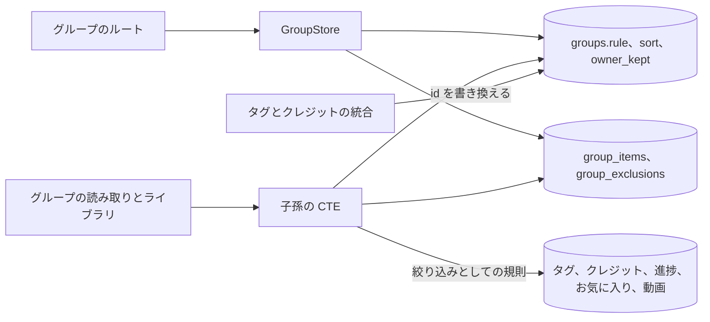
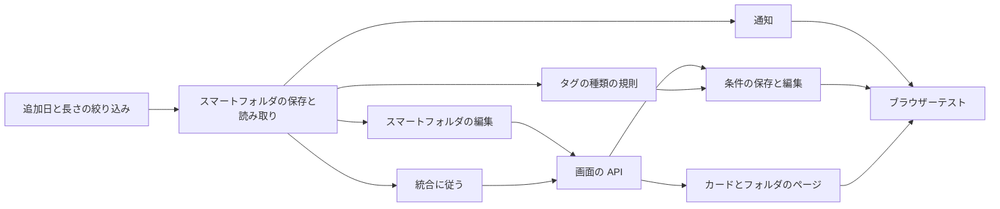

# 実装計画: 動画が保存した条件に従うスマートフォルダ {#implementation-plan-smart-folders-whose-videos-follow-a-saved-condition}

**ブランチ**: `feature/052-smart-folders` | **親 Issue**: #1139

**入力**: 親 Issue。これがこの機能の仕様である。

## 概要 {#summary}

所有者は、タグ、タグの種類、人物、組織、動画の情報に対する条件をスマートフォルダとして保存する。スマートフォルダはグループで、その動画は条件に合う動画に、所有者が加えた動画を足し、所有者が取り除いた動画を引いたものである。スマートフォルダは規則を保存した `groups` の行なので、お気に入り、プレイリスト、入れ子、ゲスト、カード、グループのページ、`Up next` は、グループに届くのと同じようにそのグループの id でそれに届く。条件に合う動画は、すでにグループの子孫を計算している読み取りの中で、ライブラリが使うのと同じ絞り込みの SQL から計算する。

図は、この機能が加えるか変える部分と、それぞれが読み書きするものを示す。



| 関心事 | 方針 |
| --- | --- |
| 保存 | `rule` と `sort` を持つグループ ([R-1](research.md#r-1-a-smart-folder-is-a-group-with-a-stored-rule)、[data-model.md、Migration](data-model.md#migration)) |
| 所属 | 読み取りのときに評価し ([R-2](research.md#r-2-matched-videos-are-computed-when-a-group-is-read-not-stored))、予算の範囲内に収める ([R-12](research.md#r-12-a-read-budget-at-20000-videos-and-50-smart-folders)) |
| 条件 | ライブラリの絞り込みの項目、AND、1 つの SQL の組み立て ([R-3](research.md#r-3-the-rule-is-the-library-filter-combined-with-and-built-by-the-same-sql))。絞り込みに追加日の範囲と長さが加わる ([R-4](research.md#r-4-the-library-filter-gains-added-within-and-length)) |
| 手での編集 | 項目と除外 ([R-5](research.md#r-5-hand-added-videos-are-items-hand-removed-videos-are-exclusions)) |
| 順序 | 子グループは位置順、動画はフォルダの並び順 ([R-6](research.md#r-6-child-groups-keep-their-positions-videos-follow-the-folders-sort)) |
| ライブラリ | メンバーは最上位を離れる ([R-7](research.md#r-7-matched-videos-leave-the-librarys-top-level-as-group-members-do))。空のフォルダは所有者には残る ([R-8](research.md#r-8-an-empty-smart-folder-stays-and-is-shown-to-the-owner-only)) |
| 統合と削除された参照 | 統合で書き換える。存在しない参照は何にも合わない ([R-9](research.md#r-9-merges-rewrite-rules-a-deleted-reference-makes-the-rule-match-nothing)) |
| 所有者の記録 | すべてのグループの `owner_kept` ([R-10](research.md#r-10-owner_kept-marks-every-group-the-owner-made-or-edited)) |
| ゲスト | 所有者の情報、閲覧者の見え方 ([R-11](research.md#r-11-the-rule-reads-the-owners-facts-visibility-is-the-viewers)) |
| イベント | 編集と、条件に合うかを変えうる書き込みの後のすべてのスマートフォルダに `GroupsChanged` ([R-13](research.md#r-13-writes-that-can-change-a-match-publish-groupschanged-for-every-smart-folder)) |

Issue には `ui` ラベルがあるので、画面の単位より前に `design` 段階が `ui-design.md` を書く。対象は、ライブラリの絞り込みをスマートフォルダとして保存すること、条件の編集画面と、その追加日の範囲と長さの部品、カードのスマートフォルダの印 (求められるときだけ示す)、手で加えた動画と取り除いた動画、取り除いた動画を戻すことを持つフォルダのページ、空のフォルダと存在しない条件の通知、ドラッグでの整理での `smart_folder_sorted` と `smart_folder_merge` の拒否で、親 Issue の `UI品質` に照らして判断する。

## 技術的な文脈 {#technical-context}

**正本の定義**:

| 項目 | 出典 |
| --- | --- |
| 境界、依存の向き、ユーザーデータ、認証の境界 | [ARCHITECTURE.md](../../ARCHITECTURE.md)、[.golangci.yml](../../.golangci.yml) (depguard) |
| グループ、項目、除外、入れ子、再生の順序、見え方、`GroupsChanged` | [048 データモデル](../048-groups/data-model.md)、[048 調査](../048-groups/research.md) |
| ドラッグでの整理と取り消し | [050 contracts/screen-api.md](../050-drag-organize/contracts/screen-api.md) |
| ライブラリの絞り込みとその URL | [internal/domain/library.go](../../internal/domain/library.go) の `domain.VideoQuery`、[web/src/videoList/listCriteria.ts](../../web/src/videoList/listCriteria.ts)、[web/src/library/tagCriteria.ts](../../web/src/library/tagCriteria.ts)、[web/src/library/creditCriteria.ts](../../web/src/library/creditCriteria.ts) |
| タグの種類と `tagKind` の絞り込み | #1136、`feature/051-tag-kinds` 上の `specs/051-tag-kinds/` |
| ユーザーキー、まとまり | [030 データモデル、User key](../030-video-versions/data-model.md#user-key) |
| 画面の API と生成コード | [api/openapi.yaml](../../api/openapi.yaml)、`task generate` |
| 画面と Web のテスト | [design-system.md](../../docs/design-docs/design-system.md)、[library-ui.md](../../docs/design-docs/library-ui.md)、[web-testing.md](../../docs/design-docs/web-testing.md)、[i18n.md](../../docs/design-docs/i18n.md) |
| 検査 | [Taskfile.yml](../../Taskfile.yml) (`task check`、`task check-docs`、`task test-e2e`) |

**この機能に固有の文脈**:

- マイグレーションは 1 つで、入るときに番号を付ける ([data-model.md、Migration](data-model.md#migration))。
- 画面の API のスキーマの変更と 1 つのルート ([contracts/screen-api.md](contracts/screen-api.md))。外部 API と MCP は変わらない。
- 規則の `tagKind` の項目には、`main` にある #1136 のライブラリの `tagKind` の絞り込みが要る。それが要る単位はそう述べる。ほかの単位はそれを待たない。
- 読み取りの予算: 20,000 本の動画と 50 個のスマートフォルダで、ライブラリの最初のページとフォルダのページに 500 ms ([R-12](research.md#r-12-a-read-budget-at-20000-videos-and-50-smart-folders))。

## 憲章の確認 {#constitution-check}

| 規則 (出典) | 判定 |
| --- | --- |
| アダプターは互いも `internal/app` も import しない (ARCHITECTURE.md、depguard) | 合格: ルートは、`GroupStore` が満たす `internal/httpapi` の `Groups` インターフェースを拡張する。新しいパッケージはない |
| ドメインが決め、ストアが強制する (ARCHITECTURE.md) | 合格: `domain.SmartRule` が規則を解析し、検証し、`VideoQuery` に変える。ストアはそこから SQL を組み立て、自分のトランザクションの中で参照を確かめる |
| ストアの役割 (ARCHITECTURE.md) | 合格: スマートフォルダの編集は `GroupStore` のものである。タグとクレジットの統合での規則の書き換えは、`TagStore` と `CreditStore` のトランザクションの中で呼ぶパッケージ非公開のヘルパーである |
| イベントはコミットの後 (ARCHITECTURE.md) | 合格: 048 と同じように、コミットの後に `GroupsChanged`。タグ、クレジット、お気に入り、進捗、取り込みの書き込みからの通知を含む ([data-model.md、Notices](data-model.md#notices)) |
| ユーザーデータは作り直しを越えて残る (ARCHITECTURE.md) | 合格: 新しい列はすでにユーザーデータである `groups` にある。規則はタグ、種類、クレジットの id を挙げ、それらは作り直しで保たれる |
| どの読み取りも閲覧者を知っている (ARCHITECTURE.md) | 合格: 条件に合う動画は閲覧者の見え方に切り詰める。`smartFolder`、`manual`、`/excluded` は所有者だけである。新しい一覧のパラメーターは隠したものを何も明かさない |
| メディアフォルダのファイルを読むのはスキャンだけ (ARCHITECTURE.md) | 合格: 規則は SQLite だけを読む |
| 生成ファイルを手で編集しない (AGENTS.md) | 合格: `api/openapi.yaml` を変え、続いて `task generate` |
| 複雑度は 25 以下、コードを写さない (AGENTS.md) | 合格: 規則は 2 つ目の変換の代わりにライブラリの絞り込みの条件を再利用する ([R-3](research.md#r-3-the-rule-is-the-library-filter-combined-with-and-built-by-the-same-sql)) |
| 画面の前に design-system.md を読む。最も低いレベルでテストする (AGENTS.md) | 合格: 画面は `ui-design.md` に従う。規則はドメインのテスト、ストアはそのテストとベンチマーク、画面はページテスト、受け入れ条件は 1 つのブラウザーテストを得る |

違反はないので、複雑さの記録はない。

## プロジェクトの構成 {#project-structure}

### 文書 (この機能) {#documentation-this-feature}

```text
specs/052-smart-folders/
├── plan.md
├── research.md
├── data-model.md
└── contracts/
    └── screen-api.md
```

`ui-design.md` は `design` 段階が書く。`quickstart.md` はない: どの受け入れ条件とエッジケースも、ドメイン、ストア、ページのテスト、ベンチマーク、下のブラウザーテストで届く。

### ソースコード {#source-code}

**影響する境界**:

| 境界 | この機能で持つもの |
| --- | --- |
| `internal/domain` | `SmartRule`、`ValidateSmartSort`、`VideoQuery` の新しい項目、スマートフォルダのエラー |
| `internal/store` | マイグレーション、追加日の範囲と長さの絞り込みの条件、`groupDescendantsCTE` での条件に合う動画、スマートフォルダの編集、`owner_kept`、統合での規則の書き換え、ベンチマーク |
| `internal/httpapi`、`api/openapi.yaml` | 一覧のパラメーター、変えるスキーマ、除外のルート、新しいエラーコード |
| `web/src/api`、`web/src/library`、`web/src/videoList`、`web/src/groups`、`web/src/i18n` | クライアント、絞り込みの部品、スマートフォルダの保存と編集、カードの印、フォルダのページ |
| `web/e2e` | ブラウザーテスト |

**新しいパス**: `internal/store/migrations/000NN_smart_folders.sql`、`internal/domain/smart_rule.go`、`internal/store/smart_folders.go`、`web/e2e/smart-folders.e2e.ts`。

**構成の判断**: 既存の配置に従う。スマートフォルダの編集は、それが分岐するグループの編集の隣の `GroupStore` に置く。

## 実装作業 {#implementation-work}

図は、どの単位が先に入る必要があるかを示す。画面の単位は `design` 段階の `ui-design.md` も待つ。



### ライブラリの動画を、追加されてからの期間と長さで絞り込む {#filter-library-videos-by-how-long-ago-they-were-added-and-by-length}

**範囲**: `VideoQuery` の項目とその絞り込みの条件、`listVideos`、`listLibrary`、`listLibraryIds` の `addedWithin`、`minDuration`、`maxDuration` の一覧のパラメーター、それらへのゲストのアクセス、その API クライアントのパラメーター。画面の変更はない ([R-4](research.md#r-4-the-library-filter-gains-added-within-and-length)、[contracts/screen-api.md、List parameters added](contracts/screen-api.md#list-parameters-added))。

**依存**: なし。

**受け入れ**: `task check` が通り、`task generate` で差分が出ない。ストアのテストが次を示す: `addedWithin=7` は 6 日前に追加した動画を挙げ、8 日前に追加した動画を挙げない。`minDuration=60&maxDuration=600` は 60 秒と 600 秒の動画を挙げ、59 秒、601 秒、長さが分からない動画を挙げない。どちらもタグの絞り込みと AND になる。ハンドラーのテストが、`addedWithin=0` と、`minDuration` が `maxDuration` を超える場合に `400 invalid_request` を示し、ゲストには `200` で応答することを示す。

### スマートフォルダを保存し、条件に合う動画をグループとライブラリの読み取りで読む {#store-smart-folders-and-read-their-matched-videos-in-group-and-library-reads}

**範囲**: マイグレーション、`Query()` と `Refs()` を持つ `domain.SmartRule`、`ValidateSmartSort`、除外を伴う `groupDescendantsCTE` での条件に合う動画、子グループ、続いて並べた動画という再生の順序、存在しない参照の規則、所有者が空のスマートフォルダを見ること、`LibraryGroup.smart`、不変条件、`BenchmarkSmartFolderReads` ([data-model.md、Members](data-model.md#members)、[R-6](research.md#r-6-child-groups-keep-their-positions-videos-follow-the-folders-sort)、[R-7](research.md#r-7-matched-videos-leave-the-librarys-top-level-as-group-members-do)、[R-8](research.md#r-8-an-empty-smart-folder-stays-and-is-shown-to-the-owner-only)、[R-11](research.md#r-11-the-rule-reads-the-owners-facts-visibility-is-the-viewers)、[R-12](research.md#r-12-a-read-budget-at-20000-videos-and-50-smart-folders))。次の単位までは、スマートフォルダはテストのフィクスチャだけが書く。

**依存**: ライブラリの動画を、追加されてからの期間と長さで絞り込む。

**受け入れ**: `task check` が通る。マイグレーションのテストが、自動のものを含む既存のすべてのグループが `owner_kept = 1` で始まることを示す。ドメインのテストが、範囲外の規則の各メンバーと、並び順としての `random` を拒む。ストアのテストが次を示す: 規則 `tags:[猫]` のフォルダは、ほかに何も書かずに、`猫` が付いた動画を持ち、外した後は持たない (受け入れ条件 1)。`watch: unwatched` は、動画の進捗が完了すると、その動画を落とす。条件に合う動画はライブラリの最上位を離れ、フォルダは 1 枚のカードになる。条件に合わない手で加えた項目は挙がり、条件に合う除外した動画は挙がらない。子グループは動画より前に来て、動画は `sort` に従う。まとまりは 1 回だけ数える。ゲストは公開の条件に合う動画だけを見て、それが 1 つもないフォルダを見ない。所有者のライブラリは合う動画がないフォルダを挙げ、ゲストのライブラリは挙げない。タグが削除された規則は何にも合わない。`?group`、`Up next`、プレイリストの項目、フォルダのお気に入りは、その再生の順序に従う。グループの中に入れたフォルダは、そのグループを開くと挙がる (受け入れ条件 4)。20,000 本の動画と 50 個のフォルダでのベンチマークの結果は 500 ms 未満で、PR に記録する。

### 手で加えた動画と取り除いた動画とともに、ストアでスマートフォルダを作り、編集する {#create-and-edit-smart-folders-in-the-store-with-hand-added-and-removed-videos}

**範囲**: `rule` と `sort` を付けた作成、`rule` と `sort` の変更、項目と除外による動画の追加と取り除き、空になっても解散しないこと、移動と整理での拒否、任意のグループへの所有者のすべての書き込みが設定する `owner_kept`、それぞれの `GroupsChanged` ([data-model.md、Edits](data-model.md#edits)、[R-5](research.md#r-5-hand-added-videos-are-items-hand-removed-videos-are-exclusions)、[R-10](research.md#r-10-owner_kept-marks-every-group-the-owner-made-or-edited))。

**依存**: スマートフォルダを保存し、条件に合う動画をグループとライブラリの読み取りで読む。

**受け入れ**: `task check` が通る。ストアのテストが次を示す: 条件に合う動画を取り除くとその除外を書き、そのタグをもう一度付けても戻らない。条件に合わない動画を加えると、どのタグの変更の後もフォルダに残る (受け入れ条件 3)。除外した、条件に合う動画を加えると、項目を作らずに除外を削除する。最後の動画を取り除くと空のフォルダが残る。動画の移動は `ErrSmartFolderSorted` で、子グループは移動できる。スマートフォルダの整理での統合は `ErrSmartFolderMerge` で、何も書かれない。所有者のすべての書き込みは、変えたグループに `owner_kept` を設定し、フォルダの同期は新しい自動のグループを 0 のままにする。各編集は、フォルダとその祖先に `GroupsChanged` を発行する。

### タグ、人物、組織の統合にスマートフォルダの規則を従わせる {#follow-tag-person-and-organization-merges-in-smart-folder-rules}

**範囲**: `mergeTagsInto` と `CreditStore.Merge` での規則の書き換えと、書き換えたフォルダの `GroupsChanged` ([data-model.md、Merges and deletions](data-model.md#merges-and-deletions)、[R-9](research.md#r-9-merges-rewrite-rules-a-deleted-reference-makes-the-rule-match-nothing))。

**依存**: スマートフォルダを保存し、条件に合う動画をグループとライブラリの読み取りで読む。

**受け入れ**: `task check` が通る。ストアのテストが次を示す: タグ A を B に統合すると、規則 `tags:[A]` は `tags:[B]` に、`tags:[A,B]` は `tags:[B]` になり、その後フォルダは B の動画を持つ。人物か組織 X を Y に統合すると、`person` か `organization` を書き換える。統合は、コミットの後に書き換えたフォルダに `GroupsChanged` を発行し、統合元を挙げる規則がなければ何も発行しない。

### 条件に合うかを変えうる書き込みの後に、開いている画面にスマートフォルダをもう一度読むよう伝える {#tell-open-screens-to-read-smart-folders-again-after-writes-that-can-change-a-match}

**範囲**: [data-model.md、Notices](data-model.md#notices) の各書き込みからの、すべてのスマートフォルダとその祖先を挙げる `GroupsChanged`、視聴状態が変わるときだけ発行する進捗の保存、スマートフォルダがないときは何も発行しないこと。タグの種類の行は #1136 が `main` に入ったときに加わる ([R-13](research.md#r-13-writes-that-can-change-a-match-publish-groupschanged-for-every-smart-folder))。

**依存**: スマートフォルダを保存し、条件に合う動画をグループとライブラリの読み取りで読む。

**受け入れ**: `task check` が通る。ストアのテストが次を示す: 1 つのスマートフォルダをグループの中に入れた状態で、タグを付けると、コミットの後にフォルダとグループを挙げる `GroupsChanged` を 1 つ発行する。視聴状態を保つ進捗の保存は何も発行せず、動画を完了させる保存は発行する。データベースにスマートフォルダがない書き込みは何も発行しない。ロールバックした書き込みは何も発行しない。`/api/events` の購読者は、タグを付けた後に `group` イベントを受け取る。

### スマートフォルダをタグの種類で照合する {#match-smart-folders-by-tag-kind}

**範囲**: #1136 の `VideoQuery.TagKindID` を通した規則の `tagKind` メンバー、種類が削除された後の存在しない参照の確認、`SmartRule` スキーマの `tagKind`。先に `main` を feature ブランチにマージする。

**依存**: スマートフォルダを保存し、条件に合う動画をグループとライブラリの読み取りで読む。`main` にマージされた #1136 の単位「Filter library videos by tag kind」。

**受け入れ**: `task check` が通る。ストアのテストが次を示す: 規則 `tagKind: Genre, watch: unwatched` は Genre のタグを持つ未視聴の動画だけを持ち、視聴するとその動画を落とす (受け入れ条件 2)。種類を削除すると、規則は何にも合わなくなり、それを存在しないものとして挙げる。

### スマートフォルダを画面の API に加える {#add-smart-folders-to-the-screen-api}

**範囲**: スキーマの変更、`GET /api/groups/{id}/excluded`、エラーコードとカタログのそのメッセージ、ハンドラー、`web/src/api/groups.ts` のクライアントの関数。SPA は省略できる `GroupItem.id` で動き続ける ([contracts/screen-api.md](contracts/screen-api.md))。

**依存**: 手で加えた動画と取り除いた動画とともに、ストアでスマートフォルダを作り、編集する。タグ、人物、組織の統合にスマートフォルダの規則を従わせる。

**受け入れ**: `task check` が通り、`task generate` で差分が出ない。ハンドラーのテストが、契約の表の各ステータス、ゲストには `smartFolder`、`manual`、`/excluded` がないか拒まれること、`missing` が削除されたタグを挙げることを示し、`TestAccessClassificationMatchesOpenAPISecurity` が通る。既存のグループのページのテストが通る。

### ライブラリの絞り込みをスマートフォルダとして保存し、その条件を編集する {#save-the-library-filter-as-a-smart-folder-and-edit-its-condition}

**範囲**: ライブラリの絞り込みと URL の追加日の範囲と長さの部品、今の絞り込みを名前を付けてスマートフォルダとして保存すること、ライブラリの絞り込みの部品 (タグの種類を含む) から作る条件の編集画面とその並び順、カタログの文言。配置は `ui-design.md` に従う。

**依存**: スマートフォルダを画面の API に加える。スマートフォルダをタグの種類で照合する。`design` 段階の `ui-design.md`。

**受け入れ**: この単位は画面を変えるので、`ui-design.md` と親 Issue の `UI品質` に照らした見た目と操作のレビューが要る。`task check` が通る。ページテストが次を示す: ライブラリの URL は `addedWithin`、`minDuration`、`maxDuration` を保ち、それらを送る。タグ `猫` と `watch=unwatched` で保存すると、それらの項目を持つ `rule` を送る (受け入れ条件 5)。編集画面はフォルダの規則で開き、変えた規則を送り、無効な規則は送れない。ゲストには保存の操作がない。

### 手で加えた動画と取り除いた動画とともに、スマートフォルダをカードとそのページに示す {#show-smart-folders-as-cards-and-on-their-page-with-hand-added-and-removed-videos}

**範囲**: カードと行のスマートフォルダの印、フォルダのページの手で加えた印、取り除いた動画とその 1 本を戻すこと、`videoIds` による動画の取り除き、空の状態と存在しない条件の状態、ドラッグでの整理での `smart_folder_sorted` と `smart_folder_merge` の拒否、カタログの文言。配置は `ui-design.md` に従う。

**依存**: スマートフォルダを画面の API に加える。`design` 段階の `ui-design.md`。

**受け入れ**: この単位は画面を変えるので、`ui-design.md` と親 Issue の `UI品質` に照らした見た目と操作のレビューが要る。`task check` が通る。ページテストが次を示す: 手で加えた動画はその印を持ち、条件に合う動画は持たない。条件に合う動画を取り除くと `videoIds` にその id を送り、その後その動画は取り除いた動画の中に現れ、そこから戻すと追加を送る。空のフォルダは空であると伝える。規則の中の存在しないタグを名前で示す。スマートフォルダの中で動画を新しい場所にドラッグすると拒否を示す。ゲストは印も取り除いた動画も見ない。

### スマートフォルダをブラウザーテストで確かめる {#cover-smart-folders-in-a-browser-test}

**範囲**: 本物のサーバーとメディアに対する `web/e2e/smart-folders.e2e.ts` ([web-testing.md、Test levels](../../docs/design-docs/web-testing.md#test-levels))。

**依存**: ライブラリの絞り込みをスマートフォルダとして保存し、その条件を編集する。手で加えた動画と取り除いた動画とともに、スマートフォルダをカードとそのページに示す。条件に合うかを変えうる書き込みの後に、開いている画面にスマートフォルダをもう一度読むよう伝える。

**受け入れ**: `task test-e2e -- e2e/smart-folders.e2e.ts` が通り、親 Issue の受け入れ条件 1 から 5 を示す: 動画にタグ `猫` を付けると、別の開いているタブに示した `タグ: 猫` のフォルダに再読み込みなしで入り、タグを外すと出る (1)。Genre かつ未視聴のフォルダは、視聴した動画を落とす (2)。取り除いた動画はタグを付け直した後も外にあり、加えた動画は中に残る (3)。グループに入れたフォルダは、そのグループを開くと現れる (4)。絞り込んだライブラリから保存したフォルダは同じ動画を持つ (5)。
