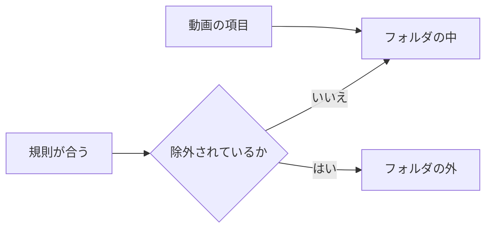

# 調査: 動画が保存した条件に従うスマートフォルダ {#research-smart-folders-whose-videos-follow-a-saved-condition}

親 Issue: #1139。グループ、その項目、除外、入れ子、再生の順序、見え方は [048 調査](../048-groups/research.md) と [048 データモデル](../048-groups/data-model.md) から、ドラッグでの整理は [050 調査](../050-drag-organize/research.md) から、タグの種類は #1136 (`specs/051-tag-kinds/`、この計画を書いた時点ではレビュー中) から引き継ぐ。ライブラリの絞り込みは `domain.VideoQuery` と、`internal/store/listing.go` と `internal/store/library_items.go` にあるその SQL である。このファイルは、この機能が加える決定だけを記録する。

## R-1: スマートフォルダは規則を保存したグループである {#r-1-a-smart-folder-is-a-group-with-a-stored-rule}

**決定**: スマートフォルダは `groups` の行で、新しい `rule` 列がその条件を、新しい `sort` 列がその動画の順序を持つ。`rule` が null のグループは、これまでどおりのグループである ([data-model.md、Migration](data-model.md#migration))。

| 案 | 判定 |
| --- | --- |
| **`rule` と `sort` を持つグループの行** | 採用 |
| 独自の id を持つ別の `smart_folders` テーブル | 不採用: お気に入り、プレイリスト、入れ子、グループのページ、`?group`、ドラッグでの整理はどれもグループを `groups.id` で指す (048 R-10、R-9) ので、2 つ目の id の空間ではそのすべてを二重に持つ必要がある |
| グループをスマートフォルダに変え、また戻すこと | 不採用: Issue はそれを求めておらず、フォルダから取り除いた規則は、条件に合っていた動画を項目の行のない状態に残す |

**理由**: 要件 5 と要件 7 は、グループができることのすべてをスマートフォルダに求める。id を 1 つに保てば、既存のどのグループの読み書きも、メンバーを計算する箇所の 1 つの分岐でそれに届く。

## R-2: 条件に合う動画は、保存せず、グループを読むときに計算する {#r-2-matched-videos-are-computed-when-a-group-is-read-not-stored}

**決定**: スマートフォルダの条件に合う動画は、すでにグループの子孫を計算している読み取り (`groupDescendantsCTE` とライブラリの項目のクエリー) の中で、規則と、今のタグ、クレジット、進捗、お気に入り、動画の情報から評価する。所属はどこにも書かない。

| 案 | 判定 |
| --- | --- |
| **読み取りのときに評価する** | 採用 |
| 変更のたびに更新する所属のテーブル | 不採用: 条件に合うかを変えうるすべての書き込み (タグ、クレジット、進捗、お気に入り、まとめること、取り込み) が、自身のトランザクションでそれを更新しなければならず、書き込みを 1 つでも漏らすと、次に全体を更新するまで誤ったメンバーが残る |
| 所属を作り直すバックグラウンドのジョブ | 不採用: ジョブが動くまでフォルダは条件に遅れ、受け入れ条件 1 (`操作なしで`) に反する |

**理由**: そうすれば要件 3 は、何が情報を書いたかにかかわらずすべての読み取りで成り立ち、取り込みが規則を待つことはない (数万本の動画についてのエッジケース)。開いている画面にもう一度読むよう伝えることは、別の、最善努力の通知のままである ([R-13](#r-13-writes-that-can-change-a-match-publish-groupschanged-for-every-smart-folder)): 通知を逃すと画面が遅れるが、メンバーを壊すことは決してない。費用は読み取りに移る。その予算は [R-12](#r-12-a-read-budget-at-20000-videos-and-50-smart-folders) にある。

## R-3: 規則はライブラリの絞り込みで、AND で組み合わせ、同じ SQL で組み立てる {#r-3-the-rule-is-the-library-filter-combined-with-and-built-by-the-same-sql}

**決定**: 規則は、ライブラリの絞り込みの項目 (検索の文言、視聴の状態、再生できるものだけ、お気に入りだけ、タグ、タグの種類、人物、組織) に、[R-4](#r-4-the-library-filter-gains-added-within-and-length) の追加日と長さの項目を加えたものを持つ。設定したすべての項目が成り立たなければならない。ストアは規則を `domain.VideoQuery` に変え、`ListLibrary` が使う絞り込みの条件を使うので、1 つの組み立てが両方を決める。

| 案 | 判定 |
| --- | --- |
| **ライブラリの絞り込みの項目、AND** | 採用 |
| OR、NOT、入れ子のグループを持つ式の木 | 不採用: 条件の UI はライブラリの絞り込みの言葉と部品を使わなければならず (`UI品質`)、ライブラリの絞り込みには項目の間の OR がない。検索の文言はすでに `OR` と `-` を受け付ける |
| スマートフォルダ専用の条件の言語 | 不採用: そうすると受け入れ条件 5 (保存した絞り込みがライブラリと等しい) は、2 つの変換の歩調を合わせ続けることでしか成り立たない |

**理由**: 受け入れ条件 1、2、5 はどれも絞り込みの項目の AND である。条件の組み立てを共有すれば、条件 5 は作りの上で成り立ち、コードを写すことに反する規則 (AGENTS.md) にも従う。

## R-4: ライブラリの絞り込みに追加日の範囲と長さが加わる {#r-4-the-library-filter-gains-added-within-and-length}

**決定**: `VideoQuery` とライブラリの URL に、`addedWithin` (日数、1 から 36,500: 今からその日数を引いた時点以降に追加された) と、`minDuration` と `maxDuration` (秒、両端を含む。長さが分からない動画はどちらにも合わない) が加わる。ゲストの一覧が明かさないものを何も明かさないので、ゲストもそれらを使える。

| 案 | 判定 |
| --- | --- |
| **共有の絞り込みに加える** | 採用 |
| スマートフォルダだけ | 不採用: 条件の編集画面にライブラリにない部品が要り、保存したライブラリの絞り込みがそれらを持ち帰れない (`UI品質`) |
| 追加日の絶対的な日付の範囲 | 不採用: 固定の範囲には新しい動画が決して加わらないので、満たされ続けるフォルダではなく一度きりの絞り込みになる。Issue の例の情報は今を基準にしている |

**理由**: 要件 2 は、規則が使う情報として追加日と長さを挙げる。視聴の状態とお気に入りはすでに絞り込みの項目である。

## R-5: 手で加えた動画は項目、手で取り除いた動画は除外である {#r-5-hand-added-videos-are-items-hand-removed-videos-are-exclusions}

**決定**: 所有者がスマートフォルダに加えた動画は、どのグループとも同じように `group_items` の行である。所有者が取り除いた動画は `group_exclusions` の行である。スマートフォルダの動画は、条件に合う動画からその除外を引き、その動画の項目を足したものである。除外した動画を加えると除外を削除し、その動画が条件に合わないときにだけ項目を挿入する。動画を取り除くとその項目を削除し、必ず除外を書く。

| 案 | 判定 |
| --- | --- |
| **自動のグループが使うとおりの項目と除外** | 採用 |
| 含めるか除くかのフラグを持つ 1 つの上書きのテーブル | 不採用: `group_items` と `group_exclusions` はすでに自動のグループで同じ意味を持ち (048 R-3)、まとめることと継承でのキーの付け替えはすでに両方を動かす (`rekeyGroupItems`) |
| 取り除いた動画が条件に合うときだけ除外する | 不採用: 条件に合わないときに取り除いた動画が、合った瞬間に戻ってきて、受け入れ条件 3 に反する |

**理由**: 要件 4 は、所有者の追加と取り除きが規則に優先することを求める。除外は条件に合うことに優先し、項目は条件に合うかどうかにかかわらずフォルダの中にあるので、規則がどちらかを覆すことはない。

## R-6: 子グループは位置を保ち、動画はフォルダの並び順に従う {#r-6-child-groups-keep-their-positions-videos-follow-the-folders-sort}

**決定**: スマートフォルダの再生の順序は、位置順の子グループ、続いてその `sort` で並べた動画である。その並び順は、`random` 以外のライブラリの並び順を取る。既定は `addedDesc` である。スマートフォルダの中で動画を移動すると `409 smart_folder_sorted` で拒まれる。子グループの移動はグループと同じように動く。

| 案 | 判定 |
| --- | --- |
| **グループは位置順、続いて動画は並び順** | 採用 |
| すべての動画に位置を持たせる | 不採用: 条件に合う動画には位置を持つ行がなく、新たに合った動画には場所を選ぶ必要がある |
| フォルダの並び順としての `random` | 不採用: 再生の順序が読み取りのたびに変わるので、`Up next` とメンバーの窓が 2 つの要求の間で食い違う |

**理由**: 要件 6 は、条件に合う動画の順序を求める。手で加えた動画も同じ並び順を取るので、所有者はそれぞれを置く必要がない。

## R-7: 条件に合う動画は、グループのメンバーと同じようにライブラリの最上位を離れる {#r-7-matched-videos-leave-the-librarys-top-level-as-group-members-do}

**決定**: スマートフォルダの中の動画は、ライブラリの項目のクエリーではグループのメンバーとして数える。それが最上位に挙がるのは部分的に合う検索を通してだけで (048 R-6)、最上位のスマートフォルダは 1 枚のカードである。

| 案 | 判定 |
| --- | --- |
| **メンバーは最上位を離れる** | 採用 |
| カードを加え、動画は挙げたままにする | 不採用: ライブラリは、グループと違って (要件 7)、条件に合う各動画を 2 回挙げることになる。また、この Issue が準備する AI による整理には、動画がフォルダに移ることが要る |

**理由**: 要件 5 と `UI品質` は、スマートフォルダがグループのカードとして振る舞うことを求める。広い規則は多くの動画を最上位から外す。フォルダをグループの中に入れることが、所有者がそれを邪魔にならないようにする方法である。

## R-8: 空のスマートフォルダは残り、所有者にだけ示す {#r-8-an-empty-smart-folder-stays-and-is-shown-to-the-owner-only}

**決定**: スマートフォルダは、動画がないことを理由に解散することはない: 最後の動画の取り除きも、それを空にする整理での移動も、それをその場に残す (048 の「編集は空のグループを決して残さない」規則は当てはまらない)。所有者のライブラリとグループの一覧は、空のスマートフォルダをカードとして示す。ゲストには、048 の見え方の規則 (見える動画が少なくとも 1 本) は変わらない。

| 案 | 判定 |
| --- | --- |
| **残し、所有者が見る** | 採用 |
| 空のグループと同じように、全員から隠す | 不採用: 所有者がそれを開いて条件を変えられず、エッジケース `空であることが分かる` に反する |
| 解散する | 不採用: 初めて何も合わなかったときに規則が失われる |

## R-9: 統合は規則を書き換え、削除された参照は規則を何にも合わなくする {#r-9-merges-rewrite-rules-a-deleted-reference-makes-the-rule-match-nothing}

**決定**: タグ、人物、組織の統合は、統合元の id を挙げるすべての規則を、統合のトランザクションの中で統合先の id に書き換える。もう存在しないタグ、タグの種類、人物、組織を挙げる規則はどの動画にも合わず (その動画の項目は引き続き示す)、所有者によるフォルダの読み取りは存在しない参照を挙げる。

| 案 | 判定 |
| --- | --- |
| **統合で書き換え、存在しない参照では何にも合わない** | 採用 |
| ライブラリが存在しないタグを落とす (`MissingTagIDs`) のと同じように、存在しない項目を落として残りを評価する | 不採用: タグが削除されたフォルダ `タグ: 猫` がすべての動画に合い、ライブラリ全体を最上位から外す ([R-7](#r-7-matched-videos-leave-the-librarys-top-level-as-group-members-do)) |
| 参照ごとの外部キー | 不採用: 参照は JSON の規則の中にある ([data-model.md](data-model.md#groupsrule))。4 つの関連テーブルを、規則を読むたびに丸ごと読むことになる |

**理由**: エッジケースは、統合では統合先に従い、削除では条件が働いていないことを示すことを求める。タグの種類には統合がない (#1136) ので、それには削除だけが当てはまる。

## R-10: `owner_kept` は所有者が作ったか編集したすべてのグループに印を付ける {#r-10-owner_kept-marks-every-group-the-owner-made-or-edited}

**決定**: `groups` に `owner_kept` が加わる。グループかスマートフォルダを作る、その名前を変える、その規則か並び順を変える、その項目を加える、取り除く、並べ替える、画面の API のすべての書き込みは、そのグループにそれを 1 に設定する。フォルダのスキャンの同期は決して設定しない。マイグレーションを実行した時点で存在するすべてのグループは 1 から始まる。

| 案 | 判定 |
| --- | --- |
| **すべてのグループに 1 つのフラグ、所有者の書き込みが設定する** | 採用 |
| スマートフォルダだけ | 不採用: このフラグを読む AI による整理は、手作りのグループと自動のグループも並べ替える。また、フラグができる前の編集は後から取り戻せない |
| `created_by` の値 (所有者、スキャン、AI) | 不採用: 要件 8 は、編集した AI のフォルダも所有者のものとして数えることを求めるが、作成者の項目はそれを記録しない |
| 編集を検出できるとき (手で加えた項目、除外、変えた名前) だけ、既存の自動のグループを 1 にする | 不採用: 並べ替えや、名前を変えて元に戻すことは跡を残さないので、編集したグループが 0 から始まり、AI がそれを並べ替えてしまう |

**理由**: 要件 8 は、AI がこれらのフォルダに手を付けないように記録を求める。AI の書き込みの経路は範囲外である。それはフラグを設定しない唯一の経路になる。

## R-11: 規則は所有者の情報を読み、見え方は閲覧者のものである {#r-11-the-rule-reads-the-owners-facts-visibility-is-the-viewers}

**決定**: 規則は、誰がフォルダを見るかにかかわらず、所有者のタグ、進捗、お気に入り、完全な検索で評価する。その結果を、閲覧者が見てよい動画に切り詰める (048 の見え方)。

| 案 | 判定 |
| --- | --- |
| **所有者の情報、閲覧者の見え方** | 採用 |
| 閲覧者として規則を評価する | 不採用: ゲストの絞り込みはタグ、クレジット、視聴の状態、お気に入りを拒む (`guest_filter_not_allowed`) ので、フォルダはゲストと所有者で違う動画を持つことになる |

**理由**: 要件 7 と隠した動画についてのエッジケースは、所有者が作ったフォルダから、ゲストが見てはいけないものを除いたものを、ゲストが見ることを求める。

## R-12: 20,000 本の動画と 50 個のスマートフォルダでの読み取りの予算 {#r-12-a-read-budget-at-20000-videos-and-50-smart-folders}

**決定**: 20,000 本の動画と 50 個のスマートフォルダで、ライブラリの最初のページとスマートフォルダのグループのページは、それぞれ 500 ms 以内に返る。これをストアのベンチマークで測る。条件に合う動画の CTE は、挙げるグループごとに 1 回ではなく、読み取りごとに 1 回動く。

| 案 | 判定 |
| --- | --- |
| **予算を明示したベンチマーク** | 採用 |
| 単体テストの中の時間制限 | 不採用: CI のランナーはばらつき、時間の検証はコードの変更なしに失敗する |
| 予算なし | 不採用: [R-2](#r-2-matched-videos-are-computed-when-a-group-is-read-not-stored) は費用をライブラリのすべての読み取りに移し、数万本の動画についてのエッジケースはそれを扱う |

**理由**: `BenchmarkRebuildFolderIndex` は、フォルダの索引に同じ種類の測った予算を設けている。予算を超えたときの代わりの手段は、要求ごとの条件に合うキーのキャッシュであり、所属の保存ではない。

## R-13: 条件に合うかを変えうる書き込みは、すべてのスマートフォルダに `GroupsChanged` を発行する {#r-13-writes-that-can-change-a-match-publish-groupschanged-for-every-smart-folder}

**決定**: 規則、並び順、項目、除外の変更は、フォルダとその祖先に `GroupsChanged` を発行する (048 R-13)。いずれかの規則に合う動画を変えうる、コミットされた書き込みは、すべてのスマートフォルダとその祖先に `GroupsChanged` を発行し、スマートフォルダが 1 つもないときは何も発行しない ([data-model.md、Notices](data-model.md#notices))。進捗の保存は、動画の視聴状態を変えるときだけ発行する。

| 案 | 判定 |
| --- | --- |
| **すべてのスマートフォルダを挙げる 1 つの通知** | 採用 |
| フォルダの編集だけが発行する | 不採用: SPA はグループを、それを挙げる `group` イベントでだけ読み直し (`web/src/api/useGroupRefresh.ts`)、ライブラリはページを `group` イベントでだけ読み直すので、新しくタグを付けた動画は、開いているフォルダの外とライブラリの最上位に残ってしまう |
| 書き込みがどのフォルダを変えたかを割り出す | 不採用: 書き込みのたびにその前後ですべての規則を評価することになる。それは [R-2](#r-2-matched-videos-are-computed-when-a-group-is-read-not-stored) が書き込みの経路から外す費用である |
| 進捗の保存のたびに発行する | 不採用: 進捗は再生中に数秒ごとに保存され、通知のたびにライブラリは読み込んだページを読み直す |

**理由**: 受け入れ条件 1 は操作なしでフォルダが変わることを求め、開いている画面は変更をイベントからしか知らない。既存の `group` イベントとそのハンドラーが通知を運ぶので、SPA に変更は要らない。
