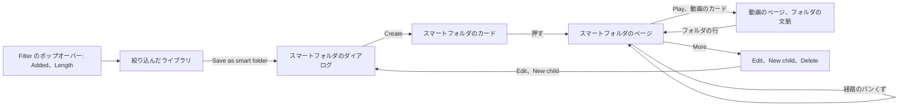
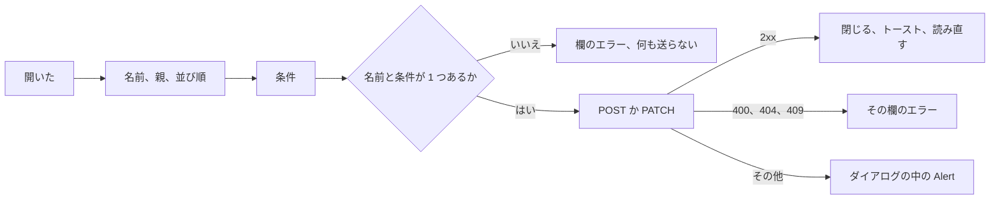
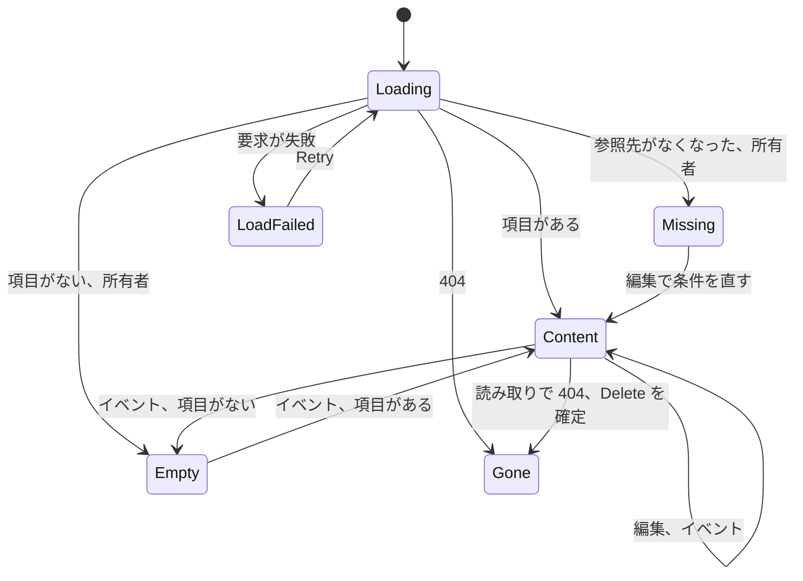

# UI 設計: 中身が保存した条件に従うスマートフォルダ {#ui-design-smart-folders-whose-contents-follow-a-saved-condition}

**機能**: [親 Issue #1139](https://github.com/syudead/vv/issues/1139) · [plan.md](plan.md) · [research.md R-3](research.md#r-3-a-rule-is-the-library-filters-fields-contents-are-the-filtered-library) · [R-4](research.md#r-4-the-library-filter-gains-added-within-and-length) · [R-5](research.md#r-5-a-childs-effective-rule-is-every-rule-on-its-path-anded) · [R-6](research.md#r-6-videos-follow-the-folders-sort-random-is-refused) · [R-7](research.md#r-7-root-smart-folders-are-cards-in-the-unfiltered-library) · [R-8](research.md#r-8-an-empty-folder-stays-and-is-shown-to-the-owner-only) · [R-9](research.md#r-9-merges-rewrite-rules-a-deleted-reference-makes-the-rule-match-nothing) · [R-12](research.md#r-12-writes-that-can-change-a-match-publish-smartfolderschanged) · [data-model.md、Contents](data-model.md#contents) · [contracts/screen-api.md](contracts/screen-api.md)

すでに決めている出典。ここでは繰り返さず、リンクする。

| 話題 | 出典 |
| --- | --- |
| トークン、閉じた段階、ライブラリの密度 | [design-system.md、Foundations](../../docs/design-docs/design-system.md#foundations)。値は [`web/src/ui/tokens.css`](../../web/src/ui/tokens.css) の `@theme` にあり、ここでは名前で参照し、写さない |
| `ListPage`、`PageHeader`、`CardGrid`、`DataTable`、状態のブロック | [patterns.md、List page](../../web/registry/rules/patterns.md#list-page)、[Sections](../../web/registry/rules/patterns.md#sections)、[States](../../web/registry/rules/patterns.md#states) |
| `FormDialog`、`ConfirmDialog`: `pending`、その中の失敗の `Alert` | [patterns.md、Form dialog](../../web/registry/rules/patterns.md#form-dialog)、[Confirm dialog](../../web/registry/rules/patterns.md#confirm-dialog) |
| `Select`、`Badge`、`Breadcrumb`、`TagCommand`、`CreditCommand`、`DropdownMenu`、`Tooltip`、`Sonner`: それぞれの用途 | [components.md](../../web/registry/rules/components.md) |
| ライブラリのツールバー、`Filter` のポップオーバー、並び順のメニュー | [library-ui.md、Shell and toolbar](../../docs/design-docs/library-ui.md#shell-and-toolbar)、[013 の UI 設計、Filter menu](../013-library-search/ui-design.md#filter-menu)、[035 の UI 設計、Filter menu](../035-favorites/ui-design.md#filter-menu) |
| 適用中の絞り込みの行 (`Filtering by`) とそのチップ | [014 の UI 設計、Active tag filters](../014-video-tags/ui-design.md#active-tag-filters)、[047 の UI 設計、Library](../047-video-work-info/ui-design.md#library-filter-by-a-person-or-organization) |
| タグの種類の絞り込みの行とそのチップ | #1136、`feature/051-tag-kinds` 上の `specs/051-tag-kinds/ui-design.md` (`Library`) |
| グループのカードと行、その絵、数の面、隅の印 | [library-ui.md、Cards](../../docs/design-docs/library-ui.md#cards)、[048 の UI 設計、Group card and row](../048-groups/ui-design.md#group-card-and-row)、[044 の UI 設計、Add to playlist](../044-playlists/ui-design.md#add-to-playlist) |
| グループのページ: その経路の帯、ヘッダー、本体、状態、消えた状態 | [048 の UI 設計、Group page](../048-groups/ui-design.md#group-page) |
| 名前のダイアログと名前の規則 | [048 の UI 設計、New group](../048-groups/ui-design.md#new-group)、[048 の調査 R-14](../048-groups/research.md#r-14-a-group-name-is-1-to-100-characters-after-trimming-names-may-repeat) |
| 動画のページのグループの行、`Up next`、矢印、自動再生の通知 | [library-ui.md、Group members](../../docs/design-docs/library-ui.md#group-members)、[048 の UI 設計、Video page](../048-groups/ui-design.md#video-page)、[044 の UI 設計、Video page in a playlist](../044-playlists/ui-design.md#video-page-in-a-playlist) |
| カードのドラッグ: 何がドロップ先で、何が拒むか | [050 の UI 設計、Drag layer](../050-drag-organize/ui-design.md#drag-layer) |
| ゲストでの縮退 | [016 の UI 設計、Guest degradation](../016-single-account-auth/ui-design.md#guest-degradation) |
| CSS の幅のブレークポイント。人が確かめるレイアウト | [library-ui.md、Width breakpoints](../../docs/design-docs/library-ui.md#width-breakpoints-in-css-and-the-sidebar-exception)、[Layout verified by people](../../docs/design-docs/library-ui.md#layout-verified-by-people-not-machines) |
| 画面の文言 | [`web/src/i18n/en.ts`](../../web/src/i18n/en.ts) (`list.filter`、`list.sort`、`library.activeTags`、`library.group`、`groups`、`player.group`)。この機能は `smartFolders` と下の文言を加える |

図は、この機能が加えるか変える部分と、それぞれの操作の行き先を示す。

変わらないもの: 動画のカードとグループのカード。お気に入りのハート。`Add to playlist` と `Add to group`。選択バーとその操作。グループのページ。フォルダの画面。プレイリストの画面。サイドバー。自動再生の通知。下のすべての部分はレジストリのコンポーネントかパターンであり、`web/src/theme/tokens.test.ts` のコントラストの組は何も増えない。トークンは加えない: スマートフォルダのカードはグループのカードを使い回し、ダイアログは `FormDialog` であり、フォルダのページはグループのページの帯、ヘッダー、本体を使い回し、2 つの新しい絞り込みの行は `Filter` のポップオーバーの幅の `Select` である。

## この形にした理由 {#why-this-shape}

スマートフォルダは保存したライブラリの絞り込みなので、そのすべての画面は、1 語を変えたライブラリ自身の部分である。カードはグループのカードであり (要件 6。`UI品質`、1 つ目の点)、ページはグループのページ (048) で、グループのページがフォルダの行を出す場所に条件を出し、条件は `Filter` のポップオーバーの行、タグのチップ、所有者がすでにライブラリで設定する人物のチップであり (要件 2。`UI品質`、2 つ目の点)、動画のページのフォルダの文脈は、別のアイコンを持つグループの行である。スマートフォルダ独自の画面 (木、規則の表) は採用しなかった。所有者が同じ動画を読む 2 つ目の方法を覚えることになり、また要件 4 は中身を絞り込んだライブラリと定めており、それはライブラリのカードがすでに出しているからである。

保存は、ライブラリのヘッダーの 1 つの `outline` の操作 `Save as smart folder` で、条件が適用されている間だけ描く (要件 10)。ライブラリのページにはヘッダーの操作がなかった。その枠はリストのページの 1 つの主な操作のためのパターン上の場所であり、この操作は所有者が絞り込んだ理由である。`Filter` のポップオーバーの中に置くことは採用しなかった。検索の文字列、タグのチップ、人物のチップはポップオーバーの中にないので、所有者がポップオーバーの行だけを保存すると読みうるからである。`Filtering by` の行に置くことは採用しなかった。その行は取り除けるチップを持ち、他に何も持たないからである。条件がないとき、操作は無効にするのではなく、ない: 空の規則はすべての動画に合い、すべてを持つフォルダは要件 10 が述べるものではない。子は親のページから作る。そこでは親が見えている。

1 つのダイアログが作成と編集をする。その条件の節は、ライブラリの絞り込みの部分をフォームとして並べたものである: 検索の欄、視聴状態の切り替え、2 つのチェックボックス、タグの種類の `Select`、動画のページのタグの欄を伴うタグのチップ、詳細の編集の人物と組織の欄、この機能がポップオーバーに加える 2 つの `Select`。所有者は両方の場所で同じ形の同じ語を読むので、ライブラリから保存した絞り込みは、所有者が設定したとおりにダイアログで開く (受け入れ条件 5)。自由記述の規則の言語と、演算子を持つ条件ごとの行のビルダーは採用しなかった (R-3): ライブラリの絞り込みには演算子がなく、ビルダーはライブラリが使わない語を作り出すことになる。ダイアログは名前、親、並び順も持つ。要件 1 は所有者がそれらすべてを後で変えられるとしており、1 つのダイアログなら「フォルダを変える」が 1 つの操作のままだからである。

追加日と長さは、数値の欄ではなく、プリセットの 2 つの `Select`、`Added` と `Length` として `Filter` のポップオーバーに加わる。ポップオーバーの行は選ぶとすぐに作用し (`ToggleGroup`、`Checkbox`、タグの種類の `Select`)、ポップオーバーの中の数値の欄はキー入力のたびに作用するか、ボタンを必要とする。プリセットなら行は 1 回押すだけのままである。URL か規則が設定したプリセット外の値は、それ自身の選択肢として出すので、何も失われない ([Added and length](#added-and-length))。

スマートフォルダは、よく見たときにだけグループと見分けられる (`UI品質`、1 つ目の点): カードの箱、絵、数の面、名前、印はグループのカードのもので、唯一の違いは、面の数の前と行の数の行の前にある小さなスマートフォルダのアイコンである。目はそれを通り過ぎ、ポインタはそれを見つける。カードのバッジやラベルは採用しなかった。どの閲覧の操作も変えない違いのための、2 つ目の種類のカードになるからである。印をまったく付けないことも採用しなかった。動画がなぜ 2 か所にあるのかと思った所有者は、フォルダを開かずにそれを知ることができなければならないからである。

子のページでは、上への道は経路の帯で、絞り込みは条件の行である: 子自身の条件を最初に、次に祖先ごとに 1 行、`From {parent}:` とその親の条件を、最も外側を最後に置く (`UI品質`、3 つ目の点。R-5)。経路を 1 つのチップの一覧にまとめることは採用しなかった。所有者が条件を緩めるためにどのフォルダを編集すればよいかを見分けられなくなるからである。

## 文言 {#words}

`web/src/i18n/en.ts` の `smartFolders` の下の文言。キーを挙げたところは除く。ユーザーデータ (フォルダの名前、タグの名前、タイトル) は引数として埋め込む。`videos` はカタログの「1 video」/「N videos」のヘルパーである。

| 場所 | 文言 | 備考 |
| --- | --- | --- |
| ライブラリのヘッダーの操作 | Save as smart folder | `smartFolders.save`。lucide `FolderSearch` と文字 |
| 絞り込みのポップオーバーの行 | Added; Length | `list.filter.added`、`list.filter.length`。`Select` のラベル |
| Added の選択肢 | Any time; Last 24 hours; Last 7 days; Last 30 days; Last 90 days; Last year; Last {N} days | `list.filter.addedOptions`。最後の形はプリセット外の値にだけ使う |
| Length の選択肢 | Any length; Under 5 minutes; 5 to 20 minutes; 20 to 60 minutes; Over an hour; {min} to {max} minutes; Under {max} minutes; Over {min} minutes | `list.filter.lengthOptions`。最後の 3 つはプリセット外の値にだけ使う |
| ダイアログのタイトル、作成時 | New smart folder | `smartFolders.dialog.newTitle` |
| ダイアログのタイトル、子の作成時 | New smart folder in "{parent}" | `smartFolders.dialog.newChildTitle(parent)` |
| ダイアログのタイトル、編集時 | Edit smart folder | `smartFolders.dialog.editTitle` |
| 名前の欄のラベル。規則 | Name; Use a name of 1 to 100 characters. | `groups.nameLabel`、`groups.nameRule` (048 の名前の規則) |
| 親の欄のラベル。最上位の選択肢 | Parent; None (top level) | `smartFolders.dialog.parent`、`.noParent` |
| 循環になる親の選択肢 | (フォルダ自身とその子孫は一覧に出さない) | [Parent](#parent) |
| 並び順の欄のラベル | Sort | `list.sort.heading`。選択肢は `list.sort.kinds` と `list.sort.wording` から「Date added, newest first」のように作る |
| ライブラリの並び順がランダムだったときの並び順のヒント | Random can't be saved; the folder is sorted by date added | `smartFolders.dialog.randomSort` |
| 条件の節の見出し | Conditions | `smartFolders.dialog.conditions` |
| 条件のヒント | Videos that match every condition are in the folder. | `smartFolders.dialog.conditionsHint` |
| 検索の欄のラベル | Search | `list.search.placeholder` |
| 視聴状態、Favorites only、Playable only、タグの種類 | ポップオーバーと同じ | `list.filter.*` |
| タグの欄のラベル。欄のプレースホルダー | Tags; Add tag | `library.tagRow.label`、`player.tags.add` |
| 人物と組織の欄のラベル | Person; Organization | `credits` の下の、詳細の編集の役割のラベル |
| Added、Length | ポップオーバーと同じ | `list.filter.added`、`list.filter.length` |
| 条件に何も設定されていない | Add at least one condition. | `smartFolders.dialog.noConditions`。節の `FieldError` |
| 作成の操作。送信中 | Create; Creating… | `smartFolders.dialog.submit`、`.submitting` |
| 保存の操作。送信中 | Save; Saving… | `smartFolders.dialog.saveSubmit`、`.saving` |
| 作成の失敗。保存の失敗 | Couldn't create the smart folder: {reason}; Couldn't save the smart folder: {reason} | `smartFolders.dialog.createFailed`、`.saveFailed`。ダイアログの中の `destructive` の `Alert` |
| `smart_folder_cycle` | A smart folder can't be put inside itself or inside one of its children. | `errorCodes.smart_folder_cycle`。親の欄の `FieldError` |
| 親としての `smart_folder_not_found` | That smart folder no longer exists. | `errorCodes.smart_folder_not_found`。親の欄の `FieldError` で、親の一覧を読み直す |
| `invalid_smart_rule` | A condition is out of range. | `errorCodes.invalid_smart_rule`。条件の節の `FieldError` |
| 作成した。保存した | Created "{name}"; Saved "{name}" | `smartFolders.created(name)`、`.saved(name)`。トースト |
| カードのアクセシブルな名前 | {name}, smart folder of 12 videos; {name}, smart folder of 12 videos, 3 watched | `library.smartFolder.label(name, count, watched)` |
| カードの印のツールチップと `title` | Smart folder | `smartFolders.kind` |
| カードのお気に入り、プレイリストへの追加 | Favorite smart folder "{name}"; Add smart folder "{name}" to a playlist | `library.smartFolder.favorite(name)`、`.addToPlaylist(name)` |
| 経路の帯のアクセシブルな名前 | Smart folder path | `smartFolders.trail` |
| 最初のパンくず | Library | `library.title` |
| ヘッダーの数 | 12 videos · 1:32:10; 0 videos | `groups.detail.count(count, duration)` |
| 条件の行のラベル | Conditions: | `smartFolders.detail.conditions` |
| 受け継いだ条件の行のラベル | From "{parent}": | `smartFolders.detail.fromParent(name)` |
| 条件のチップ | Search: kyoto; Unwatched; In progress; Watched; Favorites; Playable; Kind: Genre; Tag: 猫; Person: {name}; Organization: {name}; Added in the last 7 days; 5 to 20 minutes | `smartFolders.condition.*`。視聴と長さの語はポップオーバーのもの |
| 参照先がなくなった条件のチップ | Tag: deleted; Kind: deleted; Person: deleted; Organization: deleted | `smartFolders.condition.deleted(kind)`。lucide `TriangleAlert` を持つ `warning` の `Badge` |
| 空の本体、何も合わない | Nothing matches these conditions yet; Videos that match appear here as soon as they are tagged or added. | `smartFolders.detail.empty.title`、`.description`。所有者の操作は「Edit conditions…」 |
| 空の本体、参照先がなくなった | A condition no longer works; A tag, kind, person or organization in the conditions was deleted, so nothing matches. | `smartFolders.detail.missing.title`、`.description`。所有者の操作は「Edit conditions…」 |
| 再生の操作、アクセシブルな名前 | Play; Play "{name}" | `groups.detail.play`、`.playFor(name)` |
| More のボタン、ツールチップとアクセシブルな名前 | More | `common.more` |
| メニューの項目 | Edit…; New child smart folder…; Delete… | `smartFolders.detail.edit`、`.newChild`、`.delete` |
| 空の状態での編集の操作 | Edit conditions… | `smartFolders.detail.editConditions` |
| 削除のダイアログのタイトル | Delete "{name}"? | `smartFolders.deleteDialog.title(name)` |
| 削除のダイアログの説明 | The smart folder is deleted. Its videos stay in the library. | `smartFolders.deleteDialog.description` |
| 削除のダイアログ、子を持つフォルダ | Its {N} child smart folders are deleted with it. | `smartFolders.deleteDialog.children(count)`。2 つ目の文 |
| 削除の操作。送信中 | Delete; Deleting… | `smartFolders.deleteDialog.submit`、`.submitting`。`destructive` |
| 削除の失敗 | Couldn't delete the smart folder: {reason} | `smartFolders.deleteDialog.failed` |
| 削除した | Deleted "{name}" | `smartFolders.deleted(name)`。トースト |
| 消えたときのタイトル | This smart folder no longer exists | `smartFolders.detail.gone.title` |
| 消えたときの説明 | It was deleted, maybe in another tab. | `smartFolders.detail.gone.description` |
| 消えたときの操作 | Back to library | `groups.detail.gone.action` |
| 読み込みの失敗 | Couldn't load the smart folder | `smartFolders.detail.loadFailed` |
| 続きの読み込みの失敗 | Couldn't load more of the smart folder | `smartFolders.detail.moreFailed` |
| 動画のページのフォルダの行、アクセシブルな名前 | Smart folder "{name}", video 3 of 12. Open the smart folder | `player.smartFolder.line(name, position, count)` |
| スマートフォルダのカードでドロップを拒む | Can't drop here | `organize.drop.refused` |

「Smart folder」は機能全体を指す製品の用語である。「rule」は画面に出さず、画面での語は「conditions」で、「condition」はその 1 つの部分である。「Child smart folder」は別のフォルダの下のフォルダで、「parent」はその上のものである。スマートフォルダを終わらせるのは「Delete」である。何も解散しない (中に動画はない) からである。スマートフォルダの名前は、グループの名前と同じく、文の中で引用符で囲む。

## ライブラリ {#library}

### 追加日と長さ {#added-and-length}

`Filter` のポップオーバーは、`Playable only` の後に (#1136 のタグの種類の行があるときはその後に) 2 つの行を得る。それぞれラベルとポップオーバーの幅の `Select` を持つ `Field` で、順に `Added`、`Length` である。どちらも所有者とゲストに出す (R-4)。選ぶとすぐに適用され、URL は `addedWithin=<days>`、または `minDuration=<s>` と `maxDuration=<s>` を得て、リストは先頭から読み直され、ポップオーバーは開いたままになる。ボタンはそれぞれを 1 つの適用中の絞り込みとして数え、`Clear filters` は両方を取り除く。`Filtering by` の行にはチップが加わらない: 2 つは、視聴状態と同じくボタンで数える。どのエンティティも名指さないからである。

| 選択肢 | 送るもの |
| --- | --- |
| Any time | なし |
| Last 24 hours | `addedWithin=1` |
| Last 7 days、Last 30 days、Last 90 days、Last year | `addedWithin=7`、`30`、`90`、`365` |
| Any length | なし |
| Under 5 minutes | `maxDuration=299` |
| 5 to 20 minutes | `minDuration=300&maxDuration=1199` |
| 20 to 60 minutes | `minDuration=1200&maxDuration=3599` |
| Over an hour | `minDuration=3600` |

値がどのプリセットにも合わない URL (`addedWithin=14`、`minDuration=90`) は、プリセットの後に、選んだ状態のもう 1 つの選択肢 `Last 14 days` か `1.5 to … minutes` を描く。別の選択肢を選ぶとそれは消える。範囲外の値や、`maxDuration` を超える `minDuration` は、ゲストの `fav=1` と同じく、URL の `replace` で要求の前に落とすので、手で編集した URL に対してリストが `400` を送ることはない。並び順は保つ。

### スマートフォルダとして保存 {#save-as-smart-folder}

ライブラリの `PageHeader` は、所有者に `outline` `sm` の操作 `Save as smart folder` (lucide `FolderSearch`) を得て、何かの条件が適用されている間に描く: 検索の文字列、視聴状態、お気に入りのみ、再生可能のみ、タグの種類、タグ、人物、組織、追加日、長さ。これは、URL から設定した条件、今の並び順から設定した並び順、空の名前、`None (top level)` の親で [スマートフォルダのダイアログ](#smart-folder-dialog) を開く。選択、スクロールの位置、リストは触らない。`201` でトースト `Created "{name}"` が出て、ライブラリはその場で最初のページを読み直すので、新しいカードはその並び順の値が置く場所に立つ (R-7)。`random` の並び順は、`Date added, newest first` と、並び順の欄の下の [Words](#words) のヒントでダイアログを開く (R-6)。

### スマートフォルダのカードと行 {#smart-folder-card-and-row}

ライブラリの `smartFolder` の項目は、次の違いを持つグループのカードを描き、それ以外はグループのカードの箱、絵 (応答の `previews` の `FolderArt`)、数の面、視聴済みのバー、名前、タグの行、隅の印を描く:

| 部分 | スマートフォルダ |
| --- | --- |
| 数の面 | lucide `FolderSearch` `size-3`、次に「12 videos」、次に合計。アイコンはツールチップ `Smart folder` を持ち、唯一の見える違いである |
| リンク | `state.from` をリストの URL として `/smart-folders/{id}`。アクセシブルな名前は「{name}, smart folder of 12 videos」 |
| 隅の印 | ハートと `Add to playlist` だけ。`Add to group` はない (`対象外`: スマートフォルダはグループに入らない) |
| 選択のチェック | なし。`Select all` はこのカードを飛ばす。その動画はライブラリでそれ自身のカードであり、そこで選ばれる |
| ドラッグ | 持ち上げず、ドロップ先でもない: その上にドラッグしたカードは `Can't drop here` を出す ([050 の UI 設計、Indicators](../050-drag-organize/ui-design.md#indicators)) |
| 空のフォルダ (所有者) | シートのない絵、面は「0 videos」、名前は `text-muted-foreground`。ゲストには決して見えない (R-8) |

リスト表示では、行はグループの行で、数の行で `Folder` の代わりに `FolderSearch` のアイコンを持ち、チェックの列も `Add to group` の列もない。

カードは、グループのカードが `group` イベントで読み直されるのと同じく、その id を運ぶ `smartFolder` イベント (R-12) でスケルトンなしで読み直される。`404` はそれを取り除く。絞り込んだライブラリはスマートフォルダのカードを一覧に出さず、お気に入りのみはお気に入りにしたものをどの深さでも一覧に出す (R-7) ので、子のフォルダのカードがライブラリに立てるのはそこだけである。

## スマートフォルダのダイアログ {#smart-folder-dialog}

`size="wide"` の 1 つの `FormDialog` で、ライブラリからの作成、フォルダのページからの子の作成、フォルダの編集に使う。本体はダイアログの中でスクロールする。フッターは `Cancel` と `default` の `Create` か `Save` を持ち、編集中は何かがフォルダと違うまで `submitDisabled` である。フォーカスは名前の欄で開く。

| 部分 | 形 |
| --- | --- |
| 名前 | [048 の UI 設計、New group](../048-groups/ui-design.md#new-group) の名前の欄: `Label`「Name」、`Input`、コードポイントの数、送信時の `FieldError` としての規則 |
| 親 | `Select` で、最初に「None (top level)」、次に所有者が持つすべてのスマートフォルダを自然な名前の順で並べ、入れ子のものは 1 段ごとに `pl-4` を 1 つ字下げする。`GET /api/smart-folders` から読む。何を除くかは [Parent](#parent) が言う |
| 並び順 | ライブラリの並び順の種類と方向を「Date added, newest first」のように並べた 15 個の選択肢の `Select` で、`Random` はない。既定は `Date added, newest first` |
| 条件 | 凡例「Conditions」とヒントを持つ `FieldSet` で、[Conditions](#conditions) の行を表の順に持ち、行の間はポップオーバーと同じく `gap-3` |

空の条件は規則にない。メンバーのない規則は、送る前に節の `FieldError` で拒む。[contracts/screen-api.md、Statuses](contracts/screen-api.md#statuses) の `400`、`404`、`409` の状態は [Words](#words) で挙げた欄に出る。その他の失敗は欄の下の `destructive` の `Alert` で、ダイアログは開いたままである。`Cancel`、`×`、Esc は尋ねずに下書きを捨てる: ダイアログが持つのはいくつかの値で、1 ページ分の作業ではない。

### 条件 {#conditions}

| 行 | 操作部品 | 規則のメンバー |
| --- | --- | --- |
| 検索 | ライブラリの検索のプレースホルダーを持つ `Input`。前後の空白を除き、最大 500 文字 | `q` |
| 視聴状態 | ポップオーバーの `ToggleGroup` (`All`、`Unwatched`、`In progress`、`Watched`) | `watch`。`All` のときは規則にない |
| Favorites only、Playable only | ポップオーバーの 2 つのチェックボックス | `favorite`、`playable` |
| タグの種類 | ポップオーバーの `Select` (`Any kind`、次に種類)。ポップオーバーの行と同じく、#1136 がマージされてから描く | `tagKind` |
| タグ | 動画のページのタグの部分のチップとその `×`、その後に `dropdown` のレイアウトの `TagCommand` で、作成の行はない (条件は既存のタグを名指す)。チップは最大 16 個で、16 個になると欄はヒント「Up to 16 tags」とともに `disabled` になる | `tags` |
| 人物、組織 | それぞれ `×` を持つチップ 1 つ、なければ作成の行のない `dropdown` のレイアウトの詳細の編集の `CreditCommand` | `person`、`organization` |
| 追加日 | ポップオーバーの `Select` | `addedWithin` |
| 長さ | ポップオーバーの `Select` | `minDuration`、`maxDuration` |

画面が描けない規則のメンバー (欄の長さを超える `q`、どのプリセットにも合わない長さ) は、それ自身の選択肢として描くか、そのまま保つので、他の欄を保存してもそれを落とすことはない。タグ、種類、人物、組織がもう存在しないチップは、`×` を持つ [Words](#words) の `warning` のチップなので、所有者はそれを取り除くか置き換える。

### 親 {#parent}

親の `Select` は、編集中のフォルダとその子孫を `GET /api/smart-folders` の木から除くので、循環になる唯一の選択はできない。競合 (別のタブでフォルダを動かした) は今も `409 smart_folder_cycle` を返し、親の欄のエラーとして描く (Edge Case)。フォルダのページから子を作ると、そのフォルダを選んだ状態でダイアログを開く。所有者はそれを変えてもよい。

## スマートフォルダのページ {#smart-folder-page}

`/smart-folders/{id}` は `AppShell` の中の `ListPage` で、使うときに読み込まれ、所有者とゲストのためにあり、グループのページ ([048 の UI 設計、Group page](../048-groups/ui-design.md#group-page)) と同じく、下の違いを持って作る。`document.title` はフォルダの名前である。`?trail` はない: 親は保存されており、応答の `trail` が帯の描くものである。

### 経路の帯 {#trail-band}

「Smart folder path」という名前の、フォルダの画面のパンくずの帯: 「Library」、`trail` の各祖先をそのページへのリンクとして外側から順に、そして今のパンくずとしてのフォルダの名前。`md` 未満では、グループの帯と同じく、パンくずが 4 つ以上で「… › {parent} › {name}」に折りたたまれる。

### ヘッダー {#header}

| 部分 | 形 |
| --- | --- |
| タイトル | 名前。`text-xl font-semibold` で、最大 2 行で、`title` に名前全体 |
| 数 | カードの値から「12 videos · 1:32:10」。空のフォルダでは「0 videos」 |
| 説明 | 条件の行 ([Conditions lines](#conditions-lines)) |
| 操作 | 再生の順が空でない間に描く `default` `sm` の「Play」(lucide `Play`) と、所有者の `ghost` `icon-sm` の「More」(lucide `Ellipsis`)。「More」は `DropdownMenu` を開く: 「Edit…」(lucide `Pencil`)、「New child smart folder…」(lucide `Plus`)、区切り、「Delete…」(lucide `Trash2`、`variant="destructive"`) |

「Play」は `state: { from: <this page's URL>, autoplay: true }` 付きで `/videos/{openVideoId}?smartFolder={id}` を開く。

### 条件の行 {#conditions-lines}

数の下に、経路上のフォルダごとに `text-xs text-muted-foreground` の 1 行を置く。それぞれラベルと、`gap-1` の `outline` の `Badge` の折り返す並びで、チップの文字は `text-xs font-normal` である:

| 行 | いつ | 内容 |
| --- | --- | --- |
| 「Conditions:」 | 常に | フォルダ自身の条件をチップとして、[Conditions](#conditions) の順に。規則が空のフォルダはラベルの後にチップを出さない |
| 「From "{parent}":」 | 祖先ごとに、近いものから | その祖先の条件。ラベルはその祖先のページへの `link` の変種のリンク |

チップは読むだけである: 押しても何もせず、`×` もない。閲覧者全員が行を見る。フォルダが何であるかを言うからである。所有者の `settings` は `missing` の一覧を加え、それが名指すチップを [Words](#words) の `warning` のチップに変える。タグ、種類、人物、組織のチップの名前は、`Filtering by` のチップと同じく、共有のタグの一覧、種類の一覧、`GET /api/people/{id}` か `/organizations/{id}` から得て、届くまでは `Skeleton` `w-12` を出す。ゲストのチップもタグ、人物、組織を名指す: 名前はフォルダが絞り込みに使うものであり、フォルダは公開の動画を中に持つときにだけゲストに出すからである (R-11)。

### 本体 {#body}

ツールバーはグループのページのものである: 表示の切り替えとズームで、検索、絞り込み、並び順はない (並び順はフォルダのもので、ダイアログで変える)。本体は応答の `items` を応答の順に並べたライブラリのグリッドかリスト表示である: 子のスマートフォルダを最初に名前の順で、次に動画とグループをフォルダの並び順で並べる ([data-model.md、Contents](data-model.md#contents))。

| 項目 | カードとリンク |
| --- | --- |
| 子のスマートフォルダ | [スマートフォルダのカード](#smart-folder-card-and-row)で、`/smart-folders/{childId}` を開く |
| 動画 | ライブラリの `VideoCard` で、`state.from` をこのページの URL として `/videos/{videoId}?smartFolder={id}` を開くので、`×` と Esc はここに戻り、`Up next` はこのフォルダに従う |
| グループ | ライブラリの `GroupCard` で、ライブラリと同じく `/groups/{groupId}` を開く。一部だけが合うグループは、代わりに合う動画を動画のカードとして一覧に出す (027、R-3) |

リスト表示は、プレイリストの画面の行ではなく、ライブラリの行を使う: スマートフォルダにはドラッグする順序も `×` もないので、行はライブラリの列を保つ。カードのタグを押すと、グループのページと同じく `/?tag=<id>` を開く。選択は、動画とグループのカードについてはライブラリのもので (所有者)、ライブラリの選択バーとその操作を持つ。子のフォルダのカードにはチェックがない。ページ送りは、ライブラリのグリッドと同じく、番兵が 600px 以内に来たときに `nextCursor` から `GET /api/smart-folders/{id}/items` を読む。失敗したページは `Retry` 付きの `LoadMoreRow` の `Alert` を出す。

### 編集 {#editing}

「Edit…」は、フォルダの名前、親、並び順、条件で [スマートフォルダのダイアログ](#smart-folder-dialog) を開き、名前の文字列を選んだ状態にする。`200` でダイアログが閉じ、トースト `Saved "{name}"` が出て、タイトル、帯の最後のパンくず、条件の行、`document.title`、本体が読み直され、フォーカスは「More」に戻る。親を変えると帯を描き直し、新しい親がより上か下のフォルダのとき、ページはこのフォルダに留まる。フォルダ自身への `404 not_found` は消えた状態を出す。

### 新しい子 {#new-child}

「New child smart folder…」は、親をこのフォルダ、条件を空、並び順を `Date added, newest first` としてダイアログを開く。`201` でトースト `Created "{name}"` が出て、本体が読み直されるので、子のカードは子の中で最初に立つ。

### 削除 {#deleting}

「Delete…」は `ConfirmDialog` を開く: タイトル `Delete "{name}"?`、[Words](#words) の説明、子を持つフォルダではその数を名指す 2 つ目の文 (`GET /api/smart-folders` の木から)、次に `Cancel` と `destructive` の「Delete」。説明は残るものを名指す。ここでの唯一の恐れは動画を失うことだからである (要件 5)。2 つ目の文は、削除した親についての Edge Case が語られる唯一の場所である。

| 出来事 | 振る舞い |
| --- | --- |
| 確定 | `pending`。`DELETE /api/smart-folders/{id}` |
| `204` | ダイアログが閉じ、画面は親のページへ、親がなければ `/` へ離れ、そこでトーストが `Deleted "{name}"` と言う |
| `404` | すでに削除されている: トーストなしで `204` と同じ |
| その他の失敗 | 理由を持つ `destructive` の `Alert`。ダイアログは開いたまま |
| Cancel、Esc | 何も変わらない |

### 読み直し {#reading-again}

このフォルダの id を運ぶ `smartFolder` イベント (R-12) は、スクロールの位置と選択を保って、スケルトンなしでフォルダを読み直す。帯、タイトル、数、条件の行、項目は応答に従うので、別のタブでタグを付けた動画は再読み込みなしで本体に出る (受け入れ条件 1)。ライブラリはそのフォルダのカードについて同じことをし、条件に合うかを変えるすべての書き込みがすべてのフォルダを名指すので、フォルダのカードの値の読み直しは 1 つのイベントにつき最大 1 回である。どの読み取りでの `404` も消えた状態である。

### 状態 {#states}

図は本体の状態と、その間を動かすものを示す。

| 状態 | 画面が出すもの |
| --- | --- |
| 読み込み中 | 「Library」と `Skeleton` のパンくずを持つ帯。タイトルの場所に `Skeleton` の行を持つヘッダー。今の表示の `LoadingState` |
| 読み込みの失敗 | 「Couldn't load the smart folder」と `Retry` を持つ `ErrorState`。帯は「Library」だけ。操作はない |
| 消えた | lucide `FolderX`、「This smart folder no longer exists」、「It was deleted, maybe in another tab.」、`default` `sm` の「Back to library」を持つ `EmptyState`。帯は「Library」だけ。タイトルは「Library」 |
| 内容 | グリッドかリスト。ヘッダーは数、条件の行、「Play」、「More」を持つ |
| 空 | ヘッダーは「0 videos」、条件の行、「More」を持つ (「Play」はない)。子のフォルダのカードがあればそれ、次に lucide `FolderSearch`、「Nothing matches these conditions yet」、その説明、ダイアログを開く `outline` `sm` の「Edit conditions…」を持つ `EmptyState`。所有者にだけ描く。ゲストはサーバーから消えた状態を得る (R-8) |
| 参照先がない | 空と同じで、条件の行に `warning` のチップを持ち、`EmptyState` のタイトルと説明は参照先がない場合のものである。アイコンは lucide `TriangleAlert`。参照先がなくなったフォルダの下の子は、受け継いだ行に警告のチップを持つ同じ状態を出し、「Edit conditions…」はこのフォルダのダイアログを開くが、そこでは受け継いだ条件を編集できないので、その状態の説明は「The condition is in "{parent}".」を加える |
| 続きの読み込み中、続きの読み込みの失敗 | 項目の後の `LoadMoreRow` |
| 編集中、削除中 | 変わらない本体の上の、`pending` の形のダイアログ |

## 動画のページ {#video-page}

`?smartFolder=<id>` があると、ページの読み取りは `smartFolder` を運び、フォルダの行、矢印、`Up next` のメンバーの一覧、自動再生の通知はフォルダの再生順に従う。両方あるときは `group` が勝ち、プレイリストの文脈は両方より優先する ([contracts/screen-api.md、Schemas and parameters changed](contracts/screen-api.md#schemas-and-parameters-changed))。もう動画を持たないフォルダはサーバーが無視し、そのときページはクエリーがないときに出すものを出す。

| 部分 | 形 |
| --- | --- |
| フォルダの行 | タイトルの上の、グループの行の形の 1 行で、`Folder` の代わりに lucide `FolderSearch` `size-4` を持つ: 切り詰めた名前、`·`、「3 / 12」。`state.from` を引き継ぐ `/smart-folders/{id}` への `Link` で、アクセシブルな名前は [Words](#words) のもの。ゲストにも同じ |
| 行の後の操作 | なし: スマートフォルダには「Remove from」がなく (手で入れたものは何もない)、編集は 1 回押せば届くフォルダのページにある |
| `Up next`、矢印、通知 | フォルダの再生順。行、矢印、通知は、開く URL に `?smartFolder` を保つ |
| 操作のグループ | 変わらない: ハート、`Add to playlist`、`Add to group` は動画に作用する |

## ゲストでの縮退 {#guest-degradation}

ゲストとして描くとき、次のものは出さない。`disabled` にも `aria-disabled` にもしない (016 と同じ)。

| 場所 | 出さないもの | 代わり |
| --- | --- | --- |
| ライブラリ | `Save as smart folder`。フォルダのカードの印と選択 | 公開の動画を持つフォルダのカードと行。`Added` と `Length` の行はポップオーバーに残る (R-4) |
| ダイアログ | すべて | なし |
| スマートフォルダのページ | 「More」、選択、`missing` の警告のチップ | 帯、タイトル、数、条件の行、「Play」、ただのカードか行としての項目。空のフォルダは消えた状態である |
| 動画のページ | 048 の規則を超えて変わるものはない | フォルダの行はリンクのまま |

## レスポンシブな振る舞い {#responsive-behaviour}

下の幅は、実装を判断する幅である。フォルダのページのグリッドは、ライブラリのものと同じく幅とズームで変わる。帯は `md` 未満で折りたたまれる。ダイアログは `sm` から `max-w-2xl` で中央に置き、それ未満では 16px の余白で画面に広がる。

| 幅 | レイアウト |
| --- | --- |
| 360px | ライブラリ: ヘッダーのタイトル、数、`Save as smart folder` が 1 行を共有し、操作は行の終わりで文字を欠かさない。ポップオーバーの `Added` と `Length` の `Select` はポップオーバーを満たす。ダイアログ: 1 列。名前、親、並び順は縦に積む。条件の中では、視聴の切り替えはポップオーバーの 2 列のグリッドで、タグの欄とチップは折り返し、ダイアログはフッターを見せたまま自身の中でスクロールする。フォルダのページ: 帯は 1 行で、祖先が 2 つ以上なら「… › {parent} › {name}」である。条件の行はラベルの下でチップごとに折り返し、長い祖先の名前は切り詰める。グリッドは 1 列である。動画のページ: フォルダの行は位置より先に名前を切り詰める |
| 768px | ダイアログ: `max-w-2xl` で中央に置き、名前と親は 1 行に、並び順はその下に、条件は 1 列に置く。条件が 4 つの規則なら、ダイアログ全体がスクロールなしで 768×1024 に収まる。フォルダのページ: 帯は経路全体を示す。ヘッダーの名前、数、2 つの操作は、名前が約 40 文字までなら 1 行に収まる。条件の行は、チップが約 5 個まではそれぞれ 1 行に収まる |
| 1280px | ライブラリ: ヘッダーの操作は数の右に置く。グリッドはライブラリの列である。フォルダのページ: 条件の行は本体の左端で数の下に置き、チップはそれぞれ 1 行である。グリッドは両端がヘッダーの端にそろう。動画のページ: 2 列で、行はタイトルの上 |

## レビューの基準 {#review-criteria}

360px、768px、1280px で画面を見て判断する。所有者としてサインインし、ライブラリにはタグ `猫` と `犬`、`猫` に付いた種類 `Genre`、2 つのパートの両方に `猫` を持つグループ 1 つ、part1 だけに `猫` を持つグループ 1 つ、2 本の動画にクレジットされた人物 1 人、未視聴と視聴済みの `猫` の動画 1 本ずつ、今日追加した動画 1 本と 90 分の動画 1 本がある。そのうえで、子 `未視聴` (`watch: unwatched`) を持つフォルダ `タグ: 猫` と、タグが削除されたフォルダを用意する。

1. **グループと同じ見た目** (`UI品質`、1 つ目の点。要件 6): グループのカードの隣のフォルダのカードは、同じ箱、絵、数の面、名前の大きさ、タグの行、隅の現れ方を持つ。面の小さなアイコンを隠すと、どのズームでも 2 つは見分けられず、アイコンの上で止まると「Smart folder」と読める。アイコンは面の文字の色の `size-3` で、隣の長さより大きくも明るくもない。リスト表示では、フォルダの行とグループの行の違いは、そのアイコンと、チェックと `Add to group` の列がないことだけである (`視覚的な階層`、`情報密度`)。
2. **同じ語と部分** (`UI品質`、2 つ目の点。要件 2): `猫`、`Unwatched`、`Kind: Genre`、`Last 7 days` で絞り込んだライブラリからダイアログを開くと、同じ 4 つの値を、ポップオーバーとチップと同じ形で出す: `Unwatched` が押された切り替え、`Genre` と `Last 7 days` の `Select`、`×` を持つ `猫` のチップ。同じ条件についてライブラリが使わない語はダイアログに出ない。ポップオーバーの 2 つの新しい行は、その上のタグの種類の行の `gap-3`、`h-8` の `Select`、ラベルの太さを持つ (`タイポグラフィ`、`余白のリズム`)。
3. **フォルダのページの視覚的な階層**: 名前は唯一の `text-xl` である。帯は薄い色の `text-sm` で、経路として読める。数と条件の行は薄い色の `text-xs` で、チップは塗りなしの枠付きで、どれもカードのタイトルより先に目を引かない。「Play」は唯一の塗りつぶした操作部品で、「More」は薄い色である。`warning` のチップはヘッダーで唯一の色の付いた要素で、参照先が削除されたフォルダにだけある (`視覚的な階層`)。
4. **操作の優先度**: 絞り込んだライブラリでは、Tab は数のすぐ後に `Save as smart folder` に届く。操作は `default` ではなく `outline` なので、カードより上位にならない。フォルダのページでは、Tab は「More」より先に「Play」に届き、「More」は「Edit…」、「New child smart folder…」、「Delete…」を持ち、「Delete…」は線の後の最後にある。削除には「More」、「Delete…」、「Delete」が要る。Cancel か Esc は何も変えない (`操作の優先度`)。
5. **上への道と絞り込み** (`UI品質`、3 つ目の点。要件 7): 子のページでは、帯は 1280px で `Library › タグ: 猫 › 未視聴`、360px で `… › タグ: 猫 › 未視聴` と読め、カードがスクロールする間もトップバーの下に留まる。数の下に `Conditions: Unwatched`、次に `From "タグ: 猫": Tag: 猫` があり、親の名前は、帯が 1 パンくず短くなった親を開くリンクである。子は未視聴の `猫` の動画だけを一覧に出し、親のページは子のカードを最初に、次に自身のカードを出す (受け入れ条件 4)。
6. **中身が条件に従う** (受け入れ条件 1): 1 つのタブでフォルダ `タグ: 猫` を開いたまま、別のタブで `犬` の動画に `猫` を付けると、そのカードが再読み込みなしで開いたページに入る。タグを外すとそれが出る。3 つ目のタブのライブラリはその間ずっと動画を出し、フォルダのカードの数は追従する。フォルダのページはこの変化にスケルトンを描かない。
7. **グループ** (受け入れ条件 3): 両方のパートにタグが付いたグループは、フォルダの中で 1 つのグループのカードで、ライブラリと同じ絵を持つ。part1 だけにタグが付いたグループは、part1 を動画のカードとして出し、グループのカードは出さない。
8. **ライブラリから保存** (受け入れ条件 5): ライブラリを `猫` と `Unwatched` で絞り込み、`Save as smart folder` を押し、名前を付けて Enter を押すと、ダイアログが閉じ、トーストが出て、新しいカードは絞り込みのないライブラリにある。それを開くと、絞り込んだライブラリが出したのと同じカードを同じ順に出す。ライブラリを `Random` で並べているとき、ダイアログの並び順は `Date added, newest first` と読め、その下にヒントがある。
9. **空と参照先がない** (Edge Cases): 合うもののないフォルダは「0 videos」、その条件、「Edit conditions…」を持つ `EmptyState` を出す。タグが削除されたフォルダは、警告の色でアイコン付きのチップ `Tag: deleted` と、参照先がない場合の `EmptyState` を出す。そのダイアログを開くと `×` を持つ警告のチップが出て、それを `犬` に置き換えて保存すると本体が埋まる。ゲストとしてサインインすると、両方のフォルダは消えた状態で、ライブラリにカードがない。
10. **循環と削除** (Edge Cases): `タグ: 猫` を編集すると、親の `Select` は `未視聴` を一覧に出さない。`未視聴` を 3 つ目のフォルダの下に動かすと、3 つ目のフォルダで帯を描き直す。`タグ: 猫` の「Delete…」は「Its 1 child smart folder is deleted with it.」と読め、「Delete」の後、ライブラリはどちらのフォルダも出さず、すべての動画を変わらず出す。
11. **フォルダの中の動画のページ**: `タグ: 猫` から動画を開くと、タイトルの上にスマートフォルダのアイコンを持つ行 `タグ: 猫 · 2 / 4` が出て、`Up next` はフォルダの順である。行はグループの行と同じくらい小さく薄い色で、フォルダのページを開く。その後に操作のボタンは続かない。進めると、次の動画でも行が保たれる。
12. **ゲスト**: ゲストには、公開の動画を持つフォルダが印もチェックもないカードとして見え、そのページを帯、名前、数、条件の行、「Play」、ただのカードとともに開ける。`Filter` のポップオーバーは `Added` と `Length` を持つが、`Save as smart folder` はない。
13. **失敗する例** (`UI品質`): バッジかラベルを持つか、グループのカードと絵、箱、名前の大きさが違うフォルダのカード。長さの文字より大きく描くか `primary` で描いたスマートフォルダのアイコン。演算子を持つ条件のビルダー、自由記述の規則、ポップオーバーが使わない語で条件を名指すダイアログ。ポップオーバーの中の追加日か長さの数値の欄。`Save as smart folder` を `default` のボタンにすること、条件なしで描くこと、ポップオーバーに隠すこと。祖先の名前なしで 1 つの一覧にまとめた条件の行。2 つ目の見出しとして描いた帯。ダイアログのない「Delete」。動画のページのフォルダの行の後の操作のメニュー。選択のチェックを持つ子のフォルダのカード。トーストの後になって初めて拒む循環。
