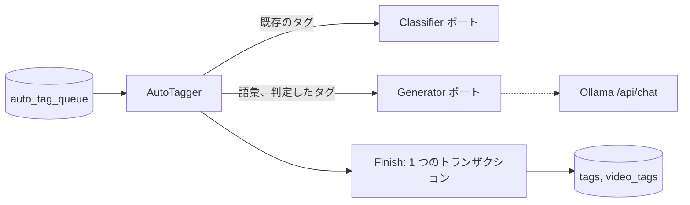
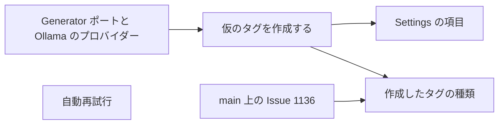

# 実装計画: 自動タグ付けの間に AI がタグを作成する {#implementation-plan-tag-creation-by-the-ai-during-auto-tagging}

**ブランチ**: `feature/053-ai-tag-generation` | **親 Issue**: #1138

**入力**: 親 Issue。これがこの機能の仕様である。

## 概要 {#summary}

動画に自動タグ付けが実行されると、生成型の画像モデルが判定と同じ画像と事実を読み、その動画のタグを名付ける。既存のタグに一致する名前はそのタグを付け、新しい名前は種類付きの仮のタグになる。モデルには、タスクに依存しない新しい生成器のポートを通じて到達し、既定では `gemma4:e4b` を使う Ollama の `/api/chat` がそれを提供する。

図は、この機能の後の 1 つの自動タグ付けジョブを示す。



| 関心事 | 方針 |
| --- | --- |
| ポート | `app.Generator`: 事実、画像、指示、JSON Schema を受け取り、JSON を返す ([R-1](research.md#r-1-a-second-task-agnostic-port-for-generation)) |
| プロバイダー | `format` 付き、`num_ctx` 16384、推論なしの Ollama `/api/chat` ([R-2](research.md#r-2-the-ollama-provider-uses-apichat-with-a-vision-model)) |
| モデル | `ollama.generation_model`、既定は `gemma4:e4b`。接続テストは両方のモデルを確認する ([R-3](research.md#r-3-a-separate-generation-model-default-gemma4e4b)) |
| ジョブ | 判定し、次に生成し、次に 1 回の `Finish`。どのエラーもジョブを失敗させ、動画のタグを変えないままにする ([R-4](research.md#r-4-judging-and-creation-are-one-job-with-one-result)) |
| 再利用 | プロンプトに最大 500 個のタグ、その後に名前と同義語の完全一致の検索 ([R-5](research.md#r-5-reuse-comes-from-the-prompt-and-from-name-lookup)) |
| 種類 | 例とプリセットのヒント付きの種類の名前。スキーマが選択を制限する ([R-6](research.md#r-6-kinds-are-described-by-name-examples-and-preset-hints)) |
| 付け方 | 動画 1 本につき新しい仮のタグは最大 5 個。一致した確定済みのタグは提案されたタグとして ([R-7](research.md#r-7-how-a-returned-name-is-attached)) |
| 設定 | "Create new tags" は既定でオン、"Language for new tags" は `Japanese` ([R-8](research.md#r-8-settings-for-tag-creation)) |
| 失敗 | 10 分、1 時間、6 時間の後に 3 回の自動再試行 ([R-9](research.md#r-9-failed-jobs-retry-automatically-three-times)) |

要件 7 には変更が要らない: 作成したタグは通常の仮のタグなので、タグの画面、外部 API、MCP は今と同じようにそれを確定し、却下し、統合する。初期タグ (#1137) は通常の確定済みのタグなので、この機能はそれを待たない。初期タグが存在すれば、プロンプトの語彙に入る。

## 技術的な文脈 {#technical-context}

**正本の定義**:

| 項目 | 出典 |
| --- | --- |
| 境界、ストアの役割、コミットの後のイベント | [ARCHITECTURE.md](../../ARCHITECTURE.md)、[.golangci.yml](../../.golangci.yml) (depguard) |
| 分類器のポート、Ollama のプロバイダー、接続の設定 | [ai-layer.md](../../docs/design-docs/ai-layer.md) |
| 自動タグ付けのキュー、画像、事実、しきい値、Settings | [auto-tagging.md](../../docs/design-docs/auto-tagging.md) |
| 仮のタグ、却下した名前、`resolveTagNames` | [031 データモデル](../031-tentative-tags/data-model.md) |
| タグの種類 | `feature/051-tag-kinds` 上の [051 の計画](https://github.com/syudead/vv/blob/feature/051-tag-kinds/specs/051-tag-kinds/plan.md) (#1136) |
| 画面の API と生成コード | [api/openapi.yaml](../../api/openapi.yaml)、`task generate` |
| 画面と Web のテスト | [design-system.md](../../docs/design-docs/design-system.md)、[web-testing.md](../../docs/design-docs/web-testing.md)、[i18n.md](../../docs/design-docs/i18n.md) |
| 検査 | [Taskfile.yml](../../Taskfile.yml) (`task check`、`task check-docs`) |

**この機能に固有の文脈**:

- キューの再試行の列のためのマイグレーションが 1 つあり、入るときに番号を付ける ([data-model.md、Migration](data-model.md#migration))。
- 新しい Go や npm の依存はない: 今の `internal/ollama` と同じく、プロバイダーは素の HTTP である。
- 種類には、#1136 の `tag_kinds` と `tags.kind_id` が `main` にあることが必要である。最後の単位以外はそれなしで動き、最後の単位は #1136 が `main` にマージされ、`main` が feature ブランチにマージされるのを待つ。
- CPU での `gemma4:e4b` の動画 1 本あたりの時間は測っていない。試行は Workers AI 上の `gemma-4-26b-a4b-it` を使った。[quickstart.md](quickstart.md) がそれを測る。

## 憲章の確認 {#constitution-check}

| 規則 (出典) | 判定 |
| --- | --- |
| `internal/app` はプロバイダーを import しない。アダプターは互いを import しない (ARCHITECTURE.md、depguard) | 合格: `app.Generator` は `internal/app` で宣言し、`internal/ollama` がそれを実装し、`cmd/mdm` が配線する。値は `domain.GeneratorRequest` として境界を越える |
| ドメインが決め、ストアが強制する (ARCHITECTURE.md) | 合格: プロンプト、スキーマ、解析、5 個の上限、再試行の遅延は `internal/domain` の純粋関数である。`Finish` は自分のトランザクションの中でタグ、種類、却下した名前を読み直す |
| ストアの役割: どの役割も別の役割の公開メソッドを呼ばない (ARCHITECTURE.md) | 合格: `AutoTagStore.Finish` は、`TagStore` が使うパッケージ非公開の `resolveTagNames` を通じて、自分のトランザクションの中でタグを作成する |
| イベントはコミットの後 (ARCHITECTURE.md) | 合格: `Finish` は今と同じく、コミットの後に `AutoTagApplied` を発行する |
| ユーザーデータは作り直しを越えて残る (ARCHITECTURE.md) | 合格: キューの新しい列は作り直せる。作成したタグは、どのタグとも同じキーを持つユーザーデータである |
| サーバーは保存した接続にだけ要求を送る (ai-layer.md) | 合格: 分類器と同じく、生成器は呼び出しのたびに保存した URL を読む |
| 生成ファイルを手で編集しない (AGENTS.md) | 合格: `api/openapi.yaml` を変え、その後に `task generate` を実行する |
| 複雑度は 25 以下、コードを写さない (AGENTS.md) | 合格: 名前の解決は `resolveTagNames` を再利用する。POST と Ollama のエラー処理は `Classifier.post` から取り出し、`internal/ollama` の両方の呼び出しで共有する |

違反はないので、複雑さの記録はない。

## プロジェクトの構成 {#project-structure}

### 文書 (この機能) {#documentation-this-feature}

```text
specs/053-ai-tag-generation/
├── plan.md
├── research.md
├── data-model.md
├── quickstart.md
└── contracts/
    └── screen-api.md
```

親 Issue には `ui` ラベルがないので、`ui-design.md` はない。Settings の項目は、既存の Auto-tagging と Ollama のセクションに従う。

### ソースコード {#source-code}

**影響する境界**:

| 境界 | この機能で持つもの |
| --- | --- |
| `internal/domain` | `GeneratorRequest`、プロンプトとスキーマ、提案の解析、新しい設定、再試行の遅延 |
| `internal/app` | `Generator`。`AutoTagger` は判定の後に生成を実行する |
| `internal/ollama` | `/api/chat` の生成器と、2 つのモデルの接続テスト |
| `internal/store` | マイグレーション、`Claim` と `Fail` での再試行、語彙の読み取り、`Finish` での提案、新しい設定のキー |
| `internal/httpapi`、`api/openapi.yaml` | 設定の項目 |
| `web/src/settings`、`web/src/i18n` | Auto-tagging と Ollama のセクション |
| `cmd/mdm` | 生成器の配線 |
| `scripts/clefrelay` | Workers AI への `/api/chat` の中継 |
| `docs/design-docs` | `ai-layer.md`、`auto-tagging.md`。ARCHITECTURE.md のサブシステムの地図 |

**新しいパス**: `internal/app/generator.go`、`internal/domain/generator.go`、`internal/domain/auto_tag_generation.go`、`internal/ollama/generator.go`、`internal/store/migrations/000NN_auto_tag_retry.sql`。

**構成の判断**: 1 つのジョブが両方の結果を運ぶので、生成は新しいユースケースではなく `AutoTagger` とそのキューの中にとどめる ([R-4](research.md#r-4-judging-and-creation-are-one-job-with-one-result))。

## 実装作業 {#implementation-work}

図は、どの単位が先に入る必要があるかを示す。



### 生成器のポートとその Ollama のプロバイダーを加える {#add-a-generator-port-and-its-ollama-provider}

**範囲**: `domain.GeneratorRequest`、`app.Generator`、`internal/ollama` の `/api/chat` の実装、`ollama.generation_model` と Ollama の設定 API の `generationModel`、2 つのモデルの接続テスト、`scripts/clefrelay` の `/api/chat` の中継、`ai-layer.md` ([R-1](research.md#r-1-a-second-task-agnostic-port-for-generation)–[R-3](research.md#r-3-a-separate-generation-model-default-gemma4e4b)、[contracts/screen-api.md](contracts/screen-api.md))。

**依存**: なし

**受け入れ**: `task check` が通る。偽のサーバーに対する `internal/ollama` のテストが、要求が画像、`format`、`num_ctx` 16384、`think: false` を運ぶことと、Ollama のエラーの文言が返ることを示す。生成モデルだけがないとき、接続テストは利用できないと答え、生成モデルを名指しする。何も保存されていないとき、`GET /api/settings/ollama` は `generationModel: "gemma4:e4b"` を返す。

### 自動タグ付けの間に動画から仮のタグを作成する {#create-tentative-tags-from-the-video-during-auto-tagging}

**範囲**: `internal/domain` のプロンプト、スキーマ、解析。語彙の読み取り。判定の後に、判定する候補がないときにも、生成器に問い合わせる `AutoTagger`。種類なしで R-7 の表に従って提案を付ける `Finish`。`auto_tag.create_tags`、`auto_tag.tag_language` とその API の項目。`auto-tagging.md` と ARCHITECTURE.md のサブシステムの地図 ([R-4](research.md#r-4-judging-and-creation-are-one-job-with-one-result)、[R-5](research.md#r-5-reuse-comes-from-the-prompt-and-from-name-lookup)、[R-7](research.md#r-7-how-a-returned-name-is-attached)、[R-8](research.md#r-8-settings-for-tag-creation)、[data-model.md、Rules](data-model.md#rules))。

**依存**: 生成器のポートとその Ollama のプロバイダーを加える

**受け入れ**: `task check` が通る。偽の生成器を使うアプリのテストが、受け入れ条件 1 (タグのない動画が仮のタグを得る)、2 (返された `猫` が既存の `猫` を付け、プロンプトがそれを挙げる)、3 (却下した名前は再実行で作成されない)、4 (`createTags` がオフのとき生成器は呼ばれない) を示し、生成器のエラーか不正な JSON が、動画のタグを変えずにジョブを失敗させることを示す。ストアのテストが、R-7 の表を 1 行ずつ、5 個の上限、不正な名前が捨てられること、2 つのジョブが同じ新しい名前を提案すると 1 つのタグが作成されることを示す。

### 失敗した自動タグ付けのジョブを自動で再試行する {#retry-failed-auto-tagging-jobs-automatically}

**範囲**: マイグレーション、`Fail`、`Claim`、`queue` でのリセット、ワーカーが最も早い再試行を待つこと、`auto-tagging.md` の Failures のセクション ([R-9](research.md#r-9-failed-jobs-retry-automatically-three-times)、[data-model.md、`auto_tag_queue`](data-model.md#auto_tag_queue))。

**依存**: なし

**受け入れ**: `task check` が通る。ストアのテストが、10 分、1 時間、6 時間の遅延、3 回目の後は再試行しないこと、トリガーが `attempts` をリセットすること、マイグレーションより前からある `failed` の行は取得されないことを示す。アプリのテストが、再試行の時刻が過ぎると、起こされなくてもワーカーがその再試行を取得することを示す。

### タグの作成と生成モデルを Settings に表示する {#show-tag-creation-and-the-generation-model-in-settings}

**範囲**: Auto-tagging のセクションの "Create new tags" と "Language for new tags"、Ollama のセクションの "Generation model"、およびそのカタログの文言 ([contracts/screen-api.md](contracts/screen-api.md))。

**依存**: 自動タグ付けの間に動画から仮のタグを作成する

**受け入れ**: `task check` が通る。ページテストが、両方のセクションが新しい項目を読み込んで保存することと、空の言語がサーバーのメッセージを表示することを示す。実装は両方のセクションの目視での確認を負う。

### 自動タグ付けが作成したタグに種類を付ける {#give-tags-created-by-auto-tagging-a-kind}

**範囲**: プロンプトの種類とその例とヒント、スキーマの `kind` の列挙、`Finish` が作成するタグの `kind_id` ([R-6](research.md#r-6-kinds-are-described-by-name-examples-and-preset-hints))。

**依存**: 自動タグ付けの間に動画から仮のタグを作成する。#1136 が `main` にマージされ、`main` が feature ブランチにマージされていること

**受け入れ**: `task check` が通る。ドメインのテストが、プリセットのヒントは初期の名前のままの種類にだけプロンプトが挙げることを示す。ストアのテストが、作成したタグが選ばれた種類を得ること、`Finish` より前に削除された種類はタグを種類なしにすること、既存のタグの種類は変わらないことを示す。
