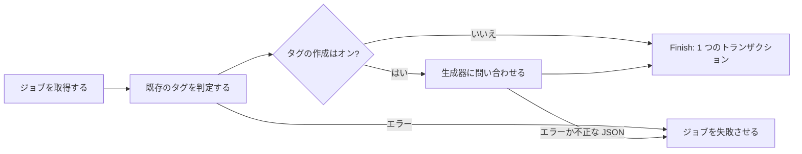
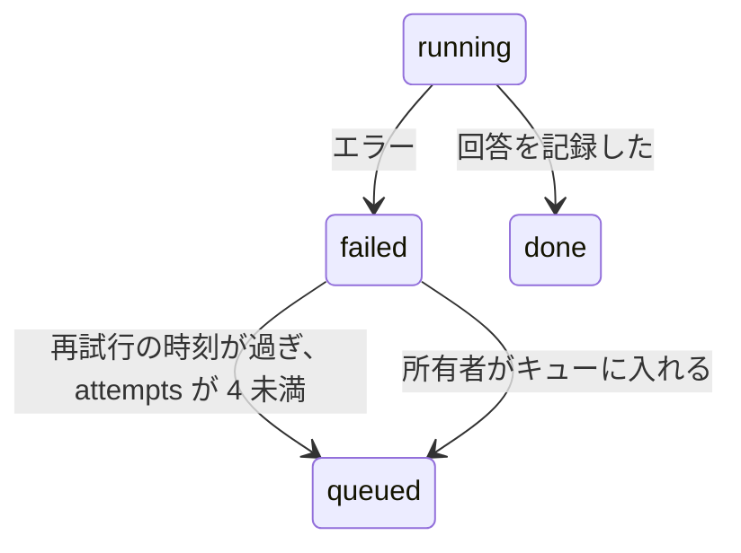

# 調査: 自動タグ付けの間に AI がタグを作成する {#research-tag-creation-by-the-ai-during-auto-tagging}

引き継ぐ決定: 分類器のポートと Ollama のプロバイダー ([ai-layer.md](../../docs/design-docs/ai-layer.md))。自動タグ付けのキュー、画像、事実 ([auto-tagging.md](../../docs/design-docs/auto-tagging.md))。仮のタグと却下した名前 ([031 データモデル](../031-tentative-tags/data-model.md))。タグの種類 (`feature/051-tag-kinds` 上の [051 データモデル](https://github.com/syudead/vv/blob/feature/051-tag-kinds/specs/051-tag-kinds/data-model.md))。このファイルは、この機能が加える決定だけを記録する。

## R-1: 生成のための、タスクに依存しない 2 つ目のポート {#r-1-a-second-task-agnostic-port-for-generation}

**決定**: `internal/app` は `Generator` を宣言する。これは分類器と同じ事実と画像に加えて、指示、プロンプト、JSON Schema を受け取り、スキーマに合う 1 つの JSON 文書を返す。機能がそれを解析する。

| 案 | 判定 |
| --- | --- |
| **JSON Schema を使う `app.Generator`** | 採用 |
| `app.Classifier` に名前を尋ねる | 不採用: Clef は与えられた選択肢ごとに確率を返し、名前を書けない ([auto-tagging.md、Tags it adds](../../docs/design-docs/auto-tagging.md#tags-it-adds)) |
| タグ向けの形のポート (`SuggestTags(video) []Tag`) | 不採用: プロバイダーがタグのプロンプトと規則を持つことになり、生成型のモデルを使う 2 つ目の機能には別のポートが要り、[ai-layer.md](../../docs/design-docs/ai-layer.md) の分担に反する |
| 機能が解析する自由なテキスト | 不採用: 下の試行では、スキーマを与えるとどのモデルも有効な JSON を返した。自由なテキストには、拒否の基準になる形がない |

**理由**: このポートは分類器のポートの規則を保つ: 機能が文言と意味を持ち、プロバイダーが通信と制限を持つ。事実と画像が同じなので、入力の型 `domain.ClassifierInput` をそのまま再利用する。

## R-2: Ollama のプロバイダーは画像モデルとともに `/api/chat` を使う {#r-2-the-ollama-provider-uses-apichat-with-a-vision-model}

**決定**: `internal/ollama` は、Ollama ネイティブの `POST /api/chat` で `Generator` を実装する: ユーザーメッセージに画像、`format` にスキーマ、`stream: false`、`think: false`、`options.num_ctx: 16384`、分類器と同じ 10 分のタイムアウトと `keep_alive`。

| 案 | 判定 |
| --- | --- |
| **Ollama `/api/chat`** | 採用 |
| Ollama の OpenAI 互換の `/v1/chat/completions` | 不採用: `num_ctx` がなく、Ollama の既定のコンテキストでは 9 枚の画像と最大 500 個のタグの名前 (R-5) のプロンプトが切れる |
| 製品のプロバイダーとしての Cloudflare Workers AI | 不採用: 所有者の動画のフレームがそのネットワークの外に出ることになり、vv のプロバイダーはセルフホストである。Ollama のないコンテナは下の開発用の中継で賄う |
| 推論をオン (`think` を省略) | 不採用: CPU だけのマシンでは推論のトークンがどれも時間を食い、試行では推論を最低にして使える回答を得た |

**理由**: 画像、JSON Schema、コンテキストのサイズをまとめて受け取る Ollama のルートは `/api/chat` だけである。`scripts/clefrelay` に `/api/chat` から Workers AI のチャット補完への中継を加えるので、Ollama のないコンテナでも、今の判定と同じようにこの機能を実行できる。

## R-3: 別の生成モデル、既定は `gemma4:e4b` {#r-3-a-separate-generation-model-default-gemma4e4b}

**決定**: Ollama の接続に、判定のモデルと並べて `ollama.generation_model` (既定は `gemma4:e4b`) を加える。接続テストは両方のモデルが存在することを確認し、ないものをそれぞれ名指しする。

| 案 | 判定 |
| --- | --- |
| **別の設定、`gemma4:e4b`** | 採用 |
| 判定と生成で 1 つのモデル | 不採用: Clef は生成できず、汎用のモデルはしきい値のための較正された確率を出さない |
| `gemma4:26b` (試行のモデル) | 既定としては不採用: 16–19 GB は、64 個の質問で Clef-flash をすでに保持できなかった 15 GB の CPU マシンに収まらない ([ai-layer.md](../../docs/design-docs/ai-layer.md#ollama-provider))。所有者はこれを設定してよい |
| 接続テストは判定のモデルだけを確認する | 不採用: タグの作成は既定でオン (R-8) なので、テストが通った後にすべての動画が失敗することになる |

**理由**: `gemma4:e4b` はテキストと画像を受け取り、128K のコンテキストを持ち、6.6–9.5 GB である。Workers AI にはないので、その品質と CPU での時間は試行ではなく [quickstart.md](quickstart.md) で測る。

試行は 2026-10-15 に Workers AI を通じて、生成した 3 枚の写真 (ソファの上の猫とコーヒー、砂漠でのロケットの打ち上げ、雪山の 2 人のハイカー)、`{name, kind}` の項目のスキーマ、R-5 と R-6 のプロンプトで実行した。

| モデル | 秒数 | `猫` と `雪山` を再利用した | 却下した名前を返した |
| --- | --- | --- | --- |
| `gemma-4-26b-a4b-it` | 18–26 | はい | いいえ |
| `mistral-small-3.1-24b-instruct` | 3–13 | はい | はい (`寝る`) |
| `llama-4-scout-17b-16e-instruct` | 3–7 | `猫` (尋ねたのはそれだけ) | 尋ねていない。`ソファ` を `ソフィ` と誤記した |

## R-4: 判定と作成は、1 つの結果を持つ 1 つのジョブである {#r-4-judging-and-creation-are-one-job-with-one-result}

**決定**: ワーカーは既存のタグを判定し、次に判定したタグを文脈として生成器に問い合わせ、`Finish` が両方の結果を 1 つのトランザクションで書く。どちらかの段階のエラーはジョブ全体を失敗させ、どのタグも変えない。

| 案 | 判定 |
| --- | --- |
| **1 つのジョブ、判定してから生成する** | 採用 |
| 生成のための 2 つ目のキュー | 不採用: 動画 1 本につき 2 行、2 つの失敗の状態になり、生成器は判定が加えたタグを知らないことになる |
| 先に生成し、後で判定する | 不採用: 動画にすでに何があるかを生成器に伝えられないので、生成器は同じものを再び名付けることになる |
| 生成が失敗したとき判定の結果を残す | 不採用: エッジケースは、AI のエラーで動画のタグが変わらないことを求める |

**理由**: 1 つの行なら、キューの状態と Settings の件数は今のままで、生成器は判定が選んだばかりのタグを見る。

## R-5: 再利用はプロンプトと名前の検索から得る {#r-5-reuse-comes-from-the-prompt-and-from-name-lookup}

**決定**: プロンプトは、判定がその動画に選んだタグを挙げ、次にほかのタグを最大 500 個 (確定済みを仮より先に、次に動画の数の順、次に名前の順で)、その同義語と種類とともに挙げ、最も新しく却下した名前を最大 200 個挙げる。返されたどの名前もその後にタグの名前と同義語で解決するので、タグに一致する名前はそのタグを付ける。

| 案 | 判定 |
| --- | --- |
| **プロンプトの 500 個の語彙と完全一致の検索** | 採用 |
| すべてのタグをプロンプトに入れる | 不採用: タグの画面は 30,000 個のタグを想定して作られており ([036 の計画](../036-tag-admin-scale/plan.md))、それは約 300,000 トークンで、`num_ctx` (R-2) を超える |
| 似たタグの埋め込み検索 | 不採用: 所有者が 1 回の操作で統合できる重複 (要件 7) のために、2 つ目のモデルとインデックスが要る |
| 検索だけで語彙なし | 不採用: 検索は完全一致なので、`ねこ` は `猫` を見つけない (受け入れ条件 2) |

**理由**: 試行では、どのモデルも新しい表記ではなく、挙げた `猫` と `雪山` を返した。初期タグ (#1137) は確定済みのタグなので、仮のタグより上に並ぶ。500 個の外にあるタグとほぼ重複する名前は、所有者が統合する仮のタグになる。

## R-6: 種類は名前、例、プリセットのヒントで説明する {#r-6-kinds-are-described-by-name-examples-and-preset-hints}

**決定**: プロンプトはすべての種類を、その種類のタグを例として最大 5 個添えて挙げ、名前がまだ `Genre`、`Work`、`Place`、`Character` のいずれかである種類には固定の英語のヒントを加える。スキーマは `kind` を種類の名前に制限し、`Finish` より前に削除された種類はタグを種類なしにする。

| 案 | 判定 |
| --- | --- |
| **名前、例、プリセットのヒント** | 採用 |
| 種類の名前だけ | 不採用: 試行では、`mistral-small` は `猫` を `Character`、`コーヒー` を `Work`、`ソファ` を `Place` に入れた。ヒントがあると `Genre`、`Genre`、`Genre` を選んだ |
| `tag_kinds` に保存するヒント | 不採用: 051 は種類を名前だけに保ち ([051 R-7](https://github.com/syudead/vv/blob/feature/051-tag-kinds/specs/051-tag-kinds/research.md#r-7-a-kind-has-a-name-and-nothing-else))、ヒントはプロンプトの文言にすぎない |

## R-7: 返された名前の付け方 {#r-7-how-a-returned-name-is-attached}

**決定**: 返された各名前が何をするかは表が決める。新しいタグは動画 1 本につき、モデルの順で最大 5 個作成し、プロンプトは最大 10 個の名前を求める。

| 返された名前 | 結果 |
| --- | --- |
| `NormalizeTagName` を通らない | 捨てる (エッジケース) |
| `rejected_tag_names` にある | 捨てる (要件 5) |
| 仮のタグに一致する | そのタグを通常のタグとして付ける |
| この動画で却下された確定済みのタグに一致する | 捨てる ([auto-tagging.md、Tags it adds](../../docs/design-docs/auto-tagging.md#tags-it-adds)) |
| 動画に付いていない確定済みのタグに一致する | そのタグを提案されたタグとして付ける |
| 動画にすでに付いているタグに一致する | 何も変わらない |
| 新しく、最初の 5 個の新しい名前に入る | 選ばれた種類の仮のタグを作り、通常のタグとして付ける |
| 新しく、5 個の後 | 捨てる (エッジケース) |

| 案 | 判定 |
| --- | --- |
| **仮のタグは通常のタグとして、確定済みのタグは提案されたタグとして付ける** | 採用 |
| 新しいタグを提案されたタグとして付ける | 不採用: タグ自体の仮の状態がすでに確認を求めており、1 つのチップの 2 つの印は同じことを意味する |
| 確定済みのタグを通常のタグとして付ける | 不採用: 判定はそのタグをすでに "Probability to suggest" より下と採点したか、尋ねていないので、生成器だけでは確認なしに加えるのに足りない |
| 動画 1 本につき 10 個の新しいタグ | 不採用: 新しいタグはどれも確認の項目になる。試行のモデルは 3 個から 8 個の名前を返し、主題、動作、場所を最初の 5 個の中に入れた |

**理由**: 判定は仮のタグについて尋ねないので、生成器がなければ、仮のタグはそれを作成した 1 本の動画に付いたままになる。名前の解決はストアの `resolveTagNames` を使う。これはすでに仮のタグを作成し、却下した名前を飛ばし、検索と同じトランザクションの中で動く ([031 R-6](../031-tentative-tags/research.md#r-6-rejection-and-a-tentative-attach-of-the-same-name-rely-on-sqlite-write-serialization)) ので、同じ新しいタグを名付けた 2 本の動画は 1 つのタグを得る。

## R-8: タグの作成の設定 {#r-8-settings-for-tag-creation}

**決定**: Auto-tagging のセクションに "Create new tags" (既定でオン) と "Language for new tags" (最大 40 文字の自由なテキスト、既定は `Japanese`) を加え、`auto_tag.create_tags` と `auto_tag.tag_language` として保存する。

| 案 | 判定 |
| --- | --- |
| **既定でオンのスイッチ、言語の設定** | 採用 |
| 既定でオフのスイッチ | 不採用: 要件 1 は、自動タグ付けがオンのとき作成を自動タグ付けの一部にし、自動タグ付け自体は既定でオフである |
| 既存のタグから言語を決める | 不採用: 受け入れ条件 1 はタグのない状態から始まる |
| 画面から言語を決める | 不採用: 画面は英語だけで、言語の選択はない ([i18n.md](../../docs/design-docs/i18n.md)) |

## R-9: 失敗したジョブは自動で 3 回再試行する {#r-9-failed-jobs-retry-automatically-three-times}

**決定**: 失敗したジョブは 10 分、1 時間、6 時間の後にキューに戻る。3 回目の再試行が失敗した後は、所有者がキューに入れるまで `failed` のままである。

| 案 | 判定 |
| --- | --- |
| **時刻を決めた 3 回の再試行** | 採用 |
| 自動の再試行なし (今) | 不採用: エッジケースは後での再試行を求める |
| 成功するまで再試行する | 不採用: Ollama が止まっていると、すべての動画が間隔ごとにいつまでも送り直される |

**理由**: 所有者が動画をキューに入れるとその試行回数がリセットされるので、Settings のボタンは意味を保つ。
