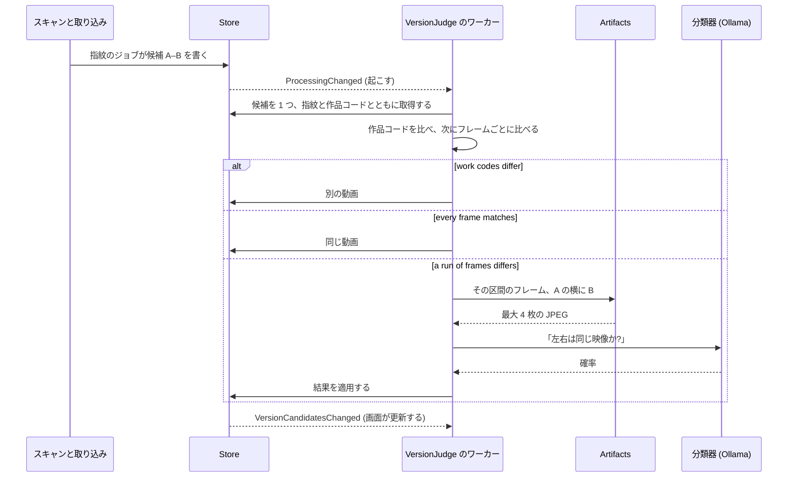
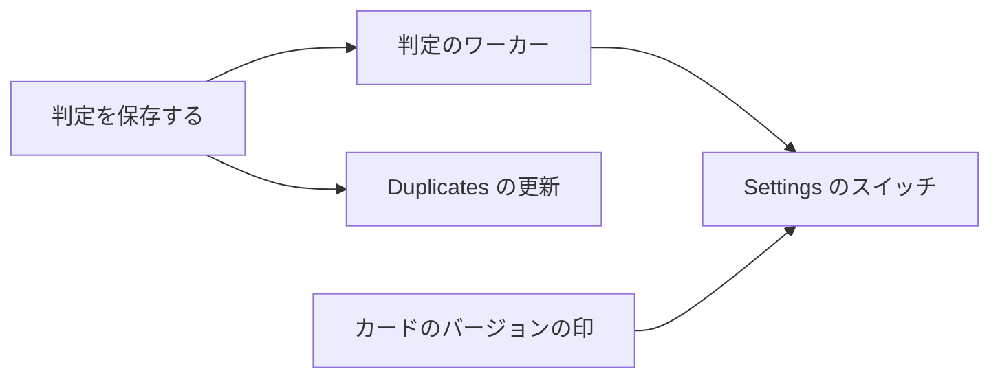

# 実装計画: 重複の候補を自動で判定し、同じものをまとめる {#implementation-plan-judging-possible-duplicates-automatically-and-bundling-the-same-ones}

**ブランチ**: `feature/054-auto-dup` | **親 Issue**: #1141

**入力**: 親 Issue。これがこの機能の仕様である。

## 概要 {#summary}

重複の候補はそれぞれ、まず保存済みの情報から判定する。2 つの作品コードが異なれば別の動画であり、次に 2 つの指紋で決める: すべてのフレームが一致すれば、AI へのリクエストなしで組をまとめる。フレームが続けて異なる区間があれば、そのフレームを横に並べて分類器のポートに見せ、同じ映像かを問う。「同じ動画」なら所有者がまとめるのと同じように組をまとめ、「別の動画」なら退け、それ以外は Duplicates のページに残る。動画のカードにはバージョンの印が付き、その印は一覧の項目が新たに持つ `versions` の要約から読む。

| 関心事 | 方針 |
| --- | --- |
| 作品コード | 2 つの異なる作品コードか外部 ID は、リクエストなしで「別」 ([R-12](research.md#r-12-different-work-codes-dismiss-a-pair-without-the-model)) |
| 最初の判定 | フレームごとの指紋の距離。すべて一致すれば、リクエストなしで「同じ」 ([R-1](research.md#r-1-the-fingerprints-decide-first-the-model-is-asked-only-when-a-section-differs)) |
| AI への入力 | 続けて異なるフレームの区間から最大 4 枚の画像、A の横に B。事実はなし ([R-2](research.md#r-2-the-model-sees-the-frames-where-the-two-files-differ)、[R-11](research.md#r-11-the-request-carries-no-file-names)) |
| AI の判定 | 0.8 以上で同じ、0.2 以下で別、固定 ([R-3](research.md#r-3-the-question-wording-and-two-fixed-thresholds)) |
| キュー | 候補の行にある判定の列。判定が null の候補が待つ ([R-4](research.md#r-4-the-judgement-is-columns-on-the-candidate-row)) |
| AI への接続がない | 規則はそのまま動く。モデルが要る組は、所有者が Ollama の接続を保存するまで、問われずに待つ ([R-13](research.md#r-13-the-model-is-asked-only-once-the-owner-has-saved-a-connection)) |
| 失敗 | 10 分、1 時間、6 時間の後に再試行し、その後は毎日 ([R-5](research.md#r-5-a-failed-judgement-retries-on-a-backoff-that-never-ends)) |
| 衝突 | 退けた組か、まとまりから外した組をまたぐまとめはしない ([R-6](research.md#r-6-a-same-pair-joins-two-sides-unless-a-pair-across-them-is-known-to-differ)) |
| 代表 | まとまりの代表。なければ所有者のデータを持つ方、次に再生できること、音声、画素、ビットレート ([R-7](research.md#r-7-the-representative-keeps-the-owners-data-then-plays-best)) |
| バージョンを外す | 組を記録し、二度と判定せず、候補を作り直す ([R-8](research.md#r-8-removing-a-version-records-the-pairs-and-rebuilds-its-candidates)) |
| カードの印 | 画面の API のすべての `Video` に `versions`、ページごとに 1 つのクエリ ([R-9](research.md#r-9-list-items-carry-the-existing-versions-summary-read-per-page)) |
| Duplicates のページ | 新しい `candidates` の通知で取得し直す ([R-10](research.md#r-10-the-duplicates-page-refreshes-on-a-candidates-notification)) |

## 仕組み {#how-it-works}

判定は既存の取り込みの後に、それと並んで動き、候補の見つけ方は何も変えない。シーケンス図は、1 つの候補がスキャンから結果に至るまでを示す。



1. **候補は今と同じように現れる。** 取り込みの `fingerprint` ジョブが、新しい動画の指紋をほかの動画の指紋と比べ、フレームの距離の中央値が 12 以下のときに `video_version_candidates` に行を書く (030)。この行は今後、判定が null の状態で始まり、null は「待っている」を意味する。
2. **ワーカーが起きる。** `app.VersionJudge` は、`AutoTagger` と同じく `cmd/mdm` で起動する 1 つの goroutine である。起動時、ジョブが終わったとき (`ProcessingChanged`)、候補が変わったとき、設定が保存されたときに起きる。設定がオフの間は何もしない。
3. **候補を 1 つ取得する。** ストアは、待っている候補のうち最も古いもの、または再試行の時刻を過ぎた失敗した候補を選ぶ。所有者がバージョンから外した組は飛ばし、選んだ候補を `running` にして、両方の指紋と、両方の動画の作品コードと外部 ID を返す。
4. **作品情報を確かめる。** 所有者か作品情報プラグインが両方の動画に作品コードを与えていて、そのコードが異なるとき、または同じ取得元の外部 ID が異なるとき、組は別の動画であり、それ以上は何も問わない。1 つの作品が完全版とカット版で出ることがあるので、コードが等しくても何も決めない。
5. **指紋をフレームごとに比べる。** 指紋は、シーク用プレビューの最大 81 フレームのそれぞれについてハッシュを持つ。フレームは候補の確認と同じように時刻で組にし、組の距離が 12 を超えるとその組は異なる。候補の確認が使う中央値は差し替えた区間を隠すが、フレームごとの一覧はそれを示す。

| フレーム | 結果 | リクエスト |
| --- | --- | --- |
| 異なるのが 5% 以下で、2 枚続けて異なることはない | 同じ動画 | なし |
| 2 枚以上続けて異なる | そうした区間のうち最も長いものをモデルに送る | 1 回 |

6. **異なる区間があれば、モデルが設定されている場合にモデルに問う。** 所有者が Settings で Ollama の接続を一度も保存していないとき、ワーカーは何も送らない: 組は `no_connection` になり、接続が保存されるまで Duplicates で待つ。接続の保存はワーカーを起こす。そうでなければ: `internal/artifacts` が、各シーク用プレビューからその区間のフレームを最大 4 枚切り出し、A のフレームと B のフレームを横に並べて 1 枚の JPEG にする。ffmpeg は動かず、メディアファイルも開かない。画像と質問は、自動タグ付けが使うポートである `app.Classifier` に送り、答えは確率である: 0.8 以上は同じ、0.2 以下は別である。
7. **ストアが結果を 1 つのトランザクションで適用する。**

| 結果 | ストアがすること | 所有者に見えるもの |
| --- | --- | --- |
| 同じ (すべてのフレーム、または 0.8 以上) | `VersionStore.Bundle` の手順で A と B をまとめる。代表は、一方がまとまりにあればそのまとまりの代表、なければ所有者のタグなどのデータを持つ方、次にブラウザーで再生できる方、音がある方、画素が多い方、ビットレートが高い方 | バージョンの印付きの 1 枚のカード |
| 別 (作品コード、または 0.2 以下) | Duplicates のページのボタンと同じように、「別の動画」として退けた組を書く | 組が Duplicates から消える |
| 0.2 と 0.8 の間 | 候補を `undecided` にする。二度と問わない | 組が Duplicates に残る |
| Ollama の接続が保存されていない | `no_connection` にする。リクエストは送らない | 組が Duplicates に残る。Settings は接続を待っている組の数を示す |
| 答えがないか、エラー | `failed` にし、再試行の時刻を決める: 10 分、1 時間、6 時間、その後は毎日 | 再試行で決まるまで、組が Duplicates に残る |

所有者が別だとした 2 つの動画を 1 つのまとまりに入れることになる「同じ」は、代わりに `undecided` として保存する。

**試行で分かったこと。** 合成の動画では、解像度を半分にして再エンコードしたものはすべてのフレームで一致し (距離 0 から 4)、リクエストなしでまとめられる。8 秒から 11 秒を差し替えたコピーも中央値は 0 だったので、今も候補になる。その異なる 4 フレームをモデルに見せると、`clef` では 0.06、既定の `clef-flash` では 0.08 で、どちらのモデルでも退けられる。

**バージョンを外す。** 動画ページの "Remove from versions" は、外した動画を残りの各メンバーと組にして `video_version_unbundles` に記録し、その候補を作り直す。そのため組は Duplicates に戻り、ワーカーはそれ以降その組を飛ばす。

**カードの印。** 一覧の応答は、動画ページがすでに受け取る `versions` の要約を、ページ全体の分を 1 つのクエリで入れる。カードは、それがあるときに小さな印を示す。

各選択の理由と代わりの案は [research.md](research.md) にあり、テーブルと規則は [data-model.md](data-model.md) にある。

## 技術的な文脈 {#technical-context}

**正本の定義**:

| 項目 | 出典 |
| --- | --- |
| 境界、ストアの役割、コミットの後のイベント | [ARCHITECTURE.md](../../ARCHITECTURE.md)、[.golangci.yml](../../.golangci.yml) (depguard) |
| 指紋、候補、退けた組、まとまり、`Unbundle` | [030 データモデル](../030-video-versions/data-model.md)、[030 の調査](../030-video-versions/research.md) |
| 分類器のポート、Ollama のプロバイダとその設定 | [ai-layer.md](../../docs/design-docs/ai-layer.md) |
| キューと単一のワーカーの形、モデルの入力としてのシーク用のフレーム | [auto-tagging.md](../../docs/design-docs/auto-tagging.md) |
| 画面の API と生成コード | [api/openapi.yaml](../../api/openapi.yaml)、`task generate` |
| 画面と Web のテスト | [design-system.md](../../docs/design-docs/design-system.md)、[web-testing.md](../../docs/design-docs/web-testing.md)、[i18n.md](../../docs/design-docs/i18n.md) |
| 検査 | [Taskfile.yml](../../Taskfile.yml) (`task check`、`task check-docs`) |

**この機能に固有の文脈**: しきい値は合成の試行に基づき、[クイックスタート](quickstart.md) は最後の単位がマージされる前に、それを実際のファイルで繰り返す。ほかの feature ブランチもマイグレーションを加えるので、マイグレーションは、その単位を書く時点の `main` の次の番号を取る。

## 憲章の確認 {#constitution-check}

ARCHITECTURE.md と AGENTS.md に照らして確認した。この設計が拠る規則は次のとおりである:

| 規則 | 設計がそれを満たす方法 |
| --- | --- |
| ドメインが決め、ストアが強制する | フレームの規則、しきい値、衝突の確認、代表、再試行の時刻は `internal/domain` にある。ストアはまとめるトランザクションの中で、メンバーと退けた組を読み直す |
| メディアフォルダのファイルを読むのはスキャンだけである | モデルが見るのは、データディレクトリにあるシーク用プレビューのフレームである |
| ユーザーデータは作り直しを越えて残る | `video_version_unbundles` は内容の鍵をキーとし、ユーザーデータとして一覧に載る |
| コードを写さない | 自動のまとめと退ける処理は、`VersionStore.Bundle` と `Dismiss` の手順を呼ぶ |

## プロジェクトの構成 {#project-structure}

### 文書 (この機能) {#documentation-this-feature}

```text
specs/054-auto-dup/
├── plan.md
├── research.md            # R-1..R-13
├── data-model.md          # Two tables, the rules, the setting
├── quickstart.md          # The real-model check
└── contracts/
    └── screen-api.md      # Video.versions on lists, the setting resource
```

`design` 段階が、カードの印と Settings のセクションのための `ui-design.md` を加える。

### ソースコード {#source-code}

**影響する境界**:

| パッケージ | 変更 |
| --- | --- |
| `internal/domain` | フレームごとの規則と異なる区間、判定、衝突の確認、代表の選択、再試行の時刻 |
| `internal/store` | マイグレーション、判定の取得と結果、`VersionCandidatesChanged`、`Unbundle`、引き継ぎでのキーの付け替え、設定、一覧の動画の `versions` |
| `internal/artifacts` | 2 つのシーク用プレビューから、指定したフレームを横に並べた組 |
| `internal/app` | `VersionJudge`: 設定、ワーカー、起こす処理 |
| `internal/httpapi`、`api/openapi.yaml` | 設定のリソース。一覧の項目の `versions`。`candidates` の通知 |
| `cmd/mdm` | `events.go` でのワーカーとそれを起こす処理の配線 |
| `web/src/settings`、`web/src/videoList`、`web/src/versions` | Settings のセクション。カードの印。Duplicates のページの取得し直し |

**新しいパス**: `internal/app/version_judge.go`、`internal/store/version_judgements.go`、`docs/design-docs/duplicate-judging.md`。

**構成の判断**: ワーカーは `jobs` のジョブの種類ではなく、`AutoTagger` と並ぶ独自のユースケースである。判定は組についてのもので、ジョブのキューの取得と一意性の規則は動画ごとだからである。

## 実装作業 {#implementation-work}

図は、どの単位が先に入る必要があるかを示す。画面の単位は `design` 段階の `ui-design.md` も待つ。[クイックスタート](quickstart.md) の実際のモデルでの実行は、スイッチと印が要るので、最後の単位のものである。



### 重複の判定と、バージョンから外した組を保存する {#store-duplicate-judgements-and-the-pairs-removed-from-versions}

**範囲**: 候補の列と `video_version_unbundles` を持つマイグレーション。ドメインの規則 (衝突の確認、代表、再試行の時刻) と `VersionCandidatesChanged`。両方の指紋と作品コードを返すストアの取得、回復、衝突の確認付きの 3 つの結果。`version_judging.enabled` の設定の読み書き。組を記録して候補を作り直す `Unbundle`。`video_version_unbundles` のキーを付け替える引き継ぎ。ARCHITECTURE.md と running-vv.md のユーザーデータの一覧 ([data-model.md](data-model.md)、[R-4](research.md#r-4-the-judgement-is-columns-on-the-candidate-row) から [R-8](research.md#r-8-removing-a-version-records-the-pairs-and-rebuilds-its-candidates))。

**依存**: なし。

**受け入れ**: `task check` と `task check-docs` が通る。ストアのテストが次を示す: 「同じ」の結果は組を R-7 の代表でまとめ (タグを付けた 720p の動画は、新しい 1080p のコピーに対して代表のままである)、候補はなくなる。新しい動画とまとまりのメンバーについての「同じ」は、それをそのまとまりに加え、そのまとまりを分けて手作業でもう一度まとめた後でも加える。「別」は退けた組を書き、候補を取り除く。退けた組をまたぐ「同じ」は、候補を `undecided` のまま残す。`video_version_unbundles` にある組か `undecided` の組は取得されない。`failed` の行は、その `retry_at` の後にだけ取得され、その `attempts` は回復を越えて残る。`Unbundle` は組を書き、一致する候補はまた一覧に出る。各結果は `VersionCandidatesChanged` を発行する。

### 指紋と分類器で重複の候補を判定する {#judge-possible-duplicates-from-their-fingerprints-and-the-classifier}

**範囲**: `internal/domain` の作品コードの規則、フレームごとの規則、最も長い異なる区間。`internal/artifacts` の、指定したフレームを横に並べた組。`app.VersionJudge` (設定がオンの間 1 つずつ取得し、規則を適用し、異なる区間があるときだけ R-3 の質問をし、結果を適用し、次の `retry_at` まで待つ)。各組の規則の結果と確率を記すログの行。配線と起こす処理 (起動時、`ProcessingChanged`、`VersionCandidatesChanged`、設定の保存、Ollama の接続の保存)。接続の行がないときの `no_connection` の経路。索引からリンクする `docs/design-docs/duplicate-judging.md`。AI 層とサブシステムの地図の項目 ([R-1](research.md#r-1-the-fingerprints-decide-first-the-model-is-asked-only-when-a-section-differs) から [R-3](research.md#r-3-the-question-wording-and-two-fixed-thresholds)、[R-5](research.md#r-5-a-failed-judgement-retries-on-a-backoff-that-never-ends)、[R-11](research.md#r-11-the-request-carries-no-file-names)、[R-12](research.md#r-12-different-work-codes-dismiss-a-pair-without-the-model))。

**依存**: 重複の判定と、バージョンから外した組を保存する。

**受け入れ**: `task check` と `task check-docs` が通る。ドメインのテストが次を示す: 異なる作品コードは「別」で、等しいものは何も決めない。距離がすべて 12 以内なら「同じ」、20 枚のうち離れた 1 枚だけが異なってもまだ「同じ」、4 枚続けて異なればその区間を返す。偽の分類器を使うアプリのテストが次を示す: 一致する組は分類器を呼ばずにまとめ、異なる組は区間のフレームを送り、0.85 はまとめ、0.1 は退け、0.5 は候補を残し、エラーか質問のキーのない応答は再試行の時刻付きの `failed` の行にし、接続が保存されていないときにモデルが要る組は分類器を呼ばずに `no_connection` になって接続の保存の後に判定され、設定がオフの間は何も取得しない。artifacts のテストが、求めたフレームが 1 フレームの 2 倍の幅の JPEG として返ることを示す。

### 候補が判定されたら Duplicates のページを更新する {#refresh-the-duplicates-page-when-candidates-are-judged}

**範囲**: `VersionCandidatesChanged` のための `/api/events` の `candidates` の通知と、それで取得し直す Duplicates のページ ([contracts/screen-api.md、`GET /api/events`](contracts/screen-api.md#get-apievents-candidates)、[R-10](research.md#r-10-the-duplicates-page-refreshes-on-a-candidates-notification))。

**依存**: 重複の判定と、バージョンから外した組を保存する。

**受け入れ**: `task check` が通り、`task generate` で差分が出ない。ハンドラーのテストが、イベントが所有者のイベントの流れに `candidates` として届くことを示す。Web のテストが、開いている Duplicates のページが `candidates` で取得し直し、なくなった組を落とすことを示す。

### 動画のカードにバージョンの印を示す {#show-a-versions-mark-on-video-cards}

**範囲**: まとまりのメンバーについて画面の API のすべての `Video` に入れ、ページごとに 1 回読む `versions`。`api/openapi.yaml` の説明。`ui-design.md` に従ったカードと一覧の行の印。030 ui-design.md の置き換えられるカードの規則 ([contracts/screen-api.md、`Video` delta](contracts/screen-api.md#video-delta)、[R-9](research.md#r-9-list-items-carry-the-existing-versions-summary-read-per-page))。

**依存**: なし。

**受け入れ**: `task check` と `task check-docs` が通る。ストアのテストが、ライブラリ、動画の一覧、フォルダ、グループの読み取りが、まとまりの代表に `versions.count` 2 を与え、まとまっていない動画には何も与えないことを示す。`ui-design.md` の幅での見た目のレビューで、まとめた動画のライブラリ、検索、フォルダ、グループ、ホームのカードは印を示し、普通の動画のカードは示さない。

### 重複の自動判定を Settings でオンとオフにする {#turn-automatic-duplicate-judging-on-and-off-in-settings}

**範囲**: `GET` と `PUT /api/settings/version-judging`、ワーカーを起こす保存、`ui-design.md` に従った Settings のセクション ([contracts/screen-api.md](contracts/screen-api.md))。

**依存**: 指紋と分類器で重複の候補を判定する。動画のカードにバージョンの印を示す。

**受け入れ**: `task check` が通り、`task generate` で差分が出ない。ハンドラーのテストが次を示す: `GET` は保存の前には `enabled: false` を応答し、`PUT` は保存した値を `waitingForConnection` とともに応答し、所有者のセッションのないリクエストは `401 unauthenticated` を受け取る。Web のテストがスイッチの保存を示す。[クイックスタート](quickstart.md) のすべての行が既定の `clef-flash` で通り、PR は各組の規則の結果と確率を記録する。Settings のセクションが、`ui-design.md` の幅での見た目のレビューに通る。
