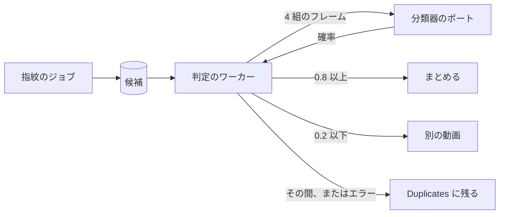
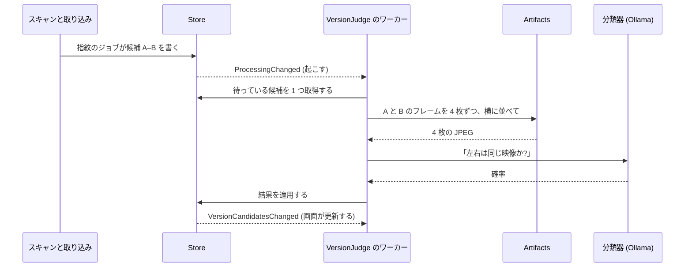
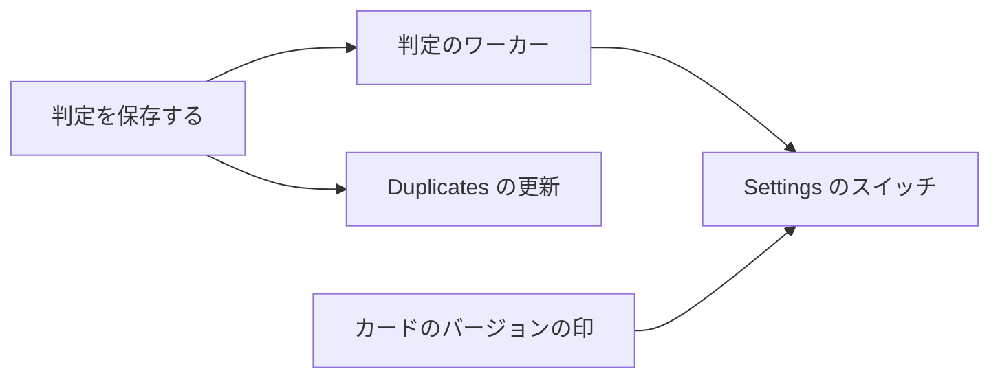

# 実装計画: 重複の候補を自動で判定し、同じものをまとめる {#implementation-plan-judging-possible-duplicates-automatically-and-bundling-the-same-ones}

**ブランチ**: `feature/054-auto-dup` | **親 Issue**: #1141

**入力**: 親 Issue。これがこの機能の仕様である。

## 概要 {#summary}

ワーカーは重複の候補ごとに、2 つのファイルが同じ映像を映しているかを分類器のポートに問う。「同じ動画」なら所有者がまとめるのと同じようにまとめ、「別の動画」なら退け、それ以外は Duplicates のページに残る。動画のカードにはバージョンの印が付き、その印は一覧の項目が新たに持つ `versions` の要約から読む。

図は、1 つの候補が指紋から結果に至るまでを示す。



| 関心事 | 方針 |
| --- | --- |
| モデル | `app.Classifier` を通した、はいかいいえの 1 つの質問 ([R-1](research.md#r-1-one-yesno-question-through-the-existing-classifier-port)) |
| 入力 | 4 枚の画像。それぞれ A のフレームの横に、同じ位置の B のフレームを置く ([R-2](research.md#r-2-the-images-are-four-side-by-side-frame-pairs)) |
| 判定 | 0.8 以上で同じ、0.2 以下で別、固定 ([R-3](research.md#r-3-the-question-wording-and-two-fixed-thresholds)) |
| キュー | 候補の行にある判定の列。判定が null の候補が待つ ([R-4](research.md#r-4-the-judgement-is-columns-on-the-candidate-row)) |
| 失敗 | 10 分、1 時間、6 時間の後に再試行し、その後は毎日 ([R-5](research.md#r-5-a-failed-judgement-retries-on-a-backoff-that-never-ends)) |
| 衝突 | 退けた組か、まとまりから外した組をまたぐまとめはしない ([R-6](research.md#r-6-a-same-pair-joins-two-sides-unless-a-pair-across-them-is-known-to-differ)) |
| 代表 | まとまりの代表、なければ画素の多い方 ([R-7](research.md#r-7-the-representative-is-the-bundles-else-the-larger-picture)) |
| バージョンを外す | 組を記録し、二度と判定せず、候補を作り直す ([R-8](research.md#r-8-removing-a-version-records-the-pairs-and-rebuilds-its-candidates)) |
| カードの印 | 画面の API のすべての `Video` に `versions`、ページごとに 1 つのクエリ ([R-9](research.md#r-9-list-items-carry-the-existing-versions-summary-read-per-page)) |
| Duplicates のページ | 新しい `candidates` の通知で取得し直す ([R-10](research.md#r-10-the-duplicates-page-refreshes-on-a-candidates-notification)) |
| モデル | `clef-flash` を既定のままにする。まとめるための `clef` を Settings が示す ([R-11](research.md#r-11-the-default-model-is-left-as-it-is-and-settings-names-the-one-that-bundles)) |

## 仕組み {#how-it-works}

判定は既存の取り込みの後に、それと並んで動き、候補の見つけ方は何も変えない。シーケンス図は、1 つの候補がスキャンから結果に至るまでを示す。



1. **候補は今と同じように現れる。** 取り込みの `fingerprint` ジョブが、新しい動画の指紋をほかの動画の指紋と比べ、`video_version_candidates` に行を書く (030)。この行は今後、判定が null の状態で始まり、null は「待っている」を意味する。
2. **ワーカーが起きる。** `app.VersionJudge` は、`AutoTagger` と同じく `cmd/mdm` で起動する 1 つの goroutine である。起動時、ジョブが終わったとき (`ProcessingChanged`)、候補が変わったとき、設定が保存されたときに起きる。設定がオフの間は何もしない。
3. **候補を 1 つ取得する。** ストアは、待っている候補のうち最も古いもの、または再試行の時刻を過ぎた失敗した候補を選ぶ。所有者がバージョンから外した組は飛ばし、選んだ候補を `running` にする。
4. **画像を作る。** `internal/artifacts` が、各動画のシーク用プレビュー (指紋を作ったのと同じシート) から、4 等分した各部分の中央のフレームを 4 枚切り出し、A のフレーム `i` と B のフレーム `i` を横に並べて 1 枚の JPEG にする。ffmpeg は動かず、メディアファイルも開かない。
5. **質問を 1 つする。** 4 枚の画像と質問は、自動タグ付けが使うポートである `app.Classifier` に送る。そのため、Settings の Ollama の接続が両方に使われる。答えは確率である。
6. **ストアが結果を 1 つのトランザクションで適用する。**

| 確率 | ストアがすること | 所有者に見えるもの |
| --- | --- | --- |
| 0.8 以上 | `VersionStore.Bundle` の手順で A と B をまとめる。代表は、一方がまとまりにあればそのまとまりの代表、なければ大きい方の映像 | バージョンの印付きの 1 枚のカード |
| 0.2 以下 | Duplicates のページのボタンと同じように、「別の動画」として退けた組を書く | 組が Duplicates から消える |
| その間 | 候補を `undecided` にする。二度と問わない | 組が Duplicates に残る |
| 答えがないか、エラー | `failed` にし、再試行の時刻を決める: 10 分、1 時間、6 時間、その後は毎日 | 再試行で決まるまで、組が Duplicates に残る |

所有者が別だとした 2 つの動画を 1 つのまとまりに入れることになる「同じ」は、代わりに `undecided` として保存する。

**バージョンを外す。** 動画ページの "Remove from versions" は、外した動画を残りの各メンバーと組にして `video_version_unbundles` に記録し、その候補を作り直す。そのため組は Duplicates に戻り、ワーカーはそれ以降その組を飛ばす。

**カードの印。** 一覧の応答は、動画ページがすでに受け取る `versions` の要約を、ページ全体の分を 1 つのクエリで入れる。カードは、それがあるときに小さな印を示す。

**モデル。** 試行では、`clef` は同じ映像に 0.97、始まり方だけが同じ動画に 0.02 と答えた。既定の `clef-flash` は 0.29 と 0.09 と答えた: 明らかに別の組は取り除くが、何もまとめない。そのため、まとめるには `clef` が要ることを Settings が示す。

各選択の理由と代わりの案は [research.md](research.md) にあり、テーブルと規則は [data-model.md](data-model.md) にある。

## 技術的な文脈 {#technical-context}

**正本の定義**:

| 項目 | 出典 |
| --- | --- |
| 境界、ストアの役割、コミットの後のイベント | [ARCHITECTURE.md](../../ARCHITECTURE.md)、[.golangci.yml](../../.golangci.yml) (depguard) |
| 指紋、候補、退けた組、まとまり、`Unbundle` | [030 データモデル](../030-video-versions/data-model.md)、[030 の調査](../030-video-versions/research.md) |
| 分類器のポート、Ollama のプロバイダとその設定 | [ai-layer.md](../../docs/design-docs/ai-layer.md) |
| キューと単一のワーカーの形、モデルの入力としてのシーク用のフレーム | [auto-tagging.md](../../docs/design-docs/auto-tagging.md) |
| 画面の API と生成コード | [api/openapi.yaml](../../api/openapi.yaml)、`task generate` |
| 画面と Web のテスト | [design-system.md](../../docs/design-docs/design-system.md)、[web-testing.md](../../docs/design-docs/web-testing.md)、[i18n.md](../../docs/design-docs/i18n.md) |
| 検査 | [Taskfile.yml](../../Taskfile.yml) (`task check`、`task check-docs`) |

**この機能に固有の文脈**: しきい値は合成の試行に基づき、[クイックスタート](quickstart.md) は最後の単位がマージされる前に、それを実際のファイルで繰り返す。ほかの feature ブランチもマイグレーションを加えるので、マイグレーションは、その単位を書く時点の `main` の次の番号を取る。

## 憲章の確認 {#constitution-check}

ARCHITECTURE.md と AGENTS.md に照らして確認した。この設計が拠る規則は次のとおりである:

| 規則 | 設計がそれを満たす方法 |
| --- | --- |
| ドメインが決め、ストアが強制する | しきい値、衝突の確認、代表、再試行の時刻は `internal/domain` にある。ストアはまとめるトランザクションの中で、メンバーと退けた組を読み直す |
| メディアフォルダのファイルを読むのはスキャンだけである | モデルが見るのは、データディレクトリにあるシーク用プレビューのフレームである |
| ユーザーデータは作り直しを越えて残る | `video_version_unbundles` は内容の鍵をキーとし、ユーザーデータとして一覧に載る |
| コードを写さない | 自動のまとめと退ける処理は、`VersionStore.Bundle` と `Dismiss` の手順を呼ぶ |

## プロジェクトの構成 {#project-structure}

### 文書 (この機能) {#documentation-this-feature}

```text
specs/054-auto-dup/
├── plan.md
├── research.md            # R-1..R-11
├── data-model.md          # Two tables, the rules, the setting
├── quickstart.md          # The real-model check
└── contracts/
    └── screen-api.md      # Video.versions on lists, the setting resource
```

`design` 段階が、カードの印と Settings のセクションのための `ui-design.md` を加える。

### ソースコード {#source-code}

**影響する境界**:

| パッケージ | 変更 |
| --- | --- |
| `internal/domain` | 判定、衝突の確認、代表の選択、再試行の時刻 |
| `internal/store` | マイグレーション、判定の取得と結果、`VersionCandidatesChanged`、`Unbundle`、引き継ぎでのキーの付け替え、設定、一覧の動画の `versions` |
| `internal/artifacts` | 2 つのシーク用プレビューから作る、横に並べたフレームの組 |
| `internal/app` | `VersionJudge`: 設定、ワーカー、起こす処理 |
| `internal/httpapi`、`api/openapi.yaml` | 設定のリソース。一覧の項目の `versions`。`candidates` の通知 |
| `cmd/mdm` | `events.go` でのワーカーとそれを起こす処理の配線 |
| `web/src/settings`、`web/src/videoList`、`web/src/versions` | Settings のセクション。カードの印。Duplicates のページの取得し直し |

**新しいパス**: `internal/app/version_judge.go`、`internal/store/version_judgements.go`、`docs/design-docs/duplicate-judging.md`。

**構成の判断**: ワーカーは `jobs` のジョブの種類ではなく、`AutoTagger` と並ぶ独自のユースケースである。判定は組についてのもので、ジョブのキューの取得と一意性の規則は動画ごとだからである。

## 実装作業 {#implementation-work}

図は、どの単位が先に入る必要があるかを示す。画面の単位は `design` 段階の `ui-design.md` も待つ。[クイックスタート](quickstart.md) の実際のモデルでの実行は、スイッチと印が要るので、最後の単位のものである。



### 重複の判定と、バージョンから外した組を保存する {#store-duplicate-judgements-and-the-pairs-removed-from-versions}

**範囲**: 候補の列と `video_version_unbundles` を持つマイグレーション。ドメインの規則 (判定、衝突の確認、代表、再試行の時刻) と `VersionCandidatesChanged`。ストアの取得、回復、衝突の確認付きの 3 つの結果。`version_judging.enabled` の設定の読み書き。組を記録して候補を作り直す `Unbundle`。`video_version_unbundles` のキーを付け替える引き継ぎ。ARCHITECTURE.md と running-vv.md のユーザーデータの一覧 ([data-model.md](data-model.md)、[R-4](research.md#r-4-the-judgement-is-columns-on-the-candidate-row) から [R-8](research.md#r-8-removing-a-version-records-the-pairs-and-rebuilds-its-candidates))。

**依存**: なし。

**受け入れ**: `task check` と `task check-docs` が通る。ストアのテストが次を示す: 「同じ」の結果は組を R-7 の代表でまとめ、候補はなくなる。新しい動画とまとまりのメンバーについての「同じ」は、それをそのまとまりに加え、そのまとまりを分けて手作業でもう一度まとめた後でも加える。「別」は退けた組を書き、候補を取り除く。退けた組をまたぐ「同じ」は、候補を `undecided` のまま残す。`video_version_unbundles` にある組か `undecided` の組は取得されない。`failed` の行は、その `retry_at` の後にだけ取得され、その `attempts` は回復を越えて残る。`Unbundle` は組を書き、一致する候補はまた一覧に出る。各結果は `VersionCandidatesChanged` を発行する。

### 分類器で重複の候補を判定する {#judge-possible-duplicates-with-the-classifier}

**範囲**: `internal/artifacts` の横に並べたフレームの組。`app.VersionJudge` (設定がオンの間 1 つずつ取得し、R-3 の質問をし、結果を適用し、次の `retry_at` まで待つ)。各組の確率を記すログの行。配線と起こす処理 (起動時、`ProcessingChanged`、`VersionCandidatesChanged`、設定の保存)。索引からリンクする `docs/design-docs/duplicate-judging.md`。AI 層とサブシステムの地図の項目 ([R-1](research.md#r-1-one-yesno-question-through-the-existing-classifier-port) から [R-5](research.md#r-5-a-failed-judgement-retries-on-a-backoff-that-never-ends))。

**依存**: 重複の判定と、バージョンから外した組を保存する。

**受け入れ**: `task check` と `task check-docs` が通る。偽の分類器を使うアプリのテストが次を示す: 0.85 はまとめ、0.1 は退け、0.5 は候補を残し、エラーか質問のキーのない応答は再試行の時刻付きの `failed` の行にし、設定がオフの間は何も取得しない。artifacts のテストが、それぞれ 1 フレームの 2 倍の幅を持つ 4 枚の JPEG を示す。

### 候補が判定されたら Duplicates のページを更新する {#refresh-the-duplicates-page-when-candidates-are-judged}

**範囲**: `VersionCandidatesChanged` のための `/api/events` の `candidates` の通知と、それで取得し直す Duplicates のページ ([contracts/screen-api.md、`GET /api/events`](contracts/screen-api.md#get-apievents-candidates)、[R-10](research.md#r-10-the-duplicates-page-refreshes-on-a-candidates-notification))。

**依存**: 重複の判定と、バージョンから外した組を保存する。

**受け入れ**: `task check` が通り、`task generate` で差分が出ない。ハンドラーのテストが、イベントが所有者のイベントの流れに `candidates` として届くことを示す。Web のテストが、開いている Duplicates のページが `candidates` で取得し直し、なくなった組を落とすことを示す。

### 動画のカードにバージョンの印を示す {#show-a-versions-mark-on-video-cards}

**範囲**: まとまりのメンバーについて画面の API のすべての `Video` に入れ、ページごとに 1 回読む `versions`。`api/openapi.yaml` の説明。`ui-design.md` に従ったカードと一覧の行の印。030 ui-design.md の置き換えられるカードの規則 ([contracts/screen-api.md、`Video` delta](contracts/screen-api.md#video-delta)、[R-9](research.md#r-9-list-items-carry-the-existing-versions-summary-read-per-page))。

**依存**: なし。

**受け入れ**: `task check` と `task check-docs` が通る。ストアのテストが、ライブラリ、動画の一覧、フォルダ、グループの読み取りが、まとまりの代表に `versions.count` 2 を与え、まとまっていない動画には何も与えないことを示す。`ui-design.md` の幅での見た目のレビューで、まとめた動画のライブラリ、検索、フォルダ、グループ、ホームのカードは印を示し、普通の動画のカードは示さない。

### 重複の自動判定を Settings でオンとオフにする {#turn-automatic-duplicate-judging-on-and-off-in-settings}

**範囲**: `GET` と `PUT /api/settings/version-judging`、ワーカーを起こす保存、モデルについての注記を持つ、`ui-design.md` に従った Settings のセクション ([contracts/screen-api.md](contracts/screen-api.md)、[R-11](research.md#r-11-the-default-model-is-left-as-it-is-and-settings-names-the-one-that-bundles))。

**依存**: 分類器で重複の候補を判定する。動画のカードにバージョンの印を示す。

**受け入れ**: `task check` が通り、`task generate` で差分が出ない。ハンドラーのテストが次を示す: `GET` は保存の前には `enabled: false` を応答し、`PUT` は保存した値を応答し、所有者のセッションのないリクエストは `401 unauthenticated` を受け取る。Web のテストがスイッチの保存を示す。[クイックスタート](quickstart.md) のすべての行が `clef` で通り、PR は各組の確率を記録する。Settings のセクションが、`ui-design.md` の幅での見た目のレビューに通る。
