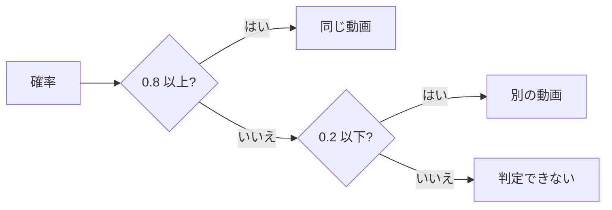
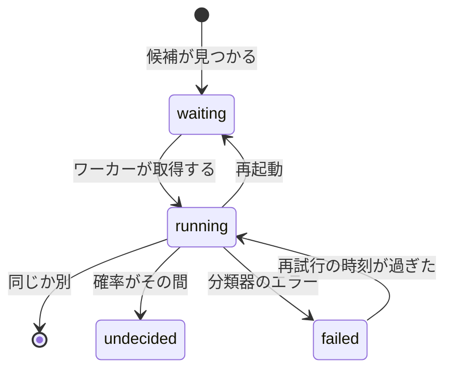
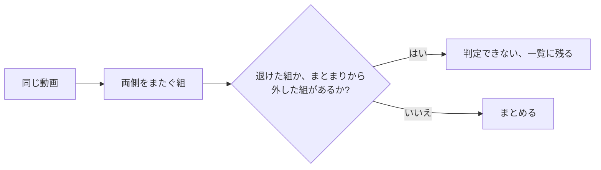

# 調査: 重複の候補を自動で判定する {#research-judging-possible-duplicates-automatically}

引き継ぐ決定: 指紋、候補、退けた組、まとまりは [030 の調査 R-6 から R-9](../030-video-versions/research.md) にある。分類器のポートと Ollama のプロバイダは [ai-layer.md](../../docs/design-docs/ai-layer.md) にある。キューとワーカーの形は [auto-tagging.md](../../docs/design-docs/auto-tagging.md) に従う。このファイルは、この機能が加える決定だけを記録する。

## R-1: 既存の分類器のポートを通した、はいかいいえの 1 つの質問 {#r-1-one-yesno-question-through-the-existing-classifier-port}

**決定**: 候補は、2 つのファイルが同じ映像を映しているかという 1 つの質問を `app.Classifier` にし、その確率を 2 つの固定のしきい値で読んで判定する。

| 案 | ポートの変更 | 今のプロバイダ | 判定 |
| --- | --- | --- | --- |
| **`app.Classifier` への 1 つの質問** | なし | Ollama の Clef | 採用 |
| 同じ、別、判定できないのどれかで答える生成のポート | 新しいポートとプロバイダ | マージされていない `feature/053-ai-tag-generation` にだけある | 不採用: この機能を、別の機能のマージされていないポートに縛る |
| AI なしで、より厳しい指紋の距離 | なし | なし | 不採用: 要件 1 は AI の判定を求め、距離では冒頭が共通なだけの動画と同じ動画を区別できない |

**理由**: Clef は与えられた質問に点を付け、組についての質問はまさにそれである。プロバイダには自動タグ付けと同じように届くので、Ollama の設定、接続のテスト、後のプロバイダが両方の機能に役立つ。

## R-2: 画像は横に並べた 4 組のフレームである {#r-2-the-images-are-four-side-by-side-frame-pairs}

**決定**: リクエストは 4 枚の画像を運ぶ。画像 `i` は動画 A のフレーム `i` を左に、動画 B のフレーム `i` を右に置き、どちらも各動画を 4 等分した各部分の中央にあたるシーク用プレビューから取る。リクエストに事実 (facts) はない。

下の試行では、20 秒の合成の動画を 3 つ使った: 640×360 の A、同じ映像を 320×180 で再エンコードした B (同じ)、A の最初の 4 秒だけを共有する C (別) で、質問は [R-3](#r-3-the-question-wording-and-two-fixed-thresholds) のものである。各セルは、2026-10-15 に Workers AI から得た P(yes) である。

| モデル | A と B (同じ) | A と C (冒頭だけ) |
| --- | --- | --- |
| `clef` | 0.97 | 0.02 |
| `clef-flash` | 0.29 | 0.09 |

| 案 | 判定 |
| --- | --- |
| **横に並べた 4 組** | 採用 |
| A の画像、続いて B の画像の、別々の 8 枚の画像 | 不採用: Workers AI の Clef は 4 枚の画像を受け取るので、開発用の中継がそれらを 1 枚の画像に敷き詰め、モデルはどのフレームがどちらのものかを見失う |
| ライブラリの 2 つのサムネイル | 不採用: それぞれ 1 つの場面なので、共通の冒頭が同じ動画と読まれる (受け入れ条件 2) |
| 元のファイルから ffmpeg で取るフレーム | 不採用: メディアフォルダのファイルを読むのはスキャンだけである ([ARCHITECTURE.md](../../ARCHITECTURE.md#cross-cutting-invariants))。シーク用プレビューは、指紋がそこから作られるので、どの候補にもすでにある |

**理由**: 候補は長さが一致するので、同じ相対位置は両方のファイルで同じ瞬間である。また、1 枚の画像の中の組は、8 枚を覚えることではなく 2 つの絵を比べることをモデルに求める。動画全体に散らばったフレームは、始まり方だけが同じ動画を捉える。`internal/artifacts` は、自動タグ付けのためにすでにシーク用のフレームを切り出しているように、組を切り出して合成するので、`internal/app` は画像を復号しない。

## R-3: 質問の文言と 2 つの固定のしきい値 {#r-3-the-question-wording-and-two-fixed-thresholds}

**決定**: 質問は "Each image puts two frames side by side, taken at the same moment from two video files. In every image, do the left half and the right half show the same picture (ignoring differences in sharpness, resolution or compression)?" である。0.8 以上の確率は「同じ動画」、0.2 以下は「別の動画」、その間はすべて「判定できない」である。質問への答えのない応答は失敗であり、[R-5](#r-5-a-failed-judgement-retries-on-a-backoff-that-never-ends) のとおりに再試行し、決して確率 0 とはしない。

| 案 | 判定 |
| --- | --- |
| **0.8 と 0.2、固定** | 採用 |
| 自動タグ付けのような、所有者が決めるしきい値 | 不採用: 要件 7 が求めるのはオンとオフだけであり、誤った「同じ」は動画をライブラリから隠す |
| "Do A and B contain the same footage throughout?" | 不採用: 同じ試行で `clef` では 0.93 と 0.09 で、採用した文言より差が狭い |

**理由**: `clef-flash` は同じ映像を 0.29 としたので、それでは同じ動画の組は誤ってまとめられるのではなく判定できないままになり、一覧を離れるのは明らかに別の組だけである。試行は合成の映像である。しきい値が確定する前に、[クイックスタート](quickstart.md) がそれを実際のファイルで繰り返す。

## R-4: 判定は候補の行の列である {#r-4-the-judgement-is-columns-on-the-candidate-row}

**決定**: `video_version_candidates` は判定の状態、試行の回数、再試行の時刻、メッセージ、確率を得て、状態が null の候補は待っている ([data-model.md](data-model.md#video_version_candidates))。ある鍵の候補を作り直すとその判定は戻るので、もう一度問われる。

| 案 | 判定 |
| --- | --- |
| **候補の行の列** | 採用 |
| 候補からカスケードする別の判定のテーブル | 不採用: 作り直しは候補の行を削除するので、カスケードは同じように判定を失い、そのうえ 2 つ目のテーブルと外部キーが要る |
| `auto_tag_queue` のように、候補を挿入したときに書くキューの行 | 不採用: 機能をオンにしても、オフの間に見つかった候補は判定されないまま残る |

**理由**: 判定はその候補とともに生き、ともに消える。また、キューを候補から導くので、機能をオンにすると待っているすべての候補を判定する。ある鍵の候補は、その指紋がもう一度書かれたとき (新しいスプライトか新しい `FingerprintVersion`) と、その鍵がまとまりから外されたとき ([R-8](#r-8-removing-a-version-records-the-pairs-and-rebuilds-its-candidates)) に作り直される。そのときにそれらの組をもう一度判定する方が、変わった指紋を越えて古い答えを持ち越すより安い。判定はインデックスのデータである: モデルにもう一度問えば作り直せる。

## R-5: 失敗した判定は終わりのないバックオフで再試行する {#r-5-a-failed-judgement-retries-on-a-backoff-that-never-ends}

**決定**: 失敗した判定は、1 回目、2 回目、3 回目の失敗の 10 分、1 時間、6 時間後に再び取得できるようになり、その後は 24 時間ごとになる。失敗の回数は取得と再起動を越えて残る。

| 案 | 判定 |
| --- | --- |
| **バックオフ、その後は毎日** | 採用 |
| 3 回再試行し、その後は所有者を待つ (053 の規則) | 不採用: この機能には所有者のための「もう一度判定する」操作がないので、組は二度と判定されなくなる |
| 次のスキャンが終わったときに再試行する | 不採用: 再スキャンされないライブラリは決して再試行しない |

**理由**: エッジケースは、所有者が何もせずに後で再試行することを求める。候補はその間ずっと一覧に残るので、遅い再試行の代償は所有者が待つ時間だけである。また、Ollama が止まっていると、各候補が送るリクエストは 1 日に多くて 1 回である。

## R-6: 「同じ」の組は、両側をまたぐ組が異なると分かっていない限り、2 つの側をつなぐ {#r-6-a-same-pair-joins-two-sides-unless-a-pair-across-them-is-known-to-differ}

**決定**: ストアは「同じ」の組を、それぞれの側にまとまりがあればそのまとまりとともにまとめる。ただし、一方の側の動画ともう一方の側の動画が退けた組かまとまりから外した組であれば、まとめない。そのとき判定は判定できないになり、候補は残る。一方の側の中の組と、両側をまたぐ組のうち未判定か判定できない組は、妨げない。

| 案 | 判定 |
| --- | --- |
| **両側をまたぐ組を確認する** | 採用 |
| できあがるまとまりのすべての組を確認する | 不採用: {A, B} から B を外し、手作業でもう一度まとめた所有者は (A, B) を記録したまま残し、A の新しいコピーはどれもずっと判定できないままになる |
| 判定した組だけを確認する | 不採用: A–B と B–C が「同じ」で A–C が退けられていると A と C をまとめてしまい、食い違う判定のエッジケースを破る |
| 両側をまたぐ未判定か判定できない組でも妨げる | 不採用: B を通した 2 つの「同じ」の答えがすでに A と C が同じ動画だと言っており、A–C を待つと 3 本からなるグループの大半がまとめられないまま残る |

**理由**: まとまりと矛盾するのは記録された「別」だけである。所有者自身のまとまりはそのまま受け取る。ドメインは 2 つのメンバーの集合と記録された組から決め、ストアはそれらを自分のトランザクションの中で読み直す ([ARCHITECTURE.md](../../ARCHITECTURE.md#cross-cutting-invariants))。そのため、モデルが答えている間に所有者が保存した退けた組が、それでも優先される。

## R-7: 代表はまとまりのもの、なければ大きい方の映像 {#r-7-the-representative-is-the-bundles-else-the-larger-picture}

**決定**: 一方がまとまりにあるときは、そのまとまりの実効の代表が残る。両方がまとまりにあるときは、画素の多い代表が勝つ。どちらもないときは、画素 (幅 × 高さ) の多い動画が代表になり、次にファイルの大きい方、次に動画 id の小さい方になる。

| 案 | 判定 |
| --- | --- |
| **まとまりの代表を保ち、なければ画素の多い方** | 採用 |
| 先に加わった動画 | 不採用: どのファイルが再生に向くかを何も示さない |
| まとまりの代表があっても、常に解像度の高い方 | 不採用: その代表は所有者が選んだかもしれず、新しいファイルが頼まれずにそれを置き換えてしまう |

**理由**: 手作業では、所有者はまとめるダイアログで代表を選び、そのダイアログに既定値はない。規則は、再エンコードしたものをまとめる所有者が選ぶものを選び、すでにされた選択を保つ。タグ、位置、公開の状態はその後、変わらない `VersionStore.Bundle` に従う (要件 2)。

## R-8: バージョンを外すと組を記録し、その候補を作り直す {#r-8-removing-a-version-records-the-pairs-and-rebuilds-its-candidates}

**決定**: "Remove from versions" は、外した動画をほかの各メンバーと組にして `video_version_unbundles` (ユーザーデータ) に書き、同じトランザクションで外した動画の候補を作り直す。まとまりから外した組は決して判定されないので、候補である組は所有者のために一覧に残る。

| 案 | 判定 |
| --- | --- |
| **まとまりから外した組のユーザーデータのテーブル、候補は作り直す** | 採用 |
| 退けた組 (「別の動画」) として記録する | 不採用: 組は一覧を離れるが、バージョンを外すことはまとめる前の状態に戻ることであり、その状態では組は候補だった |
| まとまりから外した組を候補から除く | 不採用: そうすると所有者は一覧からそれらを決してまとめられない |

**理由**: 要件 6 が禁じるのは、組を自動でまとめることだけである。すぐに作り直すと、指紋を待たずに組がまた一覧に出る。指紋は今は、自分から再び来ることはない。所有者が手作業でまとめ、指紋で一度も一致しなかった組は、候補にならない。作り直しは、外した動画のほかの判定も戻す (R-4)。記録は、退けた組と同じように、同じパスの内容の変化に付いていく (030 R-5)。

## R-9: 一覧の項目は既存の `versions` の要約を持ち、ページごとに読む {#r-9-list-items-carry-the-existing-versions-summary-read-per-page}

**決定**: `Video` を返す画面の API のすべての応答は、一覧の項目も含め、まとまりのメンバーについて `versions` (`VideoVersionsRef`) を入れ、一覧はページ全体の分を 1 つのクエリで読む。カードはそこから印を示す。

| 案 | 判定 |
| --- | --- |
| **すべての `Video` に `versions`、ページごとに 1 つのクエリ** | 採用 |
| 詳細と同じように、項目ごとに `bundleVersionsRef` | 不採用: 項目ごとに 1 つのクエリで、どの一覧でもページの大きさの数まで増える |
| 一覧の項目の新しい真偽値 `hasVersions` | 不採用: `versions.count` がすでに示すことのための 2 つ目のフィールド |
| ライブラリと検索のエンドポイントでだけ入れる | 不採用: グループとフォルダは別々のクエリで読むので、1 つの一覧を漏らすと印が出ない |

**理由**: 外部 API は自分のスキーマを保ち、まとまりを示さない (030 R-10) ので、変わらない。これは [030 ui-design.md](../030-video-versions/ui-design.md) の「まとめたことはカードに印を付けない」を置き換える。印は `design` 段階が決める。

## R-10: Duplicates のページは候補の通知で取得し直す {#r-10-the-duplicates-page-refreshes-on-a-candidates-notification}

**決定**: 新しいドメインイベント `VersionCandidatesChanged` は、判定の結果かバージョンからの取り外しがコミットした後に発行され、新しい画面の通知 `candidates` になる。Duplicates のページはそれで取得し直す。

| 案 | 判定 |
| --- | --- |
| **`candidates` の通知** | 採用 |
| すべての `scan` の通知で取得し直す | 不採用: `scan` は取り込みの間、終わったジョブごとに 1 回来るので、ページはそのたびに取得し直すことになる |
| `video` の通知で取得し直す | 不採用: 退けることはどの動画も変えないので、その組は画面に残る |

**理由**: 判定は取り込みが終わった後に動き、そのときページの今の規則 (スキャンが終わったら取得し直す) はもう働かないので、開いているページはすでに決まった組を示し続けてしまう。ワーカーもこのイベントで起きるので、取り外しでまた一覧に出た候補は、次のジョブを待たずに判定される。

## R-11: 既定のモデルはそのままにし、まとめるモデルを Settings が示す {#r-11-the-default-model-is-left-as-it-is-and-settings-names-the-one-that-bundles}

**決定**: モデルは既定で `clef-flash` のままである。この機能の Settings のセクションは、まとめるには `clef` のモデルが要ること、より小さいモデルでは大半の組が所有者のために残ることを示す。

| 案 | 判定 |
| --- | --- |
| **既定を保ち、Settings で示す** | 採用 |
| 既定のモデルを `clef` に変える | 不採用: 27B であり、設定を共有する自動タグ付けがどのマシンでも遅くなる |
| 判定のための別のモデルの設定 | 不採用: モデルはプロバイダが持ち ([ai-layer.md](../../docs/design-docs/ai-layer.md#adding-a-provider))、機能ごとのモデルは機能の中にあるプロバイダの設定になる |

**理由**: `clef-flash` でも、機能は明らかに別の組を取り除き (試行で 0.09)、誤ってまとめることは決してない。まとめを望む所有者は、機能をオンにする場所で対処法を知る。
