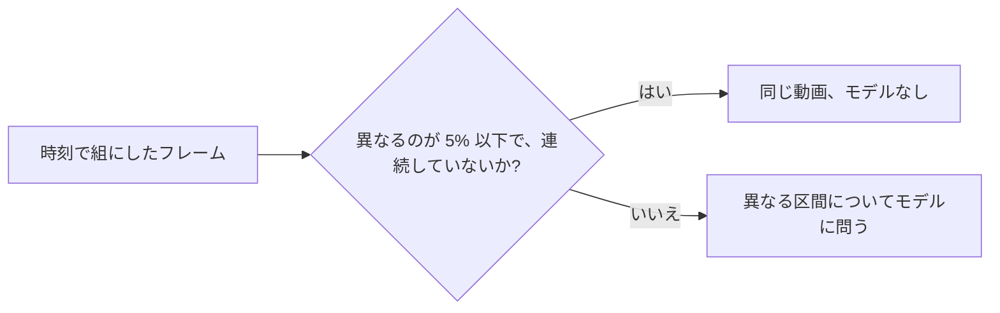
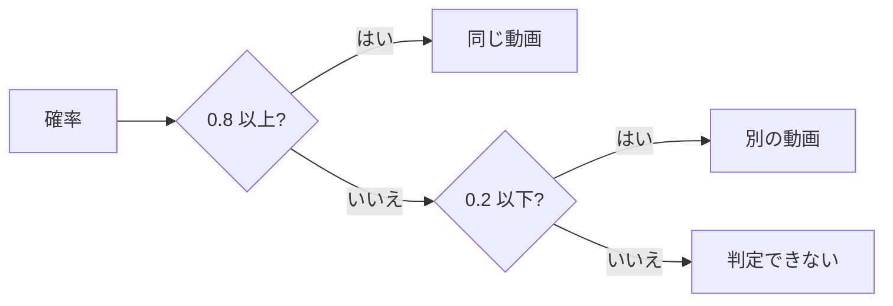
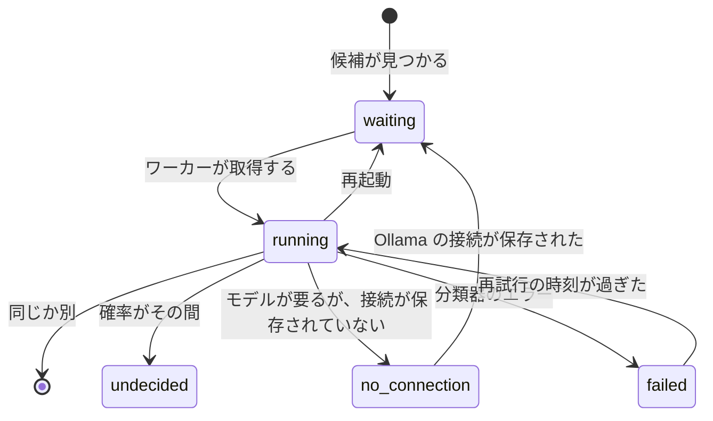
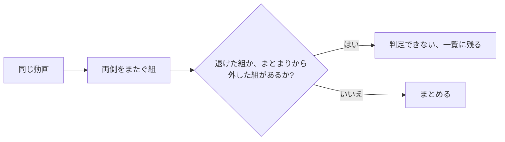

# 調査: 重複の候補を自動で判定する {#research-judging-possible-duplicates-automatically}

引き継ぐ決定: 指紋、候補、退けた組、まとまりは [030 の調査 R-6 から R-9](../030-video-versions/research.md) にある。分類器のポートと Ollama のプロバイダは [ai-layer.md](../../docs/design-docs/ai-layer.md) にある。キューとワーカーの形は [auto-tagging.md](../../docs/design-docs/auto-tagging.md) に従う。このファイルは、この機能が加える決定だけを記録する。

## R-1: まず指紋で決め、ある区間が異なるときだけモデルに問う {#r-1-the-fingerprints-decide-first-the-model-is-asked-only-when-a-section-differs}

**決定**: 各候補は、まず保存済みの 2 つの指紋のフレームごとの距離から判定する。動画の最初から最後までフレームが一致するときは、モデルを使わずに組を「同じ動画」とする。フレームが続けて異なる区間があるときは、その区間についてモデルに問う。

フレームの組は、そのハミング距離が `FingerprintMatchMaxDistance` (12)、つまり候補がすでに使っている境目を超えるときに「異なる」。フレームは時刻で組にし、平坦なフレームは `CompareFingerprints` と同じように飛ばす。

今は、候補になるには距離の中央値が 12 以下であればよいので、途中を差し替えた動画でも通る。A (640×360) に対する 3 つの 20 秒の合成の動画の、1 秒に 1 フレームの値:

| 組 | フレームごとの距離 | 中央値 | 規則 |
| --- | --- | --- | --- |
| B、A を 320×180 で再エンコードしたもの | 20 枚すべてで 0 から 4 | 0 | 同じ動画 |
| D、A の 8 秒から 11 秒を差し替えたもの | 0 が 8 枚、次に 32 から 34 が 4 枚、次に 0 が 8 枚 | 0 | 8 秒から 11 秒について問う |
| C、A の最初の 4 秒だけを共有するもの | 0 が 4 枚、次に 20 から 40 が 16 枚 | 30 | 候補ではない |

| 案 | 判定 |
| --- | --- |
| **まず指紋の規則、異なる区間にはモデル** | 採用 |
| すべての候補についてモデルに問う | 不採用: 指紋がすでに B は A だと示している。問えば組ごとに 1 回のリクエストがかかり、既定のモデルの `clef-flash` はその組を 0.29 とし、「同じ」に届かなかった |
| すべての候補を指紋だけで決める | 不採用: 続けて異なるフレームの区間は、別の動画のこともあれば、場面を変えた同じ動画のこともあり、どちらかは映像でしか分からない (要件 1 は AI の判定を求める) |
| 今と同じく中央値を使う | 不採用: D の中央値は 0 で、B と同じである |

**理由**: 030 がまとめる場合である再エンコードや解像度の違いでは、どのフレームも境目の内側に収まるので、規則はリクエストなしで、どのモデルでもそれを決められる。異なるフレームが 1 枚だけなら許すのは、フレームは間隔の半分以内で組にされるので、場面の切り替わりをまたぐ組は、同じ動画の 2 つのファイルで 2 つの場面を映すことがあるからである。規則は機能がオンの間だけ動き、AI への接続を必要としない。

## R-2: モデルは 2 つのファイルが異なるところのフレームを見る {#r-2-the-model-sees-the-frames-where-the-two-files-differ}

**決定**: リクエストは最大 4 枚の画像を運ぶ。各画像は、A のフレームの横に、組になる B のフレームを置いたもので、2 つのシーク用プレビューから、続けて異なるフレームの区間のうち最も長いものから取る (区間が 4 枚より長いときは、区間全体に散らして取る)。事実 (facts) は運ばない。

試行では、2026-10-15 に Workers AI を通して、[R-3](#r-3-the-question-wording-and-two-fixed-thresholds) の質問を 2 つの Clef のモデルに問うた:

| 組と画像 | `clef` | `clef-flash` |
| --- | --- | --- |
| A と D、8 秒から 11 秒の 4 フレーム | 0.06 | 0.08 |
| A と B、動画全体に散らした 4 フレーム | 0.97 | 0.29 |
| A と C、動画全体に散らした 4 フレーム | 0.02 | 0.09 |

| 案 | 判定 |
| --- | --- |
| **異なる区間のフレーム、A の横に B** | 採用 |
| 動画全体に散らした 4 フレーム | 不採用: D では大半が一致する部分を映し、指紋がすでに知っていることをモデルに問うことになる |
| A の画像、続いて B の画像の、別々の 8 枚の画像 | 不採用: Workers AI の Clef は 4 枚の画像を受け取るので、開発用の中継がそれらを 1 枚に敷き詰め、モデルはどのフレームがどちらのものかを見失う |
| 元のファイルから ffmpeg で取るフレーム | 不採用: メディアフォルダのファイルを読むのはスキャンだけである ([ARCHITECTURE.md](../../ARCHITECTURE.md#cross-cutting-invariants))。シーク用プレビューは、指紋を作った元である |

**理由**: 問題になるのは異なる区間だけであり、それを示すと両方のモデルがはっきり答えた。`internal/artifacts` は、自動タグ付けのためにすでにシーク用のフレームを切り出しているように、組を切り出して合成するので、`internal/app` は画像を復号しない。

## R-3: 質問の文言と 2 つの固定のしきい値 {#r-3-the-question-wording-and-two-fixed-thresholds}

**決定**: 質問は "Each image puts two frames side by side, taken at the same moment from two video files. In every image, do the left half and the right half show the same picture (ignoring differences in sharpness, resolution or compression)?" である。0.8 以上の確率は「同じ動画」、0.2 以下は「別の動画」、その間はすべて「判定できない」である。質問への答えのない応答は失敗であり、[R-5](#r-5-a-failed-judgement-retries-on-a-backoff-that-never-ends) のとおりに再試行し、決して確率 0 とはしない。

| 案 | 判定 |
| --- | --- |
| **0.8 と 0.2、固定** | 採用 |
| 自動タグ付けのような、所有者が決めるしきい値 | 不採用: 要件 7 が求めるのはオンとオフだけであり、誤った「同じ」は動画をライブラリから隠す |
| "Do A and B contain the same footage throughout?" | 不採用: A と B に散らしたフレームで、`clef` では 0.93 と 0.09 で、採用した文言より差が狭い |

**理由**: モデルが答えるのは指紋で決められなかった組だけであり、誤った「同じ」が代償の大きい誤りなので、「同じ」の幅は狭くする。試行は合成の映像である。しきい値が確定する前に、[クイックスタート](quickstart.md) がそれを実際のファイルで繰り返す。

## R-4: 判定は候補の行の列である {#r-4-the-judgement-is-columns-on-the-candidate-row}

**決定**: `video_version_candidates` は判定の状態、試行の回数、再試行の時刻、メッセージ、確率を得て、状態が null の候補は待っている ([data-model.md](data-model.md#video_version_candidates))。ある鍵の候補を作り直すとその判定は戻るので、もう一度問われる。

| 案 | 判定 |
| --- | --- |
| **候補の行の列** | 採用 |
| 候補からカスケードする別の判定のテーブル | 不採用: 作り直しは候補の行を削除するので、カスケードは同じように判定を失い、そのうえ 2 つ目のテーブルと外部キーが要る |
| `auto_tag_queue` のように、候補を挿入したときに書くキューの行 | 不採用: 機能をオンにしても、オフの間に見つかった候補は判定されないまま残る |

**理由**: 判定はその候補とともに生き、ともに消える。また、キューを候補から導くので、機能をオンにすると待っているすべての候補を判定する。ある鍵の候補は、その指紋がもう一度書かれたとき (新しいスプライトか新しい `FingerprintVersion`) と、その鍵がまとまりから外されたとき ([R-8](#r-8-removing-a-version-records-the-pairs-and-rebuilds-its-candidates)) に作り直される。そのときにそれらの組をもう一度判定する方が、変わった指紋を越えて古い答えを持ち越すより安い。判定はインデックスのデータである: モデルにもう一度問えば作り直せる。

## R-5: 失敗した判定は終わりのないバックオフで再試行する {#r-5-a-failed-judgement-retries-on-a-backoff-that-never-ends}

**決定**: 失敗した判定は、1 回目、2 回目、3 回目の失敗の 10 分、1 時間、6 時間後に再び取得できるようになり、その後は 24 時間ごとになる。失敗の回数は取得と再起動を越えて残る。

| 案 | 判定 |
| --- | --- |
| **バックオフ、その後は毎日** | 採用 |
| 3 回再試行し、その後は所有者を待つ (053 の規則) | 不採用: この機能には所有者のための「もう一度判定する」操作がないので、組は二度と判定されなくなる |
| 次のスキャンが終わったときに再試行する | 不採用: 再スキャンされないライブラリは決して再試行しない |

**理由**: エッジケースは、所有者が何もせずに後で再試行することを求める。候補はその間ずっと一覧に残るので、遅い再試行の代償は所有者が待つ時間だけである。また、保存した Ollama が止まっていると、各候補が送るリクエストは 1 日に多くて 1 回である。所有者が保存していない接続に対して組を再試行することは決してない ([R-13](#r-13-the-model-is-asked-only-once-the-owner-has-saved-a-connection))。

## R-6: 「同じ」の組は、両側をまたぐ組が異なると分かっていない限り、2 つの側をつなぐ {#r-6-a-same-pair-joins-two-sides-unless-a-pair-across-them-is-known-to-differ}

**決定**: ストアは「同じ」の組を、それぞれの側にまとまりがあればそのまとまりとともにまとめる。ただし、一方の側の動画ともう一方の側の動画が退けた組かまとまりから外した組であれば、まとめない。そのとき判定は判定できないになり、候補は残る。一方の側の中の組と、両側をまたぐ組のうち未判定か判定できない組は、妨げない。

| 案 | 判定 |
| --- | --- |
| **両側をまたぐ組を確認する** | 採用 |
| できあがるまとまりのすべての組を確認する | 不採用: {A, B} から B を外し、手作業でもう一度まとめた所有者は (A, B) を記録したまま残し、A の新しいコピーはどれもずっと判定できないままになる |
| 判定した組だけを確認する | 不採用: A–B と B–C が「同じ」で A–C が退けられていると A と C をまとめてしまい、食い違う判定のエッジケースを破る |
| 両側をまたぐ未判定か判定できない組でも妨げる | 不採用: B を通した 2 つの「同じ」の答えがすでに A と C が同じ動画だと言っており、A–C を待つと 3 本からなるグループの大半がまとめられないまま残る |

**理由**: まとまりと矛盾するのは記録された「別」だけである。所有者自身のまとまりはそのまま受け取る。ドメインは 2 つのメンバーの集合と記録された組から決め、ストアはそれらを自分のトランザクションの中で読み直す ([ARCHITECTURE.md](../../ARCHITECTURE.md#cross-cutting-invariants))。そのため、モデルが答えている間に所有者が保存した退けた組が、それでも優先される。

## R-7: 代表は所有者のデータを保ち、次に最もよく再生できるものにする {#r-7-the-representative-keeps-the-owners-data-then-plays-best}

**決定**: 一方がまとまりにあるときは、そのまとまりの実効の代表が残る (両方がまとまりにあるときは、2 つの代表を下のとおりに比べる)。それ以外のときは、2 つを区別できる最初の規則が代表を選ぶ:

| 順 | 選ぶ動画 | 理由 |
| --- | --- | --- |
| 1 | 所有者のデータ (タグ、再生位置、公開の状態、表示名、適用したサムネイル画像、作品情報) を一方だけが持つ | `VersionStore.Bundle` は代表の値を保ち、ほかの値を脇に置くので、ほかの選び方では所有者が設定したものが隠れる |
| 2 | ブラウザーでそのまま再生できる (`playable`) | もう一方はライブ変換が要る |
| 3 | 音声のストリームを持つ | 音のないコピーは再生に向かない方である |
| 4 | 画素 (幅 × 高さ) が多い | よりよい映像 |
| 5 | ビットレート (サイズ ÷ 長さ) が高い | 同じ解像度で圧縮が少ない |
| 6 | 動画 id が小さい | 安定した同順位の決め方 |

| 案 | 判定 |
| --- | --- |
| **所有者のデータ、次に再生できること、音声、画素、ビットレート** | 採用 |
| 画素の多さを最初にする | 不採用: タグを付けた 720p の動画の新しい 1080p のコピーが代表になり、所有者のタグが脇に置かれる |
| 先に加わった動画 | 不採用: どのファイルが再生に向くかを何も示さない |
| まとまりの代表があっても、常に選び直す | 不採用: その代表は所有者が選んだかもしれない |

**理由**: 手作業では、所有者はまとめるダイアログで代表を選び、そのダイアログに既定値はない。この順は所有者が選ぶものを選び、どの入力もすでに `videos` の行かユーザーデータのテーブルにある。タグ、位置、公開の状態はその後、変わらない `VersionStore.Bundle` に従う (要件 2)。

## R-8: バージョンを外すと組を記録し、その候補を作り直す {#r-8-removing-a-version-records-the-pairs-and-rebuilds-its-candidates}

**決定**: "Remove from versions" は、外した動画をほかの各メンバーと組にして `video_version_unbundles` (ユーザーデータ) に書き、同じトランザクションで外した動画の候補を作り直す。まとまりから外した組は決して判定されないので、候補である組は所有者のために一覧に残る。

| 案 | 判定 |
| --- | --- |
| **まとまりから外した組のユーザーデータのテーブル、候補は作り直す** | 採用 |
| 退けた組 (「別の動画」) として記録する | 不採用: 組は一覧を離れるが、バージョンを外すことはまとめる前の状態に戻ることであり、その状態では組は候補だった |
| まとまりから外した組を候補から除く | 不採用: そうすると所有者は一覧からそれらを決してまとめられない |

**理由**: 要件 6 が禁じるのは、組を自動でまとめることだけである。すぐに作り直すと、指紋を待たずに組がまた一覧に出る。指紋は今は、自分から再び来ることはない。所有者が手作業でまとめ、指紋で一度も一致しなかった組は、候補にならない。作り直しは、外した動画のほかの判定も戻す (R-4)。記録は、退けた組と同じように、同じパスの内容の変化に付いていく (030 R-5)。

## R-9: 一覧の項目は既存の `versions` の要約を持ち、ページごとに読む {#r-9-list-items-carry-the-existing-versions-summary-read-per-page}

**決定**: `Video` を返す画面の API のすべての応答は、一覧の項目も含め、まとまりのメンバーについて `versions` (`VideoVersionsRef`) を入れ、一覧はページ全体の分を 1 つのクエリで読む。カードはそこから印を示す。

| 案 | 判定 |
| --- | --- |
| **すべての `Video` に `versions`、ページごとに 1 つのクエリ** | 採用 |
| 詳細と同じように、項目ごとに `bundleVersionsRef` | 不採用: 項目ごとに 1 つのクエリで、どの一覧でもページの大きさの数まで増える |
| 一覧の項目の新しい真偽値 `hasVersions` | 不採用: `versions.count` がすでに示すことのための 2 つ目のフィールド |
| ライブラリと検索のエンドポイントでだけ入れる | 不採用: グループとフォルダは別々のクエリで読むので、1 つの一覧を漏らすと印が出ない |

**理由**: 外部 API は自分のスキーマを保ち、まとまりを示さない (030 R-10) ので、変わらない。これは [030 ui-design.md](../030-video-versions/ui-design.md) の「まとめたことはカードに印を付けない」を置き換える。印は `design` 段階が決める。

## R-10: Duplicates のページは候補の通知で取得し直す {#r-10-the-duplicates-page-refreshes-on-a-candidates-notification}

**決定**: 新しいドメインイベント `VersionCandidatesChanged` は、判定の結果かバージョンからの取り外しがコミットした後に発行され、新しい画面の通知 `candidates` になる。Duplicates のページはそれで取得し直す。

| 案 | 判定 |
| --- | --- |
| **`candidates` の通知** | 採用 |
| すべての `scan` の通知で取得し直す | 不採用: `scan` は取り込みの間、終わったジョブごとに 1 回来るので、ページはそのたびに取得し直すことになる |
| `video` の通知で取得し直す | 不採用: 退けることはどの動画も変えないので、その組は画面に残る |

**理由**: 判定は取り込みが終わった後に動き、そのときページの今の規則 (スキャンが終わったら取得し直す) はもう働かないので、開いているページはすでに決まった組を示し続けてしまう。ワーカーもこのイベントで起きるので、取り外しでまた一覧に出た候補は、次のジョブを待たずに判定される。

## R-11: リクエストはファイル名を運ばない {#r-11-the-request-carries-no-file-names}

**決定**: リクエストは事実 (facts) を持たない。ファイル名、フォルダ、長さはそこに入れない。

| 案 | A と B の `clef` | A と B の `clef-flash` | A と D の `clef` | 判定 |
| --- | --- | --- | --- | --- |
| **事実なし** | 0.97 | 0.29 | 0.06 | 採用 |
| 2 つのファイル名 (`movie.mp4` と `movie_360p.mp4`、`show_ep01.mp4` と `show_ep02.mp4`) | 0.91 | 0.52 | 0.04 | 不採用: どの組もしきい値の反対側へ動かさず、`IMG_0001` と `IMG_0002` のような名前は誤った方を指すことになる |

**理由**: 長さはどの候補でもすでに一致しており、フレームは指紋が使った。モデルが加える証拠は映像である。

## R-12: 作品コードが異なれば、モデルなしで組を退ける {#r-12-different-work-codes-dismiss-a-pair-without-the-model}

**決定**: 両方の動画が作品コードを持ち、そのコードが異なるとき (`code_key` が保存するように正規化して比べる)、または同じ取得元の外部 ID を持ち、その値が異なるとき、フレームを比べる前に組は「別の動画」になる。コードが一致しても何も決めない。決めるのはやはりフレームである。

表は、各動画について保存されている情報と、判定がそれで何をするかを示す。

| 情報 | 場所 | 使い方 |
| --- | --- | --- |
| フレームごとの指紋 | `video_fingerprints` | 最初の判定 ([R-1](#r-1-the-fingerprints-decide-first-the-model-is-asked-only-when-a-section-differs)) |
| シーク用プレビューのフレーム | 生成したファイル | モデルが見るもの ([R-2](#r-2-the-model-sees-the-frames-where-the-two-files-differ)) |
| 作品コードと外部 ID | `video_work_info`、`video_work_external_ids` | 値が異なれば退ける (この決定) |
| `playable`、音声のコーデック、幅、高さ、サイズ、長さ | `videos` | 代表 ([R-7](#r-7-the-representative-keeps-the-owners-data-then-plays-best)) |
| タグ、位置、公開の状態、表示名、サムネイル画像 | ユーザーデータのテーブル | 代表 (R-7) |
| 長さ | `videos` | どの候補でもすでに `DurationsMatch` の範囲で等しい (030) |
| ファイル名とフォルダ | `video_locations` | 使わない: 試行ではどの組も動かず、番号付きの名前は誤らせる ([R-11](#r-11-the-request-carries-no-file-names)) |
| コーデック、コンテナ、縦横比 | `videos` | 使わない: 再エンコードは定義上それらを変え、指紋は黒い帯を切り落とす |
| 日付 | `videos`、`video_locations` | 使わない: コピーは新しい日付を得る |
| 音声の内容 | 保存していない | 使わない: 同梱の ffmpeg には Chromaprint がなく (030 R-6)、ファイルを読んでよいのはスキャンだけである |

| 案 | 判定 |
| --- | --- |
| **異なるコードは退け、等しいコードは何も決めない** | 採用 |
| 等しいコードならまとめる | 不採用: 1 つの作品が完全版とカット版で出ることがあり、それはフレームで区別できる |
| 作品情報を無視する | 不採用: 所有者かプラグインが、各ファイルがどの作品かをすでに示している |

**理由**: 作品コードは製品を名指す。異なるコードを持つ 2 つのファイルは、指紋がよく一致しても 2 つの作品である。長い共通の場面を持つシリーズの 2 つの話がそうなりうる。規則は所有者か作品情報プラグインが書いた値を読むだけなので、リクエストはかからない。

## R-13: モデルに問うのは、所有者が接続を保存した後だけである {#r-13-the-model-is-asked-only-once-the-owner-has-saved-a-connection}

**決定**: ワーカーがリクエストを送るのは、Settings で Ollama の接続が保存されている (`ollama.endpoint` の行がある) ときだけである。接続がなければ、モデルが要る組は `no_connection` になり、Duplicates に残り、再試行されない。接続を保存すると、それらの組は待っている状態に戻り、ワーカーが起きる。作品コードとフレームの規則は、どちらの場合も動く。

| 案 | 判定 |
| --- | --- |
| **接続が保存された後にだけ問う** | 採用 |
| 既定のアドレス `http://127.0.0.1:11434` に問う | 不採用: 所有者が設定したことのないアドレスへのリクエストであり、Ollama のないマシンでは、そうした組はどれも失敗し、いつまでも再試行する |
| 接続のテストが通った後にだけ問う | 不採用: テストは保存されない別の操作であり、一度通った接続も後で止まることがあり、それは R-5 が扱う |
| 接続がなければ機能全体をオフにする | 不採用: 作品コードとフレームの規則が大半の組を決め、モデルを必要としない |
| 接続を待っている組の数を Settings に示す | 不採用: プロバイダを持たないすべての所有者に、任意のプロバイダを押し付けることになり、それらの組はすでに Duplicates にある |

**理由**: `OllamaSettings` は行がないと既定のアドレスに戻るので、ストアは行があるかどうかを報告する。行があることが、所有者がプロバイダを設定したことである。画面のどこも、接続がないことを指し示さない: AI は任意であり、待っている組は、Duplicates で所有者が決めるほかの組と同じに見える。
