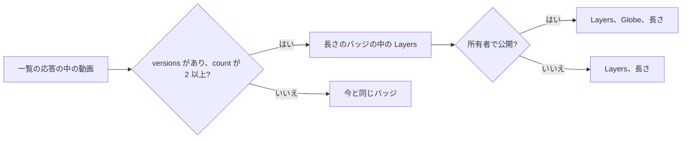
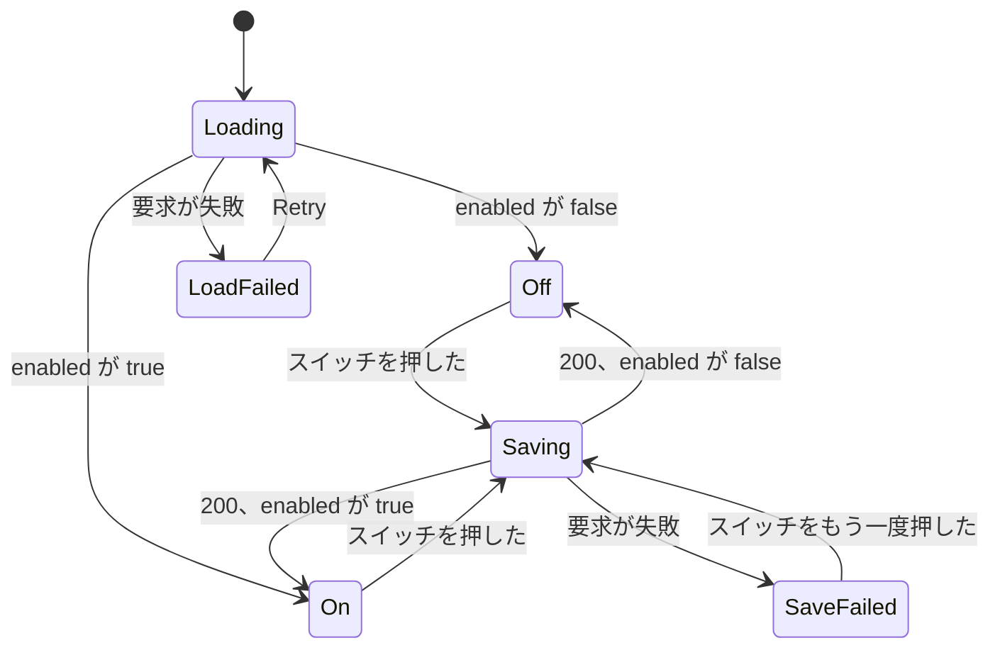

# UI 設計: カードのバージョンの印と重複判定のスイッチ {#ui-design-a-versions-mark-on-cards-and-the-duplicate-judging-switch}

**機能**: [親 Issue #1141](https://github.com/syudead/vv/issues/1141) · [plan.md](plan.md) · [research.md R-9](research.md#r-9-list-items-carry-the-existing-versions-summary-read-per-page) · [R-10](research.md#r-10-the-duplicates-page-refreshes-on-a-candidates-notification) · [R-13](research.md#r-13-the-model-is-asked-only-once-the-owner-has-saved-a-connection) · [contracts/screen-api.md](contracts/screen-api.md)

すでに決めている出典。ここでは繰り返さずにリンクする。

| 項目 | 出典 |
| --- | --- |
| トークン、閉じたスケール、ライブラリの密度 | [design-system.md、基礎](../../docs/design-docs/design-system.md#foundations)。[`web/src/ui/tokens.css`](../../web/src/ui/tokens.css) の `@theme` の値。ここでは名前で示し、決してコピーしない |
| `VideoThumbnail` とその重ね表示、`Badge`、`Switch`、`Alert`、`Skeleton`: それぞれ何に使うか | [components.md](../../web/registry/rules/components.md) |
| `SettingsPage`、`PageSection`、`FormRow`: スイッチはすぐに効き、保存ボタンはない | [patterns.md、設定ページ](../../web/registry/rules/patterns.md#settings-page) と [節](../../web/registry/rules/patterns.md#sections) |
| 動画カード、リスト表示の行、プレイリストとグループの順序付きの行 | [library-ui.md、カード](../../docs/design-docs/library-ui.md#cards)、[リスト表示と選択](../../docs/design-docs/library-ui.md#list-view-and-selection)、[`VideoCard.tsx`](../../web/src/videoList/VideoCard.tsx)、[`ItemRowCells.tsx`](../../web/src/videoList/ItemRowCells.tsx) |
| 公開の印。長さのバッジに小さなアイコンを置いた前例 | [016 UI 設計、カード](../016-single-account-auth/ui-design.md#card) |
| 隅の印 (選択のチェック、お気に入りのハート、ピッカー) と、それらが空けている場所 | [library-ui.md、お気に入りの印](../../docs/design-docs/library-ui.md#favorite-mark)、[035 UI 設計、配置](../035-favorites/ui-design.md#placement) |
| 動画ページのバージョンの項目、まとめるダイアログ、重複のページとその更新 | [030 UI 設計](../030-video-versions/ui-design.md)、[`VersionsFact.tsx`](../../web/src/player/VersionsFact.tsx)、[`DuplicatesPage.tsx`](../../web/src/versions/DuplicatesPage.tsx) |
| 押すと保存するスイッチが 1 つだけの設定の節 | [042 UI 設計、Settings: Auto-import の節](../042-folder-watch-import/ui-design.md#settings-auto-import-section)、[`AutoImportSection.tsx`](../../web/src/settings/AutoImportSection.tsx) |
| この節が隣に並ぶ Ollama と Auto-tagging の節 | [`OllamaSection.tsx`](../../web/src/settings/OllamaSection.tsx)、[`AutoTaggingSection.tsx`](../../web/src/settings/AutoTaggingSection.tsx) |
| ゲストでの縮退 | [016 UI 設計、ゲストでの縮退](../016-single-account-auth/ui-design.md#guest-degradation) |
| 画面の文言 | [`web/src/i18n/en.ts`](../../web/src/i18n/en.ts) (`list.card`、`player.versions`、`settings`)。この機能は下の言葉を加える |

この機能は画面に 2 つのものを加える。まとまりの代表のすべての動画カードとリストの行に付く**バージョンの印** (要件 5) と、スイッチを 1 つ持つ Settings の **Duplicate judging** の節 (要件 7) である。重複のページは、いつ再取得するかだけが変わる (R-10)。そのレイアウト、言葉、操作は 030 のものである。動画ページ、まとめるダイアログ、選択バーは変わらない。判定そのものには画面がない。自動のまとまりは所有者が作ったまとまりとまったく同じに見え (`UI品質` の 2 点目)、モデルが退けたペアは重複のページから消えるだけである。

トークンは加えず、`web/src/theme/tokens.test.ts` のコントラストの組も何も増えない。印は長さのバッジ自身の `overlay` の上の `foreground` を使う。デザインシステムは 1 つの規則で変わる。[components.md、VideoThumbnail](../../web/registry/rules/components.md#videothumbnail) の `VideoThumbnailDuration` の文 ("a public mark may come first") は "a versions mark and a public mark may come first" になる。これでバッジは引き続き小さな事実を置く唯一の場所であり、画像にはほかの文字が載らない。030 の「まとめたことはカードに印を付けない」という規則は置き換わる (R-9)。印を加える実装単位が、その文と 030 のレビューの基準 2 をここを指すように書き換える。

## この形にする理由 {#why-this-shape}

印は長さのバッジの中、公開の印の前に置く `Layers` アイコンであり、それ以外は何もない。数も、言葉も、2 つ目のバッジもない。サムネイルの右下のバッジは、カードがすでにファイルについての小さな事実 (長さと、所有者には公開の地球儀) を置いている唯一の場所である。所有者の操作ではなくファイルに属する事実は、そこでは長さと同じ階層として読める (`UI品質` の 1 点目: タイトルとサムネイルより小さく静か)。上の隅は採用しなかった。上の始まりの隅は選択のチェックであり、上の終わりの隅はハートと 2 つのピッカーを持つので、そこに置いた印は 4 つ目の操作と読まれる。タイトルの下の帯やその横の `Badge` は、カードに 1 行を足すので採用しなかった。まとめたカードが隣より高くなり、グリッドの行がそろわなくなる。`UI品質` の点は、カードがすでに持つものの中に印を収めることを求めている。

数は意図して省く。`VideoThumbnail` の規則は、画像の上に長さと知らせ以外の文字を許さない。長さの横の数字は `card-0` の幅では長さの一部と読まれる。数は動画ページの "3 versions" の項目まで 1 回押すだけで見られ、そこでバージョンが一覧され、切り替えられる。1 つの項目の複製を重ねる類似の製品 (写真ライブラリのスタック) は、重なったアイコンでスタックに印を付け、メンバーはその項目自身のページで見せる。カードの印は「ここにはさらにある」とだけ伝える。

`Layers` は、製品がすでにバージョンを名指すすべての場所でのバージョンのアイコンである。動画ページの項目、選択バーとドロップメニューの "Bundle as versions"、サイドバーの Duplicates の入口である。グループやプレイリストと読み違える危険は小さい。グループには `Folder` の印が付き、プレイリストはカードに印を付けないからである (Q-5)。印には振る舞いがない。カードを押すと今と同じく動画が開き、動画ページの項目がバージョンの唯一の操作である。ツールチップは採用しなかった。公開の印にはツールチップがなく、リンクの中の操作できないアイコンに付けたツールチップはタッチでは開かない。

スイッチは "Auto-tagging" の直後に置く独立した `PageSection`、"Duplicate judging" である。2 つの機能は "Ollama" の下で設定する分類器の 2 つの使い道なので、3 つの節は 1 つのまとまり (接続、そしてそれを使うもの) として読める。"Auto-tagging" の中の `FormRow` は採用しなかった。その節はしきい値を持つのでボタンで保存するが、この設定はすぐに効くスイッチ 1 つであり ([patterns.md、設定ページ](../../web/registry/rules/patterns.md#settings-page))、2 つの機能は別々に入り切りする (要件 7 は専用のスイッチを求めている)。"Ollama" の節の行は、機能が保存された接続なしでも働くので採用しなかった。指紋の規則は引き続きまとめたり退けたりし、モデルが必要なペアだけが待つ (R-13)。そのためスイッチは接続の属性ではない。

節は待ち行列の数も最後の誤りも見せない。契約が持つのは `enabled` だけであり、モデルがまだ決着させていない候補はすでに重複のページにあり、そこが待っているものを見る場所である。ここに数を加えると、そのページの数の行を、意味の薄い数 (待っている、失敗した、決められないペアが混ざる) で重ねることになる。

## 文言 {#words}

| 場所 | 文言 | 注記 |
| --- | --- | --- |
| カードと行の印、スクリーンリーダーのみ | 3 versions | `player.versions.count`。動画ページの項目と同じ言葉。公開の印の "Public" と同じく、アイコンの後ろの `sr-only`。カードではリンクの説明にもなる ([アクセシビリティ](#accessibility)) |
| 設定の節の見出し | Duplicate judging | `PageSection` の `h2` |
| 節の説明 | Judges each pair the scan lists as a possible duplicate: the two files are compared frame by frame, and the classifier set under Ollama is asked only about the frames that differ. Same videos are bundled as versions, different videos leave Duplicates, and the rest wait there for you. | 1 段落。所有者がスイッチを信頼するのに必要な仕組み |
| スイッチの行のラベル | Judge possible duplicates automatically | `FormRow` のラベル |
| スイッチの行の説明 | Off: every possible duplicate waits on Duplicates for you. On: pairs that match throughout are bundled even without Ollama; pairs with a differing part wait until an Ollama connection is saved. | `FormRow` の説明。両方の状態で 1 つの文言 |
| 保存中の行 | Saving… | `settings.autoImport.saving` の形 |
| 保存の失敗 | Couldn't save the settings: {reason} | `destructive` の `Alert` |
| 読み込み中 | Loading the duplicate judging settings | `Skeleton` の `aria-label` |
| 読み込みの失敗 | Couldn't load the duplicate judging settings: {reason} | `ErrorState` のタイトル。`Retry` 付き |
| Ollama の節の説明 (変更) | Where VVMDM reaches Ollama and which model it uses. Auto-tagging and duplicate judging use it; the test works whether they are on or off. | "Auto-tagging uses it; the test works whether auto-tagging is on or off." を置き換える |

## バージョンの印 {#versions-mark}

図は、カードや行が印を持つかどうかを何が決めるかを示す。

印は動画ページの規則に従う。`Video.versions` があり `count` が 2 以上のとき、所有者にもゲストにも同じく描く。`count` はすでに閲覧者が見てよいバージョンだけを数えているからである ([contracts/screen-api.md、`Video` の差分](contracts/screen-api.md#video-delta))。ほかのバージョンのファイルがすべてなくなった代表は `count` が 1 で、印はない。そのとき動画ページにも項目がないのと同じである。

| 場所 | 印の位置 |
| --- | --- |
| 動画カード (ライブラリのグリッド、フォルダのページ、フォルダとライブラリの検索結果、グループのページのグリッド) | `VideoThumbnailDuration` の中の先頭。`Layers` (`size-3`、`shrink-0`、`aria-hidden`)、所有者に見えるときは公開の `Globe`、そして長さの順で、間はバッジ自身の `gap-1.5`。`sr-only` の "3 versions" はアイコンの後ろに続く |
| リスト表示の行 (`VideoRow`) | 長さのセルの中、公開の印の前。`gap-1.5` の同じ `inline-flex` の中。`sr-only` の文言はカードと同じ |
| 順序付きの行 (プレイリストのページ、リスト表示のグループのページ、`ItemRowCells`) | 行のサムネイルの `VideoThumbnailDuration` の中。カードと同じ |
| グループのカード、プレイリストのカード、フォルダのカード | 印はない。それらのバッジは合計であり、1 つの動画のものではない |
| 動画ページの関連動画の列、履歴の項目 | 変わらない。動画ページは見ている動画のバージョンの項目をすでに見せており、履歴の項目は視聴であってライブラリの項目ではない |

動画は長さが読まれる前にまとめられることがある (まとめるときはメタデータではなく内容の鍵を確かめる)。そのためカードと順序付きの行は、`VideoThumbnailDuration` に入れるもの、つまり印、公開の印、長さのどれかがあるときにそれを描く。まだ長さのないまとめられた動画は、アイコンだけのバッジを見せ、その大きさは今の地球儀だけのバッジと同じである。リスト表示の行の長さのセルは常に描かれ、同じように印を入れる。

バッジは大きさと形を保つ。`text-2xs`、`bg-overlay`、`rounded-sm`、同じ余白である。幅だけがアイコン 1 つと間 1 つ分広がる。アイコンはバッジの `foreground` で、長さと同じ色であり、`primary` でも `muted-foreground` でもない。ファイルの事実であって、操作でも無効なものでもないからである。ポインタがサムネイルの上をなぞる間、長さの文字は今と同じくなぞった時刻に変わり、印はその場にとどまる。まとめられていて、さらに視聴済み、公開、お気に入り、再生できない動画は、それらすべてを今と同じく見せる。印はバッジに加わるだけで、隅、進み具合の縁、知らせからは何も取らない。

カードには、自動のまとまりと所有者が作ったまとまりを見分けるものは何もなく、どのバージョンが代表かを伝えるものもない。030 が決めたとおり、カードは代表のものであり、そのタイトル、サムネイル、タグを持つ。

### 状態 {#states}

| 状態 | カードが見せるもの |
| --- | --- |
| まとまりのメンバーで、2 つ以上のバージョンが見える | 公開の印と長さの前にある印 |
| まとまりのメンバーで、見えるバージョンが 1 つ | 印はない。まとめられていない動画のカードと同じに見える |
| まとめられていない | 印はない |
| 所有者の一覧を開いている間にまとめられた (自動のまとまり、または所有者のもの) | 一覧は今と同じく `video` の通知で再取得する。もう一方のメンバーのカードは一覧から消え、代表のバッジはその場で印を得る。アニメーションはない |
| 所有者の一覧を開いている間にバージョンから外された | まとまりが動画 1 つになると、代表のバッジからその場で印が消え、外された動画のカードは一覧の次の取得で現れる |
| ゲストの一覧を開いている間にまとめられた、または外された | 一覧の次の取得 (再読み込み、または一覧をもう一度開くこと) まで何も変わらない。ゲストは `group` の通知だけを受け取る ([048 の契約、`/api/events`](../048-groups/contracts/screen-api.md#apievents)) ので、非公開の動画を明かしうる通知はない |

## Settings: Duplicate judging の節 {#settings-duplicate-judging-section}

"Auto-tagging" と "ComfyUI" の間の `PageSection`。見出しの行はタイトルと説明を持ち、操作は持たない。本体は 1 つの `FormRow` である。

| 行 | 内容 |
| --- | --- |
| スイッチの行 | ラベル "Judge possible duplicates automatically"、上の説明をその説明とし、唯一の操作として `Switch` を持つ `FormRow`。`enabled` が `true` のときにオン |
| 保存中の行 | 変更を送っている間だけ。回る `LoaderCircle` 付きの "Saving…"、`text-xs` `text-muted-foreground`。"Auto-import" の節と同じ |
| 保存の失敗 | `PUT` が失敗したあとだけ。スイッチの行の下に `destructive` の `Alert`。スイッチは保存されている値に戻る |

説明は両方の状態で同じ文言なので、スイッチを押しても行の高さは変わらず、下の "ComfyUI" の節は動かない。スイッチを押すとすぐに `PUT /api/settings/version-judging` を送る。保存ボタンはなく、成功してもトーストは出ない。"Auto-import" と同じく、スイッチの新しい位置が結果である。オンにすると判定のワーカーが起き、待っている候補をすべて判定する ([contracts/screen-api.md、`PUT`](contracts/screen-api.md#put-apisettingsversion-judging))。このページではその作業を何も見せない。所有者はそれを、判定したペアが一覧から消える重複のページと、まとめたカードが印を得るライブラリで見る。

節は Ollama の接続を読まず、見せない。行の説明が接続のないときに何が起きるかを伝え、上の "Ollama" の節が接続を保存し試す場所である。

### 状態 {#states-1}

図は、節の状態と、それらの間を何が動かすかを示す。

| 状態 | 節が見せるもの |
| --- | --- |
| 読み込み中 | ラベルを持つスイッチの行と、操作の位置にスイッチの大きさの `Skeleton`。節はちらつかない |
| 読み込みの失敗 | 本体に "Couldn't load the duplicate judging settings: {reason}" と `Retry` を持つ `ErrorState`。スイッチはない |
| オフ | スイッチはオフ |
| オン | スイッチはオン |
| 保存中 | スイッチは押して変えた状態を見せる。保存中の行。応答までスイッチは 2 回目の押下に反応しない |
| 保存の失敗 | スイッチは保存されている値に戻る。理由を持つ `destructive` の `Alert`。次に押すと再び送る |

## 重複のページ {#duplicates-page}

ページのレイアウト、言葉、操作、状態は 030 のものである。変わるのは再取得する時である。`/api/events` の `candidates` の通知が、`scan` の通知とともにきっかけになり、030 の "Refresh" の規則 (再取得の間も一覧は変わらずに見え、スクロール位置は保たれ、なくなったペアは消え、新しいペアは先頭に加わる) に従う。モデルが判定したペアはこうして一覧から消え、トーストもそれについての行もない。所有者は操作していないので確認するものはなく、数の行が減ることだけが合図である。残るペアは、モデルを待っているもの、決められないもの、失敗したもののどれでも、ほかのすべてのペアと同じに見える。応答は判定の状態を持たず、見出しの行は "Same length · similar frames" のままである。

## ゲストでの縮退 {#guest-degradation}

ゲストは、動画ページの項目と同じ `count` の規則のもとで、見えるカードと行に印を見る (要件 5 は印がカードにあるとし、030 はゲストにバージョンを見せる)。ゲストには Settings のページがないので、節にゲスト向けの形はいらない。

## レスポンシブの振る舞い {#responsive-behaviour}

ブレークポイントは Tailwind の既定値だけで、CSS で適用する ([library-ui.md、幅のブレークポイント](../../docs/design-docs/library-ui.md#width-breakpoints-in-css-and-the-sidebar-exception))。判断する幅は 360px、768px、1280px で、ライブラリのグリッドは最小のカードの大きさ (`card-0`) と最大 (`card-3`) で見る。

| 幅 | 印 | 設定の節 |
| --- | --- | --- |
| 1280px | どのカードの大きさでも、バッジは印、地球儀、長さを 1 行に収める。`card-0` でも進み具合の縁と隅の印から離れている | 上下の行と同じく、スイッチの行は左にラベルと説明、右にスイッチ |
| 768px | 同じ。リスト表示の行は長さの列に印を見せる | 同じ |
| 360px | グリッドは 1 列。バッジは変わらない。リスト表示の行は長さの列を保つので、品質、大きさ、日付の列が隠れても印は見えたままである | "Auto-import" と同じく `FormRow` は積み重なる。ラベル、説明、その下にスイッチ |

## レビューの基準 {#review-criteria}

実際の画面を見て判断する ([library-ui.md、機械ではなく人が確かめるレイアウト](../../docs/design-docs/library-ui.md#layout-verified-by-people-not-machines))。上の幅で、まとめられた代表、公開のまとめられた動画、見えるバージョンが 1 つの動画、普通の動画を持つライブラリを使い、Ollama の接続を保存する前とあとの Settings で見る。「存在する」だけでは基準を満たさない (Q-4)。

1. **視覚の階層 (カード)**: カードの行を見ると、目はサムネイル → タイトル → タグと進み、印は最後に、長さとともに見つかる。並べると、まとめられた動画のカードと普通の動画のカードは同じ高さ、同じタイトルの位置、同じタグの行を持つ。違いは長さのバッジの中のアイコン 1 つだけである (`UI品質` の 1 点目)。
2. **情報の密度**: まとめられたカードは数も、言葉も、2 つ目のバッジも、帯も見せない。バージョンそのものは動画ページの "3 versions" の項目でだけ見える。長さのバッジは引き続き 1 つのバッジとして読め、バッジの横のアイコンとは読めない。
3. **余白のリズム**: 印、地球儀、長さの間はバッジの 1 つの間であり、今の地球儀と長さの間と同じである。バッジの余白とサムネイルの角からの距離は、`card-0` でも `card-3` でも変わらない。
4. **文字と色**: アイコンは長さの高さ (`size-3`) と長さの色である。バッジの中のものはどれも `primary` でも太字でもなく、`text-2xs` より大きくもない。印は太さや色では公開の地球儀と見分けられず、形でだけ見分けられる。
5. **操作の優先度**: 印は押せず、ホバーでも何も変わらない。カードを押すと動画が開く。隅の操作 (チェック、ハート、ピッカー) は元の位置にあり、届きにくくなっていない。
6. **2 種類のまとまりに同じ印**: 所有者が選択バーからまとめた動画と、判定のワーカーがまとめた動画は同じ印を持ち、動画ページの "Remove from versions" は、どちらでも同じように代表のカードから印を消す (`UI品質` の 2 点目、要件 6)。
7. **すべての一覧**: ライブラリのグリッド、ライブラリのリスト表示、フォルダのページ、フォルダとライブラリの検索結果、両方の表示のグループのページ、プレイリストのページが、同じまとめられた動画に印を見せ、グループのカードとプレイリストのカードは何も見せない。
8. **ゲスト**: ログアウトした状態で、同じまとめられた動画のカードは印を見せる (地球儀はない)。ほかのバージョンが非公開の代表は印を見せない。
9. **設定 (階層)**: "Duplicate judging" は "Ollama" と "Auto-tagging" の兄弟として読める。同じ `text-lg` の見出し、同じ `text-sm` `text-muted-foreground` の説明、同じカードの本体を持つ。その中では行のラベルがもっとも強い要素で、スイッチが唯一の操作である。節はオフでもオンでも 1 行の高さである。
10. **設定 (決定)**: スイッチを押すと保存中の行が出て、そのあとスイッチは新しい位置に残り、トーストもページのほかの変化もない。保存に失敗するとスイッチが戻り、行の下に理由が出る。待っている候補があるときにオンにすると、重複のページを再読み込みしなくても、ペアがそのページから消える (受け入れ条件 1、2、4)。
11. **重複のページ**: ページを開いていてワーカーが判定する間、ペアはその場で一覧から消え、読んでいるペアは動かず、トーストは出ず、残るペアはほかのペアと同じに見える。
12. **要件を満たさない例** (`UI品質`): 印が上の隅やタイトルの横にある。数や言葉を持つ。`primary` の色であるか、長さより大きい。まとめられたカードが隣より高い。自動のまとまりが手動のものと違う印を持つ。Settings の節が保存ボタン、待ち行列の数、Ollama の状態を持つ。

## アクセシビリティ {#accessibility}

親 Issue はスクリーンリーダーやコントラストの設計を求めていないので、016 と 030 と同じく名前だけを決める。

- 印のアイコンは `aria-hidden` で、その後ろに `sr-only` の "3 versions" が続く。リスト表示の行と順序付きの行では、バッジまたは長さのセルがタイトルのリンクの外にあるので、順に "3 versions, Public, 12:34" と読まれる。
- カードではバッジがリンクの中にあり、リンクの `aria-label` (タイトル、または場所付きのタイトル) が子孫の文字を置き換える。そのため `sr-only` の span は id を持ち、リンクはそれを `aria-describedby` で指す。これでカードの名前はタイトルのままになり、説明は "3 versions" になる。印のないカードは `aria-describedby` を持たない。
- スイッチは `htmlFor` で `FormRow` のラベルを名前とする。保存中の行は `role="status"` である。保存に失敗したときの `Alert` はコンポーネント自身のロールである。
